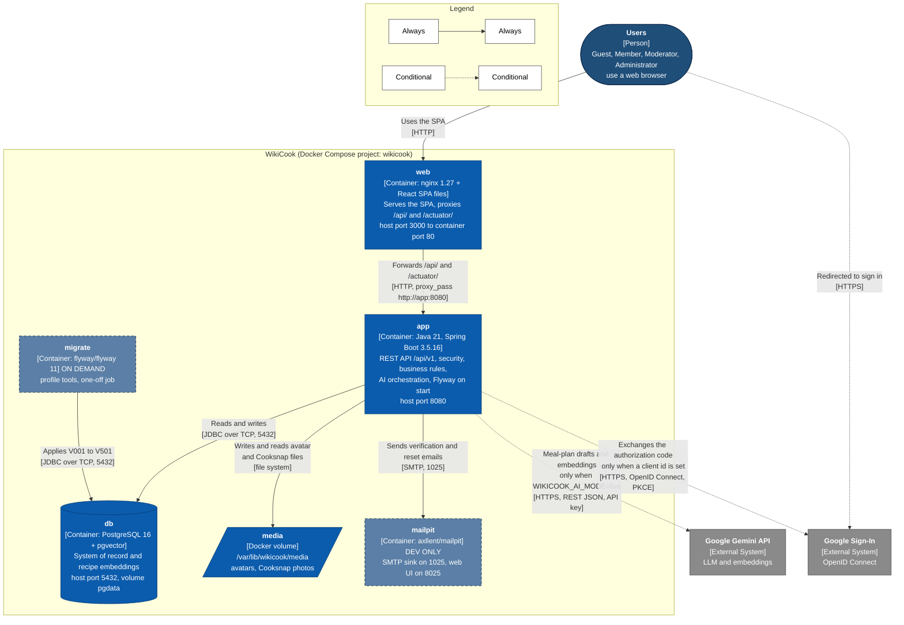
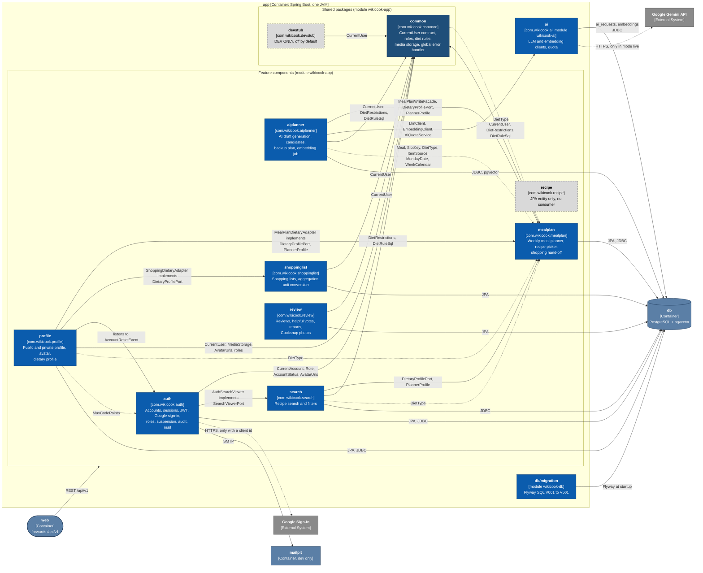
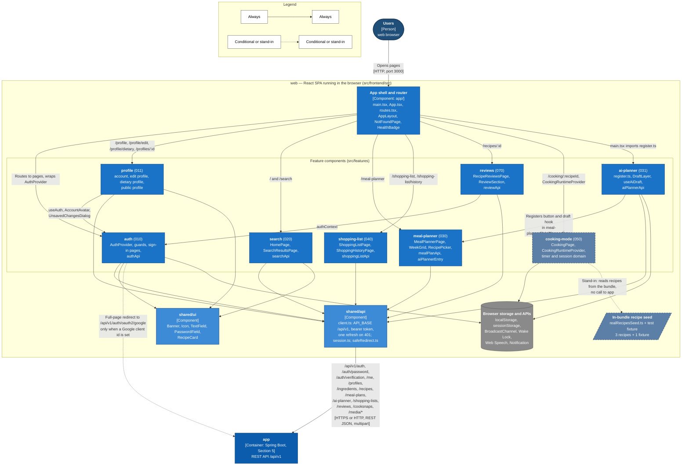
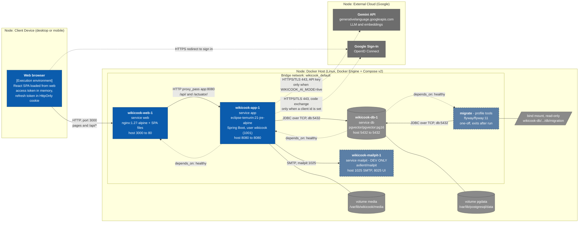

# SOFTWARE ARCHITECTURE DOCUMENT: WIKICOOK

## DOCUMENT METADATA & RESPONSIBILITY MATRIX

| Section | Title | Performed by (Author) | Reviewed by | Edited by | Task |
| :---: | :--- | :---: | :---: | :---: | :---: |
| **Section 1** | System Overview | **Mai Văn Hiển (MaiHien3507)** | **Nguyễn Thành Dự (ThanhDu14)** | **Lê Quốc Hưng (LqHung06)** | PA1 baseline; two wording fixes in Part B (`SCRUM-80`) |
| **Section 2** | C4 Level 1 — System Context (Part B) | **Mai Văn Hiển (MaiHien3507)** | **Nguyễn Đức Duy (DucDuyNguyen15-IT)** | **Mai Văn Hiển (MaiHien3507)** | `SCRUM-80` |
| **Section 3** | Technology Stack (Part B) | **Mai Văn Hiển (MaiHien3507)** | **Nguyễn Đức Duy (DucDuyNguyen15-IT)** | **Mai Văn Hiển (MaiHien3507)** | `SCRUM-80` |
| **Sections 4-5** | C4 Level 2 Container (Section 4) and Backend Level 3 Component (Section 5) (Part C) | **Mai Văn Hiển (MaiHien3507)** | **Nguyễn Thành Dự (ThanhDu14)** | **Mai Văn Hiển (MaiHien3507)** | `SCRUM-81` |
| **Section 6** | C4 Level 3 — Frontend Components and Code-to-Diagram Parity (Part C) | **Nguyễn Thành Dự (ThanhDu14)** | **Mai Văn Hiển (MaiHien3507)** | **Nguyễn Thành Dự (ThanhDu14)** | `SCRUM-82` |
| **Section 7** | Deployment Architecture (Part D) | **Nguyễn Thành Dự (ThanhDu14)** | **Lê Quốc Hưng (LqHung06)** | **Nguyễn Thành Dự (ThanhDu14)** | `SCRUM-83` |

---

## 1. System Overview
*Performed by: Mai Văn Hiển (MaiHien3507) | Reviewed by: Nguyễn Thành Dự (ThanhDu14) | Edited by: Lê Quốc Hưng (LqHung06)*

### 1.1. Architectural Style & Design Philosophy

WikiCook follows a modern, decoupled **Layered Client-Server Architecture** designed to balance development velocity, testability, and operational simplicity:

1. **Strict Layered Separation:**
   - Client tier: Single Page Application (SPA) delivering rich interactive experiences.
   - API tier: Stateless RESTful API layer managing requests and validation.
   - Business service tier: Encapsulates domain logic, recipe algorithms, and AI orchestration.
   - Persistence tier: Relational data mapping and semantic vector retrieval.
2. **Security & Boundary Isolation:**
   - Controllers never interact directly with database repositories; all flows pass through explicit domain services.
   - Data transfer between tiers uses immutable Data Transfer Objects (DTOs); JPA entities are never exposed across the network boundary.
   - External LLM API keys are strictly confined to the backend server environment.
3. **Spec-Driven & Test-First Compatibility:**
   - Architecture strictly adheres to the principles ratified in `constitution.md` (Java 21, Spring Boot 3.x, PostgreSQL 16).

---

## 2. C4 Level 1 — System Context
*Performed by: Mai Văn Hiển (MaiHien3507) | Reviewed by: Nguyễn Đức Duy (DucDuyNguyen15-IT) | Edited by: Mai Văn Hiển (MaiHien3507)*

### 2.1. Scope and Verification Basis

The System Context diagram shows WikiCook as a single box, the people who use it, and the external systems it depends on. Internal structure is deliberately left out; it belongs to the Container and Component levels (Part C, see Section 4).

Every statement in this section and in Section 3 was checked against the repository at `origin/main` commit `4538a7a` on 2026-11-16 (it includes the merge of PR #89, the authentication backend of `SCRUM-74`), using the Maven poms, `application.yml`, both `docker-compose.yml` files, the Dockerfiles, `package.json`, the Flyway migrations and the Java and TypeScript sources. Two status values are used:

- **Current** — present in code or configuration on `main` and used by the running system.
- **Planned** — described in an approved spec or plan but not on `main` yet. This includes features that are only partly built, for example Google sign-in, where the button and settings exist but the backend flow does not. A Planned item must not be read as delivered.

### 2.2. Diagram

Mermaid's native `C4Context` syntax can only recolour a relationship, not draw it dashed, so a colour-only difference would be lost in print and for colour-blind readers. The diagram therefore uses a `flowchart` that follows C4 conventions (person, software system, external system, labelled relationship with protocol). **Solid lines and borders mean Current; dashed lines and borders mean Planned.**


### 2.3. People (Actors)

The actors follow the Use-Case Model (`docs/requirements/use-case-model.md`, Section 2). The `users.role` column accepts `MEMBER`, `CONTRIBUTOR`, `MODERATOR` and `ADMINISTRATOR` (`V101__users_auth.sql`); Guest is an unauthenticated visitor and has no row.

| Actor | Role in the system | Interaction (direction, protocol) | Status |
| :--- | :--- | :--- | :---: |
| **Guest** | Visitor without an account. Searches and reads published recipes. | Browser → WikiCook over HTTPS; the SPA calls the REST API under `/api/v1` and sends no identity. | Current |
| **Member** | Signed-in home cook. Owns a meal planner, shopping lists and AI-generated plan drafts, and uses cooking mode. | Same as Guest, with an identity on each request. Registration, sign-in, sign-out and token refresh are served by the auth module under `/api/v1/auth` (a 15-minute JWT bearer token plus an HttpOnly refresh cookie). The development stub (`X-Dev-User-Id`, `com.wikicook.devstub`) is still in the code but disabled by default, and its beans back off when real authentication is present. The profile and dietary-profile backend (spec 011, `SCRUM-75`) is not on `main`, so consumers still read a stub profile. | Current (sign-in and features); profile backend Planned |
| **Contributor** | Member with a "Verified Contributor" badge who submits recipes. | Browser → WikiCook over HTTPS. The role exists in the role hierarchy (`SecurityConfig`: Administrator > Moderator > Contributor > Member), but the recipe editor (spec 060) is not on `main`, so the role has no extra capability yet. | Planned |
| **Moderator** | Suspends accounts today; will also review submitted recipes and process reports. | Browser → WikiCook over HTTPS. `POST /api/v1/admin/users/{id}/suspension` needs at least the Moderator role (`AccountActionPolicy`). The review queue and reports (spec 100) are not on `main`. | Current (account suspension); content moderation Planned |
| **Administrator** | Everything a Moderator can do, plus roles, bans, reinstatement and the audit trail. | Browser → WikiCook over HTTPS under `/api/v1/admin/users` and `/api/v1/admin/audit-logs` (read-only). The first Administrator is created at startup from `WIKICOOK_BOOTSTRAP_ADMIN_*` (`AdminBootstrapRunner`). Taxonomies, featured recipes and nutrition management (specs 090, 100) are not on `main`. | Current (account administration); the rest Planned |

### 2.4. External Systems

| External system | Role | Direction and protocol | Status |
| :--- | :--- | :--- | :---: |
| **Google Gemini API** (`generativelanguage.googleapis.com/v1beta`) | One provider for both AI needs. The LLM (`gemini-3.5-flash` by default) arranges the weekly meal-plan draft from a shortlist of candidate recipes; the embedding model (`gemini-embedding-001`, 768 dimensions) vectorises recipes and queries for pgvector retrieval. | WikiCook backend → Gemini, outbound HTTPS, JSON over REST (`POST …:generateContent`, `…:embedContent`, `…:batchEmbedContents`), API key in the `x-goog-api-key` header. The key lives only in the backend environment (`WIKICOOK_AI_API_KEY`). `wikicook.ai.mode` selects `live`, `mock` or `offline`; the default is `mock`, so the provider is called only when the mode is `live` and a key is set. If the call fails, the planner falls back to a draft built without AI. Nutrition estimation (spec 090) will reuse the same provider but is not implemented. | Current |
| **angingon.com** | Public recipe site used as the source of the seed catalogue. The team has permission to scrape it, and WikiCook must show `source_url` as attribution. | Two flows, both outbound HTTPS GET. (1) The offline script `tools/angingon-scraper` fetches pages, and its JSONL output is loaded into PostgreSQL with `import.sh`/`import.sql`; this runs on a developer machine, not inside the deployed application. (2) Recipe covers are stored as `recipe_media.external_url`, so the user's browser loads each image directly from the source site. | Current |
| **Google Sign-In** (OAuth 2.0 / OpenID Connect) | Identity provider for "Sign in with Google" (spec 010, US5). | Browser and backend ↔ Google using the Authorization Code flow with PKCE; the backend needs a client id and secret (`WIKICOOK_GOOGLE_CLIENT_ID`, `WIKICOOK_GOOGLE_CLIENT_SECRET`). On `main` there are only the `spring-boot-starter-oauth2-client` dependency, the `wikicook.auth.google` settings, the `google_sub` column of the user account entity and the frontend button that links to `/api/v1/auth/oauth2/google`. The backend flow does not exist yet (no such endpoint, and the Google tasks of spec 010 US5 are still open), so the button cannot sign anyone in. | Planned |
| **Email delivery service** (SMTP) | Sends the account verification email (spec 010). Password-reset and account-status emails are Planned (spec 010 US4, spec 100). | WikiCook backend → SMTP server, outbound, through Spring `JavaMailSender` (`LinkMailer.sendVerification`). In Docker Compose `MAIL_HOST` is `mailpit`, a Mailpit container that captures every message (web UI on port 8025). No production provider has been chosen, so no real email leaves a development machine. An unreachable SMTP server does not fail the health check. | Current (verification email, development sink only) |
| **YouTube / TikTok** | Host the optional cooking video of a recipe. | The recipe stores a link and platform (`recipes.video_url`, `video_platform` in `V202__recipes.sql`). The browser would load the video from the provider over HTTPS. No frontend code on `main` embeds a video, and the recipe editor that accepts the link (spec 060) is not on `main`. | Planned |

### 2.5. Current vs Planned Summary

| Element | Type | Today on `main` | Planned (spec) |
| :--- | :--- | :--- | :--- |
| Guest | Person | Search and recipe browsing without identity. | — |
| Member | Person | Registration, sign-in (JWT and refresh cookie), meal planner, shopping list, AI planner and cooking mode. | Profile and dietary-profile backend (spec 011, `SCRUM-75`). |
| Contributor | Person | Role value and place in the role hierarchy only. | Recipe editor and badge (spec 060). |
| Moderator | Person | Account suspension. | Moderation queue and reports (spec 100). |
| Administrator | Person | Roles, bans, reinstatement, read-only audit log, bootstrap Administrator. | Taxonomies, featured recipes, nutrition management (specs 090, 100). |
| WikiCook | Software system | SPA, REST API and PostgreSQL run together through Docker Compose. | Reviews and Cooksnap, bookmarks, nutrition analysis, moderation. |
| Google Gemini API | External system | LLM and embedding clients in `wikicook-ai`, with `live`/`mock`/`offline` modes. | AI nutrition estimates (spec 090). |
| angingon.com | External system | Offline scraper and import script; cover images loaded by URL. | — |
| Google Sign-In | External system | Dependency, settings and frontend button only; no backend flow. | Authorization Code sign-in (spec 010 US5). |
| Email delivery service | External system | Verification email through SMTP; Mailpit sink in Docker Compose. | Password-reset and status emails, a production provider (specs 010, 100). |
| YouTube / TikTok | External system | Columns in the schema only. | Video link and preview (spec 060). |

### 2.6. Deliberately Not Shown

- **Redis, OpenAI / GPT-4, and a separate embedding service.** PA1 drew them; none exists (Section 3.3).
- **Browser platform APIs** (Screen Wake Lock, Web Speech). The cooking-mode code uses them, but they are capabilities of the user's browser, a container of WikiCook rather than a separate system. They belong in the Frontend component diagram, not here.
- **Image storage for uploads** (specs 060 and 070). The plans use a local volume inside the deployment, so it is a container concern, not an external system.
- **Developer tooling** such as GitHub Actions and Spec Kit. They are not part of the running product.

---

## 3. Technology Stack
*Performed by: Mai Văn Hiển (MaiHien3507) | Reviewed by: Nguyễn Đức Duy (DucDuyNguyen15-IT) | Edited by: Mai Văn Hiển (MaiHien3507)*

Versions come from the configuration files named in the Evidence column. "Managed by Boot" means the version is set by the `spring-boot-starter-parent` 3.5.16 bill of materials rather than written in a pom. Paths are relative to the repository root.

### 3.1. Verified Technologies

| Layer | Technology | Version | Role in WikiCook | Status | Evidence |
| :--- | :--- | :--- | :--- | :---: | :--- |
| Frontend | **React** | 18.3.1 | Single-page application that renders every screen. | Current | `src/frontend/package.json`, `package-lock.json` |
| Frontend | **TypeScript** | 5.9.3 | Type-checked source (`tsc -b` runs before the build). | Current | `src/frontend/package.json` |
| Frontend | **Vite** | 6.4.5 | Dev server (proxies `/api` and `/actuator` to the backend) and production bundler. | Current | `src/frontend/vite.config.ts` |
| Frontend | **React Router** | 6.30.6 | Client-side routes: search, meal planner, shopping list, cooking mode, sign-in and registration pages, and profile pages. | Current | `src/frontend/src/app/routes.tsx` |
| Frontend | **Tailwind CSS** (with PostCSS) | 3.4.19 | Utility-first styling bound to CSS design tokens (`src/styles/tokens.css`) for responsive layouts and cooking themes. | Current | `src/frontend/tailwind.config.ts`, `postcss.config.js` |
| Frontend | **Browser storage and platform APIs** | Browser-provided | `localStorage` keeps the dev identity and cooking-session recovery; the access token stays in memory only. Wake Lock and Web Speech serve cooking mode. | Current | `src/frontend/src/shared/api/session.ts`, `features/cooking-mode/adapters/` |
| Frontend | **nginx** | 1.27-alpine | Serves the built SPA and reverse-proxies `/api/` and `/actuator/` to the backend, so the browser stays same-origin. | Current | `src/frontend/Dockerfile`, `src/frontend/nginx.conf` |
| Backend | **Java** | 21 (LTS) | Language runtime; virtual threads are enabled for blocking AI calls. | Current | `src/backend/pom.xml` (`java.version`), `application.yml` (`spring.threads.virtual.enabled`) |
| Backend | **Spring Boot** (Web, Data JPA, Validation, Actuator) | 3.5.16 | REST API under `/api/v1`, dependency injection, request validation, and `/actuator/health` used by Docker health checks. | Current | `src/backend/pom.xml`, `wikicook-app/pom.xml` |
| Backend | **Hibernate ORM** (via Spring Data JPA) | 6.6.53, managed by Boot | Maps entities to tables; `ddl-auto: validate`, so the schema is owned by Flyway. | Current | `application.yml`, `wikicook-app/pom.xml` |
| Backend | **springdoc-openapi** | 2.8.13 | Generates OpenAPI documentation and the Swagger UI. | Current | `src/backend/pom.xml` |
| Backend | **Maven multi-module build** | Maven 3.9 (build image) | Modules `wikicook-db` (migrations), `wikicook-ai` (LLM, embedding and quota library) and `wikicook-app` (Spring Boot application). | Current | `src/backend/pom.xml`, `src/backend/Dockerfile` |
| Backend | **Spring Security, OAuth2 Resource Server (Nimbus JOSE JWT) and BCrypt** | Spring Security 6.5.11, Nimbus JOSE 9.37.4, managed by Boot | Requires authentication on every `/api/**` route except the public ones, validates the 15-minute JWT, hashes passwords with BCrypt (cost 12, SHA-256 pre-hash) and enforces the role hierarchy. | Current | `wikicook-app/pom.xml`, `auth/security/SecurityConfig.java`, `PrehashedBCryptPasswordEncoder.java`, `application.yml` (`wikicook.auth`) |
| Backend | **Spring Mail** (Jakarta Mail) | 2.0.5, managed by Boot | Sends the account verification email after the transaction commits. | Current | `wikicook-app/pom.xml`, `auth/mail/LinkMailer.java`, `application.yml` (`spring.mail`) |
| Backend | **Spring OAuth2 Client** (Google sign-in) | Managed by Boot | Dependency is declared, but the Google Authorization Code flow is not implemented on the backend yet. | Planned | `wikicook-app/pom.xml`, `specs/010-user-authentication-roles/tasks.md` (US5 open) |
| Backend | **Development stub** | — | Legacy stand-in from before spec 010: `X-Dev-User-Id` header, fixed dietary profile. Disabled by default; the identity stub backs off when real authentication is present, while the dietary-profile stub remains until spec 011 lands. | Current (dev only) | `application.yml` (`wikicook.dev-stubs`), `com.wikicook.devstub` |
| Backend | **Local-volume media storage, WebP and EXIF image processing, Caffeine in-memory rate limiter** | Caffeine 3.1.8, WebP ImageIO 0.1.6, TwelveMonkeys 3.10.1 (as written in the plan) | Recipe cover upload (060) and Cooksnap photos with a review rate limit (070). Not in any pom yet. | Planned | `specs/060-recipe-editor/plan.md`, `specs/070-review-cooksnap/plan.md` |
| Data | **PostgreSQL** | 16 | System of record for recipes, meal plans, shopping lists, users and AI usage; JSONB and full-text search (`tsvector`) are used. | Current | `src/backend/docker-compose.yml` (`pgvector/pgvector:pg16`), `V204__recipe_search_vector.sql` |
| Data | **pg_trgm and unaccent** extensions | Bundled with the image | Accent-insensitive Vietnamese search. | Current | `V001__extensions.sql`, `V204__recipe_search_vector.sql` |
| Data | **pgvector** (extension and Java client) | Java client 0.1.6; extension version not pinned (image tag `pg16`) | Stores 768-dimension recipe embeddings (`VECTOR(768)`, HNSW cosine index) for similarity retrieval in the AI planner. | Current | `V001__extensions.sql`, `V302__ai_requests_embeddings.sql`, `src/backend/pom.xml` |
| Data | **Flyway** | 11.7.2, managed by Boot | Versioned migrations `V001`–`V403` plus `V102`–`V104` (18 files), applied at application start. `out-of-order` is enabled because the auth migrations were added below `V403`. A `flyway/flyway:11` container offers the same migration on demand. | Current | `wikicook-app/pom.xml`, `application.yml` (`spring.flyway`), `wikicook-db/src/main/resources/db/migration/`, `src/backend/docker-compose.yml` |
| Data | **PostgreSQL JDBC driver** | 42.7.11, managed by Boot | Database connectivity and the base class of `PGvector`. | Current | `wikicook-app/pom.xml` |
| AI | **Google Gemini API, LLM** | Model `gemini-3.5-flash` (configurable) | Produces the structured weekly meal-plan draft. Called with the JDK HTTP client through Spring `RestClient`; no vendor SDK. | Current | `application.yml` (`wikicook.ai.llm`), `wikicook-ai/.../GeminiHttp.java`, `GeminiLlmClient.java` |
| AI | **Google Gemini API, embeddings** | Model `gemini-embedding-001`, 768 dimensions | Embeds recipes (nightly reconcile job) and search queries for retrieval. | Current | `application.yml` (`wikicook.ai.embedding`), `GeminiEmbeddingClient.java` |
| AI | **Mock and offline AI clients, daily quota** | — | `mock` (default) answers without a key for CI and demos; `offline` forces failures to test fallbacks; `ai_requests` enforces per-user and daily limits in PostgreSQL. | Current | `AiClientConfig.java`, `V302__ai_requests_embeddings.sql` |
| Data tooling | **Python scraper** (requests, beautifulsoup4, lxml) | Python 3; libraries `>=2.31`, `>=4.12`, `>=5.0` | Offline collection of seed recipes from angingon.com and import into PostgreSQL. | Current | `tools/angingon-scraper/requirements.txt`, `import.sh` |
| Delivery | **Docker Compose** | Compose v2 (`include:` needs 2.20 or later) | Runs `db`, `app`, `web` and the on-demand `migrate` service from one command at the repository root. | Current | `docker-compose.yml`, `src/backend/docker-compose.yml` |
| Delivery | **Container images** | `pgvector/pgvector:pg16`, `eclipse-temurin:21-jre-alpine`, `maven:3.9-eclipse-temurin-21`, `node:22-alpine`, `nginx:1.27-alpine`, `flyway/flyway:11` | Database, backend runtime, build stages, static web server and migration tool. | Current | `src/backend/Dockerfile`, `src/frontend/Dockerfile`, both compose files |
| Delivery | **GitHub Actions** | `checkout@v5`, `setup-java@v5`, `setup-node@v5` | CI: `mvn -B verify` on Java 21; `npm ci`, lint, test and build on Node 22. | Current | `.github/workflows/backend.yml`, `frontend.yml` |
| Quality | **JUnit 5, Mockito, Testcontainers, WireMock, JaCoCo** | WireMock 3.13.2, JaCoCo 0.8.16, others managed by Boot | Backend unit and integration tests on a real PostgreSQL container; fake Gemini endpoint; a 70 % line and branch coverage gate. | Current | `src/backend/pom.xml`, `wikicook-app/pom.xml`, `wikicook-ai/pom.xml` |
| Quality | **Vitest, React Testing Library, MSW, Playwright, ESLint** | Vitest 3.2.7, RTL 16.3.3, MSW 2.15.0, Playwright 1.64.1, ESLint 9.39.5 | Frontend component, mocked-API and end-to-end tests, and linting. | Current | `src/frontend/package.json`, `playwright.config.ts` |
| Delivery | **Mailpit** (dev SMTP sink) | Image `axllent/mailpit` (tag not pinned) | Captures verification emails during development (SMTP on 1025, web UI on 8025). | Current | `src/backend/docker-compose.yml` |

### 3.2. Reading Notes

- **Authentication is on `main` except Google sign-in.** PR #89 (`SCRUM-74`) brought Spring Security, JWT, BCrypt, the admin API and the verification email. Google sign-in and the profile and dietary-profile backend (spec 011) are still missing, so they stay Planned.
- **Docker Compose now requires secrets.** `WIKICOOK_JWT_SECRET` and `WIKICOOK_EMAIL_HASH_KEY` have no default; Compose refuses to start the `app` service without them (`src/backend/.env.example`).
- **The AI feature is implemented but defaults to `mock`.** Live calls need `WIKICOOK_AI_MODE=live` and `WIKICOOK_AI_API_KEY`. A live run against Gemini on 2026-10-30 is recorded in `src/backend/wikicook-ai/README.md`.
- **Rate limiting uses PostgreSQL**, not a cache server: AI limits count rows in `ai_requests`, and spec 010 does the same for sign-in throttling (a per-IP limit in `wikicook.auth.sign-in`, plus tables added by `V102`–`V104`).

### 3.3. PA1 Claims Not Confirmed in the Project

| PA1 statement | Finding | Evidence |
| :--- | :--- | :--- |
| **Redis 7.x** for rate limiting, lockout and token blacklisting | **Not used.** No dependency, no compose service and no configuration. Specs 010 (R5) and 031 (R11) decided against it and count in PostgreSQL. | `wikicook-app/pom.xml`, both compose files, `specs/010-user-authentication-roles/research.md` R5 |
| **GPT-4** as an alternative LLM | **Not used.** No OpenAI dependency, URL or key. Spec 031 chose Gemini and rejected OpenAI. | `specs/031-ai-weekly-meal-planner/research.md`, `wikicook-ai/pom.xml` |
| **Gemini Pro** | **Replaced.** The configured model is `gemini-3.5-flash`. | `application.yml` |
| **Separate "Text Embedding Model"** service | **Not a separate system.** Embeddings come from the same Gemini API (`gemini-embedding-001`). | `application.yml`, `GeminiEmbeddingClient.java` |
| **SPA / PWA** | **PWA not used.** There is no service worker or web manifest, and no PWA plugin in `package.json`. | `src/frontend/package.json`, `vite.config.ts` |
| **Spring Security 6.x, JWT, BCrypt** | **Confirmed** since PR #89 (Spring Security 6.5.11). PA1 did not mention the OAuth2 Resource Server that validates the JWT. | `wikicook-app/pom.xml`, `auth/security/SecurityConfig.java` |
| **Docker Compose runs Backend, Frontend, PostgreSQL and Redis** | **No Redis.** The services are `db`, `app`, `web` and `migrate`. | `docker-compose.yml`, `src/backend/docker-compose.yml` |
| **pgvector 0.7+** | **Version not pinned.** The extension version follows the image `pgvector/pgvector:pg16`; only the Java client (0.1.6) is pinned. | `src/backend/docker-compose.yml`, `src/backend/pom.xml` |
| **Flyway "Latest"** | **Pinned by Boot** to 11.7.2. | `wikicook-app/pom.xml` |
| **`idb` (IndexedDB wrapper)** in the frontend skeleton | **Declared but never imported.** Cooking-session recovery uses `localStorage`. | `src/frontend/package.json`, `features/cooking-mode/adapters/sessionPersistence.ts` |

---

## 4. C4 Level 2 — Container
*Performed by: Mai Văn Hiển (MaiHien3507) | Reviewed by: Nguyễn Thành Dự (ThanhDu14) | Edited by: Mai Văn Hiển (MaiHien3507)*

### 4.1. Scope and Verification Basis

Level 2 opens the WikiCook box of Section 2 and shows the separately running containers, what each one is built from, the ports and volumes it uses, and how the containers talk to each other and to the external systems. Level 3 for the backend follows in Section 5; the frontend component view is a separate deliverable (`SCRUM-82`).

Every statement in Sections 4 and 5 was checked against `origin/main` at commit `b259a6a` (2026-11-19, the merge of PR #105), using both `docker-compose.yml` files, both Dockerfiles, `src/frontend/nginx.conf`, the three backend poms, `application.yml`, the Flyway migrations and the Java sources. Status values:

- **Current** — built, wired and used by the running system.
- **Stand-in** — present so that a consumer works, but it is not the real implementation of the feature behind it (a no-op, an in-memory data set, or direct SQL against tables that belong to another spec).
- **Dev only** — runs only on a development machine or only with a development flag.

A container or component appears below only if it exists in configuration or source. A feature whose spec exists but whose code does not (recipe editor 060, bookmarks 080, nutrition 090, moderation 100, cooking mode on the backend) has no box.

### 4.2. Diagram

Like Section 2, the diagram is a `flowchart` that follows C4 conventions. **Solid lines are always configured; dashed lines exist only under a condition written on the line** (a mode, a key, a profile). Arrows point in the direction of the call.



Dashed borders on `mailpit` and `migrate` mark development tooling, not part of a production deployment.

### 4.3. Containers

| Container | Technology | Responsibility | Ports and volumes | Evidence |
| :--- | :--- | :--- | :--- | :--- |
| **web** | `nginx:1.27-alpine` with the Vite build output (`npm run build`, Node 22 build stage) | Serves the React SPA and its hashed assets, falls back to `index.html` for client-side routes, and forwards `/api/` and `/actuator/` to `app`, so the browser only talks to one origin. Allows a 6 MB body on `/api/` for avatar and photo upload. | Host `${WEB_PORT:-3000}` to container 80. No volume. Starts after `app` is healthy. | `docker-compose.yml`, `src/frontend/Dockerfile`, `src/frontend/nginx.conf` |
| **app** | `eclipse-temurin:21-jre-alpine`, one Spring Boot fat jar (`wikicook-app`, which contains `wikicook-ai` and `wikicook-db`), layered, run as user `wikicook` | The whole backend: REST API under `/api/v1`, authentication and roles, profile, meal planner, AI planner, recipe search, shopping list, reviews and Cooksnaps. Applies the Flyway migrations at startup. Section 5 opens this container. | Host `${APP_PORT:-8080}` to container 8080 (also published directly, not only through `web`). Volume `media` on `/var/lib/wikicook/media`. Health check `GET /actuator/health`. Starts after `db` is healthy. | `src/backend/docker-compose.yml`, `src/backend/Dockerfile`, `wikicook-app/pom.xml` |
| **db** | `pgvector/pgvector:pg16` | PostgreSQL 16 with the `pgvector`, `pg_trgm` and `unaccent` extensions. Holds every table, the full-text search vector and the 768-dimension recipe embeddings. | Host `${POSTGRES_PORT:-5432}` to container 5432. Volume `pgdata` on `/var/lib/postgresql/data`. Health check `pg_isready`. | `src/backend/docker-compose.yml`, `V001__extensions.sql`, `V302__ai_requests_embeddings.sql` |
| **mailpit** | `axllent/mailpit` (tag not pinned) | Captures the emails sent by `app`. `MAIL_HOST` is fixed to `mailpit` in the compose file. No production mail provider is configured. `app` does not wait for it, so a missing SMTP server does not stop the application. | Host 1025 (SMTP) and 8025 (web UI). No volume. | `src/backend/docker-compose.yml`, `application.yml` (`spring.mail`, `management.health.mail`) |
| **migrate** | `flyway/flyway:11`, compose profile `tools` | Runs the SQL files of `wikicook-db` against `db` once and exits, without starting `app`. Uses the same Flyway history table as `app` and enables `out-of-order`. Not started by `docker compose up`. | Mounts `wikicook-db/src/main/resources/db/migration` read-only. No published port. | `src/backend/docker-compose.yml` |

`media` and `pgdata` are named Docker volumes, not containers.

### 4.4. Relationships

| From | To | What flows | Protocol | Evidence |
| :--- | :--- | :--- | :--- | :--- |
| Browser | web | Page, scripts and styles of the SPA. The browser keeps the access token in memory and the refresh token in an HttpOnly cookie. | HTTP on port 3000. TLS is not configured anywhere in the repository (nginx listens on 80 only), so HTTPS would need a proxy in front of `web`. | `nginx.conf`, `docker-compose.yml` |
| web | app | Every `/api/` and `/actuator/` request, with `Host`, `X-Real-IP`, `X-Forwarded-For` and `X-Forwarded-Proto`. `app` trusts them (`server.forward-headers-strategy: native`) for the sign-in throttle and the audit IP address. | HTTP, `proxy_pass http://app:8080` | `nginx.conf`, `application.yml` |
| app | db | JPA and JDBC queries, `pgvector` similarity search, Flyway DDL. | JDBC over TCP to `db:5432`; `DB_URL`, `DB_USER`, `DB_PASSWORD` | `docker-compose.yml`, `application.yml` |
| app | media volume | Avatar files written by `LocalDiskMediaStorage`; Cooksnap photos and thumbnails written by `LocalStorageServiceImpl` under `cooksnaps/`. | Local file system | `docker-compose.yml` (`WIKICOOK_MEDIA_DIR`, `WIKICOOK_REVIEW_STORAGE_ROOTPATH`), `ProfileDefaultsConfig.java`, `ReviewStorageProperties.java` |
| app | mailpit | Account verification and password-reset emails, sent through Spring `JavaMailSender` after the transaction commits. | SMTP to `mailpit:1025`, no authentication | `LinkMailer.java`, `docker-compose.yml` |
| app | Google Gemini API | Meal-plan draft requests and recipe or query embeddings. | HTTPS, REST JSON, API key in `x-goog-api-key`. Base URL `https://generativelanguage.googleapis.com/v1beta`. Only in mode `live`; the compose default is `mock`. | `AiProperties.java`, `AiClientConfig.java`, `GeminiHttp.java` |
| app and browser | Google Sign-In | Authorization Code with PKCE; the browser is redirected to Google and `app` exchanges the code. Google's endpoints come from Spring's `CommonOAuth2Provider.GOOGLE`. The registration exists only when `WIKICOOK_GOOGLE_CLIENT_ID` is set. | HTTPS, OpenID Connect | `GoogleOAuthConfig.java`, `application.yml` (`wikicook.auth.google`) |
| migrate | db | The same Flyway migrations, applied on demand. | JDBC over TCP to `db:5432` | `docker-compose.yml` |

Two flows of Section 2 are not drawn because they involve no container of WikiCook: the browser loading recipe cover images straight from the source site by URL, and the offline script `tools/angingon-scraper` run on a developer machine.

### 4.5. Technology Stack Mapped to Containers

| Section 3 rows | Runs in | Note |
| :--- | :--- | :--- |
| React, TypeScript, Vite, React Router, Tailwind CSS, browser storage and platform APIs | Built into **web**; executed in the user's browser | Vite and TypeScript exist only at build time. Browser storage and Wake Lock or Web Speech belong to the SPA, not to a container. |
| nginx | **web** | |
| Java 21, Spring Boot, Hibernate, springdoc-openapi, Spring Security with JWT and BCrypt, Spring Mail, Spring OAuth2 Client, Caffeine, image processing | **app** | Section 5 places each one in a component. |
| Maven multi-module build | Build stage of the **app** image | Not present at run time. |
| Development stub | **app**, disabled by default | `WIKICOOK_DEV_STUBS_ENABLED` is `false` in the compose file. |
| PostgreSQL, `pg_trgm`, `unaccent`, `pgvector` | **db** | The Java client of `pgvector` runs inside **app**. |
| Flyway | **app** (at startup) and **migrate** (on demand) | |
| PostgreSQL JDBC driver | **app** | |
| Gemini LLM and embedding clients, mock and offline clients, daily quota | **app** (library `wikicook-ai`) | The quota is counted in table `ai_requests` in **db**. |
| Python scraper | None (developer machine) | Not part of the running stack. |
| Docker Compose, container images | The stack itself | `docker-compose.yml` includes `src/backend/docker-compose.yml`. |
| GitHub Actions, JUnit, Mockito, Testcontainers, WireMock, JaCoCo, Vitest, Playwright, ESLint | None (CI and developer machines) | |
| Mailpit | **mailpit** | Development only. |

### 4.6. Differences From Sections 2 and 3 and Other Findings

Sections 2 and 3 were verified on 2026-11-16 at commit `4538a7a` and are kept as they were for `SCRUM-80`. Code merged since then changes some of their statements. For the current state, this section and Section 5 take precedence.

| Earlier statement | Finding at `b259a6a` | Evidence |
| :--- | :--- | :--- |
| Google sign-in is **Planned**; "the backend flow does not exist". | The flow exists: `GET /api/v1/auth/oauth2/google` start endpoint, Spring OAuth2 login with a code and PKCE, `GoogleSignInService`. The Google registration is created only when a client id is configured. | `GoogleStartController.java`, `GoogleOAuthConfig.java`, `GoogleSignInService.java` |
| The profile and dietary-profile backend (spec 011) is **Planned** and consumers read a stub. | `com.wikicook.profile` is on `main`. `MealPlanDietaryAdapter` is the real `DietaryProfilePort`; the dietary stub is gone from `devstub`. | `profile/port/MealPlanDietaryAdapter.java`, `devstub/package-info.java` |
| Reviews and Cooksnaps are **Planned**; Caffeine, WebP and EXIF handling are "not in any pom". | `com.wikicook.review` is on `main`; Caffeine and the WebP and JPEG image libraries are in `wikicook-app/pom.xml`. | `review/`, `wikicook-app/pom.xml` |
| Password-reset email is **Planned**. | `PasswordResetController` and `PasswordResetService` exist, with `reset-password` mail templates. | `auth/controller/PasswordResetController.java`, `resources/mail/` |
| Browser to WikiCook uses **HTTPS**. | The stack serves plain HTTP on port 80 (published as 3000). No certificate or TLS setting exists in the repository. | `nginx.conf`, `docker-compose.yml` |
| Flyway has "18 files". | `wikicook-db` holds 20 migrations, `V001` to `V501` (including `V211` and `V501`). | `wikicook-db/src/main/resources/db/migration/` |

Other findings that matter for the architecture:

- **Cooksnap photos share the `media` volume.** `wikicook.review.storage.root-path` defaults to `uploads/cooksnaps/`, relative to the working directory. The `app` image runs as user `wikicook` and `/app` belongs to `root`, so that default cannot be created inside the container. The compose file therefore sets `WIKICOOK_REVIEW_STORAGE_ROOTPATH=/var/lib/wikicook/media/cooksnaps/` (`SCRUM-89`, checked on 24/11/2026: upload returns 201 and the photo is still served after the container is recreated). On a developer machine without that variable the default creates the directory `uploads/` under the folder the application starts in.
- **Two upload paths exist.** Avatars use `common.media.MediaStorage`; Cooksnaps use their own `review.service.StorageService`.
- **`app` is also published on host port 8080**, so the API can be reached without `web`.

---

## 5. C4 Level 3 — Backend Components
*Performed by: Mai Văn Hiển (MaiHien3507) | Reviewed by: Nguyễn Thành Dự (ThanhDu14) | Edited by: Mai Văn Hiển (MaiHien3507)*

### 5.1. Scope

This level opens the container **app**. It is one Spring Boot process with one application context. Its code comes from three Maven modules of `src/backend`:

| Maven module | Content | Depends on |
| :--- | :--- | :--- |
| `wikicook-app` | The Spring Boot application, `com.wikicook.WikiCookApplication`, and one package per feature. It scans everything under `com.wikicook`, including `com.wikicook.ai`. | `wikicook-db`, `wikicook-ai` |
| `wikicook-ai` | A plain library, package `com.wikicook.ai`: LLM and embedding clients, `live`/`mock`/`offline` modes, per-user and daily quota. It has no import from `wikicook-app`. | `wikicook-db` only in tests |
| `wikicook-db` | No Java. Only the Flyway SQL files `V001` to `V501`; `app` runs them at startup. | — |

A **component** here is a feature package of `com.wikicook`, which maps one to one to a feature spec (`010` auth, `011` profile, `030` meal plan, `031` AI planner, `020` search, `040` shopping list, `070` reviews), plus the two shared packages `common` and `devstub`. The classes are listed in Section 5.4; none was named in advance.

Three auto-configurations register fall-back beans for ports whose real feature has not been built or has not been wired (`META-INF/spring/org.springframework.boot.autoconfigure.AutoConfiguration.imports`): `mealplan.port.DefaultPortsConfig`, `search.port.SearchPortsConfig` and `profile.config.ProfileDefaultsConfig`. A fourth entry, `devstub.DevStubConfig`, is on only when `wikicook.dev-stubs.enabled=true`. Each uses `@ConditionalOnMissingBean`, so a real bean replaces the fall-back without any change to the fall-back.

### 5.2. Diagram

An arrow `A --> B` means "a class of A imports a class of B". For a port, the arrow points from the package that implements it to the package that owns it, because that is where the import is (for example `profile` implements the meal planner's `DietaryProfilePort`). A **solid arrow** goes through the other feature's `api` or `port` package, through a shared contract in `common`, or through a published event. A **dotted arrow** reaches into another feature's `domain`, `controller`, `service` or `validation` package: it works, but it breaks the rule of Section 5.3 and each one is listed as a known deviation in Section 5.5.



Dashed borders mark `recipe` (an entity with no consumer) and `devstub` (development only). Because `shoppinglist` and `review` import no other feature, they have no outgoing arrow except to `common` and the database. The database edges are drawn per component to show which components own tables; all of them reach `db` through the same datasource of `app`.

### 5.3. Dependency Rules

The code follows one layout in every feature package. These are the rules the diagram is read against, and Section 5.5 reports where the code does not follow them.

1. **Inside a feature:** `controller` calls `service`; `service` calls `repository` and `port`; `domain` and `dto` are passive. Optional packages are `api` (what other features may call), `config`, `validation`, `security`, `mail`, `job` and `embedding`.
2. **Between features:** a feature uses another one only through that feature's `api` or `port` package, through a shared contract in `common`, or through a Spring event. It does not import another feature's `service`, `repository`, `controller` or `domain`.
3. **Adapters live with the implementer.** A real implementation of a port is a `@Component` in the implementing package, so the dependency points from the implementer to the owner of the port.
4. **`common` depends on no feature.**
5. **`wikicook-ai` depends on no application package.**

Checked by scanning the imports of every `.java` file under `wikicook-app/src/main` and `wikicook-ai/src/main` on `b259a6a`:

| Rule | Result |
| :--- | :--- |
| 1: a controller imports a repository | No occurrence. |
| 1: `domain` or `dto` imports a service or repository; a repository imports a service | No occurrence. |
| 2: a feature imports another feature's non-`api`, non-`port` package | Occurs. Listed in Section 5.5 (D2 to D5). |
| 4: `common` imports a feature | Occurs, once per class. D1 in Section 5.5. |
| 5: `wikicook-ai` imports `com.wikicook` outside `com.wikicook.ai` | No occurrence. |

### 5.4. Components

REST prefixes come from `@RequestMapping` on the controllers. "Key classes" are real class names found in the package.

| Component | Module | Responsibility | REST prefix | Key classes | Status |
| :--- | :---: | :--- | :--- | :--- | :---: |
| **auth** | app | Registration with email verification, sign-in with throttling and a BCrypt bulkhead, 15-minute JWT access tokens and a refresh cookie, Google sign-in, password reset, roles and suspension or ban, closure tokens for banned accounts, audit trail, bootstrap Administrator. Owns the Spring Security filter chain for the whole API. | `/api/v1/auth`, `/api/v1/auth/oauth2`, `/api/v1/auth/password`, `/api/v1/auth/verification`, `/api/v1/admin/users`, `/api/v1/admin/audit-logs` | `security/SecurityConfig`, `controller/AuthController`, `GoogleStartController`, `PasswordResetController`, `AccountAdminController`, `service/SignInService`, `RegistrationService`, `GoogleSignInService`, `AccountAdminService`, `AuditService`, `mail/LinkMailer`, `job/SuspensionExpiryJob`, `config/AdminBootstrapRunner` | Current |
| **profile** | app | Own profile and public profile page, avatar upload (WebP, size limited), dietary profile with allergens and diet type, dietary notices, ingredient suggestions, write limiter. Supplies the real dietary profile to the meal planner and search. | `/api/v1/me`, `/api/v1/profiles`, `/api/v1/ingredients`, `/api/v1/media/avatars` | `controller/MyProfileController`, `DietaryProfileController`, `PublicProfileController`, `AvatarMediaController`, `service/MyProfileService`, `DietaryProfileService`, `PublicProfileService`, `AvatarImageProcessor`, `AccountResetCleaner`, `port/MealPlanDietaryAdapter` | Current, with stand-in ports (Section 5.6) |
| **mealplan** | app | Weekly plan with three meals per day and up to four dishes per meal, recipe picker with dietary filtering, move, replace and servings changes with conflict results, and the hand-off of a week to the shopping list. Exposes a write facade for the AI planner. | `/api/v1/meal-plans/{weekStart}`, `/api/v1/meal-plans/picker/recipes` | `controller/MealPlanController`, `PickerController`, `service/MealPlanService`, `MealPlanWriteService`, `PickerService`, `ItemMoveService`, `ShoppingHandoffService`, `api/MealPlanWriteFacade` | Current, with stand-in ports (Section 5.6) |
| **aiplanner** | app | Builds a candidate shortlist (pgvector retrieval plus diversification), asks the LLM for a draft, validates it, falls back to a backup plan without AI, and confirms a draft into the meal plan. Re-embeds recipes at startup (off by default) and every night at 03:00 (Asia/Ho_Chi_Minh). | `/api/v1/ai-planner` | `controller/AiPlannerController`, `service/GenerationService`, `CandidateService`, `DraftValidator`, `BackupPlanner`, `ConfirmService`, `embedding/EmbeddingReconcileJob`, resource `prompts/meal-plan.v1.txt` | Current |
| **search** | app | Recipe search with keyword, taxonomy, time and difficulty filters, featured recipes, and dietary conflict notices for a signed-in viewer. | `/api/v1/recipes` | `controller/RecipeSearchController`, `service/RecipeSearchService`, `SearchCriteriaParser`, `repository/RecipeSearchQueryRepository`, `port/SearchViewerPort` | Current. `api/RecipeSearchIndexFacade` is declared but has no implementer. |
| **shoppinglist** | app | Shopping lists grouped by aisle, import of a recipe, custom items, unit conversion and ingredient aggregation. | `/api/v1/shopping-lists` | `controller/ShoppingListController`, `service/ShoppingListService`, `IngredientAggregationService`, `UnitConversionService`, `port/RecipeDetailPort` | Current, but recipe import reads a stand-in (Section 5.6) |
| **review** | app | Reviews with ratings and helpful votes, reports with rate limiting, Cooksnap photo upload with image processing, thumbnails and media serving. | `/api/v1` (recipe reviews, reports), `/api/v1/media/cooksnaps` | `controller/ReviewController`, `ReviewReportController`, `CooksnapMediaController`, `service/ReviewService`, `ReviewReportService`, `CooksnapMediaService`, `ImageProcessorService`, `RateLimitingService`, `LocalStorageServiceImpl` | Current |
| **recipe** | app | Only the JPA entity `Recipe` (table `recipes`). No controller, service or repository, and no other package imports it. Other components read recipe tables with their own SQL. | — | `domain/Recipe` | Partial |
| **common** | app | Contracts and helpers shared by the features: `CurrentUser` and `CurrentAccount`, `Role`, `AccountStatus`, role annotations (`AdministratorOnly`, `ModeratorOnly`, `VerifiedEmailRequired`), diet rules as Java and SQL (`DietRestrictions`, `DietRuleSql`), `MediaStorage` and `AvatarUrls`, `GlobalExceptionHandler`, `ClockConfig`. | — | `security/CurrentUser`, `diet/DietRestrictions`, `media/MediaStorage`, `GlobalExceptionHandler` | Current |
| **devstub** | app | A fixed signed-in user and a user provisioner for development without login. Active only with `wikicook.dev-stubs.enabled=true`; the bean steps aside when a real `CurrentUser` exists. | — | `DevStubConfig`, `StubCurrentUser`, `DevUserProvisioner` | Dev only |
| **ai** | ai | Provider-neutral `LlmClient` and `EmbeddingClient`, Gemini, mock and offline implementations chosen by `wikicook.ai.mode`, a shared HTTP helper, and an `ai_requests` based quota (daily total cap, meal planner and nutrition shares). | — | `config/AiClientConfig`, `llm/GeminiLlmClient`, `embedding/GeminiEmbeddingClient`, `gemini/GeminiHttp`, `quota/AiQuotaService`, `AiRequestRepository` | Current. The quota has a `NUTRITION` share, but no code calls it (spec 090 is not built). |
| **db/migration** | db | Versioned schema for users and auth, audit and suspensions, ingredients, recipes and revisions, search vector, dietary profiles, meal plans, AI requests and embeddings, nutrition columns, shopping lists and community tables. | — | `V001__extensions.sql` to `V501__community.sql` (20 files) | Current |

### 5.5. Known Deviations

The code reaches across feature boundaries in the following places. They work and are covered by the test suite, but they are the places to change first if a feature is split or replaced.

| # | Where | What is imported | Rule broken |
| :-: | :--- | :--- | :---: |
| D1 | `common.diet.DietRestrictions`, `common.diet.DietRuleSql` | `mealplan.domain.DietType`. Because `mealplan`, `search` and `aiplanner` import `common.diet` in return, `common` and `mealplan` depend on each other (a package cycle). | 4 |
| D2 | `aiplanner` (controller, service, repository, domain and dto classes) | `mealplan.domain.Meal`, `SlotKey`, `DietType`, `ItemSource`; `mealplan.controller.MondayDate`; `mealplan.service.WeekCalendar`. The write path itself correctly goes through `mealplan.api.MealPlanWriteFacade`. | 2 |
| D3 | `profile` (`UserProfile`, `DietaryLinkRepository`, `DietaryProfileService` and three DTOs) | `mealplan.domain.DietType` | 2 |
| D4 | `profile.dto.ProfileUpdateRequest` | `auth.validation.MaxCodePoints` | 2 |
| D5 | `search` (`SearchCriteria`, `SearchCriteriaParser`, `RecipeSearchQueryRepository`, `RecipeSearchService`, two DTOs) | `mealplan.domain.DietType` | 2 |

`DietType` is the one type behind D1, D3 and D5: it is a domain type of the meal planner that the whole dietary concept uses. Moving it to `common` would remove those three deviations and the `common` and `mealplan` dependency cycle in one change; this document records the situation and does not change code.

### 5.6. Ports and Adapters

This table lists every port that crosses a feature boundary and what is behind it today. A port with a real adapter is **Current**; the others are **Stand-in** or not connected. None of the stand-ins is a feature that has been built.

| Port (owner) | Behind it today | Used by | Status |
| :--- | :--- | :--- | :---: |
| `common.security.CurrentUser` / `CurrentAccount` | `auth.security.SecurityContextCurrentAccount`. `devstub.StubCurrentUser` only with `wikicook.dev-stubs.enabled=true`. | Controllers of every feature | Current |
| `mealplan.port.DietaryProfilePort`, `PlannerProfile` | `profile.port.MealPlanDietaryAdapter` | `mealplan`, `aiplanner`, `search` | Current |
| `search.port.SearchViewerPort` | `auth.security.AuthSearchViewer`. Fall-backs: `DevHeaderSearchViewer` (dev stubs on) and a guest viewer. | `search` | Current |
| `mealplan.api.MealPlanWriteFacade` | `mealplan.service.MealPlanWriteService` | `aiplanner.service.ConfirmService` | Current |
| `mealplan.port.RecipeSummaryPort` | `JdbcRecipeSummaryAdapter` from `DefaultPortsConfig`, which reads the recipe tables directly because the recipe editor (060) is not built. | `mealplan` | Stand-in |
| `mealplan.port.CollectionRecipePort` | A lambda returning an empty set (`DefaultPortsConfig.noCollections`). Bookmarks (080) are not built. | `mealplan` | Stand-in |
| `mealplan.port.DayNutritionPort` | A lambda returning an empty map (`DefaultPortsConfig.noNutrition`). Nutrition (090) is not built. | `mealplan` | Stand-in |
| `shoppinglist.port.RecipeDetailPort` | `SeedRecipeDetailAdapter`: a small in-memory set of recipes written in the class, registered only when no other bean exists. Importing a recipe into a shopping list therefore does not read the recipes in `db`. | `shoppinglist.service.ShoppingListService` | Stand-in |
| `shoppinglist.port.DietaryProfilePort` | `profile.port.ShoppingDietaryAdapter` exists. No class of `shoppinglist` uses the port. | None | Implemented, unused |
| `shoppinglist.port.MealPlanHandoffPort` | Declared. No implementer and no user. The meal planner's own `MealPlanShoppingFacade` (implemented by `ShoppingHandoffService`) serves `GET` of the hand-off from `MealPlanController` and is not connected to the shopping list. | None | Not connected |
| `search.api.RecipeSearchIndexFacade` | Declared. No implementer and no user. | None | Not connected |
| `profile.port.ProfileAuditPort` | `ProfileDefaultsConfig.noAudit`, a no-op. `auth.api.AuditWriter` exists, but no adapter connects the two (the code names task T116). Profile and dietary-profile writes are therefore not recorded in the audit log. | `profile.service.MyProfileService`, `DietaryProfileService` | Stand-in |
| `profile.port.IngredientCatalogPort`, `CuisineCatalogPort`, `PublicRecipesPort` | `JdbcIngredientCatalog`, `JdbcCuisineCatalog`, `JdbcPublicRecipes`: direct SQL on tables of other specs (060, 100). | `profile` | Stand-in |
| `common.media.MediaStorage` | `LocalDiskMediaStorage`, created by `ProfileDefaultsConfig` at `WIKICOOK_MEDIA_DIR`. | `profile` | Current |
| `auth.api` (`AccountAdminFacade`, `AuditWriter`, `BlockedEmails`, `ClosureTokens`, `ReauthService`) | Implemented in `auth.service`. Only `auth` itself calls them today; `profile` reacts to `AccountResetEvent`. | `auth` | Current (internal use) |

### 5.7. Results to Coordinate With `SCRUM-82`

The frontend diagram of `SCRUM-82` should use the same REST prefixes as the table in Section 5.4, and the container names `web` and `app` of Section 4. Where a frontend feature depends on a stand-in or not-connected port of Section 5.6 (recipe import into a shopping list, collections, nutrition), the data it shows is not backed by the full backend feature; `SCRUM-82` should check this when it maps the frontend to the backend.

---

## 6. C4 Level 3 — Frontend Components
*Performed by: Nguyễn Thành Dự (ThanhDu14) | Reviewed by: Mai Văn Hiển (MaiHien3507) | Edited by: Nguyễn Thành Dự (ThanhDu14)*

### 6.1. Scope

This level opens the container **web** of Section 4. At run time `web` is nginx serving static files; the components below are the parts of the React 18 single-page application that those files contain and that run in the user's browser. The code is `src/frontend/src/`, built by Vite (`npm run build`) into the `web` image.

A **component** here is a folder of `src/frontend/src/features/`, which maps one to one to a feature spec (`010` auth, `011` profile, `020` search, `030` meal planner, `031` AI planner, `040` shopping list, `050` cooking mode, `070` reviews), plus the app shell `src/app/` and the two shared folders `shared/api` and `shared/ui`. Inside a feature the usual sub-folders are `pages`, `components`, `hooks`, `api` (or `services`) and `lib`; `cooking-mode` adds `domain`, `adapters`, `runtime` and `i18n`.

Every statement in this section was checked against `origin/main` at commit `ce7c7a3` (2026-11-20, the merge of PR #107), using `routes.tsx`, `App.tsx`, `main.tsx`, `package.json`, `vite.config.ts` and an import scan of every non-test `.ts` and `.tsx` file under `src/frontend/src`. Test files (`*.test.*`, `__tests__/`, `test/`), `src/test/` and the unused MSW handler `src/mocks/handlers/search.ts` are not components. Status values are those of Section 4.1, plus **Partial** (the component works but part of what it shows is not backed by the real backend feature).

### 6.2. Diagram

The conventions of Sections 4.2 and 5.2 apply: **solid lines are always configured; dashed lines exist only under a condition or point at a stand-in**, written on the line. Arrows point in the direction of the call or import. REST prefixes are those of Section 5.4; all calls are relative to `/api/v1` on the same origin and reach `app` through the nginx proxy of `web`.



`cooking-mode` has a dashed border because it does not read recipes from `app` (Section 6.5, FD5). Imports of `shared/ui` by `meal-planner`, `shopping-list` and `reviews` are not drawn: those features use their own `Icon` and `Overlay` copies (Section 6.5).

### 6.3. Dependency Rules

1. **One way to the backend:** every call to `app` goes through `shared/api/client.ts` (`api.*`, `fetchJson`, `API_BASE`), which adds the bearer token, the `X-WikiCook-Client: web` header on `/auth/*`, and one refresh (`POST /api/v1/auth/refresh`) after a 401.
2. **Between features:** a feature uses another one only through an explicit extension point (today `meal-planner/lib/aiPlannerEntry.ts`) or through the auth context; it does not import another feature's `components`, `hooks`, `lib`, `strings` or `types`.
3. **`shared` depends on no feature**, and a feature does not import the app shell.
4. **Only `app/` and `main.tsx` wire features together** (routes, providers, the AI planner registration).
5. **Production code does not import test code.**

Checked by scanning the imports of every non-test `.ts` and `.tsx` file under `src/frontend/src` on `ce7c7a3`:

| Rule | Result |
| :--- | :--- |
| 1: `fetch`, `XMLHttpRequest` or `axios` outside `shared/api/client.ts` | No occurrence. `GoogleButton` changes `window.location` to `/api/v1/auth/oauth2/google`; that is a page navigation, not an API call. |
| 2: a feature imports another feature's internals | Occurs. FD2 to FD4 in Section 6.5. |
| 3: `shared` imports a feature; a feature imports `app/` | Occurs, once each. FD1 and FD4. |
| 4: a feature registers itself outside `app/` and `main.tsx` | No occurrence. `ai-planner/register.ts` is imported only by `main.tsx`. |
| 5: a non-test file imports from `__tests__/` | Occurs once. FD5. |

### 6.4. Components

"Routes" come from `src/app/routes.tsx`; "Backend prefix" is matched to the `@RequestMapping` prefixes of Section 5.4.

| Component | Folder | Responsibility | Routes | Backend prefix (Section 5.4 component) | Key files | Status |
| :--- | :--- | :--- | :--- | :--- | :--- | :---: |
| **App shell and router** | `src/app/`, `src/main.tsx` | Mounts the app, the router with React Router v7 future flags, `AuthProvider` and `CookingRuntimeProvider`; the shared layout with navigation, account menu, email-verification banner and session-expired dialog; the not-found page; a health badge. Imports `ai-planner/register` before render. | All routes; `*` → `NotFoundPage` | `/actuator/health` (HealthBadge, through `web`) | `App.tsx`, `routes.tsx`, `AppLayout.tsx`, `NotFoundPage.tsx`, `HealthBadge.tsx`, `CookingRuntimeProvider.tsx` (re-export), `main.tsx` | Current |
| **auth** | `features/auth/` | Sign-in, registration, Google sign-in redirect, email verification, password reset, account status, access denied; route guards (`RequireAuth`, `RedirectIfAuthenticated`); the session context, synchronised between tabs with `BroadcastChannel`. | `/login`, `/register`, `/forgot-password`, `/reset-password`, `/auth/callback`, `/check-email`, `/verify-email`, `/account-status`, `/access-denied` | `/api/v1/auth`, `/api/v1/auth/password`, `/api/v1/auth/verification`, `/api/v1/auth/oauth2` (auth) | `AuthProvider.tsx`, `guards.tsx`, `api/authApi.ts`, `pages/LoginPage.tsx`, `pages/RegisterPage.tsx`, `components/GoogleButton.tsx`, `components/SessionExpiredDialog.tsx` | Current |
| **profile** | `features/profile/` | My account, profile editing with avatar upload (multipart), dietary profile with allergens, diet type, excluded ingredients and cuisines, dietary notices, public profile page. | `/profile`, `/profile/edit`, `/profile/dietary`, `/profiles/:id` | `/api/v1/me`, `/api/v1/profiles`, `/api/v1/ingredients`, `/api/v1/media/avatars` (profile) | `api/profileApi.ts`, `api/dietaryApi.ts`, `pages/MyAccountPage.tsx`, `pages/EditProfilePage.tsx`, `pages/DietaryProfilePage.tsx`, `pages/PublicProfilePage.tsx` | Current |
| **search** | `features/search/` | Home page with featured recipes, search results with keyword, filters, sort and pagination, dietary notice for a signed-in viewer. | `/`, `/search` | `/api/v1/recipes` (`/search`, `/search/options`, `/featured`) (search) | `api/searchApi.ts`, `hooks/useRecipeSearch.ts`, `pages/HomePage.tsx`, `pages/SearchResultsPage.tsx`, `lib/searchState.ts` | Current |
| **meal-planner** | `features/meal-planner/` | Weekly plan (week grid on desktop, day view on mobile), recipe picker, move, replace, servings, clear day, offline notice, "create shopping list" button. Owns the extension point through which `ai-planner` adds its button and draft layer. | `/meal-planner` (member) | `/api/v1/meal-plans/{weekStart}`, `/api/v1/meal-plans/picker/recipes` (mealplan) | `api/mealPlanApi.ts`, `hooks/useWeekPlan.ts`, `pages/MealPlannerPage.tsx`, `components/WeekGrid.tsx`, `components/RecipePicker.tsx`, `lib/aiPlannerEntry.ts` | Partial (Section 6.6) |
| **ai-planner** | `features/ai-planner/` | "Tạo bằng AI" dialog, generation progress with abort, the unsaved draft shown over the calendar, leave-draft guard, confirm into the plan, limit and not-enough-recipes messages. Has no route of its own; it plugs into `meal-planner`. Keeps the draft in `sessionStorage` / `localStorage`. | None (inside `/meal-planner`) | `/api/v1/ai-planner` (`/weeks/{weekStart}/options`, `/generations`, `/confirm`) (aiplanner) | `register.ts`, `api/aiPlannerApi.ts`, `hooks/useAiDraft.ts`, `hooks/useLeaveGuard.ts`, `components/AiGenerateDialog.tsx`, `components/DraftLayer.tsx` | Current |
| **shopping-list** | `features/shopping-list/` | Active list grouped by aisle, custom items, check-off, item provenance, archive and restore, history. | `/shopping-list`, `/shopping-list/history` (member, `offlineFirst` handle); `/shopping-list/import` redirects to `/shopping-list` | `/api/v1/shopping-lists` (shoppinglist) | `services/shoppingListApi.ts`, `hooks/useShoppingList.ts`, `ShoppingListPage.tsx`, `ShoppingHistoryPage.tsx`, `components/ChecklistScreen.tsx` | Partial (Section 6.6) |
| **reviews** | `features/reviews/` | Reviews and ratings of a recipe, rating breakdown, Cooksnap upload (multipart, 5 MB per file) and lightbox, helpful votes, reports. | `/recipes/:id` | `/api/v1/recipes/{recipeId}/reviews`, `/api/v1/reviews`, `/api/v1/cooksnaps`, `/api/v1/media/cooksnaps` (review) | `RecipeReviewsPage.tsx`, `ReviewSection.tsx`, `services/reviewApi.ts`, `hooks/useReviews.ts`, `components/ReviewForm.tsx`, `components/CooksnapUploader.tsx` | Current |
| **cooking-mode** | `features/cooking-mode/` | Step-by-step cooking screen outside the app layout: steps, ingredient drawer, timers that keep running in the background, voice commands and read-aloud, screen wake lock, resume of an interrupted session. | `/cooking/:recipeId` | None | `pages/CookingPage.tsx`, `runtime/CookingRuntimeProvider.tsx`, `domain/sessionReducer.ts`, `domain/timerEngine.ts`, `adapters/recipeReader.ts`, `adapters/speechAdapter.ts`, `adapters/sessionPersistence.ts` | Stand-in (FD5) |
| **shared/api** | `shared/api/` | The single HTTP client: base `/api/v1`, JSON and multipart helpers, RFC 7807 errors as `ApiError`, bearer header, one shared refresh after 401, auth events; the access token is kept in memory only (`session.ts` removes keys of earlier builds from `localStorage`); safe redirect targets. | — | All of the above, plus `POST /api/v1/auth/refresh` | `client.ts`, `session.ts`, `safeRedirect.ts` | Current |
| **shared/ui** | `shared/ui/` | Reusable primitives: banner, icon, text and password fields, field ids, recipe card. | — | — | `Banner.tsx`, `Icon.tsx`, `TextField.tsx`, `PasswordField.tsx`, `RecipeCard.tsx`, `useFieldIds.ts` | Current |

### 6.5. Known Deviations

| # | Where | What is imported or done | Rule broken |
| :-: | :--- | :--- | :---: |
| FD1 | `shared/ui/RecipeCard.tsx` | `features/search/types` and `features/search/strings.vi`. The shared card depends on the search feature. | 3 |
| FD2 | `ai-planner` (`AiGenerateButton`, `AiGenerateDialog`, `DraftBar`, `DraftLayer`, `GenerationProgress`, `LeaveDraftDialog`, `LimitReachedMessage`, `NotEnoughRecipesMessage`, `useAiDraft`, `types.ts`) | `meal-planner/components/Icon`, `Overlay`, `RecipePicker`; `meal-planner/strings.vi`; `meal-planner/types`. The registration itself correctly goes through `meal-planner/lib/aiPlannerEntry`. | 2 |
| FD3 | `profile` (`AccountLayout`, `AvatarPicker`, `MyAccountPage`, `EditProfilePage`, `DietaryProfilePage`, `PublicProfilePage`) | `auth/components/AccountAvatar`, `UnsavedChangesDialog`; `auth/hooks/useSignOut`, `useUnsavedChangesBlocker`; `auth/lib/initials`, `auth/lib/problem`. Use of `useAuth` is the allowed auth context. | 2 |
| FD4 | `reviews/RecipeReviewsPage.tsx` | `app/NotFoundPage`: a feature imports the app shell. (`ReviewSection` importing `auth/authContext` is the allowed auth context.) | 3 |
| FD5 | `cooking-mode/adapters/recipeReader.ts` | `CookingPage` uses `defaultRecipeReader`, a `MockRecipeReader` filled from `realRecipesSeed.ts` (recipes 6, 7 and 9 copied from a database) and from `__tests__/fixtures/recipeFixtures` (one phở bò fixture, under ids `recipe-pho-bo-101` and `101`). The page never calls `app`; any other recipe id shows as unavailable. Section 4.2 already notes that cooking mode has no backend. | 5 |
| FD6 | `meal-planner`, `shopping-list`, `reviews` | Each has its own `components/Icon.tsx` (and `meal-planner` and `shopping-list` an `Overlay.tsx`) next to `shared/ui/Icon.tsx`. Not a broken rule, but duplication to remove when a feature is touched. | — |

Other findings:

- `aiPlannerApi.cancel` calls `DELETE /api/v1/ai-planner/generations/{requestId}`. `AiPlannerController` has no such mapping on `ce7c7a3`, and no component calls `cancel`; aborting a generation only cancels the browser request (`AbortSignal`).
- `shopping-list/components/PreImportBottomSheet.tsx` and `RecipeIngredientsPanel.tsx` are imported by no page. `useShoppingList.importRecipe` exists, but no screen on `main` offers recipe import.
- `idb` is a dependency in `package.json` but no file under `src/` imports it; nothing on `main` uses IndexedDB. The `offlineFirst` route handle of the shopping list only keeps the session-expired dialog away; the list itself is not stored in the browser.

### 6.6. Frontend Dependencies on Backend Stand-ins

Following Section 5.7, these are the screens whose data is not backed by the full backend feature:

| Frontend component and screen | Backend port (Section 5.6) | What the user sees |
| :--- | :--- | :--- |
| `meal-planner`, `DayNutritionBadge` in `WeekGrid` | `mealplan.port.DayNutritionPort` — empty map (090 not built) | No nutrition figure for any day. |
| `meal-planner`, `RecipePicker` and the bookmark filter | `mealplan.port.CollectionRecipePort` — empty set (080 not built) | No recipe is ever marked as saved. |
| `meal-planner`, dish names and photos in slots and picker | `mealplan.port.RecipeSummaryPort` — direct SQL on recipe tables (060 not built) | Real data from `db`, but not through a recipe component. |
| `meal-planner`, "Đi chợ" / shopping hand-off; `/shopping-list/import` | `mealplan.MealPlanShoppingFacade` is served, `shoppinglist.port.MealPlanHandoffPort` is not connected | The route redirects to `/shopping-list`; a week is not imported into the list. |
| `shopping-list`, recipe import (`importRecipe`) | `shoppinglist.port.RecipeDetailPort` — `SeedRecipeDetailAdapter`, in-memory recipes | Not reachable from any screen today (Section 6.5); when it is, imports would use the seed, not `db`. |
| `profile`, ingredient and cuisine pickers | `profile.port.IngredientCatalogPort`, `CuisineCatalogPort` — direct SQL (060, 100) | Real data from `db`. |
| `reviews`, recipe title on `/recipes/:id` | No `GET /api/v1/recipes/{id}` (060 not built) | The title comes from the router state of the card that linked to the page. |
| `cooking-mode` | None — no backend call at all | Only the bundled recipes open (FD5). |

### 6.7. Code-to-Diagram Parity Verification

Every component drawn in Sections 5.2 and 6.2 is listed with the path it was checked against. "Exists" was verified with `ls` / `find` on `ce7c7a3`; backend key classes of Section 5.4 were checked one by one and all were found.

| Level | Component | Path in `src/` | Exists | Note |
| :---: | :--- | :--- | :---: | :--- |
| FE | App shell and router | `frontend/src/app/`, `frontend/src/main.tsx` | Yes | 7 non-test files. |
| FE | auth | `frontend/src/features/auth/` | Yes | |
| FE | profile | `frontend/src/features/profile/` | Yes | |
| FE | search | `frontend/src/features/search/` | Yes | Not named in the `SCRUM-82` ticket. |
| FE | meal-planner | `frontend/src/features/meal-planner/` | Yes | |
| FE | ai-planner | `frontend/src/features/ai-planner/` | Yes | No route; registered by `main.tsx`. |
| FE | shopping-list | `frontend/src/features/shopping-list/` | Yes | |
| FE | reviews | `frontend/src/features/reviews/` | Yes | |
| FE | cooking-mode | `frontend/src/features/cooking-mode/` | Yes | Not named in the `SCRUM-82` ticket. |
| FE | shared/api | `frontend/src/shared/api/client.ts`, `session.ts`, `safeRedirect.ts` | Yes | |
| FE | shared/ui | `frontend/src/shared/ui/` | Yes | 6 non-test files. |
| FE | In-bundle recipe seed | `frontend/src/features/cooking-mode/adapters/realRecipesSeed.ts`, `__tests__/fixtures/recipeFixtures.ts` | Yes | |
| FE | Browser storage and APIs | `shared/api/session.ts`, `auth/AuthProvider.tsx`, `ai-planner/hooks/useAiDraft.ts`, `cooking-mode/adapters/*` | Yes | No IndexedDB use. |
| BE | auth | `backend/wikicook-app/src/main/java/com/wikicook/auth/` | Yes | |
| BE | profile | `backend/wikicook-app/src/main/java/com/wikicook/profile/` | Yes | |
| BE | mealplan | `backend/wikicook-app/src/main/java/com/wikicook/mealplan/` | Yes | |
| BE | aiplanner | `backend/wikicook-app/src/main/java/com/wikicook/aiplanner/` | Yes | |
| BE | search | `backend/wikicook-app/src/main/java/com/wikicook/search/` | Yes | |
| BE | shoppinglist | `backend/wikicook-app/src/main/java/com/wikicook/shoppinglist/` | Yes | |
| BE | review | `backend/wikicook-app/src/main/java/com/wikicook/review/` | Yes | |
| BE | recipe | `backend/wikicook-app/src/main/java/com/wikicook/recipe/domain/Recipe.java` | Yes | |
| BE | common | `backend/wikicook-app/src/main/java/com/wikicook/common/` | Yes | `GlobalExceptionHandler` is at `common/GlobalExceptionHandler.java`. |
| BE | devstub | `backend/wikicook-app/src/main/java/com/wikicook/devstub/` | Yes | |
| BE | ai | `backend/wikicook-ai/src/main/java/com/wikicook/ai/` | Yes | `AiRequestRepository` is in `ai/quota/`. |
| BE | db/migration | `backend/wikicook-db/src/main/resources/db/migration/` | Yes | 20 files, as stated in Section 5.4. |
| FE → BE | REST prefixes used by the SPA | `shared/api/client.ts` callers vs `@RequestMapping` / `@*Mapping` of the controllers | Yes, one exception | Every path called by a screen has a backend mapping. The exception is the unused `DELETE /api/v1/ai-planner/generations/{requestId}` (Section 6.5). |

---

## 7. Deployment Architecture (Part D)
*Performed by: Nguyễn Thành Dự (ThanhDu14) | Reviewed by: Lê Quốc Hưng (LqHung06) | Edited by: Nguyễn Thành Dự (ThanhDu14)*

### 7.1. Scope and Verification Basis

Section 4 shows **what** runs (containers and their relationships). This section shows **where** it runs: the physical and virtual nodes, the containers placed on each node, the network, ports, volumes and health checks, and the startup order. WikiCook has one deployment configuration in the repository: a single Docker host running the Compose project `wikicook`. No cloud, Kubernetes or production TLS configuration exists, so none is drawn.

Checked against `origin/main` at commit `ce7c7a3` using `docker-compose.yml`, `src/backend/docker-compose.yml`, `src/backend/Dockerfile`, `src/frontend/Dockerfile`, `src/frontend/nginx.conf`, `src/backend/.env.example` and `application.yml`.

### 7.2. Deployment Diagram

The root `docker-compose.yml` defines `web` and includes `src/backend/docker-compose.yml`, which defines `db`, `app`, `mailpit` and `migrate`. No network is declared, so all services join the project's default bridge network `wikicook_default` and reach each other by service name. Compose names the containers `wikicook-<service>-1`. Solid lines are always configured; dashed lines exist only under the condition written on the line; dotted arrows marked `depends_on` give the startup order.



### 7.3. Node and Container Specification

| Node | Container (service) | Image / runtime | Port mapping (host:container) | Volume | Health check | Responsibility |
| :--- | :--- | :--- | :---: | :--- | :--- | :--- |
| **Client Device** | — | Desktop or mobile browser | — | Browser storage (Section 6.4) | — | Runs the SPA; talks only to `web` on one origin. |
| **Docker Host** | `wikicook-web-1` (`web`) | `src/frontend/Dockerfile`: `node:22-alpine` build stage, then `nginx:1.27-alpine` | `${WEB_PORT:-3000}:80` | — | `wget http://127.0.0.1/`, every 10 s, timeout 3 s, 5 retries | Serves the SPA (fallback to `index.html`, 1-year cache on `/assets/`), proxies `/api/` (body up to 6 MB) and `/actuator/` to `app:8080`. `restart: unless-stopped`. |
| **Docker Host** | `wikicook-app-1` (`app`) | `src/backend/Dockerfile`: `maven:3.9-eclipse-temurin-21` build, then `eclipse-temurin:21-jre-alpine` with a layered Spring Boot jar, non-root user `wikicook` (uid 1001), `-XX:MaxRAMPercentage=75` | `${APP_PORT:-8080}:8080` | `media` → `/var/lib/wikicook/media` (avatars, `cooksnaps/`) | `wget http://127.0.0.1:8080/actuator/health`, every 10 s, timeout 3 s, start period 40 s, 10 retries (in compose and in the image) | The whole backend (Section 5); runs Flyway at startup. `restart: unless-stopped`. |
| **Docker Host** | `wikicook-db-1` (`db`) | `pgvector/pgvector:pg16` | `${POSTGRES_PORT:-5432}:5432` | `pgdata` → `/var/lib/postgresql/data` | `pg_isready -U $POSTGRES_USER -d $POSTGRES_DB`, every 5 s, timeout 3 s, 10 retries | PostgreSQL 16 with `pgvector`, `pg_trgm`, `unaccent`; timezone `Asia/Ho_Chi_Minh`. `restart: unless-stopped`. |
| **Docker Host** | `wikicook-mailpit-1` (`mailpit`) | `axllent/mailpit` (tag not pinned) | `1025:1025`, `8025:8025` | — | — | Development SMTP sink for verification and reset emails. `app` does not wait for it. |
| **Docker Host** | `migrate` (profile `tools`) | `flyway/flyway:11` | — | Read-only bind mount of `wikicook-db/src/main/resources/db/migration` → `/flyway/sql` | — (waits for `db` healthy; `FLYWAY_CONNECT_RETRIES=10`) | Applies the migrations without the app (`out-of-order` on). Started only with `docker compose run --rm migrate`. |
| **External Cloud** | — | Google Gemini API, base URL `https://generativelanguage.googleapis.com/v1beta`; models `gemini-3.5-flash` and `gemini-embedding-001` | 443 | — | — | Meal-plan drafts and embeddings, only in AI mode `live` (compose default `mock`). |
| **External Cloud** | — | Google OpenID Connect endpoints | 443 | — | — | Google sign-in, only when `WIKICOOK_GOOGLE_CLIENT_ID` is set. Redirect URI `${WIKICOOK_PUBLIC_BASE_URL}/api/v1/auth/oauth2/callback/google`. |

### 7.4. Communication Protocols

| From → To | Protocol | Port | Notes |
| :--- | :--- | :---: | :--- |
| Browser → `web` | HTTP | 3000 → 80 | Public entry point. TLS is not configured in the repository; HTTPS needs a TLS-terminating proxy in front of the host, and then `WIKICOOK_AUTH_COOKIE_SECURE=true`. |
| `web` → `app` | HTTP (nginx reverse proxy) | 8080 | Internal network, by service name. Forwards `Host`, `X-Real-IP`, `X-Forwarded-For`, `X-Forwarded-Proto`. |
| `app` → `db` | JDBC (PostgreSQL wire protocol) over TCP | 5432 | Internal. `DB_URL=jdbc:postgresql://db:5432/${POSTGRES_DB}`, user and password from `.env`. |
| `migrate` → `db` | JDBC over TCP | 5432 | Internal, on demand. |
| `app` → `mailpit` | SMTP, no authentication | 1025 | Internal; `MAIL_HOST` fixed to `mailpit` in compose. |
| `app` → Gemini API | HTTPS / TLS, REST JSON | 443 | Outbound only, header `x-goog-api-key`; the key stays on the backend. 60 s timeout; daily cap `WIKICOOK_AI_DAILY_CAP_TOTAL`. |
| `app` and browser → Google Sign-In | HTTPS / TLS, OpenID Connect with PKCE | 443 | Browser is redirected; `app` exchanges the code. |
| Developer → `app`, `db`, `mailpit` | HTTP, JDBC, HTTP | 8080, 5432, 8025 | Published for local development; a production host would not publish them. |

### 7.5. Startup Order, Persistence and Configuration

- **Startup order:** `db` → (`pg_isready` healthy) → `app` runs Flyway and starts → (`/actuator/health` healthy) → `web`. `mailpit` starts independently. `migrate` is not part of `docker compose up`.
- **Persistence:** `pgdata` holds the database and `media` the avatar files and Cooksnap photos (`cooksnaps/`, Section 4.6); both survive `docker compose down` and are removed only by `down -v`. `web`, `app` and `mailpit` are otherwise stateless.
- **Configuration and secrets:** backend values come from the git-ignored `src/backend/.env` (template `src/backend/.env.example`). Required: `WIKICOOK_JWT_SECRET`, `WIKICOOK_EMAIL_HASH_KEY` (compose refuses to start without them). Others: `POSTGRES_DB`, `POSTGRES_USER`, `POSTGRES_PASSWORD`, `POSTGRES_PORT`, `APP_PORT`, `WIKICOOK_AI_MODE`, `WIKICOOK_AI_API_KEY`, `WIKICOOK_AI_DAILY_CAP_TOTAL`, `WIKICOOK_AI_EMBEDDING_RECONCILE_ON_STARTUP`, `WIKICOOK_AI_EMBEDDING_RECONCILE_LIMIT`, `WIKICOOK_PUBLIC_BASE_URL`, `WIKICOOK_AUTH_COOKIE_SECURE`, `WIKICOOK_AUTH_SIGN_IN_IP_LIMIT`, `MAIL_PORT`, `MAIL_USERNAME`, `MAIL_PASSWORD`, `WIKICOOK_MAIL_FROM`, `WIKICOOK_APPEAL_CONTACT`, `WIKICOOK_GOOGLE_CLIENT_ID`, `WIKICOOK_GOOGLE_CLIENT_SECRET`, `WIKICOOK_BOOTSTRAP_ADMIN_EMAIL`, `WIKICOOK_BOOTSTRAP_ADMIN_PASSWORD`, `WIKICOOK_DEV_STUBS_ENABLED`, `WIKICOOK_DEV_STUBS_USER_ID`. `WEB_PORT` is read from the shell or a root `.env`. No secret is stored in an image or in `application.yml`.
- **Running the stack:**

```bash
cp src/backend/.env.example src/backend/.env   # set POSTGRES_PASSWORD, WIKICOOK_JWT_SECRET, WIKICOOK_EMAIL_HASH_KEY
docker compose up -d --build                    # db, app (http://localhost:8080), mailpit (http://localhost:8025), web (http://localhost:3000)
docker compose ps                               # db, app and web report "healthy"
docker compose run --rm migrate                 # optional: apply migrations without the app
```
