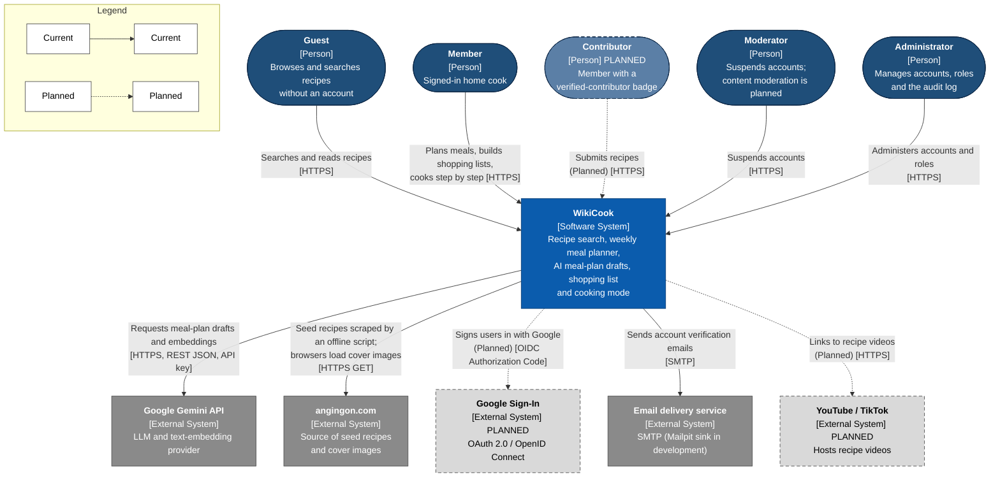

# SOFTWARE ARCHITECTURE DOCUMENT: WIKICOOK

## DOCUMENT METADATA & RESPONSIBILITY MATRIX

| Section | Title | Performed by (Author) | Reviewed by | Edited by | Task |
| :---: | :--- | :---: | :---: | :---: | :---: |
| **Section 1** | System Overview | **Mai Văn Hiển (MaiHien3507)** | **Nguyễn Thành Dự (ThanhDu14)** | **Lê Quốc Hưng (LqHung06)** | PA1 baseline; two wording fixes in Part B (`SCRUM-80`) |
| **Section 2** | C4 Level 1 — System Context (Part B) | **Mai Văn Hiển (MaiHien3507)** | **Nguyễn Đức Duy (DucDuyNguyen15-IT)** | **Mai Văn Hiển (MaiHien3507)** | `SCRUM-80` |
| **Section 3** | Technology Stack (Part B) | **Mai Văn Hiển (MaiHien3507)** | **Nguyễn Đức Duy (DucDuyNguyen15-IT)** | **Mai Văn Hiển (MaiHien3507)** | `SCRUM-80` |
| **Sections 4+** | C4 Level 2 Container and Backend Level 3 Component (Part C) | **Mai Văn Hiển (MaiHien3507)** | **Nguyễn Thành Dự (ThanhDu14)** | — | `SCRUM-81` (not started; see Section 4) |

---

## 1. System Overview
*Performed by: Mai Văn Hiển (MaiHien3507) | Reviewed by: Nguyễn Thành Dự (ThanhDu14) | Edited by: Lê Quốc Hưng (LqHung06)*

### 1.1. Architectural Style & Design Philosophy

WikiCook follows a modern, decoupled **Layered Client-Server Architecture** designed to balance development velocity, testability, and operational simplicity:

1. **Strict Layered Separation:**
   - Client tier: Single Page Application (SPA) delivering rich interactive experiences.
   - API tier: Stateless RESTful API layer managing requests and validation.
   - Business service tier: Encapsulates domain logic, recipe algorithms, and AI orchestration.
   - Persistence tier: Relational data mapping and semantic vector retrieval.
2. **Security & Boundary Isolation:**
   - Controllers never interact directly with database repositories; all flows pass through explicit domain services.
   - Data transfer between tiers uses immutable Data Transfer Objects (DTOs); JPA entities are never exposed across the network boundary.
   - External LLM API keys are strictly confined to the backend server environment.
3. **Spec-Driven & Test-First Compatibility:**
   - Architecture strictly adheres to the principles ratified in `constitution.md` (Java 21, Spring Boot 3.x, PostgreSQL 16).

---

## 2. C4 Level 1 — System Context
*Performed by: Mai Văn Hiển (MaiHien3507) | Reviewed by: Nguyễn Đức Duy (DucDuyNguyen15-IT) | Edited by: Mai Văn Hiển (MaiHien3507)*

### 2.1. Scope and Verification Basis

The System Context diagram shows WikiCook as a single box, the people who use it, and the external systems it depends on. Internal structure is deliberately left out; it belongs to the Container and Component levels (Part C, see Section 4).

Every statement in this section and in Section 3 was checked against the repository at `origin/main` commit `4538a7a` on 2026-11-16 (it includes the merge of PR #89, the authentication backend of `SCRUM-74`), using the Maven poms, `application.yml`, both `docker-compose.yml` files, the Dockerfiles, `package.json`, the Flyway migrations and the Java and TypeScript sources. Two status values are used:

- **Current** — present in code or configuration on `main` and used by the running system.
- **Planned** — described in an approved spec or plan but not on `main` yet. This includes features that are only partly built, for example Google sign-in, where the button and settings exist but the backend flow does not. A Planned item must not be read as delivered.

### 2.2. Diagram

Mermaid's native `C4Context` syntax can only recolour a relationship, not draw it dashed, so a colour-only difference would be lost in print and for colour-blind readers. The diagram therefore uses a `flowchart` that follows C4 conventions (person, software system, external system, labelled relationship with protocol). **Solid lines and borders mean Current; dashed lines and borders mean Planned.**

### 2.3. People (Actors)

The actors follow the Use-Case Model (`docs/requirements/use-case-model.md`, Section 2). The `users.role` column accepts `MEMBER`, `CONTRIBUTOR`, `MODERATOR` and `ADMINISTRATOR` (`V101__users_auth.sql`); Guest is an unauthenticated visitor and has no row.

| Actor | Role in the system | Interaction (direction, protocol) | Status |
| :--- | :--- | :--- | :---: |
| **Guest** | Visitor without an account. Searches and reads published recipes. | Browser → WikiCook over HTTPS; the SPA calls the REST API under `/api/v1` and sends no identity. | Current |
| **Member** | Signed-in home cook. Owns a meal planner, shopping lists and AI-generated plan drafts, and uses cooking mode. | Same as Guest, with an identity on each request. Registration, sign-in, sign-out and token refresh are served by the auth module under `/api/v1/auth` (a 15-minute JWT bearer token plus an HttpOnly refresh cookie). The development stub (`X-Dev-User-Id`, `com.wikicook.devstub`) is still in the code but disabled by default, and its beans back off when real authentication is present. The profile and dietary-profile backend (spec 011, `SCRUM-75`) is not on `main`, so consumers still read a stub profile. | Current (sign-in and features); profile backend Planned |
| **Contributor** | Member with a "Verified Contributor" badge who submits recipes. | Browser → WikiCook over HTTPS. The role exists in the role hierarchy (`SecurityConfig`: Administrator > Moderator > Contributor > Member), but the recipe editor (spec 060) is not on `main`, so the role has no extra capability yet. | Planned |
| **Moderator** | Suspends accounts today; will also review submitted recipes and process reports. | Browser → WikiCook over HTTPS. `POST /api/v1/admin/users/{id}/suspension` needs at least the Moderator role (`AccountActionPolicy`). The review queue and reports (spec 100) are not on `main`. | Current (account suspension); content moderation Planned |
| **Administrator** | Everything a Moderator can do, plus roles, bans, reinstatement and the audit trail. | Browser → WikiCook over HTTPS under `/api/v1/admin/users` and `/api/v1/admin/audit-logs` (read-only). The first Administrator is created at startup from `WIKICOOK_BOOTSTRAP_ADMIN_*` (`AdminBootstrapRunner`). Taxonomies, featured recipes and nutrition management (specs 090, 100) are not on `main`. | Current (account administration); the rest Planned |

### 2.4. External Systems

| External system | Role | Direction and protocol | Status |
| :--- | :--- | :--- | :---: |
| **Google Gemini API** (`generativelanguage.googleapis.com/v1beta`) | One provider for both AI needs. The LLM (`gemini-3.5-flash` by default) arranges the weekly meal-plan draft from a shortlist of candidate recipes; the embedding model (`gemini-embedding-001`, 768 dimensions) vectorises recipes and queries for pgvector retrieval. | WikiCook backend → Gemini, outbound HTTPS, JSON over REST (`POST …:generateContent`, `…:embedContent`, `…:batchEmbedContents`), API key in the `x-goog-api-key` header. The key lives only in the backend environment (`WIKICOOK_AI_API_KEY`). `wikicook.ai.mode` selects `live`, `mock` or `offline`; the default is `mock`, so the provider is called only when the mode is `live` and a key is set. If the call fails, the planner falls back to a draft built without AI. Nutrition estimation (spec 090) will reuse the same provider but is not implemented. | Current |
| **angingon.com** | Public recipe site used as the source of the seed catalogue. The team has permission to scrape it, and WikiCook must show `source_url` as attribution. | Two flows, both outbound HTTPS GET. (1) The offline script `tools/angingon-scraper` fetches pages, and its JSONL output is loaded into PostgreSQL with `import.sh`/`import.sql`; this runs on a developer machine, not inside the deployed application. (2) Recipe covers are stored as `recipe_media.external_url`, so the user's browser loads each image directly from the source site. | Current |
| **Google Sign-In** (OAuth 2.0 / OpenID Connect) | Identity provider for "Sign in with Google" (spec 010, US5). | Browser and backend ↔ Google using the Authorization Code flow with PKCE; the backend needs a client id and secret (`WIKICOOK_GOOGLE_CLIENT_ID`, `WIKICOOK_GOOGLE_CLIENT_SECRET`). On `main` there are only the `spring-boot-starter-oauth2-client` dependency, the `wikicook.auth.google` settings, the `google_sub` column of the user account entity and the frontend button that links to `/api/v1/auth/oauth2/google`. The backend flow does not exist yet (no such endpoint, and the Google tasks of spec 010 US5 are still open), so the button cannot sign anyone in. | Planned |
| **Email delivery service** (SMTP) | Sends the account verification email (spec 010). Password-reset and account-status emails are Planned (spec 010 US4, spec 100). | WikiCook backend → SMTP server, outbound, through Spring `JavaMailSender` (`LinkMailer.sendVerification`). In Docker Compose `MAIL_HOST` is `mailpit`, a Mailpit container that captures every message (web UI on port 8025). No production provider has been chosen, so no real email leaves a development machine. An unreachable SMTP server does not fail the health check. | Current (verification email, development sink only) |
| **YouTube / TikTok** | Host the optional cooking video of a recipe. | The recipe stores a link and platform (`recipes.video_url`, `video_platform` in `V202__recipes.sql`). The browser would load the video from the provider over HTTPS. No frontend code on `main` embeds a video, and the recipe editor that accepts the link (spec 060) is not on `main`. | Planned |

### 2.5. Current vs Planned Summary

| Element | Type | Today on `main` | Planned (spec) |
| :--- | :--- | :--- | :--- |
| Guest | Person | Search and recipe browsing without identity. | — |
| Member | Person | Registration, sign-in (JWT and refresh cookie), meal planner, shopping list, AI planner and cooking mode. | Profile and dietary-profile backend (spec 011, `SCRUM-75`). |
| Contributor | Person | Role value and place in the role hierarchy only. | Recipe editor and badge (spec 060). |
| Moderator | Person | Account suspension. | Moderation queue and reports (spec 100). |
| Administrator | Person | Roles, bans, reinstatement, read-only audit log, bootstrap Administrator. | Taxonomies, featured recipes, nutrition management (specs 090, 100). |
| WikiCook | Software system | SPA, REST API and PostgreSQL run together through Docker Compose. | Reviews and Cooksnap, bookmarks, nutrition analysis, moderation. |
| Google Gemini API | External system | LLM and embedding clients in `wikicook-ai`, with `live`/`mock`/`offline` modes. | AI nutrition estimates (spec 090). |
| angingon.com | External system | Offline scraper and import script; cover images loaded by URL. | — |
| Google Sign-In | External system | Dependency, settings and frontend button only; no backend flow. | Authorization Code sign-in (spec 010 US5). |
| Email delivery service | External system | Verification email through SMTP; Mailpit sink in Docker Compose. | Password-reset and status emails, a production provider (specs 010, 100). |
| YouTube / TikTok | External system | Columns in the schema only. | Video link and preview (spec 060). |

### 2.6. Deliberately Not Shown

- **Redis, OpenAI / GPT-4, and a separate embedding service.** PA1 drew them; none exists (Section 3.3).
- **Browser platform APIs** (Screen Wake Lock, Web Speech). The cooking-mode code uses them, but they are capabilities of the user's browser, a container of WikiCook rather than a separate system. They belong in the Frontend component diagram, not here.
- **Image storage for uploads** (specs 060 and 070). The plans use a local volume inside the deployment, so it is a container concern, not an external system.
- **Developer tooling** such as GitHub Actions and Spec Kit. They are not part of the running product.

---

## 3. Technology Stack
*Performed by: Mai Văn Hiển (MaiHien3507) | Reviewed by: Nguyễn Đức Duy (DucDuyNguyen15-IT) | Edited by: Mai Văn Hiển (MaiHien3507)*

Versions come from the configuration files named in the Evidence column. "Managed by Boot" means the version is set by the `spring-boot-starter-parent` 3.5.16 bill of materials rather than written in a pom. Paths are relative to the repository root.

### 3.1. Verified Technologies

| Layer | Technology | Version | Role in WikiCook | Status | Evidence |
| :--- | :--- | :--- | :--- | :---: | :--- |
| Frontend | **React** | 18.3.1 | Single-page application that renders every screen. | Current | `src/frontend/package.json`, `package-lock.json` |
| Frontend | **TypeScript** | 5.9.3 | Type-checked source (`tsc -b` runs before the build). | Current | `src/frontend/package.json` |
| Frontend | **Vite** | 6.4.5 | Dev server (proxies `/api` and `/actuator` to the backend) and production bundler. | Current | `src/frontend/vite.config.ts` |
| Frontend | **React Router** | 6.30.6 | Client-side routes: search, meal planner, shopping list, cooking mode, sign-in and registration pages, and profile pages. | Current | `src/frontend/src/app/routes.tsx` |
| Frontend | **Tailwind CSS** (with PostCSS) | 3.4.19 | Utility-first styling bound to CSS design tokens (`src/styles/tokens.css`) for responsive layouts and cooking themes. | Current | `src/frontend/tailwind.config.ts`, `postcss.config.js` |
| Frontend | **Browser storage and platform APIs** | Browser-provided | `localStorage` keeps the dev identity and cooking-session recovery; the access token stays in memory only. Wake Lock and Web Speech serve cooking mode. | Current | `src/frontend/src/shared/api/session.ts`, `features/cooking-mode/adapters/` |
| Frontend | **nginx** | 1.27-alpine | Serves the built SPA and reverse-proxies `/api/` and `/actuator/` to the backend, so the browser stays same-origin. | Current | `src/frontend/Dockerfile`, `src/frontend/nginx.conf` |
| Backend | **Java** | 21 (LTS) | Language runtime; virtual threads are enabled for blocking AI calls. | Current | `src/backend/pom.xml` (`java.version`), `application.yml` (`spring.threads.virtual.enabled`) |
| Backend | **Spring Boot** (Web, Data JPA, Validation, Actuator) | 3.5.16 | REST API under `/api/v1`, dependency injection, request validation, and `/actuator/health` used by Docker health checks. | Current | `src/backend/pom.xml`, `wikicook-app/pom.xml` |
| Backend | **Hibernate ORM** (via Spring Data JPA) | 6.6.53, managed by Boot | Maps entities to tables; `ddl-auto: validate`, so the schema is owned by Flyway. | Current | `application.yml`, `wikicook-app/pom.xml` |
| Backend | **springdoc-openapi** | 2.8.13 | Generates OpenAPI documentation and the Swagger UI. | Current | `src/backend/pom.xml` |
| Backend | **Maven multi-module build** | Maven 3.9 (build image) | Modules `wikicook-db` (migrations), `wikicook-ai` (LLM, embedding and quota library) and `wikicook-app` (Spring Boot application). | Current | `src/backend/pom.xml`, `src/backend/Dockerfile` |
| Backend | **Spring Security, OAuth2 Resource Server (Nimbus JOSE JWT) and BCrypt** | Spring Security 6.5.11, Nimbus JOSE 9.37.4, managed by Boot | Requires authentication on every `/api/**` route except the public ones, validates the 15-minute JWT, hashes passwords with BCrypt (cost 12, SHA-256 pre-hash) and enforces the role hierarchy. | Current | `wikicook-app/pom.xml`, `auth/security/SecurityConfig.java`, `PrehashedBCryptPasswordEncoder.java`, `application.yml` (`wikicook.auth`) |
| Backend | **Spring Mail** (Jakarta Mail) | 2.0.5, managed by Boot | Sends the account verification email after the transaction commits. | Current | `wikicook-app/pom.xml`, `auth/mail/LinkMailer.java`, `application.yml` (`spring.mail`) |
| Backend | **Spring OAuth2 Client** (Google sign-in) | Managed by Boot | Dependency is declared, but the Google Authorization Code flow is not implemented on the backend yet. | Planned | `wikicook-app/pom.xml`, `specs/010-user-authentication-roles/tasks.md` (US5 open) |
| Backend | **Development stub** | — | Legacy stand-in from before spec 010: `X-Dev-User-Id` header, fixed dietary profile. Disabled by default; the identity stub backs off when real authentication is present, while the dietary-profile stub remains until spec 011 lands. | Current (dev only) | `application.yml` (`wikicook.dev-stubs`), `com.wikicook.devstub` |
| Backend | **Local-volume media storage, WebP and EXIF image processing, Caffeine in-memory rate limiter** | Caffeine 3.1.8, WebP ImageIO 0.1.6, TwelveMonkeys 3.10.1 (as written in the plan) | Recipe cover upload (060) and Cooksnap photos with a review rate limit (070). Not in any pom yet. | Planned | `specs/060-recipe-editor/plan.md`, `specs/070-review-cooksnap/plan.md` |
| Data | **PostgreSQL** | 16 | System of record for recipes, meal plans, shopping lists, users and AI usage; JSONB and full-text search (`tsvector`) are used. | Current | `src/backend/docker-compose.yml` (`pgvector/pgvector:pg16`), `V204__recipe_search_vector.sql` |
| Data | **pg_trgm and unaccent** extensions | Bundled with the image | Accent-insensitive Vietnamese search. | Current | `V001__extensions.sql`, `V204__recipe_search_vector.sql` |
| Data | **pgvector** (extension and Java client) | Java client 0.1.6; extension version not pinned (image tag `pg16`) | Stores 768-dimension recipe embeddings (`VECTOR(768)`, HNSW cosine index) for similarity retrieval in the AI planner. | Current | `V001__extensions.sql`, `V302__ai_requests_embeddings.sql`, `src/backend/pom.xml` |
| Data | **Flyway** | 11.7.2, managed by Boot | Versioned migrations `V001`–`V403` plus `V102`–`V104` (18 files), applied at application start. `out-of-order` is enabled because the auth migrations were added below `V403`. A `flyway/flyway:11` container offers the same migration on demand. | Current | `wikicook-app/pom.xml`, `application.yml` (`spring.flyway`), `wikicook-db/src/main/resources/db/migration/`, `src/backend/docker-compose.yml` |
| Data | **PostgreSQL JDBC driver** | 42.7.11, managed by Boot | Database connectivity and the base class of `PGvector`. | Current | `wikicook-app/pom.xml` |
| AI | **Google Gemini API, LLM** | Model `gemini-3.5-flash` (configurable) | Produces the structured weekly meal-plan draft. Called with the JDK HTTP client through Spring `RestClient`; no vendor SDK. | Current | `application.yml` (`wikicook.ai.llm`), `wikicook-ai/.../GeminiHttp.java`, `GeminiLlmClient.java` |
| AI | **Google Gemini API, embeddings** | Model `gemini-embedding-001`, 768 dimensions | Embeds recipes (nightly reconcile job) and search queries for retrieval. | Current | `application.yml` (`wikicook.ai.embedding`), `GeminiEmbeddingClient.java` |
| AI | **Mock and offline AI clients, daily quota** | — | `mock` (default) answers without a key for CI and demos; `offline` forces failures to test fallbacks; `ai_requests` enforces per-user and daily limits in PostgreSQL. | Current | `AiClientConfig.java`, `V302__ai_requests_embeddings.sql` |
| Data tooling | **Python scraper** (requests, beautifulsoup4, lxml) | Python 3; libraries `>=2.31`, `>=4.12`, `>=5.0` | Offline collection of seed recipes from angingon.com and import into PostgreSQL. | Current | `tools/angingon-scraper/requirements.txt`, `import.sh` |
| Delivery | **Docker Compose** | Compose v2 (`include:` needs 2.20 or later) | Runs `db`, `app`, `web` and the on-demand `migrate` service from one command at the repository root. | Current | `docker-compose.yml`, `src/backend/docker-compose.yml` |
| Delivery | **Container images** | `pgvector/pgvector:pg16`, `eclipse-temurin:21-jre-alpine`, `maven:3.9-eclipse-temurin-21`, `node:22-alpine`, `nginx:1.27-alpine`, `flyway/flyway:11` | Database, backend runtime, build stages, static web server and migration tool. | Current | `src/backend/Dockerfile`, `src/frontend/Dockerfile`, both compose files |
| Delivery | **GitHub Actions** | `checkout@v5`, `setup-java@v5`, `setup-node@v5` | CI: `mvn -B verify` on Java 21; `npm ci`, lint, test and build on Node 22. | Current | `.github/workflows/backend.yml`, `frontend.yml` |
| Quality | **JUnit 5, Mockito, Testcontainers, WireMock, JaCoCo** | WireMock 3.13.2, JaCoCo 0.8.16, others managed by Boot | Backend unit and integration tests on a real PostgreSQL container; fake Gemini endpoint; a 70 % line and branch coverage gate. | Current | `src/backend/pom.xml`, `wikicook-app/pom.xml`, `wikicook-ai/pom.xml` |
| Quality | **Vitest, React Testing Library, MSW, Playwright, ESLint** | Vitest 3.2.7, RTL 16.3.3, MSW 2.15.0, Playwright 1.64.1, ESLint 9.39.5 | Frontend component, mocked-API and end-to-end tests, and linting. | Current | `src/frontend/package.json`, `playwright.config.ts` |
| Delivery | **Mailpit** (dev SMTP sink) | Image `axllent/mailpit` (tag not pinned) | Captures verification emails during development (SMTP on 1025, web UI on 8025). | Current | `src/backend/docker-compose.yml` |

### 3.2. Reading Notes

- **Authentication is on `main` except Google sign-in.** PR #89 (`SCRUM-74`) brought Spring Security, JWT, BCrypt, the admin API and the verification email. Google sign-in and the profile and dietary-profile backend (spec 011) are still missing, so they stay Planned.
- **Docker Compose now requires secrets.** `WIKICOOK_JWT_SECRET` and `WIKICOOK_EMAIL_HASH_KEY` have no default; Compose refuses to start the `app` service without them (`src/backend/.env.example`).
- **The AI feature is implemented but defaults to `mock`.** Live calls need `WIKICOOK_AI_MODE=live` and `WIKICOOK_AI_API_KEY`. A live run against Gemini on 2026-10-30 is recorded in `src/backend/wikicook-ai/README.md`.
- **Rate limiting uses PostgreSQL**, not a cache server: AI limits count rows in `ai_requests`, and spec 010 does the same for sign-in throttling (a per-IP limit in `wikicook.auth.sign-in`, plus tables added by `V102`–`V104`).

### 3.3. PA1 Claims Not Confirmed in the Project

| PA1 statement | Finding | Evidence |
| :--- | :--- | :--- |
| **Redis 7.x** for rate limiting, lockout and token blacklisting | **Not used.** No dependency, no compose service and no configuration. Specs 010 (R5) and 031 (R11) decided against it and count in PostgreSQL. | `wikicook-app/pom.xml`, both compose files, `specs/010-user-authentication-roles/research.md` R5 |
| **GPT-4** as an alternative LLM | **Not used.** No OpenAI dependency, URL or key. Spec 031 chose Gemini and rejected OpenAI. | `specs/031-ai-weekly-meal-planner/research.md`, `wikicook-ai/pom.xml` |
| **Gemini Pro** | **Replaced.** The configured model is `gemini-3.5-flash`. | `application.yml` |
| **Separate "Text Embedding Model"** service | **Not a separate system.** Embeddings come from the same Gemini API (`gemini-embedding-001`). | `application.yml`, `GeminiEmbeddingClient.java` |
| **SPA / PWA** | **PWA not used.** There is no service worker or web manifest, and no PWA plugin in `package.json`. | `src/frontend/package.json`, `vite.config.ts` |
| **Spring Security 6.x, JWT, BCrypt** | **Confirmed** since PR #89 (Spring Security 6.5.11). PA1 did not mention the OAuth2 Resource Server that validates the JWT. | `wikicook-app/pom.xml`, `auth/security/SecurityConfig.java` |
| **Docker Compose runs Backend, Frontend, PostgreSQL and Redis** | **No Redis.** The services are `db`, `app`, `web` and `migrate`. | `docker-compose.yml`, `src/backend/docker-compose.yml` |
| **pgvector 0.7+** | **Version not pinned.** The extension version follows the image `pgvector/pgvector:pg16`; only the Java client (0.1.6) is pinned. | `src/backend/docker-compose.yml`, `src/backend/pom.xml` |
| **Flyway "Latest"** | **Pinned by Boot** to 11.7.2. | `wikicook-app/pom.xml` |
| **`idb` (IndexedDB wrapper)** in the frontend skeleton | **Declared but never imported.** Cooking-session recovery uses `localStorage`. | `src/frontend/package.json`, `features/cooking-mode/adapters/sessionPersistence.ts` |

---

## 4. Reserved for Part C

C4 Level 2 (Container) and the Backend Level 3 (Component) diagrams are the scope of `SCRUM-81` and will be added here after code freeze, from the packages and configuration that actually landed. They will refine this document's boundary: the WikiCook box in Section 2 will be split into the containers `web` (nginx and the React SPA), `app` (Spring Boot) and `db` (PostgreSQL with pgvector), and the Section 3 rows will be mapped to them. Nothing in Part C is claimed here.
