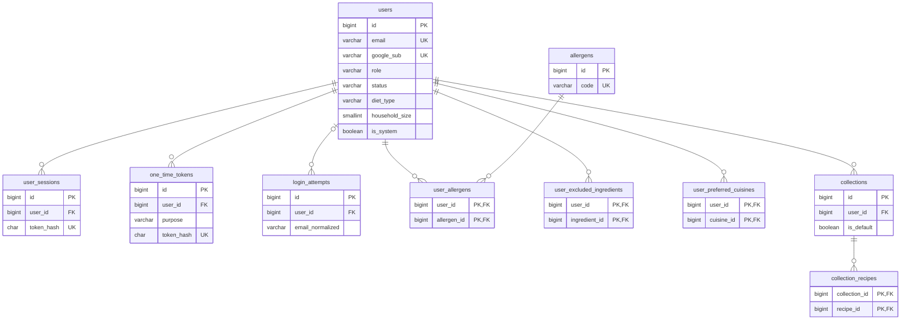
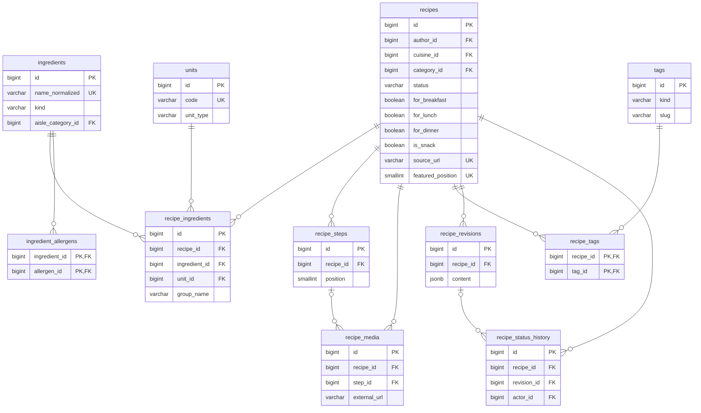
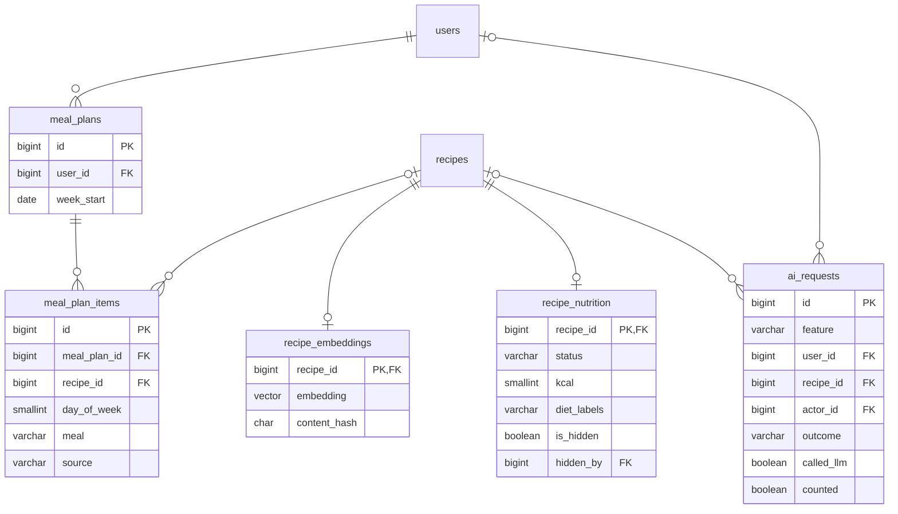
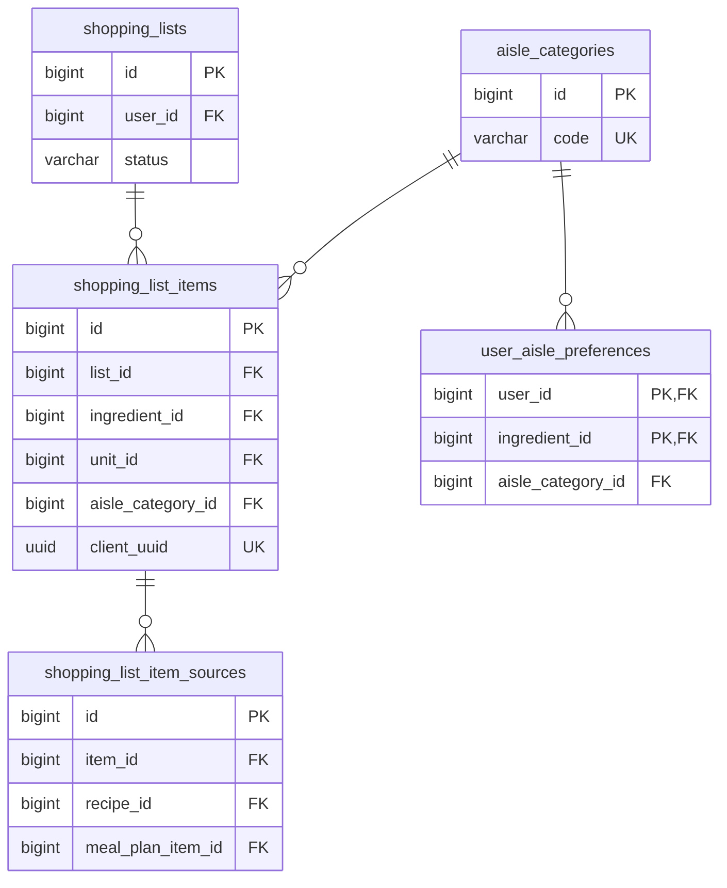
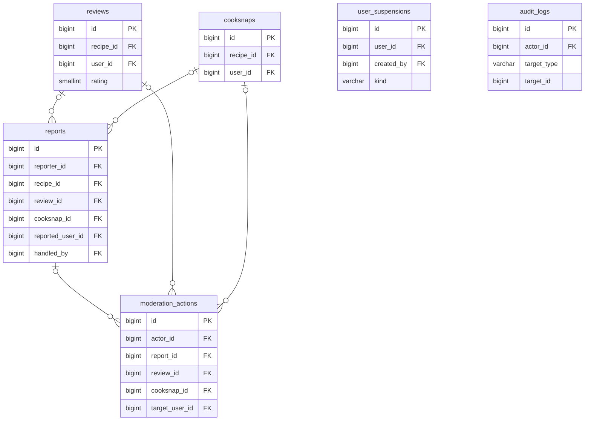

# Thiết kế CSDL toàn dự án WikiCook (PostgreSQL 16)

*Soạn bởi: Nguyễn Thành Dự (ThanhDu14) | Review: _(chờ A – quy ước chung, B – nhóm công thức)_ | Trạng thái: **bản nháp tổng hợp 18/10/2026, đã rút gọn***

File này gom toàn bộ CSDL của 12 spec vào một chỗ: sơ đồ quan hệ, khóa chính, khóa ngoại, hành vi khi xóa và cách nạp dữ liệu cào từ angingon.com. Phần công thức/nguyên liệu dựa trên [bản nháp của B](draft-recipes-ingredients.md), bổ sung những gì dữ liệu cào và AI planner cần (🆕) và rút gọn các bảng nhỏ thành cột (✂️). Khi nhóm duyệt, nội dung chuyển vào `README.md` (đặc tả CSDL chung theo [file phân công](../../management/w1-spec-design-assignment.md#2-phần-csdl-của-từng-người)).

> **Ký hiệu:** 🆕 *bổ sung so với bản nháp của B* · ✂️ *rút gọn (gộp bảng thành cột hoặc gộp bảng)* · ❓ *cần chốt (mục 8)* · **PK** khóa chính · **FK** khóa ngoại · **UK** unique

---

## 1. Quy ước chung

| Vấn đề | Quy ước |
|---|---|
| Khóa chính | `BIGINT GENERATED ALWAYS AS IDENTITY`; bảng nối dùng PK kép; bảng 1–1 dùng FK làm PK |
| Enum | `VARCHAR` + `CHECK (... IN (...))`, map `@Enumerated(EnumType.STRING)` |
| Thời gian | `created_at`, `updated_at` kiểu `TIMESTAMPTZ NOT NULL DEFAULT now()` (không ghi lại trong từng bảng bên dưới) |
| Tên | `snake_case`, tên bảng số nhiều |
| Xóa | Công thức không xóa cứng khi đã xuất bản (`status = 'ARCHIVED'`); danh mục dùng `is_active`; dữ liệu cá nhân xóa theo tài khoản |
| Đa hình | **Không** dùng cặp `target_type + target_id` khi cần toàn vẹn: dùng nhiều cột FK có thể NULL + `CHECK (num_nonnulls(...) = 1)`. Ngoại lệ duy nhất: `audit_logs` (nhật ký phải sống sót khi đối tượng bị xóa) |
| Bảng nhỏ | Thông tin 1–1 hoặc danh sách cố định vài giá trị lưu thành cột (boolean, mảng) thay vì bảng riêng |
| Extension | `unaccent`, `pg_trgm`, `vector` (pgvector) – có sẵn trong Docker Compose của C |
| Migration | Flyway `V{n}__{mo_ta}.sql`, mỗi người một dải số (mục 7) |

---

## 2. Bản đồ module → bảng

| Nhóm | Spec | Bảng | Phụ trách |
|---|---|---|---|
| Tài khoản & bảo mật | 010 | `users`, `user_sessions`, `one_time_tokens`, `login_attempts` | A |
| Hồ sơ ăn uống | 011 | `allergens`, `user_allergens`, `user_excluded_ingredients`, `user_preferred_cuisines` (phần còn lại là cột của `users`) | A |
| Danh mục dùng chung | 020, 060, 040 | `cuisines`, `categories`, `tags`, `units`, `aisle_categories` | B, D |
| Nguyên liệu | 060, 011, 040 | `ingredients`, `ingredient_allergens` | B |
| Công thức | 060, 020 | `recipes`, `recipe_ingredients`, `recipe_steps`, `recipe_media`, `recipe_tags`, `recipe_revisions`, `recipe_status_history` | B |
| Meal planner | 030 | `meal_plans`, `meal_plan_items` | C |
| AI planner & dinh dưỡng | 031, 090 | `recipe_embeddings`, `recipe_nutrition`, `ai_requests` | C |
| Shopping list | 040 | `shopping_lists`, `shopping_list_items`, `shopping_list_item_sources`, `user_aisle_preferences` | D |
| Chế độ nấu | 050 | *(không có bảng – lưu ở Local Storage, spec 050 FR-017)* | D |
| Đánh giá & Cooksnap | 070 | `reviews`, `cooksnaps` | E |
| Bộ sưu tập | 080 | `collections`, `collection_recipes` | A |
| Quản trị | 100, 010 | `reports`, `moderation_actions`, `user_suspensions`, `audit_logs` | E |

Tổng: **39 bảng**.

### 2.1. Những gì đã rút gọn (✂️)

| Bỏ | Thay bằng | Lý do |
|---|---|---|
| `ingredient_groups` | Cột `recipe_ingredients.group_name` | Dữ liệu cào không có công thức nào nhiều hơn một nhóm |
| `recipe_meal_types` | Cột `recipes.for_breakfast`, `for_lunch`, `for_dinner`, `is_snack` | Danh sách cố định 4 giá trị |
| `recipe_dietary_tags` | Cột `recipe_nutrition.diet_labels VARCHAR[]` | Chỉ để hiển thị |
| `ai_generation_requests`, `ai_quota_usage`, `nutrition_attempts` | Một bảng `ai_requests` | Một chỗ cho mọi lượt dùng AI; hạn mức tính bằng `COUNT` |
| `unit_aliases`, `ingredient_aliases` | File ánh xạ CSV đi kèm script nhập (mục 5) | Chỉ dùng lúc nhập dữ liệu cào; người dùng gõ thì tìm trigram |
| `unit_conversions` | Hằng số trong code | Spec 040 chỉ đổi g ↔ kg, ml ↔ l (FR-007) |
| `user_identities` | Cột `users.google_sub` | Chỉ có một nhà cung cấp (Google) |
| `dietary_profiles` | Cột `users.diet_type`, `household_size`, `max_cook_time_minutes` | Quan hệ 1–1 |
| `featured_recipes` | Cột `recipes.featured_position` | |
| `equipment`, `cooking_methods`, `recipe_equipment`, `recipe_cooking_methods` | `tags.kind` (`TAG`, `EQUIPMENT`, `METHOD`) + `recipe_tags` | Cùng cấu trúc với `tags` |

---

## 3. Sơ đồ quan hệ

### 3.1. Sơ đồ tổng (chỉ quan hệ)

```mermaid
erDiagram
    users ||--o{ user_sessions : ""
    users ||--o{ one_time_tokens : ""
    users |o--o{ login_attempts : ""
    users ||--o{ user_allergens : ""
    allergens ||--o{ user_allergens : ""
    users ||--o{ user_excluded_ingredients : ""
    ingredients ||--o{ user_excluded_ingredients : ""
    users ||--o{ user_preferred_cuisines : ""
    cuisines ||--o{ user_preferred_cuisines : ""

    users |o--o{ recipes : "viết"
    cuisines ||--o{ recipes : ""
    categories ||--o{ recipes : ""
    recipes ||--o{ recipe_ingredients : ""
    ingredients ||--o{ recipe_ingredients : ""
    units ||--o{ recipe_ingredients : ""
    ingredients ||--o{ ingredient_allergens : ""
    allergens ||--o{ ingredient_allergens : ""
    aisle_categories |o--o{ ingredients : ""
    recipes ||--o{ recipe_steps : ""
    recipes ||--o{ recipe_media : ""
    recipe_steps |o--o{ recipe_media : ""
    recipes ||--o{ recipe_tags : ""
    tags ||--o{ recipe_tags : ""
    recipes ||--o{ recipe_revisions : ""
    recipes ||--o{ recipe_status_history : ""
    recipe_revisions |o--o{ recipe_status_history : ""

    users ||--o{ meal_plans : ""
    meal_plans ||--o{ meal_plan_items : ""
    recipes |o--o{ meal_plan_items : ""
    recipes ||--o| recipe_embeddings : ""
    recipes ||--o| recipe_nutrition : ""
    users |o--o{ ai_requests : ""
    recipes |o--o{ ai_requests : ""

    users ||--o{ shopping_lists : ""
    shopping_lists ||--o{ shopping_list_items : ""
    ingredients |o--o{ shopping_list_items : ""
    aisle_categories ||--o{ shopping_list_items : ""
    shopping_list_items ||--o{ shopping_list_item_sources : ""
    recipes |o--o{ shopping_list_item_sources : ""
    meal_plan_items |o--o{ shopping_list_item_sources : ""
    users ||--o{ user_aisle_preferences : ""

    recipes ||--o{ reviews : ""
    users |o--o{ reviews : ""
    recipes ||--o{ cooksnaps : ""
    users |o--o{ cooksnaps : ""
    users ||--o{ collections : ""
    collections ||--o{ collection_recipes : ""
    recipes ||--o{ collection_recipes : ""

    users |o--o{ reports : "báo cáo"
    reports |o--o{ moderation_actions : ""
    users ||--o{ user_suspensions : ""
    users |o--o{ audit_logs : ""
```

### 3.2. Tài khoản, hồ sơ, bộ sưu tập (A)

### 3.3. Công thức và nguyên liệu (B)

`cuisines` và `categories` là danh mục đơn giản (mục 4.3), không vẽ lại.

### 3.4. Meal planner, AI và dinh dưỡng (C)

### 3.5. Shopping list (D)

### 3.6. Cộng đồng và quản trị (E)

---

## 4. Đặc tả từng bảng

Cột `created_at`, `updated_at` có ở mọi bảng trừ khi ghi "chỉ `created_at`". Cột "Tham chiếu" ghi bảng đích và hành vi `ON DELETE`.

### 4.1. Tài khoản, bảo mật và hồ sơ (010, 011 – A)

**`users`**

| Cột | Kiểu | NULL | Khóa / Tham chiếu | Ghi chú |
|---|---|---|---|---|
| `id` | `BIGINT` | NOT NULL | PK | |
| `email` | `VARCHAR(254)` | NOT NULL | UK | Lưu dạng đã chuẩn hóa (`lower(trim)`) – 010 FR-002 |
| `password_hash` | `VARCHAR(100)` | NULL | | BCrypt cost 12; NULL với tài khoản chỉ dùng Google hoặc tài khoản hệ thống |
| `google_sub` | `VARCHAR(255)` | NULL | UK | ✂️ Thay `user_identities`; mã tài khoản Google (010 FR-018, FR-019) |
| `display_name` | `VARCHAR(50)` | NOT NULL | | |
| `avatar_storage_key` | `VARCHAR(255)` | NULL | | 011 |
| `role` | `VARCHAR(15)` | NOT NULL | | `CHECK IN ('MEMBER','CONTRIBUTOR','MODERATOR','ADMINISTRATOR')`, mặc định `MEMBER` |
| `status` | `VARCHAR(10)` | NOT NULL | | `CHECK IN ('ACTIVE','SUSPENDED','BANNED')`; lịch sử ở `user_suspensions` |
| `email_verified_at` | `TIMESTAMPTZ` | NULL | | |
| `locked_until` | `TIMESTAMPTZ` | NULL | | Khóa 15 phút sau 5 lần sai (010 FR-012) |
| `last_sign_in_at` | `TIMESTAMPTZ` | NULL | | |
| `diet_type` | `VARCHAR(15)` | NOT NULL | | ✂️ Từ `dietary_profiles`; `CHECK IN ('NONE','VEGETARIAN','VEGAN','PESCATARIAN')`, mặc định `NONE` – chỉ các kiểu suy ra được từ `ingredients.kind` (031 FR-009a) ❓ |
| `household_size` | `SMALLINT` | NULL | | ✂️ `CHECK BETWEEN 1 AND 20`; NULL → khẩu phần "Theo công thức" |
| `max_cook_time_minutes` | `SMALLINT` | NULL | | ✂️ `CHECK (... >= 10)` |
| `is_system` | `BOOLEAN` | NOT NULL | | 🆕 `DEFAULT false`; `true` cho tài khoản "WikiCook" sở hữu công thức cào; `CHECK (NOT is_system OR (password_hash IS NULL AND google_sub IS NULL))` |

Quy tắc "còn ít nhất một Administrator" (010 FR-023) kiểm tra ở Service.

**`user_sessions`** – phiên đăng nhập / refresh token (010 FR-009, FR-016)

| Cột | Kiểu | NULL | Khóa / Tham chiếu | Ghi chú |
|---|---|---|---|---|
| `id` | `BIGINT` | NOT NULL | PK | |
| `user_id` | `BIGINT` | NOT NULL | FK → `users` `CASCADE` | |
| `token_hash` | `CHAR(64)` | NOT NULL | UK | SHA-256 của refresh token, không lưu token gốc |
| `remember_me` | `BOOLEAN` | NOT NULL | | |
| `last_activity_at`, `expires_at` | `TIMESTAMPTZ` | NOT NULL | | 30 ngày hoặc 24 giờ |
| `revoked_at` | `TIMESTAMPTZ` | NULL | | Đăng xuất, đặt lại mật khẩu |
| `user_agent` | `VARCHAR(255)` | NULL | | |

Index `(user_id) WHERE revoked_at IS NULL`.

**`one_time_tokens`** – link xác minh email và đặt lại mật khẩu (010 FR-005, FR-015); gộp `email_verification_tokens` và `password_reset_tokens` của file phân công ❓. Chỉ `created_at`.

| Cột | Kiểu | NULL | Khóa / Tham chiếu | Ghi chú |
|---|---|---|---|---|
| `id` | `BIGINT` | NOT NULL | PK | |
| `user_id` | `BIGINT` | NOT NULL | FK → `users` `CASCADE` | |
| `purpose` | `VARCHAR(20)` | NOT NULL | | `CHECK IN ('EMAIL_VERIFICATION','PASSWORD_RESET')` |
| `token_hash` | `CHAR(64)` | NOT NULL | UK | |
| `expires_at` | `TIMESTAMPTZ` | NOT NULL | | 24 giờ / 30 phút |
| `used_at` | `TIMESTAMPTZ` | NULL | | Dùng một lần |

Index `(user_id, purpose, created_at DESC)` – giới hạn 3 email/15 phút (010 FR-017), vô hiệu link cũ.

**`login_attempts`** (010 FR-012, FR-025) – chỉ `created_at`

| Cột | Kiểu | NULL | Khóa / Tham chiếu | Ghi chú |
|---|---|---|---|---|
| `id` | `BIGINT` | NOT NULL | PK | |
| `user_id` | `BIGINT` | NULL | FK → `users` `CASCADE` | NULL khi email không tồn tại |
| `email_normalized` | `VARCHAR(254)` | NOT NULL | | |
| `success` | `BOOLEAN` | NOT NULL | | |
| `ip_address` | `INET` | NULL | | |

Index `(user_id, created_at DESC)`; xóa dòng cũ hơn 90 ngày.

**`allergens`** – danh mục chất gây dị ứng (seed: gluten, đậu phộng, hạt cây, sữa, trứng, cá, giáp xác, nhuyễn thể, đậu nành, mè…): `id` PK; `code VARCHAR(20)` UK (`PEANUT`, `MILK`…); `name_vi VARCHAR(50)`.

**`user_allergens`** – PK `(user_id, allergen_id)`; `user_id` → `users` `CASCADE`; `allergen_id` → `allergens` `RESTRICT`.

**`user_excluded_ingredients`** – PK `(user_id, ingredient_id)`; `user_id` → `users` `CASCADE`; `ingredient_id` → `ingredients` `RESTRICT`.

**`user_preferred_cuisines`** – PK `(user_id, cuisine_id)`; `user_id` → `users` `CASCADE`; `cuisine_id` → `cuisines` `RESTRICT`. Dùng cho AI planner (031 FR-002).

### 4.2. Bộ sưu tập (080 – A)

**`collections`**: `id` PK; `user_id` FK → `users` `CASCADE`; `name VARCHAR(60)`; `is_default BOOLEAN` ("Yêu thích" = bookmark). `UNIQUE (user_id, name)`, `UNIQUE (user_id) WHERE is_default`.

**`collection_recipes`**: PK `(collection_id, recipe_id)`; `collection_id` → `collections` `CASCADE`; `recipe_id` → `recipes` `CASCADE`; `added_at TIMESTAMPTZ`. Công thức `ARCHIVED` vẫn nằm trong bộ sưu tập, hiển thị "Không còn khả dụng".

### 4.3. Danh mục dùng chung (B, D)

**`cuisines`, `categories`** – cùng cấu trúc

| Cột | Kiểu | NULL | Khóa | Ghi chú |
|---|---|---|---|---|
| `id` | `BIGINT` | NOT NULL | PK | |
| `name` | `VARCHAR(60)` | NOT NULL | | |
| `slug` | `VARCHAR(60)` | NOT NULL | UK | Dùng trên URL lọc (020 FR-023) |
| `is_active` | `BOOLEAN` | NOT NULL | | `DEFAULT true`; admin "xóa" = tắt |
| `position` | `SMALLINT` | NOT NULL | | `DEFAULT 0` |

**`tags`** ✂️ – gộp thẻ, dụng cụ và cách nấu

| Cột | Kiểu | NULL | Khóa | Ghi chú |
|---|---|---|---|---|
| `id` | `BIGINT` | NOT NULL | PK | |
| `kind` | `VARCHAR(10)` | NOT NULL | | `CHECK IN ('TAG','EQUIPMENT','METHOD')` |
| `name` | `VARCHAR(60)` | NOT NULL | | "Nồi chiên không dầu", "Hấp", "Tiệc" |
| `slug` | `VARCHAR(60)` | NOT NULL | | `UNIQUE (kind, slug)` |
| `is_active` | `BOOLEAN` | NOT NULL | | |
| `position` | `SMALLINT` | NOT NULL | | |

Bộ lọc "cách nấu" của 020 lọc theo `kind = 'METHOD'`; giới hạn 10 thẻ `TAG` mỗi công thức kiểm tra ở Service.

**`units`**

| Cột | Kiểu | NULL | Khóa | Ghi chú |
|---|---|---|---|---|
| `id` | `BIGINT` | NOT NULL | PK | |
| `code` | `VARCHAR(20)` | NOT NULL | UK | `g`, `kg`, `ml`, `l`, `tbsp`, `tsp`, `cup`, `piece`, `to_taste`, 🆕 `cu`, `trai`, `nhanh`, `tep`, `cay`, `con`, `lat`, `bo`, `goi`, `hop`, `chen`, `mieng`, `la` |
| `name_vi` | `VARCHAR(30)` | NOT NULL | | "muỗng canh", "củ", "vừa ăn"… |
| `unit_type` | `VARCHAR(10)` | NOT NULL | | `CHECK IN ('MASS','VOLUME','COUNT','NONE')` |
| `requires_quantity` | `BOOLEAN` | NOT NULL | | `false` với `to_taste` |
| `is_active` | `BOOLEAN` | NOT NULL | | |

Quy đổi g ↔ kg, ml ↔ l của 040 (FR-007) là hằng số trong code ✂️.

**`aisle_categories`** (040 – D): `id` PK; `code VARCHAR(20)` UK `CHECK IN ('PRODUCE','MEAT_SEAFOOD','DAIRY_EGGS','PANTRY_SPICES','FROZEN','GENERAL')`; `name_vi`; `icon_name`; `position`.

### 4.4. Nguyên liệu (B)

**`ingredients`**

| Cột | Kiểu | NULL | Khóa / Tham chiếu | Ghi chú |
|---|---|---|---|---|
| `id` | `BIGINT` | NOT NULL | PK | |
| `name` | `VARCHAR(100)` | NOT NULL | | "Hành lá" |
| `name_normalized` | `VARCHAR(100)` | NOT NULL | UK (khi `APPROVED`) | `f_unaccent(lower(trim(name)))` |
| `kind` | `VARCHAR(10)` | NOT NULL | | 🆕 `CHECK IN ('MEAT','SEAFOOD','EGG','DAIRY','HONEY','PLANT','OTHER')`; nguồn suy ra món chay/thuần chay (031 FR-009a, 090 FR-011, 020). Nước mắm, mắm tôm = `SEAFOOD`; mỡ heo = `MEAT` |
| `status` | `VARCHAR(10)` | NOT NULL | | `CHECK IN ('APPROVED','PROPOSED','REJECTED')` |
| `proposed_by` | `BIGINT` | NULL | FK → `users` `SET NULL` | |
| `aisle_category_id` | `BIGINT` | NULL | FK → `aisle_categories` `SET NULL` | Quầy mặc định (040) |

`UNIQUE (name_normalized) WHERE status = 'APPROVED'`; index GIN trigram trên `name_normalized` cho gợi ý khi gõ và tìm tên gần đúng.

**`ingredient_allergens`** – PK `(ingredient_id, allergen_id)`; `ingredient_id` → `ingredients` `CASCADE`; `allergen_id` → `allergens` `RESTRICT`; index `(allergen_id)`. **Nguồn sự thật duy nhất** cho lọc dị ứng (020, 031) và cảnh báo dị ứng (090).

### 4.5. Công thức (060, 020 – B)

**`recipes`**

| Cột | Kiểu | NULL | Khóa / Tham chiếu | Ghi chú |
|---|---|---|---|---|
| `id` | `BIGINT` | NOT NULL | PK | |
| `author_id` | `BIGINT` | NULL | FK → `users` `SET NULL` | Xóa tài khoản → "Người dùng đã xóa" ❓; công thức cào thuộc tài khoản hệ thống |
| `title` | `VARCHAR(100)` | NULL | | |
| `description` | `VARCHAR(500)` | NULL | | |
| `cuisine_id` | `BIGINT` | NULL | FK → `cuisines` `RESTRICT` | Dữ liệu cào mặc định "Việt Nam" |
| `category_id` | `BIGINT` | NULL | FK → `categories` `RESTRICT` | |
| `difficulty` | `VARCHAR(10)` | NULL | | `CHECK IN ('EASY','MEDIUM','HARD')` |
| `prep_time_minutes` | `SMALLINT` | NULL | | 0–1440 |
| `cook_time_minutes` | `SMALLINT` | NULL | | 0–1440 |
| `total_time_minutes` | `SMALLINT` | | | `GENERATED ALWAYS AS (COALESCE(prep_time_minutes,0) + COALESCE(cook_time_minutes,0)) STORED` |
| `servings` | `SMALLINT` | NULL | | 1–50 |
| `for_breakfast` | `BOOLEAN` | NOT NULL | | ✂️ `DEFAULT false` |
| `for_lunch`, `for_dinner` | `BOOLEAN` | NOT NULL | | ✂️ `DEFAULT true` (030: không có thông tin bữa thì coi là trưa + tối) |
| `is_snack` | `BOOLEAN` | NOT NULL | | ✂️ `DEFAULT false`; đồ uống, chè, kem, ăn vặt – planner không chọn |
| `video_url`, `video_platform` | `VARCHAR` | NULL | | Như bản của B |
| `status` | `VARCHAR(20)` | NOT NULL | | `DRAFT/PENDING/PUBLISHED/REJECTED/REVISION_REQUESTED/ARCHIVED` |
| `last_wizard_step` | `SMALLINT` | NOT NULL | | |
| `rating_avg` | `NUMERIC(3,2)` | NOT NULL | | `DEFAULT 0`; cập nhật bởi Service của 070 |
| `review_count` | `INTEGER` | NOT NULL | | `DEFAULT 0` |
| `featured_position` | `SMALLINT` | NULL | UK (khi khác NULL) | ✂️ Thay `featured_recipes`; NULL = không nổi bật |
| `search_vector` | `TSVECTOR` | NULL | | Full-text (020) |
| `source_name` | `VARCHAR(50)` | NULL | | 🆕 "angingon.com" |
| `source_url` | `VARCHAR(500)` | NULL | UK (khi khác NULL) | 🆕 Ghi nguồn; chạy lại script nhập không tạo bản trùng |
| `imported_at` | `TIMESTAMPTZ` | NULL | | 🆕 |
| `version` | `INTEGER` | NOT NULL | | Optimistic lock |
| `submitted_at`, `published_at`, `archived_at` | `TIMESTAMPTZ` | NULL | | |

Ràng buộc:
- `CHECK (NOT is_snack OR NOT (for_breakfast OR for_lunch OR for_dinner))` – món ăn vặt không thuộc bữa chính.
- `chk_recipes_complete` 🆕 **không bắt buộc** `prep_time_minutes` (129/1.000 công thức cào thiếu), chỉ yêu cầu `cook_time_minutes IS NOT NULL AND total_time_minutes > 0`.
- Index `(for_breakfast, for_lunch, for_dinner) WHERE status = 'PUBLISHED' AND NOT is_snack` cho hộp chọn món (030) và bước lọc trước của AI (031).

**`recipe_ingredients`**

| Cột | Kiểu | NULL | Khóa / Tham chiếu | Ghi chú |
|---|---|---|---|---|
| `id` | `BIGINT` | NOT NULL | PK | |
| `recipe_id` | `BIGINT` | NOT NULL | FK → `recipes` `CASCADE` | |
| `group_name` | `VARCHAR(60)` | NULL | | ✂️ Thay `ingredient_groups` ("Phần nước dùng") |
| `ingredient_id` | `BIGINT` | NOT NULL | FK → `ingredients` `RESTRICT` | |
| `quantity` | `NUMERIC(10,3)` | NULL | | `> 0` hoặc NULL |
| `unit_id` | `BIGINT` | NOT NULL | FK → `units` `RESTRICT` | |
| `amount_text` | `VARCHAR(50)` | NULL | | 🆕 Chữ gốc ("1 ít", "1/2 củ") |
| `note` | `VARCHAR(100)` | NULL | | |
| `is_optional` | `BOOLEAN` | NOT NULL | | |
| `position` | `SMALLINT` | NOT NULL | | `UNIQUE (recipe_id, position)` |

Index `(ingredient_id, recipe_id)` – dùng cho quy tắc loại công thức theo dị ứng/loại nguyên liệu (`NOT EXISTS`).

**`recipe_steps`**

| Cột | Kiểu | NULL | Khóa / Tham chiếu | Ghi chú |
|---|---|---|---|---|
| `id` | `BIGINT` | NOT NULL | PK | |
| `recipe_id` | `BIGINT` | NOT NULL | FK → `recipes` `CASCADE` | |
| `position` | `SMALLINT` | NOT NULL | | `UNIQUE (recipe_id, position)` |
| `title` | `VARCHAR(100)` | NULL | | 🆕 "Sơ chế nguyên liệu" |
| `content` | `VARCHAR(3000)` | NULL | | 🆕 Nới từ 1.000 (118 bước cào dài hơn) |
| `timer_seconds` | `INTEGER` | NULL | | 10–86.400; dữ liệu cào để NULL |

**`recipe_media`**

| Cột | Kiểu | NULL | Khóa / Tham chiếu | Ghi chú |
|---|---|---|---|---|
| `id` | `BIGINT` | NOT NULL | PK | |
| `recipe_id` | `BIGINT` | NOT NULL | FK → `recipes` `CASCADE` | |
| `step_id` | `BIGINT` | NULL | FK → `recipe_steps` `CASCADE` | |
| `role` | `VARCHAR(10)` | NOT NULL | | `COVER` / `STEP` |
| `position` | `SMALLINT` | NOT NULL | | 🆕 Nhiều ảnh mỗi bước (dữ liệu cào trung bình 2,5) |
| `storage_key` | `VARCHAR(255)` | NULL | | File upload |
| `external_url` | `VARCHAR(500)` | NULL | | 🆕 Link ảnh gốc của dữ liệu cào |
| `content_type`, `size_bytes` | | NULL | | Bắt buộc khi có `storage_key` |
| `uploaded_by` | `BIGINT` | NULL | FK → `users` `SET NULL` | |

`CHECK (num_nonnulls(storage_key, external_url) = 1)`; `UNIQUE (recipe_id) WHERE role = 'COVER'`; `UNIQUE (step_id, position) WHERE role = 'STEP'`.

**`recipe_tags`** ✂️ – PK `(recipe_id, tag_id)`; `recipe_id` → `recipes` `CASCADE`; `tag_id` → `tags` `RESTRICT`; index `(tag_id)`. Thay cả `recipe_equipment` và `recipe_cooking_methods`.

**`recipe_revisions`** và **`recipe_status_history`**: giữ nguyên bản của B (mục 4.11, 4.12 trong bản nháp của B). `recipe_status_history.actor_id` → `users` `SET NULL`; `revision_id` → `recipe_revisions` `CASCADE`.

### 4.6. Meal planner (030 – C)

**`meal_plans`**

| Cột | Kiểu | NULL | Khóa / Tham chiếu | Ghi chú |
|---|---|---|---|---|
| `id` | `BIGINT` | NOT NULL | PK | |
| `user_id` | `BIGINT` | NOT NULL | FK → `users` `CASCADE` | |
| `week_start` | `DATE` | NOT NULL | | Thứ Hai, giờ Việt Nam; `CHECK (EXTRACT(ISODOW FROM week_start) = 1)` |

`UNIQUE (user_id, week_start)` (030 FR-002).

**`meal_plan_items`**

| Cột | Kiểu | NULL | Khóa / Tham chiếu | Ghi chú |
|---|---|---|---|---|
| `id` | `BIGINT` | NOT NULL | PK | |
| `meal_plan_id` | `BIGINT` | NOT NULL | FK → `meal_plans` `CASCADE` | |
| `day_of_week` | `SMALLINT` | NOT NULL | | `CHECK BETWEEN 1 AND 7` |
| `meal` | `VARCHAR(10)` | NOT NULL | | `CHECK IN ('BREAKFAST','LUNCH','DINNER')` |
| `recipe_id` | `BIGINT` | NULL | FK → `recipes` `SET NULL` | NULL → "Không còn khả dụng" |
| `recipe_name_snapshot` | `VARCHAR(100)` | NOT NULL | | Tên lúc thêm (030 FR-020) |
| `servings` | `SMALLINT` | NOT NULL | | `CHECK BETWEEN 1 AND 20`; "Theo công thức" được quy ra số lúc lưu |
| `source` | `VARCHAR(10)` | NOT NULL | | `CHECK IN ('MANUAL','AI','AUTO')` (031 FR-016, FR-027) |
| `version` | `INTEGER` | NOT NULL | | Phát hiện sửa trên 2 thiết bị (030 Edge Cases) |

`UNIQUE (meal_plan_id, day_of_week, meal)` (một món mỗi ô); index `(recipe_id)`.

### 4.7. AI planner và dinh dưỡng (031, 090 – C)

**`recipe_embeddings`** – 1–1 với công thức đã xuất bản

| Cột | Kiểu | NULL | Khóa / Tham chiếu | Ghi chú |
|---|---|---|---|---|
| `recipe_id` | `BIGINT` | NOT NULL | PK, FK → `recipes` `CASCADE` | |
| `embedding` | `VECTOR(768)` | NOT NULL | | Số chiều theo mô hình chọn ở họp 14/10 ❓ |
| `model` | `VARCHAR(50)` | NOT NULL | | Đổi mô hình → tạo lại |
| `content_hash` | `CHAR(64)` | NOT NULL | | Hash nội dung đem đi embedding (tên, nguyên liệu, danh mục, bữa, thời gian); khác → tạo lại (031 FR-029) |

Index HNSW `(embedding vector_cosine_ops)`. Truy vấn luôn `JOIN recipes ... WHERE status = 'PUBLISHED'` và lọc cứng trước (031 FR-008a).

**`recipe_nutrition`** – 1–1 với công thức (090)

| Cột | Kiểu | NULL | Khóa / Tham chiếu | Ghi chú |
|---|---|---|---|---|
| `recipe_id` | `BIGINT` | NOT NULL | PK, FK → `recipes` `CASCADE` | |
| `status` | `VARCHAR(12)` | NOT NULL | | `CHECK IN ('CALCULATING','AVAILABLE','FAILED')` |
| `kcal` | `SMALLINT` | NULL | | `CHECK BETWEEN 0 AND 3000` |
| `protein_g`, `carbs_g`, `fat_g` | `SMALLINT` | NULL | | `CHECK BETWEEN 0 AND 300` |
| `diet_labels` | `VARCHAR(15)[]` | NOT NULL | | ✂️ Thay `recipe_dietary_tags`; `DEFAULT '{}'`; `CHECK (diet_labels <@ ARRAY['GLUTEN_FREE','DAIRY_FREE','NUT_FREE','LOW_SODIUM','VEGETARIAN','VEGAN']::VARCHAR[])`. Chỉ hiển thị, không dùng để lọc |
| `low_confidence` | `BOOLEAN` | NOT NULL | | |
| `excluded_ingredients` | `JSONB` | NULL | | Nguyên liệu "vừa ăn"/tùy chọn bị bỏ qua |
| `input_fingerprint` | `CHAR(64)` | NOT NULL | | Hash danh sách nguyên liệu + khẩu phần (090 FR-005) |
| `last_error` | `VARCHAR(30)` | NULL | | Nhóm lý do lỗi |
| `is_hidden` | `BOOLEAN` | NOT NULL | | `DEFAULT false` |
| `hidden_reason` | `VARCHAR(300)` | NULL | | `CHECK (NOT is_hidden OR hidden_reason IS NOT NULL)` |
| `hidden_by` | `BIGINT` | NULL | FK → `users` `SET NULL` | |
| `computed_at` | `TIMESTAMPTZ` | NULL | | |

`CHECK (status <> 'AVAILABLE' OR (kcal IS NOT NULL AND protein_g IS NOT NULL AND carbs_g IS NOT NULL AND fat_g IS NOT NULL))`. Index `(kcal) WHERE status = 'AVAILABLE' AND NOT is_hidden` – bộ lọc calo của 020.

**`ai_requests`** ✂️ – mọi lượt dùng AI của 031 và 090, thay `ai_generation_requests`, `ai_quota_usage`, `nutrition_attempts`. Chỉ `created_at`.

| Cột | Kiểu | NULL | Khóa / Tham chiếu | Ghi chú |
|---|---|---|---|---|
| `id` | `BIGINT` | NOT NULL | PK | |
| `feature` | `VARCHAR(15)` | NOT NULL | | `CHECK IN ('MEAL_PLANNER','NUTRITION')` |
| `user_id` | `BIGINT` | NULL | FK → `users` `CASCADE` | Người tạo thực đơn (031) |
| `recipe_id` | `BIGINT` | NULL | FK → `recipes` `CASCADE` | Công thức được ước tính (090) |
| `actor_id` | `BIGINT` | NULL | FK → `users` `SET NULL` | Admin bấm "Tính lại" (090 FR-024) |
| `trigger` | `VARCHAR(15)` | NOT NULL | | `CHECK IN ('USER','APPROVAL','REVISION','IMPORT','ADMIN_RECALC')` |
| `outcome` | `VARCHAR(15)` | NOT NULL | | `CHECK IN ('AI_DRAFT','AUTO_DRAFT','NOT_ENOUGH','SUCCESS','FAILED','REJECTED','TIMEOUT','CANCELLED','QUOTA_CAP')` |
| `called_llm` | `BOOLEAN` | NOT NULL | | Lượt này có gọi LLM không – tính vào hạn mức chung (031 FR-025a, 090 FR-020) |
| `counted` | `BOOLEAN` | NOT NULL | | Tính vào 5 lượt/người/giờ: `CHECK (counted = (feature = 'MEAL_PLANNER' AND outcome = 'AI_DRAFT'))` |
| `week_start` | `DATE` | NULL | | 031 |
| `requested_slots`, `removed_picks` | `SMALLINT` | NULL | | 031 FR-032 |
| `constraints` | `JSONB` | NULL | | Ràng buộc đã dùng (031) |
| `reason` | `VARCHAR(100)` | NULL | | Nhóm lý do lỗi |

Ràng buộc: `CHECK (feature <> 'MEAL_PLANNER' OR (user_id IS NOT NULL AND week_start IS NOT NULL))`, `CHECK (feature <> 'NUTRITION' OR recipe_id IS NOT NULL)`.

Index và cách dùng:
- `(user_id, created_at DESC) WHERE counted` – đếm 5 lượt trong 60 phút.
- `(feature, created_at) WHERE called_llm` – hạn mức theo ngày: `COUNT(*) WHERE feature = ? AND called_llm AND created_at >= đầu ngày (giờ Việt Nam)`. Kiểm tra và ghi trong cùng transaction có `pg_advisory_xact_lock` theo `feature` để hai request đồng thời không vượt trần.
- `(recipe_id, created_at DESC)` – lịch sử ước tính cho admin (090 FR-023).
- Xóa dòng `NUTRITION` cũ hơn 30 ngày (090 NFR-009), dòng `MEAL_PLANNER` cũ hơn 90 ngày.

### 4.8. Shopping list (040 – D)

**`shopping_lists`**

| Cột | Kiểu | NULL | Khóa / Tham chiếu | Ghi chú |
|---|---|---|---|---|
| `id` | `BIGINT` | NOT NULL | PK | |
| `user_id` | `BIGINT` | NOT NULL | FK → `users` `CASCADE` | |
| `title` | `VARCHAR(100)` | NOT NULL | | "Danh sách mua sắm 18/10" |
| `status` | `VARCHAR(10)` | NOT NULL | | `CHECK IN ('ACTIVE','ARCHIVED')` |
| `archived_at` | `TIMESTAMPTZ` | NULL | | |

`UNIQUE (user_id) WHERE status = 'ACTIVE'` – đúng một list đang dùng (040 FR-001).

**`shopping_list_items`**

| Cột | Kiểu | NULL | Khóa / Tham chiếu | Ghi chú |
|---|---|---|---|---|
| `id` | `BIGINT` | NOT NULL | PK | |
| `list_id` | `BIGINT` | NOT NULL | FK → `shopping_lists` `CASCADE` | |
| `client_uuid` | `UUID` | NOT NULL | UK | Tạo ở client khi offline; đồng bộ không tạo trùng (FR-021) |
| `ingredient_id` | `BIGINT` | NULL | FK → `ingredients` `RESTRICT` | NULL với món tự nhập |
| `custom_name` | `VARCHAR(100)` | NULL | | `CHECK (num_nonnulls(ingredient_id, custom_name) >= 1)` |
| `quantity` | `NUMERIC(10,3)` | NULL | | |
| `unit_id` | `BIGINT` | NULL | FK → `units` `RESTRICT` | |
| `aisle_category_id` | `BIGINT` | NOT NULL | FK → `aisle_categories` `RESTRICT` | |
| `is_checked`, `is_cleared`, `is_manually_edited` | `BOOLEAN` | NOT NULL | | |
| `cleared_at` | `TIMESTAMPTZ` | NULL | | |
| `version` | `INTEGER` | NOT NULL | | Last-write-wins theo từng dòng |

Giới hạn 200 dòng mỗi list kiểm tra ở Service (FR-025).

**`shopping_list_item_sources`** – nguồn đóng góp của mỗi dòng (FR-009)

| Cột | Kiểu | NULL | Khóa / Tham chiếu | Ghi chú |
|---|---|---|---|---|
| `id` | `BIGINT` | NOT NULL | PK | |
| `item_id` | `BIGINT` | NOT NULL | FK → `shopping_list_items` `CASCADE` | |
| `recipe_id` | `BIGINT` | NULL | FK → `recipes` `SET NULL` | |
| `meal_plan_item_id` | `BIGINT` | NULL | FK → `meal_plan_items` `SET NULL` | 🆕 Món nào trong lịch tuần sinh ra dòng này |
| `recipe_title_snapshot` | `VARCHAR(100)` | NOT NULL | | |
| `contributed_quantity` | `NUMERIC(10,3)` | NULL | | |
| `unit_id` | `BIGINT` | NULL | FK → `units` `RESTRICT` | |
| `scaled_servings` | `SMALLINT` | NOT NULL | | |

**`user_aisle_preferences`** – PK `(user_id, ingredient_id)`; `user_id` → `users` `CASCADE`; `ingredient_id` → `ingredients` `CASCADE`; `aisle_category_id` → `aisle_categories` `RESTRICT`.

### 4.9. Đánh giá & Cooksnap (070 – E)

**`reviews`**

| Cột | Kiểu | NULL | Khóa / Tham chiếu | Ghi chú |
|---|---|---|---|---|
| `id` | `BIGINT` | NOT NULL | PK | |
| `recipe_id` | `BIGINT` | NOT NULL | FK → `recipes` `CASCADE` | |
| `user_id` | `BIGINT` | NULL | FK → `users` `SET NULL` | "Người dùng đã xóa" ❓ |
| `rating` | `SMALLINT` | NOT NULL | | `CHECK BETWEEN 1 AND 5` |
| `comment` | `VARCHAR(2000)` | NULL | | |
| `substitution_tip` | `VARCHAR(500)` | NULL | | Mẹo thay nguyên liệu |
| `status` | `VARCHAR(10)` | NOT NULL | | `CHECK IN ('VISIBLE','HIDDEN')` |

`UNIQUE (recipe_id, user_id) WHERE user_id IS NOT NULL` – mỗi người một đánh giá mỗi công thức. Thêm/sửa/xóa cập nhật `recipes.rating_avg`, `review_count` trong cùng transaction.

**`cooksnaps`**

| Cột | Kiểu | NULL | Khóa / Tham chiếu | Ghi chú |
|---|---|---|---|---|
| `id` | `BIGINT` | NOT NULL | PK | |
| `recipe_id` | `BIGINT` | NOT NULL | FK → `recipes` `CASCADE` | |
| `user_id` | `BIGINT` | NULL | FK → `users` `SET NULL` | |
| `storage_key` | `VARCHAR(255)` | NOT NULL | | |
| `content_type`, `size_bytes` | | NOT NULL | | ≤ 5 MB |
| `caption` | `VARCHAR(300)` | NULL | | |
| `status` | `VARCHAR(10)` | NOT NULL | | `VISIBLE` / `HIDDEN` |

### 4.10. Quản trị (100, 010 – E)

**`reports`**

| Cột | Kiểu | NULL | Khóa / Tham chiếu | Ghi chú |
|---|---|---|---|---|
| `id` | `BIGINT` | NOT NULL | PK | |
| `reporter_id` | `BIGINT` | NULL | FK → `users` `SET NULL` | |
| `recipe_id` | `BIGINT` | NULL | FK → `recipes` `CASCADE` | |
| `review_id` | `BIGINT` | NULL | FK → `reviews` `CASCADE` | |
| `cooksnap_id` | `BIGINT` | NULL | FK → `cooksnaps` `CASCADE` | |
| `reported_user_id` | `BIGINT` | NULL | FK → `users` `CASCADE` | |
| `reason` | `VARCHAR(15)` | NOT NULL | | `CHECK IN ('SPAM','OFFENSIVE','COPYRIGHT','UNSAFE','OTHER')` |
| `details` | `VARCHAR(1000)` | NULL | | |
| `status` | `VARCHAR(10)` | NOT NULL | | `CHECK IN ('OPEN','RESOLVED','DISMISSED')` |
| `handled_by` | `BIGINT` | NULL | FK → `users` `SET NULL` | |
| `handled_at` | `TIMESTAMPTZ` | NULL | | |

`CHECK (num_nonnulls(recipe_id, review_id, cooksnap_id, reported_user_id) = 1)` – đúng một đối tượng bị báo cáo; index `(status, created_at)`.

**`moderation_actions`** – xử lý đánh giá, Cooksnap, người dùng (công thức dùng `recipe_status_history`). Chỉ `created_at`.

| Cột | Kiểu | NULL | Khóa / Tham chiếu | Ghi chú |
|---|---|---|---|---|
| `id` | `BIGINT` | NOT NULL | PK | |
| `actor_id` | `BIGINT` | NULL | FK → `users` `SET NULL` | |
| `report_id` | `BIGINT` | NULL | FK → `reports` `SET NULL` | |
| `review_id` | `BIGINT` | NULL | FK → `reviews` `CASCADE` | |
| `cooksnap_id` | `BIGINT` | NULL | FK → `cooksnaps` `CASCADE` | |
| `target_user_id` | `BIGINT` | NULL | FK → `users` `CASCADE` | |
| `action` | `VARCHAR(10)` | NOT NULL | | `CHECK IN ('HIDE','UNHIDE','DELETE','WARN')` |
| `reason` | `VARCHAR(500)` | NULL | | |

`CHECK (num_nonnulls(review_id, cooksnap_id, target_user_id) = 1)`.

**`user_suspensions`**

| Cột | Kiểu | NULL | Khóa / Tham chiếu | Ghi chú |
|---|---|---|---|---|
| `id` | `BIGINT` | NOT NULL | PK | |
| `user_id` | `BIGINT` | NOT NULL | FK → `users` `CASCADE` | |
| `kind` | `VARCHAR(10)` | NOT NULL | | `CHECK IN ('SUSPENSION','BAN')` |
| `reason` | `VARCHAR(500)` | NOT NULL | | |
| `starts_at` | `TIMESTAMPTZ` | NOT NULL | | |
| `ends_at` | `TIMESTAMPTZ` | NULL | | `CHECK ((kind = 'BAN') = (ends_at IS NULL))` |
| `created_by` | `BIGINT` | NULL | FK → `users` `SET NULL` | |
| `lifted_at` | `TIMESTAMPTZ` | NULL | | |
| `lifted_by` | `BIGINT` | NULL | FK → `users` `SET NULL` | |

`users.status` được cập nhật cùng transaction để kiểm tra nhanh mỗi request (010 FR-024).

**`audit_logs`** (010 FR-025, 090 FR-026, 100) – chỉ `created_at`, giữ ≥ 90 ngày

| Cột | Kiểu | NULL | Khóa / Tham chiếu | Ghi chú |
|---|---|---|---|---|
| `id` | `BIGINT` | NOT NULL | PK | |
| `actor_id` | `BIGINT` | NULL | FK → `users` `SET NULL` | |
| `action` | `VARCHAR(50)` | NOT NULL | | `SIGN_IN_FAILED`, `ROLE_CHANGED`, `NUTRITION_HIDDEN`, `RECIPE_FEATURED`… |
| `target_type` | `VARCHAR(30)` | NULL | | Cố ý **không** có FK: nhật ký phải giữ được khi đối tượng bị xóa |
| `target_id` | `BIGINT` | NULL | | |
| `details` | `JSONB` | NULL | | |
| `ip_address` | `INET` | NULL | | |

Index `(created_at DESC)`, `(target_type, target_id)`. Ai đặt/bỏ món nổi bật ghi ở đây (`RECIPE_FEATURED`) thay cho cột `created_by` của bảng `featured_recipes` cũ.

---

## 5. Nạp dữ liệu cào (`tools/angingon-scraper/data/recipes.jsonl`)

Script nhập một lần (thuộc plan của 031, chạy sau migration). Mỗi công thức một transaction; trùng `source_url` thì bỏ qua. Ba file ánh xạ ✂️ đi kèm script thay cho bảng alias trong CSDL:

| File | Cột | Ví dụ |
|---|---|---|
| `mappings/units.csv` | `raw_unit` → `unit_code` | `gr`, `gram` → `g`; `thìa canh` → `tbsp`; `quả` → `trai`; `bát` → `chen`; `ít`, `nhúm`, *(trống)* → `to_taste` |
| `mappings/ingredients.csv` | `raw_name_normalized` → `canonical_name`, `kind`, `allergens`, `aisle` | `ba chi heo` → *Thịt ba chỉ*, `MEAT`, –, `MEAT_SEAFOOD` |
| `mappings/categories.csv` | `category` → `for_breakfast`, `for_lunch`, `for_dinner`, `is_snack`, `skip` | Món cháo, Món nước → sáng + trưa; Kho, Canh, Xào, Chiên → trưa + tối; Thức uống, Trà sữa, Sinh tố, Nước ép, Chè, Kem, Ăn vặt → ăn vặt; Mẹo vào bếp → bỏ |

| Trường JSONL | Bảng.cột | Xử lý |
|---|---|---|
| `source`, `source_url`, `scraped_at` | `recipes.source_name`, `source_url`, `imported_at` | |
| — | `recipes.author_id` | Tài khoản hệ thống "WikiCook" (`users.is_system`) |
| — | `recipes.status`, `published_at` | `PUBLISHED`, thời điểm nhập |
| `title`, `description` | `recipes.title`, `description` | |
| `category` | `recipes.category_id`, `for_*`, `is_snack` | Theo `categories.csv`; bỏ 15 bài "Mẹo vào bếp" |
| — | `recipes.cuisine_id` | "Việt Nam" |
| `difficulty` | `recipes.difficulty` | Dễ → `EASY`, Trung bình → `MEDIUM`, Khó → `HARD` |
| `prep_time_minutes`, `cook_time_minutes`, `servings` | cùng tên | `prep` thiếu → NULL |
| `image_url` | `recipe_media` (`COVER`, `external_url`) | |
| `ingredients[].group` | `recipe_ingredients.group_name` | |
| `ingredients[].name` | `recipe_ingredients.ingredient_id` | Theo `ingredients.csv`; tên mới → tạo `ingredients` (`APPROVED`) và `ingredient_allergens` |
| `ingredients[].unit` | `recipe_ingredients.unit_id` | Theo `units.csv` |
| `ingredients[].quantity`, `amount_text` | `quantity`, `amount_text` | |
| `steps[].order`, `title`, `text` | `recipe_steps.position`, `title`, `content` | Bỏ đoạn "Xem thêm: …"; giữ "Mẹo" một lần |
| `steps[].images[]` | `recipe_media` (`STEP`, `external_url`, `position`) | |

Sau khi nhập: tạo `recipe_embeddings`; xếp hàng ước tính dinh dưỡng (090, mỗi công thức một lần, rải theo hạn mức trong `ai_requests`). Việc tốn công nhất là điền `ingredients.csv` (khoảng 2.900 tên trước khi gộp) – đây cũng là phần quyết định độ an toàn của lọc dị ứng.

---

## 6. Tổng hợp khóa ngoại và hành vi khi xóa

**Xóa tài khoản (`users`)**

| Bảng con | Hành vi | Lý do |
|---|---|---|
| `user_sessions`, `one_time_tokens`, `login_attempts`, `user_allergens`, `user_excluded_ingredients`, `user_preferred_cuisines`, `collections`, `meal_plans`, `ai_requests.user_id`, `shopping_lists`, `user_aisle_preferences`, `user_suspensions` | `CASCADE` | Dữ liệu cá nhân |
| `recipes.author_id`, `reviews.user_id`, `cooksnaps.user_id`, `reports.reporter_id` | `SET NULL` | Giữ nội dung cộng đồng, hiển thị "Người dùng đã xóa" ❓ |
| `ingredients.proposed_by`, `recipe_media.uploaded_by`, `recipe_status_history.actor_id`, `recipe_nutrition.hidden_by`, `ai_requests.actor_id`, `reports.handled_by`, `moderation_actions.actor_id`, `user_suspensions.created_by/lifted_by`, `audit_logs.actor_id` | `SET NULL` | Giữ lịch sử thao tác |

**Xóa công thức (`recipes`)** – chỉ xảy ra với `DRAFT`/`REJECTED`; công thức đã xuất bản chỉ `ARCHIVED`

| Bảng con | Hành vi |
|---|---|
| `recipe_ingredients`, `recipe_steps`, `recipe_media`, `recipe_tags`, `recipe_revisions`, `recipe_status_history`, `recipe_embeddings`, `recipe_nutrition`, `ai_requests.recipe_id`, `reviews`, `cooksnaps`, `collection_recipes`, `reports` | `CASCADE` |
| `meal_plan_items.recipe_id`, `shopping_list_item_sources.recipe_id` | `SET NULL` (giữ tên snapshot) |

**Danh mục** (`cuisines`, `categories`, `tags`, `units`, `allergens`, `aisle_categories`, `ingredients`): FK từ dữ liệu sang danh mục đều `RESTRICT`; admin "xóa" bằng `is_active = false`.

---

## 7. Thứ tự migration Flyway

FK chéo giữa các nhóm buộc danh mục dùng chung phải tạo trước, nên các bảng tra cứu nằm ở `V0xx`:

| File | Bảng | Người |
|---|---|---|
| `V001__extensions.sql` | `unaccent`, `pg_trgm`, `vector`, hàm `f_unaccent` | C |
| `V010__shared_lookups.sql` | `allergens`, `aisle_categories`, `units`, `cuisines`, `categories`, `tags` | A, B, D |
| `V101__users_auth.sql` | `users`, `user_sessions`, `one_time_tokens`, `login_attempts` | A |
| `V201__ingredients.sql` | `ingredients`, `ingredient_allergens` | B |
| `V202__recipes.sql` | `recipes`, `recipe_ingredients`, `recipe_steps`, `recipe_media`, `recipe_tags` | B |
| `V203__recipe_revisions_history.sql` | `recipe_revisions`, `recipe_status_history` | B |
| `V210__dietary_profiles.sql` | `user_allergens`, `user_excluded_ingredients`, `user_preferred_cuisines` (cần `ingredients`, nên đánh số sau `V201`) | A |
| `V301__meal_plans.sql` | `meal_plans`, `meal_plan_items` | C |
| `V302__ai.sql` | `recipe_embeddings`, `recipe_nutrition`, `ai_requests` | C |
| `V401__shopping_lists.sql` | `shopping_lists`, `shopping_list_items`, `shopping_list_item_sources`, `user_aisle_preferences` | D |
| `V501__community.sql` | `reviews`, `cooksnaps` | E |
| `V502__collections.sql` | `collections`, `collection_recipes` | A |
| `V503__admin.sql` | `reports`, `moderation_actions`, `user_suspensions`, `audit_logs` | E |
| `R__seed_*.sql` | Dữ liệu mặc định: đơn vị, quầy, chất gây dị ứng, danh mục, thẻ/dụng cụ/cách nấu, tài khoản hệ thống | Cả nhóm |

---

## 8. Câu hỏi cần chốt

| # | Với | Câu hỏi | Đề xuất |
|---|---|---|---|
| 1 | A | Gộp `email_verification_tokens` và `password_reset_tokens` thành `one_time_tokens`? | Gộp, phân biệt bằng `purpose` |
| 2 | A | Bỏ `user_identities`, `dietary_profiles`, chuyển thành cột của `users` (`google_sub`, `diet_type`, `household_size`, `max_cook_time_minutes`)? | Có |
| 3 | A, E | Xóa tài khoản: công thức, đánh giá, Cooksnap giữ lại dạng "Người dùng đã xóa"? | Giữ (`SET NULL`) |
| 4 | A, B | `diet_type` chỉ gồm kiểu suy ra được từ `ingredients.kind` (chay, thuần chay, ăn cá)? Spec 020 nhắc "keto" | Chỉ 4 giá trị; keto để sau vì không suy ra được |
| 5 | B | Chấp nhận các thay đổi 🆕 và ✂️ trên nhóm bảng công thức (`source_url`, `external_url`, `for_*`/`is_snack`, `ingredients.kind`, `group_name`, `tags.kind` thay `equipment`/`cooking_methods`, bỏ bắt buộc `prep_time`)? | Có |
| 6 | B, C | Ai điền `mappings/ingredients.csv` (loại, chất gây dị ứng, quầy) cho khoảng 2.900 tên cào? | B và C chia đôi, moderator duyệt |
| 7 | C | Mô hình embedding và số chiều vector? | Chốt theo LLM đã chọn ở họp 14/10 |
| 8 | D | Quy đổi đơn vị để trong code thay vì bảng `unit_conversions`; thêm `shopping_list_item_sources.meal_plan_item_id`? | Có |
| 9 | E | Món nổi bật dùng cột `recipes.featured_position` thay bảng `featured_recipes` (mất lịch hẹn ngày bắt đầu/kết thúc)? | Có |
| 10 | Cả nhóm | Dải số migration và file `V010__shared_lookups.sql` dùng chung do ai giữ? | A (Tech Lead) |
