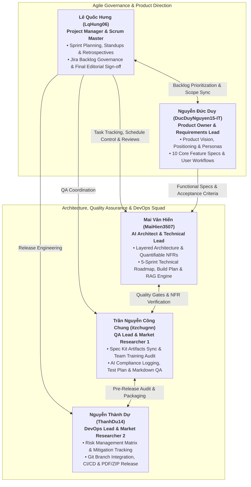
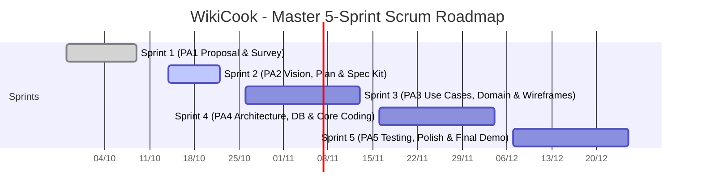
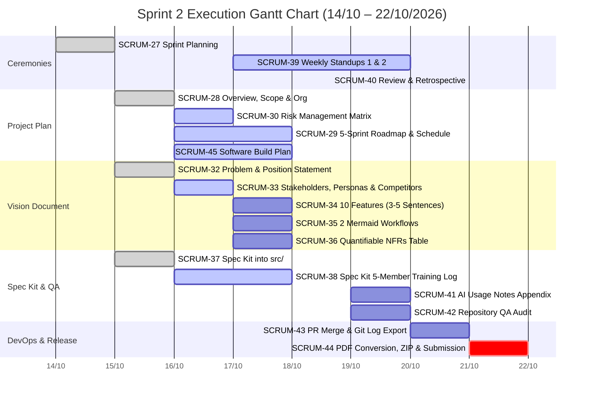
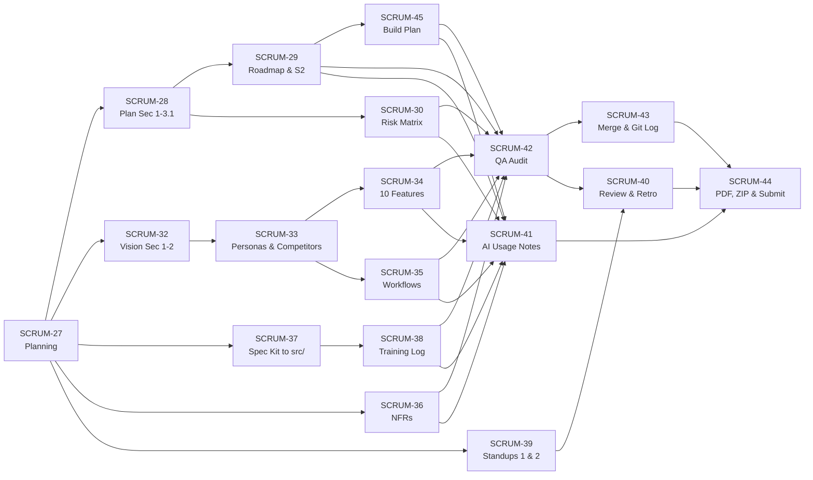
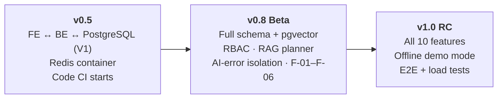
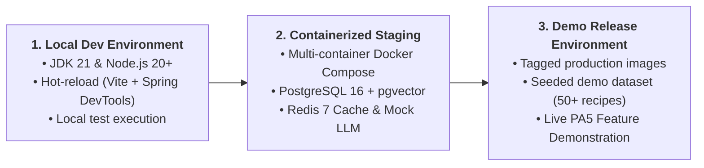

# SOFTWARE DEVELOPMENT PLAN (PROJECT PLAN): WIKICOOK

**Course:** CS300 - CSC13002 - Introduction to Software Engineering  
**Project Name:** WikiCook — Intelligent Culinary & Meal Planning Ecosystem  
**Team:** Group 06  
**Process Model:** Agile Scrum (5 Sprints, replacing the classic RUP lifecycle phases of the `rup_sdpln_sp.dot` template)  
**Document Version:** 1.0 (Sprint 02 Unified Baseline — Project Assignment 2)  
**Date:** October 16, 2026  

---

## DOCUMENT METADATA & RESPONSIBILITY MATRIX

| Section | Section Title | Performed by (Author) | Reviewed by | Edited by | Jira Task |
| :---: | :--- | :---: | :---: | :---: | :---: |
| **Section 1** | Introduction (Purpose, Scope, Definitions, References) | **Lê Quốc Hưng (LqHung06)** | **Nguyễn Thành Dự (ThanhDu14)** | **Lê Quốc Hưng (LqHung06)** | `SCRUM-28` |
| **Section 2** | Project Overview (Objectives, Assumptions, Deliverables) | **Lê Quốc Hưng (LqHung06)** | **Nguyễn Thành Dự (ThanhDu14)** | **Lê Quốc Hưng (LqHung06)** | `SCRUM-28` |
| **Section 3.1** | Organizational Structure, Roles & RACI Matrix | **Lê Quốc Hưng (LqHung06)** | **Nguyễn Thành Dự (ThanhDu14)** | **Lê Quốc Hưng (LqHung06)** | `SCRUM-28` |
| **Section 3.2** | Risk Management Matrix & Mitigation Strategies | **Nguyễn Thành Dự (ThanhDu14)** | **Trần Nguyễn Công Chung (itzchugnn)** | **Lê Quốc Hưng (LqHung06)** | `SCRUM-30` |
| **Section 4.1 – 4.3** | 5-Sprint Scrum Roadmap & Sprint 02 Task Schedule | **Mai Văn Hiển (MaiHien3507)** | **Lê Quốc Hưng (LqHung06)** | **Lê Quốc Hưng (LqHung06)** | `SCRUM-29` |
| **Section 4.4** | Software Build & Release Plan (v0.1 → v1.0 RC) | **Mai Văn Hiển (MaiHien3507)** | **Lê Quốc Hưng (LqHung06)** | **Lê Quốc Hưng (LqHung06)** | `SCRUM-45` |
| **Section 5** | Project Monitoring, Control & Definition of Done | **Lê Quốc Hưng (LqHung06)** | **Nguyễn Thành Dự (ThanhDu14)** | **Lê Quốc Hưng (LqHung06)** | `SCRUM-28` |
| **Appendices** | Jira Board Verification & Revision History | **Mai Văn Hiển & Trần Nguyễn Công Chung** | **Lê Quốc Hưng (LqHung06)** | **Lê Quốc Hưng (LqHung06)** | `SCRUM-29`, `SCRUM-42` |

### Revision History

| Date | Version | Description | Author |
| :---: | :---: | :--- | :--- |
| **14/10/2026** | `v0.1` | Initialized Project Plan structure based on RUP template adapted for Scrum. | Lê Quốc Hưng (`LqHung06`) |
| **15/10/2026** | `v0.5` | Authored Sections 1, 2, 3.1, and 5 (`SCRUM-28`) for PA2 initial draft. | Lê Quốc Hưng (`LqHung06`) |
| **16/10/2026** | `v0.8` | Integrated 5-Sprint Scrum roadmap, Sprint 2 schedule, and preliminary Sprints 3–5 (`SCRUM-29`). | Mai Văn Hiển (`MaiHien3507`) |
| **16/10/2026** | `v1.0` | Unified full baseline: merged Risk Matrix (`SCRUM-30`) and 5-stage Build Plan (`SCRUM-45`); eliminated section duplication and synchronized with Jira Board. | Lê Quốc Hưng (`LqHung06` — Chief Editor) |
| **19/10/2026** | `v1.1` | Section 4.4 (`SCRUM-45`): replaced LLM 5 s timeout and SQL fallback with spec 031 / Vision §7 metrics; added branch coverage, 5xx scope and LCP method. | Mai Văn Hiển (`MaiHien3507`) |
| **19/10/2026** | `v1.2` | Aligned ASM-02, RSK-02, and Sec 4.3.3 with Spec 031 and Constitution: removed obsolete deterministic/SQL fallback and fallback caching references; reaffirmed explicit AI error reporting with independent manual planning resilience. | Lê Quốc Hưng (`LqHung06`) |

---

## 1. INTRODUCTION
*Performed by: Lê Quốc Hưng (LqHung06) | Reviewed by: Nguyễn Thành Dự (ThanhDu14) | Edited by: Lê Quốc Hưng (LqHung06)*

### 1.1. Purpose
The purpose of this Software Development Plan (Project Plan) is to establish the managerial, organizational, and technical framework required to plan, execute, monitor, and control the development of the **WikiCook** web application across the Fall 2026–2027 semester. Adapted from the Rational Unified Process (RUP) Software Development Plan for Small Projects (`rup_sdpln_sp.dot`) and tailored to the **Agile Scrum** methodology mandated by **CS300 - CSC13002**, this document serves as the central operational reference for the entire engineering team:

- **The Project Manager & Scrum Master** uses this plan to allocate tasks across five iterative Sprints, monitor velocity on Jira Software Cloud, enforce quality gates, and mitigate schedule or technical risks.
- **Project Team Members** use this plan to understand their individual responsibilities, inter-task dependencies, branching conventions, build targets, and the Definition of Done (DoD) required at each milestone.
- **Course Instructors and Teaching Assistants (TAs)** use this plan to evaluate the realism of the team's schedule, workload fairness, and alignment with the live Jira Scrum board.

### 1.2. Scope
This Project Plan governs all software engineering activities for the **WikiCook** project from initial conception (**Sprint 1 / PA1**) through final product release and live feature demonstration (**Sprint 5 / PA5**). It defines the project objectives, assumptions, constraints, deliverable baselines, five-member organizational structure, RACI accountability matrix, risk management protocols, five-Sprint Scrum schedule, incremental build plan, and quality assurance standards.

In accordance with the **PA2-2026** specification, traditional RUP lifecycle phases (*Inception, Elaboration, Construction, Transition*) are omitted in favor of an iterative **5-Sprint Scrum process**, where each 2-to-3-week Sprint directly corresponds to one Project Assignment (`PA1` through `PA5`). Detailed task assignments are locked in for the current active sprint (**Sprint 2 / PA2**), while high-level backlog items and build milestones are established for **Sprints 3, 4, and 5** and will be refined in **PA3-2026** based on Teaching Assistant feedback.

### 1.3. Definitions, Acronyms, and Abbreviations

| Acronym / Term | Full Form / Definition |
| :--- | :--- |
| **AI / LLM** | Artificial Intelligence / Large Language Model (used for menu generation and nutritional analysis). |
| **BCrypt** | Adaptive cryptographic hash function used for secure password storage (cost factor 12). |
| **CI/CD** | Continuous Integration and Continuous Delivery automated via GitHub Actions and Docker. |
| **DoD** | Definition of Done — the mandatory checklist of quality criteria a task must pass before closing. |
| **DTO** | Data Transfer Object — immutable Java record used to isolate JPA entities from API boundaries. |
| **JWT** | JSON Web Token — stateless cryptographic token used for user authentication and session management. |
| **MoSCoW** | Prioritization framework categorizing features into *Must-have, Should-have, Could-have, Won't-have*. |
| **NFR** | Non-Functional Requirement — quantifiable system quality attributes (latency, throughput, security). |
| **PA1 – PA5** | Project Assignments 1 through 5 in course CS300 (corresponding to Sprints 1 through 5). |
| **PO / PM / SM** | Product Owner / Project Manager / Scrum Master. |
| **PWA / SPA** | Progressive Web Application / Single-Page Application built with React 18+ and Vite. |
| **RACI** | Responsibility Assignment Matrix (*Responsible, Accountable, Consulted, Informed*). |
| **RAG** | Retrieval-Augmented Generation — grounding LLM outputs via `pgvector` semantic similarity search. |
| **RBAC** | Role-Based Access Control (`Guest`, `Standard User`, `Culinary Creator`, `Platform Administrator`). |
| **SDD** | Spec-Driven Development — engineering workflow powered by GitHub Spec Kit (`.specify/` and `src/`). |

### 1.4. References
1. **Course Guidelines:** *CS300 - CSC13002 Project Assignment 1 (PA1-2026.pdf)*, *Project Assignment 2 (PA2-2026.pdf)*, *Weekly Reports Guide (Weekly Reports.pdf)*, and *AI Usage Guidelines (AI Usage Guidelines.pdf)*.
2. **Project Proposal & Market Survey (PA1 Baseline):** `docs/requirements/project-proposal.md` and `docs/requirements/existing-app-survey.md`.
3. **Vision Document (PA2 Companion Spec):** `docs/requirements/vision-document.md` (adapted from `rup_vision_sp.docx`).
4. **Team Charter & Governance:** `docs/management/team-contract.md` and `docs/management/group-registration.md`.
5. **Engineering Constitution & Architecture:** `docs/analysis-and-design/architecture.md` and GitHub Spec Kit `constitution.md` (`v1.0.0`).

### 1.5. Document Overview
The remainder of this document is structured into four primary chapters:
- **Section 2 (Project Overview):** Articulates the project purpose, functional scope, core objectives, technical/schedule assumptions, operational constraints, and the master schedule of deliverables across all five Sprints.
- **Section 3 (Project Organization & Risk Management):** Details the five-member cross-functional Scrum organization, role descriptions, RACI responsibility matrix, and the consolidated Risk Management Matrix.
- **Section 4 (Project Plan — Scrum Schedule & Build Plan):** Presents the 5-Sprint Scrum roadmap, the granular 18-task schedule for Sprint 2 (`SCRUM-27` to `SCRUM-45`), preliminary backlogs for Sprints 3–5, and the 5-stage incremental build plan culminating in the PA5 full-feature demo.
- **Section 5 (Project Monitoring, Control & Supporting Process Plans):** Defines requirements control via Spec Kit, Scrum reporting cadences, Git configuration management, and the team's Definition of Done (DoD).
- **Appendices:** Provides the Sprint 2 Jira task cross-check audit and document revision history.

---

## 2. PROJECT OVERVIEW
*Performed by: Lê Quốc Hưng (LqHung06) | Reviewed by: Nguyễn Thành Dự (ThanhDu14) | Edited by: Lê Quốc Hưng (LqHung06)*

### 2.1. Project Purpose, Scope, and Objectives

#### 2.1.1. Project Purpose
Urban professionals, independent university students, and busy homemakers lose an average of 15 to 30 minutes daily to meal decision fatigue (*"What should I cook today?"*), while existing culinary platforms suffer from intrusive advertisements, static serving sizes, fragmented grocery planning, and touch-heavy interfaces unsuitable for wet or messy hands in the kitchen. **WikiCook** is engineered to solve these challenges by delivering an intelligent, community-driven culinary web ecosystem that unifies pantry-based recipe discovery, AI-automated weekly meal planning, smart grocery aggregation, and hands-free cooking guidance.

#### 2.1.2. Project Scope
The functional and technical scope of **WikiCook** encompasses a responsive Single-Page Web Application (**React 18+ / Vite / Tailwind CSS**) backed by a stateless RESTful server (**Java 21 / Spring Boot 3.x / Spring Security 6**), relational and vector persistence (**PostgreSQL 16 + `pgvector` + Flyway**), in-memory rate-limiting and caching (**Redis 7.x**), and cloud LLM integration (**Retrieval-Augmented Generation**). Across the five Sprints, the system implements **10 core functional modules**:

1. **User Authentication, RBAC & Dietary Profile Management:** Secure registration/login (Email + BCrypt/JWT and Google OAuth 2.0), account lockout protection, and persistent dietary/allergen preferences.
2. **Smart Recipe Discovery & Multi-Criteria Filtering:** Full-text and pantry-ingredient matching filtered by prep time, cuisine, cooking method, difficulty, and caloric ceiling.
3. **AI Weekly Meal Planner (RAG Smart Chef):** Personalized 7-day menu generation grounded in verified PostgreSQL/`pgvector` recipes with single-click dish swapping.
4. **Automated Smart Shopping List:** Dynamic ingredient scaling and consolidation across selected meals, categorized by supermarket aisles with interactive check-offs.
5. **Distraction-Free Hands-Free Cooking Mode & Concurrent Timers:** High-contrast, full-screen step-by-step kitchen view with voice/keyboard navigation, Screen Wake Lock, and parallel countdown timers.
6. **Structured Community Recipe Authoring:** Rich creation studio for home chefs to publish structured ingredients, dynamic serving ratios, and step-by-step media.
7. **Social Cooksnaps & Verified Reviews:** Photo proof uploads (*Cooksnaps*), star ratings, and community feedback threads tied to verified recipe attempts.
8. **Custom Recipe Collections (Digital Cookbooks):** Personalized bookmarking and folder organization for favorite and seasonal dishes.
9. **AI Nutrition & Allergen Safety Analyzer:** Automated per-serving calorie/macronutrient estimation (`kcal`, protein, carbs, fat) and real-time allergen warning badges.
10. **Admin Content Moderation & Taxonomy Governance:** Dedicated back-office dashboard for reviewing user submissions, managing ingredient taxonomies, and handling abuse reports.

#### 2.1.3. Core Project Objectives
- **Objective 1 — Spec-Driven Engineering Rigor:** Maintain 100% alignment between requirements specifications (`.specify/`, `specs/`, Vision Document) and implementation artifacts before writing production code.
- **Objective 2 — High-Performance & Quantifiable Quality:** Achieve page load times `< 2.0s`, P95 REST API latency `< 500ms`, AI RAG generation `< 5.0s`, and automated unit/integration test coverage $\ge 70\%$ across business logic.
- **Objective 3 — Predictable Agile Delivery:** Complete 100% of committed Jira Sprint Backlog items at least 24–48 hours prior to every course PA deadline with zero critical formatting or build regressions.
- **Objective 4 — End-to-End Production Readiness by Sprint 5:** Deliver a fully containerized (`Docker Compose`), feature-complete release (`Build v1.0 RC`) ready for live demonstration during **PA5**.

### 2.2. Assumptions and Constraints

| Category | ID | Description & Operational Impact |
| :--- | :---: | :--- |
| **Schedule Constraint** | **CON-01** | The project must be completed within a strict **14-week academic semester** divided into 5 Sprints (`PA1`–`PA5`). Final submission dates on Moodle are hard deadlines. |
| **Team & Resource Constraint** | **CON-02** | The engineering team is fixed at **5 undergraduate students** who simultaneously manage coursework and midterm/final examinations in other university subjects. |
| **Budget & Infrastructure Constraint** | **CON-03** | Zero commercial budget ($0 USD). All infrastructure, hosting, databases, and AI APIs must operate within free-tier student/educational quotas (GitHub Education, Jira Free, Gemini/OpenAI Free Tier, local Docker containers). |
| **Process & Tooling Constraint** | **CON-04** | Every task must be tracked on **Jira Software Cloud** with a single assignee and explicit due date; all documents must be authored in **English Markdown (`.md`)** with **Mermaid** diagrams, 3-tier section metadata, and exported `.pdf` counterparts. |
| **AI Compliance Constraint** | **CON-05** | All AI tool interactions must be transparently logged with exact timestamps, prompts, AI outputs, human revisions, and chat history screenshots in accordance with `AI Usage Guidelines.pdf`. |
| **Technical Assumption** | **ASM-01** | All 5 team members possess working local development environments capable of running **JDK 21**, **Node.js 20+**, and **Docker Desktop** (for PostgreSQL 16 + `pgvector` and Redis 7). |
| **External API Assumption** | **ASM-02** | External LLM and embedding APIs remain accessible during development and demo windows. If an AI service error or timeout occurs, the system displays a clear error message while allowing users to continue using the manual weekly meal planner independently without data loss (per Spec 030 / Spec 031). |
| **Stakeholder Assumption** | **ASM-03** | Course Instructors and Teaching Assistants act as primary external stakeholders and provide timely feedback on **PA2** deliverables to guide revisions in **PA3**. |

### 2.3. Project Deliverables
The table below catalogues all major engineering and management deliverables produced across the five Sprints (`PA1` through `PA5`), their repository paths, target delivery dates, and primary owners:

| Sprint / Milestone | Deliverable Name | Repository Location / Format | Target Delivery Date | Lead Owner (Assignee) | Status |
| :---: | :--- | :--- | :---: | :--- | :---: |
| **Sprint 1 (PA1)** | Group Registration & Roster | `docs/management/group-registration.md` (`.md` & `.pdf`) | Oct 09, 2026 | Lê Quốc Hưng (`LqHung06`) | **Completed** |
| **Sprint 1 (PA1)** | Project Proposal (10 Modules & AI Flow) | `docs/requirements/project-proposal.md` (`.md` & `.pdf`) | Oct 09, 2026 | Nguyễn Đức Duy (`DucDuyNguyen15-IT`) | **Completed** |
| **Sprint 1 (PA1)** | Existing Application Survey | `docs/requirements/existing-app-survey.md` (`.md` & `.pdf`) | Oct 09, 2026 | Trần Nguyễn Công Chung & Nguyễn Thành Dự | **Completed** |
| **Sprint 1 (PA1)** | Team Contract & Governance Charter | `docs/management/team-contract.md` (`.md` & `.pdf`) | Oct 09, 2026 | Lê Quốc Hưng & Mai Văn Hiển | **Completed** |
| **Sprint 1 (PA1)** | Sprint 01 Report & AI Account Proofs | `docs/management/reports/sprint-01/sprint-01-report.md` | Oct 09, 2026 | Lê Quốc Hưng (`LqHung06`) | **Completed** |
| **Sprint 2 (PA2)** | **Project Plan v1.0 (Scrum & Build Plan)** | `docs/management/project-plan.md` (`.md` & `.pdf`) | **Oct 22, 2026** *(Moodle: Oct 24)* | Lê Quốc Hưng, Mai Văn Hiển, Nguyễn Thành Dự | **Completed** |
| **Sprint 2 (PA2)** | **Vision Document v1.0 (Features & NFRs)** | `docs/requirements/vision-document.md` (`.md` & `.pdf`) | **Oct 22, 2026** *(Moodle: Oct 24)* | Nguyễn Đức Duy & Mai Văn Hiển | **In Progress** |
| **Sprint 2 (PA2)** | **Spec Kit Artifacts & Training Log** | `src/` & `docs/management/spec-kit-training-log.md` | **Oct 22, 2026** *(Moodle: Oct 24)* | Trần Nguyễn Công Chung (`itzchugnn`) | **In Progress** |
| **Sprint 2 (PA2)** | **Sprint 02 Report & AI Usage Notes** | `docs/management/reports/sprint-02/sprint-02-report.md` | **Oct 22, 2026** *(Moodle: Oct 24)* | Lê Quốc Hưng & Trần Nguyễn Công Chung | **In Progress** |
| **Sprint 3 (PA3)** | Revised Project Plan v2.0 & Vision v2.0 | `docs/management/project-plan.md`, `vision-document.md` | Nov 13, 2026 *(Est.)* | Lê Quốc Hưng & Nguyễn Đức Duy | Planned |
| **Sprint 3 (PA3)** | Detailed Use Case Specifications & UI Wireframes | `docs/requirements/` & `docs/analysis-and-design/ui-ux/` | Nov 13, 2026 *(Est.)* | Nguyễn Đức Duy & Trần Nguyễn Công Chung | Planned |
| **Sprint 3 (PA3)** | Core Backend/Frontend Skeleton (`Build v0.5`) | `src/backend/`, `src/frontend/`, `docker-compose.yml` | Nov 13, 2026 *(Est.)* | Mai Văn Hiển & Nguyễn Thành Dự | Planned |
| **Sprint 4 (PA4)** | Software Architecture, DB Schema & Test Plan | `docs/analysis-and-design/architecture.md`, `docs/test/` | Dec 04, 2026 *(Est.)* | Mai Văn Hiển & Trần Nguyễn Công Chung | Planned |
| **Sprint 4 (PA4)** | Core Feature Implementation (`Build v0.8 Beta`) | `src/` (Auth, Recipe Search, AI Planner, Shopping List) | Dec 04, 2026 *(Est.)* | All 5 Full-Stack Engineers | Planned |
| **Sprint 5 (PA5)** | Final Integrated System (`Build v1.0 RC`) & Live Demo | `src/`, Full Test Suite ($\ge 70\%$ coverage), Demo Deck | Dec 25, 2026 *(Est.)* | All 5 Full-Stack Engineers | Planned |

---

## 3. PROJECT ORGANIZATION & RISK MANAGEMENT
*Performed by: Lê Quốc Hưng (LqHung06), Nguyễn Thành Dự (ThanhDu14) | Reviewed by: Nguyễn Thành Dự (ThanhDu14), Trần Nguyễn Công Chung (itzchugnn) | Edited by: Lê Quốc Hưng (LqHung06)*

### 3.1. Organizational Structure, Roles & RACI Matrix

#### 3.1.1. Cross-Functional Scrum Team Structure
In alignment with our ratified `team-contract.md` and course requirements, **all 5 members of Group 06 operate as Full-Stack Software Engineers** who participate in requirements specification, system design, coding, testing, and peer review. To eliminate coordination bottlenecks and establish clear accountability across the Scrum lifecycle, each member holds a primary leadership role:

#### 3.1.2. Detailed Member Roles and Responsibilities

| Student ID | Full Name & GitHub | Primary Scrum Role | Core Responsibilities in Sprint 2 (PA2) & Subsequent Sprints |
| :---: | :--- | :--- | :--- |
| **24120184** | **Lê Quốc Hưng** (`@LqHung06`) | **Project Manager & Scrum Master** | • Facilitates all 4 Scrum ceremonies per Sprint (Planning, Standup 1, Standup 2, Review/Retrospective) and records formal meeting minutes. • Configures and maintains the Jira Scrum Board (`SCRUM-27` to `SCRUM-45`), ensuring strict 1-person task ownership and schedule compliance. • Authors Project Plan Sections 1, 2, 3.1, and 5 (`SCRUM-28`) and Sprint 02 Report (`SCRUM-27`, `SCRUM-39`, `SCRUM-40`). • Serves as Chief Editor across all repository deliverables and leads final Moodle submission verification. |
| **24120294** | **Nguyễn Đức Duy** (`@DucDuyNguyen15-IT`) | **Product Owner & Requirements Lead** | • Owns the **Vision Document** (`docs/requirements/vision-document.md`), authoring Problem/Positioning Statements (`SCRUM-32`), Stakeholders/Personas & Competitive Analysis (`SCRUM-33`). • Specifies the 10 core product features in rigorous 3–5 sentence analytical paragraphs (`SCRUM-34`) and models end-to-end user workflow diagrams in Mermaid (`SCRUM-35`). • Leads Use Case modeling in Sprint 3 and frontend/backend feature implementation in Sprints 4–5. |
| **24120308** | **Mai Văn Hiển** (`@MaiHien3507`) | **AI Architect & Technical Lead** | • Defines quantifiable Non-Functional Requirements (performance, security, reliability, AI latency thresholds) in Section 7 of the Vision Document (`SCRUM-36`). • Designs the 5-Sprint Scrum execution roadmap, Sprint 2 task alignment (`SCRUM-29`), and the 5-stage Software Build & Release Plan (`SCRUM-45`). • Architects the Spring Boot 3.x + React 18 + PostgreSQL/`pgvector` RAG pipeline and leads core AI/backend development. |
| **24120272** | **Trần Nguyễn Công Chung** (`@itzchugnn`) | **QA Lead & Market Researcher 1** | • Synchronizes ratified GitHub Spec Kit artifacts (`constitution.md` and spec templates) into `WikiCook/src/` (`SCRUM-37`) and compiles the 5-member Spec Kit training evidence log (`SCRUM-38`). • Compiles the mandatory **AI Usage Notes** appendix (`SCRUM-41`) in strict compliance with course academic integrity rules. • Executes repository-wide Quality Assurance audits on Markdown formatting, 3-tier metadata headers, internal links, and Mermaid syntax (`SCRUM-42`). |
| **24120288** | **Nguyễn Thành Dự** (`@ThanhDu14`) | **DevOps Lead & Market Researcher 2** | • Formulates the Project Risk Management Matrix and mitigation protocols in Section 3.2 of the Project Plan (`SCRUM-30`). • Governs GitHub Flow branch protection (`main`), reviews/merges member Pull Requests, and exports verified Git commit logs (`SCRUM-43`). • Executes Markdown-to-PDF compilation, visual layout inspection, and `PA2-Group06.zip` release packaging (`SCRUM-44`), plus Docker/CI setup in Sprints 3–5. |

#### 3.1.3. RACI Responsibility Assignment Matrix
To prevent ambiguity and ensure multi-tier peer verification across every artifact, the team enforces the following **RACI Matrix** (* **R** = Responsible [Performs the work], **A** = Accountable [Final sign-off/Editor], **C** = Consulted [Peer Reviewer], **I** = Informed *):

| Workstream / Deliverable Artifact | Lê Quốc Hưng (`PM / SM`) | Nguyễn Đức Duy (`PO Lead`) | Mai Văn Hiển (`Tech Lead`) | Trần Nguyễn Công Chung (`QA Lead`) | Nguyễn Thành Dự (`DevOps Lead`) |
| :--- | :---: | :---: | :---: | :---: | :---: |
| **1. Sprint Planning, Jira Board & Ceremonies (`SCRUM-27`, `39`, `40`)** | **R / A** | **C** | **I** | **C** | **I** |
| **2. Project Plan: Overview, Org & Control (`SCRUM-28`)** | **R / A** | **I** | **I** | **I** | **C** |
| **3. Project Plan: Risk Management Matrix (`SCRUM-30`)** | **A** | **I** | **I** | **C** | **R** |
| **4. Project Plan: 5-Sprint Schedule & Build Plan (`SCRUM-29`, `45`)** | **A / C** | **I** | **R** | **I** | **I** |
| **5. Vision Doc: Positioning, Users & Competition (`SCRUM-32`, `33`)** | **A / C** | **R** | **I** | **C** | **I** |
| **6. Vision Doc: 10 Core Features & Workflows (`SCRUM-34`, `35`)** | **A** | **R** | **C** | **I** | **I** |
| **7. Vision Doc: Quantifiable NFRs (`SCRUM-36`)** | **A** | **I** | **R** | **I** | **C** |
| **8. Spec Kit `/src` Sync & 5-Member Training Log (`SCRUM-37`, `38`)** | **A / C** | **C** | **C** | **R** | **C** |
| **9. AI Usage Declaration & Repository QA Audit (`SCRUM-41`, `42`)** | **A / C** | **I** | **C** | **R** | **I** |
| **10. Git PR Merge, Commit Log, PDF Export & ZIP (`SCRUM-43`, `44`)** | **A / C** | **I** | **I** | **C** | **R** |

---

### 3.2. Risk Management Matrix & Mitigation Strategies
*Performed by: Nguyễn Thành Dự (ThanhDu14) | Reviewed by: Trần Nguyễn Công Chung (itzchugnn) | Edited by: Lê Quốc Hưng (LqHung06)*

To ensure predictable project execution across the 14-week semester, the team identifies, analyzes, and formulates mitigation protocols for both **project-wide risks** (`RSK-01` to `RSK-05`) and **active Sprint 2 operational risks** (`RSK-S2-01` to `RSK-S2-04`).

#### 3.2.1. Project-Wide Risk Matrix (`SCRUM-30`)

| Risk ID | Category | Risk Description | Likelihood | Impact | Severity | Early Warning Trigger | Mitigation & Contingency Strategy | Owner |
| :---: | :---: | :--- | :---: | :---: | :---: | :--- | :--- | :---: |
| **RSK-01** | **Operational / Team** | **Team Member Unavailability:** Members become unavailable due to university midterms/finals, illness, or overlapping course deadlines. | **Medium** | **High** | **High** | Member misses Standup or fails to update Jira task within 24h of due date. | **Pair-Engineering & Transparent Backlog:** Every task is granularly defined on Jira with explicit acceptance criteria. Designated peer reviewers (`C` in RACI) cross-audit work daily and can immediately step in to take over the branch. The team schedules a mandatory 48-hour buffer before all Moodle deadlines. | **Lê Quốc Hưng** |
| **RSK-02** | **Technical / AI** | **External AI API Rate-Limits & Latency Spikes:** Google Gemini or OpenAI free-tier APIs exceed rate quotas (RPM/TPM) or experience latency $> 5.0s$, causing RAG timeouts during development and live demo. | **Medium** | **High** | **High** | LLM API returns HTTP `429 Too Many Requests` or response time exceeds 4.0s in tests. | **Graceful AI Error Handling & Independent Manual Planner:** If the AI service fails or times out, the system displays a clear, informative error toast without crashing; manual weekly meal planning (Spec 030) remains 100% functional and independent (per Spec 031). A local mock LLM (`LLM_MODE=mock/offline`) is integrated for testing and demo resilience. | **Mai Văn Hiển** |
| **RSK-03** | **Scope / Schedule** | **Scope Creep & Feature Over-Expansion:** Ambition to build advanced features (voice synthesis, live video streaming, IoT smart pantry sensors) threatens completion of core functional modules before Sprint 5. | **Medium** | **High** | **High** | Development backlog velocity falls below 80% of committed Story Points during Sprint 3/4. | **Strict MoSCoW Prioritization:** Strictly freeze requirements under Spec Kit governance. Classify all 10 features into *Must-have* (Auth, Recipe Discovery, Meal Planner, Shopping List, Cooking Mode) and *Should/Could-have*. Only Must-have modules are required for the PA5 MVP demo. | **Nguyễn Đức Duy** |
| **RSK-04** | **Compliance / Academic** | **AI Usage Declaration Incompleteness:** A team member fails to log prompts, outputs, or screenshots of AI interactions, violating `AI Usage Guidelines.pdf` and risking a zero grade. | **Low** | **Critical** | **High** | Pull Request submitted without corresponding prompt logs or screenshots in `docs/assets/jira/ai_prompts/`. | **Pre-Commit Enforcement & QA Gate:** Enforce AI logging as a mandatory Definition of Done criterion. QA Lead (`itzchugnn`) audits all member submissions daily and compiles the consolidated Appendix before any sprint code is tagged. | **Trần Nguyễn Công Chung** |
| **RSK-05** | **Release / DevOps** | **Formatting Defects in Markdown-to-PDF Export:** Mermaid diagrams crop, tables overflow margins, or styling breaks during automated PDF generation prior to Moodle submission. | **Medium** | **Medium** | **Medium** | PDF build script generates visual warnings or clipped diagram blocks. | **Early Compilation & Visual Inspection:** DevOps Lead executes dry-run PDF conversions at least 48 hours before submission (`SCRUM-44`). All Mermaid blocks are validated for standard syntax and tested across Chrome Puppeteer and Pandoc PDF engines. | **Nguyễn Thành Dự** |

#### 3.2.2. Sprint 02 Specific Operational Risks

| ID | Operational Risk | Likelihood | Impact | Practical Mitigation Protocol |
| :---: | :--- | :---: | :---: | :--- |
| **RSK-S2-01** | **Editorial Review Bottleneck:** Chief Editor Lê Quốc Hưng reviews 7 tasks while authoring 4 tasks. | High | Medium | Distribute first-tier technical reviews to designated peer reviewers on Oct 19; Hưng performs only final integration sign-off. |
| **RSK-S2-02** | **Merge Conflicts on Core Markdown Files:** Multiple members simultaneously edit `project-plan.md` or `vision-document.md`. | Medium | Medium | Strict section-level modularity. Members edit only their designated sections on isolated branches; DevOps Lead orchestrates sequential merges into `main` via PRs (`SCRUM-43`). |
| **RSK-S2-03** | **Spec Kit Artifact Misplacement:** Placing Spec Kit files outside the required directory structure. | Low | High | QA Lead confirms `constitution.md` and spec templates reside directly inside `WikiCook/src/` per `PA2-2026.pdf` Sec C (`SCRUM-37`). |
| **RSK-S2-04** | **Missing 3–5 Sentence Paragraph Rule on Features:** Features formatted as simple bullet lists rather than complete analytical paragraphs. | Medium | High | Product Owner Nguyễn Đức Duy enforces the *What / Why / Who* 3–5 sentence paragraph structure in Section 5 of the Vision Document (`SCRUM-34`). |

---

## 4. PROJECT PLAN (SCRUM SCHEDULE & BUILD PLAN)
*Performed by: Mai Văn Hiển (MaiHien3507) | Reviewed by: Lê Quốc Hưng (LqHung06) | Edited by: Lê Quốc Hưng (LqHung06)*

As mandated by **PA2-2026**, WikiCook does **not** follow the traditional RUP lifecycle phases (*Inception, Elaboration, Construction, Transition*). Instead, the project is executed through **5 iterative Scrum Sprints**, each lasting 2–3 weeks and directly mapped to one course Project Assignment (`PA1` through `PA5`).

### 4.1. Five-Sprint Scrum Roadmap (PA1 – PA5)

#### 4.1.1. Scrum Governance Framework

| Scrum Element | Implementation in WikiCook |
| :--- | :--- |
| **Product Owner** | **Nguyễn Đức Duy** — owns the Product Backlog, prioritizes user stories, and signs off on functional specifications. |
| **Scrum Master / PM** | **Lê Quốc Hưng** — facilitates Scrum events, unblocks team members, enforces Jira tracking, and acts as Chief Editor. |
| **Development Squad** | **Mai Văn Hiển** (Tech Lead), **Trần Nguyễn Công Chung** (QA Lead), **Nguyễn Thành Dự** (DevOps Lead), plus PO and SM as full-stack engineers. |
| **Sprint Planning** | Held on Day 1 of each Sprint; commits to Sprint Goal and generates granular Jira backlog with single-assignee ownership. |
| **Daily / Weekly Scrum** | Held twice per Sprint on Google Meet; members report: (1) What was done? (2) What is next? (3) Any impediments? |
| **Sprint Review & Retro** | Held on the penultimate day of each Sprint; inspects increment, captures 100% Jira Done evidence, and defines actionable lessons. |
| **Scrum Artifacts** | Product Backlog, Sprint Backlog (Jira project `SCRUM`), Sprint Increment (PR merged to `main`), Sprint Report (`docs/management/reports/`). |
| **Engineering Tooling** | Jira Software Cloud, GitHub (`feature/*` → PR → `main`), Google Meet, GitHub Spec Kit (`.specify/` and `src/`). |

#### 4.1.2. Five-Sprint Lifecycle Roadmap

| Sprint Cycle | Duration | Academic Mapping | Core Sprint Goal & Milestone Deliverables |
| :---: | :---: | :---: | :--- |
| **Sprint 1** | 28/09/2026 – 09/10/2026 | **PA1** | Project Proposal, Existing Application Survey, Team Governance Charter, Git Repository Initialization. |
| **Sprint 2** | 14/10/2026 – 22/10/2026 | **PA2** | Vision Document (Features & NFRs), Project Plan (Scrum & Build Plan), Spec Kit `/src` Sync & Team Training Dossier. |
| **Sprint 3** | 26/10/2026 – 13/11/2026 *(Est.)* | **PA3** | Detailed Use Case Specifications (US-01–07), Domain Analysis Model, UI Wireframes & Navigation Map (`Build v0.5`). |
| **Sprint 4** | 16/11/2026 – 04/12/2026 *(Est.)* | **PA4** | Layered Software Architecture, PostgreSQL/`pgvector` Schema, Core Backend/Frontend Coding & Unit Tests (`Build v0.8 Beta`). |
| **Sprint 5** | 07/12/2026 – 25/12/2026 *(Est.)* | **PA5** | System Integration, Hands-Free Kitchen Mode, Social Cooksnaps, Test Suite ($\ge 70\%$), Final Demo Release (`Build v1.0 RC`). |

#### 4.1.3. Master Milestones

| Milestone ID | Milestone Description | Target Date | Verification & Completion Criteria |
| :---: | :--- | :---: | :--- |
| **M1** | PA1 Submission (Sprint 1 Close) | 09/10/2026 | Proposal, Market Survey, Team Contract, and Sprint 1 Report submitted to Moodle; Git & Jira initialized. |
| **M2** | Sprint 2 Planning & Backlog Lock | 14/10/2026 | 18 Jira tasks created (`SCRUM-27` to `SCRUM-45`) with single assignees, reviewers, and start/due dates. |
| **M3** | Sprint 2 Draft Freeze | 18/10/2026 | 100% drafts of Vision Doc, Project Plan (Sec 4.1–4.4), NFRs, Spec Kit training log completed across branches. |
| **M4** | Sprint 2 Review & Retrospective | 21/10/2026 | Deliverables inspected against DoD; 100% Jira Done status captured; PRs merged into `main` (`SCRUM-40`, `43`). |
| **M5** | PA2 Early Submission | 22/10/2026, 14:00 | `PA2-Group06.zip` uploaded to Moodle (48 hours ahead of hard deadline Oct 24) (`SCRUM-44`). |
| **M6** | PA3 Submission (Sprint 3 Close) | 13/11/2026 *(Est.)* | Use Case Specifications, Domain Model ERD, UI Wireframes approved; `Build v0.5` backend/frontend skeleton tagged. |
| **M7** | PA4 Submission (Sprint 4 Close) | 04/12/2026 *(Est.)* | Software Architecture Document, PostgreSQL schema, working core features merged, unit tests passing (`Build v0.8 Beta`). |
| **M8** | PA5 Live Demo & Release (Sprint 5 Close) | 25/12/2026 *(Est.)* | Full live feature demo presented; test coverage $\ge 70\%$; final release candidate tagged (`Build v1.0 RC`). |

---

### 4.2. Detailed Sprint 02 Plan & Jira Task Breakdown (`SCRUM-27` to `SCRUM-45`)

#### 4.2.1. Sprint 02 Goal & Scope

| Sprint Parameter | Specification Detail |
| :--- | :--- |
| **Jira Sprint Name** | `WikiCook - Complete Sprint2 PA2` |
| **Sprint Duration** | October 14, 2026 – October 22, 2026 (Internal target: 14:00 Oct 22 — 48h buffer before Oct 24 deadline) |
| **Sprint Goal** | Deliver 100% of the Vision Document, Project Plan (5-Sprint Scrum roadmap & Build Plan), Spec Kit `/src` sync, 5-member Spec Kit training evidence log, and Sprint 2 Report with AI Usage Notes meeting all course regulations. |
| **Total Jira Tasks** | **18 Tasks** (`SCRUM-27` through `SCRUM-45`; note that `SCRUM-31` is skipped/omitted on the live Jira Board). |

#### 4.2.2. Sprint 02 Granular Task Breakdown by Workstream

**A. Scrum Ceremonies & Agile Governance**

| Key | Task Summary | Assignee | Reviewer | Start | Due | Target Deliverable / Location |
| :---: | :--- | :---: | :---: | :---: | :---: | :--- |
| `SCRUM-27` | `[Ceremony] Tổ chức họp Sprint 2 Planning & Thiết lập Jira Backlog` | Lê Quốc Hưng | Nguyễn Đức Duy | 14/10 | **15/10** | `docs/management/reports/sprint-02/sprint-02-report.md` (Sec 1 & 2.1) |
| `SCRUM-39` | `[Ceremony] Tổ chức và ghi chép 2 buổi Daily/Weekly Scrum (Standup 1 & 2)` | Lê Quốc Hưng | Nguyễn Đức Duy | 17/10 | **20/10** | `docs/management/reports/sprint-02/sprint-02-report.md` (Sec 2.2 & 2.3) |
| `SCRUM-40` | `[Ceremony] Tổ chức họp Sprint 2 Review & Retrospective` | Lê Quốc Hưng | Trần Nguyễn Công Chung | 21/10 | **21/10** | `docs/management/reports/sprint-02/sprint-02-report.md` (Sec 2.4 & 5) |

**B. Project Plan Development**

| Key | Task Summary | Assignee | Reviewer | Start | Due | Target Deliverable / Location |
| :---: | :--- | :---: | :---: | :---: | :---: | :--- |
| `SCRUM-28` | `[Project-Plan] Soạn thảo Tổng quan dự án, Phạm vi & Cơ cấu nhóm (Sec 1-3.1)` | Lê Quốc Hưng | Nguyễn Thành Dự | 15/10 | **16/10** | `docs/management/project-plan.md` (Sec 1, 2, 3.1, 5) |
| `SCRUM-29` | `[Project-Plan] Xây dựng Lộ trình Kế hoạch 5 Sprints Scrum & Chi tiết Sprint 2 (Sec 4.1 - 4.3)` | Mai Văn Hiển | Lê Quốc Hưng | 16/10 | **18/10** | `docs/management/project-plan.md` (Sec 4.1–4.3) |
| `SCRUM-30` | `[Project-Plan] Nhận diện và Xây dựng Ma trận Quản trị rủi ro (Sec 3.2)` | Nguyễn Thành Dự | Trần Nguyễn Công Chung | 16/10 | **17/10** | `docs/management/project-plan.md` (Sec 3.2) |
| `SCRUM-45` | `[Project-Plan] Thiết kế Kế hoạch Đóng gói và Phát hành Phần mềm - Build Plan (Sec 4.4)` | Mai Văn Hiển | Lê Quốc Hưng | 16/10 | **18/10** | `docs/management/project-plan.md` (Sec 4.4) |

**C. Vision Document Specification**

| Key | Task Summary | Assignee | Reviewer | Start | Due | Target Deliverable / Location |
| :---: | :--- | :---: | :---: | :---: | :---: | :--- |
| `SCRUM-32` | `[Vision] Hoàn thiện Problem Statement và Product Position Statement (Sec 1-2)` | Nguyễn Đức Duy | Lê Quốc Hưng | 15/10 | **16/10** | `docs/requirements/vision-document.md` (Sec 1–2) |
| `SCRUM-33` | `[Vision] Mô tả chi tiết Stakeholders, User Personas và Đối thủ cạnh tranh (Sec 3-4)` | Nguyễn Đức Duy | Trần Nguyễn Công Chung | 16/10 | **17/10** | `docs/requirements/vision-document.md` (Sec 3–4) |
| `SCRUM-34` | `[Vision] Soạn thảo chi tiết 10 tính năng cốt lõi WikiCook (Sec 5)` | Nguyễn Đức Duy | Mai Văn Hiển | 17/10 | **18/10** | `docs/requirements/vision-document.md` (Sec 5) |
| `SCRUM-35` | `[Vision] Thiết kế 2 sơ đồ Mermaid minh họa User Workflows (Sec 6)` | Nguyễn Đức Duy | Mai Văn Hiển | 17/10 | **18/10** | `docs/requirements/vision-document.md` (Sec 6) |
| `SCRUM-36` | `[Vision] Xây dựng bảng Yêu cầu phi chức năng (NFRs) định lượng (Sec 7)` | Mai Văn Hiển | Nguyễn Thành Dự | 17/10 | **18/10** | `docs/requirements/vision-document.md` (Sec 7) |

**D. Spec Kit Initialization & Training**

| Key | Task Summary | Assignee | Reviewer | Start | Due | Target Deliverable / Location |
| :---: | :--- | :---: | :---: | :---: | :---: | :--- |
| `SCRUM-37` | `[Spec-Kit] Đồng bộ và đưa các artifacts của Spec Kit vào thư mục WikiCook/src/` | Trần Nguyễn Công Chung | Nguyễn Thành Dự | 15/10 | **16/10** | `src/constitution.md`, `src/README.md` |
| `SCRUM-38` | `[Spec-Kit] Hoàn thành đào tạo Spec Kit và lập Hồ sơ minh chứng 5 thành viên` | Trần Nguyễn Công Chung | Lê Quốc Hưng | 16/10 | **18/10** | `docs/management/spec-kit-training-log.md` & `docs/assets/spec-kit/` |

**E. Compliance & Quality Assurance**

| Key | Task Summary | Assignee | Reviewer | Start | Due | Target Deliverable / Location |
| :---: | :--- | :---: | :---: | :---: | :---: | :--- |
| `SCRUM-41` | `[Compliance] Lập Phụ lục Khai báo sử dụng AI (AI Usage Notes) chuẩn quy chế` | Trần Nguyễn Công Chung | Lê Quốc Hưng | 19/10 | **20/10** | `docs/management/reports/sprint-02/sprint-02-report.md` (Sec 4) |
| `SCRUM-42` | `[QA] Rà soát chéo chất lượng tài liệu, Metadata 3 cấp & Markdown` | Trần Nguyễn Công Chung | Mai Văn Hiển | 19/10 | **20/10** | Repository-wide QA across `docs/` and `src/` |

**F. DevOps, Packaging & Submission**

| Key | Task Summary | Assignee | Reviewer | Start | Due | Target Deliverable / Location |
| :---: | :--- | :---: | :---: | :---: | :---: | :--- |
| `SCRUM-43` | `[DevOps] Quản lý Git Flow, Merge PRs vào main & Xuất Git Commit Log` | Nguyễn Thành Dự | Lê Quốc Hưng | 20/10 | **21/10** | `docs/management/git-log.txt`, `docs/assets/jira/git_log.png` |
| `SCRUM-44` | `[DevOps] Chuyển đổi Markdown sang PDF, Đóng gói PA2-Group06.zip & Nộp bài` | Nguyễn Thành Dự | Lê Quốc Hưng | 21/10 | **22/10** | Final submission archive `PA2-Group06.zip` on Moodle |

#### 4.2.3. Workload Balance Summary

| Team Member | Primary Scrum Role | Authored Tasks | Task Keys | Assigned Peer Reviews |
| :--- | :--- | :---: | :--- | :---: |
| **Lê Quốc Hưng** | PM & Scrum Master | **4** | `SCRUM-27`, `SCRUM-28`, `SCRUM-39`, `SCRUM-40` | **7** |
| **Nguyễn Đức Duy** | PO & Requirements Lead | **4** | `SCRUM-32`, `SCRUM-33`, `SCRUM-34`, `SCRUM-35` | **2** |
| **Mai Văn Hiển** | Tech Lead & AI Architect | **3** | `SCRUM-29`, `SCRUM-36`, `SCRUM-45` | **3** |
| **Trần Nguyễn Công Chung** | QA Lead & Market Researcher 1 | **4** | `SCRUM-37`, `SCRUM-38`, `SCRUM-41`, `SCRUM-42` | **3** |
| **Nguyễn Thành Dự** | DevOps Lead & Market Researcher 2 | **3** | `SCRUM-30`, `SCRUM-43`, `SCRUM-44` | **3** |
| **Total Group 06** | | **18** | *(100% mapped to live Jira Board)* | **18** |

---

### 4.3. Sprint 02 Schedule, Dependencies & Preliminary Plan for Sprints 03–05

#### 4.3.1. Sprint 02 Day-by-Day Execution Timeline

| Date | Day | Scheduled Activities & Output Targets | Precondition | Jira Tasks |
| :---: | :---: | :--- | :--- | :---: |
| **14/10** | **Wed** | **Meeting 1: Sprint 2 Planning (20:00)**; 18 tasks published on Jira Backlog. | Sprint 2 kickoff. | `SCRUM-27` |
| **15/10** | **Thu** | Project Plan skeleton established; Spec Kit artifacts synced into `src/`; Vision Sec 1–2 drafted. | Tasks assigned on Jira. | `SCRUM-28`, `SCRUM-32`, `SCRUM-37` |
| **16/10** | **Fri** | Problem Statement & Position Statement complete; Project Plan Sec 1–3.1 complete; `src/README.md` created. | PA1 Proposal available. | `SCRUM-28`, `SCRUM-32`, `SCRUM-37` |
| **17/10** | **Sat** | Personas/Stakeholders complete; Risk Matrix complete; **Meeting 2: Weekly Standup 1 (20:30)**. | 3-day progress sync. | `SCRUM-30`, `SCRUM-33`, `SCRUM-39` |
| **18/10** | **Sun** | **100% Draft Freeze:** 10 Features (3–5 sentences), 2 Mermaid workflows, NFRs, 5-Sprint Roadmap, Build Plan, 5-member Spec Kit training log. | Full draft submission. | `SCRUM-29`, `SCRUM-34`, `SCRUM-35`, `SCRUM-36`, `SCRUM-38`, `SCRUM-45` |
| **19/10** | **Mon** | **Cross Peer-Review:** Peer reviews executed across branches; AI Usage Notes compilation and QA audit initiated. | Drafts complete. | `SCRUM-41`, `SCRUM-42` |
| **20/10** | **Tue** | **Meeting 3: Weekly Standup 2 (20:30)**; QA audit on links, metadata, and Mermaid; AI Usage Notes completed. | Peer review feedback applied. | `SCRUM-39`, `SCRUM-41`, `SCRUM-42` |
| **21/10** | **Wed** | **Meeting 4: Sprint Review & Retro (20:00)**; PRs merged into `main`; Git commit log exported; PDF compilation tested. | QA audit signed off. | `SCRUM-40`, `SCRUM-43`, `SCRUM-44` |
| **22/10** | **Thu** | **Submission (14:00):** Final `PA2-Group06.zip` uploaded to Moodle by PM (48 hours ahead of Oct 24 deadline). | ZIP package verified. | `SCRUM-44` |
| **23–24/10** | **Fri–Sat** | **Contingency Buffer:** 48-hour safety window absorbing potential network congestion or Moodle portal issues. | Submission completed. | Risk mitigation buffer. |

#### 4.3.2. Task Dependency Network & Critical Path Analysis

**Critical Path:** `SCRUM-27` $\to$ `SCRUM-32` $\to$ `SCRUM-33` $\to$ `SCRUM-34` $\to$ `SCRUM-42` $\to$ `SCRUM-43` $\to$ `SCRUM-44`.  
Any delay in authoring the 10 core features or the technical roadmap propagates directly into the QA audit and packaging steps. Therefore, progress on these items is reviewed daily and reported during Standup 1.

#### 4.3.3. Preliminary Backlog & Engineering Plan for Sprints 03, 04, and 05
*Note: This roadmap provides the forward engineering baseline for upcoming assignments and will be formally refined during the respective Sprint Planning ceremonies.*

**Sprint 3 — Use Case Specifications, Domain Analysis & UI Wireframes (PA3)** *(Proposed: 26/10 – 13/11/2026)*
- **Candidate User Stories:**
  - `US-01`: User registration and authentication with dietary preference initialization.
  - `US-02`: Multi-criteria pantry search matching ingredients on hand.
  - `US-03`: AI weekly meal plan generation based on dietary caloric ceiling.
  - `US-04`: Dynamic ingredient scaling and consolidated supermarket shopping list.
  - `US-05`: Community recipe submission with structured steps and ingredient quantities.
  - `US-06`: Distraction-free hands-free cooking view with concurrent countdown timers.
  - `US-07`: Admin moderation portal for recipe approval and taxonomy curation.
- **Engineering Deliverables:** Formal Use Case Specifications (Brief, Casual, Fully Dressed), Domain Model Diagram (conceptual class diagram), High-Fidelity UI Wireframes (Figma), Navigation Map, and `Build v0.5` architectural skeleton.

**Sprint 4 — Layered Architecture, Database Schema & Core Feature Coding (PA4)** *(Proposed: 16/11 – 04/12/2026)*
- **Candidate Engineering Tasks:**
  - Layered Architecture Document (Presentation, Application, Domain, Infrastructure).
  - PostgreSQL 16 Relational Schema & `pgvector` index configuration managed via Flyway.
  - RESTful API implementation in Spring Boot 3.x (Auth, Recipes, Meal Plans, Shopping Lists).
  - Frontend SPA implementation in React 18+ / Vite / Tailwind CSS.
  - External LLM integration service with graceful error reporting (manual planning remains fully functional if AI service fails, per Spec 030 / Spec 031).
  - Automated unit and integration testing achieving $\ge 70\%$ code coverage.
- **Deliverables:** Architecture Specification, Database ERD & DDL, `Build v0.8 Beta` running locally in Docker Compose.

**Sprint 5 — System Integration, Security Hardening & Final Live Demo (PA5)** *(Proposed: 07/12 – 25/12/2026)*
- **Candidate Engineering Tasks:**
  - Hands-Free cooking mode voice/keyboard navigation integration.
  - Social Cooksnap image upload and verified star rating system.
  - End-to-end integration and automated regression test execution.
  - Performance profiling against quantifiable NFR thresholds (P95 latency $< 500$ms, load time $< 2.0$s).
  - Production containerization (`docker-compose.yml`) and live demonstration preparation.
- **Deliverables:** Final Release Package (`Build v1.0 RC`), Test Execution Report, User Guide, and **Live Demonstration of 100% project features** during course evaluation.

---

### 4.4. Software Build and Release Plan
*Performed by: Mai Văn Hiển (MaiHien3507) | Reviewed by: Lê Quốc Hưng (LqHung06) | Edited by: Lê Quốc Hưng (LqHung06)*

In strict accordance with the **PA2-2026** instructions (*"specify how many builds you will produce for testing and when... note that the final sprint includes a demo of all project features"*), the team commits to **5 planned builds**, one per Sprint milestone: **2 documentation baselines** (`v0.1`, `v0.2`) and **3 executable software builds for testing** (`v0.5`, `v0.8 Beta`, `v1.0 RC`). Additional patch or release-candidate builds (e.g., `v0.8.0-beta.2`, `v1.0.0-rc.2`) are produced **only** to fix defects found while testing a planned build; they never add new scope.

#### 4.4.1. Versioning, Git Tagging & Release Notes Conventions

| Convention | Rule Applied in WikiCook |
| :--- | :--- |
| **Version Format** | Semantic Versioning `vMAJOR.MINOR.PATCH[-PRERELEASE]`. `MAJOR = 0` until the PA5 demo build is accepted; `PRERELEASE` is `beta.N` for Sprint 4 and `rc.N` for Sprint 5. |
| **Meaning of MINOR (why `v0.2` jumps to `v0.5`)** | The MINOR number marks **product maturity**, not a build counter: `0.1–0.2` = documentation baselines with no runnable code; `0.5` = the halfway point where the full stack runs end-to-end for the first time; `0.8` = Must-have core features working (Beta); `1.0` = feature-complete. Versions `0.3` and `0.4` are skipped on purpose because Sprint 3 delivers no intermediate code increment worth a separate release. |
| **Git Tags** | Annotated tags on the `main` commit that was submitted or demonstrated: `v0.1.0`, `v0.2.0`, `v0.5.0`, `v0.8.0-beta.1`, `v1.0.0-rc.1`. After the PA5 demo is accepted, the demonstrated RC commit is re-tagged `v1.0.0`. Tags are created only by the Release Owner (Sec 4.4.3) after the Acceptance Gate passes. |
| **Docker Image Tags** | From `v0.5` onward, every image is tagged with the same version as the Git tag (e.g., `wikicook-backend:0.8.0-beta.1`). Tagged images are never overwritten, so any earlier build can be redeployed. |
| **Release Notes** | Each tag gets a GitHub Release and an entry in the root `CHANGELOG.md` (*Keep a Changelog* format) containing: (1) build ID & date; (2) features (`F-xx`) and Jira keys included; (3) Flyway migration versions; (4) test summary (pass/fail counts, coverage %, k6 P95 latency); (5) known issues with severity; (6) rollback target (the previous stable tag). For `v0.1`/`v0.2`, the release notes are the Sprint Report and the Moodle ZIP. |
| **Defect Severity Scale** | **S1 Critical:** crash, data loss, security breach, or blocks a demo scenario. **S2 Major:** feature behaves incorrectly but a workaround exists. **S3 Minor:** cosmetic or low-impact issue. Acceptance gates below are stated in terms of this scale. |

#### 4.4.2. Five-Stage Incremental Build Schedule

| Build Version | Sprint Target | Target Release Date | Build Artifacts & Core Scope | Target Environment | Primary Verification & Test Objectives | Acceptance Gate Criteria (Measurable) |
| :---: | :---: | :---: | :--- | :--- | :--- | :--- |
| **`Build v0.1`** | **Sprint 1** | **09/10/2026** | Repository skeleton, `.gitignore`, PA1 documents (proposal, survey, team charter). **No application code.** | GitHub Repository / Markdown | Validate repository structure, `main` branch protection, and Markdown rendering. Documentation checks (`markdownlint`, relative-link check) are run by hand by the QA Lead; there is no automated code CI in Sprint 1. | All PA1 documents peer-reviewed and merged into `main`; `markdownlint` reports 0 errors; 0 broken relative links; PA1 ZIP submitted on time. |
| **`Build v0.2`** | **Sprint 2** | **22/10/2026** | Spec Kit framework in `WikiCook/src/` (`constitution.md`), Vision Document v1.0, Project Plan v1.0. **No application code.** | GitHub Repository / `src/` | Verify Spec Kit placement, 3-tier metadata, Mermaid rendering, and PDF conversion integrity. | 100% of PA2 deliverables pass the `SCRUM-42` QA checklist; 0 `markdownlint` errors; 0 broken links; every Mermaid diagram renders in both GitHub and PDF with 0 clipped blocks. |
| **`Build v0.5`** | **Sprint 3** | **13/11/2026** | Walking skeleton: Spring Boot 3.x project (layered packages, health endpoint), React 18 SPA skeleton (routing, API client), PostgreSQL 16 container with **Flyway `V1` baseline only** (schema history + `users` table), Redis 7 container. First automated code CI (GitHub Actions). | Local Docker Compose | Verify multi-tier connectivity (Frontend $\to$ Backend $\to$ PostgreSQL / Redis); CI builds and tests backend and frontend on every PR. | From a clean clone, `docker compose up` brings all 4 containers to `healthy` in $\le 5$ min; `GET /actuator/health` returns `UP` including `db` and `redis` components; SPA displays the health status; Flyway `V1` applies with 0 errors; CI pipeline green on `main`. |
| **`Build v0.8 Beta`** | **Sprint 4** | **04/12/2026** | Core services: **F-01** Auth (JWT/BCrypt) **with RBAC** for the 4 roles (`Guest`, `Standard User`, `Culinary Creator`, `Platform Administrator`); **F-02** Recipe Search; **F-03** AI Meal Planner with **RAG vector service** (`pgvector` column + index, embedding generation for seeded/new recipes, top-k retrieval, prompt assembly, LLM call with a 60 s hard limit; on AI failure the user sees an error and manual planning keeps working, with no SQL fallback); **F-04** Shopping List; **F-05** basic step-by-step view; **F-06** basic recipe authoring. **Full relational schema** (Flyway `V2…Vn`) and 50+ seeded recipes. | Docker Compose Local Staging (Mock LLM + real LLM) | Service-level unit tests, REST API integration tests (Testcontainers), RBAC permission matrix tests, RAG retrieval tests, and a test with the LLM disconnected (`LLM_MODE=offline`) followed by manual planner operations. | All in-scope user stories accepted by the PO; line and branch coverage each $\ge 70\%$ (JaCoCo) **for the `service` package of the modules implemented so far**; P95 $< 500$ ms for non-AI endpoints at 20 virtual users for 5 min (k6); AI weekly draft shown in $\le 30$ s for P90 of successful generations (hard limit 60 s); slot suggestions shown in $\le 3$ s for 90% of picker openings; RAG retrieval + prompt assembly (LLM call excluded) P95 $\le 5$ s; with the LLM disabled, an error is shown and 100% of manual planner actions still succeed; RBAC matrix 100% pass; 0 open S1 defects. |
| **`Build v1.0 RC`** | **Sprint 5** | **18/12/2026** *(RC tag)* → **25/12/2026** *(demo)* | Feature-complete release candidate: all **10 features** (adds **F-05** full hands-free mode with voice/keyboard and concurrent timers, **F-06** media & moderation flow, **F-07** Cooksnaps, **F-08** Collections, **F-09** AI Nutrition Analyzer, **F-10** Admin Dashboard); offline demo mode; demo seed snapshot. | Dockerized Demo Release (Sec 4.4.6) | Full regression suite, E2E smoke tests of demo scenarios D1–D10 (Playwright), load test at 100 concurrent users, and two demo dry runs (Sec 4.4.7). | All 10 features pass demo scenarios D1–D10 in **2 consecutive dry runs**; line and branch coverage each $\ge 70\%$ **across all backend business logic** (`service` package); at 100 concurrent users for 10 min: P95 $< 500$ ms (non-AI), error rate $< 1\%$ (HTTP 5xx, AI endpoints excluded); the AI thresholds of `v0.8` still hold (P90 draft $\le 30$ s, retrieval + prompt P95 $\le 5$ s); 95% of page loads reach LCP $\le 2.0$ s on the demo machine (Lighthouse, mobile profile, simulated 4G); 0 open S1/S2 defects; offline mode verified. |

#### 4.4.3. Build Ownership: Release, Testing & Acceptance Sign-off

| Build | Release Owner *(tags, packages, release notes)* | Integration Owner *(merges the stack)* | Test Owner *(plans & runs tests)* | Acceptance Sign-off |
| :---: | :--- | :--- | :--- | :--- |
| **`v0.1`** | Nguyễn Thành Dự (`ThanhDu14`) | — | Trần Nguyễn Công Chung (`itzchugnn`) | Lê Quốc Hưng (`LqHung06`) — PM |
| **`v0.2`** | Nguyễn Thành Dự (`SCRUM-44`) | — | Trần Nguyễn Công Chung (`SCRUM-42`) | Lê Quốc Hưng — PM |
| **`v0.5`** | Nguyễn Thành Dự | Mai Văn Hiển (`MaiHien3507`) — Tech Lead | Trần Nguyễn Công Chung | Mai Văn Hiển (technical) → Lê Quốc Hưng (final) |
| **`v0.8 Beta`** | Nguyễn Thành Dự | Mai Văn Hiển | Trần Nguyễn Công Chung | Nguyễn Đức Duy (`DucDuyNguyen15-IT`) — PO (functional) → Lê Quốc Hưng (final) |
| **`v1.0 RC`** | Nguyễn Thành Dự | Mai Văn Hiển | Trần Nguyễn Công Chung | Nguyễn Đức Duy — PO (all 10 features) → Lê Quốc Hưng (final, Go/No-Go for demo) |

*Rule:* a build is tagged only after the Test Owner publishes its test summary and both sign-off owners approve it in the Jira release ticket. Every feature author (all 5 members) fixes S1/S2 defects in their own module before the gate.

#### 4.4.4. Integration Roadmap per Build

`v0.1` and `v0.2` contain no runnable code, so integration starts at `v0.5`.

| Layer / Integration Point | `Build v0.5` (Sprint 3) | `Build v0.8 Beta` (Sprint 4) | `Build v1.0 RC` (Sprint 5) |
| :--- | :--- | :--- | :--- |
| **Frontend (React 18 SPA)** $\leftrightarrow$ **Backend** | Routing shell + API client calling `/actuator/health`. | Pages for F-01–F-06 wired to real REST APIs with JWT handling. | All 10 feature UIs; Screen Wake Lock, voice/keyboard navigation (F-05). |
| **Backend (Spring Boot 3.x)** | Layered package skeleton, health endpoint, OpenAPI stub. | JWT/BCrypt + RBAC (Spring Security method-level rules for 4 roles); REST APIs for F-01–F-06. | All endpoints; input validation, account lockout, rate limiting; admin APIs (F-10). |
| **Backend** $\leftrightarrow$ **PostgreSQL 16 / `pgvector`** | Flyway `V1` baseline only; `pgvector` image used, extension not yet used. | Full relational schema (Flyway `V2…Vn`); `vector` embedding column + similarity index; 50+ seeded recipes. | Migrations for Cooksnaps, Collections, moderation; frozen demo seed snapshot. |
| **Backend** $\leftrightarrow$ **Redis 7** | Container + health check only. | Rate limit on AI generation (5 counted generations per user in any rolling 60-minute window, spec 031 FR-025). | Rate limit on login/auth. |
| **Backend** $\leftrightarrow$ **LLM / Embedding API** | Not integrated (Mock LLM container only). | Embedding pipeline + RAG retrieval and prompt assembly for F-03; 60 s hard limit on generation; AI error reported while manual planning keeps working (no SQL fallback); Mock LLM in CI. | F-09 nutrition analysis via LLM; `LLM_MODE=live/mock/offline` switch for the demo. |
| **CI (GitHub Actions)** | Backend build + unit tests, frontend build + lint, Docker image build. | + Integration tests (Testcontainers), JaCoCo coverage report. | + E2E smoke (Playwright) on demo scenarios, k6 load test before RC tag. |

#### 4.4.5. Feature-to-Build Traceability & PA5 Demo Scenarios

Feature IDs follow the numbering of the 10 core modules in Section 2.1.2. MoSCoW priorities for F-06–F-10 are provisional and will be confirmed by the Product Owner in PA3.

| Feature ID | Feature | Priority | First Working In | Completed In | PA5 Demo Scenario |
| :---: | :--- | :---: | :---: | :---: | :--- |
| **F-01** | Authentication, RBAC & Dietary Profile | Must | `v0.8` | `v1.0` | **D1:** Register by email, set a "no peanuts, $\le 600$ kcal" profile; show a `Guest` denied recipe creation (HTTP `403`) and account lockout after repeated failed logins. |
| **F-02** | Smart Recipe Discovery & Filtering | Must | `v0.8` | `v1.0` | **D2:** Pantry search "egg, tomato" filtered by $\le 30$ min and *Easy*; results respect the dietary profile. |
| **F-03** | AI Weekly Meal Planner (RAG) | Must | `v0.8` | `v1.0` | **D3:** Generate a 7-day plan, swap one dish; switch `LLM_MODE=offline`, show the AI error message and that the manual calendar still works. |
| **F-04** | Smart Shopping List | Must | `v0.8` | `v1.0` | **D4:** Build a consolidated list from the plan, scale servings 2 $\to$ 4, check items off by aisle. |
| **F-05** | Hands-Free Cooking Mode & Timers | Must | `v0.8` *(basic step view)* | `v1.0` | **D5:** Cook a recipe in full-screen mode, navigate steps by voice/keyboard, run 2 timers in parallel. |
| **F-06** | Community Recipe Authoring | Should | `v0.8` *(basic form)* | `v1.0` | **D6:** A `Culinary Creator` publishes a structured recipe with photos; it enters the moderation queue. |
| **F-07** | Social Cooksnaps & Verified Reviews | Should | `v1.0` | `v1.0` | **D7:** Upload a Cooksnap photo and a star rating for a cooked recipe. |
| **F-08** | Recipe Collections (Digital Cookbooks) | Could | `v1.0` | `v1.0` | **D8:** Save recipes into a "Weeknight Dinners" collection and reopen it. |
| **F-09** | AI Nutrition & Allergen Analyzer | Should | `v1.0` | `v1.0` | **D9:** Show per-serving kcal/macros and a peanut allergen warning badge matching the D1 profile. |
| **F-10** | Admin Moderation & Taxonomy | Should | `v1.0` | `v1.0` | **D10:** An administrator approves the D6 recipe and resolves an abuse report. |

**Demo commitment:** `Build v1.0 RC` commits to demonstrating **all 10 features** (D1–D10) in one continuous storyline. The Must-have features **F-01–F-05** are the **minimum condition for a Go decision**: if a Should/Could feature still has an open S1 defect at code freeze, the demo proceeds, that feature is shown at its last stable state, and the defect is listed as a known issue in the release notes.

#### 4.4.6. Build Environments & Deployment Strategy

1. **Development Environment:** All developers run localized Spring Boot and Vite servers with hot-reload enabled. Developers execute unit tests locally prior to raising Pull Requests.
2. **Containerized Staging Environment (`docker-compose.yml`, from `v0.5`):** Replicates production dependencies locally via Docker Compose, including PostgreSQL 16 with the `pgvector` extension and Redis 7. Integrates a mock LLM service allowing integration testing without consuming external cloud API quotas. Builds `v0.5` and `v0.8 Beta` are tested here.
3. **Demo Release Environment (`Build v1.0 RC`):** A pre-configured, self-contained container stack running the tagged images with pre-seeded recipe data (50+ Vietnamese and international dishes), ensuring the live demonstration during **PA5** remains resilient against internet dropouts or third-party API throttling.

#### 4.4.7. Code Freeze, Demo Dry-Run & Contingency Plan

| Date | Checkpoint | Rule / Activity | Owner |
| :---: | :--- | :--- | :--- |
| **11/11/2026** | `v0.5` code freeze | Only `fix:` PRs allowed; tag `v0.5.0` on 13/11 after the gate passes. | Nguyễn Thành Dự |
| **30/11/2026** | `v0.8` feature freeze | No new user stories enter Sprint 4. | Lê Quốc Hưng |
| **02/12/2026** | `v0.8` code freeze | Tag `v0.8.0-beta.1`; Test Owner runs the full Beta test suite until 04/12. | Nguyễn Thành Dự & Trần Nguyễn Công Chung |
| **16/12/2026** | `v1.0` feature freeze | All 10 features merged into `main`; only S1/S2 fixes after this date. | Lê Quốc Hưng |
| **18/12/2026** | `v1.0` code freeze | Tag `v1.0.0-rc.1`; regression, E2E, and load tests run. | Nguyễn Thành Dự & Trần Nguyễn Công Chung |
| **20/12/2026** | Demo dry run #1 | Full D1–D10 run on staging, timed; defects logged in Jira. | All 5 members |
| **22/12/2026** | RC fix build (if needed) | Tag `v1.0.0-rc.2` with S1/S2 fixes only, approved by Tech Lead and QA Lead. | Mai Văn Hiển & Nguyễn Thành Dự |
| **23/12/2026** | Demo dry run #2 | Full D1–D10 run on the **primary and backup demo machines**, including one run in offline mode. | All 5 members |
| **24/12/2026** | Go/No-Go decision | PO and PM sign off the demonstrated RC; images exported for offline use. | Nguyễn Đức Duy & Lê Quốc Hưng |
| **25/12/2026** *(Est.)* | **PA5 Live Demo** | Demo of all 10 features; RC commit re-tagged `v1.0.0` after acceptance. | All 5 members |

**Contingency measures for the PA5 demo:**
1. **Last stable build:** The previous accepted tag (`v1.0.0-rc.N-1`, or `v0.8.0-beta.N` in the worst case) and its Docker images are kept ready; rollback means switching the image tags in `docker-compose.yml` and restarting the stack (target $\le 10$ min).
2. **Backup machine:** A second team laptop holds the same stack, loaded from images exported with `docker save` and the demo database snapshot, and is verified in dry run #2.
3. **If the LLM fails during the demo:** the demo runs on the **real LLM** (`LLM_MODE=live`). If the LLM fails mid-demo, the presenter (a) shows the AI error message and that the manual calendar is still usable (spec 031), then (b) switches to `LLM_MODE=mock` to present the rest of the flow, stating explicitly to the graders that the Mock LLM is in use. Nutrition data for demo recipes is pre-computed and stored in the database.
4. **Last resort:** A screen recording of dry run #2 covering D1–D10 is prepared in case both machines fail.

#### 4.4.8. Consistency Notes with Other Sections

| Topic | Other Section | How Section 4.4 Aligns |
| :--- | :--- | :--- |
| **CI timing** | Sec 3.1.2 places Docker/CI setup in Sprints 3–5. | Sprint 1–2 builds use documentation checks only (`markdownlint`, link check). Automated code CI starts with `Build v0.5`. |
| **Database schema** | Sec 4.3.3 places the full PostgreSQL schema and `pgvector` index in Sprint 4. | `Build v0.5` contains only the Flyway `V1` baseline; the full schema and `pgvector` arrive in `Build v0.8 Beta`. |
| **Coverage target** | Sec 2.3 and milestone M8 set $\ge 70\%$ coverage in Sprint 5. | `v0.8 Beta`: line and branch $\ge 70\%$ for implemented modules only; `v1.0 RC`: line and branch $\ge 70\%$ across all backend business logic, matching M8 and Vision NFR-MNT-01/02. |
| **Demo scope** | `RSK-03` requires only Must-have modules for the PA5 demo. | `v1.0 RC` commits to demonstrating all 10 features; Must-have F-01–F-05 is the minimum Go condition (Sec 4.4.5), so `RSK-03` remains the fallback, not the target. |

---

## 5. PROJECT MONITORING, CONTROL & SUPPORTING PROCESS PLANS
*Performed by: Lê Quốc Hưng (LqHung06) | Reviewed by: Nguyễn Thành Dự (ThanhDu14) | Edited by: Lê Quốc Hưng (LqHung06)*

### 5.1. Requirements Management & Spec-Driven Workflow
Requirements for **WikiCook** are governed through a dual baseline consisting of the **Vision Document** (`docs/requirements/vision-document.md`) and **GitHub Spec Kit** artifacts (`src/constitution.md` and feature specifications under `specs/`):

1. **Spec-First Mandate:** In accordance with Principle I of the WikiCook Constitution (`v1.0.0`), no feature implementation or database migration may begin until its functional specification, user stories, edge cases, and acceptance criteria are formally documented and peer-reviewed.
2. **Traceability & Change Control:** Every functional module (`F-01` through `F-10`) and Non-Functional Requirement (`NFR`) is mapped directly to Jira Backlog items (`SCRUM-*`). Any proposed change to baseline requirements during Sprints 3–5 must be raised during a Scrum Standup or Sprint Planning session, evaluated for scope impact using the **MoSCoW** method, approved by at least 3 of 5 members, and committed via a documented Pull Request.

### 5.2. Reporting, Measurement & Scrum Ceremonies
To maintain continuous visibility into project health and individual velocity, the team executes a structured cadence of **four formal Scrum ceremonies** per Sprint and tracks quantitative Agile metrics:

| Scrum Ceremony / Report | Frequency & Timing | Purpose & Tracked Metrics | Output Artifact |
| :--- | :--- | :--- | :--- |
| **1. Sprint Planning** | Day 1 of Sprint (e.g., Oct 14, 2026 — 20:00) | Define Sprint Goal, decompose deliverables into granular single-assignee Jira tasks, estimate effort, and set due dates. | Jira Active Sprint Board & Meeting 1 Minutes |
| **2. Daily/Weekly Scrum (Standup 1)** | Mid-Sprint Early Check (e.g., Oct 17, 2026 — 20:30) | Synchronize initial draft progress across all 5 members using the standard 3 Scrum questions (*Done? To do? Blockers?*). | Meeting 2 Minutes in Sprint Report |
| **3. Daily/Weekly Scrum (Standup 2)** | Pre-Release Check (e.g., Oct 20, 2026 — 20:30) | Verify 100% draft completion, review peer-audit findings, and resolve formatting or integration bottlenecks. | Meeting 3 Minutes in Sprint Report |
| **4. Sprint Review & Retrospective** | Sprint Close (e.g., Oct 21, 2026 — 20:00) | Inspect completed deliverables against Acceptance Criteria, capture Jira 100% `DONE` evidence, and define action items for the next Sprint. | Meeting 4 Minutes & Retrospective Analysis |

**Key Project Metrics Collected Weekly:**
- **Task Completion Velocity:** Ratio of `Done` vs. `In Progress` and `To Do` tasks on the Jira board against target due dates.
- **Git Contribution Balance:** Commit frequency, lines authored/reviewed, and Pull Request turnaround time across all 5 member branches (`Hung`, `Duy`, `Hien`, `Chung`, `ThanhDu14`).
- **Defect & Audit Resolution Rate:** Number of Markdown formatting defects, broken links, Mermaid syntax warnings, or code test failures identified and closed during QA (`SCRUM-42`).

### 5.3. Configuration Management & Release Baselines
All source code, Spec Kit templates, Markdown documentation, visual assets, and exported PDFs are version-controlled in the private GitHub repository (`ThanhDu14/WikiCook`) under strict configuration management rules:

1. **Branching & Pull Request Policy:** The `main` branch is protected and represents the verified release baseline. Each member develops on an isolated branch (`Hung`, `Duy`, `Hien`, `Chung`, `ThanhDu14` or `feature/scrum-*`) and submits Pull Requests that require peer review before merging.
2. **Commit Message Standard:** All commits strictly follow conventional prefixes (`feat:`, `fix:`, `docs:`, `style:`, `refactor:`) referencing the corresponding Jira issue key where applicable.
3. **Submission Baseline Packaging:** At the end of each Sprint (48 hours prior to the Moodle deadline), the DevOps Lead and Project Manager freeze the `main` branch, export the full commit graph (`docs/management/git-log.txt` and `docs/assets/jira/git_log.png`), compile all Markdown files to `.pdf`, and archive both `.md` and `.pdf` versions alongside `src/` into `PA[X]-Group06.zip`.

### 5.4. Quality Assurance & Definition of Done (DoD)
No Jira task in Sprint 2 or subsequent sprints may be transitioned to the **DONE** column until it satisfies all applicable criteria in the team's **Definition of Done (DoD)**:

| DoD Gate | Verification Criteria | Responsible Verifier |
| :--- | :--- | :--- |
| **1. Content & Scope Completeness** | The deliverable fulfills 100% of the prompt guidelines in `PA2-2026.pdf` and its assigned Jira Acceptance Criteria with zero placeholder text (`TBD` or `Lorem Ipsum`). | Assigned Task Author |
| **2. Academic English & Clarity** | Written in clear, professional US English with consistent domain terminology and zero grammatical or typographical errors. | Designated Peer Reviewer |
| **3. Three-Tier Header Metadata** | Every top-level section (`##`) immediately includes the standardized attribution line: `*Performed by: [Author] | Reviewed by: [Reviewer] | Edited by: Lê Quốc Hưng (LqHung06)*`. | QA Lead (`SCRUM-42`) |
| **4. Markdown & Mermaid Integrity** | All Markdown tables align cleanly, relative image paths resolve properly, and all Mermaid diagrams render without syntax errors or clipping in both GitHub and PDF outputs. | QA Lead & DevOps Lead |
| **5. AI Academic Integrity Compliance** | Any AI assistance used during drafting or diagramming is logged in the Sprint Report Appendix (`SCRUM-41`) with exact timestamps, prompts, revisions, and screenshot proofs. | All 5 Members & QA Lead |
| **6. Version Control & Jira Sync** | Changes are committed to the member's Git branch following conventional commit rules, merged into `main` via approved PR, and the corresponding Jira issue status is updated with accurate timestamps. | DevOps Lead & Scrum Master |

---

## APPENDICES
*Performed by: Mai Văn Hiển (MaiHien3507), Trần Nguyễn Công Chung (itzchugnn) | Reviewed by: Lê Quốc Hưng (LqHung06) | Edited by: Lê Quốc Hưng (LqHung06)*

### Appendix A. Sprint 02 Task Cross-Check Audit against Live Jira Board

| # | Jira Issue Key | Summary Title Matches Jira Board | Assigned Owner | Target Due Date | Document Section Reference | Audit Status |
| :---: | :---: | :---: | :---: | :---: | :---: | :---: |
| 1 | **`SCRUM-27`** | `[Ceremony] Tổ chức họp Sprint 2 Planning & Thiết lập Jira Backlog` | Lê Quốc Hưng | 15/10/2026 | Section 4.2.2 (A) & Sprint Report Sec 2.1 | **Verified (DONE)** |
| 2 | **`SCRUM-28`** | `[Project-Plan] Soạn thảo Tổng quan dự án, Phạm vi & Cơ cấu nhóm (Sec 1-3.1)` | Lê Quốc Hưng | 16/10/2026 | Section 1, 2, 3.1 & Section 5 | **Verified (DONE)** |
| 3 | **`SCRUM-29`** | `[Project-Plan] Xây dựng Lộ trình Kế hoạch 5 Sprints Scrum & Chi tiết Sprint 2 (Sec 4.1 - 4.3)` | Mai Văn Hiển | 18/10/2026 | Section 4.1, 4.2 & 4.3 | **Verified (DONE)** |
| 4 | **`SCRUM-30`** | `[Project-Plan] Nhận diện và Xây dựng Ma trận Quản trị rủi ro (Sec 3.2)` | Nguyễn Thành Dự | 17/10/2026 | Section 3.2 | **Verified (DONE)** |
| 5 | **`SCRUM-32`** | `[Vision] Hoàn thiện Problem Statement và Product Position Statement (Sec 1-2)` | Nguyễn Đức Duy | 16/10/2026 | Vision Doc Section 1–2 | **In Progress** |
| 6 | **`SCRUM-33`** | `[Vision] Mô tả chi tiết Stakeholders, User Personas và Đối thủ cạnh tranh (Sec 3-4)` | Nguyễn Đức Duy | 17/10/2026 | Vision Doc Section 3–4 | **In Progress** |
| 7 | **`SCRUM-34`** | `[Vision] Soạn thảo chi tiết 10 tính năng cốt lõi WikiCook (Sec 5)` | Nguyễn Đức Duy | 18/10/2026 | Vision Doc Section 5 | **Scheduled** |
| 8 | **`SCRUM-35`** | `[Vision] Thiết kế 2 sơ đồ Mermaid minh họa User Workflows (Sec 6)` | Nguyễn Đức Duy | 18/10/2026 | Vision Doc Section 6 | **Scheduled** |
| 9 | **`SCRUM-36`** | `[Vision] Xây dựng bảng Yêu cầu phi chức năng (NFRs) định lượng (Sec 7)` | Mai Văn Hiển | 18/10/2026 | Vision Doc Section 7 | **Scheduled** |
| 10 | **`SCRUM-37`** | `[Spec-Kit] Đồng bộ và đưa các artifacts của Spec Kit vào thư mục WikiCook/src/` | Trần Nguyễn Công Chung | 16/10/2026 | `WikiCook/src/` & `src/README.md` | **In Progress** |
| 11 | **`SCRUM-38`** | `[Spec-Kit] Hoàn thành đào tạo Spec Kit và lập Hồ sơ minh chứng 5 thành viên` | Trần Nguyễn Công Chung | 18/10/2026 | `docs/management/spec-kit-training-log.md` | **In Progress** |
| 12 | **`SCRUM-39`** | `[Ceremony] Tổ chức và ghi chép 2 buổi Daily/Weekly Scrum (Standup 1 & 2)` | Lê Quốc Hưng | 20/10/2026 | Sprint Report Sec 2.2 & 2.3 | **Scheduled** |
| 13 | **`SCRUM-40`** | `[Ceremony] Tổ chức họp Sprint 2 Review & Retrospective` | Lê Quốc Hưng | 21/10/2026 | Sprint Report Sec 2.4 & Sec 5 | **Scheduled** |
| 14 | **`SCRUM-41`** | `[Compliance] Lập Phụ lục Khai báo sử dụng AI (AI Usage Notes) chuẩn quy chế` | Trần Nguyễn Công Chung | 20/10/2026 | Sprint Report Section 4 | **Scheduled** |
| 15 | **`SCRUM-42`** | `[QA] Rà soát chéo chất lượng tài liệu, Metadata 3 cấp & Markdown` | Trần Nguyễn Công Chung | 20/10/2026 | Repository-wide across `docs/` | **Scheduled** |
| 16 | **`SCRUM-43`** | `[DevOps] Quản lý Git Flow, Merge PRs vào main & Xuất Git Commit Log` | Nguyễn Thành Dự | 21/10/2026 | `docs/management/git-log.txt` | **Scheduled** |
| 17 | **`SCRUM-44`** | `[DevOps] Chuyển đổi Markdown sang PDF, Đóng gói PA2-Group06.zip & Nộp bài` | Nguyễn Thành Dự | 22/10/2026 | Final `PA2-Group06.zip` on Moodle | **Scheduled** |
| 18 | **`SCRUM-45`** | `[Project-Plan] Thiết kế Kế hoạch Đóng gói và Phát hành Phần mềm - Build Plan (Sec 4.4)` | Mai Văn Hiển | 18/10/2026 | Section 4.4 | **Verified (DONE)** |

> *Audit Note:* Confirmed that `SCRUM-31` is not present on the Jira board; total active Sprint 02 scope consists of exactly 18 tasks matching the live board order.

### Appendix B. Master Document Revision History

| Revision | Date | Contributing Author(s) | Reviewer / Sign-off | Description of Modifications |
| :---: | :---: | :--- | :--- | :--- |
| **`v0.1`** | 14/10/2026 | Mai Văn Hiển & Lê Quốc Hưng | Lê Quốc Hưng | Initialized document skeleton and proposed 5-Sprint Scrum roadmap. |
| **`v0.5`** | 15/10/2026 | Lê Quốc Hưng (`LqHung06`) | Nguyễn Thành Dự | Completed Section 1 (Intro), Section 2 (Overview), Section 3.1 (Org & RACI), and Section 5 (DoD) under `SCRUM-28`. |
| **`v0.8`** | 16/10/2026 | Mai Văn Hiển (`MaiHien3507`) | Lê Quốc Hưng | Completed Section 4.1 (5-Sprint Roadmap), Section 4.2 (Sprint 2 Breakdown), and Section 4.3 (Schedule & Prelim Backlog) under `SCRUM-29`. |
| **`v1.0`** | 16/10/2026 | Nguyễn Thành Dự & Mai Văn Hiển | Lê Quốc Hưng (Chief Editor) | Integrated Section 3.2 Risk Management Matrix (`SCRUM-30`) and Section 4.4 Software Build Plan (`SCRUM-45`); resolved duplicate draft sections into a unified, publication-ready baseline. |
| **`v1.1`** | 19/10/2026 | Mai Văn Hiển (`MaiHien3507`) | Lê Quốc Hưng | Revised Section 4.4 (`SCRUM-45`) to match spec 031 and Vision §7: removed the LLM 5 s timeout and SQL fallback, added AI latency/RAG metrics and branch coverage, and rewrote the demo contingency for LLM failure. |
