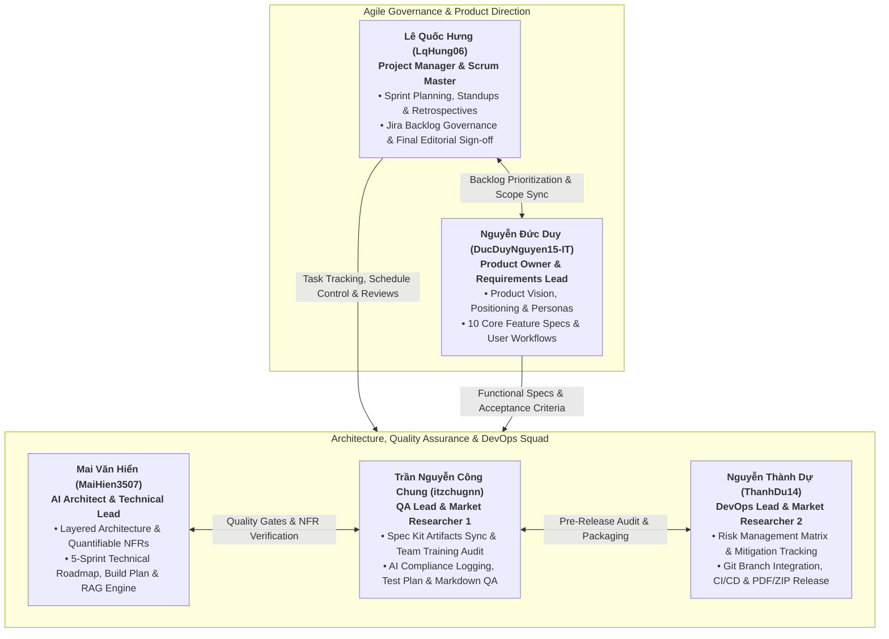

# SOFTWARE DEVELOPMENT PLAN (PROJECT PLAN): WIKICOOK

**Course:** CS300 - CSC13002 - Introduction to Software Engineering  
**Project Name:** WikiCook
**Document Version:** 1.0 (Initial Draft — Project Assignment 2)  
**Date:** October 16, 2026  

---

## DOCUMENT METADATA & RESPONSIBILITY MATRIX

| Section | Section Title | Performed by (Author) | Reviewed by | Edited by | Jira Task |
| :---: | :--- | :---: | :---: | :---: | :---: |
| **Section 1** | Introduction (Purpose, Scope, Definitions, References) | **Lê Quốc Hưng (LqHung06)** | **Nguyễn Thành Dự (ThanhDu14)** | **Lê Quốc Hưng (LqHung06)** | `SCRUM-28` |
| **Section 2** | Project Overview (Objectives, Assumptions, Deliverables) | **Lê Quốc Hưng (LqHung06)** | **Nguyễn Thành Dự (ThanhDu14)** | **Lê Quốc Hưng (LqHung06)** | `SCRUM-28` |
| **Section 3.1** | Organizational Structure, Roles & RACI Matrix | **Lê Quốc Hưng (LqHung06)** | **Nguyễn Thành Dự (ThanhDu14)** | **Lê Quốc Hưng (LqHung06)** | `SCRUM-28` |
| **Section 3.2** | Risk Management Matrix & Mitigation Strategies | **Nguyễn Thành Dự (ThanhDu14)** | **Trần Nguyễn Công Chung (itzchugnn)** | **Lê Quốc Hưng (LqHung06)** | `SCRUM-30` |
| **Section 4.1 - 4.3** | 5-Sprint Scrum Roadmap & Sprint 02 Task Schedule | **Mai Văn Hiển (MaiHien3507)** | **Lê Quốc Hưng (LqHung06)** | **Lê Quốc Hưng (LqHung06)** | `SCRUM-29` |
| **Section 4.4** | Software Build & Release Plan | **Mai Văn Hiển (MaiHien3507)** | **Lê Quốc Hưng (LqHung06)** | **Lê Quốc Hưng (LqHung06)** | `SCRUM-45` |
| **Section 5** | Project Monitoring, Control & Definition of Done | **Lê Quốc Hưng (LqHung06)** | **Nguyễn Thành Dự (ThanhDu14)** | **Lê Quốc Hưng (LqHung06)** | `SCRUM-28` |

### Revision History

| Date | Version | Description | Author |
| :---: | :---: | :--- | :--- |
| **15/10/2026** | `v0.1` | Initialized Project Plan structure based on RUP Small Project template adapted for Scrum. | Lê Quốc Hưng (`LqHung06`) |
| **16/10/2026** | `v1.0` | Completed Sections 1, 2, 3.1, and 5 (`SCRUM-28`) for PA2 initial submission. | Lê Quốc Hưng (`LqHung06`) |

---

## 1. INTRODUCTION
*Performed by: Lê Quốc Hưng (LqHung06) | Reviewed by: Nguyễn Thành Dự (ThanhDu14) | Edited by: Lê Quốc Hưng (LqHung06)*

### 1.1. Purpose
The purpose of this Software Development Plan (Project Plan) is to establish the managerial, organizational, and technical framework required to plan, execute, monitor, and control the development of the **WikiCook** web application across the Fall 2026–2027 semester. Adapted from the Rational Unified Process (RUP) Software Development Plan for Small Projects and tailored to the **Agile Scrum** methodology mandated by **CS300 - CSC13002**, this document serves as the central operational reference for the entire engineering team:

- **The Project Manager & Scrum Master** uses this plan to allocate tasks across five iterative Sprints, monitor velocity on Jira Software Cloud, enforce quality gates, and mitigate schedule or technical risks.
- **Project Team Members** use this plan to understand their individual responsibilities, inter-task dependencies, branching conventions, build targets, and the Definition of Done (DoD) required at each milestone.
- **Course Instructors and Teaching Assistants (TAs)** use this plan to evaluate the realism of the team's schedule, workload fairness, and alignment with the live Jira Scrum board.

### 1.2. Scope
This Project Plan governs all software engineering activities for the **WikiCook** project from initial conception (**Sprint 1 / PA1**) through final product release and live feature demonstration (**Sprint 5 / PA5**). It defines the project objectives, assumptions, constraints, deliverable baselines, five-member organizational structure, RACI accountability matrix, risk management protocols, five-Sprint Scrum schedule, incremental build plan, and quality assurance standards.

In accordance with the **PA2-2026** specification, traditional RUP lifecycle phases (*Inception, Elaboration, Construction, Transition*) are omitted in favor of an iterative **5-Sprint Scrum process**, where each 2-to-3-week Sprint directly corresponds to one Project Assignment (`PA1` through `PA5`). Detailed task assignments are locked in for the current active sprint (**Sprint 2 / PA2**), while high-level backlog items and build milestones are established for **Sprints 3, 4, and 5** and will be refined in **PA3-2026** based on Teaching Assistant feedback.

### 1.3. Definitions, Acronyms, and Abbreviations

| Acronym / Term | Full Form / Definition |
| :--- | :--- |
| **AI / LLM** | Artificial Intelligence / Large Language Model (used for menu generation and nutritional analysis). |
| **BCrypt** | Adaptive cryptographic hash function used for secure password storage (cost factor 12). |
| **CI/CD** | Continuous Integration and Continuous Delivery automated via GitHub Actions and Docker. |
| **DoD** | Definition of Done — the mandatory checklist of quality criteria a task must pass before closing. |
| **DTO** | Data Transfer Object — immutable Java record used to isolate JPA entities from API boundaries. |
| **JWT** | JSON Web Token — stateless cryptographic token used for user authentication and session management. |
| **MoSCoW** | Prioritization framework categorizing features into *Must-have, Should-have, Could-have, Won't-have*. |
| **NFR** | Non-Functional Requirement — quantifiable system quality attributes (latency, throughput, security). |
| **PA1 – PA5** | Project Assignments 1 through 5 in course CS300 (corresponding to Sprints 1 through 5). |
| **PO / PM / SM** | Product Owner / Project Manager / Scrum Master. |
| **PWA / SPA** | Progressive Web Application / Single-Page Application built with React 18+ and Vite. |
| **RACI** | Responsibility Assignment Matrix (*Responsible, Accountable, Consulted, Informed*). |
| **RAG** | Retrieval-Augmented Generation — grounding LLM outputs via `pgvector` semantic similarity search. |
| **RBAC** | Role-Based Access Control (`Guest`, `Standard User`, `Culinary Creator`, `Platform Administrator`). |
| **SDD** | Spec-Driven Development — engineering workflow powered by GitHub Spec Kit (`.specify/` and `src/`). |

### 1.4. References
1. **Course Guidelines:** *CS300 - CSC13002 Project Assignment 1 (PA1-2026.pdf)*, *Project Assignment 2 (PA2-2026.pdf)*, *Weekly Reports Guide (Weekly Reports.pdf)*, and *AI Usage Guidelines (AI Usage Guidelines.pdf)*.
2. **Project Proposal & Market Survey (PA1 Baseline):** `docs/requirements/project-proposal.md` and `docs/requirements/existing-app-survey.md`.
3. **Vision Document (PA2 Companion Spec):** `docs/requirements/vision-document.md` (adapted from `rup_vision_sp.docx`).
4. **Team Charter & Governance:** `docs/management/team-contract.md` and `docs/management/group-registration.md`.
5. **Engineering Constitution & Architecture:** `docs/analysis-and-design/architecture.md` and GitHub Spec Kit `constitution.md` (`v1.0.0`).

### 1.5. Document Overview
The remainder of this document is structured into four primary chapters:
- **Section 2 (Project Overview):** Articulates the project purpose, functional scope, core objectives, technical/schedule assumptions, operational constraints, and the master schedule of deliverables across all five Sprints.
- **Section 3 (Project Organization):** Details the five-member cross-functional Scrum organization, role descriptions, RACI responsibility matrix, and risk management strategies.
- **Section 4 (Project Plan — Scrum Schedule & Build Plan):** Presents the 5-Sprint Scrum roadmap, the granular 18-task schedule for Sprint 2 (`SCRUM-27` to `SCRUM-45`), preliminary backlogs for Sprints 3–5, and the 5-stage incremental build plan culminating in the PA5 full-feature demo.
- **Section 5 (Project Monitoring, Control & Supporting Process Plans):** Defines requirements control via Spec Kit, Scrum reporting cadences, Git configuration management, and the team's Definition of Done (DoD).

---

## 2. PROJECT OVERVIEW
*Performed by: Lê Quốc Hưng (LqHung06) | Reviewed by: Nguyễn Thành Dự (ThanhDu14) | Edited by: Lê Quốc Hưng (LqHung06)*

### 2.1. Project Purpose, Scope, and Objectives

#### 2.1.1. Project Purpose
Urban professionals, independent university students, and busy homemakers lose an average of 15 to 30 minutes daily to meal decision fatigue (*"What should I cook today?"*), while existing culinary platforms suffer from intrusive advertisements, static serving sizes, fragmented grocery planning, and touch-heavy interfaces unsuitable for wet or messy hands in the kitchen. **WikiCook** is engineered to solve these challenges by delivering an intelligent, community-driven culinary web ecosystem that unifies pantry-based recipe discovery, AI-automated weekly meal planning, smart grocery aggregation, and hands-free cooking guidance.

#### 2.1.2. Project Scope
The functional and technical scope of **WikiCook** encompasses a responsive Single-Page Web Application (**React 18+ / Vite / Tailwind CSS**) backed by a stateless RESTful server (**Java 21 / Spring Boot 3.x / Spring Security 6**), relational and vector persistence (**PostgreSQL 16 + `pgvector` + Flyway**), in-memory rate-limiting and caching (**Redis 7.x**), and cloud LLM integration (**Retrieval-Augmented Generation**). Across the five Sprints, the system implements **10 core functional modules**:

1. **User Authentication, RBAC & Dietary Profile Management:** Secure registration/login (Email + BCrypt/JWT and Google OAuth 2.0), account lockout protection, and persistent dietary/allergen preferences.
2. **Smart Recipe Discovery & Multi-Criteria Filtering:** Full-text and pantry-ingredient matching filtered by prep time, cuisine, cooking method, difficulty, and caloric ceiling.
3. **AI Weekly Meal Planner (RAG Smart Chef):** Personalized 7-day menu generation grounded in verified PostgreSQL/`pgvector` recipes with single-click dish swapping.
4. **Automated Smart Shopping List:** Dynamic ingredient scaling and consolidation across selected meals, categorized by supermarket aisles with interactive check-offs.
5. **Distraction-Free Hands-Free Cooking Mode & Concurrent Timers:** High-contrast, full-screen step-by-step kitchen view with voice/keyboard navigation, Screen Wake Lock, and parallel countdown timers.
6. **Structured Community Recipe Authoring:** Rich creation studio for home chefs to publish structured ingredients, dynamic serving ratios, and step-by-step media.
7. **Social Cooksnaps & Verified Reviews:** Photo proof uploads (*Cooksnaps*), star ratings, and community feedback threads tied to verified recipe attempts.
8. **Custom Recipe Collections (Digital Cookbooks):** Personalized bookmarking and folder organization for favorite and seasonal dishes.
9. **AI Nutrition & Allergen Safety Analyzer:** Automated per-serving calorie/macronutrient estimation (`kcal`, protein, carbs, fat) and real-time allergen warning badges.
10. **Admin Content Moderation & Taxonomy Governance:** Dedicated back-office dashboard for reviewing user submissions, managing ingredient taxonomies, and handling abuse reports.

#### 2.1.3. Core Project Objectives
- **Objective 1 — Spec-Driven Engineering Rigor:** Maintain 100% alignment between requirements specifications (`.specify/`, `specs/`, Vision Document) and implementation artifacts before writing production code.
- **Objective 2 — High-Performance & Quantifiable Quality:** Achieve page load times `< 2.0s`, P95 REST API latency `< 500ms`, AI RAG generation `< 5.0s`, and automated unit/integration test coverage $\ge 70\%$ across business logic.
- **Objective 3 — Predictable Agile Delivery:** Complete 100% of committed Jira Sprint Backlog items atleast 24–48 hours prior to every course PA deadline with zero critical formatting or build regressions.
- **Objective 4 — End-to-End Production Readiness by Sprint 5:** Deliver a fully containerized (`Docker Compose`), feature-complete release (`Build v1.0 RC`) ready for live demonstration during **PA5**.

### 2.2. Assumptions and Constraints

| Category | ID | Description & Operational Impact |
| :--- | :---: | :--- |
| **Schedule Constraint** | **CON-01** | The project must be completed within a strict **14-week academic semester** divided into 5 Sprints (`PA1`–`PA5`). Final submission dates on Moodle are hard deadlines. |
| **Team & Resource Constraint** | **CON-02** | The engineering team is fixed at **5 undergraduate students** who simultaneously manage coursework and midterm/final examinations in other university subjects. |
| **Budget & Infrastructure Constraint** | **CON-03** | Zero commercial budget ($0 USD). All infrastructure, hosting, databases, and AI APIs must operate within free-tier student/educational quotas (GitHub Education, Jira Free, Gemini/OpenAI Free Tier, local Docker containers). |
| **Process & Tooling Constraint** | **CON-04** | Every task must be tracked on **Jira Software Cloud** with a single assignee and explicit due date; all documents must be authored in **English Markdown (`.md`)** with **Mermaid** diagrams, 3-tier section metadata, and exported `.pdf` counterparts. |
| **AI Compliance Constraint** | **CON-05** | All AI tool interactions must be transparently logged with exact timestamps, prompts, AI outputs, human revisions, and chat history screenshots in accordance with `AI Usage Guidelines.pdf`. |
| **Technical Assumption** | **ASM-01** | All 5 team members possess working local development environments capable of running **JDK 21**, **Node.js 20+**, and **Docker Desktop** (for PostgreSQL 16 + `pgvector` and Redis 7). |
| **External API Assumption** | **ASM-02** | External LLM and embedding APIs remain accessible during development and demo windows; Redis caching and deterministic fallback logic will absorb temporary rate-limit spikes. |
| **Stakeholder Assumption** | **ASM-03** | Course Instructors and Teaching Assistants act as primary external stakeholders and provide timely feedback on **PA2** deliverables to guide revisions in **PA3**. |

### 2.3. Project Deliverables
The table below catalogues all major engineering and management deliverables produced across the five Sprints (`PA1` through `PA5`), their repository paths, target delivery dates, and primary owners:

| Sprint / Milestone | Deliverable Name | Repository Location / Format | Target Delivery Date | Lead Owner (Assignee) | Status |
| :---: | :--- | :--- | :---: | :--- | :---: |
| **Sprint 1 (PA1)** | Group Registration & Roster | `docs/management/group-registration.md` (`.md` & `.pdf`) | Oct 09, 2026 | Lê Quốc Hưng (`LqHung06`) | **Completed** |
| **Sprint 1 (PA1)** | Project Proposal (10 Modules & AI Flow) | `docs/requirements/project-proposal.md` (`.md` & `.pdf`) | Oct 09, 2026 | Nguyễn Đức Duy (`DucDuyNguyen15-IT`) | **Completed** |
| **Sprint 1 (PA1)** | Existing Application Survey | `docs/requirements/existing-app-survey.md` (`.md` & `.pdf`) | Oct 09, 2026 | Trần Nguyễn Công Chung & Nguyễn Thành Dự | **Completed** |
| **Sprint 1 (PA1)** | Team Contract & Governance Charter | `docs/management/team-contract.md` (`.md` & `.pdf`) | Oct 09, 2026 | Lê Quốc Hưng & Mai Văn Hiển | **Completed** |
| **Sprint 1 (PA1)** | Sprint 01 Report & AI Account Proofs | `docs/management/reports/sprint-01/sprint-01-report.md` | Oct 09, 2026 | Lê Quốc Hưng (`LqHung06`) | **Completed** |
| **Sprint 2 (PA2)** | **Project Plan v1.0 (Scrum & Build Plan)** | `docs/management/project-plan.md` (`.md` & `.pdf`) | **Oct 22, 2026** *(Moodle: Oct 24)* | Lê Quốc Hưng, Mai Văn Hiển, Nguyễn Thành Dự | **In Progress** |
| **Sprint 2 (PA2)** | **Vision Document v1.0 (Features & NFRs)** | `docs/requirements/vision-document.md` (`.md` & `.pdf`) | **Oct 22, 2026** *(Moodle: Oct 24)* | Nguyễn Đức Duy & Mai Văn Hiển | **In Progress** |
| **Sprint 2 (PA2)** | **Spec Kit Artifacts & Training Log** | `src/` & `docs/management/spec-kit-training-log.md` | **Oct 22, 2026** *(Moodle: Oct 24)* | Trần Nguyễn Công Chung (`itzchugnn`) | **In Progress** |
| **Sprint 2 (PA2)** | **Sprint 02 Report & AI Usage Notes** | `docs/management/reports/sprint-02/sprint-02-report.md` | **Oct 22, 2026** *(Moodle: Oct 24)* | Lê Quốc Hưng & Trần Nguyễn Công Chung | **In Progress** |
| **Sprint 3 (PA3)** | Revised Project Plan v2.0 & Vision v2.0 | `docs/management/project-plan.md`, `vision-document.md` | Nov 14, 2026 *(Est.)* | Lê Quốc Hưng & Nguyễn Đức Duy | Planned |
| **Sprint 3 (PA3)** | Detailed Use Case Specifications & UI Wireframes | `docs/requirements/` & `docs/analysis-and-design/ui-ux/` | Nov 14, 2026 *(Est.)* | Nguyễn Đức Duy & Trần Nguyễn Công Chung | Planned |
| **Sprint 3 (PA3)** | Core Backend/Frontend Skeleton (`Build v0.5`) | `src/backend/`, `src/frontend/`, `docker-compose.yml` | Nov 14, 2026 *(Est.)* | Mai Văn Hiển & Nguyễn Thành Dự | Planned |
| **Sprint 4 (PA4)** | Software Architecture, DB Schema & Test Plan | `docs/analysis-and-design/architecture.md`, `docs/test/` | Dec 05, 2026 *(Est.)* | Mai Văn Hiển & Trần Nguyễn Công Chung | Planned |
| **Sprint 4 (PA4)** | Core Feature Implementation (`Build v0.8 Beta`) | `src/` (Auth, Recipe Search, AI Planner, Shopping List) | Dec 05, 2026 *(Est.)* | All 5 Full-Stack Engineers | Planned |
| **Sprint 5 (PA5)** | Final Integrated System (`Build v1.0 RC`) & Live Demo | `src/`, Full Test Suite ($\ge 70\%$ coverage), Demo Deck | Dec 26, 2026 *(Est.)* | All 5 Full-Stack Engineers | Planned |

---

## 3. PROJECT ORGANIZATION
*Performed by: Lê Quốc Hưng (LqHung06) | Reviewed by: Nguyễn Thành Dự (ThanhDu14) | Edited by: Lê Quốc Hưng (LqHung06)*

### 3.1. Organizational Structure, Roles & RACI Matrix

#### 3.1.1. Cross-Functional Scrum Team Structure
In alignment with our ratified `team-contract.md` and course requirements, **all 5 members of Group 06 operate as Full-Stack Software Engineers** who participate in requirements specification, system design, coding, testing, and peer review. To eliminate coordination bottlenecks and establish clear accountability across the Scrum lifecycle, each member holds a primary leadership role:

#### 3.1.2. Detailed Member Roles and Responsibilities

| Student ID | Full Name & GitHub | Primary Scrum Role | Core Responsibilities in Sprint 2 (PA2) & Subsequent Sprints |
| :---: | :--- | :--- | :--- |
| **24120184** | **Lê Quốc Hưng** (`@LqHung06`) | **Project Manager & Scrum Master** | • Facilitates all 4 Scrum ceremonies per Sprint (Planning, Standup 1, Standup 2, Review/Retrospective) and records formal meeting minutes. • Configures and maintains the Jira Scrum Board (`SCRUM-27` to `SCRUM-45`), ensuring strict 1-person task ownership and schedule compliance. • Authors Project Plan Sections 1, 2, 3.1, and 5 (`SCRUM-28`) and Sprint 02 Report (`SCRUM-27`, `SCRUM-39`, `SCRUM-40`). • Serves as Chief Editor across all repository deliverables and leads final Moodle submission verification. |
| **24120294** | **Nguyễn Đức Duy** (`@DucDuyNguyen15-IT`) | **Product Owner & Requirements Lead** | • Owns the **Vision Document** (`docs/requirements/vision-document.md`), authoring Problem/Positioning Statements (`SCRUM-32`), Stakeholders/Personas & Competitive Analysis (`SCRUM-33`). • Specifies the 10 core product features in rigorous 3–5 sentence analytical paragraphs (`SCRUM-34`) and models end-to-end user workflow diagrams in Mermaid (`SCRUM-35`). • Leads Use Case modeling in Sprint 3 and frontend/backend feature implementation in Sprints 4–5. |
| **24120308** | **Mai Văn Hiển** (`@MaiHien3507`) | **AI Architect & Technical Lead** | • Defines quantifiable Non-Functional Requirements (performance, security, reliability, AI latency thresholds) in Section 7 of the Vision Document (`SCRUM-36`). • Designs the 5-Sprint Scrum execution roadmap, Sprint 2 task alignment (`SCRUM-29`), and the 5-stage Software Build & Release Plan (`SCRUM-45`). • Architects the Spring Boot 3.x + React 18 + PostgreSQL/`pgvector` RAG pipeline and leads core AI/backend development. |
| **24120272** | **Trần Nguyễn Công Chung** (`@itzchugnn`) | **QA Lead & Market Researcher 1** | • Synchronizes ratified GitHub Spec Kit artifacts (`constitution.md` and spec templates) into `WikiCook/src/` (`SCRUM-37`) and compiles the 5-member Spec Kit training evidence log (`SCRUM-38`). • Compiles the mandatory **AI Usage Notes** appendix (`SCRUM-41`) in strict compliance with course academic integrity rules. • Executes repository-wide Quality Assurance audits on Markdown formatting, 3-tier metadata headers, internal links, and Mermaid syntax (`SCRUM-42`). |
| **24120288** | **Nguyễn Thành Dự** (`@ThanhDu14`) | **DevOps Lead & Market Researcher 2** | • Formulates the Project Risk Management Matrix and mitigation protocols in Section 3.2 of the Project Plan (`SCRUM-30`). • Governs GitHub Flow branch protection (`main`), reviews/merges member Pull Requests, and exports verified Git commit logs (`SCRUM-43`). • Executes Markdown-to-PDF compilation, visual layout inspection, and `PA2-Group06.zip` release packaging (`SCRUM-44`), plus Docker/CI setup in Sprints 3–5. |

#### 3.1.3. RACI Responsibility Assignment Matrix
To prevent ambiguity and ensure multi-tier peer verification across every artifact, the team enforces the following **RACI Matrix** (* **R** = Responsible [Performs the work], **A** = Accountable [Final sign-off/Editor], **C** = Consulted [Peer Reviewer], **I** = Informed *):

| Workstream / Deliverable Artifact | Lê Quốc Hưng (`PM / SM`) | Nguyễn Đức Duy (`PO Lead`) | Mai Văn Hiển (`Tech Lead`) | Trần Nguyễn Công Chung (`QA Lead`) | Nguyễn Thành Dự (`DevOps Lead`) |
| :--- | :---: | :---: | :---: | :---: | :---: |
| **1. Sprint Planning, Jira Board & Ceremonies (`SCRUM-27`, `39`, `40`)** | **R / A** | **C** | **I** | **C** | **I** |
| **2. Project Plan: Overview, Org & Control (`SCRUM-28`)** | **R / A** | **I** | **I** | **I** | **C** |
| **3. Project Plan: Risk Management Matrix (`SCRUM-30`)** | **A** | **I** | **I** | **C** | **R** |
| **4. Project Plan: 5-Sprint Schedule & Build Plan (`SCRUM-29`, `45`)** | **A / C** | **I** | **R** | **I** | **I** |
| **5. Vision Doc: Positioning, Users & Competition (`SCRUM-32`, `33`)** | **A / C** | **R** | **I** | **C** | **I** |
| **6. Vision Doc: 10 Core Features & Workflows (`SCRUM-34`, `35`)** | **A** | **R** | **C** | **I** | **I** |
| **7. Vision Doc: Quantifiable NFRs (`SCRUM-36`)** | **A** | **I** | **R** | **I** | **C** |
| **8. Spec Kit `/src` Sync & 5-Member Training Log (`SCRUM-37`, `38`)** | **A / C** | **C** | **C** | **R** | **C** |
| **9. AI Usage Declaration & Repository QA Audit (`SCRUM-41`, `42`)** | **A / C** | **I** | **C** | **R** | **I** |
| **10. Git PR Merge, Commit Log, PDF Export & ZIP (`SCRUM-43`, `44`)** | **A / C** | **I** | **I** | **C** | **R** |

---

### 3.2. Risk Management Matrix
*Performed by: Nguyễn Thành Dự (ThanhDu14) | Reviewed by: Trần Nguyễn Công Chung (itzchugnn) | Edited by: Lê Quốc Hưng (LqHung06)*

*(Section structure initialized under `SCRUM-28`; detailed risk analysis, likelihood/impact ratings, and mitigation strategies to be committed by Nguyễn Thành Dự under Jira task `SCRUM-30`.)*

---

## 4. PROJECT PLAN (SCRUM SCHEDULE & BUILD PLAN)
*Performed by: Mai Văn Hiển (MaiHien3507) | Reviewed by: Lê Quốc Hưng (LqHung06) | Edited by: Lê Quốc Hưng (LqHung06)*

### 4.1. Five-Sprint Scrum Roadmap (PA1 – PA5)
*(Section structure initialized under `SCRUM-28`; 5-Sprint Scrum overview and milestone timeline to be committed by Mai Văn Hiển under Jira task `SCRUM-29`.)*

### 4.2. Detailed Sprint 02 Schedule & Jira Task Breakdown (`SCRUM-27` to `SCRUM-45`)
*(Section structure initialized under `SCRUM-28`; granular 18-task Sprint 02 schedule synchronized with the Jira board to be committed by Mai Văn Hiển under Jira task `SCRUM-29`.)*

### 4.3. Preliminary Backlog & Planned Tasks for Sprints 03, 04, and 05
*(Section structure initialized under `SCRUM-28`; preliminary tasks for upcoming sprints to be committed by Mai Văn Hiển under Jira task `SCRUM-29`.)*

### 4.4. Software Build and Release Plan
*(Section structure initialized under `SCRUM-28`; incremental build schedule from `Build v0.1` to `Build v1.0 RC` for the PA5 full-feature demo to be committed by Mai Văn Hiển under Jira task `SCRUM-45`.)*

---

## 5. PROJECT MONITORING, CONTROL & SUPPORTING PROCESS PLANS
*Performed by: Lê Quốc Hưng (LqHung06) | Reviewed by: Nguyễn Thành Dự (ThanhDu14) | Edited by: Lê Quốc Hưng (LqHung06)*

### 5.1. Requirements Management & Spec-Driven Workflow
Requirements for **WikiCook** are governed through a dual baseline consisting of the **Vision Document** (`docs/requirements/vision-document.md`) and **GitHub Spec Kit** artifacts (`src/constitution.md` and feature specifications under `specs/`):

1. **Spec-First Mandate:** In accordance with Principle I of the WikiCook Constitution (`v1.0.0`), no feature implementation or database migration may begin until its functional specification, user stories, edge cases, and acceptance criteria are formally documented and peer-reviewed.
2. **Traceability & Change Control:** Every functional module (`F-01` through `F-10`) and Non-Functional Requirement (`NFR`) is mapped directly to Jira Backlog items (`SCRUM-*`). Any proposed change to baseline requirements during Sprints 3–5 must be raised during a Scrum Standup or Sprint Planning session, evaluated for scope impact using the **MoSCoW** method, approved by at least 3 of 5 members, and committed via a documented Pull Request.

### 5.2. Reporting, Measurement & Scrum Ceremonies
To maintain continuous visibility into project health and individual velocity, the team executes a structured cadence of **four formal Scrum ceremonies** per Sprint and tracks quantitative Agile metrics:

| Scrum Ceremony / Report | Frequency & Timing | Purpose & Tracked Metrics | Output Artifact |
| :--- | :--- | :--- | :--- |
| **1. Sprint Planning** | Day 1 of Sprint (e.g., Oct 14, 2026 — 20:00) | Define Sprint Goal, decompose deliverables into granular single-assignee Jira tasks, estimate effort, and set due dates. | Jira Active Sprint Board & Meeting 1 Minutes |
| **2. Daily/Weekly Scrum (Standup 1)** | Mid-Sprint Early Check (e.g., Oct 17, 2026 — 20:30) | Synchronize initial draft progress across all 5 members using the standard 3 Scrum questions (*Done? To do? Blockers?*). | Meeting 2 Minutes in Sprint Report |
| **3. Daily/Weekly Scrum (Standup 2)** | Pre-Release Check (e.g., Oct 20, 2026 — 20:30) | Verify 100% draft completion, review peer-audit findings, and resolve formatting or integration bottlenecks. | Meeting 3 Minutes in Sprint Report |
| **4. Sprint Review & Retrospective** | Sprint Close (e.g., Oct 21, 2026 — 20:00) | Inspect completed deliverables against Acceptance Criteria, capture Jira 100% `DONE` evidence, and define action items for the next Sprint. | Meeting 4 Minutes & Retrospective Analysis |

**Key Project Metrics Collected Weekly:**
- **Task Completion Velocity:** Ratio of `Done` vs. `In Progress` and `To Do` tasks on the Jira board against target due dates.
- **Git Contribution Balance:** Commit frequency, lines authored/reviewed, and Pull Request turnaround time across all 5 member branches (`Hung`, `Duy`, `Hien`, `Chung`, `ThanhDu14`).
- **Defect & Audit Resolution Rate:** Number of Markdown formatting defects, broken links, Mermaid syntax warnings, or code test failures identified and closed during QA (`SCRUM-42`).

### 5.3. Configuration Management & Release Baselines
All source code, Spec Kit templates, Markdown documentation, visual assets, and exported PDFs are version-controlled in the private GitHub repository (`ThanhDu14/WikiCook`) under strict configuration management rules:

1. **Branching & Pull Request Policy:** The `main` branch is protected and represents the verified release baseline. Each member develops on an isolated branch (`Hung`, `Duy`, `Hien`, `Chung`, `ThanhDu14` or `feature/scrum-*`) and submits Pull Requests that require peer review before merging.
2. **Commit Message Standard:** All commits strictly follow conventional prefixes (`feat:`, `fix:`, `docs:`, `style:`, `refactor:`) referencing the corresponding Jira issue key where applicable.
3. **Submission Baseline Packaging:** At the end of each Sprint (48 hours prior to the Moodle deadline), the DevOps Lead and Project Manager freeze the `main` branch, export the full commit graph (`docs/management/git-log.txt` and `docs/assets/jira/git_log.png`), compile all Markdown files to `.pdf`, and archive both `.md` and `.pdf` versions alongside `src/` into `PA[X]-Group06.zip`.

### 5.4. Quality Assurance & Definition of Done (DoD)
No Jira task in Sprint 2 or subsequent sprints may be transitioned to the **DONE** column until it satisfies all applicable criteria in the team's **Definition of Done (DoD)**:

| DoD Gate | Verification Criteria | Responsible Verifier |
| :--- | :--- | :--- |
| **1. Content & Scope Completeness** | The deliverable fulfills 100% of the prompt guidelines in `PA2-2026.pdf` and its assigned Jira Acceptance Criteria with zero placeholder text (`TBD` or `Lorem Ipsum`). | Assigned Task Author |
| **2. Academic English & Clarity** | Written in clear, professional US English with consistent domain terminology and zero grammatical or typographical errors. | Designated Peer Reviewer |
| **3. Three-Tier Header Metadata** | Every top-level section (`##`) immediately includes the standardized attribution line: `*Performed by: [Author] | Reviewed by: [Reviewer] | Edited by: Lê Quốc Hưng (LqHung06)*`. | QA Lead (`SCRUM-42`) |
| **4. Markdown & Mermaid Integrity** | All Markdown tables align cleanly, relative image paths resolve properly, and all Mermaid diagrams render without syntax errors or clipping in both GitHub and PDF outputs. | QA Lead & DevOps Lead |
| **5. AI Academic Integrity Compliance** | Any AI assistance used during drafting or diagramming is logged in the Sprint Report Appendix (`SCRUM-41`) with exact timestamps, prompts, revisions, and screenshot proofs. | All 5 Members & QA Lead |
| **6. Version Control & Jira Sync** | Changes are committed to the member's Git branch following conventional commit rules, merged into `main` via approved PR, and the corresponding Jira issue status is updated with accurate timestamps. | DevOps Lead & Scrum Master |
