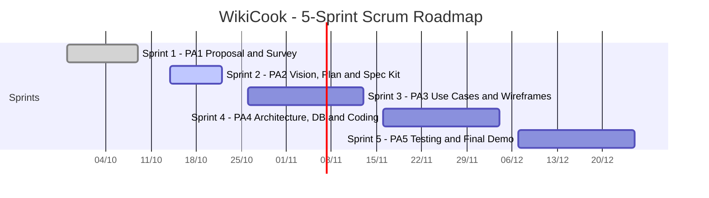
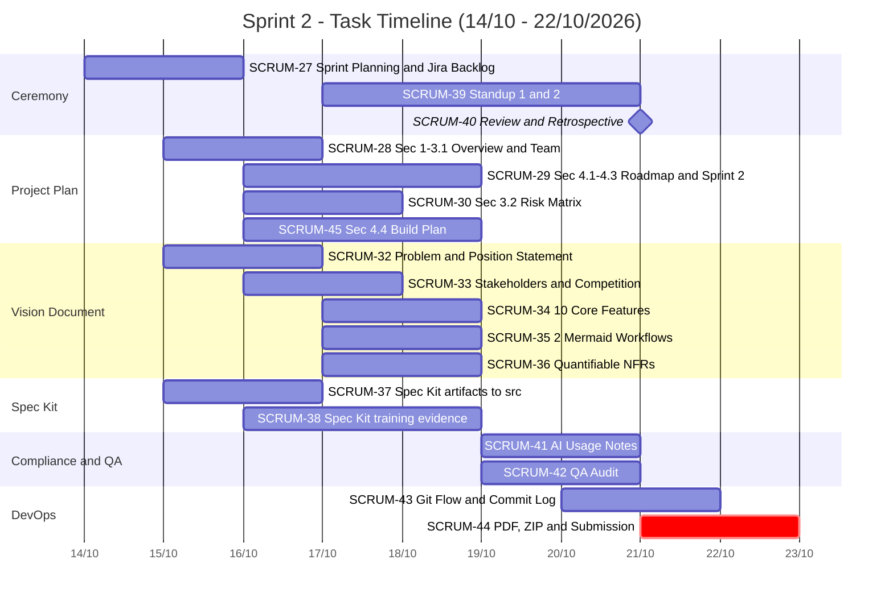
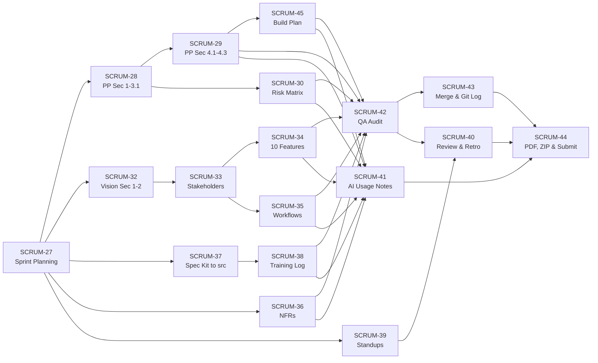

# PROJECT PLAN: WIKICOOK

**Course:** Introduction to Software Engineering  
**Project:** WikiCook — AI Smart Chef Assistant  
**Team:** Group 06  
**Process Model:** Scrum (5 Sprints, replacing the classic RUP phases of the `rup_sdpln_sp.dot` template)  
**Document Version:** 0.1 (Draft — Sprint 2)

---

## DOCUMENT METADATA & RESPONSIBILITY MATRIX

| Section | Title | Performed by | Reviewed by | Edited by | Jira |
| :---: | :--- | :---: | :---: | :---: | :---: |
| **Section 1 – 2** | Introduction & Project Overview | Lê Quốc Hưng (LqHung06) | Nguyễn Thành Dự (ThanhDu14) | Lê Quốc Hưng (LqHung06) | `SCRUM-28` |
| **Section 3.1** | Organizational Structure | Lê Quốc Hưng (LqHung06) | Nguyễn Thành Dự (ThanhDu14) | Lê Quốc Hưng (LqHung06) | `SCRUM-28` |
| **Section 3.2** | Risk Management Matrix | Nguyễn Thành Dự (ThanhDu14) | Trần Nguyễn Công Chung | Lê Quốc Hưng (LqHung06) | `SCRUM-30` |
| **Section 4.1 – 4.3** | Scrum Roadmap, Sprint 2 Plan & Preliminary Sprints 3–5 | Mai Văn Hiển (MaiHien3507) | Lê Quốc Hưng (LqHung06) | Lê Quốc Hưng (LqHung06) | `SCRUM-29` |
| **Section 4.4** | Build Plan | Mai Văn Hiển (MaiHien3507) | Lê Quốc Hưng (LqHung06) | Lê Quốc Hưng (LqHung06) | `SCRUM-45` |
| **Section 5** | Definition of Done & Quality Standards | Lê Quốc Hưng (LqHung06) | TBD | Lê Quốc Hưng (LqHung06) | `SCRUM-28` |

---

## 1. INTRODUCTION
*Performed by: Lê Quốc Hưng (LqHung06) | Reviewed by: Nguyễn Thành Dự (ThanhDu14) | Edited by: Lê Quốc Hưng (LqHung06)*

> **Placeholder — owned by `SCRUM-28`.** Purpose, scope, definitions and references of this Project Plan.

---

## 2. PROJECT OVERVIEW
*Performed by: Lê Quốc Hưng (LqHung06) | Reviewed by: Nguyễn Thành Dự (ThanhDu14) | Edited by: Lê Quốc Hưng (LqHung06)*

> **Placeholder — owned by `SCRUM-28`.** Project purpose, scope and objectives, assumptions and constraints, and the list of deliverables from PA1 to PA5.

---

## 3. PROJECT ORGANIZATION
*Performed by: Lê Quốc Hưng (LqHung06), Nguyễn Thành Dự (ThanhDu14) | Reviewed by: Nguyễn Thành Dự (ThanhDu14), Trần Nguyễn Công Chung | Edited by: Lê Quốc Hưng (LqHung06)*

### 3.1. Organizational Structure

> **Placeholder — owned by `SCRUM-28`.** Five-member team, Scrum roles (PO, Scrum Master, Tech Lead, QA, DevOps) and RACI matrix.

### 3.2. Risk Management Matrix

> **Placeholder — owned by `SCRUM-30`.** At least 3 project-wide risks with Likelihood, Impact and Mitigation Strategy. Sprint-2-specific risks are listed separately in [Section 4.3.3](#433-sprint-2-risks--mitigation).

---

## 4. MANAGEMENT PROCESS (SCRUM)
*Performed by: Mai Văn Hiển (MaiHien3507) | Reviewed by: Lê Quốc Hưng (LqHung06) | Edited by: Lê Quốc Hưng (LqHung06)*

As required by PA2, WikiCook does **not** follow the RUP phases (Inception, Elaboration, Construction, Transition) of the original template. The project is instead delivered through **5 Scrum Sprints**, each lasting 2–3 weeks and mapped one-to-one to a Project Assignment (PA1 → PA5).

### 4.1. Scrum Roadmap: 5 Sprints & Milestones

#### 4.1.1. Scrum Framework Applied

| Element | Application in WikiCook |
| :--- | :--- |
| **Product Owner** | Nguyễn Đức Duy — owns the Product Backlog and the requirements documents. |
| **Scrum Master / PM** | Lê Quốc Hưng — facilitates Scrum events, removes impediments, final editor and submitter. |
| **Development Team** | Mai Văn Hiển (Tech Lead & AI Architect), Trần Nguyễn Công Chung (QA Lead), Nguyễn Thành Dự (DevOps Lead), together with the PO and SM. |
| **Sprint Planning** | Held on the first day of each Sprint; the Sprint Goal is agreed and the Sprint Backlog is created on Jira. |
| **Daily / Weekly Scrum** | Held at least twice per Sprint; each member answers: (1) What did I do? (2) What will I do next? (3) What is blocking me? |
| **Sprint Review & Retrospective** | Held on the last working day before submission; the increment is inspected and improvement actions are recorded for the next Sprint. |
| **Artifacts** | Product Backlog and Sprint Backlog (Jira project `SCRUM`), Increment (documents and code merged to `main`), Sprint Report (`docs/management/reports/sprint-XX/`). |
| **Tools** | Jira (backlog and board), GitHub (one personal branch per member → Pull Request → `main`), Google Meet (meetings), Spec Kit (spec-driven development). |

**Generic Definition of Done (all Sprints):**

1. The work item satisfies the Acceptance Criteria written in its Jira task.
2. Every `##` heading of each document carries the metadata line `*Performed by | Reviewed by | Edited by*`.
3. The work has been peer-reviewed by the assigned Reviewer and passed the QA audit (links, tables, Mermaid rendering).
4. The change is merged into `main` through a Pull Request with no conflict markers.
5. Deliverable documents are exported to PDF and included in the submission package.
6. Any AI assistance is declared in the Sprint Report's AI Usage Notes appendix.

#### 4.1.2. Five-Sprint Roadmap

| Sprint | Duration | Goal / Key Deliverables | PA |
| :---: | :---: | :--- | :---: |
| **Sprint 1** | 28/09/2026 – 09/10/2026 | Project Proposal, Existing App Survey & Git Setup | PA1 |
| **Sprint 2** | 14/10/2026 – 22/10/2026 | Vision Document, Project Plan & Spec Kit Init | PA2 |
| **Sprint 3** | 26/10/2026 – 13/11/2026 *(proposed)* | Use Case Specifications, Domain Analysis & UI Wireframes | PA3 |
| **Sprint 4** | 16/11/2026 – 04/12/2026 *(proposed)* | Architecture Design, Database Schema & Core Feature Coding | PA4 |
| **Sprint 5** | 07/12/2026 – 25/12/2026 *(proposed)* | Testing, Integration, Feature Polish & Final Demo | PA5 |

> **Note:** The dates of Sprints 3–5 are proposed by the team (about 3 weeks each, starting shortly after the previous PA submission). The official PA3–PA5 deadlines have not been published yet; the dates will be aligned with them at each Sprint Planning.

#### 4.1.3. Milestones

| ID | Milestone | Date | Completion Criteria |
| :---: | :--- | :---: | :--- |
| **M1** | PA1 submitted (end of Sprint 1) | 09/10/2026 | Project Proposal, Existing App Survey, Team Contract and Sprint 1 Report submitted; GitHub repo and Jira project set up. |
| **M2** | Sprint 2 Planning completed | 14/10/2026 | 18 tasks created on the Jira Board with Assignee, Reviewer, Start and Due Date (`SCRUM-27`). |
| **M3** | Sprint 2 draft freeze | 18/10/2026 | All drafts of the Vision Document, Project Plan Sec 4.1–4.4, NFRs and Spec Kit training evidence completed. |
| **M4** | Sprint 2 Review & Retrospective | 21/10/2026 | Increment accepted by 5/5 members; QA audit passed; PRs merged into `main` (`SCRUM-40`, `SCRUM-43`). |
| **M5** | PA2 submitted | 22/10/2026, 14:00 | `PA2-Group06.zip` (MD + PDF + `src/` + assets + git log) uploaded to Moodle, 48 hours before the 24/10/2026 deadline (`SCRUM-44`). |
| **M6** | PA3 submitted (end of Sprint 3) | TBD (proposed 13/11/2026) | Use Case Specifications, domain model and UI wireframes reviewed and submitted. |
| **M7** | PA4 submitted (end of Sprint 4) | TBD (proposed 04/12/2026) | Architecture document, database schema and working core features merged into `main`. |
| **M8** | PA5 final demo & release (end of Sprint 5) | TBD (proposed 25/12/2026) | Demo of all project features; test report completed; final release candidate tagged. |

> The builds produced at the end of each Sprint (v0.1 → v1.0 RC) are specified in [Section 4.4 – Build Plan](#44-build-plan).

---

### 4.2. Sprint 2 Plan: Goal, Scope & Task Breakdown

#### 4.2.1. Sprint Goal & Scope

| Item | Detail |
| :--- | :--- |
| **Jira Sprint** | WikiCook - Complete Sprint2 PA2 |
| **Duration** | 14/10/2026 – 22/10/2026 (submission 48 hours before the 24/10/2026 Moodle deadline) |
| **Sprint Goal** | Complete 100% of the Vision Document, Project Plan (5-Sprint Scrum roadmap & Build Plan), the Spec Kit structure in `WikiCook/src/`, the Spec Kit training evidence of all 5 members, and the Sprint Report with an AI Usage Notes appendix that meets the course regulations. |

**Sprint 2 Deliverables:**

| # | Deliverable | Location in Repository | Related Tasks |
| :---: | :--- | :--- | :---: |
| 1 | Vision Document | `docs/requirements/vision-document.md` | `SCRUM-32` – `SCRUM-36` |
| 2 | Project Plan | `docs/management/project-plan.md` | `SCRUM-28`, `SCRUM-29`, `SCRUM-30`, `SCRUM-45` |
| 3 | Spec Kit artifacts | `src/` (incl. `src/README.md`) | `SCRUM-37` |
| 4 | Spec Kit training log & evidence | `docs/management/spec-kit-training-log.md`, `docs/assets/spec-kit/` | `SCRUM-38` |
| 5 | Sprint 2 Report with AI Usage Notes appendix | `docs/management/reports/sprint-02/sprint-02-report.md` | `SCRUM-27`, `SCRUM-39`, `SCRUM-40`, `SCRUM-41` |
| 6 | Git commit log | `docs/management/git-log.txt`, `docs/assets/jira/git_log.png` | `SCRUM-43` |
| 7 | Submission package | `PA2-Group06.zip` | `SCRUM-44` |

**Sprint 2 Definition of Done** (in addition to the generic DoD in [Section 4.1.1](#411-scrum-framework-applied)):

- All 18 Jira tasks are in the **Done** column.
- The 10 core features in the Vision Document are written as paragraphs of 3–5 sentences (What / Why / Who), and every NFR has a quantifiable threshold.
- All Mermaid diagrams render without syntax errors in both Markdown and PDF.
- `constitution.md` and the Spec Kit templates are present in `src/`.
- Training evidence exists for all 5 members.
- The AI Usage Notes appendix lists tool, version, time, prompt, purpose, AI-generated part and student-verified part, with screenshots.

**Sprint 2 Scrum Events:**

| Event | Date & Time | Duration | Jira | Record |
| :--- | :---: | :---: | :---: | :--- |
| Sprint Planning (Meeting 1) | 14/10/2026, 20:00 | 45 min | `SCRUM-27` | Sprint 2 Report, Sec 2.1 |
| Daily/Weekly Scrum – Standup 1 (Meeting 2) | 17/10/2026, 20:30 | TBD | `SCRUM-39` | Sprint 2 Report, Sec 2.2 |
| Daily/Weekly Scrum – Standup 2 (Meeting 3) | 20/10/2026, 20:30 | TBD | `SCRUM-39` | Sprint 2 Report, Sec 2.3 |
| Sprint Review & Retrospective (Meeting 4) | 21/10/2026, 20:00 | 60 min | `SCRUM-40` | Sprint 2 Report, Sec 2.4 & Sec 5 |

#### 4.2.2. Sprint 2 Task Breakdown (18 Tasks, `SCRUM-27` → `SCRUM-45`)

The table below matches the Jira Board (source: `jira_tasks.md`). Task keys and summaries are kept exactly as on the Board. **`SCRUM-31` does not exist on the Board**, so the 18 tasks are `SCRUM-27` to `SCRUM-30` and `SCRUM-32` to `SCRUM-45`. Priority and Story Point estimates have not been set on Jira yet and are marked **TBD**. Dependencies are derived from the Sprint 2 timeline in `PA2_task.md`.

**A. Ceremony**

| Key | Summary | Short Description | Assignee | Reviewer | Priority | Estimate (SP/h) | Start | Due | Status | Dependencies |
| :---: | :--- | :--- | :---: | :---: | :---: | :---: | :---: | :---: | :---: | :---: |
| `SCRUM-27` | `[Ceremony] Tổ chức họp Sprint 2 Planning & Thiết lập Jira Backlog` | Sprint Planning meeting; create 18 tasks on Jira with Assignee, Reviewer and dates. | Lê Quốc Hưng | Nguyễn Đức Duy | TBD | TBD | 14/10/2026 | 15/10/2026 | To Do | — |
| `SCRUM-39` | `[Ceremony] Tổ chức và ghi chép 2 buổi Daily/Weekly Scrum (Standup 1 & 2)` | Host and record Standup 1 (17/10) and Standup 2 (20/10) using the 3 Scrum questions. | Lê Quốc Hưng | Nguyễn Đức Duy | TBD | TBD | 17/10/2026 | 20/10/2026 | To Do | `SCRUM-27` |
| `SCRUM-40` | `[Ceremony] Tổ chức họp Sprint 2 Review & Retrospective` | Review the increment and hold the Retrospective (went well / went wrong / actions for Sprint 3). | Lê Quốc Hưng | Trần Nguyễn Công Chung | TBD | TBD | 21/10/2026 | 21/10/2026 | To Do | `SCRUM-39`, `SCRUM-42` |

**B. Project Plan**

| Key | Summary | Short Description | Assignee | Reviewer | Priority | Estimate (SP/h) | Start | Due | Status | Dependencies |
| :---: | :--- | :--- | :---: | :---: | :---: | :---: | :---: | :---: | :---: | :---: |
| `SCRUM-28` | `[Project-Plan] Soạn thảo Tổng quan dự án, Phạm vi & Cơ cấu nhóm (Sec 1-3.1)` | Project Plan Sec 1, 2 and 3.1: objectives, scope, deliverables PA1–PA5, team roles and RACI matrix. | Lê Quốc Hưng | Nguyễn Thành Dự | TBD | TBD | 15/10/2026 | 16/10/2026 | To Do | `SCRUM-27` |
| `SCRUM-29` | `[Project-Plan] Xây dựng Lộ trình Kế hoạch 5 Sprints Scrum & Chi tiết Sprint 2 (Sec 4.1 - 4.3)` | 5-Sprint roadmap with milestones, Sprint 2 task breakdown and preliminary Sprints 3–5. | Mai Văn Hiển | Lê Quốc Hưng | TBD | TBD | 16/10/2026 | 18/10/2026 | To Do | `SCRUM-27`, `SCRUM-28` |
| `SCRUM-30` | `[Project-Plan] Nhận diện và Xây dựng Ma trận Quản trị rủi ro (Sec 3.2)` | Risk matrix with at least 3 risks, Likelihood, Impact and Mitigation Strategy. | Nguyễn Thành Dự | Trần Nguyễn Công Chung | TBD | TBD | 16/10/2026 | 17/10/2026 | To Do | `SCRUM-28` |
| `SCRUM-45` | `[Project-Plan] Thiết kế Kế hoạch Đóng gói và Phát hành Phần mềm - Build Plan (Sec 4.4)` | Build Plan v0.1 → v1.0 RC across 5 Sprints, with build environments and acceptance criteria per build. | Mai Văn Hiển | Lê Quốc Hưng | TBD | TBD | 16/10/2026 | 18/10/2026 | To Do | `SCRUM-29` |

**C. Vision Document**

| Key | Summary | Short Description | Assignee | Reviewer | Priority | Estimate (SP/h) | Start | Due | Status | Dependencies |
| :---: | :--- | :--- | :---: | :---: | :---: | :---: | :---: | :---: | :---: | :---: |
| `SCRUM-32` | `[Vision] Hoàn thiện Problem Statement và Product Position Statement (Sec 1-2)` | Vision Sec 1–2: Introduction, Problem Statement table and Product Position Statement (RUP format). | Nguyễn Đức Duy | Lê Quốc Hưng | TBD | TBD | 15/10/2026 | 16/10/2026 | To Do | `SCRUM-27` |
| `SCRUM-33` | `[Vision] Mô tả chi tiết Stakeholders, User Personas và Đối thủ cạnh tranh (Sec 3-4)` | Vision Sec 3–4: stakeholders, user summary, user environment, key needs, competition (from PA1 survey). | Nguyễn Đức Duy | Trần Nguyễn Công Chung | TBD | TBD | 16/10/2026 | 17/10/2026 | To Do | `SCRUM-32` |
| `SCRUM-34` | `[Vision] Soạn thảo chi tiết 10 tính năng cốt lõi WikiCook (Sec 5)` | Vision Sec 5: 10 core features, each a 3–5 sentence paragraph (What / Why / Who). | Nguyễn Đức Duy | Mai Văn Hiển | TBD | TBD | 17/10/2026 | 18/10/2026 | To Do | `SCRUM-33` |
| `SCRUM-35` | `[Vision] Thiết kế 2 sơ đồ Mermaid minh họa User Workflows (Sec 6)` | Vision Sec 6: Mermaid workflows for AI Meal Planning → Grocery and Pantry Search → Cooking Mode. | Nguyễn Đức Duy | Mai Văn Hiển | TBD | TBD | 17/10/2026 | 18/10/2026 | To Do | `SCRUM-33` |
| `SCRUM-36` | `[Vision] Xây dựng bảng Yêu cầu phi chức năng (NFRs) định lượng (Sec 7)` | Vision Sec 7: quantifiable NFRs (performance, security, platform & accessibility, AI constraints). | Mai Văn Hiển | Nguyễn Thành Dự | TBD | TBD | 17/10/2026 | 18/10/2026 | To Do | `SCRUM-27` |

**D. Spec Kit**

| Key | Summary | Short Description | Assignee | Reviewer | Priority | Estimate (SP/h) | Start | Due | Status | Dependencies |
| :---: | :--- | :--- | :---: | :---: | :---: | :---: | :---: | :---: | :---: | :---: |
| `SCRUM-37` | `[Spec-Kit] Đồng bộ và đưa các artifacts của Spec Kit vào thư mục WikiCook/src/` | Place `constitution.md` and Spec Kit Markdown artifacts in `src/`; document them in `src/README.md`. | Trần Nguyễn Công Chung | Nguyễn Thành Dự | TBD | TBD | 15/10/2026 | 16/10/2026 | To Do | `SCRUM-27` |
| `SCRUM-38` | `[Spec-Kit] Hoàn thành đào tạo Spec Kit và lập Hồ sơ minh chứng 5 thành viên` | Collect Spec Kit training screenshots and 3–5 bullet training logs from all 5 members. | Trần Nguyễn Công Chung | Lê Quốc Hưng | TBD | TBD | 16/10/2026 | 18/10/2026 | To Do | `SCRUM-37` |

**E. Compliance & QA**

| Key | Summary | Short Description | Assignee | Reviewer | Priority | Estimate (SP/h) | Start | Due | Status | Dependencies |
| :---: | :--- | :--- | :---: | :---: | :---: | :---: | :---: | :---: | :---: | :---: |
| `SCRUM-41` | `[Compliance] Lập Phụ lục Khai báo sử dụng AI (AI Usage Notes) chuẩn quy chế` | AI Usage Notes appendix in the Sprint 2 Report (tool, version, time, prompt, purpose, AI vs. student work, screenshots). | Trần Nguyễn Công Chung | Lê Quốc Hưng | TBD | TBD | 19/10/2026 | 20/10/2026 | To Do | All drafting tasks |
| `SCRUM-42` | `[QA] Rà soát chéo chất lượng tài liệu, Metadata 3 cấp & Markdown` | QA audit of `docs/`: 3-level metadata, internal links, image paths, Mermaid rendering, English consistency. | Trần Nguyễn Công Chung | Mai Văn Hiển | TBD | TBD | 19/10/2026 | 20/10/2026 | To Do | `SCRUM-28` – `SCRUM-30`, `SCRUM-32` – `SCRUM-38`, `SCRUM-45` |

**F. DevOps**

| Key | Summary | Short Description | Assignee | Reviewer | Priority | Estimate (SP/h) | Start | Due | Status | Dependencies |
| :---: | :--- | :--- | :---: | :---: | :---: | :---: | :---: | :---: | :---: | :---: |
| `SCRUM-43` | `[DevOps] Quản lý Git Flow, Merge PRs vào main & Xuất Git Commit Log` | Review and merge member PRs into `main`; export `git log --graph --oneline --all` and a screenshot. | Nguyễn Thành Dự | Lê Quốc Hưng | TBD | TBD | 20/10/2026 | 21/10/2026 | To Do | `SCRUM-42` |
| `SCRUM-44` | `[DevOps] Chuyển đổi Markdown sang PDF, Đóng gói PA2-Group06.zip & Nộp bài` | Convert all `.md` to `.pdf`, package `PA2-Group06.zip` and submit to Moodle. | Nguyễn Thành Dự | Lê Quốc Hưng | TBD | TBD | 21/10/2026 | 22/10/2026 (14:00) | To Do | `SCRUM-40`, `SCRUM-41`, `SCRUM-43` |

#### 4.2.3. Workload Distribution

| Member | Scrum Role | Tasks | Count |
| :--- | :--- | :--- | :---: |
| Lê Quốc Hưng | PM & Scrum Master | `SCRUM-27`, `SCRUM-28`, `SCRUM-39`, `SCRUM-40` | 4 |
| Nguyễn Đức Duy | PO & Requirements Lead | `SCRUM-32`, `SCRUM-33`, `SCRUM-34`, `SCRUM-35` | 4 |
| Mai Văn Hiển | Tech Lead & AI Architect | `SCRUM-29`, `SCRUM-36`, `SCRUM-45` | 3 |
| Trần Nguyễn Công Chung | QA Lead & Market Researcher 1 | `SCRUM-37`, `SCRUM-38`, `SCRUM-41`, `SCRUM-42` | 4 |
| Nguyễn Thành Dự | DevOps Lead & Market Researcher 2 | `SCRUM-30`, `SCRUM-43`, `SCRUM-44` | 3 |
| **Total** | | | **18** |

---

### 4.3. Sprint 2 Schedule, Dependencies & Risks; Preliminary Plan for Sprints 3–5

#### 4.3.1. Sprint 2 Day-by-Day Schedule

| Date | Activities / Expected Outcome | Precondition | Jira Tasks |
| :---: | :--- | :--- | :---: |
| **14/10 (Wed)** | **Meeting 1 – Sprint Planning (20:00)**; 18 tasks created on Jira. | Sprint 2 starts. | `SCRUM-27` |
| **15/10 (Thu)** | Project Plan skeleton created; Spec Kit artifacts synced to `src/`; Vision Sec 1–2 started. | Tasks assigned on Jira. | `SCRUM-28`, `SCRUM-32`, `SCRUM-37` |
| **16/10 (Fri)** | Problem Statement & Product Position done; Project Plan Sec 1–3.1 done; Spec Kit sync done. | PA1 proposal and survey available. | `SCRUM-28`, `SCRUM-32`, `SCRUM-37` |
| **17/10 (Sat)** | Stakeholders/Personas done; Risk Matrix done; **Meeting 2 – Standup 1 (20:30)**. | Progress check after 3 days. | `SCRUM-30`, `SCRUM-33`, `SCRUM-39` |
| **18/10 (Sun)** | **Draft freeze:** 10 features, 2 Mermaid workflows, NFRs, 5-Sprint roadmap, Build Plan, Spec Kit training evidence. | All 5 members submit drafts. | `SCRUM-29`, `SCRUM-34`, `SCRUM-35`, `SCRUM-36`, `SCRUM-38`, `SCRUM-45` |
| **19/10 (Mon)** | **Peer review:** Duy reviews Hưng, Hiển reviews Duy, Chung reviews Hiển, Dự reviews Chung; AI Notes and QA audit begin. | Drafts ready. | `SCRUM-41`, `SCRUM-42` |
| **20/10 (Tue)** | **Meeting 3 – Standup 2 (20:30)**; QA audit of metadata/links/Mermaid; AI Usage Notes completed. | Review fixes applied. | `SCRUM-39`, `SCRUM-41`, `SCRUM-42` |
| **21/10 (Wed)** | **Meeting 4 – Sprint Review & Retrospective (20:00)**; PRs merged into `main`; git log exported; PDF conversion. | Internal acceptance done. | `SCRUM-40`, `SCRUM-43`, `SCRUM-44` |
| **22/10 (Thu)** | **Submission (14:00):** `PA2-Group06.zip` uploaded to Moodle. | PDF, MD, git log and ZIP complete. | `SCRUM-44` |
| **23–24/10** | **Buffer:** 2 days of contingency before the Moodle deadline. | — | — |

#### 4.3.2. Task Dependencies & Critical Path

**Critical path:** `SCRUM-27` → `SCRUM-32` → `SCRUM-33` → `SCRUM-34` → `SCRUM-42` → `SCRUM-43` → `SCRUM-44`. A delay to the Vision Document drafts directly delays the QA audit and the submission, so these tasks are tracked at both Standups.

#### 4.3.3. Sprint 2 Risks & Mitigation

Project-wide risks are maintained in [Section 3.2](#32-risk-management-matrix). The risks below concern only Sprint 2.

| # | Risk | Likelihood | Impact | Mitigation |
| :---: | :--- | :---: | :---: | :--- |
| R1 | A member is unavailable (midterm exams, illness) during the drafting window 15–18/10. | Medium | High | Tasks are fully described on Jira; the Reviewer of the task takes it over; the draft freeze on 18/10 leaves 4 days of slack. |
| R2 | Review bottleneck: Lê Quốc Hưng reviews 7 tasks and is also final editor. | High | Medium | Peer reviews are spread across members on 19/10; Hưng reviews only the final increment at the Sprint Review. |
| R3 | Mermaid diagrams or tables break in the PDF export. | Medium | High | Mermaid syntax checked in the QA audit (`SCRUM-42`) on 19–20/10; PDF checked visually before packaging (`SCRUM-44`). |
| R4 | AI usage evidence is incomplete (risk of a zero score). | Medium | Very High | Each member saves prompts and screenshots as they work; `SCRUM-41` consolidates them by 20/10 and Hưng verifies them. |
| R5 | Merge conflicts on shared files (`project-plan.md`, `vision-document.md`). | Medium | Medium | Each member edits only their own sections; PRs are merged by the DevOps Lead on 20–21/10 (`SCRUM-43`). |

#### 4.3.4. Preliminary Plan for Sprints 3–5

> **Note:** This is a **preliminary plan**. User stories, tasks and dates will be refined, estimated and assigned at the Sprint Planning of each Sprint.

User stories are based on the 10 core features of WikiCook: User Auth & Dietary Profile, Smart Recipe Discovery & Filters, AI Weekly Meal Planner, Smart Shopping List, Hands-free Cooking Mode & Timers, Community Recipe Contribution, Social Cooksnaps & Reviews, Custom Recipe Collections, Nutrition & Allergen Analyzer, and Admin Content Moderation.

**Sprint 3 — Use Case Specifications, Domain Analysis & UI Wireframes (PA3)** *(proposed 26/10 – 13/11/2026)*

*Candidate user stories (to be specified as use cases):*

| ID | User Story |
| :---: | :--- |
| US-01 | As a **home cook**, I want to register and log in with my email so that my recipes and plans are saved to my account. |
| US-02 | As a **home cook**, I want to set my dietary preferences and allergies so that recommendations are safe for me. |
| US-03 | As a **home cook**, I want to search recipes by name, ingredients I have, cuisine and cooking time so that I can decide quickly what to cook. |
| US-04 | As a **busy home cook**, I want the AI Smart Chef to generate a weekly meal plan from my profile so that I no longer need to decide what to cook every day. |
| US-05 | As a **home cook**, I want a shopping list generated from my meal plan and grouped by store section so that I shop in one trip. |
| US-06 | As a **recipe contributor**, I want to submit my own recipe with photos and steps so that I can share it with the community. |
| US-07 | As an **administrator**, I want to review and approve or reject submitted recipes so that content quality is maintained. |

*Technical tasks:*

- **Analysis:** identify actors and use cases; write Use Case Specifications (main flow, alternative flows, pre/post-conditions) for US-01 – US-07; build the domain model (Recipe, Ingredient, User, MealPlan, ShoppingList, Review, Collection).
- **Design:** UI wireframes for the main screens (login, search, recipe detail, meal planner, shopping list, cooking mode, admin moderation); navigation map.
- **Coding:** create the Spec Kit specs for the selected features (`/speckit.specify`, `/speckit.clarify`).
- **Testing:** derive acceptance criteria per use case as the basis for test cases.
- **Documentation:** Sprint 3 Report with meeting records and AI Usage Notes.

*Deliverables & exit criteria:* Use Case document, domain model diagram and wireframes reviewed by the PO; each prioritized user story has a use case and acceptance criteria; PA3 package submitted.

**Sprint 4 — Architecture Design, Database Schema & Core Feature Coding (PA4)** *(proposed 16/11 – 04/12/2026)*

*Candidate user stories (to be implemented):*

| ID | User Story |
| :---: | :--- |
| US-01 – US-03 | Authentication, dietary profile and recipe search (implemented end-to-end). |
| US-08 | As a **home cook**, I want to view a recipe with servings scaling so that ingredient quantities match my household. |
| US-09 | As a **home cook**, I want to save recipes into my own collections so that I can find my favourite dishes again. |
| US-04 – US-05 | First working version of the AI Weekly Meal Planner and the shopping list. |

*Technical tasks:*

- **Analysis:** refine the specs and plans with Spec Kit (`/speckit.plan`, `/speckit.tasks`).
- **Design:** layered architecture document, component and deployment diagrams, database schema (ERD) and REST API contract, design of the AI RAG service.
- **Coding:** backend skeleton and database migrations; authentication and role-based access; recipe and search APIs; frontend screens for the stories above; AI meal-planner integration with a fallback when the LLM is unavailable.
- **Testing:** unit tests for the service layer (target ≥ 70% coverage per the Spec Kit constitution); API tests for the core endpoints.
- **Documentation:** architecture and database documents; Sprint 4 Report with AI Usage Notes.

*Deliverables & exit criteria:* architecture and schema documents approved; core features run on the local development environment; unit tests pass in CI; PA4 package submitted.

**Sprint 5 — Testing, Integration, Feature Polish & Final Demo (PA5)** *(proposed 07/12 – 25/12/2026)*

*Candidate user stories (to be completed and polished):*

| ID | User Story |
| :---: | :--- |
| US-10 | As a **home cook**, I want a hands-free cooking mode with step-by-step display and timers so that I can cook without touching the screen. |
| US-11 | As a **home cook**, I want to post a Cooksnap photo and review of a recipe I cooked so that I can share my result with others. |
| US-12 | As a **health-conscious user**, I want to see the calories, macronutrients and allergen warnings of a recipe so that I can eat safely. |
| US-13 | As an **administrator**, I want to moderate reported reviews and Cooksnaps so that the community stays safe. |

*Technical tasks:*

- **Analysis:** triage the remaining backlog with MoSCoW and freeze the demo scope.
- **Design:** UI polish and accessibility adjustments.
- **Coding:** remaining features above; bug fixes; full frontend/backend/AI integration.
- **Testing:** test plan and test cases execution (`docs/test/`), integration and end-to-end tests, performance checks against the NFR thresholds, user acceptance testing with the PO.
- **Documentation:** test report, user guide, demo script, final Sprint Report.

*Deliverables & exit criteria:* all Must-have stories done and accepted; test report shows no open critical defects; final release candidate tagged; **demo of all project features** delivered; PA5 package submitted.

---

### 4.4. Build Plan

> **Placeholder — owned by `SCRUM-45`.** Number of builds, release time, test objectives, build environments and acceptance criteria of each build (v0.1 → v1.0 Release Candidate).

---

## 5. DEFINITION OF DONE & QUALITY STANDARDS
*Performed by: Lê Quốc Hưng (LqHung06) | Reviewed by: TBD | Edited by: Lê Quốc Hưng (LqHung06)*

> **Placeholder — owned by `SCRUM-28`.** Detailed Definition of Done and documentation/code quality standards.

---

## APPENDICES
*Performed by: Mai Văn Hiển (MaiHien3507) | Reviewed by: Lê Quốc Hưng (LqHung06) | Edited by: Lê Quốc Hưng (LqHung06)*

### Appendix A. Sprint 2 Task Cross-Check against the Jira Board

| # | Jira Key | Summary matches Jira | Assignee | Due Date | In Sec 4.2.2 |
| :---: | :---: | :---: | :---: | :---: | :---: |
| 1 | `SCRUM-27` | ✔ | Lê Quốc Hưng | 15/10/2026 | ✔ |
| 2 | `SCRUM-28` | ✔ | Lê Quốc Hưng | 16/10/2026 | ✔ |
| 3 | `SCRUM-29` | ✔ | Mai Văn Hiển | 18/10/2026 | ✔ |
| 4 | `SCRUM-30` | ✔ | Nguyễn Thành Dự | 17/10/2026 | ✔ |
| 5 | `SCRUM-32` | ✔ | Nguyễn Đức Duy | 16/10/2026 | ✔ |
| 6 | `SCRUM-33` | ✔ | Nguyễn Đức Duy | 17/10/2026 | ✔ |
| 7 | `SCRUM-34` | ✔ | Nguyễn Đức Duy | 18/10/2026 | ✔ |
| 8 | `SCRUM-35` | ✔ | Nguyễn Đức Duy | 18/10/2026 | ✔ |
| 9 | `SCRUM-36` | ✔ | Mai Văn Hiển | 18/10/2026 | ✔ |
| 10 | `SCRUM-37` | ✔ | Trần Nguyễn Công Chung | 16/10/2026 | ✔ |
| 11 | `SCRUM-38` | ✔ | Trần Nguyễn Công Chung | 18/10/2026 | ✔ |
| 12 | `SCRUM-39` | ✔ | Lê Quốc Hưng | 20/10/2026 | ✔ |
| 13 | `SCRUM-40` | ✔ | Lê Quốc Hưng | 21/10/2026 | ✔ |
| 14 | `SCRUM-41` | ✔ | Trần Nguyễn Công Chung | 20/10/2026 | ✔ |
| 15 | `SCRUM-42` | ✔ | Trần Nguyễn Công Chung | 20/10/2026 | ✔ |
| 16 | `SCRUM-43` | ✔ | Nguyễn Thành Dự | 21/10/2026 | ✔ |
| 17 | `SCRUM-44` | ✔ | Nguyễn Thành Dự | 22/10/2026 | ✔ |
| 18 | `SCRUM-45` | ✔ | Mai Văn Hiển | 18/10/2026 | ✔ |

> `SCRUM-31` is not present on the Jira Board and is therefore not part of Sprint 2.

### Appendix B. Document Revision History

| Version | Date | Author | Description |
| :---: | :---: | :--- | :--- |
| 0.1 | 14/10/2026 | Mai Văn Hiển | Created document skeleton; wrote Sections 4.1–4.3 (5-Sprint roadmap, milestones, Sprint 2 plan, preliminary Sprints 3–5). |
