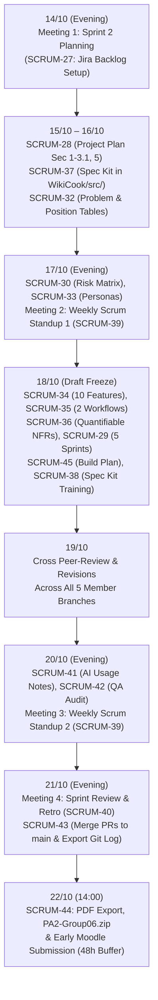

# SPRINT 02 REPORT: WIKICOOK PROJECT

**Course:** CS300 - CSC13002 - Introduction to Software Engineering  
**Project Name:** WikiCook — Intelligent Culinary & Meal Planning Ecosystem  
**Sprint Cycle:** Sprint 02 (Project Assignment 2 — Project Plan, Vision Document & Spec Kit Initialization)  
**Sprint Duration:** October 14, 2026 – October 22, 2026 *(48-Hour Early Submission Buffer; Moodle Deadline: October 24, 2026)*  
**Document Version:** 1.0 (`SCRUM-27` Baseline — Sprint 02 Planning & Backlog Initialization)

---

## DOCUMENT METADATA & RESPONSIBILITY MATRIX

| Document Section | Section Title | Performed by (Author) | Reviewed by | Edited by | Jira Task |
| :---: | :--- | :---: | :---: | :---: | :---: |
| **Section 1** | Sprint 02 Overview, Goals & Jira Backlog (`SCRUM-27` – `SCRUM-45`) | **Lê Quốc Hưng (LqHung06)** | **Nguyễn Đức Duy (DucDuyNguyen15-IT)** | **Lê Quốc Hưng (LqHung06)** | `SCRUM-27` |
| **Section 2.1** | Meeting 1 Minutes: Sprint 02 Planning (Oct 14, 2026) | **Lê Quốc Hưng (LqHung06)** | **Nguyễn Đức Duy (DucDuyNguyen15-IT)** | **Lê Quốc Hưng (LqHung06)** | `SCRUM-27` |
| **Section 2.2 - 2.3** | Meeting 2 & Meeting 3 Minutes: Weekly Scrum Standups 01 & 02 | **Lê Quốc Hưng (LqHung06)** | **Nguyễn Đức Duy (DucDuyNguyen15-IT)** | **Lê Quốc Hưng (LqHung06)** | `SCRUM-39` |
| **Section 2.4** | Meeting 4 Minutes: Sprint 02 Review (Oct 21, 2026) | **Lê Quốc Hưng (LqHung06)** | **Trần Nguyễn Công Chung (itzchugnn)** | **Lê Quốc Hưng (LqHung06)** | `SCRUM-40` |
| **Section 3** | Jira Task Management Evidence & Progress Analysis | **Lê Quốc Hưng (LqHung06)** | **Nguyễn Đức Duy (DucDuyNguyen15-IT)** | **Lê Quốc Hưng (LqHung06)** | `SCRUM-27`, `SCRUM-40` |
| **Section 4** | AI Usage Declaration & Compliance Log (Appendix) | **Trần Nguyễn Công Chung (itzchugnn)** | **Lê Quốc Hưng (LqHung06)** | **Lê Quốc Hưng (LqHung06)** | `SCRUM-41` |
| **Section 5** | Sprint 02 Retrospective & Action Plan for Sprint 03 | **Lê Quốc Hưng (LqHung06)** | **Trần Nguyễn Công Chung (itzchugnn)** | **Lê Quốc Hưng (LqHung06)** | `SCRUM-40` |

### Revision History

| Date | Version | Description | Author |
| :---: | :---: | :--- | :--- |
| **15/10/2026** | `v1.0` | Initialized Sprint 02 Report, 18-task Jira Backlog table, and Meeting 1 (Sprint Planning) minutes (`SCRUM-27`). | Lê Quốc Hưng (`LqHung06`) |

---

## 1. SPRINT 02 OVERVIEW, GOALS & JIRA BACKLOG
*Performed by: Lê Quốc Hưng (LqHung06) | Reviewed by: Nguyễn Đức Duy (DucDuyNguyen15-IT) | Edited by: Lê Quốc Hưng (LqHung06)*

### 1.1. Sprint 02 Goal & Scope (`PA2-2026`)
Following the successful completion of Sprint 01 (`PA1-2026`, where all 24 foundational tasks reached `DONE`), the overarching goal of **Sprint 02 (`PA2-2026` — 45 Points)** is to transition **WikiCook** from initial concept proposal into a formal, quantifiable engineering baseline. Specifically, the team commits to delivering four core workstreams by **October 22, 2026 (14:00)** — 48 hours ahead of the official Moodle deadline:

1. **Part A — Software Development Plan / Project Plan (15 Points):** Draft `docs/management/project-plan.md` adapted from the RUP Small Project template (`rup_sdpln_sp.dot`) to our **5-Sprint Scrum lifecycle**, detailing project scope, deliverables across `PA1`–`PA5`, 5-member organizational structure and RACI matrix, risk management strategies ($\ge 3$ core risks), the 18-task Sprint 02 schedule, preliminary Sprints 03–05 backlogs, and a 5-stage incremental Build Plan culminating in the `PA5` live feature demo.
2. **Part B — Vision Document (20 Points):** Author `docs/requirements/vision-document.md` following `rup_vision_sp.docx`, featuring standardized Problem and Product Position Statement tables, stakeholder/persona profiles, competitive benchmarking against *MyFridgeFood* and *Ăn Gì Ngon* (from our PA1 survey), 10 refined core features written in comprehensive 3–5 sentence analytical paragraphs, 2 end-to-end Mermaid user workflow diagrams, and quantifiable Non-Functional Requirements (NFRs).
3. **Part C — GitHub Spec Kit Initialization & Team Training (5 Points):** Synchronize ratified Spec Kit artifacts (`constitution.md` and specification templates) into the `WikiCook/src/` directory and compile verifiable training completion evidence (screenshots + key takeaways on Spec-Driven Development) from all 5 team members in `docs/management/spec-kit-training-log.md`.
4. **Part D — Weekly Scrum Report & AI Usage Compliance (5 Points):** Conduct and document 4 structured Scrum ceremonies (1 Sprint Planning, 2 Weekly Scrum Standups answering the 3 standard questions, and 1 Sprint Review & Retrospective), provide Jira board visual evidence, and log all AI tool usages in strict accordance with `AI Usage Guidelines.pdf`.

### 1.2. Master Jira Backlog Table (18 Tasks — `SCRUM-27` to `SCRUM-45`)
During the Sprint 02 Planning ceremony on **October 14, 2026**, the team decomposed the PA2 scope into **18 individually assigned tasks** on Jira Software Cloud (`SCRUM-27` through `SCRUM-45`, matching the live Jira Board sequence):

| No. | Jira Key | Task Summary | Assignee | Peer Reviewer | Start Date | Due Date | Status (Oct 15) | Target Deliverable / Path |
| :---: | :---: | :--- | :--- | :--- | :---: | :---: | :---: | :--- |
| 1 | **`SCRUM-27`** | `[Ceremony]` Organize Sprint 2 Planning & Establish Jira Backlog | **Lê Quốc Hưng** (`@LqHung06`) | Nguyễn Đức Duy (`@DucDuyNguyen15-IT`) | 14/10/2026 | **15/10/2026** | **DONE** | `docs/management/reports/sprint-02/sprint-02-report.md` (Sec 1 & 2.1) |
| 2 | **`SCRUM-28`** | `[Project-Plan]` Draft Project Overview, Scope & Org Structure (Sec 1–3.1 & 5) | **Lê Quốc Hưng** (`@LqHung06`) | Nguyễn Thành Dự (`@ThanhDu14`) | 15/10/2026 | **16/10/2026** | **IN PROGRESS** | `docs/management/project-plan.md` (Sec 1, 2, 3.1, 5) |
| 3 | **`SCRUM-29`** | `[Project-Plan]` Develop 5-Sprint Scrum Roadmap & Sprint 2 Schedule (Sec 4.1–4.3) | **Mai Văn Hiển** (`@MaiHien3507`) | Lê Quốc Hưng (`@LqHung06`) | 16/10/2026 | **18/10/2026** | **TO DO** | `docs/management/project-plan.md` (Sec 4.1–4.3) |
| 4 | **`SCRUM-30`** | `[Project-Plan]` Identify Risks & Formulate Risk Management Matrix (Sec 3.2) | **Nguyễn Thành Dự** (`@ThanhDu14`) | Trần Nguyễn Công Chung (`@itzchugnn`) | 16/10/2026 | **17/10/2026** | **TO DO** | `docs/management/project-plan.md` (Sec 3.2) |
| 5 | **`SCRUM-32`** | `[Vision]` Finalize Problem Statement & Product Position Statement (Sec 1–2) | **Nguyễn Đức Duy** (`@DucDuyNguyen15-IT`) | Lê Quốc Hưng (`@LqHung06`) | 15/10/2026 | **16/10/2026** | **IN PROGRESS** | `docs/requirements/vision-document.md` (Sec 1–2) |
| 6 | **`SCRUM-33`** | `[Vision]` Detail Stakeholders, User Personas & Competitors (Sec 3–4) | **Nguyễn Đức Duy** (`@DucDuyNguyen15-IT`) | Trần Nguyễn Công Chung (`@itzchugnn`) | 16/10/2026 | **17/10/2026** | **TO DO** | `docs/requirements/vision-document.md` (Sec 3–4) |
| 7 | **`SCRUM-34`** | `[Vision]` Author 10 Core Product Features in 3–5 Sentence Paragraphs (Sec 5) | **Nguyễn Đức Duy** (`@DucDuyNguyen15-IT`) | Mai Văn Hiển (`@MaiHien3507`) | 17/10/2026 | **18/10/2026** | **TO DO** | `docs/requirements/vision-document.md` (Sec 5) |
| 8 | **`SCRUM-35`** | `[Vision]` Design 2 Mermaid User Workflow Diagrams (Sec 6) | **Nguyễn Đức Duy** (`@DucDuyNguyen15-IT`) | Mai Văn Hiển (`@MaiHien3507`) | 17/10/2026 | **18/10/2026** | **TO DO** | `docs/requirements/vision-document.md` (Sec 6) |
| 9 | **`SCRUM-36`** | `[Vision]` Formulate Quantifiable Non-Functional Requirements Table (Sec 7) | **Mai Văn Hiển** (`@MaiHien3507`) | Nguyễn Thành Dự (`@ThanhDu14`) | 17/10/2026 | **18/10/2026** | **TO DO** | `docs/requirements/vision-document.md` (Sec 7) |
| 10 | **`SCRUM-37`** | `[Spec-Kit]` Synchronize Spec Kit Artifacts into `WikiCook/src/` | **Trần Nguyễn Công Chung** (`@itzchugnn`) | Nguyễn Thành Dự (`@ThanhDu14`) | 15/10/2026 | **16/10/2026** | **IN PROGRESS** | `src/constitution.md`, `src/README.md` |
| 11 | **`SCRUM-38`** | `[Spec-Kit]` Complete Spec Kit Training & Compile 5-Member Evidence Log | **Trần Nguyễn Công Chung** (`@itzchugnn`) | Lê Quốc Hưng (`@LqHung06`) | 16/10/2026 | **18/10/2026** | **TO DO** | `docs/management/spec-kit-training-log.md` & `docs/assets/spec-kit/` |
| 12 | **`SCRUM-39`** | `[Ceremony]` Conduct & Document 2 Weekly Scrum Meetings (Standups 1 & 2) | **Lê Quốc Hưng** (`@LqHung06`) | Nguyễn Đức Duy (`@DucDuyNguyen15-IT`) | 17/10/2026 | **20/10/2026** | **TO DO** | `docs/management/reports/sprint-02/sprint-02-report.md` (Sec 2.2–2.3) |
| 13 | **`SCRUM-40`** | `[Ceremony]` Conduct Sprint 2 Review & Retrospective Meeting | **Lê Quốc Hưng** (`@LqHung06`) | Trần Nguyễn Công Chung (`@itzchugnn`) | 21/10/2026 | **21/10/2026** | **TO DO** | `docs/management/reports/sprint-02/sprint-02-report.md` (Sec 2.4 & 5) |
| 14 | **`SCRUM-41`** | `[Compliance]` Compile AI Usage Declaration Appendix (AI Usage Notes) | **Trần Nguyễn Công Chung** (`@itzchugnn`) | Lê Quốc Hưng (`@LqHung06`) | 19/10/2026 | **20/10/2026** | **TO DO** | `docs/management/reports/sprint-02/sprint-02-report.md` (Sec 4) |
| 15 | **`SCRUM-42`** | `[QA]` Cross-Audit Documentation Quality, 3-Tier Metadata & Markdown | **Trần Nguyễn Công Chung** (`@itzchugnn`) | Mai Văn Hiển (`@MaiHien3507`) | 19/10/2026 | **20/10/2026** | **TO DO** | Repository-wide QA across `docs/` and `src/` |
| 16 | **`SCRUM-43`** | `[DevOps]` Manage GitHub Flow, Merge PRs to `main` & Export Commit Log | **Nguyễn Thành Dự** (`@ThanhDu14`) | Lê Quốc Hưng (`@LqHung06`) | 20/10/2026 | **21/10/2026** | **TO DO** | `docs/management/git-log.txt` & `docs/assets/jira/git_log.png` |
| 17 | **`SCRUM-44`** | `[DevOps]` Convert Markdown to PDF, Package `PA2-Group06.zip` & Submit | **Nguyễn Thành Dự** (`@ThanhDu14`) | Lê Quốc Hưng (`@LqHung06`) | 21/10/2026 | **22/10/2026** | **TO DO** | Final release package `PA2-Group06.zip` on Moodle |
| 18 | **`SCRUM-45`** | `[Project-Plan]` Design Software Packaging & Release Build Plan (Sec 4.4) | **Mai Văn Hiển** (`@MaiHien3507`) | Lê Quốc Hưng (`@LqHung06`) | 16/10/2026 | **18/10/2026** | **TO DO** | `docs/management/project-plan.md` (Sec 4.4) |

### 1.3. Workload Distribution & Member Allocation Summary
To uphold our Team Contract principle of equitable full-stack participation, the 18 Jira tasks and peer-review assignments are balanced across all 5 members according to technical complexity and administrative overhead:

| Team Member | Assigned Scrum Role | Assigned Jira Tasks (Author) | Total Author Tasks | Assigned Peer Reviews (Reviewer) | Primary Sprint 02 Focus |
| :--- | :--- | :---: | :---: | :---: | :--- |
| **Lê Quốc Hưng** (`@LqHung06`) | PM & Scrum Master | `SCRUM-27`, `SCRUM-28`, `SCRUM-39`, `SCRUM-40` | **4** | **7** (`SCRUM-29`, `32`, `38`, `41`, `43`, `44`, `45`) | Project Plan (Sec 1, 2, 3.1, 5), Scrum Ceremonies, Sprint Report & Chief Editor |
| **Nguyễn Đức Duy** (`@DucDuyNguyen15-IT`) | PO & Requirements Lead | `SCRUM-32`, `SCRUM-33`, `SCRUM-34`, `SCRUM-35` | **4** | **2** (`SCRUM-27`, `SCRUM-39`) | Vision Document (Sec 1–6: Positioning, Personas, 10 Paragraph Features, 2 Workflows) |
| **Trần Nguyễn Công Chung** (`@itzchugnn`) | QA Lead & Market Researcher 1 | `SCRUM-37`, `SCRUM-38`, `SCRUM-41`, `SCRUM-42` | **4** | **3** (`SCRUM-30`, `SCRUM-33`, `SCRUM-40`) | Spec Kit `/src` Sync, 5-Member Training Log, AI Usage Notes Appendix & Repo QA Audit |
| **Mai Văn Hiển** (`@MaiHien3507`) | AI Architect & Tech Lead | `SCRUM-29`, `SCRUM-36`, `SCRUM-45` | **3** | **3** (`SCRUM-34`, `SCRUM-35`, `SCRUM-42`) | Quantifiable NFRs (Vision Sec 7), 5-Sprint Scrum Schedule & 5-Stage Build Plan |
| **Nguyễn Thành Dự** (`@ThanhDu14`) | DevOps Lead & Market Researcher 2 | `SCRUM-30`, `SCRUM-43`, `SCRUM-44` | **3** | **3** (`SCRUM-28`, `SCRUM-36`, `SCRUM-37`) | Risk Management Matrix (Plan Sec 3.2), Git PR Integration, Commit Log & PDF/ZIP Export |

### 1.4. Sprint 02 Execution Workflow (8-Day Timeline)



---

## 2. SCRUM MEETING MINUTES
*Performed by: Lê Quốc Hưng (LqHung06) | Reviewed by: Nguyễn Đức Duy (DucDuyNguyen15-IT) | Edited by: Lê Quốc Hưng (LqHung06)*

In strict adherence to the Scrum framework guidelines in `Weekly Reports.pdf`, our team conducts **four formal Scrum meetings** during Sprint 02, consolidated within this single report:

| Meeting Event | Date & Time | Modality | Primary Focus & Deliverable | Status |
| :--- | :--- | :--- | :--- | :---: |
| **Meeting 1: Sprint 02 Planning** | **14/10/2026 • 20:00 – 20:45** | Google Meet | Analyze PA2 rubric, define Sprint Goal, break down & assign 18 Jira tasks (`SCRUM-27`–`45`). | **Completed** |
| **Meeting 2: Weekly Scrum Standup 01** | **17/10/2026 • 20:30 – 21:05** | Google Meet | 3-question progress sync on initial Project Plan, Vision Doc, and Spec Kit `/src` drafts. | Scheduled (`SCRUM-39`) |
| **Meeting 3: Weekly Scrum Standup 02** | **20/10/2026 • 20:30 – 21:05** | Google Meet | 3-question sync on 100% draft freeze, peer reviews, AI Usage Notes, and QA audit. | Scheduled (`SCRUM-39`) |
| **Meeting 4: Sprint 02 Review & Retro** | **21/10/2026 • 20:00 – 21:00** | Google Meet | Inspect final deliverables, capture Jira 100% Done evidence, conduct Retrospective. | Scheduled (`SCRUM-40`) |

---

### 2.1. Meeting 1: Sprint 02 Planning (`SCRUM-27`)

```text
=========== 14/10/2026, Sprint 2 — Sprint Planning Meeting ===========
```

- **Date & Time:** October 14, 2026 | 20:00 – 20:45 (45 minutes)
- **Location / Modality:** Google Meet (Online Video Conference)
- **Team Members Present (5/5 — Full Attendance):**
  - Lê Quốc Hưng (`@LqHung06` — Project Manager & Scrum Master)
  - Nguyễn Đức Duy (`@DucDuyNguyen15-IT` — Product Owner & Requirements Lead)
  - Mai Văn Hiển (`@MaiHien3507` — AI Architect & Technical Lead)
  - Trần Nguyễn Công Chung (`@itzchugnn` — QA Lead & Market Researcher 1)
  - Nguyễn Thành Dự (`@ThanhDu14` — DevOps Lead & Market Researcher 2)
- **Team Members Absent:** None (0/5)

#### 2.1.1. Meeting Agenda
1. Review Sprint 01 handover status and inspect all instructions and templates in `PA2-2026.pdf`, `rup_sdpln_sp.dot`, `rup_vision_sp.docx`, `Weekly Reports.pdf`, and `AI Usage Guidelines.pdf`.
2. Establish the Sprint 02 internal completion timeline targeting **October 22, 2026 at 14:00** (48 hours ahead of the October 24 Moodle deadline).
3. Identify, prioritize, and estimate all Sprint 02 backlog items across Project Plan, Vision Document, Spec Kit Initialization/Training, and Weekly/AI Reporting.
4. Assign individual ownership (1 Assignee and 1 Peer Reviewer per task) across 18 Jira tasks (`SCRUM-27` to `SCRUM-45`).

#### 2.1.2. Key Discussions & Technical Decisions
1. **Adaptation of RUP Templates to Agile Scrum (`PA2-2026` Sec A & B):**
   - The team confirmed that while `rup_sdpln_sp.dot` and `rup_vision_sp.docx` provide the mandatory section outlines, all deliverables must be written in **100% academic English Markdown (`.md`)** inside `WikiCook/` and exported to `.pdf`.
   - All references to traditional RUP phases (*Inception, Elaboration, Construction, Transition*) in `rup_sdpln_sp.dot` are replaced with a **5-Sprint Scrum process** (`Sprint 1 = PA1` through `Sprint 5 = PA5`).
2. **Vision Document Quality Enforcement (`PA2-2026` Sec B):**
   - **Nguyễn Đức Duy (`PO Lead`)** highlighted the strict grading rule for Section 5 (*Product Features*): each of the 10 core features must be written as a **complete 3-to-5-sentence paragraph** explaining *what* the feature does, *why* it is needed, and *who* benefits from it (bullet-only feature lists are strictly prohibited).
   - **Mai Văn Hiển (`Tech Lead`)** agreed to formulate Section 7 (*Non-Functional Requirements*) with explicit, verifiable numerical thresholds (`page load < 2.0s`, `P95 API latency < 500ms`, `>= 100 concurrent users`, `BCrypt cost 12`, `99.5% uptime`).
3. **Spec Kit Compliance in `WikiCook/src/` (`PA2-2026` Sec C):**
   - Although the team bootstrapped `.specify/` and `specs/` during Sprint 1, Page 3 of `PA2-2026.pdf` explicitly requires Spec Kit initialization artifacts (`constitution.md` and generated Markdown templates) to reside inside the `/src` folder. **Trần Nguyễn Công Chung (`QA Lead`)** will synchronize these files into `WikiCook/src/` (`SCRUM-37`) and collect Spec Kit YouTube training screenshots and learning summaries from all 5 members (`SCRUM-38`).
4. **Strict Academic Integrity on AI Usage (`PA2-2026` Sec D):**
   - Every member agreed to log any AI tool usage (tool name/version, exact timestamp, prompt text, generated output, human verification/revision, and screenshot proof stored in `docs/assets/jira/ai_prompts/`) so **Trần Nguyễn Công Chung** can compile the consolidated Appendix in `SCRUM-41`.
5. **Three-Tier Header Metadata Standard:**
   - Every top-level `##` section across all PA2 Markdown documents must display `*Performed by: [Author] | Reviewed by: [Reviewer] | Edited by: Lê Quốc Hưng (LqHung06)*` on the line immediately following the header.

#### 2.1.3. Task Assignment Summary Agreed by Team
- **Lê Quốc Hưng (`@LqHung06`):** Assigned `SCRUM-27` (Sprint 2 Planning & Jira setup, due Oct 15), `SCRUM-28` (Project Plan Sec 1, 2, 3.1 & 5, due Oct 16), `SCRUM-39` (Weekly Standups 1 & 2, due Oct 20), and `SCRUM-40` (Sprint Review & Retrospective, due Oct 21).
- **Nguyễn Đức Duy (`@DucDuyNguyen15-IT`):** Assigned `SCRUM-32` (Vision Sec 1–2 Positioning, due Oct 16), `SCRUM-33` (Vision Sec 3–4 Stakeholders, Personas & Competitors, due Oct 17), `SCRUM-34` (Vision Sec 5 — 10 Core Features in 3–5 sentence paragraphs, due Oct 18), and `SCRUM-35` (Vision Sec 6 — 2 Mermaid Workflows, due Oct 18).
- **Mai Văn Hiển (`@MaiHien3507`):** Assigned `SCRUM-29` (Project Plan Sec 4.1–4.3 — 5-Sprint Scrum Roadmap & Sprint 2 Task Table, due Oct 18), `SCRUM-36` (Vision Sec 7 — Quantifiable NFRs, due Oct 18), and `SCRUM-45` (Project Plan Sec 4.4 — Software Build Plan `v0.1` to `v1.0 RC`, due Oct 18).
- **Trần Nguyễn Công Chung (`@itzchugnn`):** Assigned `SCRUM-37` (Sync Spec Kit artifacts into `WikiCook/src/`, due Oct 16), `SCRUM-38` (5-Member Spec Kit Training Log, due Oct 18), `SCRUM-41` (AI Usage Notes Appendix, due Oct 20), and `SCRUM-42` (Repository-wide Markdown & Metadata QA Audit, due Oct 20).
- **Nguyễn Thành Dự (`@ThanhDu14`):** Assigned `SCRUM-30` (Project Plan Sec 3.2 — Risk Management Matrix, due Oct 17), `SCRUM-43` (Git PR Merge & Commit Log Export, due Oct 21), and `SCRUM-44` (Markdown-to-PDF Export & `PA2-Group06.zip` Packaging, due Oct 22).

#### 2.1.4. Actions & Summary of Meeting 1
- **Immediate Actions:**
  1. **Lê Quốc Hưng** publishes all 18 tasks (`SCRUM-27` to `SCRUM-45`) on the Jira Active Sprint Board and commits the initial `project-plan.md` (`SCRUM-28`) and `sprint-02-report.md` (`SCRUM-27`) baselines.
  2. **Trần Nguyễn Công Chung** synchronizes `constitution.md` and Spec Kit templates into `WikiCook/src/` (`SCRUM-37`).
  3. **Nguyễn Đức Duy** initiates `vision-document.md` restructuring (`SCRUM-32`).
  4. All 5 members complete the official Spec Kit YouTube tutorial and submit their screenshot + 3–5 bullet takeaways to Chung before October 18 (`SCRUM-38`).
- **Meeting Summary:** Sprint 02 Planning concluded with unanimous agreement on scope, quality gates, and the 8-day execution schedule. All 18 Jira tasks are active and assigned.

---

### 2.2. Meeting 2: Weekly Scrum / Standup 01 (Scheduled: October 17, 2026)

```text
=========== 17/10/2026, Sprint 2 — Weekly Scrum Meeting 1 ===========
```

*(Scheduled for October 17, 2026 at 20:30 via Google Meet; status reports answering the 3 standard Scrum questions [Completed tasks / To-do tasks / Issues & Obstacles] for all 5 members will be recorded here under Jira task `SCRUM-39`.)*

---

### 2.3. Meeting 3: Weekly Scrum / Standup 02 (Scheduled: October 20, 2026)

```text
=========== 20/10/2026, Sprint 2 — Weekly Scrum Meeting 2 ===========
```

*(Scheduled for October 20, 2026 at 20:30 via Google Meet; status reports answering the 3 standard Scrum questions [Completed tasks / To-do tasks / Issues & Obstacles] for all 5 members will be recorded here under Jira task `SCRUM-39`.)*

---

### 2.4. Meeting 4: Sprint 02 Review (Scheduled: October 21, 2026)

```text
=========== 21/10/2026, Sprint 2 — Sprint Review Meeting ===========
```

*(Scheduled for October 21, 2026 at 20:00 via Google Meet; final deliverable verification outcomes and sign-off notes will be recorded here under Jira task `SCRUM-40`.)*

---

## 3. JIRA TASK MANAGEMENT EVIDENCE & PROGRESS ANALYSIS
*Performed by: Lê Quốc Hưng (LqHung06) | Reviewed by: Nguyễn Đức Duy (DucDuyNguyen15-IT) | Edited by: Lê Quốc Hưng (LqHung06)*

### 3.1. Sprint 02 Backlog Initialization Status (as of October 15, 2026)
All 18 Sprint 02 tasks (`SCRUM-27` through `SCRUM-45`) have been formally created, estimated, and assigned to individual team members on Jira Software Cloud with explicit start dates and due dates matching Section 1.2:

| Status Category | Task Count (as of Oct 15, 2026) | Task Count Target (Oct 21, 2026) | Notes |
| :--- | :---: | :---: | :--- |
| **Done** | **1 / 18** (`5.6%`) | **18 / 18** (`100.0%`) | `SCRUM-27` (Sprint 2 Planning & Backlog Setup) completed on schedule. |
| **In Progress** | **3 / 18** (`16.7%`) | **0 / 18** (`0.0%`) | `SCRUM-28` (Project Plan Sec 1–3.1, 5), `SCRUM-32` (Vision Sec 1–2), `SCRUM-37` (Spec Kit `/src` Sync) actively underway. |
| **To Do** | **14 / 18** (`77.8%`) | **0 / 18** (`0.0%`) | Scheduled across Oct 16 – Oct 22 per the 8-day Sprint roadmap. |

### 3.2. Jira Board & Task List Visual Evidence
*(Final high-resolution screenshots of the Sprint 02 Active Board and 18-Task List will be captured and embedded below upon Sprint closure under `SCRUM-40`.)*

- **Figure 3.1 — Sprint 02 Active Scrum Board:** `../../../assets/jira/jira_sprint2_active_board.png` *(To be updated in `SCRUM-40`)*
- **Figure 3.2 — Sprint 02 Complete 18-Task List (`SCRUM-27` to `SCRUM-45`):** `../../../assets/jira/jira_sprint2_tasks_list.png` *(To be updated in `SCRUM-40`)*

---

## 4. AI USAGE DECLARATION & COMPLIANCE LOG (APPENDIX)
*Performed by: Trần Nguyễn Công Chung (itzchugnn) | Reviewed by: Lê Quốc Hưng (LqHung06) | Edited by: Lê Quốc Hưng (LqHung06)*

*(Section structure initialized under `SCRUM-27`; detailed declaration table of AI tools, versions, timestamps, exact prompts, AI-generated outputs, human revisions/verifications, and chat history screenshot references in `docs/assets/jira/ai_prompts/` will be compiled by Trần Nguyễn Công Chung under Jira task `SCRUM-41`.)*

| Interaction ID | Member Name | AI Tool & Version | Date & Time | Prompt Used | Purpose | AI-Generated Output | Human Verification & Revision | Evidence Screenshot |
| :---: | :--- | :--- | :---: | :--- | :--- | :--- | :--- | :---: |
| `AI-S2-01` | *(Pending `SCRUM-41`)* | *(Pending)* | *(Pending)* | *(Pending)* | *(Pending)* | *(Pending)* | *(Pending)* | `docs/assets/jira/ai_prompts/...` |

---

## 5. SPRINT 02 RETROSPECTIVE & NEXT STEPS
*Performed by: Lê Quốc Hưng (LqHung06) | Reviewed by: Trần Nguyễn Công Chung (itzchugnn) | Edited by: Lê Quốc Hưng (LqHung06)*

*(Section structure initialized under `SCRUM-27` in accordance with `Weekly Reports.pdf`; final team reflections will be recorded during Meeting 4 on October 21, 2026 under Jira task `SCRUM-40`.)*

### 5.1. What Went Well
*(To be completed during Sprint 02 Retrospective — `SCRUM-40`)*

### 5.2. What Went Wrong
*(To be completed during Sprint 02 Retrospective — `SCRUM-40`)*

### 5.3. Problems Encountered & Root Cause Analysis
*(To be completed during Sprint 02 Retrospective — `SCRUM-40`)*

### 5.4. Actionable Improvements for Sprint 03 (`PA3-2026`)
*(To be completed during Sprint 02 Retrospective — `SCRUM-40`)*

### 5.5. Key Lessons Learned
*(To be completed during Sprint 02 Retrospective — `SCRUM-40`)*
