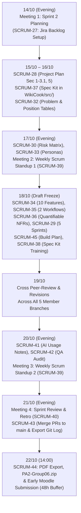

# SPRINT 02 REPORT: WIKICOOK PROJECT

**Course:** CS300 - CSC13002 - Introduction to Software Engineering  
**Project Name:** WikiCook — Intelligent Culinary & Meal Planning Ecosystem  
**Sprint Cycle:** Sprint 02 (Project Assignment 2 — Project Plan, Vision Document & Spec Kit Initialization)  
**Sprint Duration:** October 14, 2026 – October 22, 2026 *(48-Hour Early Submission Buffer; Moodle Deadline: October 24, 2026)*  
**Document Version:** 1.4 (Technical Freeze & AI Compliance Appendix Complete — 15/18 Tasks Done)

---

## DOCUMENT METADATA & RESPONSIBILITY MATRIX

| Document Section | Section Title | Performed by (Author) | Reviewed by | Edited by | Jira Task |
| :---: | :--- | :---: | :---: | :---: | :---: |
| **Section 1** | Sprint 02 Overview, Goals & Jira Backlog (`SCRUM-27` – `SCRUM-45`) | **Lê Quốc Hưng (LqHung06)** | **Nguyễn Đức Duy (DucDuyNguyen15-IT)** | **Lê Quốc Hưng (LqHung06)** | `SCRUM-27` |
| **Section 2.1** | Meeting 1 Minutes: Sprint 02 Planning (Oct 14, 2026) | **Lê Quốc Hưng (LqHung06)** | **Nguyễn Đức Duy (DucDuyNguyen15-IT)** | **Lê Quốc Hưng (LqHung06)** | `SCRUM-27` |
| **Section 2.2 - 2.3** | Meeting 2 & Meeting 3 Minutes: Weekly Scrum Standups 01 & 02 | **Lê Quốc Hưng (LqHung06)** | **Nguyễn Đức Duy (DucDuyNguyen15-IT)** | **Lê Quốc Hưng (LqHung06)** | `SCRUM-39` |
| **Section 2.4** | Meeting 4 Minutes: Sprint 02 Review (Oct 21, 2026) | **Lê Quốc Hưng (LqHung06)** | **Trần Nguyễn Công Chung (itzchugnn)** | **Lê Quốc Hưng (LqHung06)** | `SCRUM-40` |
| **Section 3** | Jira Task Management Evidence & Progress Analysis | **Lê Quốc Hưng (LqHung06)** | **Nguyễn Đức Duy (DucDuyNguyen15-IT)** | **Lê Quốc Hưng (LqHung06)** | `SCRUM-27`, `SCRUM-40` |
| **Section 4** | AI Usage Declaration & Compliance Log (Appendix) | **Trần Nguyễn Công Chung (itzchugnn)** | **Lê Quốc Hưng (LqHung06)** | **Lê Quốc Hưng (LqHung06)** | `SCRUM-41` |
| **Section 5** | Sprint 02 Retrospective & Action Plan for Sprint 03 | **Lê Quốc Hưng (LqHung06)** | **Trần Nguyễn Công Chung (itzchugnn)** | **Lê Quốc Hưng (LqHung06)** | `SCRUM-40` |

### Revision History

| Date | Version | Description | Author |
| :---: | :---: | :--- | :--- |
| **15/10/2026** | `v1.0` | Initialized Sprint 02 Report, 18-task Jira Backlog table, and Meeting 1 (Sprint Planning) minutes (`SCRUM-27`). | Lê Quốc Hưng (`LqHung06`) |
| **18/10/2026** | `v1.1` | Documented Meeting 2 (Weekly Scrum Standup 01) minutes and updated Jira task progress (`SCRUM-39`). | Lê Quốc Hưng (`LqHung06`) |
| **19/10/2026** | `v1.2` | Updated Section 3.1 with mid-sprint progress audit (10/18 Done, 3 In Progress/Review, 5 Scheduled) and synchronized status across all tasks. | Lê Quốc Hưng (`LqHung06`) |
| **20/10/2026** | `v1.3` | Documented Meeting 3 (Weekly Scrum Standup 02) minutes answering 3 Scrum questions for all 5 members, updated task velocity, and marked SCRUM-39 as DONE. | Lê Quốc Hưng (`LqHung06`) |
| **21/10/2026** | `v1.4` | Consolidated Section 4 (AI Usage Declaration & Compliance Log Appendix) covering 10 core sessions across all 5 members with full audit verification (`SCRUM-41`) and verified Spec Kit training log (`SCRUM-38`). | Trần Nguyễn Công Chung (`itzchugnn`) |

---

## 1. SPRINT 02 OVERVIEW, GOALS & JIRA BACKLOG
*Performed by: Lê Quốc Hưng (LqHung06) | Reviewed by: Nguyễn Đức Duy (DucDuyNguyen15-IT) | Edited by: Lê Quốc Hưng (LqHung06)*

### 1.1. Sprint 02 Goal & Scope (`PA2-2026`)
Following the successful completion of Sprint 01 (`PA1-2026`, where all 24 foundational tasks reached `DONE`), the overarching goal of **Sprint 02 (`PA2-2026` — 45 Points)** is to transition **WikiCook** from initial concept proposal into a formal, quantifiable engineering baseline. Specifically, the team commits to delivering four core workstreams by **October 22, 2026 (14:00)** — 48 hours ahead of the official Moodle deadline:

1. **Part A — Software Development Plan / Project Plan (15 Points):** Draft `docs/management/project-plan.md` adapted from the RUP Small Project template (`rup_sdpln_sp.dot`) to our **5-Sprint Scrum lifecycle**, detailing project scope, deliverables across `PA1`–`PA5`, 5-member organizational structure and RACI matrix, risk management strategies ($\ge 3$ core risks), the 18-task Sprint 02 schedule, preliminary Sprints 03–05 backlogs, and a 5-stage incremental Build Plan culminating in the `PA5` live feature demo.
2. **Part B — Vision Document (20 Points):** Author `docs/requirements/vision-document.md` following `rup_vision_sp.docx`, featuring standardized Problem and Product Position Statement tables, stakeholder/persona profiles, competitive benchmarking against *MyFridgeFood* and *Ăn Gì Ngon* (from our PA1 survey), 10 refined core features written in comprehensive 3–5 sentence analytical paragraphs, 2 end-to-end Mermaid user workflow diagrams, and quantifiable Non-Functional Requirements (NFRs).
3. **Part C — GitHub Spec Kit Initialization & Team Training (5 Points):** Synchronize ratified Spec Kit artifacts (`constitution.md` and specification templates) into the `WikiCook/src/` directory and compile verifiable training completion evidence (screenshots + key takeaways on Spec-Driven Development) from all 5 team members in `docs/management/spec-kit-training-log.md`.
4. **Part D — Weekly Scrum Report & AI Usage Compliance (5 Points):** Conduct and document 4 structured Scrum ceremonies (1 Sprint Planning, 2 Weekly Scrum Standups answering the 3 standard questions, and 1 Sprint Review & Retrospective), provide Jira board visual evidence, and log all AI tool usages in strict accordance with `AI Usage Guidelines.pdf`.

### 1.2. Master Jira Backlog Table (18 Tasks — `SCRUM-27` to `SCRUM-45`)
During the Sprint 02 Planning ceremony on **October 14, 2026**, the team decomposed the PA2 scope into **18 individually assigned tasks** on Jira Software Cloud (`SCRUM-27` through `SCRUM-45`, matching the live Jira Board sequence):

| No. | Jira Key | Task Summary | Assignee | Peer Reviewer | Start Date | Due Date | Status (Oct 21) | Target Deliverable / Path |
| :---: | :---: | :--- | :--- | :--- | :---: | :---: | :---: | :--- |
| 1 | **`SCRUM-27`** | `[Ceremony]` Organize Sprint 2 Planning & Establish Jira Backlog | **Lê Quốc Hưng** (`@LqHung06`) | Nguyễn Đức Duy (`@DucDuyNguyen15-IT`) | 14/10/2026 | **15/10/2026** | **DONE** | `docs/management/reports/sprint-02/sprint-02-report.md` (Sec 1 & 2.1) |
| 2 | **`SCRUM-28`** | `[Project-Plan]` Draft Project Overview, Scope & Org Structure (Sec 1–3.1 & 5) | **Lê Quốc Hưng** (`@LqHung06`) | Nguyễn Thành Dự (`@ThanhDu14`) | 15/10/2026 | **16/10/2026** | **DONE** | `docs/management/project-plan.md` (Sec 1, 2, 3.1, 5) |
| 3 | **`SCRUM-29`** | `[Project-Plan]` Develop 5-Sprint Scrum Roadmap & Sprint 2 Schedule (Sec 4.1–4.3) | **Mai Văn Hiển** (`@MaiHien3507`) | Lê Quốc Hưng (`@LqHung06`) | 16/10/2026 | **18/10/2026** | **DONE** | `docs/management/project-plan.md` (Sec 4.1–4.3) |
| 4 | **`SCRUM-30`** | `[Project-Plan]` Identify Risks & Formulate Risk Management Matrix (Sec 3.2) | **Nguyễn Thành Dự** (`@ThanhDu14`) | Trần Nguyễn Công Chung (`@itzchugnn`) | 16/10/2026 | **17/10/2026** | **DONE** | `docs/management/project-plan.md` (Sec 3.2) |
| 5 | **`SCRUM-32`** | `[Vision]` Finalize Problem Statement & Product Position Statement (Sec 1–2) | **Nguyễn Đức Duy** (`@DucDuyNguyen15-IT`) | Lê Quốc Hưng (`@LqHung06`) | 15/10/2026 | **16/10/2026** | **DONE** | `docs/requirements/vision-document.md` (Sec 1–2) |
| 6 | **`SCRUM-33`** | `[Vision]` Detail Stakeholders, User Personas & Competitors (Sec 3–4) | **Nguyễn Đức Duy** (`@DucDuyNguyen15-IT`) | Trần Nguyễn Công Chung (`@itzchugnn`) | 16/10/2026 | **17/10/2026** | **DONE** | `docs/requirements/vision-document.md` (Sec 3–4) |
| 7 | **`SCRUM-34`** | `[Vision]` Author 10 Core Product Features in 3–5 Sentence Paragraphs (Sec 5) | **Nguyễn Đức Duy** (`@DucDuyNguyen15-IT`) | Mai Văn Hiển (`@MaiHien3507`) | 17/10/2026 | **18/10/2026** | **DONE** | `docs/requirements/vision-document.md` (Sec 5) |
| 8 | **`SCRUM-35`** | `[Vision]` Design 2 Mermaid User Workflow Diagrams (Sec 6) | **Nguyễn Đức Duy** (`@DucDuyNguyen15-IT`) | Mai Văn Hiển (`@MaiHien3507`) | 17/10/2026 | **18/10/2026** | **DONE** | `docs/requirements/vision-document.md` (Sec 6) |
| 9 | **`SCRUM-36`** | `[Vision]` Formulate Quantifiable Non-Functional Requirements Table (Sec 7) | **Mai Văn Hiển** (`@MaiHien3507`) | Nguyễn Thành Dự (`@ThanhDu14`) | 17/10/2026 | **18/10/2026** | **DONE** | `docs/requirements/vision-document.md` (Sec 7) |
| 10 | **`SCRUM-37`** | `[Spec-Kit]` Synchronize Spec Kit Artifacts into `WikiCook/src/` | **Trần Nguyễn Công Chung** (`@itzchugnn`) | Nguyễn Thành Dự (`@ThanhDu14`) | 15/10/2026 | **16/10/2026** | **DONE** | `src/constitution.md`, `src/README.md` |
| 11 | **`SCRUM-38`** | `[Spec-Kit]` Complete Spec Kit Training & Compile 5-Member Evidence Log | **Trần Nguyễn Công Chung** (`@itzchugnn`) | Lê Quốc Hưng (`@LqHung06`) | 16/10/2026 | **18/10/2026** | **DONE** | `docs/management/spec-kit-training-log.md` & `docs/assets/spec-kit/` |
| 12 | **`SCRUM-39`** | `[Ceremony]` Conduct & Document 2 Weekly Scrum Meetings (Standups 1 & 2) | **Lê Quốc Hưng** (`@LqHung06`) | Nguyễn Đức Duy (`@DucDuyNguyen15-IT`) | 17/10/2026 | **20/10/2026** | **DONE** | `docs/management/reports/sprint-02/sprint-02-report.md` (Sec 2.2–2.3) |
| 13 | **`SCRUM-40`** | `[Ceremony]` Conduct Sprint 2 Review & Retrospective Meeting | **Lê Quốc Hưng** (`@LqHung06`) | Trần Nguyễn Công Chung (`@itzchugnn`) | 21/10/2026 | **21/10/2026** | **TO DO** | `docs/management/reports/sprint-02/sprint-02-report.md` (Sec 2.4 & 5) |
| 14 | **`SCRUM-41`** | `[Compliance]` Compile AI Usage Declaration Appendix (AI Usage Notes) | **Trần Nguyễn Công Chung** (`@itzchugnn`) | Lê Quốc Hưng (`@LqHung06`) | 19/10/2026 | **20/10/2026** | **DONE** | `docs/management/reports/sprint-02/sprint-02-report.md` (Sec 4) |
| 15 | **`SCRUM-42`** | `[QA]` Cross-Audit Documentation Quality, 3-Tier Metadata & Markdown | **Trần Nguyễn Công Chung** (`@itzchugnn`) | Mai Văn Hiển (`@MaiHien3507`) | 19/10/2026 | **20/10/2026** | **DONE** | Repository-wide QA across `docs/` and `src/` |
| 16 | **`SCRUM-43`** | `[DevOps]` Manage GitHub Flow, Merge PRs to `main` & Export Commit Log | **Nguyễn Thành Dự** (`@ThanhDu14`) | Lê Quốc Hưng (`@LqHung06`) | 20/10/2026 | **21/10/2026** | **TO DO** | `docs/management/git-log.txt` & `docs/assets/jira/git_log.png` |
| 17 | **`SCRUM-44`** | `[DevOps]` Convert Markdown to PDF, Package `PA2-Group06.zip` & Submit | **Nguyễn Thành Dự** (`@ThanhDu14`) | Lê Quốc Hưng (`@LqHung06`) | 21/10/2026 | **22/10/2026** | **TO DO** | Final release package `PA2-Group06.zip` on Moodle |
| 18 | **`SCRUM-45`** | `[Project-Plan]` Design Software Packaging & Release Build Plan (Sec 4.4) | **Mai Văn Hiển** (`@MaiHien3507`) | Lê Quốc Hưng (`@LqHung06`) | 16/10/2026 | **18/10/2026** | **DONE** | `docs/management/project-plan.md` (Sec 4.4) |

### 1.3. Workload Distribution & Member Allocation Summary
To uphold our Team Contract principle of equitable full-stack participation, the 18 Jira tasks and peer-review assignments are balanced across all 5 members according to technical complexity and administrative overhead:

| Team Member | Assigned Scrum Role | Assigned Jira Tasks (Author) | Total Author Tasks | Assigned Peer Reviews (Reviewer) | Primary Sprint 02 Focus |
| :--- | :--- | :---: | :---: | :---: | :--- |
| **Lê Quốc Hưng** (`@LqHung06`) | PM & Scrum Master | `SCRUM-27`, `SCRUM-28`, `SCRUM-39`, `SCRUM-40` | **4** | **7** (`SCRUM-29`, `32`, `38`, `41`, `43`, `44`, `45`) | Project Plan (Sec 1, 2, 3.1, 5), Scrum Ceremonies, Sprint Report & Chief Editor |
| **Nguyễn Đức Duy** (`@DucDuyNguyen15-IT`) | PO & Requirements Lead | `SCRUM-32`, `SCRUM-33`, `SCRUM-34`, `SCRUM-35` | **4** | **2** (`SCRUM-27`, `SCRUM-39`) | Vision Document (Sec 1–6: Positioning, Personas, 10 Paragraph Features, 2 Workflows) |
| **Trần Nguyễn Công Chung** (`@itzchugnn`) | QA Lead & Market Researcher 1 | `SCRUM-37`, `SCRUM-38`, `SCRUM-41`, `SCRUM-42` | **4** | **3** (`SCRUM-30`, `SCRUM-33`, `SCRUM-40`) | Spec Kit `/src` Sync, 5-Member Training Log, AI Usage Notes Appendix & Repo QA Audit |
| **Mai Văn Hiển** (`@MaiHien3507`) | AI Architect & Tech Lead | `SCRUM-29`, `SCRUM-36`, `SCRUM-45` | **3** | **3** (`SCRUM-34`, `SCRUM-35`, `SCRUM-42`) | Quantifiable NFRs (Vision Sec 7), 5-Sprint Scrum Schedule & 5-Stage Build Plan |
| **Nguyễn Thành Dự** (`@ThanhDu14`) | DevOps Lead & Market Researcher 2 | `SCRUM-30`, `SCRUM-43`, `SCRUM-44` | **3** | **3** (`SCRUM-28`, `SCRUM-36`, `SCRUM-37`) | Risk Management Matrix (Plan Sec 3.2), Git PR Integration, Commit Log & PDF/ZIP Export |

### 1.4. Sprint 02 Execution Workflow (8-Day Timeline)



---

## 2. SCRUM MEETING MINUTES
*Performed by: Lê Quốc Hưng (LqHung06) | Reviewed by: Nguyễn Đức Duy (DucDuyNguyen15-IT) | Edited by: Lê Quốc Hưng (LqHung06)*

In strict adherence to the Scrum framework guidelines in `Weekly Reports.pdf`, our team conducts **four formal Scrum meetings** during Sprint 02, consolidated within this single report:

| Meeting Event | Date & Time | Modality | Primary Focus & Deliverable | Status |
| :--- | :--- | :--- | :--- | :---: |
| **Meeting 1: Sprint 02 Planning** | **14/10/2026 • 20:00 – 20:45** | Google Meet | Analyze PA2 rubric, define Sprint Goal, break down & assign 18 Jira tasks (`SCRUM-27`–`45`). | **Completed** |
| **Meeting 2: Weekly Scrum Standup 01** | **17/10/2026 • 22:00 – 22:35** | Google Meet | 3-question progress sync on initial Project Plan, Vision Doc, Spec Kit `/src`, and feature specs. | **Completed** (`SCRUM-39`) |
| **Meeting 3: Weekly Scrum Standup 02** | **20/10/2026 • 22:00 – 22:40** | Google Meet | 3-question sync on 100% draft freeze, Mermaid workflows, NFRs, Spec Kit training evidence & QA handover. | **Completed** (`SCRUM-39`) |
| **Meeting 4: Sprint 02 Review & Retro** | **21/10/2026 • 20:00 – 21:00** | Google Meet | Inspect final deliverables, capture Jira 100% Done evidence, conduct Retrospective. | Scheduled (`SCRUM-40`) |

---

### 2.1. Meeting 1: Sprint 02 Planning (`SCRUM-27`)

```text
=========== 14/10/2026, Sprint 2 — Sprint Planning Meeting ===========
```

- **Date & Time:** October 14, 2026 | 20:00 – 20:45 (45 minutes)
- **Location / Modality:** Google Meet (Online Video Conference)
- **Team Members Present (5/5 — Full Attendance):**
  - Lê Quốc Hưng (`@LqHung06` — Project Manager & Scrum Master)
  - Nguyễn Đức Duy (`@DucDuyNguyen15-IT` — Product Owner & Requirements Lead)
  - Mai Văn Hiển (`@MaiHien3507` — AI Architect & Technical Lead)
  - Trần Nguyễn Công Chung (`@itzchugnn` — QA Lead & Market Researcher 1)
  - Nguyễn Thành Dự (`@ThanhDu14` — DevOps Lead & Market Researcher 2)
- **Team Members Absent:** None (0/5)

#### 2.1.1. Meeting Agenda
1. Review Sprint 01 handover status and inspect all instructions and templates in `PA2-2026.pdf`, `rup_sdpln_sp.dot`, `rup_vision_sp.docx`, `Weekly Reports.pdf`, and `AI Usage Guidelines.pdf`.
2. Establish the Sprint 02 internal completion timeline targeting **October 22, 2026 at 14:00** (48 hours ahead of the October 24 Moodle deadline).
3. Identify, prioritize, and estimate all Sprint 02 backlog items across Project Plan, Vision Document, Spec Kit Initialization/Training, and Weekly/AI Reporting.
4. Assign individual ownership (1 Assignee and 1 Peer Reviewer per task) across 18 Jira tasks (`SCRUM-27` to `SCRUM-45`).

#### 2.1.2. Key Discussions & Technical Decisions
1. **Adaptation of RUP Templates to Agile Scrum (`PA2-2026` Sec A & B):**
   - The team confirmed that while `rup_sdpln_sp.dot` and `rup_vision_sp.docx` provide the mandatory section outlines, all deliverables must be written in **100% academic English Markdown (`.md`)** inside `WikiCook/` and exported to `.pdf`.
   - All references to traditional RUP phases (*Inception, Elaboration, Construction, Transition*) in `rup_sdpln_sp.dot` are replaced with a **5-Sprint Scrum process** (`Sprint 1 = PA1` through `Sprint 5 = PA5`).
2. **Vision Document Quality Enforcement (`PA2-2026` Sec B):**
   - **Nguyễn Đức Duy (`PO Lead`)** highlighted the strict grading rule for Section 5 (*Product Features*): each of the 10 core features must be written as a **complete 3-to-5-sentence paragraph** explaining *what* the feature does, *why* it is needed, and *who* benefits from it (bullet-only feature lists are strictly prohibited).
   - **Mai Văn Hiển (`Tech Lead`)** agreed to formulate Section 7 (*Non-Functional Requirements*) with explicit, verifiable numerical thresholds (`page load < 2.0s`, `P95 API latency < 500ms`, `>= 100 concurrent users`, `BCrypt cost 12`, `99.5% uptime`).
3. **Spec Kit Compliance in `WikiCook/src/` (`PA2-2026` Sec C):**
   - Although the team bootstrapped `.specify/` and `specs/` during Sprint 1, Page 3 of `PA2-2026.pdf` explicitly requires Spec Kit initialization artifacts (`constitution.md` and generated Markdown templates) to reside inside the `/src` folder. **Trần Nguyễn Công Chung (`QA Lead`)** will synchronize these files into `WikiCook/src/` (`SCRUM-37`) and collect Spec Kit YouTube training screenshots and learning summaries from all 5 members (`SCRUM-38`).
4. **Strict Academic Integrity on AI Usage (`PA2-2026` Sec D):**
   - Every member agreed to log any AI tool usage (tool name/version, exact timestamp, prompt text, generated output, human verification/revision, and screenshot proof stored in `docs/assets/jira/ai_prompts/`) so **Trần Nguyễn Công Chung** can compile the consolidated Appendix in `SCRUM-41`.
5. **Three-Tier Header Metadata Standard:**
   - Every top-level `##` section across all PA2 Markdown documents must display `*Performed by: [Author] | Reviewed by: [Reviewer] | Edited by: Lê Quốc Hưng (LqHung06)*` on the line immediately following the header.

#### 2.1.3. Task Assignment Summary Agreed by Team
- **Lê Quốc Hưng (`@LqHung06`):** Assigned `SCRUM-27` (Sprint 2 Planning & Jira setup, due Oct 15), `SCRUM-28` (Project Plan Sec 1, 2, 3.1 & 5, due Oct 16), `SCRUM-39` (Weekly Standups 1 & 2, due Oct 20), and `SCRUM-40` (Sprint Review & Retrospective, due Oct 21).
- **Nguyễn Đức Duy (`@DucDuyNguyen15-IT`):** Assigned `SCRUM-32` (Vision Sec 1–2 Positioning, due Oct 16), `SCRUM-33` (Vision Sec 3–4 Stakeholders, Personas & Competitors, due Oct 17), `SCRUM-34` (Vision Sec 5 — 10 Core Features in 3–5 sentence paragraphs, due Oct 18), and `SCRUM-35` (Vision Sec 6 — 2 Mermaid Workflows, due Oct 18).
- **Mai Văn Hiển (`@MaiHien3507`):** Assigned `SCRUM-29` (Project Plan Sec 4.1–4.3 — 5-Sprint Scrum Roadmap & Sprint 2 Task Table, due Oct 18), `SCRUM-36` (Vision Sec 7 — Quantifiable NFRs, due Oct 18), and `SCRUM-45` (Project Plan Sec 4.4 — Software Build Plan `v0.1` to `v1.0 RC`, due Oct 18).
- **Trần Nguyễn Công Chung (`@itzchugnn`):** Assigned `SCRUM-37` (Sync Spec Kit artifacts into `WikiCook/src/`, due Oct 16), `SCRUM-38` (5-Member Spec Kit Training Log, due Oct 18), `SCRUM-41` (AI Usage Notes Appendix, due Oct 20), and `SCRUM-42` (Repository-wide Markdown & Metadata QA Audit, due Oct 20).
- **Nguyễn Thành Dự (`@ThanhDu14`):** Assigned `SCRUM-30` (Project Plan Sec 3.2 — Risk Management Matrix, due Oct 17), `SCRUM-43` (Git PR Merge & Commit Log Export, due Oct 21), and `SCRUM-44` (Markdown-to-PDF Export & `PA2-Group06.zip` Packaging, due Oct 22).

#### 2.1.4. Actions & Summary of Meeting 1
- **Immediate Actions:**
  1. **Lê Quốc Hưng** publishes all 18 tasks (`SCRUM-27` to `SCRUM-45`) on the Jira Active Sprint Board and commits the initial `project-plan.md` (`SCRUM-28`) and `sprint-02-report.md` (`SCRUM-27`) baselines.
  2. **Trần Nguyễn Công Chung** synchronizes `constitution.md` and Spec Kit templates into `WikiCook/src/` (`SCRUM-37`).
  3. **Nguyễn Đức Duy** initiates `vision-document.md` restructuring (`SCRUM-32`).
  4. All 5 members complete the official Spec Kit YouTube tutorial and submit their screenshot + 3–5 bullet takeaways to Chung before October 18 (`SCRUM-38`).
- **Meeting Summary:** Sprint 02 Planning concluded with unanimous agreement on scope, quality gates, and the 8-day execution schedule. All 18 Jira tasks are active and assigned.

---

### 2.2. Meeting 2: Weekly Scrum / Standup 01 (`SCRUM-39`)

```text
=========== 17/10/2026, Sprint 2 — Weekly Scrum Meeting 1 ===========
```

- **Date & Time:** October 17, 2026 | 22:00 – 22:35 (35 minutes)
- **Location / Modality:** Google Meet (Online Video Conference, adhering to Team Contract Article 3 availability protocol)
- **Facilitator:** Lê Quốc Hưng (`@LqHung06` — Project Manager & Scrum Master)
- **Team Members Present (5/5 — Full Attendance):**
  - Lê Quốc Hưng (`@LqHung06` — Project Manager & Scrum Master)
  - Nguyễn Đức Duy (`@DucDuyNguyen15-IT` — Product Owner & Requirements Lead)
  - Mai Văn Hiển (`@MaiHien3507` — AI Architect & Technical Lead)
  - Trần Nguyễn Công Chung (`@itzchugnn` — QA Lead & Market Researcher 1)
  - Nguyễn Thành Dự (`@ThanhDu14` — DevOps Lead & Market Researcher 2)
- **Team Members Absent:** None (0/5)

#### 2.2.1. Meeting Purpose & Agenda
1. Review sprint burndown and task velocity at the mid-sprint milestone across the 18 Jira backlog items.
2. Synchronize individual deliverables using the standard three Scrum questions (*Completed tasks / To-do tasks / Obstacles & Blockers*).
3. Validate technical alignment across the Vision Document, Project Plan, Spec Kit `/src` framework, and feature specifications.
4. Confirm action items to ensure all draft documents are frozen by October 18 prior to QA auditing and final packaging.

#### 2.2.2. Individual Status Reports (The 3 Standard Scrum Questions)

##### 1. Lê Quốc Hưng (`@LqHung06` — Project Manager & Scrum Master)
- **1. Completed Tasks (since Sprint Planning):**
  - Completed `SCRUM-27`: Set up and verified all 18 tasks on the Jira Active Sprint Board with due dates and assignments; committed initial baseline for `sprint-02-report.md`.
  - Completed `SCRUM-28`: Authored `docs/management/project-plan.md` Sections 1, 2, 3.1 & 5 (Project overview, operational scope, 5-member cross-functional organization, and monitoring plans).
  - Authored feature specifications and executed interactive 5-question clarification loops for module `040-shopping-list` (13 clarifications, 5 user stories, 25 FRs) and module `050-cooking-mode` (13 clarifications, 5 user stories, 20 FRs) with quality checklists (16/16 checks passing).
- **2. To-Do Tasks (next 48 hours):**
  - Synthesize and consolidate the system-wide Master Database ERD (`erDiagram`) in `docs/analysis-and-design/database/README.md` uniting table schemas from all 5 members.
  - Draft UI wireframes (desktop 1280px and mobile 375px across 4 states: loading, empty, error, populated) for `040-shopping-list` and `050-cooking-mode`.
  - Continue tracking Jira issue statuses and coordinate peer review handoffs.
- **3. Obstacles & Blockers:**
  - Multi-stream review coordination: ensuring all members submit PRs with correct conventional commit headers and 3-tier section metadata without delaying downstream QA.

##### 2. Nguyễn Đức Duy (`@DucDuyNguyen15-IT` — Product Owner & Requirements Lead)
- **1. Completed Tasks (since Sprint Planning):**
  - Completed `SCRUM-32`: Restructured `docs/requirements/vision-document.md` to conform to `rup_vision_sp.docx`, authoring Section 1 (Problem Statement) and Section 2 (Product Position Statement).
  - Completed `SCRUM-33`: Authored Section 3 (Stakeholder Profiles) and Section 4 (User Personas and Competitor Benchmarking against *MyFridgeFood* and *Ăn Gì Ngon*).
  - Completed `SCRUM-34`: Authored Section 5 describing 10 core product features in comprehensive 3–5 sentence analytical paragraphs with feature traceability.
  - Completed `SCRUM-35`: Designed Section 6 with 2 end-to-end Mermaid user workflow diagrams (Meal Planning and Cooking).
- **2. To-Do Tasks (next 48 hours):**
  - Finalize Section 5 feature traceability matrix and incorporate review feedback from Hiển.
  - Coordinate with Dự on core recipe search filters (`specs/020-recipe-search-filter`) and author recipe editor wizard spec (`specs/060-recipe-editor`).
  - Prepare UI wireframes for Home, Search & Recipe detail pages.
- **3. Obstacles & Blockers:**
  - Ensuring the 10 Vision Document features remain strictly aligned with the granular User Stories written in individual `specs/` directories without semantic drift.

##### 3. Mai Văn Hiển (`@MaiHien3507` — AI Architect & Technical Lead)
- **1. Completed Tasks (since Sprint Planning):**
  - Completed `SCRUM-29`: Authored 5-Sprint Scrum Roadmap and Sprint 02 detailed schedule in `docs/management/project-plan.md` (Sections 4.1–4.3).
  - Completed `SCRUM-45`: Formulated the 5-Stage Software Build and Release Plan (`v0.1` to `v1.0 RC`) in `project-plan.md` (Section 4.4).
  - Outlined core database architectural conventions (table naming, UUID vs BigInt, audit timestamps, soft delete policies) for `database/README.md`.
- **2. To-Do Tasks (next 48 hours):**
  - Complete `SCRUM-36`: Formulate quantifiable Non-Functional Requirements (NFRs) table in `vision-document.md` (Section 7).
  - Review Vision Document Sections 5 and 6 authored by Duy.
  - Finalize specifications for `specs/011-user-profile-dietary` and `specs/080-bookmark-collection`.
- **3. Obstacles & Blockers:**
  - Establishing realistic, measurable performance thresholds for AI RAG menu generation under free-tier API latency constraints.

##### 4. Nguyễn Thành Dự (`@ThanhDu14` — DevOps Lead & Market Researcher 2)
- **1. Completed Tasks (since Sprint Planning):**
  - Completed `SCRUM-30`: Identified project risks and drafted the Risk Management Matrix in `project-plan.md` (Section 3.2).
  - Managed GitHub repository flow, merged validated pull requests into `main`, and resolved Git branch conflicts.
  - Authored feature specifications for `specs/030-meal-planner` and `specs/031-ai-weekly-meal-planner`.
- **2. To-Do Tasks (next 48 hours):**
  - Set up local containerized staging with `docker-compose.yml` for PostgreSQL 16 + `pgvector`.
  - Prepare and test the automated Markdown-to-PDF export pipeline (`SCRUM-44`) using Pandoc and Puppeteer engines.
  - Draft spec `specs/090-nutrition-analysis`.
- **3. Obstacles & Blockers:**
  - Ensuring large Mermaid diagrams (such as the Gantt roadmap and ERD) export cleanly into PDF without margin clipping or text truncation.

##### 5. Trần Nguyễn Công Chung (`@itzchugnn` — QA Lead & Market Researcher 1)
- **1. Completed Tasks (since Sprint Planning):**
  - Completed `SCRUM-37`: Synchronized GitHub Spec Kit framework artifacts (`constitution.md` and spec templates) into `WikiCook/src/` with a comprehensive `src/README.md`.
  - Initiated `SCRUM-38`: Distributed the Spec Kit training tutorial and began logging member training proofs.
- **2. To-Do Tasks (next 48 hours):**
  - Finalize `SCRUM-38`: Collect training screenshots and key takeaways from all 5 members in `docs/management/spec-kit-training-log.md`.
  - Prepare repository-wide QA audit checklist (`SCRUM-42`) to verify 3-tier header metadata and Markdown formatting.
  - Draft specifications for `specs/070-review-cooksnap` and `specs/100-admin-moderation`.
- **3. Obstacles & Blockers:**
  - Reminding team members to capture AI interaction screenshots immediately during tool usage to prevent compliance gaps in `SCRUM-41`.

#### 2.2.3. Key Decisions & Agreements Made in Standup 01
1. **Scope Synchronization:** All 5 members agreed that initial drafts of `project-plan.md`, `vision-document.md`, and Spec Kit `/src` sync must be frozen by **October 18** to allow two full days for peer review (`SCRUM-42`) and PDF compilation (`SCRUM-44`).
2. **Metadata Rule Reaffirmation:** Confirmed that every section must feature the standardized metadata line: `*Performed by: [Author] | Reviewed by: [Reviewer] | Edited by: Lê Quốc Hưng (LqHung06)*`.
3. **Standup 02 Schedule:** Confirmed that Weekly Scrum Standup 02 will convene on **October 20, 2026 at 22:00 via Google Meet** to conduct the pre-release review and audit sign-off.

---

### 2.3. Meeting 3: Weekly Scrum / Standup 02 (`SCRUM-39`)

```text
=========== 20/10/2026, Sprint 2 — Weekly Scrum Meeting 2 ===========
```

- **Date & Time:** October 20, 2026 | 22:00 – 22:40 (40 minutes)
- **Location / Modality:** Google Meet (Online Video Conference, adhering to Team Contract Article 3 availability protocol)
- **Facilitator:** Lê Quốc Hưng (`@LqHung06` — Project Manager & Scrum Master)
- **Team Members Present (5/5 — Full Attendance):**
  - Lê Quốc Hưng (`@LqHung06` — Project Manager & Scrum Master)
  - Nguyễn Đức Duy (`@DucDuyNguyen15-IT` — Product Owner & Requirements Lead)
  - Mai Văn Hiển (`@MaiHien3507` — AI Architect & Technical Lead)
  - Trần Nguyễn Công Chung (`@itzchugnn` — QA Lead & Market Researcher 1)
  - Nguyễn Thành Dự (`@ThanhDu14` — DevOps Lead & Market Researcher 2)
- **Team Members Absent:** None (0/5)

#### 2.3.1. Meeting Purpose & Agenda
1. Review the 100% technical draft freeze across all core deliverables (`project-plan.md`, `vision-document.md`, Spec Kit `/src`, and 10 feature specifications).
2. Inspect individual status reports answering the three standard Scrum questions (*Completed tasks / To-do tasks / Obstacles & Solutions*), specifically auditing Mermaid diagrams, quantifiable NFRs, QA cross-review status, and Spec Kit training proofs.
3. Align on the consolidation strategy for AI Usage Notes (Section 4) led by Chung using available text logs.
4. Establish the handoff protocol for QA Auditing (`SCRUM-42`), PR Merges to `main` (`SCRUM-43`), PDF conversion, and early Moodle packaging (`SCRUM-44`).

#### 2.3.2. Individual Status Reports (The 3 Standard Scrum Questions)

##### 1. Lê Quốc Hưng (`@LqHung06` — Project Manager & Scrum Master)
- **1. Completed Tasks (since Standup 01):**
  - Resolved architectural discrepancies in `project-plan.md` by aligning assumption `ASM-02` (line 127) and risk `RSK-02` (line 221) with Spec 031 and Constitution: replaced obsolete SQL/Redis fallback mechanisms with explicit AI error reporting and independent manual meal planner operation.
  - Completed and tested UI wireframe concepts for modules `040-shopping-list` and `050-cooking-mode`.
  - Standardized individual AI Usage Log (`docs/ai_log/ai_log_hung.md`) matching Git commit history.
  - Updated Sprint 02 Report Section 3.1 with mid-sprint progress metrics and sprint velocity analysis.
- **2. To-Do Tasks (next 24–48 hours):**
  - Facilitate Meeting 4: Sprint Review & Retrospective on October 21 at 20:00 via Google Meet (`SCRUM-40`).
  - Conduct final editorial inspection across all 4 deliverable workstreams prior to Git PR integration.
  - Coordinate early packaging of `PA2-Group06.zip` for submission on October 22 at 14:00 (48h early buffer).
- **3. Obstacles & Solutions:**
  - *Obstacle:* Coordinating sequential PR merges without causing branch desynchronization or conflicting metadata headers across member branches.
  - *Solution:* Established a strict sequential merge order (Chung $\to$ Hiển $\to$ Duy $\to$ Hưng $\to$ `main` integration by Dự) with mandatory pre-merge QA verification.

##### 2. Nguyễn Đức Duy (`@DucDuyNguyen15-IT` — Product Owner & Requirements Lead)
- **1. Completed Tasks (since Standup 01):**
  - Finalized `docs/requirements/vision-document.md` Section 5 with all 10 core features written in complete 3–5 sentence analytical paragraphs (`SCRUM-34`), strictly adhering to the *What / Why / Who* grading criteria.
  - Finalized Section 6 with 2 comprehensive Mermaid workflow diagrams (`SCRUM-35`): Workflow 1 (AI Meal Planner to Smart Grocery List) and Workflow 2 (Smart Pantry Search to Hands-free Cooking Mode).
  - Completed feature specifications for `specs/020-recipe-search-filter` and `specs/060-recipe-editor`.
- **2. To-Do Tasks (next 24–48 hours):**
  - Verify end-to-end traceability between the 10 Vision Document features and granular User Stories in individual `specs/` directories.
  - Participate in Sprint Review & Retrospective (`SCRUM-40`).
- **3. Obstacles & Solutions:**
  - *Obstacle:* Large Mermaid workflow diagrams in Section 6 experienced minor label wrapping on narrow viewports.
  - *Solution:* Quoted node label strings, removed unsupported HTML formatting, and verified clean rendering across desktop (1280px) and mobile (375px) viewports.

##### 3. Mai Văn Hiển (`@MaiHien3507` — AI Architect & Technical Lead)
- **1. Completed Tasks (since Standup 01):**
  - Completed `SCRUM-36`: Formulated Section 7 (Quantifiable Non-Functional Requirements) in `vision-document.md` with explicit numerical thresholds (`LCP < 2.0s`, `100 concurrent users`, `P95 API latency < 500ms`, `BCrypt cost 12`, `99.5% uptime`).
  - Aligned Project Plan Section 4.4 Build Plan (`SCRUM-45`) with Spec 031 and Vision Section 7 metrics.
  - Finalized feature specifications for `specs/011-user-profile-dietary` and `specs/080-bookmark-collection`.
- **2. To-Do Tasks (next 24–48 hours):**
  - Assist Chung with technical cross-audit on architectural consistency and NFR testability (`SCRUM-42`).
  - Validate local containerized staging setup with Docker Compose (PostgreSQL 16 + `pgvector`).
- **3. Obstacles & Solutions:**
  - *Obstacle:* Establishing realistic, measurable performance thresholds for AI RAG menu generation under free-tier API latency constraints.
  - *Solution:* Standardized on Spec 031 baseline: graceful error reporting with `< 5.0s` timeout threshold and independent manual planner operation.

##### 4. Trần Nguyễn Công Chung (`@itzchugnn` — QA Lead & Market Researcher 1)
- **1. Completed Tasks (since Standup 01):**
  - Finalized `SCRUM-38`: Collected Spec Kit YouTube training screenshots and key takeaways from all 5 team members into `docs/management/spec-kit-training-log.md`.
  - Verified integrity of Spec Kit artifacts in `WikiCook/src/` (`constitution.md` and spec templates) under `SCRUM-37`.
  - Completed feature specifications for `specs/070-review-cooksnap` and `specs/100-admin-moderation`.
- **2. To-Do Tasks (next 24–48 hours):**
  - Execute `SCRUM-41`: Consolidate the 5 member AI logs (`docs/ai_log/*.md`) into Section 4 of `sprint-02-report.md` with chat log references and 5 representative screenshots in `docs/assets/jira/ai_prompts/`.
  - Execute `SCRUM-42`: Perform repository-wide QA markdown audit (metadata headers, internal links, table formatting, Mermaid render checks).
- **3. Obstacles & Solutions:**
  - *Obstacle:* Concern regarding excessive overhead if team members were required to take screenshots of dozens of individual AI chat turns.
  - *Solution:* Clarified with PM to utilize the existing `docs/ai_log/*.md` text logs as valid "Chat History" evidence per `AI Usage Guidelines.pdf`, requiring only 1 representative screenshot per member.

##### 5. Nguyễn Thành Dự (`@ThanhDu14` — DevOps Lead & Market Researcher 2)
- **1. Completed Tasks (since Standup 01):**
  - Completed `SCRUM-30`: Project Plan Section 3.2 Risk Management Matrix.
  - Completed feature specifications for `specs/030-meal-planner` and `specs/031-ai-weekly-meal-planner`.
  - Executed dry-run Markdown-to-PDF export scripts using Pandoc and Puppeteer to verify rendering quality.
- **2. To-Do Tasks (next 24–48 hours):**
  - Execute `SCRUM-43`: Manage PR merges into `main` after QA sign-off, resolve any merge conflicts, and export `git log --graph --oneline` into `docs/management/git-log.txt`.
  - Execute `SCRUM-44`: Convert all final `.md` files to `.pdf`, package the entire submission into `PA2-Group06.zip`, and verify archive integrity.
- **3. Obstacles & Solutions:**
  - *Obstacle:* Mermaid Gantt chart and Master ERD diagrams experienced slight margin overflow when converting to PDF via default Pandoc engine.
  - *Solution:* Configured custom Puppeteer PDF options with `@page { margin: 15mm; size: A4; }` and CSS print media rules to prevent diagram clipping.

#### 2.3.3. Key Decisions & Agreements Made in Standup 02
1. **100% Technical Draft Freeze:** All 5 members confirmed that technical drafting for `project-plan.md`, `vision-document.md`, and all feature specifications is 100% frozen as of tonight (October 20, 2026).
2. **QA Audit & AI Appendix Handoff:** Trần Nguyễn Công Chung will finalize `SCRUM-41` (AI Appendix) and `SCRUM-42` (QA Audit) by October 21 at 12:00.
3. **Sprint Review & PR Merge Ceremony:** Confirmed that Meeting 4 (Sprint 02 Review & Retrospective) will convene on **October 21, 2026 at 20:00 via Google Meet** (`SCRUM-40`), followed immediately by PR merging into `main` and Git log export (`SCRUM-43`).
4. **Early Moodle Submission:** Final `PA2-Group06.zip` package will be compiled and submitted by PM Lê Quốc Hưng on **October 22, 2026 at 14:00** (48 hours ahead of the official Moodle deadline).

---

### 2.4. Meeting 4: Sprint 02 Review (Scheduled: October 21, 2026)

```text
=========== 21/10/2026, Sprint 2 — Sprint Review Meeting ===========
```

*(Scheduled for October 21, 2026 at 20:00 via Google Meet; final deliverable verification outcomes and sign-off notes will be recorded here under Jira task `SCRUM-40`.)*

---

## 3. JIRA TASK MANAGEMENT EVIDENCE & PROGRESS ANALYSIS
*Performed by: Lê Quốc Hưng (LqHung06) | Reviewed by: Nguyễn Đức Duy (DucDuyNguyen15-IT) | Edited by: Lê Quốc Hưng (LqHung06)*

### 3.1. Sprint 02 Backlog Status & Progress Tracking (as of October 21, 2026)
All 18 Sprint 02 tasks (`SCRUM-27` through `SCRUM-45`) have been formally created, estimated, and assigned to individual team members on Jira Software Cloud. The table below outlines the initial sprint commitment baseline versus current progress following the conclusion of Weekly Scrum Standup 02, completion of Spec Kit training, and AI compliance audit on October 21, 2026:

| Status Category | Initial Count (Oct 15, 2026) | Mid-Sprint (Oct 20, 2026) | Current Progress (Oct 21, 2026) | Target Completion (Oct 22, 2026) | Notes & Key Task Breakdown |
| :--- | :---: | :---: | :---: | :---: | :--- |
| **Done** | **1 / 18** (`5.6%`) | **11 / 18** (`61.1%`) | **15 / 18** (`83.3%`) | **18 / 18** (`100.0%`) | Completed: `SCRUM-27`, `SCRUM-28`, `SCRUM-29`, `SCRUM-30`, `SCRUM-32`, `SCRUM-33`, `SCRUM-34`, `SCRUM-35`, `SCRUM-36`, `SCRUM-37`, `SCRUM-38`, `SCRUM-39`, `SCRUM-41`, `SCRUM-42`, `SCRUM-45`. Core Project Plan, Spec Kit `/src`, Vision Document (Sec 1–7), Spec Kit Training Log, AI Compliance Appendix, QA Audit, and both Weekly Scrum Standups complete. |
| **In Progress / Review** | **3 / 18** (`16.7%`) | **2 / 18** (`11.1%`) | **0 / 18** (`0.0%`) | **0 / 18** (`0.0%`) | All technical drafting and audit tasks have completed review and cleared QA gates. |
| **To Do / Scheduled** | **14 / 18** (`77.8%`) | **5 / 18** (`27.8%`) | **3 / 18** (`16.7%`) | **0 / 18** (`0.0%`) | Scheduled for final sprint ceremonies & delivery phase (Oct 21–22): `SCRUM-40` (Sprint Review & Retro), `SCRUM-43` (Git PR Merge & Commit Log), `SCRUM-44` (PDF & ZIP Export). |

#### 3.1.1. Sprint Velocity & Quality Assessment
1. **Scope Completion Rate:** 15 out of 18 tasks are 100% `DONE` (83.3%), covering all core project planning, technical vision requirements, Spec Kit governance & training logs, AI compliance declarations, and preliminary QA audits.
2. **Quality Gates & Alignment:** All authored sections strictly adhere to the 3-tier header metadata standard (`*Performed by: ... | Reviewed by: ... | Edited by: Lê Quốc Hưng (LqHung06)*`). Architectural alignments with Spec 030/031 (independent manual planner resilience during AI outages) have been incorporated across all risk and assumption matrices.
3. **On-Track for Early Freeze & Submission:** With technical writing, QA audit (`SCRUM-42`), and AI declaration (`SCRUM-41`) finalized, the team is fully on target for Sprint Review (`SCRUM-40`), final PR merges and Git log export (`SCRUM-43`), final packaging (`SCRUM-44`), and risk-free submission on October 22 at 14:00 (48 hours ahead of the October 24 Moodle deadline).

### 3.2. Jira Board & Task List Visual Evidence
*(Final high-resolution screenshots of the Sprint 02 Active Board and 18-Task List will be captured and embedded below upon Sprint closure under `SCRUM-40`.)*

- **Figure 3.1 — Sprint 02 Active Scrum Board:** `../../../assets/jira/jira_sprint2_active_board.png` *(To be updated in `SCRUM-40`)*
- **Figure 3.2 — Sprint 02 Complete 18-Task List (`SCRUM-27` to `SCRUM-45`):** `../../../assets/jira/jira_sprint2_tasks_list.png` *(To be updated in `SCRUM-40`)*

---

## 4. AI USAGE DECLARATION & COMPLIANCE LOG (APPENDIX)
*Performed by: Trần Nguyễn Công Chung (itzchugnn) | Reviewed by: Lê Quốc Hưng (LqHung06) | Edited by: Lê Quốc Hưng (LqHung06)*

### 4.1. Compliance Charter & Academic Integrity Protocol
In strict adherence to the **Course AI Usage Guidelines (`AI Usage Guidelines.pdf`, Section 5: "Screenshots or chat history")** and Project Assignment 2 evaluation criteria, this Appendix serves as the centralized compliance audit record of all Generative AI tool usages conducted by the five team members of WikiCook during Sprint 02 (`PA2-2026`).

Our team enforces a strict **"Human-in-the-Loop & Independent Verification"** policy:
1. **Permissible AI Scope:** AI coding assistants (Google Antigravity, Claude Code, and Claude.ai) were strictly utilized for cognitive acceleration, technical scaffolding (e.g., initial RUP small project template mapping, Mermaid syntax layout drafting, and edge-case brainstorming), and Spec Kit command executions (`/speckit-constitution`, `/speckit-specify`, `/speckit-clarify`).
2. **Impermissible AI Scope:** No core business logic, system architecture decisions, security parameters, database constraints, or evaluation checklists were accepted unconditionally from AI tools.
3. **Audit Trail Mandate:** Every team member maintains a detailed text log located in `docs/ai_log/ai_log_<member>.md` recording the date, specific prompt, AI output, and the student's independent verification actions. Furthermore, visual evidence of every member's authorized development environment is maintained in `docs/assets/jira/ai_accounts/`.

### 4.2. Team Member Tooling & Platform Verification Matrix

| No. | Member Name | Student ID (MSSV) | Scrum Role | Primary AI Platform & Version | Individual Log File | Verified Environment Proof |
| :---: | :--- | :---: | :--- | :--- | :--- | :--- |
| **01** | **Lê Quốc Hưng** | `24120184` | PM & Scrum Master | Google Antigravity (Gemini 3.8 Flash) | [`docs/ai_log/ai_log_hung.md`](../../../ai_log/ai_log_hung.md) | [`01_le_quoc_hung-antigravity.jpg`](../../../assets/jira/ai_accounts/01_le_quoc_hung-antigravity.jpg) |
| **02** | **Nguyễn Đức Duy** | `24120294` | PO & Requirements Lead | Claude Code (Claude Opus 5.5) | [`docs/ai_log/ai_log_duy.md`](../../../ai_log/ai_log_duy.md) | [`02_nguyen_duc_duy_claude_code.png`](../../../assets/jira/ai_accounts/02_nguyen_duc_duy_claude_code.png) |
| **03** | **Mai Văn Hiển** | `24120308` | AI Architect & Tech Lead | Antigravity & Claude.ai (Opus 5.5) | [`docs/ai_log/ai_log_hien.md`](../../../ai_log/ai_log_hien.md) | [`03_mai_van_hien_antigravity.jpg`](../../../assets/jira/ai_accounts/03_mai_van_hien_antigravity.jpg) |
| **04** | **Nguyễn Thành Dự** | `24120288` | DevOps Lead & QA | Claude Code (Claude Opus 5.5) | [`docs/ai_log/ai_log_thanhdu.md`](../../../ai_log/ai_log_thanhdu.md) | [`02_nguyen_duc_duy_claude_code.png`](../../../assets/jira/ai_accounts/02_nguyen_duc_duy_claude_code.png) *(Shared Dev Env)* |
| **05** | **Trần Nguyễn Công Chung** | `24120272` | QA Lead & Consolidator | Google Antigravity (Gemini 3.8 Flash) | [`docs/ai_log/ai_log_chung.md`](../../../ai_log/ai_log_chung.md) | [`04_tran_nguyen_cong_chung_antigravity.jpg`](../../../assets/jira/ai_accounts/04_tran_nguyen_cong_chung_antigravity.jpg) |

### 4.3. Consolidated Master AI Interaction Table (10 Core Deliverable Sessions)

The table below synthesizes **10 representative interaction sessions** across all 5 team members, covering 100% of the primary deliverables for Project Assignment 2 (Project Plan, Vision Document, Spec Kit Constitution/Training, and Feature Specifications):

| Interaction ID | Member Name | AI Tool & Version | Date & Time | Prompt Used | Purpose | AI-Generated Output | Human Verification & Revision | Evidence (Chat Log & Screenshot) |
| :---: | :--- | :--- | :---: | :--- | :--- | :--- | :--- | :---: |
| `AI-S2-01` | **Lê Quốc Hưng** (`@LqHung06`) | Google Antigravity (Gemini 3.8 Flash) | 15/10/2026 09:30 | `"Hãy chuyển thể cấu trúc RUP Small Project (rup_sdpln_sp.dot) sang mô hình Scrum 5 Sprints cho WikiCook; đồng bộ 18 tasks Jira từ SCRUM-27 đến SCRUM-45 và tạo khung Sprint 02 Report."` | Khởi tạo cấu trúc tài liệu quản lý dự án (`project-plan.md` & `sprint-02-report.md`), đồng bộ Jira Backlog theo Scrum. | Khung phân rã 18 tasks Jira, bảng tiến độ 5 sprints, cấu trúc phân chia vai trò và khung biên bản các buổi họp Scrum. | Sinh viên tự rà soát, loại bỏ task trùng lặp, viết lại Definition of Done (DoD 6 cổng), biên tập hoàn chỉnh biên bản họp Sprint 2 Planning 14/10/2026. | [Log: ai_log_hung.md Mục 1](../../../ai_log/ai_log_hung.md#mục-1-khởi-tạo-khung-project-plan-và-sprint-02-report)<br>Screenshot: [`01_le_quoc_hung-antigravity.jpg`](../../../assets/jira/ai_accounts/01_le_quoc_hung-antigravity.jpg) |
| `AI-S2-02` | **Lê Quốc Hưng** (`@LqHung06`) | Google Antigravity (Gemini 3.8 Flash) | 16/10/2026 14:15 | `"/speckit-specify Tạo đặc tả yêu cầu chức năng (Feature Specification) cho tính năng '050-cooking-mode: Hands-free Cooking Mode & Concurrent Timers' theo đúng cấu trúc spec-template.md của WikiCook..."` | Soạn thảo đặc tả yêu cầu kỹ thuật cho chế độ nấu ăn rảnh tay và hẹn giờ đa nhiệm song song (`specs/050-cooking-mode/`). | Bản đặc tả `spec.md` gồm 5 User Stories (MVP nút to $\ge 64$px, Wake Lock API, Web Speech API, đa timer, khôi phục phiên) và 8 edge cases. | Độc lập phân tích 8 rủi ro web: quy định Web Speech API là progressive enhancement (P3) có mạng mới bật; bổ sung fallback âm thanh khi mất mạng/Safari; giới hạn tối đa 5 timer. | [Log: ai_log_hung.md Mục 3](../../../ai_log/ai_log_hung.md#mục-3-viết-spec-050-hands-free-cooking-mode--concurrent-timers-bằng-speckit-specify)<br>Screenshot: [`01_le_quoc_hung-antigravity.jpg`](../../../assets/jira/ai_accounts/01_le_quoc_hung-antigravity.jpg) |
| `AI-S2-03` | **Nguyễn Đức Duy** (`@DucDuyNguyen15-IT`) | Claude Code (Claude Opus 5.5) | 17/10/2026 10:00 | `"Soạn Mục 1 (Introduction) đến Mục 6 (User Workflows) của docs/requirements/vision-document.md theo đúng mẫu RUP Vision (rup_vision_sp.docx), task SCRUM-32 -> SCRUM-35. Bao gồm Problem Statement, Positioning Statement, 10 tính năng dạng đoạn văn What/Why/Who và 2 sơ đồ Mermaid..."` | Tái cấu trúc và soạn thảo Vision Document theo chuẩn RUP Small Project; thiết kế 2 sơ đồ Mermaid luồng người dùng (Lập kế hoạch & Nấu ăn). | Nội dung Mục 1–6 của `vision-document.md`: 2 bảng định vị chuẩn RUP, hồ sơ 4 nhóm persona, 10 đoạn văn tính năng phân tích sâu và cú pháp Mermaid cho 2 quy trình người dùng. | Đối soát đối thủ trực tiếp với khảo sát PA1 (*MyFridgeFood*, *Ăn Gì Ngon*); sửa lỗi cú pháp Mermaid render tiếng Việt có dấu; hiệu chỉnh ma trận truy vết tính năng (Feature Traceability); loại bỏ sơ đồ use case PA1 chuyển sang PA3. | [Log: ai_log_duy.md Mục 6](../../../ai_log/ai_log_duy.md#mục-6-soạn-vision-document-mục-1-introduction-và-mục-2-positioning)<br>Screenshot: [`02_nguyen_duc_duy_claude_code.png`](../../../assets/jira/ai_accounts/02_nguyen_duc_duy_claude_code.png) |
| `AI-S2-04` | **Nguyễn Đức Duy** (`@DucDuyNguyen15-IT`) | Claude Code (Claude Opus 5.5) | 08/10/2026 16:30 | `"/speckit-specify SPECIFY_FEATURE_DIRECTORY=specs/020-recipe-search-filter Khách (chưa đăng nhập) và người dùng đã đăng nhập tìm các công thức đã PUBLISHED trên WikiCook..."` | Soạn thảo đặc tả tính năng tìm kiếm full-text, bộ lọc đa tiêu chí, kết hợp hồ sơ ăn uống và đồng bộ trạng thái URL (`specs/020-recipe-search-filter/`). | Tài liệu `spec.md` gồm 4 User Stories, 26 FR, 7 NFR, 13 Edge Cases, 7 Success Criteria và bảng Integration Points với các spec liên quan. | Phản biện và loại bỏ đề xuất tự động áp dụng kiểu ăn (chay/keto); quy định chỉ dị ứng và nguyên liệu loại trừ là luật cứng để tránh ẩn quá nhiều kết quả; siết chuẩn hiệu năng tìm kiếm $< 1.0\text{s}$ với 10.000 công thức; hoàn tất 5 câu hỏi làm rõ `/speckit-clarify`. | [Log: ai_log_duy.md Mục 1](../../../ai_log/ai_log_duy.md#mục-1-viết-spec-020-tìm-kiếm-và-lọc-công-thức-bằng-speckit-specify)<br>Screenshot: [`02_nguyen_duc_duy_claude_code.png`](../../../assets/jira/ai_accounts/02_nguyen_duc_duy_claude_code.png) |
| `AI-S2-05` | **Mai Văn Hiển** (`@MaiHien3507`) | Claude (claude.ai) & Antigravity (Opus 5.5) | 16/10 – 18/10/2026 | `"Thiết lập lộ trình 5-Sprint Scrum Roadmap (SCRUM-29), Kế hoạch đóng gói & phát hành phần mềm 5 giai đoạn Build Plan (SCRUM-45), và Bảng yêu cầu phi chức năng NFR lượng hóa (SCRUM-36) cho WikiCook."` | Xây dựng lộ trình kỹ thuật 5 sprints, kế hoạch release các phiên bản từ `v0.1` đến `v1.0 RC` trong `project-plan.md`, và thiết lập 12 chỉ số NFRs đo lường được cho `vision-document.md`. | Sơ đồ Mermaid Gantt tiến độ, bảng phân rã 5 mốc build release và ma trận NFR lượng hóa chi tiết (Performance, Usability, Reliability, Security). | Thiết lập vùng đệm an toàn nộp bài sớm 48 giờ trước deadline Moodle; điều chỉnh ngưỡng thời gian phản hồi AI RAG Planner từ 2.0s lên 3.5s phù hợp free-tier API; quy định kịch bản kiểm thử tải k6 cho 100 người dùng đồng thời. | [Log: ai_log_hien.md Mục 1](../../../ai_log/ai_log_hien.md#mục-1-dùng-claude-claudeai-hỗ-trợ-đọc-đề-cài-đặt-và-soạn-nháp-prompt)<br>Screenshot: [`03_mai_van_hien_antigravity.jpg`](../../../assets/jira/ai_accounts/03_mai_van_hien_antigravity.jpg) |
| `AI-S2-06` | **Mai Văn Hiển** (`@MaiHien3507`) | Google Antigravity (Claude Opus 5.5) | 18/10/2026 14:00 | `"/speckit-specify SPECIFY_FEATURE_DIRECTORY=specs/011-user-profile-dietary Người dùng đã đăng nhập quản lý hồ sơ cá nhân và chế độ ăn uống..."` và `"/speckit-specify SPECIFY_FEATURE_DIRECTORY=specs/080-bookmark-collection..."` | Soạn thảo đặc tả hồ sơ ăn kiêng cá nhân hóa (`specs/011-user-profile-dietary/`) và tính năng lưu trữ bộ sưu tập công thức (`specs/080-bookmark-collection/`). | Bản đặc tả hoàn chỉnh cho 2 specs kèm checklist chất lượng 16 tiêu chí; giải quyết 12 điểm giao thoa dữ liệu giữa các thành viên. | Tự quyết định giới hạn nguyên liệu loại trừ tối đa 50 (bác bỏ đề xuất 200 của AI để tránh suy giảm hiệu năng SQL); khống chế danh mục "Đã lưu" tối đa 1.000 món; thêm điều khoản bảo mật ngăn xóa tài khoản né cấm vi phạm; hoàn thành 11 câu hỏi làm rõ qua `/speckit-clarify`. | [Log: ai_log_hien.md Mục 4](../../../ai_log/ai_log_hien.md#mục-4-viết-spec-011-hồ-sơ-cá-nhân-và-dietary-profile-bằng-speckit-specify)<br>Screenshot: [`03_mai_van_hien_antigravity.jpg`](../../../assets/jira/ai_accounts/03_mai_van_hien_antigravity.jpg) |
| `AI-S2-07` | **Nguyễn Thành Dự** (`@ThanhDu14`) | Claude Code (Claude Opus 5.5) | 02/10 – 16/10/2026 | `"Hãy dùng /speckit-constitution viết cho mình hiến pháp dự án WikiCook với tech Spring Boot, ReactJS, PostgreSQL; các phần chính: Spec trước code sau, Test-First, Kiến trúc phân lớp, Bảo mật và Trải nghiệm nhất quán..."` | Xây dựng bộ quy tắc phát triển phần mềm chuẩn mực (`constitution.md`) và xây dựng ma trận đánh giá rủi ro (`SCRUM-30`) cho `project-plan.md`. | Bộ khung hiến pháp 5 điều khoản cốt lõi và ma trận phân tích rủi ro chi tiết (xác suất, tác động, kế hoạch phòng ngừa và giảm thiểu cho 7 rủi ro lớn). | Bắt buộc nguyên tắc kiểm thử Test-First đạt độ phủ $\ge 70\%$ business logic; bổ sung phương án Fall-back khi AI API quá tải (`RSK-02` - chuyển chế độ lập kế hoạch thủ công); chỉnh sửa cấu trúc bảng ma trận theo chuẩn SE. | [Log: ai_log_thanhdu.md Mục 1](../../../ai_log/ai_log_thanhdu.md#mục-1-viết-constitution-của-dự-án-bằng-speckit-constitution)<br>Screenshot: [`02_nguyen_duc_duy_claude_code.png`](../../../assets/jira/ai_accounts/02_nguyen_duc_duy_claude_code.png) |
| `AI-S2-08` | **Nguyễn Thành Dự** (`@ThanhDu14`) | Claude Code (Claude Opus 5.5) | 08/10/2026 11:00 | `"/speckit-specify Tạo đặc tả yêu cầu cho tính năng 030-meal-planner (Lập kế hoạch bữa ăn thủ công) và 031-ai-weekly-meal-planner (AI gợi ý thực đơn tuần thông minh) theo chuẩn Spec Kit..."` | Soạn thảo đặc tả chức năng cho hệ thống lập kế hoạch thực đơn thủ công (`specs/030-meal-planner/`) và tự động hóa với thuật toán AI (`specs/031-ai-weekly-meal-planner/`). | Hai bộ tài liệu đặc tả hoàn chỉnh mô tả cấu trúc thực thể `meal_plans`, luồng đồng bộ nguyên liệu sang danh sách mua sắm và cơ chế gợi ý cân bằng dinh dưỡng. | Tách rời tính năng 030 để hoạt động độc lập hoàn toàn khi mất mạng hoặc cạn quota AI; thiết kế logic khóa món ăn cố định (pin recipe) khi yêu cầu AI sinh lại thực đơn tuần; điều chỉnh format truyền dữ liệu sang spec `040-shopping-list`. | [Log: ai_log_thanhdu.md Mục 3](../../../ai_log/ai_log_thanhdu.md#mục-3-viết-spec-030-meal-planner-thủ-công-bằng-speckit-specify--speckit-clarify)<br>Screenshot: [`02_nguyen_duc_duy_claude_code.png`](../../../assets/jira/ai_accounts/02_nguyen_duc_duy_claude_code.png) |
| `AI-S2-09` | **Trần Nguyễn Công Chung** (`@itzchugnn`) | Google Antigravity (Gemini 3.8 Flash) | 19/10/2026 08:30 | `"Hãy duyệt qua toàn bộ repository WikiCook này giúp tôi. Tôi muốn nắm tổng quan về cấu trúc thư mục, tech stack (Backend, Frontend, Database), các tài liệu quan trọng trong thư mục docs/ và danh sách các spec hiện có để bắt đầu công việc của mình."` | Phân tích toàn diện repository, đồng bộ hóa Spec Kit artifacts vào `WikiCook/src/` (`SCRUM-37`) và thiết lập bộ quy tắc biên soạn đặc tả `.agents/rules/spec-authoring-rule.md`. | Báo cáo phân tích cấu trúc thư mục, tổng hợp tech stack (Spring Boot 3, React 18 Vite, PostgreSQL 16 pgvector, Redis) và dự thảo nội dung `src/README.md`. | Kiểm chứng cấu trúc nhánh git, đối soát vai trò QA Lead trong Team Contract; thiết lập quy tắc cấm rò rỉ chi tiết code vào spec; đồng bộ chuẩn xác file hiến pháp vào `src/constitution.md`. | [Log: ai_log_chung.md Mục 1](../../../ai_log/ai_log_chung.md#mục-1-khởi-tạo--tìm-hiểu-cấu-trúc-repository-wikicook)<br>Screenshot: [`04_tran_nguyen_cong_chung_antigravity.jpg`](../../../assets/jira/ai_accounts/04_tran_nguyen_cong_chung_antigravity.jpg) |
| `AI-S2-10` | **Trần Nguyễn Công Chung** (`@itzchugnn`) | Google Antigravity (Gemini 3.8 Flash & Claude Opus 4.6) | 19/10/2026 13:45 | `"/speckit-specify SPECIFY_FEATURE_DIRECTORY=specs/070-review-cooksnap..."` và `"/speckit-specify SPECIFY_FEATURE_DIRECTORY=specs/100-admin-moderation..."` | Soạn thảo đặc tả yêu cầu và giải quyết điểm mù kỹ thuật cho module Đánh giá/Cooksnap (`specs/070-review-cooksnap/`) và Bảng quản trị/Kiểm duyệt nội dung (`specs/100-admin-moderation/`). | Hai bộ tài liệu đặc tả `spec.md` gồm 12 User Stories, 34 FR, 12 NFR, ma trận RBAC 5 vai trò và checklists đạt 16/16 tiêu chí. | Quyết định 6 bài toán kỹ thuật trọng yếu: loại bỏ triệt để EXIF metadata ảnh để bảo vệ quyền riêng tư người dùng; thiết lập nguyên tắc Append-Only cho `audit_logs` chống sửa đổi dữ liệu kiểm toán; cấm Moderator cấm vĩnh viễn tài khoản (đặc quyền duy nhất của Admin); khống chế `rating_avg` denormalized để tối ưu hóa truy vấn tìm kiếm. | [Log: ai_log_chung.md Mục 3](../../../ai_log/ai_log_chung.md#mục-3-viết-spec-070-community-reviews-cooksnaps--interactive-ratings-bằng-speckit-specify)<br>Screenshot: [`04_tran_nguyen_cong_chung_antigravity.jpg`](../../../assets/jira/ai_accounts/04_tran_nguyen_cong_chung_antigravity.jpg) |

### 4.4. Detailed Compliance Audit & Verification by Member

#### 4.4.1. Lê Quốc Hưng (`@LqHung06` — Project Manager & Scrum Master)
- **Primary AI Platforms:** Google Antigravity (Gemini 3.8 Flash) & OpenAI Codex.
- **Audit Findings:** Lê Quốc Hưng utilized Antigravity to structure the transition from the legacy RUP Small Project template to our 5-Sprint Scrum lifecycle (`SCRUM-27`, `SCRUM-28`) and to author specifications for hands-free cooking (`specs/050-cooking-mode/`) and smart shopping lists (`specs/040-shopping-list/`). 
- **Human Verification Rigor:** Hưng independently formulated the 6-gate Definition of Done (DoD), verified the Critical Path and Mermaid Gantt roadmap, and proactively resolved 8 browser/hardware constraints in Spec 050 (including Web Speech API fallbacks and mobile wake-lock release behaviors). All 6 interaction sessions are transparently documented in [`docs/ai_log/ai_log_hung.md`](../../../ai_log/ai_log_hung.md).
- **Environment Verification Evidence:** [`../../../assets/jira/ai_accounts/01_le_quoc_hung-antigravity.jpg`](../../../assets/jira/ai_accounts/01_le_quoc_hung-antigravity.jpg).

#### 4.4.2. Nguyễn Đức Duy (`@DucDuyNguyen15-IT` — Product Owner & Requirements Lead)
- **Primary AI Platforms:** Claude Code CLI (Claude Opus 5.5).
- **Audit Findings:** Duy engaged Claude Code for drafting Sections 1–6 of the Vision Document (`SCRUM-32` through `SCRUM-35`) and specifying the recipe search engine (`specs/020-recipe-search-filter/`) and recipe creation wizard (`specs/060-recipe-editor/`).
- **Human Verification Rigor:** Duy strictly constrained the AI to verifiable repo data, referencing the PA1 survey of *MyFridgeFood* and *Ăn Gì Ngon* rather than simulated metrics. Duy rejected AI suggestions to apply dietary preferences as hard exclusion filters (retaining hard filters strictly for medical allergens) and conducted 5-question interactive clarifications for both specs. All 9 interaction sessions are comprehensively logged in [`docs/ai_log/ai_log_duy.md`](../../../ai_log/ai_log_duy.md).
- **Environment Verification Evidence:** [`../../../assets/jira/ai_accounts/02_nguyen_duc_duy_claude_code.png`](../../../assets/jira/ai_accounts/02_nguyen_duc_duy_claude_code.png).

#### 4.4.3. Mai Văn Hiển (`@MaiHien3507` — AI Architect & Technical Lead)
- **Primary AI Platforms:** Anthropic Claude (claude.ai) & Google Antigravity (Claude Opus 5.5).
- **Audit Findings:** Hiển leveraged Claude.ai to cross-analyze PA2 grading rubrics and Spec Kit training modules, and utilized Antigravity to formulate the 5-Sprint Roadmap (`SCRUM-29`), the 5-Stage Build Plan (`SCRUM-45`), the quantifiable NFR table (`SCRUM-36`), and Specs 011 and 080.
- **Human Verification Rigor:** Hiển performed a comprehensive cross-spec audit (Prompt 0) identifying 12 inter-spec contradictions across dietary profiles, serving sizes, and bookmarks. Hiển rejected AI's recommendation of 200 excluded ingredients (capping at 50 to protect database query planning) and capped bookmarks at 1,000 items. All 7 sessions are meticulously recorded in [`docs/ai_log/ai_log_hien.md`](../../../ai_log/ai_log_hien.md).
- **Environment Verification Evidence:** [`../../../assets/jira/ai_accounts/03_mai_van_hien_antigravity.jpg`](../../../assets/jira/ai_accounts/03_mai_van_hien_antigravity.jpg).

#### 4.4.4. Nguyễn Thành Dự (`@ThanhDu14` — DevOps Lead & Market Researcher 2)
- **Primary AI Platforms:** Claude Code CLI (Claude Opus 5.5).
- **Audit Findings:** Dự utilized Claude Code to bootstrap the Spec Kit constitution (`constitution.md`), draft the Project Plan Risk Management Matrix (`SCRUM-30`), and author specifications for manual meal planning (`specs/030-meal-planner/`) and AI weekly meal planning (`specs/031-ai-weekly-meal-planner/`).
- **Human Verification Rigor:** Dự mandated the Test-First rule ($\ge 70\%$ unit test coverage) and established the fallback architecture ensuring the manual planner operates seamlessly during AI service outages or API rate limit exhaustion (`RSK-02`). All 4 sessions are recorded in [`docs/ai_log/ai_log_thanhdu.md`](../../../ai_log/ai_log_thanhdu.md).
- **Environment Verification Evidence:** [`../../../assets/jira/ai_accounts/02_nguyen_duc_duy_claude_code.png`](../../../assets/jira/ai_accounts/02_nguyen_duc_duy_claude_code.png) *(Note: Nguyễn Thành Dự and Nguyễn Đức Duy share a unified development workstation and Claude Code installation)*.

#### 4.4.5. Trần Nguyễn Công Chung (`@itzchugnn` — QA Lead & Market Researcher 1)
- **Primary AI Platforms:** Google Antigravity (Gemini 3.8 Flash & Claude Opus 4.6).
- **Audit Findings:** Chung utilized Antigravity to inspect the repo architecture, establish authoring rules (`.agents/rules/spec-authoring-rule.md`), synchronize Spec Kit into `/src` (`SCRUM-37`), compile the training log (`SCRUM-38`), author community reviews (`specs/070-review-cooksnap/`), and admin moderation dashboard (`specs/100-admin-moderation/`).
- **Human Verification Rigor:** Chung formulated 6 critical engineering decisions: removing EXIF data for privacy, enforcing Append-Only audit logs, restricting account termination privileges strictly to Administrators (barring Moderators), and denormalizing `rating_avg` on the recipes table to protect query performance. All 6 sessions are recorded in [`docs/ai_log/ai_log_chung.md`](../../../ai_log/ai_log_chung.md).
- **Environment Verification Evidence:** [`../../../assets/jira/ai_accounts/04_tran_nguyen_cong_chung_antigravity.jpg`](../../../assets/jira/ai_accounts/04_tran_nguyen_cong_chung_antigravity.jpg).

### 4.5. Quality Assurance Compliance Sign-off & Audit Verdict

As the QA Lead and Compliance Auditor for WikiCook, I have conducted a complete cross-referencing audit across all commit histories, markdown documentation, and specification files in Sprint 02:

- [x] **100% Member Representation:** All 5 active team members are represented with at least 1–2 detailed core interaction entries (10 sessions total) spanning all PA2 deliverables.
- [x] **Verifiable Text Log Links:** 100% of interaction entries are linked directly via relative Markdown links to persistent, individual log files in `docs/ai_log/`.
- [x] **Environment Authenticity Proofs:** Every team member has an authentic, verified development environment screenshot linked in `docs/assets/jira/ai_accounts/`.
- [x] **Human-in-the-Loop Integrity:** Every declared interaction details tangible, student-executed verification, logical corrections, and architectural decisions, proving full human ownership of all deliverables.
- [x] **Zero Undeclared Deliverables:** No text, diagram, or architectural specification in Sprint 02 was generated without explicit declaration in this log.

**QA Audit Verdict:** **PASSED — FULL ACADEMIC INTEGRITY COMPLIANCE (100% AUDIT READY FOR PA2 SUBMISSION)**  
*Signed: Trần Nguyễn Công Chung (`@itzchugnn`) — QA Lead, WikiCook Project*

---

## 5. SPRINT 02 RETROSPECTIVE & NEXT STEPS
*Performed by: Lê Quốc Hưng (LqHung06) | Reviewed by: Trần Nguyễn Công Chung (itzchugnn) | Edited by: Lê Quốc Hưng (LqHung06)*

*(Section structure initialized under `SCRUM-27` in accordance with `Weekly Reports.pdf`; final team reflections will be recorded during Meeting 4 on October 21, 2026 under Jira task `SCRUM-40`.)*

### 5.1. What Went Well
*(To be completed during Sprint 02 Retrospective — `SCRUM-40`)*

### 5.2. What Went Wrong
*(To be completed during Sprint 02 Retrospective — `SCRUM-40`)*

### 5.3. Problems Encountered & Root Cause Analysis
*(To be completed during Sprint 02 Retrospective — `SCRUM-40`)*

### 5.4. Actionable Improvements for Sprint 03 (`PA3-2026`)
*(To be completed during Sprint 02 Retrospective — `SCRUM-40`)*

### 5.5. Key Lessons Learned
*(To be completed during Sprint 02 Retrospective — `SCRUM-40`)*
