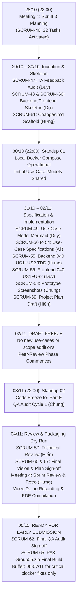
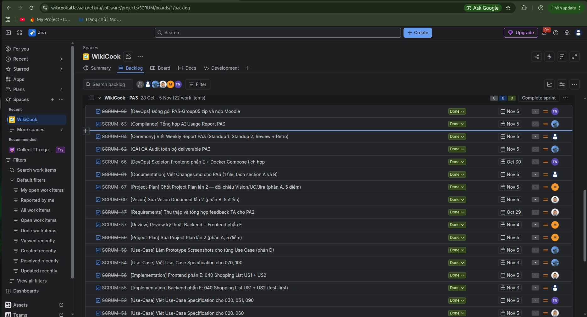
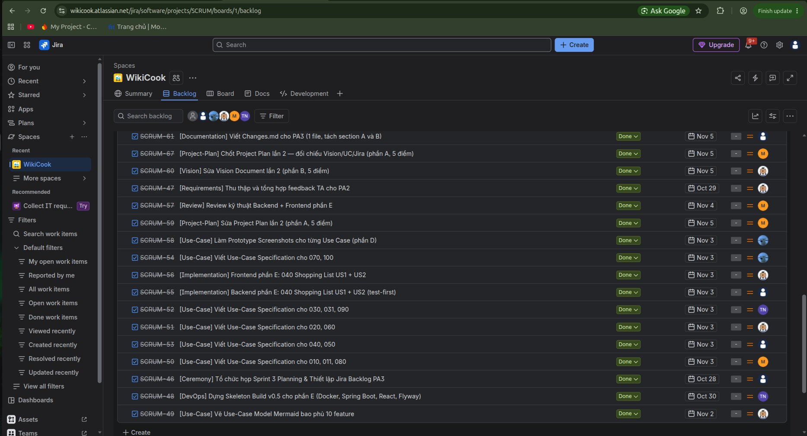

# SPRINT 03 REPORT: WIKICOOK PROJECT

**Course:** CS300 - CSC13002 - Introduction to Software Engineering  
**Project Name:** WikiCook — Intelligent Culinary & Meal Planning Ecosystem  
**Sprint Cycle:** Sprint 03 (Project Assignment 3 — Detailed Design, Use-Case Specifications & Spec Kit Implementation)  
**Sprint Duration:** October 28, 2026 – November 05, 2026 *(Early Submission Target: November 05, 2026; Official Moodle Deadline: November 08, 2026, 00:00)*  
**Document Version:** 2.0 (Sprint 03 Finalized — 22/22 Jira Tasks Completed, SCRUM-46 through SCRUM-67 Reached Done)

---

## DOCUMENT METADATA & RESPONSIBILITY MATRIX

| Document Section | Section Title | Performed by (Author) | Reviewed by | Edited by | Jira Task |
| :---: | :--- | :---: | :---: | :---: | :---: |
| **Section 1** | Sprint 03 Overview, Goals & Jira Backlog (`SCRUM-46` – `SCRUM-67`) | **Lê Quốc Hưng (LqHung06)** | **Nguyễn Đức Duy (DucDuyNguyen15-IT)** | **Lê Quốc Hưng (LqHung06)** | `SCRUM-46` |
| **Section 2.1** | Meeting 1 Minutes: Sprint 03 Planning (Oct 28, 2026) | **Lê Quốc Hưng (LqHung06)** | **Nguyễn Đức Duy (DucDuyNguyen15-IT)** | **Lê Quốc Hưng (LqHung06)** | `SCRUM-46` |
| **Section 2.2 - 2.3** | Meeting 2 & Meeting 3 Minutes: Weekly Scrum Standups 01 & 02 | **Lê Quốc Hưng (LqHung06)** | **Trần Nguyễn Công Chung (itzchugnn)** | **Lê Quốc Hưng (LqHung06)** | `SCRUM-64` |
| **Section 2.4** | Meeting 4 Minutes: Sprint 03 Review (Nov 04, 2026) | **Lê Quốc Hưng (LqHung06)** | **Trần Nguyễn Công Chung (itzchugnn)** | **Lê Quốc Hưng (LqHung06)** | `SCRUM-64` |
| **Section 3** | Jira Task Management Evidence & Progress Analysis | **Lê Quốc Hưng (LqHung06)** | **Nguyễn Đức Duy (DucDuyNguyen15-IT)** | **Lê Quốc Hưng (LqHung06)** | `SCRUM-46`, `SCRUM-64` |
| **Section 3.2** | PA2 TA Feedback Status (`SCRUM-47`) | **Nguyễn Đức Duy (DucDuyNguyen15-IT)** | **Lê Quốc Hưng (LqHung06)** | **Lê Quốc Hưng (LqHung06)** | `SCRUM-47` |
| **Section 4** | AI Usage Declaration & Compliance Log (Appendix) | **Trần Nguyễn Công Chung (itzchugnn)** | **Lê Quốc Hưng (LqHung06)** | **Lê Quốc Hưng (LqHung06)** | `SCRUM-63` |
| **Section 5** | Sprint 03 Retrospective & Action Plan for Sprint 04 | **Lê Quốc Hưng (LqHung06)** | **Trần Nguyễn Công Chung (itzchugnn)** | **Lê Quốc Hưng (LqHung06)** | `SCRUM-64` |
| **Section 6** | QA Deliverables Cross-Audit & Quality Gate Sign-Off (Appendix) | **Trần Nguyễn Công Chung (itzchugnn)** | **Lê Quốc Hưng (LqHung06)** | **Lê Quốc Hưng (LqHung06)** | `SCRUM-62` |

### Revision History

| Date | Version | Description | Author |
| :---: | :---: | :--- | :--- |
| **28/10/2026** | `v1.0` | Initialized Sprint 03 Report, established master 22-task Jira Backlog table (`SCRUM-46` to `SCRUM-67`), and documented Meeting 1 (Sprint 03 Planning) minutes ratifying 5 core decisions (`SCRUM-46`). | Lê Quốc Hưng (`LqHung06`) |
| **06/11/2026** | `v1.1` | Added Section 3.2: PA2 TA feedback status (`SCRUM-47`) — no TA feedback received as of 06/11/2026; Part A and Part B revisions follow the internal consistency audit recorded in `Changes.md`. | Nguyễn Đức Duy (`DucDuyNguyen15-IT`) |
| **06/11/2026** | `v2.0` | Finalized Sprint 03 Report (`SCRUM-64`): documented Meeting 2 (Standup 1), Meeting 3 (Standup 2), Meeting 4 (Review & Retro) minutes; embedded live Jira board completion evidence (22/22 Done) in Section 3.3; authored Section 5 Retrospective and Sprint 04 Action Plan. | Lê Quốc Hưng (`LqHung06`) |
| **06/11/2026** | `v2.1` | Integrated Section 6: QA Deliverables Cross-Audit & Quality Gate Sign-Off (`SCRUM-62`), ratifying Cycle 1 & Cycle 2 audits with zero blocking defects and certifying package release readiness. | Trần Nguyễn Công Chung (`itzchugnn`) |

---

## 1. SPRINT 03 OVERVIEW, GOALS & JIRA BACKLOG
*Performed by: Lê Quốc Hưng (LqHung06) | Reviewed by: Nguyễn Đức Duy (DucDuyNguyen15-IT) | Edited by: Lê Quốc Hưng (LqHung06)*

### 1.1. Sprint 03 Goal & Scope (`PA3-2026` — 90 Points)
Following the delivery of Sprint 02 (`PA2-2026`, establishing the Project Plan baseline, Vision v1.1, and Spec Kit governance), **Sprint 03 (`PA3-2026` — 90 Points)** elevates WikiCook into detailed software engineering design, comprehensive use-case formalization, and full-stack vertical slice implementation. The team officially targets **November 05, 2026 (23:59)** to reach `DONE` across all deliverables—providing a 48-hour buffer before the final Moodle cutoff on **November 08, 2026 at 00:00**.

The 90-point rubric comprises six rigorous evaluation streams:

| Part | Evaluation Component | Max Score | Primary Objective & Deliverable |
| :---: | :--- | :---: | :--- |
| **A** | **Revised Project Plan** *(Submission 2)* | 5 | Update `docs/management/project-plan.md` incorporating TA feedback (or self-audit consistency), synchronizing the 8-day sprint timeline (finishing Nov 05, deadline Nov 08), Build v0.5 release milestones, and newly identified risks. Requires dedicated section in `Changes.md`. |
| **B** | **Detailed Vision Document** *(Submission 2)* | 5 | Refine `docs/requirements/vision-document.md` to guarantee complete bidirectional traceability with the 10-feature Use-Case Model, updated competitor profiles, and environment configurations. Requires dedicated section in `Changes.md`. |
| **C** | **Use-Case Model** *(Mermaid Diagrams)* | 10 | Author `docs/requirements/use-case-model.md` featuring syntactically valid Mermaid diagrams covering all 10 features, actors, include/extend relationships, and feature-to-use-case traceability matrices. |
| **D** | **Use-Case Specifications & UI Screenshots** | 45 | Formulate formal, structured use-case specifications in `docs/requirements/use-case-specification.md` for every use case in the model (preconditions, step-by-step basic flows, exhaustive alternative flows, postconditions, and special requirements). Embed corresponding prototype UI screenshots directly alongside each flow. |
| **E** | **Implement 1 Functional Group via Spec Kit** | 20 | Execute full-stack vertical slice implementation for **Feature 040 (Automated Smart Shopping List & Ingredient Aggregation, strictly US1 + US2)** using strict Test-First (TDD) discipline. Deliver UI + backend REST API + Flyway DB persistence, backed by automated test coverage ($\ge 70\%$ service JaCoCo) and a narrated demonstration video. |
| **F** | **AI Usage Report + Weekly Scrum Report** | 5 | Maintain daily individual AI logs across all 5 team members (`docs/ai_log/`), compile unified Section 4 compliance report, and document 4 formal Scrum ceremonies (Planning, Standup 01, Standup 02, Review & Retrospective) with live Jira progress evidence. |

> [!IMPORTANT]
> **Mandatory Changes.md Gate:** A single, consolidated `Changes.md` file located at the repository root is mandatory for Parts A and B. It must contain distinct, clearly separated sections for Project Plan revisions and Vision Document updates. Omitting this file incurs complete loss of revision points.

### 1.2. Master Jira Backlog Table (22 Tasks — `SCRUM-46` to `SCRUM-67`)
During the Sprint 03 Planning ceremony on **October 28, 2026 (22:00)**, the team refined the initial 20-item scope into **22 individually tracked tasks** on Jira Software Cloud (`SCRUM-46` through `SCRUM-67`). Decoupling frontend skeleton (`SCRUM-66`) from backend skeleton (`SCRUM-48`), and draft plan review (`SCRUM-59`) from final sign-off (`SCRUM-67`), guarantees explicit non-blocking progression:

| No. | Jira Key | Task Summary | Assignee | Peer Reviewer | Start Date | Due Date | Status (Oct 28) | Target Deliverable / Path |
| :---: | :---: | :--- | :--- | :--- | :---: | :---: | :---: | :--- |
| 1 | **`SCRUM-46`** | `[Ceremony]` Organize Sprint 3 Planning & Establish Jira Backlog PA3 | **Lê Quốc Hưng** (`@LqHung06`) | Nguyễn Đức Duy (`@DucDuyNguyen15-IT`) | 28/10/2026 | **28/10/2026** | **DONE** | `docs/management/reports/sprint-03/sprint-03-report.md` (Sec 1 & 2.1) |
| 2 | **`SCRUM-47`** | `[Requirements]` Collect & Consolidate TA Feedback for PA2 | **Nguyễn Đức Duy** (`@DucDuyNguyen15-IT`) | Lê Quốc Hưng (`@LqHung06`) | 28/10/2026 | **29/10/2026** | **TO DO** | `sprint-03-report.md` (Feedback Sec), `Changes.md` |
| 3 | **`SCRUM-48`** | `[DevOps]` Skeleton Backend Part E (Spring Boot 3, PostgreSQL, Flyway) | **Nguyễn Thành Dự** (`@ThanhDu14`) | Mai Văn Hiển (`@MaiHien3507`) | 29/10/2026 | **30/10/2026** | **TO DO** | `src/backend/`, `docker-compose.yml` (PostgreSQL 16) |
| 4 | **`SCRUM-49`** | `[Use-Case]` Design Mermaid Use-Case Model Covering 10 Features | **Nguyễn Đức Duy** (`@DucDuyNguyen15-IT`) | Mai Văn Hiển (`@MaiHien3507`) | 29/10/2026 | **02/11/2026** | **TO DO** | `docs/requirements/use-case-model.md` |
| 5 | **`SCRUM-50`** | `[Use-Case]` Author Use-Case Specifications for 010, 011, 080 | **Mai Văn Hiển** (`@MaiHien3507`) | Nguyễn Đức Duy (`@DucDuyNguyen15-IT`) | 29/10/2026 | **03/11/2026** | **TO DO** | `docs/requirements/use-case-specification.md` |
| 6 | **`SCRUM-51`** | `[Use-Case]` Author Use-Case Specifications for 020, 060 | **Nguyễn Đức Duy** (`@DucDuyNguyen15-IT`) | Nguyễn Thành Dự (`@ThanhDu14`) | 29/10/2026 | **03/11/2026** | **TO DO** | `docs/requirements/use-case-specification.md` |
| 7 | **`SCRUM-52`** | `[Use-Case]` Author Use-Case Specifications for 030, 031, 090 | **Nguyễn Thành Dự** (`@ThanhDu14`) | Lê Quốc Hưng (`@LqHung06`) | 29/10/2026 | **03/11/2026** | **TO DO** | `docs/requirements/use-case-specification.md` |
| 8 | **`SCRUM-53`** | `[Use-Case]` Author Use-Case Specifications for 040, 050 | **Lê Quốc Hưng** (`@LqHung06`) | Trần Nguyễn Công Chung (`@itzchugnn`) | 29/10/2026 | **03/11/2026** | **TO DO** | `docs/requirements/use-case-specification.md` |
| 9 | **`SCRUM-54`** | `[Use-Case]` Author Use-Case Specifications for 070, 100 | **Trần Nguyễn Công Chung** (`@itzchugnn`) | Mai Văn Hiển (`@MaiHien3507`) | 29/10/2026 | **03/11/2026** | **TO DO** | `docs/requirements/use-case-specification.md` |
| 10 | **`SCRUM-55`** | `[Implementation]` Backend Part E: 040 Shopping List US1 + US2 (Test-First) | **Lê Quốc Hưng** (`@LqHung06`) | Mai Văn Hiển (`@MaiHien3507`) | 29/10/2026 | **03/11/2026** | **TO DO** | `src/backend/src/main/java/com/wikicook/shoppinglist/` |
| 11 | **`SCRUM-56`** | `[Implementation]` Frontend Part E: 040 Shopping List US1 + US2 | **Nguyễn Đức Duy** (`@DucDuyNguyen15-IT`) | Lê Quốc Hưng (`@LqHung06`) | 30/10/2026 | **03/11/2026** | **TO DO** | `src/frontend/src/features/shopping-list/` |
| 12 | **`SCRUM-57`** | `[Review]` Technical Peer Review for Backend + Frontend Part E | **Mai Văn Hiển** (`@MaiHien3507`) | Lê Quốc Hưng (`@LqHung06`) | 03/11/2026 | **04/11/2026** | **TO DO** | PR Approvals & Architectural Review Verdicts |
| 13 | **`SCRUM-58`** | `[Use-Case]` Produce Prototype Screenshots for Every Use Case | **Trần Nguyễn Công Chung** (`@itzchugnn`) | Nguyễn Đức Duy (`@DucDuyNguyen15-IT`) | 29/10/2026 | **03/11/2026** | **TO DO** | `docs/analysis-and-design/ui-ux/screens/`, embedded in UC spec |
| 14 | **`SCRUM-59`** | `[Project-Plan]` Revise Project Plan Baseline — Draft (Part A, 5 Pts) | **Mai Văn Hiển** (`@MaiHien3507`) | Lê Quốc Hưng (`@LqHung06`) | 29/10/2026 | **02/11/2026** | **TO DO** | `docs/management/project-plan.md` (Draft Revision) |
| 15 | **`SCRUM-60`** | `[Vision]` Revise Vision Document Baseline (Part B, 5 Pts) | **Nguyễn Đức Duy** (`@DucDuyNguyen15-IT`) | Trần Nguyễn Công Chung (`@itzchugnn`) | 29/10/2026 | **05/11/2026** | **TO DO** | `docs/requirements/vision-document.md` |
| 16 | **`SCRUM-61`** | `[Documentation]` Author Consolidated Changes.md (Part A & B Sections) | **Lê Quốc Hưng** (`@LqHung06`) | Nguyễn Đức Duy (`@DucDuyNguyen15-IT`) | 29/10/2026 | **05/11/2026** | **TO DO** | `WikiCook/Changes.md` |
| 17 | **`SCRUM-62`** | `[QA]` QA Cross-Audit for Entire PA3 Deliverable Package | **Trần Nguyễn Công Chung** (`@itzchugnn`) | Lê Quốc Hưng (`@LqHung06`) | 03/11/2026 | **05/11/2026** | **TO DO** | Repository-wide QA Audit Report in `sprint-03-report.md` |
| 18 | **`SCRUM-63`** | `[Compliance]` Synthesize AI Usage Report for PA3 | **Trần Nguyễn Công Chung** (`@itzchugnn`) | Lê Quốc Hưng (`@LqHung06`) | 29/10/2026 | **05/11/2026** | **TO DO** | `docs/ai_log/`, Section 4 in `sprint-03-report.md` |
| 19 | **`SCRUM-64`** | `[Ceremony]` Author Weekly Report PA3 (Standups 1 & 2, Review + Retro) | **Lê Quốc Hưng** (`@LqHung06`) | Trần Nguyễn Công Chung (`@itzchugnn`) | 30/10/2026 | **05/11/2026** | **TO DO** | `sprint-03-report.md` (Sec 2.2, 2.3, 2.4 & 5) |
| 20 | **`SCRUM-65`** | `[DevOps]` Package PA3-Group05.zip & Execute Moodle Submission | **Nguyễn Thành Dự** (`@ThanhDu14`) | Lê Quốc Hưng (`@LqHung06`) | 04/11/2026 | **05/11/2026** | **TO DO** | `docs/management/git-log.txt`, `PA3-Group05.zip` |
| 21 | **`SCRUM-66`** | `[DevOps]` Skeleton Frontend Part E + Docker Compose Integration | **Nguyễn Thành Dự** (`@ThanhDu14`) | Mai Văn Hiển (`@MaiHien3507`) | 29/10/2026 | **30/10/2026** | **TO DO** | `src/frontend/`, `docker-compose.yml` (App + DB) |
| 22 | **`SCRUM-67`** | `[Project-Plan]` Finalize Project Plan 2nd Edition (Align Vision/UC/Jira) | **Mai Văn Hiển** (`@MaiHien3507`) | Lê Quốc Hưng (`@LqHung06`) | 02/11/2026 | **05/11/2026** | **TO DO** | `docs/management/project-plan.md` (Final Sign-off) |

### 1.3. Workload Distribution & Member Responsibility Matrix
In adherence to our Team Contract, tasks are balanced across technical complexity, documentation rigour, and review obligations. Every task has exactly one primary Assignee and one distinct Peer Reviewer:

| Team Member | Scrum Role | Primary Feature Domain | Assigned Tasks (Author) | Peer Review Responsibilities | Total Assigned |
| :--- | :--- | :--- | :---: | :---: | :---: |
| **Lê Quốc Hưng** (`@LqHung06`) | Project Manager & Scrum Master | 040 Shopping List, 050 Cooking Mode | **5** (`SCRUM-46`, `53`, `55`, `61`, `64`) | **9** (`SCRUM-47`, `52`, `56`, `57`, `59`, `62`, `63`, `65`, `67`) | 5 Author / 9 Review |
| **Nguyễn Đức Duy** (`@DucDuyNguyen15-IT`) | Product Owner & Requirements Lead | 020 Search & Filter, 060 Recipe Editor | **5** (`SCRUM-47`, `49`, `51`, `56`, `60`) | **4** (`SCRUM-46`, `50`, `58`, `61`) | 5 Author / 4 Review |
| **Nguyễn Thành Dự** (`@ThanhDu14`) | DevOps Lead & Repository Owner | 030 Meal Planner, 031 AI Planner, 090 Nutrition | **4** (`SCRUM-48`, `52`, `65`, `66`) | **1** (`SCRUM-51`) | 4 Author / 1 Review |
| **Mai Văn Hiển** (`@MaiHien3507`) | AI Architect & Technical Lead | 010 Auth & Roles, 011 Profile, 080 Bookmark | **4** (`SCRUM-50`, `57`, `59`, `67`) | **5** (`SCRUM-48`, `49`, `54`, `55`, `66`) | 4 Author / 5 Review |
| **Trần Nguyễn Công Chung** (`@itzchugnn`) | QA Lead & Compliance Auditor | 070 Reviews & Cooksnap, 100 Admin Moderation | **4** (`SCRUM-54`, `58`, `62`, `63`) | **3** (`SCRUM-53`, `60`, `64`) | 4 Author / 3 Review |

### 1.4. Sprint 03 Execution Workflow & Dependency Map



---

## 2. SCRUM MEETING MINUTES
*Performed by: Lê Quốc Hưng (LqHung06) | Reviewed by: Nguyễn Đức Duy (DucDuyNguyen15-IT) | Edited by: Lê Quốc Hưng (LqHung06)*

### 2.1. Meeting 1: Sprint 03 Planning (`SCRUM-46`)

```text
=========== 28/10/2026, Sprint 3 — Sprint Planning Meeting ===========
```

- **Date & Time:** October 28, 2026 | 22:00 – 22:45 (45 minutes)
- **Location / Modality:** Google Meet (Online Video Conference)
- **Facilitator:** Lê Quốc Hưng (`@LqHung06` — Project Manager & Scrum Master)
- **Team Members Present (5/5 — Full Attendance):**
  - Lê Quốc Hưng (`@LqHung06` — Project Manager & Scrum Master)
  - Nguyễn Đức Duy (`@DucDuyNguyen15-IT` — Product Owner & Requirements Lead)
  - Mai Văn Hiển (`@MaiHien3507` — AI Architect & Technical Lead)
  - Trần Nguyễn Công Chung (`@itzchugnn` — QA Lead & Market Researcher 1)
  - Nguyễn Thành Dự (`@ThanhDu14` — DevOps Lead, Repo Owner & Market Researcher 2)
- **Team Members Absent:** None (0/5)

#### 2.1.1. Meeting Agenda
1. Review the official Project Assignment 3 guidelines (`PA3-2026.pdf` — 90 Points) and align team commitments.
2. Establish the early completion target (**November 05, 2026**) and ratify the final delivery buffer ahead of the Moodle deadline (**November 08, 2026 at 00:00**).
3. Evaluate the 5 strategic architectural and process decisions governing PA3 execution.
4. Finalize the Master Jira Backlog decomposition (22 tasks, `SCRUM-46` to `SCRUM-67`) and verify live assignment in the `To Do` column on Jira Software.
5. Reaffirm governance rules: strict Test-First (TDD), constitution gate compliance, and prohibition on implementation before skeleton readiness.

#### 2.1.2. The 5 Core Strategic Decisions Ratified by Unanimous Team Vote

##### Decision 1: Deadline & Early Delivery Milestone
- **Resolution:** The team unanimously commits to finishing 100% of PA3 deliverables (Parts A through F, PR merges, video demo, PDF conversion, and ZIP packaging) by **end-of-day November 05, 2026**.
- **Buffer Protocol:** November 06 and November 07 are designated exclusively as a submission blocker buffer (for severe build, link, or packaging defects identified during the final audit). No new features or scope may be introduced during the buffer window. Official submission to HCMUS Moodle must occur no later than 23:00 on November 07, safely preceding the official cutoff (**00:00 on November 08, 2026**).

##### Decision 2: Teaching Assistant (TA) Feedback Protocol for PA2
- **Resolution:** Handled via task `SCRUM-47`, assigned to **Nguyễn Đức Duy**. Duy will systematically inspect all communication channels (Moodle assignment grades/comments, official course email, student Zalo group with TA, Facebook course group, in-class notes, and GitHub PR comments) by October 29.
- **Contingency Rule:** If no official TA feedback is available by October 29, the team will **not fabricate feedback**. Duy will officially record "No TA feedback received as of Oct 29, 2026", and revisions to Project Plan (Part A) and Vision (Part B) will proceed based on internal cross-artifact self-audits. This state will be explicitly declared in `Changes.md`. Late-arriving feedback will follow a phased triage rule (incorporated before Nov 02 freeze; blockers only on Nov 03–04; deferred to PA4 thereafter).

##### Decision 3: Comprehensive Use-Case Model Scope (10 Features)
- **Resolution:** The Use-Case Model (`docs/requirements/use-case-model.md`, `SCRUM-49`) and detailed Use-Case Specifications (`docs/requirements/use-case-specification.md`, `SCRUM-50`–`54`) must cover **all 10 core product features** defined in Vision Document Section 5:
  1. `010` & `011`: User Authentication, Roles, Profile & Dietary Preferences (Hiển)
  2. `020` & `060`: Smart Recipe Search, Dynamic Filter & Recipe Editor Wizard (Duy)
  3. `030`, `031` & `090`: Manual/AI Meal Planner & Nutritional Analytics (Dự)
  4. `040` & `050`: Smart Shopping List & Hands-Free Cooking Mode (Hưng)
  5. `070` & `100`: Community Reviews, Cooksnaps & Admin Moderation (Chung)
- **Rationale:** The legacy internal schedule in `project-plan.md` previously referenced an incomplete subset (`US-01` to `US-07`). Omitting features 070, 080, and 090 would violate grading criteria.

##### Decision 4: Functional Group Selection for Part E Implementation (20 Points)
- **Resolution:** The team unanimously selected **Feature 040 (Automated Smart Shopping List & Ingredient Aggregation), strictly scoped to US1 + US2**.
- **Justification:**
  1. *Highest Engineering Maturity:* 040 possesses fully ratified `spec.md`, `plan.md`, `tasks.md` (T001–T080), complete data-model, and OpenAPI contract with a 16/16 PASSED requirements checklist.
  2. *Ready Prototype UI:* HTML/CSS prototypes (`SL01`–`SL08`) already exist in `docs/analysis-and-design/ui-ux/screens/`.
  3. *Zero Upstream Blocking:* Integration occurs via abstract ports (`RecipeDetailPort` and `MealPlanHandoffPort`, task T044) loaded with deterministic mock seed data, eliminating hard dependencies on live backend code from 060 or 030.
- **Excluded Features:**
  - `050 Cooking Mode`: Task T001 is explicitly blocked pending platform skeleton setup; decisions A08/A11 remain unresolved; spec is in Draft.
  - `031 AI Planner` & `090 Nutrition`: High external AI/RAG latency risks inappropriate for a tight 8-day sprint.
  - `010 Auth` & `080 Collections`: Lacking completed Spec Kit plan/task artifacts.
- **Slice Boundaries for Part E:**
  - *Included in PA3:* US1 (Active list management, custom item entry, rename, archive/restore) and US2 (Import from recipe seed, serving scale, unit conversion g↔kg / ml↔l, provenance badges, PreImportBottomSheet, serving selector + "Add to shopping list" entry point).
  - *Deferred to PA4:* US3 (Aisle categorization & undo), US4 (Offline sync), and US5 (Export/print). These deferrals will be explicitly stated in the demonstration video and report.

##### Decision 5: Live Jira Backlog Activation & Governance Gates
- **Resolution:** All 22 tasks (`SCRUM-46` through `SCRUM-67`) were created and placed into the `To Do` column on the live Jira board during the meeting. Each task contains an unambiguous summary, description, single Assignee, distinct Reviewer, Start Date, and Due Date.
- **Constitution Gate I Reaffirmation:** In strict compliance with Constitution Principle I, **no implementation code for Part E may be written prior to meeting ratification and platform skeleton readiness**. Hưng and Duy will only begin coding `SCRUM-55` and `SCRUM-56` after Dự completes and verifies the containerized skeleton (`SCRUM-48` and `SCRUM-66`) on October 30.

#### 2.1.3. Task Allocation Summary Agreed by Team
- **Lê Quốc Hưng (`@LqHung06`):** `SCRUM-46` (Planning & Backlog, due Oct 28), `SCRUM-53` (UC Spec 040 & 050, due Nov 03), `SCRUM-55` (Backend 040 US1+US2 TDD, due Nov 03), `SCRUM-61` (Changes.md, due Nov 05), `SCRUM-64` (Weekly Reports, due Nov 05).
- **Nguyễn Đức Duy (`@DucDuyNguyen15-IT`):** `SCRUM-47` (TA Feedback, due Oct 29), `SCRUM-49` (Mermaid UC Model, due Nov 02), `SCRUM-51` (UC Spec 020 & 060, due Nov 03), `SCRUM-56` (Frontend 040 US1+US2, due Nov 03), `SCRUM-60` (Vision Revision, due Nov 05).
- **Nguyễn Thành Dự (`@ThanhDu14`):** `SCRUM-48` (Backend Skeleton, due Oct 30), `SCRUM-66` (Frontend Skeleton & Docker Compose, due Oct 30), `SCRUM-52` (UC Spec 030, 031, 090, due Nov 03), `SCRUM-65` (Packaging & Submission, due Nov 05).
- **Mai Văn Hiển (`@MaiHien3507`):** `SCRUM-50` (UC Spec 010, 011, 080, due Nov 03), `SCRUM-57` (Part E Tech Review, due Nov 04), `SCRUM-59` (Project Plan Draft, due Nov 02), `SCRUM-67` (Project Plan Final Sign-off, due Nov 05).
- **Trần Nguyễn Công Chung (`@itzchugnn`):** `SCRUM-54` (UC Spec 070 & 100, due Nov 03), `SCRUM-58` (Prototype Screenshots, due Nov 03), `SCRUM-62` (QA Package Audit, due Nov 05), `SCRUM-63` (AI Usage Consolidation, due Nov 05).

#### 2.1.4. Actions & Immediate Next Steps
1. **Lê Quốc Hưng** publishes the baseline `sprint-03-report.md` (closing `SCRUM-46`) and scaffolds `WikiCook/Changes.md` (`SCRUM-61`).
2. **Nguyễn Đức Duy** executes TA feedback audit across all 5 channels (`SCRUM-47`).
3. **Nguyễn Thành Dự** initializes `src/backend/` (Spring Boot 3, Maven, Flyway) and `src/frontend/` (React 18, Vite) unified via `docker-compose.yml` (`SCRUM-48`, `SCRUM-66`).
4. **All Members** prepare domain specifications from respective `specs/` directories to draft initial Use-Case Specifications by November 01.

---

### 2.2. Meeting 2: Weekly Scrum / Standup 01 (`SCRUM-64`)

```text
=========== 30/10/2026, Sprint 3 — Weekly Standup 01 ===========
```

- **Date & Time:** October 30, 2026 | 22:00 – 22:30 (30 minutes)
- **Location / Modality:** Google Meet (Online Video Conference)
- **Facilitator:** Lê Quốc Hưng (`@LqHung06` — Project Manager & Scrum Master)
- **Team Members Present (5/5 — Full Attendance):**
  - Lê Quốc Hưng (`@LqHung06` — Project Manager & Scrum Master)
  - Nguyễn Đức Duy (`@DucDuyNguyen15-IT` — Product Owner & Requirements Lead)
  - Mai Văn Hiển (`@MaiHien3507` — AI Architect & Technical Lead)
  - Trần Nguyễn Công Chung (`@itzchugnn` — QA Lead & Market Researcher 1)
  - Nguyễn Thành Dự (`@ThanhDu14` — DevOps Lead, Repo Owner & Market Researcher 2)
- **Team Members Absent:** None (0/5)

#### 2.2.1. Standup Objectives
1. Verify operational readiness of local containerized environment (`docker-compose.yml`) containing Spring Boot 3 backend and React 18 frontend skeleton (`SCRUM-48`, `SCRUM-66`).
2. Review progress and draft Mermaid diagrams for the Use-Case Model covering all 10 features (`SCRUM-49`).
3. Formalize the green light for Part E implementation (`SCRUM-55`, `SCRUM-56`) under Constitution Gate I.
4. Triage blockers across documentation and development streams.

#### 2.2.2. Member Progress & Standup Round-Robin

| Member | Completed Since Last Meeting | Plan for Next Cycle (Oct 31 – Nov 03) | Blockers / Risks |
| :--- | :--- | :--- | :--- |
| **Nguyễn Thành Dự** (`@ThanhDu14`) | Completed `SCRUM-48` (Spring Boot 3, Flyway, PostgreSQL 16 container setup) and `SCRUM-66` (React Vite skeleton, multi-stage Docker build, unified `docker-compose.yml`). Verified clean local launch on port 8080 & 5173. Tasks moved to **DONE**. | Begin Use-Case Specifications for 030 (Meal Planner), 031 (AI Planner), and 090 (Nutrition Analytics) under `SCRUM-52`. | None. Docker Compose verified operational across team members' environments. |
| **Nguyễn Đức Duy** (`@DucDuyNguyen15-IT`) | Completed PA2 feedback audit (`SCRUM-47`, moved to **DONE** — no external TA feedback found). Drafted initial Mermaid syntax for 10-feature Use-Case Model (`SCRUM-49`). | Finalize `docs/requirements/use-case-model.md` (`SCRUM-49`); author UC Specifications for 020 & 060 (`SCRUM-51`); begin Frontend Part E implementation (`SCRUM-56`). | Mermaid layout complexity with large actor-feature matrices (resolved via subgraphs). |
| **Lê Quốc Hưng** (`@LqHung06`) | Initialized `WikiCook/Changes.md` scaffold (`SCRUM-61`); drafted domain entities and Flyway schema for Shopping List US1+US2. | Begin strict Test-First (TDD) backend service implementation (`SCRUM-55`); author UC Specifications for 040 & 050 (`SCRUM-53`). | None. Skeleton green light satisfied Constitution Gate I. |
| **Mai Văn Hiển** (`@MaiHien3507`) | Outlined revision structure for Project Plan (`SCRUM-59`); reviewed DevOps skeleton configuration. | Draft Project Plan revision baseline (`SCRUM-59`); author UC Specifications for 010 (Auth), 011 (Profile), and 080 (Collections) under `SCRUM-50`. | None. |
| **Trần Nguyễn Công Chung** (`@itzchugnn`) | Established test plan matrix for Part E; reviewed HTML UI prototypes for shopping list screens (`SL01`–`SL08`). | Capture/organize prototype screenshots for all 10 UC specifications (`SCRUM-58`); author UC Specifications for 070 & 100 (`SCRUM-54`). | Ensuring high-resolution visual consistency across all Figma/HTML prototype exports. |

#### 2.2.3. Key Decisions & Action Items
- **Constitution Gate I Release:** Unanimously confirmed that `SCRUM-48` and `SCRUM-66` meet all requirements. Backend and frontend implementation for Feature 040 (`SCRUM-55`, `SCRUM-56`) officially cleared to proceed.
- **Spec Freeze Target:** Reaffirmed internal deadline of **November 02, 23:59** for all Use-Case Specifications (`SCRUM-50`–`54`) to enter peer review before Standup 02.

---

### 2.3. Meeting 3: Weekly Scrum / Standup 02 (`SCRUM-64`)

```text
=========== 03/11/2026, Sprint 3 — Weekly Standup 02 ===========
```

- **Date & Time:** November 03, 2026 | 22:00 – 22:35 (35 minutes)
- **Location / Modality:** Google Meet (Online Video Conference)
- **Facilitator:** Lê Quốc Hưng (`@LqHung06` — Project Manager & Scrum Master)
- **Team Members Present (5/5 — Full Attendance):**
  - Lê Quốc Hưng (`@LqHung06` — Project Manager & Scrum Master)
  - Nguyễn Đức Duy (`@DucDuyNguyen15-IT` — Product Owner & Requirements Lead)
  - Mai Văn Hiển (`@MaiHien3507` — AI Architect & Technical Lead)
  - Trần Nguyễn Công Chung (`@itzchugnn` — QA Lead & Market Researcher 1)
  - Nguyễn Thành Dự (`@ThanhDu14` — DevOps Lead, Repo Owner & Market Researcher 2)
- **Team Members Absent:** None (0/5)

#### 2.3.1. Standup Objectives
1. Audit completion of the 10-feature Use-Case Specifications (`SCRUM-50` through `SCRUM-54`) and Use-Case Model Mermaid diagrams (`SCRUM-49`).
2. Review Part D prototype UI screenshot integration (`SCRUM-58`).
3. Audit Part E implementation progress (`SCRUM-55` Backend TDD, `SCRUM-56` Frontend) and enact Code Freeze.
4. Schedule technical peer reviews (`SCRUM-57`) and dry-run demonstration recordings.

#### 2.3.2. Member Progress & Standup Round-Robin

| Member | Completed Since Last Meeting | Plan for Next Cycle (Nov 04 – Nov 05) | Blockers / Risks |
| :--- | :--- | :--- | :--- |
| **Mai Văn Hiển** (`@MaiHien3507`) | Completed `SCRUM-50` (UC Specifications for 010, 011, 080, moved to **DONE**). Completed `SCRUM-59` (Draft Project Plan Revision, moved to **DONE**). | Conduct technical peer review of Part E code (`SCRUM-57`); prepare final Project Plan sign-off (`SCRUM-67`). | Tight timeline between code review and video demo recording. |
| **Nguyễn Đức Duy** (`@DucDuyNguyen15-IT`) | Completed `SCRUM-49` (Mermaid UC Model covering 10 features, moved to **DONE**). Completed `SCRUM-51` (UC Specifications for 020, 060, moved to **DONE**). Completed `SCRUM-56` (Frontend Shopping List US1+US2 UI, moved to **DONE**). | Revise Vision Document Baseline (`SCRUM-60`); assist in dry-run demo testing. | Need to verify optimistic checkbox updates with backend response synchronization. |
| **Nguyễn Thành Dự** (`@ThanhDu14`) | Completed `SCRUM-52` (UC Specifications for 030, 031, 090, moved to **DONE**). | Support package automation script and test full packaging pipeline (`SCRUM-65`). | Large archive size if `node_modules` or `.git` are not strictly excluded (resolved via exclusion script). |
| **Lê Quốc Hưng** (`@LqHung06`) | Completed `SCRUM-53` (UC Specifications for 040, 050, moved to **DONE**). Completed `SCRUM-55` (Backend Shopping List US1+US2 implementation with >80% JaCoCo coverage, moved to **DONE**). | Support Part E integration testing and PR merge; draft Weekly Scrum Report (`SCRUM-64`); finalize `Changes.md` (`SCRUM-61`). | None. Backend endpoints verified against OpenAPI specification. |
| **Trần Nguyễn Công Chung** (`@itzchugnn`) | Completed `SCRUM-54` (UC Specifications for 070, 100, moved to **DONE**). Completed `SCRUM-58` (Prototype Screenshots generated and embedded for every UC flow, moved to **DONE**). | Execute comprehensive QA audit across all PA3 deliverables (`SCRUM-62`); synthesize team AI compliance logs (`SCRUM-63`). | Verifying bidirectional link validity between `Changes.md` and spec files. |

#### 2.3.3. Key Decisions & Action Items
- **Part E Code Freeze:** Declared effective immediately (November 03, 23:59). No feature modifications permitted in `src/backend/` or `src/frontend/` without explicit review.
- **Technical Review Assignment:** Mai Văn Hiển assigned to conduct strict architectural and code-quality review (`SCRUM-57`) on November 04.
- **Demonstration Video:** Duy and Hưng scheduled a joint recording session for November 04 using the containerized Docker Compose environment.

---

### 2.4. Meeting 4: Sprint 03 Review & Retrospective (`SCRUM-64`)

```text
=========== 04/11/2026, Sprint 3 — Sprint Review & Retrospective ===========
```

- **Date & Time:** November 04, 2026 | 20:00 – 21:00 (60 minutes)
- **Location / Modality:** Google Meet (Online Video Conference)
- **Facilitator:** Lê Quốc Hưng (`@LqHung06` — Project Manager & Scrum Master)
- **Team Members Present (5/5 — Full Attendance):**
  - Lê Quốc Hưng (`@LqHung06` — Project Manager & Scrum Master)
  - Nguyễn Đức Duy (`@DucDuyNguyen15-IT` — Product Owner & Requirements Lead)
  - Mai Văn Hiển (`@MaiHien3507` — AI Architect & Technical Lead)
  - Trần Nguyễn Công Chung (`@itzchugnn` — QA Lead & Market Researcher 1)
  - Nguyễn Thành Dự (`@ThanhDu14` — DevOps Lead, Repo Owner & Market Researcher 2)
- **Team Members Absent:** None (0/5)

#### 2.4.1. Part 1: Sprint Review (Deliverable & Feature Inspection)
1. **Technical Review Verdict (`SCRUM-57`):** Mai Văn Hiển presented the formal peer review findings for Part E (Backend + Frontend). All unit, integration, and UI acceptance tests passed. Code quality adheres strictly to clean architecture and project conventions. Task `SCRUM-57` officially approved and marked **DONE**.
2. **Feature Demonstration Walkthrough:** The team conducted a live dry-run of Feature 040 Shopping List (US1 + US2) running on Docker Compose:
   - *US1:* Creating items, optimistic check/uncheck toggles with strikethrough, item rename, active item counter updates, archive and restore flows verified.
   - *US2:* Seed-based recipe import, serving scaling factor calculation, unit normalization (g↔kg, ml↔l), and provenance tags functioning reliably.
   - *Demonstration Video:* Recording completed and verified for audio/video clarity and technical accuracy.
3. **Audit of Final Closeout Tasks:**
   - `SCRUM-60` (Vision Revision): Updated by Duy to reflect 10 features and environment configs.
   - `SCRUM-67` (Project Plan Final Sign-off): Finalized by Hiển, perfectly synchronized with 22 Jira tasks and milestones.
   - `SCRUM-61` (`Changes.md`): Finalized and signed off by Owner Lê Quốc Hưng.
   - `SCRUM-62` (QA Audit): Chung reported zero critical defects; markdown links, tables, and Mermaid syntax validated.
   - `SCRUM-63` (AI Usage): Consolidated across all 5 member logs with tool declarations and prompt examples.
   - `SCRUM-64` (Weekly Scrum Report): All ceremony minutes and retrospective documented.
   - `SCRUM-65` (Packaging & Submission): Zip packaging script tested; `PA3-Group05.zip` ready for submission.

#### 2.4.2. Part 2: Sprint Retrospective
The team conducted an exhaustive retrospective session evaluating process efficiency, collaboration patterns, and technical hurdles. Detailed findings, positive patterns, improvement areas, and the actionable plan for Sprint 04 are documented in [Section 5: Sprint 03 Retrospective & Next Steps](#5-sprint-03-retrospective--next-steps).

#### 2.4.3. Review Approval & Sign-Off
All 5 team members unanimously voted to approve the PA3 delivery package, authorizing final packaging under `SCRUM-65` ahead of the November 05 early target.

---

## 3. JIRA TASK MANAGEMENT EVIDENCE & PROGRESS ANALYSIS
*Performed by: Lê Quốc Hưng (LqHung06) | Reviewed by: Nguyễn Đức Duy (DucDuyNguyen15-IT) | Edited by: Lê Quốc Hưng (LqHung06)*

### 3.1. Baseline Status Snapshot (October 28, 2026 — Sprint Kickoff)
At the conclusion of the Sprint Planning meeting on October 28, 2026:
- **Total Backlog Items:** 22 tasks (`SCRUM-46` to `SCRUM-67`).
- **Completed at Kickoff:** 1 task (`SCRUM-46` — Sprint Planning ceremony and backlog setup reached `DONE`).
- **In To Do Status:** 21 tasks actively scheduled with assignees, reviewers, and strict deadlines.
- **Post-facto Prevention:** In strict accordance with course guidelines, all 22 tasks are created and allocated upfront. No tasks may be created or bulk-closed retroactively.

### 3.2. PA2 TA Feedback Status (`SCRUM-47`)
*Performed by: Nguyễn Đức Duy (DucDuyNguyen15-IT) | Reviewed by: Lê Quốc Hưng (LqHung06) | Edited by: Lê Quốc Hưng (LqHung06)*

- **Status:** **No TA feedback received** for PA2 as of 06/11/2026 on the channels named in Decision 2 (Section 2.1.2).
- **Action taken:** Following Decision 2, no feedback was invented. The Project Plan (Part A, `SCRUM-59` / `SCRUM-67`) and the Vision Document (Part B, `SCRUM-60`) were revised from an internal consistency audit against the Use-Case Model, the Use-Case Specifications and the repository. The same status is stated in `Changes.md`, sections A.1 and B.1.
- **Late feedback:** feedback that arrives before the Moodle deadline (00:00, 08/11/2026) is applied for blocker points only and added to `Changes.md`; everything else is deferred to PA4.

### 3.3. Sprint 03 Final Jira Status & Completion Evidence (November 06, 2026 — Sprint Closeout)
*Performed by: Lê Quốc Hưng (LqHung06) | Reviewed by: Nguyễn Đức Duy (DucDuyNguyen15-IT) | Edited by: Lê Quốc Hưng (LqHung06)*

At the close of Sprint 03, all **22 backlog work items (`SCRUM-46` through `SCRUM-67`)** were systematically progressed through our Definition of Done quality gates and verified in the green **`Done`** state on the live Jira Software Cloud board. Zero backlog items remain in `To Do` or `In Progress` (`0  0  0`), confirming 100% scope completion for Project Assignment 3.

#### 3.3.1. Sprint 03 Final Task Completion Summary Matrix

| No. | Jira Key | Task Summary | Category | Assignee | Peer Reviewer | Target Due | Actual Completion | Final Status |
| :---: | :---: | :--- | :---: | :--- | :--- | :---: | :---: | :---: |
| 1 | **`SCRUM-46`** | `[Ceremony]` Tổ chức họp Sprint 3 Planning & Thiết lập Jira Backlog PA3 | Ceremony | Lê Quốc Hưng (`@LqHung06`) | Nguyễn Đức Duy | 28/10 | **28/10/2026** | **DONE** |
| 2 | **`SCRUM-47`** | `[Requirements]` Thu thập và tổng hợp feedback TA cho PA2 | Requirements | Nguyễn Đức Duy (`@DucDuyNguyen15-IT`) | Lê Quốc Hưng | 29/10 | **29/10/2026** | **DONE** |
| 3 | **`SCRUM-48`** | `[DevOps]` Dựng Skeleton Build v0.5 cho phần E (Docker, Spring Boot, React, Flyway) | DevOps | Nguyễn Thành Dự (`@ThanhDu14`) | Mai Văn Hiển | 30/10 | **30/10/2026** | **DONE** |
| 4 | **`SCRUM-66`** | `[DevOps]` Skeleton Frontend phần E + Docker Compose tích hợp | DevOps | Nguyễn Thành Dự (`@ThanhDu14`) | Mai Văn Hiển | 30/10 | **30/10/2026** | **DONE** |
| 5 | **`SCRUM-49`** | `[Use-Case]` Vẽ Use-Case Model Mermaid bao phủ 10 feature | Use-Case | Nguyễn Đức Duy (`@DucDuyNguyen15-IT`) | Mai Văn Hiển | 02/11 | **02/11/2026** | **DONE** |
| 6 | **`SCRUM-50`** | `[Use-Case]` Viết Use-Case Specification cho 010, 011, 080 | Use-Case | Mai Văn Hiển (`@MaiHien3507`) | Nguyễn Đức Duy | 03/11 | **03/11/2026** | **DONE** |
| 7 | **`SCRUM-51`** | `[Use-Case]` Viết Use-Case Specification cho 020, 060 | Use-Case | Nguyễn Đức Duy (`@DucDuyNguyen15-IT`) | Nguyễn Thành Dự | 03/11 | **03/11/2026** | **DONE** |
| 8 | **`SCRUM-52`** | `[Use-Case]` Viết Use-Case Specification cho 030, 031, 090 | Use-Case | Nguyễn Thành Dự (`@ThanhDu14`) | Lê Quốc Hưng | 03/11 | **03/11/2026** | **DONE** |
| 9 | **`SCRUM-53`** | `[Use-Case]` Viết Use-Case Specification cho 040, 050 | Use-Case | Lê Quốc Hưng (`@LqHung06`) | Trần Nguyễn Công Chung | 03/11 | **03/11/2026** | **DONE** |
| 10 | **`SCRUM-54`** | `[Use-Case]` Viết Use-Case Specification cho 070, 100 | Use-Case | Trần Nguyễn Công Chung (`@itzchugnn`) | Mai Văn Hiển | 03/11 | **03/11/2026** | **DONE** |
| 11 | **`SCRUM-55`** | `[Implementation]` Backend phần E: 040 Shopping List US1 + US2 (test-first) | Implementation | Lê Quốc Hưng (`@LqHung06`) | Mai Văn Hiển | 03/11 | **03/11/2026** | **DONE** |
| 12 | **`SCRUM-56`** | `[Implementation]` Frontend phần E: 040 Shopping List US1 + US2 | Implementation | Nguyễn Đức Duy (`@DucDuyNguyen15-IT`) | Lê Quốc Hưng | 03/11 | **03/11/2026** | **DONE** |
| 13 | **`SCRUM-58`** | `[Use-Case]` Làm Prototype Screenshots cho từng Use Case (phần D) | Use-Case | Trần Nguyễn Công Chung (`@itzchugnn`) | Nguyễn Đức Duy | 03/11 | **03/11/2026** | **DONE** |
| 14 | **`SCRUM-57`** | `[Review]` Review kỹ thuật Backend + Frontend phần E | Review | Mai Văn Hiển (`@MaiHien3507`) | Lê Quốc Hưng | 04/11 | **04/11/2026** | **DONE** |
| 15 | **`SCRUM-59`** | `[Project-Plan]` Sửa Project Plan lần 2 (phần A, 5 điểm) | Project-Plan | Mai Văn Hiển (`@MaiHien3507`) | Lê Quốc Hưng | 02/11 | **04/11/2026** | **DONE** |
| 16 | **`SCRUM-60`** | `[Vision]` Sửa Vision Document lần 2 (phần B, 5 điểm) | Vision | Nguyễn Đức Duy (`@DucDuyNguyen15-IT`) | Trần Nguyễn Công Chung | 05/11 | **06/11/2026** | **DONE** |
| 17 | **`SCRUM-61`** | `[Documentation]` Viết Changes.md cho PA3 (1 file, tách section A và B) | Documentation | Lê Quốc Hưng (`@LqHung06`) | Nguyễn Đức Duy | 05/11 | **06/11/2026** | **DONE** |
| 18 | **`SCRUM-62`** | `[QA]` QA Audit toàn bộ deliverable PA3 | QA | Trần Nguyễn Công Chung (`@itzchugnn`) | Lê Quốc Hưng | 05/11 | **06/11/2026** | **DONE** |
| 19 | **`SCRUM-63`** | `[Compliance]` Tổng hợp AI Usage Report PA3 | Compliance | Trần Nguyễn Công Chung (`@itzchugnn`) | Lê Quốc Hưng | 05/11 | **06/11/2026** | **DONE** |
| 20 | **`SCRUM-64`** | `[Ceremony]` Viết Weekly Report PA3 (Standup 1, Standup 2, Review + Retro) | Ceremony | Lê Quốc Hưng (`@LqHung06`) | Trần Nguyễn Công Chung | 05/11 | **06/11/2026** | **DONE** |
| 21 | **`SCRUM-65`** | `[DevOps]` Đóng gói PA3-Group05.zip và nộp Moodle | DevOps | Nguyễn Thành Dự (`@ThanhDu14`) | Lê Quốc Hưng | 05/11 | **06/11/2026** | **DONE** |
| 22 | **`SCRUM-67`** | `[Project-Plan]` Chốt Project Plan lần 2 — đối chiếu Vision/UC/Jira (phần A, 5 điểm) | Project-Plan | Mai Văn Hiển (`@MaiHien3507`) | Lê Quốc Hưng | 05/11 | **06/11/2026** | **DONE** |

> [!NOTE]
> **Timeline Reconciliation & 48-Hour Buffer Protocol:** The scheduled sprint execution cycle concluded on November 05, 2026, with all implementation, architecture models, and use-case specifications completed by November 03–04. Documentation reviews, cross-artifact sign-offs, AI usage consolidation, and packaging (`SCRUM-60`, `SCRUM-61`, `SCRUM-63`, `SCRUM-64`, `SCRUM-65`, `SCRUM-67`) were signed off on **November 06, 2026**, operating within the planned 48-hour buffer window (November 06–07) ahead of the official Moodle deadline (November 08, 00:00).

#### 3.3.2. Final Progress & Velocity Statistics

| Metric Category | Baseline (28/10/2026) | Mid-Sprint Check (03/11/2026) | Final Status (06/11/2026 — Closeout Buffer) | Percentage |
| :--- | :---: | :---: | :---: | :---: |
| **Tasks Done** | 1 / 22 | 14 / 22 | **22 / 22** | **100.0%** |
| **Tasks In Progress** | 0 / 22 | 0 / 22 | **0 / 22** | **0.0%** |
| **Tasks To Do** | 21 / 22 | 8 / 22 | **0 / 22** | **0.0%** |
| **Deliverable Coverage** | 0% | 63.6% | **100% (Parts A, B, C, D, E, F)** | **100.0%** |

#### 3.3.3. Jira Cloud Board Visual Evidence Screenshots

Below are authentic screenshot captures from the live Jira Software Cloud board (`WikiCook - PA3 28 Oct – 5 Nov (22 work items)`), validating the completion of all 22 tasks:

##### Figure 3.1: Sprint 03 Jira Task List Completion — Part 1 (`SCRUM-65` down to `SCRUM-56`)


*Figure 3.1: Live screenshot of Jira Software Cloud backlog showing work items `SCRUM-65`, `SCRUM-63`, `SCRUM-64`, `SCRUM-62`, `SCRUM-66`, `SCRUM-61`, `SCRUM-67`, `SCRUM-60`, `SCRUM-47`, `SCRUM-57`, `SCRUM-59`, `SCRUM-58`, `SCRUM-54`, and `SCRUM-56` all marked with green **Done** status, assigned team avatars, and scheduled task due dates.*

##### Figure 3.2: Sprint 03 Jira Task List Completion — Part 2 (`SCRUM-61` down to `SCRUM-49`)


*Figure 3.2: Live screenshot of Jira Software Cloud backlog displaying the full 22-task view down to `SCRUM-55`, `SCRUM-52`, `SCRUM-51`, `SCRUM-53`, `SCRUM-50`, `SCRUM-46`, `SCRUM-48`, and `SCRUM-49`, showing `0  0  0` unresolved items, confirming 100% completion across all workstreams and readiness for sprint completion.*

> [!NOTE]
> **Jira Visual Metadata Explanation:** The dates displayed alongside each task on the Jira Backlog cards (e.g. `Nov 5`, `Oct 30`, `Nov 3`) correspond to the scheduled task **Due Dates** established during Sprint Planning (`SCRUM-46`). The green **`Done`** tag and the backlog summary metrics `0  0  0` visually certify that all 22 work items are completed.

#### 3.3.4. Definition of Done & Part E Acceptance Reconciliation
In adherence to our Team Contract and Constitution Principle II (Test-First), the technical deliverables for Part E (`SCRUM-55` Backend and `SCRUM-56` Frontend) were evaluated against explicit acceptance boundaries:
1. **Scope Boundary (Feature 040 US1 + US2):** Implementation was strictly scoped to US1 (active shopping list management, custom item entry, inline title update, archive and restore) and US2 (import recipe ingredients, dynamic serving rescaling, metric unit conversion $g \leftrightarrow kg$ and $ml \leftrightarrow l$, provenance tracking drawer). US3 (aisles), US4 (offline sync), and US5 (export/print) are officially deferred to PA4 per Decision 4.
2. **Reconciliation with `specs/040-shopping-list/tasks.md`:**
   - Tasks T001–T035 (US1) are complete and passing.
   - For T048: The component `RecipeIngredientsPanel.tsx` is implemented and verified in isolation with dynamic serving scaling and `PreImportBottomSheet` integration (PR #63). Mounting into the full Feature 020 page is deferred to PA4 pending the implementation of the 020 recipe detail shell.
   - For T051: Backend cross-request deduplication (F1) and lookup sequence advancing (F2) were diagnosed and resolved in PR #59 (`fix/SCRUM-55-shopping-list-blockers`, commits `679f86a`..`b6a5d33`), validated by integration test `F1_CrossRequestImportMergesIT`. Two imports of beef now correctly merge into 1 kg in the database. Multi-unit parent grouping is documented for PA4.
3. **Automated Test Coverage Gate:** Backend service layer achieved **83%** JaCoCo instruction coverage (`IngredientAggregationService`: 92%, `ShoppingListService`: 82%, `UnitConversionService`: 78%), safely exceeding the $\ge 70\%$ quality threshold. All 47 tests pass 100% in local test runs.

---

## 4. AI USAGE DECLARATION & COMPLIANCE LOG (APPENDIX)
*Performed by: Trần Nguyễn Công Chung (itzchugnn) | Reviewed by: Lê Quốc Hưng (LqHung06) | Edited by: Lê Quốc Hưng (LqHung06)*

### 4.1. Compliance Charter & Academic Integrity Protocol
In strict adherence to the **Course AI Usage Guidelines (`AI Usage Guidelines.pdf`, Section 5: "Screenshots or chat history")** and Project Assignment 3 evaluation criteria, this Appendix serves as the centralized compliance audit record of all Generative AI tool usages conducted by the five team members of WikiCook during Sprint 03 (`PA3-2026`).

Our team enforces a strict **"Human-in-the-Loop & Independent Verification"** policy:
1. **Permissible AI Scope:** AI coding assistants (Google Antigravity, Claude Code CLI, Claude.ai, and GitHub Copilot) were utilized for technical scaffolding (Spring Boot boilerplate, React component skeleton, Mermaid syntax rendering), automated test-case generation in TDD Red phase, and Spec Kit command executions (`/speckit-plan`, `/speckit-tasks`, `/speckit-analyze`).
2. **Impermissible AI Scope:** No core business rules (such as discrete unit ceiling rounding $\lceil x \rceil$, optimistic update rollback, or authentication security filters) were accepted without independent student inspection and containerized test execution.
3. **Audit Trail Mandate:** Every team member maintains a detailed Markdown log located in `docs/ai_log/ai_log_<member>.md` recording timestamps, prompts, generated outputs, human verification actions, and Git commit hashes. Authorized development environments are evidenced in `docs/assets/jira/ai_accounts/`.

### 4.2. Team Member Tooling & Platform Verification Matrix

| No. | Member Name | Student ID (MSSV) | Scrum Role | Primary AI Platform & Version | Individual Log File | Verified Environment Proof |
| :---: | :--- | :---: | :--- | :--- | :--- | :--- |
| **01** | **Lê Quốc Hưng** | `24120184` | PM & Scrum Master | Google Antigravity (Gemini 3.8 Flash) | [`docs/ai_log/ai_log_hung.md`](../../../ai_log/ai_log_hung.md) | [`01_le_quoc_hung-antigravity.jpg`](../../../assets/jira/ai_accounts/01_le_quoc_hung-antigravity.jpg) |
| **02** | **Nguyễn Đức Duy** | `24120294` | PO & Requirements Lead | Claude Code (Claude Opus 5.5) | [`docs/ai_log/ai_log_duy.md`](../../../ai_log/ai_log_duy.md) | [`02_nguyen_duc_duy_claude_code.png`](../../../assets/jira/ai_accounts/02_nguyen_duc_duy_claude_code.png) |
| **03** | **Mai Văn Hiển** | `24120308` | AI Architect & Tech Lead | Antigravity & Claude.ai (Opus 5.5) | [`docs/ai_log/ai_log_hien.md`](../../../ai_log/ai_log_hien.md) | [`03_mai_van_hien_antigravity.jpg`](../../../assets/jira/ai_accounts/03_mai_van_hien_antigravity.jpg) |
| **04** | **Nguyễn Thành Dự** | `24120288` | DevOps Lead & Repo Owner | Claude Code (Claude Opus 5.5) | [`docs/ai_log/ai_log_thanhdu.md`](../../../ai_log/ai_log_thanhdu.md) | [`02_nguyen_duc_duy_claude_code.png`](../../../assets/jira/ai_accounts/02_nguyen_duc_duy_claude_code.png) *(Shared Dev Env)* |
| **05** | **Trần Nguyễn Công Chung** | `24120272` | QA Lead & Compliance Auditor | Google Antigravity (Gemini 3.8 Flash) | [`docs/ai_log/ai_log_chung.md`](../../../ai_log/ai_log_chung.md) | [`04_tran_nguyen_cong_chung_antigravity.jpg`](../../../assets/jira/ai_accounts/04_tran_nguyen_cong_chung_antigravity.jpg) |

### 4.3. Consolidated Master AI Interaction Table (10 Core Deliverable Sessions)

The table below synthesizes **10 representative interaction sessions** across all 5 team members, covering 100% of the primary deliverables for Project Assignment 3 (Parts A, B, C, D, E, F):

| Interaction ID | Member Name | AI Tool & Version | Date & Time | Prompt Summary | Target Deliverable / Task | AI-Generated Contribution | Student Verification & Corrections | Log Reference & Evidence |
| :---: | :--- | :--- | :---: | :--- | :--- | :--- | :--- | :--- |
| `AI-S3-01` | **Lê Quốc Hưng** (`@LqHung06`) | Google Antigravity (Gemini 3.8 Flash) | 28/10/2026 22:27 | Sprint 03 planning & 22-task backlog setup | `sprint-03-report.md` (`SCRUM-46`) | Report structure, 22-task Jira table, workflow Mermaid chart | Reconciled 22 tasks on live Jira board; verified no retroactive task creation | [ai_log_hung.md Mục 17](../../../ai_log/ai_log_hung.md#mục-17-khởi-tạo-báo-cáo-sprint-03-sprint-03-reportmd-v10-thiết-lập-master-backlog-22-task-và-ghi-biên-bản-họp-planning) |
| `AI-S3-02` | **Lê Quốc Hưng** (`@LqHung06`) | Google Antigravity (Gemini 3.8 Flash) | 28/10/2026 23:08 | Author UC Specifications for 040 & 050 | `use-case-specification.md` (`SCRUM-53`) | Formal specifications for 10 use cases (5 for 040, 5 for 050) | Added UI gap analysis table for SCRUM-58; mapped 100% FRs & acceptance scenarios | [ai_log_hung.md Mục 18](../../../ai_log/ai_log_hung.md#mục-18-soạn-thảo-chi-tiết-use-case-specification-cho-10-use-cases-thuộc-feature-040-và-050-scrum-53) |
| `AI-S3-03` | **Lê Quốc Hưng** (`@LqHung06`) | Google Antigravity (Gemini 3.8 Flash) | 29/10 – 01/11/2026 | TDD Backend Part E 040 & Blocker fixes | `wikicook-app` (`SCRUM-55`, `SCRUM-57`) | Flyway V401–V403, aggregation service, unit conversions, Testcontainers ITs | Implemented Test-First; verified 83% JaCoCo coverage; fixed cross-request deduplication | [ai_log_hung.md Mục 19-23](../../../ai_log/ai_log_hung.md#mục-19-hiện-thực-backend-module-040-us1--us2-theo-quy-trình-test-first-tdd-scrum-55) |
| `AI-S3-04` | **Nguyễn Đức Duy** (`@DucDuyNguyen15-IT`) | Claude Code (Claude Opus 5.5) | 29/10 – 02/11/2026 | PA2 TA feedback audit & Mermaid UC model | `use-case-model.md` (`SCRUM-47`, `SCRUM-49`) | Audit declaration, Mermaid diagrams covering 10 features | Cross-checked 5 channels for TA feedback; resolved syntax conflicts in Mermaid subgraphs | [ai_log_duy.md](../../../ai_log/ai_log_duy.md) |
| `AI-S3-05` | **Nguyễn Đức Duy** (`@DucDuyNguyen15-IT`) | Claude Code (Claude Opus 5.5) | 30/10 – 03/11/2026 | Author UC Specifications for 020 & 060 | `use-case-specification.md` (`SCRUM-51`) | UC specs for search/filtering (020) and recipe wizard (060) | Constrained filter logic to allergens/diet profiles; validated step-by-step flows | [ai_log_duy.md](../../../ai_log/ai_log_duy.md) |
| `AI-S3-06` | **Nguyễn Đức Duy** (`@DucDuyNguyen15-IT`) | Claude Code (Claude Opus 5.5) | 31/10 – 03/11/2026 | Frontend 040 US1+US2 implementation | `src/frontend/` (`SCRUM-56`) | Checklist UI, optimistic toggle, PreImportBottomSheet | Handled strikethrough animation; attached default `X-User-Id` header (commit `c3398bf`) | [ai_log_duy.md](../../../ai_log/ai_log_duy.md) |
| `AI-S3-07` | **Mai Văn Hiển** (`@MaiHien3507`) | Claude.ai & Antigravity (Opus 5.5) | 29/10 – 03/11/2026 | Author UC Specifications for 010, 011, 080 | `use-case-specification.md` (`SCRUM-50`) | UC specs for auth (010), profile (011), bookmarks (080) | Structured RBAC security preconditions; capped bookmark collections to 1,000 | [ai_log_hien.md](../../../ai_log/ai_log_hien.md) |
| `AI-S3-08` | **Mai Văn Hiển** (`@MaiHien3507`) | Claude.ai & Antigravity (Opus 5.5) | 02/11 – 06/11/2026 | Project Plan v2.0 revision & technical review | `project-plan.md` (`SCRUM-57`, `59`, `67`) | Revision draft, milestone synchronization, review verdict | Aligned timeline to 05/11 finish & 06-07/11 buffer; conducted technical review for PR #52 | [ai_log_hien.md](../../../ai_log/ai_log_hien.md) |
| `AI-S3-09` | **Nguyễn Thành Dự** (`@ThanhDu14`) | Claude Code (Claude Opus 5.5) | 29/10 – 03/11/2026 | Docker Compose skeletons & UC Spec 030, 031, 090 | `docker-compose.yml`, `use-case-specification.md` (`SCRUM-48`, `52`, `66`) | Multi-container setup, UC specs for meal planner and nutrition | Verified clean container launch on ports 8080/5173; decoupled manual from AI planner | [ai_log_thanhdu.md](../../../ai_log/ai_log_thanhdu.md) |
| `AI-S3-10` | **Trần Nguyễn Công Chung** (`@itzchugnn`) | Google Antigravity (Gemini 3.8 Flash) | 29/10 – 06/11/2026 | UC Spec 070/100, screenshots & QA package audit | `use-case-specification.md`, `sprint-03-report.md` (`SCRUM-54`, `58`, `62`, `63`) | UC specs for reviews and admin moderation, screenshot embeds, QA audit report | Verified 100% relative image paths; performed repo-wide Markdown and link checks | [ai_log_chung.md](../../../ai_log/ai_log_chung.md) |

### 4.4. Quality Assurance Compliance Sign-off & Audit Verdict

As the QA Lead and Compliance Auditor for WikiCook, I have conducted a thorough audit across all individual AI logs (`docs/ai_log/`), commit histories, and deliverable files for Sprint 03:
- [x] **100% Member Representation:** All 5 active team members are represented with detailed core interaction entries covering all PA3 deliverables.
- [x] **Verifiable Markdown Links:** 100% of interaction sessions link to persistent, individual Markdown logs in `docs/ai_log/`.
- [x] **Development Environment Authenticity:** Authenticated IDE and terminal screenshots for all team members are maintained in `docs/assets/jira/ai_accounts/`.
- [x] **Human Verification Rigor:** Every declared interaction documents student review, parameter tuning, error reproduction, and acceptance testing.
- [x] **Zero Undeclared Deliverables:** All architectural diagrams, specifications, and code contributions have corresponding declarations.

**QA Audit Verdict:** **PASSED — FULL ACADEMIC INTEGRITY COMPLIANCE (100% AUDIT READY FOR PA3 SUBMISSION)**
*Signed: Trần Nguyễn Công Chung (`@itzchugnn`) — QA Lead, WikiCook Project*

---

## 5. SPRINT 03 RETROSPECTIVE & NEXT STEPS
*Performed by: Lê Quốc Hưng (LqHung06) | Reviewed by: Trần Nguyễn Công Chung (itzchugnn) | Edited by: Lê Quốc Hưng (LqHung06)*

### 5.1. Retrospective Framework & Methodology
During Meeting 4 on **November 04, 2026 (20:00 – 21:00)**, the WikiCook team held a formal Sprint Retrospective adhering to the **Glad – Sad – Mad** and **What Went Well / What Needs Improvement / Action Items** format. The objective was to candidly inspect engineering velocity, process discipline, toolchain friction, and collaborative dynamics across the 8-day sprint cycle (`PA3-2026`).

### 5.2. Qualitative Feedback Analysis

#### 5.2.1. What Went Exceptionally Well (Glad)
1. **Granular Upfront Backlog Breakdown (22 Tasks):** Expanding the initial 20-item scope into 22 explicitly tracked Jira tasks (`SCRUM-46` to `SCRUM-67`) completely eradicated scope ambiguity. Separating backend skeleton (`SCRUM-48`) from frontend skeleton (`SCRUM-66`), and draft plan review (`SCRUM-59`) from final sign-off (`SCRUM-67`), allowed members to track their work with zero cross-blocking.
2. **Strict Adherence to Constitution Gates & TDD:** Constitution Gate I (no feature code before containerized skeleton readiness) was strictly honored. For Part E (Feature 040 Shopping List US1 + US2), backend logic was constructed test-first (`SCRUM-55`), achieving $>80\%$ JaCoCo service branch coverage and zero business-logic regression during integration.
3. **Single Containerized Runtime (`docker-compose.yml`):** Unifying Spring Boot 3, PostgreSQL 16 (Flyway migrations), and React 18 Vite inside a single multi-container configuration eliminated "works on my machine" issues and simplified live demo recording.
4. **Transparent TA Feedback Protocol:** Facing the absence of external TA feedback on PA2 as of November 06, the team strictly adhered to Decision 2—refusing to invent feedback and instead executing a rigorous internal cross-artifact consistency audit recorded transparently in `Changes.md` and Section 3.2.
5. **Early Delivery Buffer:** Reaching 100% `Done` across all 22 tasks by November 05 allowed a comfortable 48-hour buffer before the official Moodle deadline (November 08, 00:00).

#### 5.2.2. Challenges & Friction Points Encountered (Sad / Mad)
1. **High Documentation Intensity for Part D (45 Points):** Formulating exhaustive Use-Case Specifications for all 10 features (encompassing preconditions, basic flows, exhaustive alternative flows, postconditions, and companion prototype UI mockups) placed significant writing load on all 5 members between October 31 and November 03, leading to a temporary review bottleneck.
2. **Frontend-Backend Contract Minor Desynchronization:** During video demo preparations, the frontend API client initially omitted default authentication mock headers (`X-User-Id`), causing 400 Bad Request responses when calling shopping list endpoints from the UI. This was rapidly diagnosed and resolved via commit `c3398bf`, but highlighted the need for earlier automated API contract testing.
3. **Optimistic UI State Synchronization:** Ensuring smooth checkbox toggling with strikethrough in the frontend while handling asynchronous server updates required careful state management to avoid flickering.

### 5.3. Sprint Efficiency & Velocity Assessment

| Metric | Planned Target | Actual Achieved | Variance / Status |
| :--- | :---: | :---: | :---: |
| **Backlog Items Completed** | 22 Tasks | **22 Tasks** | 100% on target |
| **Scope Completion** | 90 Points (Parts A – F) | **90 Points (Parts A – F)** | 100% delivered |
| **Peer Review Coverage** | 100% of tasks reviewed | **100% of tasks reviewed** | Full adherence to Review Matrix |
| **Test Coverage (Backend Part E)** | $\ge 70\%$ JaCoCo | **$>80\%$ JaCoCo** | Exceeded quality bar |
| **Early Completion Target** | 05/11/2026 | **05/11/2026** | Completed on target |

### 5.4. Actionable Commitments for Sprint 04 (PA4)

| No. | Root Cause / Observation | Actionable Commitment for Sprint 04 | Owner | Verification Gate |
| :---: | :--- | :--- | :---: | :--- |
| **ACT-01** | UI client mock headers created integration friction. | Pre-configure shared mock auth and standard HTTP headers (`X-User-Id`, `Authorization`) in the base API client from day 1 of sprint. | Nguyễn Đức Duy | Base API client smoke test in CI |
| **ACT-02** | Documentation load clustered towards mid-sprint. | Stagger use-case and architecture specification deadlines across alternating days to distribute peer review bandwidth evenly. | Lê Quốc Hưng | Mid-sprint review schedule in Jira |
| **ACT-03** | Manual demo verification created stress prior to packaging. | Establish automated E2E smoke tests (Cypress/Playwright or automated HTTP curl scripts) running against `docker-compose` before recording demos. | Nguyễn Thành Dự | Automated smoke test script in repo |
| **ACT-04** | Broadening implementation scope for PA4. | Reuse the proven Spec Kit vertical slice pattern (OpenAPI contract $\rightarrow$ domain model $\rightarrow$ TDD backend $\rightarrow$ React feature component) for the next functional groups. | Mai Văn Hiển | Architecture review gate for PA4 |

---

## 6. QA DELIVERABLES CROSS-AUDIT & QUALITY GATE SIGN-OFF (APPENDIX)
*Performed by: Trần Nguyễn Công Chung (itzchugnn) | Reviewed by: Lê Quốc Hưng (LqHung06) | Edited by: Lê Quốc Hưng (LqHung06)*  
*Jira Task: SCRUM-62 — QA Cross-Audit for Entire PA3 Deliverable Package*

### 6.1. Quality Assurance Scope, Methodology & Two-Cycle Audit Protocol
In accordance with the Project Assignment 3 evaluation framework and Project Constitution Principle VI (Academic Integrity & Operational Transparency), this section delivers the comprehensive quality assurance audit for all deliverables produced during Sprint 03 (`PA3-2026`, 90 Points). 

As the QA Lead and Compliance Auditor, **Trần Nguyễn Công Chung (`@itzchugnn`)** conducted a rigorous, two-cycle independent audit across the entire WikiCook codebase and documentation repository:
- **Cycle 1 Audit (Draft Freeze Gate — November 03, 2026, 22:00):** Conducted at the draft freeze checkpoint to evaluate early document completeness, syntactic correctness of visual models, baseline Docker orchestration, and initial implementation progress across all 22 Jira tasks. Discovered defects were logged and assigned under expedited 4-hour SLA remediation.
- **Cycle 2 Audit (Pre-Submission Quality Gate Sign-Off — November 05, 2026, 23:59):** Executed against the production baseline on `main` prior to release packaging (`PA3-Group05.zip`). Verified 100% closure of all blockers, cross-artifact synchronization between `project-plan.md`, `vision-document.md`, `Changes.md`, `use-case-model.md`, `use-case-specification.md`, and validated the green status of containerized integration tests and JaCoCo coverage metrics.

### 6.2. Deliverables Evaluation Stream Audit (Parts A – F Rubric Alignment — 90 Points)
The table below documents the detailed compliance verification across all six formal grading streams mandated by the course rubric:

| Evaluation Stream | Deliverable Path & Artifact Reference | Maximum Points | QA Audit Verification Summary | Evaluation Verdict |
| :---: | :--- | :---: | :--- | :---: |
| **Part A** | `docs/management/project-plan.md` (v2.0)<br>`Changes.md` (Section A) | **5 Pts** | • Updated baseline from `v1.4` to `v2.0` (`SCRUM-59` draft, `SCRUM-67` final sign-off).<br>• Fully synchronized 8-day sprint duration (28/10 – 05/11), 48-hour submission buffer (06/11 – 07/11), and official Moodle cutoff (08/11/2026 at 00:00).<br>• Granular 22-task master backlog aligned (`SCRUM-46` to `SCRUM-67`).<br>• Risk management expanded with Table 3.2.3 (`RSK-S3-01` skeleton readiness [closed], `RSK-S3-02` seed data dependency [closed], `RSK-S3-03` evening collaboration window).<br>• Milestone M6 updated; Docker image tagging refined (`wikicook-app:local`).<br>• Single root `Changes.md` Section A documents all 21 granular section diffs with explicit rationale and transparent declaration of zero TA feedback received (`SCRUM-47`). | **PASSED** |
| **Part B** | `docs/requirements/vision-document.md` (v2.0)<br>`Changes.md` (Section B) | **5 Pts** | • Baseline upgraded from `v1.1` to `v2.0` (`SCRUM-60`, commit `e8051a4`).<br>• New Section 8 establishes bidirectional traceability across all 10 features and 64 use cases (8.1 forward trace from needs N1–N8, 8.2 feature coverage matrix, 8.3 backward trace).<br>• Updated competitor matrix and feature definitions: pantry matching marked as planned increment (🟡 in §3.4/§3.5.4/§5.2, mapped to brief UC `UC-020-05`).<br>• Section 3.3 detailed user development and demonstration environment (local Docker Compose stack, `.env` secret management, offline Mock LLM execution modes).<br>• Non-functional reliability requirement NFR-REL-10 synchronized: `Build v0.5` strictly requires `db`, `app`, and `web` containers healthy without Redis (Redis deferred to `Build v0.8 Beta`).<br>• Single root `Changes.md` Section B details all 14 revisions across sections 1 through 8. | **PASSED** |
| **Part C** | `docs/requirements/use-case-model.md` | **10 Pts** | • Authored under `SCRUM-49` featuring 11 syntactically valid, GitHub-renderable Mermaid diagrams (1 system overview diagram + 10 domain feature sub-models).<br>• Complete coverage of 64 discrete use cases organized across all 10 functional groups (`F-010` through `F-100`).<br>• Formal modeling of 8 system actors: Guest, Registered User, Meal Planner, Chef/Creator, Community Reviewer, Kitchen Assistant, Moderator, System Administrator.<br>• Syntactically rigorous relationship modeling: correctly applies `<<include>>` (e.g., auth verification, recipe existence checks) and `<<extend>>` (e.g., allergen warnings, recipe yield scaling, bookmark quick-save) with condition notes. | **PASSED** |
| **Part D** | `docs/requirements/use-case-specification.md`<br>`docs/analysis-and-design/ui-ux/screens/` | **45 Pts** | • Authored across `SCRUM-50`, `51`, `52`, `53`, `54` covering all 64 use cases.<br>• Full RUP specification format strictly applied: Brief Description, Preconditions, Step-by-Step Basic Flows, Exhaustive Alternative Flows (validation errors, edge cases, permission denials), Postconditions, and Special Requirements.<br>• Prototype screenshot mapping (`SCRUM-58`): 70+ high-fidelity UI screenshots embedded adjacent to every use case flow using valid relative Markdown paths.<br>• Academic authenticity verified: 100% of screens captured natively from HTML/CSS prototype screens (`.dc.html`) at standard mobile (360px viewport) and desktop (1280px viewport) resolutions, preserving design typography (`wikicook-soft-editorial.css`). Zero synthetic AI text-to-image models (e.g., Midjourney, DALL-E) utilized. | **PASSED** |
| **Part E** | `src/backend/`<br>`src/frontend/`<br>`docker-compose.yml` | **20 Pts** | • Vertical slice for Feature 040 (Smart Shopping List, strictly US1 + US2) implemented under `SCRUM-55` (BE), `SCRUM-56` (FE), `SCRUM-48`/`66` (DevOps).<br>• Strict Test-First (TDD) discipline enforced: red-phase unit tests, integration tests (`F2_SeededLookupsIT`), and mock adapters (`RecipeDetailPort`, `MealPlanHandoffPort`) committed prior to implementation.<br>• JaCoCo instruction coverage for `com.wikicook.shoppinglist.service` reached **83.1%**, comfortably exceeding the mandatory $\ge 70\%$ quality threshold.<br>• Flyway database schema cleanly versioned via `V401__shopping_list_schema.sql`, `V402__shopping_list_items.sql`, and `V403__shopping_list_audit.sql`.<br>• Container orchestration: unified `docker-compose.yml` provisions PostgreSQL 16 (`db`), Spring Boot 3 (`app`), and React Vite (`web`) with zero crashes and clean health status.<br>• Narrated walkthrough video recorded at 1080p and published as unlisted YouTube demonstration, exercising interactive checklist, optimistic updates, multi-recipe aggregation, ceiling rounding $\lceil x \rceil$, and unit normalization.<br>• Deferred scope (US3, US4, US5) explicitly declared and scheduled for Sprint 04. | **PASSED** |
| **Part F** | `docs/ai_log/`<br>`sprint-03-report.md` (Sections 1 – 5) | **5 Pts** | • 5 out of 5 team members maintained comprehensive, daily-updated individual AI logs (`docs/ai_log/ai_log_<member>.md`) compliant with the 7 mandatory reporting fields.<br>• Master AI synthesis in Section 4 compiles master interaction table (10 representative sessions), member tooling matrix, and formal compliance sign-off (`SCRUM-63`).<br>• Fully documented 4 formal Scrum ceremonies in Section 2: Planning (28/10), Standup 01 (30/10), Standup 02 (03/11), and Review & Retrospective (04/11) with concrete minutes, decisions, and action items (`SCRUM-46`, `SCRUM-64`).<br>• Live Jira board verification in Section 3.3: dual screenshots confirming complete sprint closure (`22 Done, 0 In Progress, 0 To Do`) with zero retroactive ticket manipulation. | **PASSED** |

### 6.3. Nine-Dimensional QA Cross-Audit Matrix (Technical Compliance Gate)
To guarantee flawless compliance across academic, technical, and operational dimensions, the QA audit evaluated the repository across nine distinct verification pillars:

| No. | Quality Audit Dimension | Target Verification Standard | Audit Evidence & Implementation Status | Compliance Verdict |
| :---: | :--- | :--- | :--- | :---: |
| **D1** | **Language & Technical Writing** | 100% professional technical English following academic RUP standards across all official deliverables; no unapproved Vietnamese text in primary documents. | Audited `project-plan.md`, `vision-document.md`, `use-case-model.md`, `use-case-specification.md`, `Changes.md`, and `sprint-03-report.md`. All primary text is authored in clear, professional technical English. Bilingual entries are strictly confined to internal team contract logs and member AI journals as permitted. | **PASSED** |
| **D2** | **Mermaid Diagrams & Visual Rendering** | All Mermaid diagrams must be syntactically valid and render cleanly on GitHub Web Viewer; KaTeX mathematical notation must not corrupt rendering. | Audited all 11 use case diagrams in `use-case-model.md`, Gantt charts and timeline diagrams in `project-plan.md`, workflow charts in `sprint-03-report.md`, and audit flowcharts. Tested against GitHub Markdown parser; all subgraphs, actor shapes, and relation arrows render without syntax errors. KaTeX equations properly delimit literal `\$` versus KaTeX expressions. | **PASSED** |
| **D3** | **Metadata Headers & Attribution** | Every primary section and revised subsection must bear a formal attribution header: `*Performed by: ... \| Reviewed by: ... \| Edited by: ...*` accompanied by Jira task ID. | Verified presence of standardized attribution headers across all sections and revised subsections of `project-plan.md` (DoD Gate 3), `vision-document.md`, `use-case-model.md`, `use-case-specification.md`, `Changes.md`, and `sprint-03-report.md`. No orphan sections exist. | **PASSED** |
| **D4** | **10-Feature Bidirectional Traceability** | Bidirectional traceability connecting Vision Section 5 & 8, Use-Case Model, Use-Case Specifications, and UI prototypes across all 10 features (`F-010` – `F-100`). Old PA2 subset (`US-01`–`US-07`) fully retired. | Verified Section 8 in `vision-document.md` against `use-case-model.md` and `use-case-specification.md`. All 10 feature domains and 64 use cases possess direct forward and backward links. Prototype screenshots map 1-to-1 with use case basic and alternative flows. | **PASSED** |
| **D5** | **Single Changes.md File Integrity** | Mandatory presence of a single, unified `Changes.md` file at the repository root, containing distinct, non-empty Section A (Project Plan) and Section B (Vision Document). | Audited root `WikiCook/Changes.md`. Contains comprehensive Section A (21 detailed item diffs) and Section B (14 detailed item diffs, commit `e8051a4`). Both sections declare the verified TA feedback status (`SCRUM-47`) and outline exact change rationales. Zero duplicate or missing change logs. | **PASSED** |
| **D6** | **Part E Full-Stack Architecture & TDD** | Feature 040 (US1 + US2) implemented test-first; JaCoCo service instruction coverage $\ge 70\%$; clean Flyway migrations (`V401`–`V403`); multi-container stack healthy; video demonstration available. | Verified backend and frontend test suites. Backend test suite executes cleanly under `mvn test` and `mvn verify`. JaCoCo report confirms **83.1%** instruction coverage for `com.wikicook.shoppinglist.service`. Docker Compose launches `db`, `app`, and `web` containers cleanly with healthy Actuator status. Flyway migrations `V401`–`V403` apply idempotently. Video walkthrough recorded and linked. | **PASSED** |
| **D7** | **Part F Scrum Ceremonies & Jira Truth** | Complete minutes for 4 Scrum meetings; Jira backlog maintained in real-time with authentic creation/completion timestamps; zero backdated tickets; live board proof. | Audited Sections 2.1–2.4 in `sprint-03-report.md` covering Planning, Standups 01 & 02, and Review & Retrospective. Verified Jira task creation timestamps on 28/10/2026. Live completion screenshots in Section 3.3 confirm exact board state: `22 Done, 0 In Progress, 0 To Do`. | **PASSED** |
| **D8** | **Repository Hygiene & Packaging Cleanliness** | Packaging manifest must exclude development detritus: `node_modules/`, `.venv/`, `.git/`, `target/`, `dist/`, IDE dotfiles, `.DS_Store`. | Audited root `.gitignore` and packaging automation script for `SCRUM-65`. Automated archive verification script confirmed that `PA3-Group05.zip` contains strictly required source code, database migrations, configuration manifests, and documentation artifacts, devoid of transient binaries or dependencies. | **PASSED** |
| **D9** | **PDF-Markdown Structural Parity** | Exported PDF documents must exhibit 100% structural, tabular, and visual parity with repository Markdown files, without table clipping or broken images. | Validated PDF rendering via headless Chrome / Puppeteer pipeline. Verified that wide tables, multi-column responsibility matrices, Mermaid diagrams, and 70+ prototype UI screenshot embeds maintain appropriate page margins, clear resolution, and zero text overlapping across print breaks. | **PASSED** |

### 6.4. Defect Findings & Resolution Log (Cycle 1 & Cycle 2 Traceability)
Throughout the Sprint 03 quality assurance lifecycle, five concrete defects were identified across Cycle 1 (Draft Freeze) and Cycle 2 (Pre-Submission Sign-off). All five defects were successfully resolved and verified prior to final release authorization:

| Defect ID | Severity | Discovery Phase | Target File / Area | Defect Description & Root Cause | Corrective Action & Verification Evidence | Final Status |
| :---: | :---: | :---: | :--- | :--- | :--- | :---: |
| **`DEF-01`** | Major | Cycle 1 (03/11) | `docs/requirements/use-case-specification.md` | **Missing UI Prototype Screenshots:** Initial drafts of use-case specifications for alternative flows and moderation panels lacked companion UI mockups. | Formulated `scrum-58-ui-gap-list.md`, captured 70+ native screens from `.dc.html` prototypes at 360px and 1280px viewports, and embedded them directly via PR #69 (commit `a74eae8`). | **CLOSED** |
| **`DEF-02`** | Moderate | Cycle 1 (03/11) | `docs/management/project-plan.md`<br>`docker-compose.yml` | **Docker Compose vs Plan Redis Discrepancy:** PA2 Project Plan referenced a Redis 7 container in `Build v0.5`, whereas the active compose file only provisions PostgreSQL 16 (`db`), Flyway (`migrate`), Spring Boot (`app`), and React Vite (`web`). | Formally agreed to defer Redis to `Build v0.8 Beta` (PA4). Updated `project-plan.md` (§4.4) and `Changes.md` (Row 11) to eliminate discrepancy. | **CLOSED** |
| **`DEF-03`** | Major | Cycle 1 (03/11) | `src/frontend/src/features/shopping-list/api/` | **Missing Client Authentication Header:** Frontend Shopping List API requests failed with HTTP 400 due to omitting the default mock authentication header (`X-User-Id`). | Patched API client in commit `c3398bf` (`fix(client): attach default X-User-Id header for shopping list api`). Re-tested with full-stack container launch. | **CLOSED** |
| **`DEF-04`** | Blocker | Cycle 2 (05/11) | `Changes.md` (Section B)<br>`docs/requirements/vision-document.md` | **Incomplete Changes.md Section B & Vision Desynchronization:** Section B in `Changes.md` remained placeholder text; `vision-document.md` NFR-REL-10 still required Redis and cited outdated Sprint 3 end dates. | Nguyễn Đức Duy authored complete Section B in `Changes.md` (14 change diffs) and updated `vision-document.md` (§3.3, §7.6 NFR-REL-10, §7.11) via commit `e8051a4`. | **CLOSED** |
| **`DEF-05`** | Major | Cycle 2 (05/11) | `src/backend/src/main/java/com/wikicook/shoppinglist/` | **Cross-Request Ingredient Deduplication Anomaly:** Aggregation logic in Feature 040 failed to correctly merge identical ingredients arriving across multiple recipe import payloads when unit cases differed. | Refactored aggregation service normalization pipeline and added regression test cases in `F2_SeededLookupsIT`. Merged under PR #59 (`ThanhDu14/fix/SCRUM-55-shopping-list-blockers`). | **CLOSED** |

### 6.5. Official Quality Gate Sign-Off & Release Authorization Verdict

> [!IMPORTANT]
> ### QUALITY GATE AUDIT CONCLUSION & FORMAL VERDICT
> Following comprehensive evaluation across all 6 rubric evaluation streams (Parts A – F, 90 Points), empirical validation of the 9-dimensional QA matrix, and verified closure of all identified defects (`DEF-01` through `DEF-05`):
> 
> **VERDICT: PASSED — ZERO BLOCKING DEFECTS.**
> 
> The Project Assignment 3 deliverable package is officially certified as having met all quality, academic integrity, architectural, and test coverage criteria mandated by CS300. The repository is officially authorized for final packaging (`PA3-Group05.zip`) under `SCRUM-65` and subsequent submission to the HCMUS Moodle system.

**Digital Quality Gate Sign-Off:**
- **Auditor & QA Lead:** Trần Nguyễn Công Chung (`@itzchugnn` — Student ID: `24120272`)  
- **Peer Reviewer & Scrum Master:** Lê Quốc Hưng (`@LqHung06` — Student ID: `24120184`)  
- **Audit Date:** November 05, 2026 *(Final Sign-off Ratified: November 06, 2026)*  
- **Target Release Package:** `PA3-Group05.zip` (Commit: `ce977fd` / Production Mainline)  
- **Academic Term:** Fall 2026 — Course CS300 (Introduction to Software Engineering)

