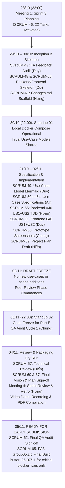

# SPRINT 03 REPORT: WIKICOOK PROJECT

**Course:** CS300 - CSC13002 - Introduction to Software Engineering  
**Project Name:** WikiCook — Intelligent Culinary & Meal Planning Ecosystem  
**Sprint Cycle:** Sprint 03 (Project Assignment 3 — Detailed Design, Use-Case Specifications & Spec Kit Implementation)  
**Sprint Duration:** October 28, 2026 – November 05, 2026 *(Early Submission Target: November 05, 2026; Official Moodle Deadline: November 08, 2026, 00:00)*  
**Document Version:** 1.0 (Sprint 03 Kickoff & Planning Baseline — 22 Jira Tasks Initialized on Active Board, SCRUM-46 Completed)

---

## DOCUMENT METADATA & RESPONSIBILITY MATRIX

| Document Section | Section Title | Performed by (Author) | Reviewed by | Edited by | Jira Task |
| :---: | :--- | :---: | :---: | :---: | :---: |
| **Section 1** | Sprint 03 Overview, Goals & Jira Backlog (`SCRUM-46` – `SCRUM-67`) | **Lê Quốc Hưng (LqHung06)** | **Nguyễn Đức Duy (DucDuyNguyen15-IT)** | **Lê Quốc Hưng (LqHung06)** | `SCRUM-46` |
| **Section 2.1** | Meeting 1 Minutes: Sprint 03 Planning (Oct 28, 2026) | **Lê Quốc Hưng (LqHung06)** | **Nguyễn Đức Duy (DucDuyNguyen15-IT)** | **Lê Quốc Hưng (LqHung06)** | `SCRUM-46` |
| **Section 2.2 - 2.3** | Meeting 2 & Meeting 3 Minutes: Weekly Scrum Standups 01 & 02 | **Lê Quốc Hưng (LqHung06)** | **Trần Nguyễn Công Chung (itzchugnn)** | **Lê Quốc Hưng (LqHung06)** | `SCRUM-64` |
| **Section 2.4** | Meeting 4 Minutes: Sprint 03 Review (Nov 04, 2026) | **Lê Quốc Hưng (LqHung06)** | **Trần Nguyễn Công Chung (itzchugnn)** | **Lê Quốc Hưng (LqHung06)** | `SCRUM-64` |
| **Section 3** | Jira Task Management Evidence & Progress Analysis | **Lê Quốc Hưng (LqHung06)** | **Nguyễn Đức Duy (DucDuyNguyen15-IT)** | **Lê Quốc Hưng (LqHung06)** | `SCRUM-46`, `SCRUM-64` |
| **Section 4** | AI Usage Declaration & Compliance Log (Appendix) | **Trần Nguyễn Công Chung (itzchugnn)** | **Lê Quốc Hưng (LqHung06)** | **Lê Quốc Hưng (LqHung06)** | `SCRUM-63` |
| **Section 5** | Sprint 03 Retrospective & Action Plan for Sprint 04 | **Lê Quốc Hưng (LqHung06)** | **Trần Nguyễn Công Chung (itzchugnn)** | **Lê Quốc Hưng (LqHung06)** | `SCRUM-64` |

### Revision History

| Date | Version | Description | Author |
| :---: | :---: | :--- | :--- |
| **28/10/2026** | `v1.0` | Initialized Sprint 03 Report, established master 22-task Jira Backlog table (`SCRUM-46` to `SCRUM-67`), and documented Meeting 1 (Sprint 03 Planning) minutes ratifying 5 core decisions (`SCRUM-46`). | Lê Quốc Hưng (`LqHung06`) |

---

## 1. SPRINT 03 OVERVIEW, GOALS & JIRA BACKLOG
*Performed by: Lê Quốc Hưng (LqHung06) | Reviewed by: Nguyễn Đức Duy (DucDuyNguyen15-IT) | Edited by: Lê Quốc Hưng (LqHung06)*

### 1.1. Sprint 03 Goal & Scope (`PA3-2026` — 90 Points)
Following the delivery of Sprint 02 (`PA2-2026`, establishing the Project Plan baseline, Vision v1.1, and Spec Kit governance), **Sprint 03 (`PA3-2026` — 90 Points)** elevates WikiCook into detailed software engineering design, comprehensive use-case formalization, and full-stack vertical slice implementation. The team officially targets **November 05, 2026 (23:59)** to reach `DONE` across all deliverables—providing a 48-hour buffer before the final Moodle cutoff on **November 08, 2026 at 00:00**.

The 90-point rubric comprises six rigorous evaluation streams:

| Part | Evaluation Component | Max Score | Primary Objective & Deliverable |
| :---: | :--- | :---: | :--- |
| **A** | **Revised Project Plan** *(Submission 2)* | 5 | Update `docs/management/project-plan.md` incorporating TA feedback (or self-audit consistency), synchronizing the 8-day sprint timeline (finishing Nov 05, deadline Nov 08), Build v0.5 release milestones, and newly identified risks. Requires dedicated section in `Changes.md`. |
| **B** | **Detailed Vision Document** *(Submission 2)* | 5 | Refine `docs/requirements/vision-document.md` to guarantee complete bidirectional traceability with the 10-feature Use-Case Model, updated competitor profiles, and environment configurations. Requires dedicated section in `Changes.md`. |
| **C** | **Use-Case Model** *(Mermaid Diagrams)* | 10 | Author `docs/requirements/use-case-model.md` featuring syntactically valid Mermaid diagrams covering all 10 features, actors, include/extend relationships, and feature-to-use-case traceability matrices. |
| **D** | **Use-Case Specifications & UI Screenshots** | 45 | Formulate formal, structured use-case specifications in `docs/requirements/use-case-specification.md` for every use case in the model (preconditions, step-by-step basic flows, exhaustive alternative flows, postconditions, and special requirements). Embed corresponding prototype UI screenshots directly alongside each flow. |
| **E** | **Implement 1 Functional Group via Spec Kit** | 20 | Execute full-stack vertical slice implementation for **Feature 040 (Automated Smart Shopping List & Ingredient Aggregation, strictly US1 + US2)** using strict Test-First (TDD) discipline. Deliver UI + backend REST API + Flyway DB persistence, backed by automated test coverage ($\ge 70\%$ service JaCoCo) and a narrated demonstration video. |
| **F** | **AI Usage Report + Weekly Scrum Report** | 5 | Maintain daily individual AI logs across all 5 team members (`docs/ai_log/`), compile unified Section 4 compliance report, and document 4 formal Scrum ceremonies (Planning, Standup 01, Standup 02, Review & Retrospective) with live Jira progress evidence. |

> [!IMPORTANT]
> **Mandatory Changes.md Gate:** A single, consolidated `Changes.md` file located at the repository root is mandatory for Parts A and B. It must contain distinct, clearly separated sections for Project Plan revisions and Vision Document updates. Omitting this file incurs complete loss of revision points.

### 1.2. Master Jira Backlog Table (22 Tasks — `SCRUM-46` to `SCRUM-67`)
During the Sprint 03 Planning ceremony on **October 28, 2026 (22:00)**, the team refined the initial 20-item scope into **22 individually tracked tasks** on Jira Software Cloud (`SCRUM-46` through `SCRUM-67`). Decoupling frontend skeleton (`SCRUM-66`) from backend skeleton (`SCRUM-48`), and draft plan review (`SCRUM-59`) from final sign-off (`SCRUM-67`), guarantees explicit non-blocking progression:

| No. | Jira Key | Task Summary | Assignee | Peer Reviewer | Start Date | Due Date | Status (Oct 28) | Target Deliverable / Path |
| :---: | :---: | :--- | :--- | :--- | :---: | :---: | :---: | :--- |
| 1 | **`SCRUM-46`** | `[Ceremony]` Organize Sprint 3 Planning & Establish Jira Backlog PA3 | **Lê Quốc Hưng** (`@LqHung06`) | Nguyễn Đức Duy (`@DucDuyNguyen15-IT`) | 28/10/2026 | **28/10/2026** | **DONE** | `docs/management/reports/sprint-03/sprint-03-report.md` (Sec 1 & 2.1) |
| 2 | **`SCRUM-47`** | `[Requirements]` Collect & Consolidate TA Feedback for PA2 | **Nguyễn Đức Duy** (`@DucDuyNguyen15-IT`) | Lê Quốc Hưng (`@LqHung06`) | 28/10/2026 | **29/10/2026** | **TO DO** | `sprint-03-report.md` (Feedback Sec), `Changes.md` |
| 3 | **`SCRUM-48`** | `[DevOps]` Skeleton Backend Part E (Spring Boot 3, PostgreSQL, Flyway) | **Nguyễn Thành Dự** (`@ThanhDu14`) | Mai Văn Hiển (`@MaiHien3507`) | 29/10/2026 | **30/10/2026** | **TO DO** | `src/backend/`, `docker-compose.yml` (PostgreSQL 16) |
| 4 | **`SCRUM-49`** | `[Use-Case]` Design Mermaid Use-Case Model Covering 10 Features | **Nguyễn Đức Duy** (`@DucDuyNguyen15-IT`) | Mai Văn Hiển (`@MaiHien3507`) | 29/10/2026 | **02/11/2026** | **TO DO** | `docs/requirements/use-case-model.md` |
| 5 | **`SCRUM-50`** | `[Use-Case]` Author Use-Case Specifications for 010, 011, 080 | **Mai Văn Hiển** (`@MaiHien3507`) | Nguyễn Đức Duy (`@DucDuyNguyen15-IT`) | 29/10/2026 | **03/11/2026** | **TO DO** | `docs/requirements/use-case-specification.md` |
| 6 | **`SCRUM-51`** | `[Use-Case]` Author Use-Case Specifications for 020, 060 | **Nguyễn Đức Duy** (`@DucDuyNguyen15-IT`) | Nguyễn Thành Dự (`@ThanhDu14`) | 29/10/2026 | **03/11/2026** | **TO DO** | `docs/requirements/use-case-specification.md` |
| 7 | **`SCRUM-52`** | `[Use-Case]` Author Use-Case Specifications for 030, 031, 090 | **Nguyễn Thành Dự** (`@ThanhDu14`) | Lê Quốc Hưng (`@LqHung06`) | 29/10/2026 | **03/11/2026** | **TO DO** | `docs/requirements/use-case-specification.md` |
| 8 | **`SCRUM-53`** | `[Use-Case]` Author Use-Case Specifications for 040, 050 | **Lê Quốc Hưng** (`@LqHung06`) | Trần Nguyễn Công Chung (`@itzchugnn`) | 29/10/2026 | **03/11/2026** | **TO DO** | `docs/requirements/use-case-specification.md` |
| 9 | **`SCRUM-54`** | `[Use-Case]` Author Use-Case Specifications for 070, 100 | **Trần Nguyễn Công Chung** (`@itzchugnn`) | Mai Văn Hiển (`@MaiHien3507`) | 29/10/2026 | **03/11/2026** | **TO DO** | `docs/requirements/use-case-specification.md` |
| 10 | **`SCRUM-55`** | `[Implementation]` Backend Part E: 040 Shopping List US1 + US2 (Test-First) | **Lê Quốc Hưng** (`@LqHung06`) | Mai Văn Hiển (`@MaiHien3507`) | 29/10/2026 | **03/11/2026** | **TO DO** | `src/backend/src/main/java/com/wikicook/shoppinglist/` |
| 11 | **`SCRUM-56`** | `[Implementation]` Frontend Part E: 040 Shopping List US1 + US2 | **Nguyễn Đức Duy** (`@DucDuyNguyen15-IT`) | Lê Quốc Hưng (`@LqHung06`) | 30/10/2026 | **03/11/2026** | **TO DO** | `src/frontend/src/features/shopping-list/` |
| 12 | **`SCRUM-57`** | `[Review]` Technical Peer Review for Backend + Frontend Part E | **Mai Văn Hiển** (`@MaiHien3507`) | Lê Quốc Hưng (`@LqHung06`) | 03/11/2026 | **04/11/2026** | **TO DO** | PR Approvals & Architectural Review Verdicts |
| 13 | **`SCRUM-58`** | `[Use-Case]` Produce Prototype Screenshots for Every Use Case | **Trần Nguyễn Công Chung** (`@itzchugnn`) | Nguyễn Đức Duy (`@DucDuyNguyen15-IT`) | 29/10/2026 | **03/11/2026** | **TO DO** | `docs/analysis-and-design/ui-ux/screens/`, embedded in UC spec |
| 14 | **`SCRUM-59`** | `[Project-Plan]` Revise Project Plan Baseline — Draft (Part A, 5 Pts) | **Mai Văn Hiển** (`@MaiHien3507`) | Lê Quốc Hưng (`@LqHung06`) | 29/10/2026 | **02/11/2026** | **TO DO** | `docs/management/project-plan.md` (Draft Revision) |
| 15 | **`SCRUM-60`** | `[Vision]` Revise Vision Document Baseline (Part B, 5 Pts) | **Nguyễn Đức Duy** (`@DucDuyNguyen15-IT`) | Trần Nguyễn Công Chung (`@itzchugnn`) | 29/10/2026 | **05/11/2026** | **TO DO** | `docs/requirements/vision-document.md` |
| 16 | **`SCRUM-61`** | `[Documentation]` Author Consolidated Changes.md (Part A & B Sections) | **Lê Quốc Hưng** (`@LqHung06`) | Nguyễn Đức Duy (`@DucDuyNguyen15-IT`) | 29/10/2026 | **05/11/2026** | **TO DO** | `WikiCook/Changes.md` |
| 17 | **`SCRUM-62`** | `[QA]` QA Cross-Audit for Entire PA3 Deliverable Package | **Trần Nguyễn Công Chung** (`@itzchugnn`) | Lê Quốc Hưng (`@LqHung06`) | 03/11/2026 | **05/11/2026** | **TO DO** | Repository-wide QA Audit Report in `sprint-03-report.md` |
| 18 | **`SCRUM-63`** | `[Compliance]` Synthesize AI Usage Report for PA3 | **Trần Nguyễn Công Chung** (`@itzchugnn`) | Lê Quốc Hưng (`@LqHung06`) | 29/10/2026 | **05/11/2026** | **TO DO** | `docs/ai_log/`, Section 4 in `sprint-03-report.md` |
| 19 | **`SCRUM-64`** | `[Ceremony]` Author Weekly Report PA3 (Standups 1 & 2, Review + Retro) | **Lê Quốc Hưng** (`@LqHung06`) | Trần Nguyễn Công Chung (`@itzchugnn`) | 30/10/2026 | **05/11/2026** | **TO DO** | `sprint-03-report.md` (Sec 2.2, 2.3, 2.4 & 5) |
| 20 | **`SCRUM-65`** | `[DevOps]` Package PA3-Group05.zip & Execute Moodle Submission | **Nguyễn Thành Dự** (`@ThanhDu14`) | Lê Quốc Hưng (`@LqHung06`) | 04/11/2026 | **05/11/2026** | **TO DO** | `docs/management/git-log.txt`, `PA3-Group05.zip` |
| 21 | **`SCRUM-66`** | `[DevOps]` Skeleton Frontend Part E + Docker Compose Integration | **Nguyễn Thành Dự** (`@ThanhDu14`) | Mai Văn Hiển (`@MaiHien3507`) | 29/10/2026 | **30/10/2026** | **TO DO** | `src/frontend/`, `docker-compose.yml` (App + DB) |
| 22 | **`SCRUM-67`** | `[Project-Plan]` Finalize Project Plan 2nd Edition (Align Vision/UC/Jira) | **Mai Văn Hiển** (`@MaiHien3507`) | Lê Quốc Hưng (`@LqHung06`) | 02/11/2026 | **05/11/2026** | **TO DO** | `docs/management/project-plan.md` (Final Sign-off) |

### 1.3. Workload Distribution & Member Responsibility Matrix
In adherence to our Team Contract, tasks are balanced across technical complexity, documentation rigour, and review obligations. Every task has exactly one primary Assignee and one distinct Peer Reviewer:

| Team Member | Scrum Role | Primary Feature Domain | Assigned Tasks (Author) | Peer Review Responsibilities | Total Assigned |
| :--- | :--- | :--- | :---: | :---: | :---: |
| **Lê Quốc Hưng** (`@LqHung06`) | Project Manager & Scrum Master | 040 Shopping List, 050 Cooking Mode | **5** (`SCRUM-46`, `53`, `55`, `61`, `64`) | **9** (`SCRUM-47`, `52`, `56`, `57`, `59`, `62`, `63`, `65`, `67`) | 5 Author / 9 Review |
| **Nguyễn Đức Duy** (`@DucDuyNguyen15-IT`) | Product Owner & Requirements Lead | 020 Search & Filter, 060 Recipe Editor | **5** (`SCRUM-47`, `49`, `51`, `56`, `60`) | **4** (`SCRUM-46`, `50`, `58`, `61`) | 5 Author / 4 Review |
| **Nguyễn Thành Dự** (`@ThanhDu14`) | DevOps Lead & Repository Owner | 030 Meal Planner, 031 AI Planner, 090 Nutrition | **4** (`SCRUM-48`, `52`, `65`, `66`) | **1** (`SCRUM-51`) | 4 Author / 1 Review |
| **Mai Văn Hiển** (`@MaiHien3507`) | AI Architect & Technical Lead | 010 Auth & Roles, 011 Profile, 080 Bookmark | **4** (`SCRUM-50`, `57`, `59`, `67`) | **5** (`SCRUM-48`, `49`, `54`, `55`, `66`) | 4 Author / 5 Review |
| **Trần Nguyễn Công Chung** (`@itzchugnn`) | QA Lead & Compliance Auditor | 070 Reviews & Cooksnap, 100 Admin Moderation | **4** (`SCRUM-54`, `58`, `62`, `63`) | **3** (`SCRUM-53`, `60`, `64`) | 4 Author / 3 Review |

### 1.4. Sprint 03 Execution Workflow & Dependency Map



---

## 2. SCRUM MEETING MINUTES
*Performed by: Lê Quốc Hưng (LqHung06) | Reviewed by: Nguyễn Đức Duy (DucDuyNguyen15-IT) | Edited by: Lê Quốc Hưng (LqHung06)*

### 2.1. Meeting 1: Sprint 03 Planning (`SCRUM-46`)

```text
=========== 28/10/2026, Sprint 3 — Sprint Planning Meeting ===========
```

- **Date & Time:** October 28, 2026 | 22:00 – 22:45 (45 minutes)
- **Location / Modality:** Google Meet (Online Video Conference)
- **Facilitator:** Lê Quốc Hưng (`@LqHung06` — Project Manager & Scrum Master)
- **Team Members Present (5/5 — Full Attendance):**
  - Lê Quốc Hưng (`@LqHung06` — Project Manager & Scrum Master)
  - Nguyễn Đức Duy (`@DucDuyNguyen15-IT` — Product Owner & Requirements Lead)
  - Mai Văn Hiển (`@MaiHien3507` — AI Architect & Technical Lead)
  - Trần Nguyễn Công Chung (`@itzchugnn` — QA Lead & Market Researcher 1)
  - Nguyễn Thành Dự (`@ThanhDu14` — DevOps Lead, Repo Owner & Market Researcher 2)
- **Team Members Absent:** None (0/5)

#### 2.1.1. Meeting Agenda
1. Review the official Project Assignment 3 guidelines (`PA3-2026.pdf` — 90 Points) and align team commitments.
2. Establish the early completion target (**November 05, 2026**) and ratify the final delivery buffer ahead of the Moodle deadline (**November 08, 2026 at 00:00**).
3. Evaluate the 5 strategic architectural and process decisions governing PA3 execution.
4. Finalize the Master Jira Backlog decomposition (22 tasks, `SCRUM-46` to `SCRUM-67`) and verify live assignment in the `To Do` column on Jira Software.
5. Reaffirm governance rules: strict Test-First (TDD), constitution gate compliance, and prohibition on implementation before skeleton readiness.

#### 2.1.2. The 5 Core Strategic Decisions Ratified by Unanimous Team Vote

##### Decision 1: Deadline & Early Delivery Milestone
- **Resolution:** The team unanimously commits to finishing 100% of PA3 deliverables (Parts A through F, PR merges, video demo, PDF conversion, and ZIP packaging) by **end-of-day November 05, 2026**.
- **Buffer Protocol:** November 06 and November 07 are designated exclusively as a submission blocker buffer (for severe build, link, or packaging defects identified during the final audit). No new features or scope may be introduced during the buffer window. Official submission to HCMUS Moodle must occur no later than 23:00 on November 07, safely preceding the official cutoff (**00:00 on November 08, 2026**).

##### Decision 2: Teaching Assistant (TA) Feedback Protocol for PA2
- **Resolution:** Handled via task `SCRUM-47`, assigned to **Nguyễn Đức Duy**. Duy will systematically inspect all communication channels (Moodle assignment grades/comments, official course email, student Zalo group with TA, Facebook course group, in-class notes, and GitHub PR comments) by October 29.
- **Contingency Rule:** If no official TA feedback is available by October 29, the team will **not fabricate feedback**. Duy will officially record "No TA feedback received as of Oct 29, 2026", and revisions to Project Plan (Part A) and Vision (Part B) will proceed based on internal cross-artifact self-audits. This state will be explicitly declared in `Changes.md`. Late-arriving feedback will follow a phased triage rule (incorporated before Nov 02 freeze; blockers only on Nov 03–04; deferred to PA4 thereafter).

##### Decision 3: Comprehensive Use-Case Model Scope (10 Features)
- **Resolution:** The Use-Case Model (`docs/requirements/use-case-model.md`, `SCRUM-49`) and detailed Use-Case Specifications (`docs/requirements/use-case-specification.md`, `SCRUM-50`–`54`) must cover **all 10 core product features** defined in Vision Document Section 5:
  1. `010` & `011`: User Authentication, Roles, Profile & Dietary Preferences (Hiển)
  2. `020` & `060`: Smart Recipe Search, Dynamic Filter & Recipe Editor Wizard (Duy)
  3. `030`, `031` & `090`: Manual/AI Meal Planner & Nutritional Analytics (Dự)
  4. `040` & `050`: Smart Shopping List & Hands-Free Cooking Mode (Hưng)
  5. `070` & `100`: Community Reviews, Cooksnaps & Admin Moderation (Chung)
- **Rationale:** The legacy internal schedule in `project-plan.md` previously referenced an incomplete subset (`US-01` to `US-07`). Omitting features 070, 080, and 090 would violate grading criteria.

##### Decision 4: Functional Group Selection for Part E Implementation (20 Points)
- **Resolution:** The team unanimously selected **Feature 040 (Automated Smart Shopping List & Ingredient Aggregation), strictly scoped to US1 + US2**.
- **Justification:**
  1. *Highest Engineering Maturity:* 040 possesses fully ratified `spec.md`, `plan.md`, `tasks.md` (T001–T080), complete data-model, and OpenAPI contract with a 16/16 PASSED requirements checklist.
  2. *Ready Prototype UI:* HTML/CSS prototypes (`SL01`–`SL08`) already exist in `docs/analysis-and-design/ui-ux/screens/`.
  3. *Zero Upstream Blocking:* Integration occurs via abstract ports (`RecipeDetailPort` and `MealPlanHandoffPort`, task T044) loaded with deterministic mock seed data, eliminating hard dependencies on live backend code from 060 or 030.
- **Excluded Features:**
  - `050 Cooking Mode`: Task T001 is explicitly blocked pending platform skeleton setup; decisions A08/A11 remain unresolved; spec is in Draft.
  - `031 AI Planner` & `090 Nutrition`: High external AI/RAG latency risks inappropriate for a tight 8-day sprint.
  - `010 Auth` & `080 Collections`: Lacking completed Spec Kit plan/task artifacts.
- **Slice Boundaries for Part E:**
  - *Included in PA3:* US1 (Active list management, custom item entry, rename, archive/restore) and US2 (Import from recipe seed, serving scale, unit conversion g↔kg / ml↔l, provenance badges, PreImportBottomSheet, serving selector + "Add to shopping list" entry point).
  - *Deferred to PA4:* US3 (Aisle categorization & undo), US4 (Offline sync), and US5 (Export/print). These deferrals will be explicitly stated in the demonstration video and report.

##### Decision 5: Live Jira Backlog Activation & Governance Gates
- **Resolution:** All 22 tasks (`SCRUM-46` through `SCRUM-67`) were created and placed into the `To Do` column on the live Jira board during the meeting. Each task contains an unambiguous summary, description, single Assignee, distinct Reviewer, Start Date, and Due Date.
- **Constitution Gate I Reaffirmation:** In strict compliance with Constitution Principle I, **no implementation code for Part E may be written prior to meeting ratification and platform skeleton readiness**. Hưng and Duy will only begin coding `SCRUM-55` and `SCRUM-56` after Dự completes and verifies the containerized skeleton (`SCRUM-48` and `SCRUM-66`) on October 30.

#### 2.1.3. Task Allocation Summary Agreed by Team
- **Lê Quốc Hưng (`@LqHung06`):** `SCRUM-46` (Planning & Backlog, due Oct 28), `SCRUM-53` (UC Spec 040 & 050, due Nov 03), `SCRUM-55` (Backend 040 US1+US2 TDD, due Nov 03), `SCRUM-61` (Changes.md, due Nov 05), `SCRUM-64` (Weekly Reports, due Nov 05).
- **Nguyễn Đức Duy (`@DucDuyNguyen15-IT`):** `SCRUM-47` (TA Feedback, due Oct 29), `SCRUM-49` (Mermaid UC Model, due Nov 02), `SCRUM-51` (UC Spec 020 & 060, due Nov 03), `SCRUM-56` (Frontend 040 US1+US2, due Nov 03), `SCRUM-60` (Vision Revision, due Nov 05).
- **Nguyễn Thành Dự (`@ThanhDu14`):** `SCRUM-48` (Backend Skeleton, due Oct 30), `SCRUM-66` (Frontend Skeleton & Docker Compose, due Oct 30), `SCRUM-52` (UC Spec 030, 031, 090, due Nov 03), `SCRUM-65` (Packaging & Submission, due Nov 05).
- **Mai Văn Hiển (`@MaiHien3507`):** `SCRUM-50` (UC Spec 010, 011, 080, due Nov 03), `SCRUM-57` (Part E Tech Review, due Nov 04), `SCRUM-59` (Project Plan Draft, due Nov 02), `SCRUM-67` (Project Plan Final Sign-off, due Nov 05).
- **Trần Nguyễn Công Chung (`@itzchugnn`):** `SCRUM-54` (UC Spec 070 & 100, due Nov 03), `SCRUM-58` (Prototype Screenshots, due Nov 03), `SCRUM-62` (QA Package Audit, due Nov 05), `SCRUM-63` (AI Usage Consolidation, due Nov 05).

#### 2.1.4. Actions & Immediate Next Steps
1. **Lê Quốc Hưng** publishes the baseline `sprint-03-report.md` (closing `SCRUM-46`) and scaffolds `WikiCook/Changes.md` (`SCRUM-61`).
2. **Nguyễn Đức Duy** executes TA feedback audit across all 5 channels (`SCRUM-47`).
3. **Nguyễn Thành Dự** initializes `src/backend/` (Spring Boot 3, Maven, Flyway) and `src/frontend/` (React 18, Vite) unified via `docker-compose.yml` (`SCRUM-48`, `SCRUM-66`).
4. **All Members** prepare domain specifications from respective `specs/` directories to draft initial Use-Case Specifications by November 01.

---

### 2.2. Meeting 2: Weekly Scrum / Standup 01 (`SCRUM-64` — Scheduled Oct 30, 2026)
*To be conducted on October 30, 2026 at 22:00 via Google Meet. Focus: Verifying operational status of Docker Compose skeleton (`SCRUM-48`, `SCRUM-66`) and reviewing initial Mermaid Use-Case Model drafts.*

---

### 2.3. Meeting 3: Weekly Scrum / Standup 02 (`SCRUM-64` — Scheduled Nov 03, 2026)
*To be conducted on November 03, 2026 at 22:00 via Google Meet. Focus: Reviewing 100% Use-Case Specification drafts (`SCRUM-50`–`54`), auditing Part E implementation code (`SCRUM-55`, `SCRUM-56`), and receiving initial QA audit findings (`SCRUM-62`).*

---

### 2.4. Meeting 4: Sprint 03 Review & Retrospective (`SCRUM-64` — Scheduled Nov 04, 2026)
*To be conducted on November 04, 2026 at 20:00 via Google Meet. Focus: Inspecting full deliverable package, validating 22/22 Jira Done evidence, conducting sprint retrospective, and authorizing dry-run packaging (`SCRUM-65`).*

---

## 3. JIRA TASK MANAGEMENT EVIDENCE & PROGRESS ANALYSIS
*Performed by: Lê Quốc Hưng (LqHung06) | Reviewed by: Nguyễn Đức Duy (DucDuyNguyen15-IT) | Edited by: Lê Quốc Hưng (LqHung06)*

### 3.1. Baseline Status Snapshot (October 28, 2026 — Sprint Kickoff)
At the conclusion of the Sprint Planning meeting on October 28, 2026:
- **Total Backlog Items:** 22 tasks (`SCRUM-46` to `SCRUM-67`).
- **Completed at Kickoff:** 1 task (`SCRUM-46` — Sprint Planning ceremony and backlog setup reached `DONE`).
- **In To Do Status:** 21 tasks actively scheduled with assignees, reviewers, and strict deadlines.
- **Post-facto Prevention:** In strict accordance with course guidelines, all 22 tasks are created and allocated upfront. No tasks may be created or bulk-closed retroactively.

---

## 4. AI USAGE DECLARATION & COMPLIANCE LOG (APPENDIX)
*Performed by: Trần Nguyễn Công Chung (itzchugnn) | Reviewed by: Lê Quốc Hưng (LqHung06) | Edited by: Lê Quốc Hưng (LqHung06)*

*(To be consolidated by QA Lead Trần Nguyễn Công Chung under `SCRUM-63` prior to final submission on November 05, 2026, synthesizing individual logs from `docs/ai_log/`).*

---

## 5. SPRINT 03 RETROSPECTIVE & NEXT STEPS
*Performed by: Lê Quốc Hưng (LqHung06) | Reviewed by: Trần Nguyễn Công Chung (itzchugnn) | Edited by: Lê Quốc Hưng (LqHung06)*

*(To be documented by PM Lê Quốc Hưng following Meeting 4 on November 04, 2026 under `SCRUM-64`).*
