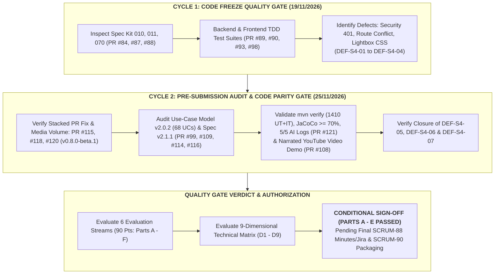

# SPRINT 04 REPORT: WIKICOOK PROJECT

**Course:** CS300 - CSC13002 - Introduction to Software Engineering
**Project Name:** WikiCook — Intelligent Culinary & Meal Planning Ecosystem
**Sprint Cycle:** Sprint 04 (Project Assignment 4 — Requirements Revision, Software Architecture & Two Full-Stack Functional Groups)
**Sprint Duration:** November 10, 2026 – November 29, 2026. The official PA4 deadline is **29/11/2026**; the team aims to submit by **23/11/2026** so that late problems can still be fixed (an internal target, not a limit)
**Document Version:** 0.14 (Sections 1–5 merged from `main` v0.13; added Section 6 AI Usage Declaration `SCRUM-85` and Section 7 QA Deliverables Cross-Audit `SCRUM-86`, synchronized with `main` at `00539b4` and PR #117 review on 25/11/2026)

---

## DOCUMENT METADATA & RESPONSIBILITY MATRIX

| Document Section | Section Title | Performed by (Author) | Reviewed by | Edited by | Jira Task |
| :---: | :--- | :---: | :---: | :---: | :---: |
| **Section 1** | Sprint 04 Overview & Jira Backlog | **Lê Quốc Hưng (LqHung06)** | **Nguyễn Đức Duy (DucDuyNguyen15-IT)** | **Lê Quốc Hưng (LqHung06)** | `SCRUM-68` |
| **Section 2.1** | Meeting 1 Minutes: Sprint 04 Planning | **Lê Quốc Hưng (LqHung06)** | **Nguyễn Đức Duy (DucDuyNguyen15-IT)** | **Lê Quốc Hưng (LqHung06)** | `SCRUM-68` |
| **Section 2.2** | Meeting 2 Minutes: Weekly Standup 01 | **Lê Quốc Hưng (LqHung06)** | **Nguyễn Đức Duy (DucDuyNguyen15-IT)** | **Lê Quốc Hưng (LqHung06)** | `SCRUM-87` |
| **Section 2.3** | Meeting 3 Minutes: Weekly Standup 02 | **Lê Quốc Hưng (LqHung06)** | **Nguyễn Đức Duy (DucDuyNguyen15-IT)** | **Lê Quốc Hưng (LqHung06)** | `SCRUM-87` |
| **Section 2.4** | Cross-Meeting Governance & Action Item Matrix | **Lê Quốc Hưng (LqHung06)** | **Nguyễn Đức Duy (DucDuyNguyen15-IT)** | **Lê Quốc Hưng (LqHung06)** | `SCRUM-87` |
| **Section 3** | PA3 TA Feedback Status & Use-Case Consistency Audit | **Nguyễn Đức Duy (DucDuyNguyen15-IT)** | **Lê Quốc Hưng (LqHung06)** | **Nguyễn Đức Duy (DucDuyNguyen15-IT)** | `SCRUM-69` |
| **Section 4** | Sprint Review (draft) | **Lê Quốc Hưng (LqHung06)** | **Trần Nguyễn Công Chung (itzchugnn)** | **Lê Quốc Hưng (LqHung06)** | `SCRUM-88` |
| **Section 5** | Sprint Retrospective (draft) | **Lê Quốc Hưng (LqHung06)** | **Trần Nguyễn Công Chung (itzchugnn)** | **Lê Quốc Hưng (LqHung06)** | `SCRUM-88` |
| **Section 6** | AI Usage Declaration & Compliance Log (Appendix) | **Trần Nguyễn Công Chung (itzchugnn)** | **Nguyễn Đức Duy (DucDuyNguyen15-IT)** | **Trần Nguyễn Công Chung (itzchugnn)** | `SCRUM-85` |
| **Section 7** | QA Deliverables Cross-Audit & Quality Gate Sign-Off (Appendix) | **Trần Nguyễn Công Chung (itzchugnn)** | **Lê Quốc Hưng (LqHung06)** | **Trần Nguyễn Công Chung (itzchugnn)** | `SCRUM-86` |

### Revision History

| Date | Version | Description | Author |
| :---: | :---: | :--- | :--- |
| **10/11/2026** | `v0.1` | Created the Sprint 04 report scaffold and recorded the SCRUM-68 planning baseline. | Lê Quốc Hưng (`LqHung06`) |
| **10/11/2026** | `v0.2` | Updated SCRUM-68 after the Scrum Master confirmed the planning meeting had taken place; recorded the 23 Jira work items shown in the provided screenshots and documented confirmed scope/workload decisions while leaving unsupported meeting logistics unasserted. | Lê Quốc Hưng (`LqHung06`) |
| **16/11/2026** | `v0.3` | Documented Meeting 2 (Standup 01, 14/11) and Meeting 3 (Standup 02, 19/11) minutes under SCRUM-87; audited Part E Spec Kit progress (010+011, 070), database seed state, C4 Level 1 draft, Part E Code Freeze criteria, and architecture diagram alignment. | Lê Quốc Hưng (`LqHung06`) |
| **18/11/2026** | `v0.4` | Added Section 3: PA3 TA feedback status (none received) and the self-audit checklist feeding SCRUM-70, SCRUM-71 and SCRUM-84 (SCRUM-69). | Nguyễn Đức Duy (`DucDuyNguyen15-IT`) |
| **18/11/2026** | `v0.5` | Correction of `v0.3` (SCRUM-87): Section 2.3 (Standup 02, planned 19/11) described a meeting that had not happened, with attendance, member reports and decisions. It is now a template with the planned agenda, repository evidence checked on 18/11 and blank fields for the meeting; Section 2.4 lists only ceremonies that took place, with the status of each action item checked against `origin/main`; Provenance Statement rewritten. Section 2.2 (Standup 01): only the statements that do not match the repository were changed (a frontend client built with Axios, the `dev:mock` command, work on `SCRUM-76` dated before 14/11, a boundary list with Cloud OCR); attendance and time are unchanged and still to be confirmed from the meeting notes. Section 2.1: wording of the conversation removed, action statuses updated, submission date stated as official 29/11 and team target 23/11. | Lê Quốc Hưng (`LqHung06`) |
| **19/11/2026** | `v0.6` | Added Sections 4 and 5 as a **draft** for `SCRUM-88`: the delivery state of the 23 backlog tasks checked against `origin/main` on 19/11/2026, known gaps, a demo checklist, and retrospective candidates taken from repository evidence. The Sprint Review and Retrospective (planned 22/11, 20:00) have not been held; nothing in the two sections is a team decision yet. | Lê Quốc Hưng (`LqHung06`) |
| **19/11/2026** | `v0.7` | Section 4.2 re-checked against GitHub (`origin/main` at `6a78652`, pull requests #84 – #106 and their reviews) at 21:00: `SCRUM-76` follow-ups and `SCRUM-84` merged (PR #104, #105), `SCRUM-81` merged (PR #106). Added the reviewer columns, Section 4.2.1 (open items by member) and the AI-log check; Section 4.3 and Sad items S1, S2 updated to match. `SCRUM-70`: the Scrum Master confirmed that Hiển's review was received before PR #99 was approved; `SCRUM-84`: Duy's change lists merged into `Changes.md`, and Use-Case Model `v2.0.1` updates the status of open issue 6. Approvals by Hưng in place of the planned reviewer (PR #91, #93, #94, #96, #97, #101, #106) marked "on behalf of", as agreed in the team. | Lê Quốc Hưng (`LqHung06`) |
| **20/11/2026** | `v0.8` | Section 4.2 re-checked against GitHub at 12:40 (`origin/main` at `ce7c7a3`, pull requests #84 – #113 and their reviews): new state "PR open" for `SCRUM-79` (#108), `SCRUM-82` (#111), `SCRUM-83` (#112); PR #109 for `SCRUM-71` and #113 for `SCRUM-78`; Chung's Sprint 4 AI-log entries merged (#107); changes requested on #108 and #109. 4.2.1, 4.3 and Sad items S1, S2 updated to match. | Lê Quốc Hưng (`LqHung06`) |
| **20/11/2026** | `v0.9` | Section 2.3 completed with the real Standup 02 (19/11/2026, 22:36 – 23:55, Google Meet, 5/5 present): round-robin summarised from the task status on GitHub and Jira at the time of the meeting, decisions confirmed by the Scrum Master (owners and dates as on Jira; 29/11 official deadline, 23/11 team target, short delays acceptable if they do not hold up others; Review and Retrospective on 22/11). Section 2.4: ACT-08 – ACT-17 added, all statuses as on 20/11, 13:15; provenance statement updated. Section 4.2: `SCRUM-87` done. | Lê Quốc Hưng (`LqHung06`) |
| **21/11/2026** | `v0.10` | Sections 2.4 and 4.2 re-checked against GitHub on 21/11/2026, 15:45 (`origin/main` at `17d255e`, pull requests #84 – #113 and their reviews): `SCRUM-82` done (PR #111); `SCRUM-83` **not on `main`**, because PR #112 was merged into the branch of PR #111 after PR #111 itself had been merged; PR #113 merged; PR #108 updated with the demo video link and PR #109 updated, both waiting for a new review. 4.2.1, 4.3, Sad items S1, S2 updated; S5 and action A8 added for the stacked pull request. | Lê Quốc Hưng (`LqHung06`) |
| **21/11/2026** | `v0.11` | Consistency pass: the branch of this report is PR #114; `SCRUM-79` and `SCRUM-71` record Hưng's new reviews of 21/11 and that Hưng watched the demo video; `SCRUM-70` lists the model `v2.0.2`; the `SCRUM-89` date note of Section 1.2 matches the decision of Section 2.1; Section 4.5 adds that Cooksnap photos cannot be stored when the backend runs in Docker Compose (checked on the image `wikicook-app:local`); retrospective note dated. | Lê Quốc Hưng (`LqHung06`) |
| **21/11/2026** | `v0.12` | Section 2.2 (Standup 01): date, time, Google Meet and 5/5 attendance confirmed by the Scrum Master; Hưng's report filled in from that confirmation; the open marks removed; statements the repository does not support (Dự's Compose and seed work in 10 – 14/11, Chung's upload folder mapping, the upload convention of decision 2, Chung's review scaffolding and Hiển's C4 Level 1 draft before the meeting) rewritten as plans or as what was built, with the evidence. Chung's Spec Kit `070` work credited. Section 3.1: submission date worded as in the rest of the report (with Duy's permission). `SCRUM-85`: PR #110 merged. | Lê Quốc Hưng (`LqHung06`) |
| **21/11/2026** | `v0.13` | Section 4.2 re-checked against GitHub at 19:50 (`origin/main` at `8b2008b`, pull requests #84 – #116): `SCRUM-71` review confirmation merged (PR #109, 19:42), with a corrected review record in PR #116 for Chung to review; `SCRUM-83` in PR #115 to `main`; `SCRUM-79` approved by Hiển, Hưng's change request still open; Section 4.4 adds Hưng's `mvn verify` of 21/11 on `main`. | Lê Quốc Hưng (`LqHung06`) |
| **25/11/2026** | `v0.14` | Merged `main` (`00539b4`, including PR #108, #114, #115, #116, #118, #120, #121 and tag `v0.8.0-beta.1`); added Section 6 (`SCRUM-85`) and Section 7 (`SCRUM-86`); refined Sprint 4 AI-log entry ranges (`Duy` Mục 22–26, `Dự` Mục 27–30), aligned Parts A–E metrics with `use-case-model.md` `v2.0.2` (68 UCs), `architecture.md`, and `scrum-79-spec-kit-test-report.md` (1,410 total backend tests; JaCoCo 97.82% / 93.14% / 77.16%), and set Quality Gate to Conditional Sign-Off pending `SCRUM-88` and `SCRUM-90`. | Trần Nguyễn Công Chung (`itzchugnn`) |

---

## 1. SPRINT 04 OVERVIEW & JIRA BACKLOG
*Performed by: Lê Quốc Hưng (LqHung06) | Reviewed by: Nguyễn Đức Duy (DucDuyNguyen15-IT) | Edited by: Lê Quốc Hưng (LqHung06)*

### 1.1. Sprint 04 Goal & Scope (`PA4-2026` — Updated rubric: 90 points)
*Performed by: Lê Quốc Hưng (LqHung06) | Reviewed by: Nguyễn Đức Duy (DucDuyNguyen15-IT) | Edited by: Lê Quốc Hưng (LqHung06)*

Sprint 04 is planned to complete the PA4-2026 submission. The updated assignment brief lists 90 points across six parts: Part A, revised use-case documents and `Changes.md` (5 points); Part B, Tech Stack and C4 Level 1 System Context (20); Part C, C4 Level 2 Container and Level 3 Component diagrams (25); Part D, Deployment Diagram (5); Part E, two Spec Kit-driven full-stack functional groups, generated tests and narrated video demo (30); and Part F, AI Usage and Weekly Reports (5).

The team selected the following two Part E groups for implementation:

1. **F-01 — User Authentication & Dietary Profile:** specs `010-user-authentication-roles` and `011-user-profile-dietary`.
2. **F-07 — Social Cooksnaps & Reviews:** spec `070-review-cooksnap`.

The Sprint 4 Jira backlog contains the corresponding Spec Kit and implementation tasks. Per PA4, both groups are expected to cover UI, API/business logic, persistence, generated tests and a narrated video demo.

The architecture diagrams must describe the actual implementation and deployment configuration at submission time. Planned modules or external services must not be represented as implemented unless verified in the repository/configuration.

### 1.2. Sprint 04 Jira Backlog — SCRUM-68 to SCRUM-90
*Performed by: Lê Quốc Hưng (LqHung06) | Reviewed by: Nguyễn Đức Duy (DucDuyNguyen15-IT) | Edited by: Lê Quốc Hưng (LqHung06)*

The Sprint 4 Jira backlog shown in the Jira screenshots contains **23 work items**, `SCRUM-68`–`SCRUM-90`. The visible issue summaries, assignees (identified by the Scrum Master from Jira avatars), statuses and due dates were compared with the team assignment plan. The screenshot shows the issues in `To Do` at capture time; that status is not represented as completion. Reviewer fields are not visible in the screenshots and should be checked in each Jira issue.

| Jira Key | Planned Summary | Planned Assignee | Planned Due Date | Part |
| :---: | :--- | :--- | :---: | :---: |
| `SCRUM-68` | Organize Sprint 4 Planning & Establish PA4 Jira Backlog | Lê Quốc Hưng | 11/11/2026 | F |
| `SCRUM-69` | Collect PA3 TA Feedback & Audit Use-Case Consistency | Nguyễn Đức Duy | 12/11/2026 | A |
| `SCRUM-70` | Revise Use-Case Model (`use-case-model.md` v2.0) | Nguyễn Đức Duy | 16/11/2026 | A |
| `SCRUM-71` | Revise Use-Case Specifications (`use-case-specification.md` v2.0) | Nguyễn Đức Duy | 18/11/2026 | A |
| `SCRUM-72` | Generate Spec Kit Plan, Contracts & Tasks for 010 + 011 | Mai Văn Hiển | 13/11/2026 | E |
| `SCRUM-73` | Generate Spec Kit Plan, Contracts & Tasks for 070 | Nguyễn Đức Duy | 13/11/2026 | E |
| `SCRUM-74` | Backend: 010 Authentication, JWT & RBAC | Mai Văn Hiển | 17/11/2026 | E |
| `SCRUM-75` | Backend: 011 Profile & Dietary Profile API | Mai Văn Hiển | 18/11/2026 | E |
| `SCRUM-76` | Frontend: 010 + 011 Auth & Dietary Profile UI | Lê Quốc Hưng | 18/11/2026 | E |
| `SCRUM-77` | Backend: 070 Reviews, Ratings & Cooksnap API | Trần Nguyễn Công Chung | 18/11/2026 | E |
| `SCRUM-78` | Frontend: 070 Reviews, Ratings & Cooksnap UI | Nguyễn Đức Duy | 18/11/2026 | E |
| `SCRUM-79` | Verify Spec Kit Tests & Record YouTube Video Demo | Trần Nguyễn Công Chung | 21/11/2026 | E |
| `SCRUM-80` | Tech Stack & C4 Level 1 System Context Diagram | Mai Văn Hiển | 17/11/2026 | B |
| `SCRUM-81` | C4 Level 2 Container & Level 3 Backend Components | Mai Văn Hiển | 20/11/2026 | C |
| `SCRUM-82` | C4 Level 3 Frontend Components & Code Parity Audit | Nguyễn Thành Dự | 20/11/2026 | C |
| `SCRUM-83` | Mermaid Deployment Diagram & Runtime Node Specification | Nguyễn Thành Dự | 19/11/2026 | D |
| `SCRUM-84` | Author the single PA4 `Changes.md` | Lê Quốc Hưng | 20/11/2026 | A |
| `SCRUM-85` | Compile Five-Member AI Usage Report | Trần Nguyễn Công Chung | 21/11/2026 | F |
| `SCRUM-86` | Full QA Audit of PA4 Deliverables, Diagrams & Code Parity | Trần Nguyễn Công Chung | 22/11/2026 | All |
| `SCRUM-87` | Conduct & Document Weekly Scrum Standups 01 & 02 | Lê Quốc Hưng | 19/11/2026 | F |
| `SCRUM-88` | Sprint 4 Review, Retrospective & Sprint Report | Lê Quốc Hưng | 22/11/2026 | F |
| `SCRUM-89` | Compose Environment, Recipe Data Seed & Release Tag | Nguyễn Thành Dự | 23/11/2026* | D/E |
| `SCRUM-90` | Git Log, PDF Export, PA4 ZIP & Submission | Nguyễn Thành Dự | 23/11/2026 | All |

\* **Date discrepancy:** The Jira screenshot shows `SCRUM-89` due 23/11/2026, while the team assignment file lists 19/11/2026. This report uses the Jira date; on 18/11/2026 the 19/11 date of the assignment file was treated as superseded (Section 2.1). The screenshot does not show reviewer fields, so reviewers should be verified in Jira issue details.

---

## 2. SCRUM MEETING MINUTES

### 2.1. Meeting 1: Sprint 04 Planning (`SCRUM-68`)
*Performed by: Lê Quốc Hưng (LqHung06) | Reviewed by: Nguyễn Đức Duy (DucDuyNguyen15-IT) | Edited by: Lê Quốc Hưng (LqHung06)*

The Scrum Master confirmed that Sprint 4 Planning took place. The decisions and backlog details below come from that confirmation, the approved PA4 assignment plan and the Jira backlog screenshots. Meeting time, platform, attendee list and discussion transcript were not recorded, so they are not inferred here.

- **Date:** 10/11/2026 (Sprint 4 start date in the assignment plan; the Scrum Master confirms the planning meeting took place on this date).
- **Time / platform:** Not recorded in the available evidence.
- **Attendees:** Not recorded in the available evidence.
- **Facilitator / minute taker:** Lê Quốc Hưng (`@LqHung06`), SCRUM-68 assignee.
- **Meeting objective:** Review PA4 requirements, select implementation scope, distribute work and establish the Sprint 4 Jira backlog.

#### Discussion and decisions

1. **PA4 scope:** The updated PA4 brief totals 90 points and includes revised use-case documents (A), architecture diagrams (B–D), two Spec Kit-driven end-to-end functional groups with generated tests and narrated demo (E), and AI/Weekly reporting (F).
2. **Part E group selection:** The team selected **F-01 (`010` Authentication + `011` Profile & Dietary Profile)** and **F-07 (`070` Reviews & Cooksnap)**. Both are planned as full-stack groups; the delivery needs to demonstrate UI, API/business logic and persistence.
3. **Jira backlog:** The screenshots show 23 work items, `SCRUM-68`–`SCRUM-90`, with the task summaries and assignee avatars. The Scrum Master identified the Jira avatars as the respective members. The visible items were in `To Do` when captured; that status is preserved as shown, not interpreted as task completion.
4. **Workload distribution:** Planned author counts are Hưng 5, Duy 5, Hiển 5, Chung 4, Dự 4 tasks, meeting the agreed target of 4–5 SCRUM tasks per person.
5. **Architecture quality constraint:** C4 diagrams are to describe the real source/configuration at submission time; unimplemented modules must not be presented as implemented.
6. **Submission date:** The official PA4 deadline is **29/11/2026** (given by the Scrum Master). The team plans to submit by **23/11/2026** to keep a buffer for problems found late; the date and time are to be checked again in Moodle before submission. Other documents still carry older dates: `project-plan.md` (Sprint 4 from 16/11 to 04/12, submission 04/12/2026, estimated) and `w6-w10-weekly-plan.md` (submission 21/11/2026, estimated). They are not changed here; this report and `Changes.md` use 29/11 as the official deadline and 23/11 as the team target.

#### Jira backlog review and follow-up

The screenshots show backlog summaries and assignee avatars, but not issue descriptions/reviewers. SCRUM-89 is displayed with a due date of 23/11/2026 in the screenshot, whereas the team-assignment file lists 19/11/2026. The Jira date (23/11/2026) is the one used in the backlog table above and in this report; the 19/11 date of the assignment file is treated as superseded. Reviewers and detailed descriptions should be checked in Jira issue details.

| Action | Owner | Due | Status |
|---|---|---:|---|
| Check PA3 TA feedback and record sourced feedback or a no-feedback self-audit | Nguyễn Đức Duy (`SCRUM-69`) | 12/11/2026 | Done (Section 3, PR #100); no feedback found, to be checked again before submission. |
| Prepare Spec Kit artifacts for F-01 (`010` + `011`) | Mai Văn Hiển (`SCRUM-72`) | 13/11/2026 | Done (PR #84, 12/11). |
| Prepare Spec Kit artifacts for F-07 (`070`) | Nguyễn Đức Duy (`SCRUM-73`) | 13/11/2026 | Done (PR #87, #88, 12/11). |
| Reconcile SCRUM-89 due date in the source assignment with the Jira date | Lê Quốc Hưng / team | Before the task is due | Closed on 18/11/2026: the Jira date (23/11/2026) is used; the assignment file (19/11) is superseded. |

#### Attendance and evidence note

Meeting attendance, duration/platform and the detailed discussion were not present in the evidence available when this report was updated. Add them from the team's actual meeting record if needed. The Jira screenshots are the evidence for the visible backlog items and assignee avatars; attach the original image files in the report package if they are available in the repository.

---

### 2.2. Meeting 2: Weekly Scrum / Standup 01 (`SCRUM-87`)
*Performed by: Lê Quốc Hưng (LqHung06) | Reviewed by: Nguyễn Đức Duy (DucDuyNguyen15-IT) | Edited by: Lê Quốc Hưng (LqHung06)*

```text
=========== 14/11/2026, Sprint 4 — Weekly Standup 01 ===========
```

- **Date & Time:** November 14, 2026 | 22:00 – 22:30 (30 minutes)
- **Location / Modality:** Google Meet (Online Video Conference)
- **Facilitator:** Lê Quốc Hưng (`@LqHung06` — Project Manager & Scrum Master)
- **Team Members Present (5/5 — Full Attendance):**
  - Lê Quốc Hưng (`@LqHung06` — Project Manager & Scrum Master)
  - Nguyễn Đức Duy (`@DucDuyNguyen15-IT` — Product Owner & Requirements Lead)
  - Mai Văn Hiển (`@MaiHien3507` — AI Architect & Technical Lead)
  - Trần Nguyễn Công Chung (`@itzchugnn` — QA Lead & Market Researcher 1)
  - Nguyễn Thành Dự (`@ThanhDu14` — DevOps Lead & Repository Owner)
- **Team Members Absent:** None (0/5)

#### 2.2.1. Standup Objectives
1. **Spec Kit Phase Verification (Part E):** Verify completion and PR merge of Spec Kit artifacts (`plan.md`, `data-model.md`, `contracts/openapi.yaml`, `tasks.md`) for Group 1 (`010` Auth + `011` Profile, `SCRUM-72`) and Group 2 (`070` Reviews & Cooksnap, `SCRUM-73`).
2. **Database & Infrastructure State Audit:** Verify operational readiness of Docker Compose environment containing PostgreSQL 16 container, Flyway schema migrations, and scraped recipe dataset seed (`recipes.jsonl`) (`SCRUM-89`).
3. **Architecture Model Review (Part B):** Inspect initial draft of Tech Stack documentation and C4 Level 1 System Context Diagram (`SCRUM-80`) authored by Mai Văn Hiển.
4. **Implementation Triage:** Unblock upcoming full-stack development streams scheduled for 15/11 – 18/11 across Auth/Profile (`SCRUM-74`, `SCRUM-75`, `SCRUM-76`) and Reviews/Cooksnap (`SCRUM-77`, `SCRUM-78`).

#### 2.2.2. Member Progress & Standup Round-Robin

| Member | Completed Since Planning (Nov 10 – Nov 14) | Plan for Next Cycle (Nov 15 – Nov 18) | Blockers / Risks |
| :--- | :--- | :--- | :--- |
| **Mai Văn Hiển** (`@MaiHien3507`) | • Completed and merged Spec Kit for `010+011` (`SCRUM-72`, PR #84, commit `b18cd2e` on 12/11).<br>• Backend `010` started on branch `feature/SCRUM-74-auth-backend` (commits from 13/11): migrations `V102` – `V104`, BCrypt encoder, security filter chain, refresh-token sessions and sign-in throttle. | • Finalize Backend `010` (Authentication, JWT & RBAC, `SCRUM-74`) and open PR into `main`.<br>• Implement Backend `011` (Profile & Dietary Profile API, `SCRUM-75`).<br>• Write the Tech Stack and C4 Level 1 System Context for the Part B milestone on 17/11 (`SCRUM-80`; first commit 16/11, PR #91). | Balancing BCrypt salt rounds between rapid integration test cycles ($<2$ seconds) and secure production hashing requirements (addressed via profile-specific test beans). |
| **Nguyễn Đức Duy** (`@DucDuyNguyen15-IT`) | • Spec Kit for `070-review-cooksnap` merged (`SCRUM-73`): PR #88 by Duy and PR #87 by Chung, merge commits `1cfd43e` and `2c95f74` on 12/11.<br>• Audited TA Feedback for PA3 (`SCRUM-69`) — confirmed no formal feedback published on course channels.<br>• Outlined revisions for Use-Case Model v2.0 (`SCRUM-70`). | • Finalize Use-Case Model v2.0 (`SCRUM-70`, due 16/11).<br>• Author Use-Case Specifications v2.0 (`SCRUM-71`, due 18/11).<br>• Begin Frontend `070` Reviews & Cooksnap UI implementation (`SCRUM-78`). | Handling multipart photo upload preview and client-side image compression for Cooksnap submissions before Backend `070` endpoints are live. |
| **Lê Quốc Hưng** (`@LqHung06`) | • Published Sprint 04 Planning report & Jira backlog (`SCRUM-68`, PR #80).<br>• Frontend `010+011` (`SCRUM-76`): not started in code yet; work starts on 15 – 16/11 (the first `SCRUM-76` commits in the repository are dated 16/11/2026). | • Complete Frontend `010+011` Auth & Profile UI with Vitest + MSW test suite (`SCRUM-76`).<br>• Initialize PA4 `Changes.md` scaffold (`SCRUM-84`).<br>• Facilitate and document Standup 01 and Standup 02 minutes (`SCRUM-87`). | None reported. |
| **Trần Nguyễn Công Chung** (`@itzchugnn`) | • Wrote the Spec Kit artifacts of `070` with Duy (`SCRUM-73`): ratified `spec.md` and research (11/11), data model with the `V501` schema, `contracts/openapi.yaml`, `plan.md`, `tasks.md` and the quickstart (12/11), merged by PR #87 on 12/11. | • Implement Backend `070` Review & Cooksnap API (`SCRUM-77`), starting with the controller, service and repository structure, then the Flyway `V501` migration script and the photo upload handler (first `SCRUM-77` commit: 15/11, 01:06).<br>• Establish 5-member AI Usage log collection template (`SCRUM-85`). | Cooksnap photos must survive container restarts; the plan was to keep them in a folder mounted into the container. *As built (checked 21/11/2026):* no such mount exists in `docker-compose.yml`, see Section 4.5. |
| **Nguyễn Thành Dự** (`@ThanhDu14`) | • App shell from the W-MP01/MP01 screens and more varied AI planner drafts (`031`) (commits `7c28153`, `0b34d91`, 10/11).<br>• Repository owner: merges of the team's pull requests (e.g. PR #81, 10/11).<br>• The Docker Compose environment (PostgreSQL 16, backend, frontend) and the Flyway migrations up to `V210` exist since PA3 (`SCRUM-66`, 28 – 29/10); no Sprint 4 change to them and no seed check is recorded for 10 – 14/11. | • Check the recipe seed and the Flyway migrations in Docker Compose, including the new `V501` (`SCRUM-89`).<br>• Draft Mermaid Deployment Diagram (`SCRUM-83`, due 19/11).<br>• Collaborate with Hiển on C4 Level 3 Frontend Component diagram (`SCRUM-82`). | Ensuring PostgreSQL container does not encounter memory throttling during concurrent backend integration test executions. |

#### 2.2.3. Key Decisions & Action Items from Standup 01
1. **Spec Kit Quality Gate Passed:** Both `SCRUM-72` (PR #84) and `SCRUM-73` (PR #87 & #88) successfully verified and merged. Team authorized to proceed with Part E full-stack implementation.
2. **Persistence & Upload Convention (plan):** image uploads (user avatars for `011`, Cooksnap photos for `070`) use multipart form-data and are kept on Docker storage that survives container restarts. *As built (checked 21/11/2026):* avatars are on the named volume `media` (`/var/lib/wikicook/media`) and served by `GET /api/v1/media/avatars/{file}`; Cooksnap photos are written to `/app/uploads/cooksnaps`, which is not on a volume, and served by `GET /api/v1/media/cooksnaps/{storageKey}`; no static resource handler is used. See Section 4.5.
3. **C4 Level 1 Boundary (plan):** Hiển writes the System Context diagram for Part B (`SCRUM-80`, due 17/11); it reached the repository on 16/11 (PR #91). The final list of actors and external systems is the one in `docs/analysis-and-design/architecture.md` Sections 2.3 – 2.4 (merged by PR #91 and #94): Guest, Member, Contributor, Moderator, Administrator; Google Gemini API, angingon.com, Google Sign-In, an SMTP email service and YouTube/TikTok.

---

### 2.3. Meeting 3: Weekly Scrum / Standup 02 (`SCRUM-87`)
*Performed by: Lê Quốc Hưng (LqHung06) | Reviewed by: Nguyễn Đức Duy (DucDuyNguyen15-IT) | Edited by: Lê Quốc Hưng (LqHung06)*

```text
=========== 19/11/2026, Sprint 4 — Weekly Standup 02 ===========
```

- **Date & Time:** November 19, 2026 | 22:36 – 23:55 (79 minutes; planned start 22:00)
- **Location / Modality:** Google Meet (online video conference)
- **Facilitator and minute taker:** Lê Quốc Hưng (`@LqHung06` — Project Manager & Scrum Master)
- **Team Members Present (5/5 — full attendance):**
  - Lê Quốc Hưng (`@LqHung06` — Project Manager & Scrum Master)
  - Nguyễn Đức Duy (`@DucDuyNguyen15-IT` — Product Owner & Requirements Lead)
  - Mai Văn Hiển (`@MaiHien3507` — AI Architect & Technical Lead)
  - Trần Nguyễn Công Chung (`@itzchugnn` — QA Lead)
  - Nguyễn Thành Dự (`@ThanhDu14` — DevOps Lead & Repository Owner)
- **Team Members Absent:** None (0/5)
- **Basis of these minutes:** written on 20/11/2026 by the Scrum Master. The round-robin summarises each member's report using the status of their tasks on GitHub and on the Jira board at the time of the meeting; the Scrum Master confirmed that both showed the same status. It is a summary, not a word-for-word transcript.

#### 2.3.1. Standup Objectives
Taken from the Jira description of `SCRUM-87` and the PA4 schedule (Code Freeze of Part E at **18/11/2026, 23:59**):
1. **Part E after the Code Freeze:** confirm that Group 1 (`010` + `011`) and Group 2 (`070`) are on `main` and list what is still open.
2. **Architecture diagrams (Parts B, C, D):** state of C4 Level 2 and Level 3 (`SCRUM-81`, `SCRUM-82`) and of the Deployment Diagram (`SCRUM-83`).
3. **Tests and evidence:** test runs of both groups and the test report for the demo (`SCRUM-79`).
4. **Hand-off to the last days:** demo video (`SCRUM-79`), AI usage summary (`SCRUM-85`), QA audit (`SCRUM-86`), release and packaging (`SCRUM-89`, `SCRUM-90`).

#### 2.3.2. Member Progress & Standup Round-Robin

| Member | Completed since Standup 01 (15/11 – 19/11) | Plan for the next cycle (20/11 – 23/11) | Blockers / Risks |
| :--- | :--- | :--- | :--- |
| **Mai Văn Hiển** (`@MaiHien3507`) | • Backend `010` merged: authentication (PR #89), password reset (PR #96), Google sign-in, closure token and `avatarUrl` (PR #97) (`SCRUM-74`).<br>• Backend `011` merged: profile, dietary profile, public profile and avatar (PR #95, #97) (`SCRUM-75`).<br>• Tech Stack and C4 Level 1 (PR #91, #94, `SCRUM-80`); C4 Level 2 and Backend Level 3 (PR #106, merged 19/11, `SCRUM-81`). | • Review the Frontend Level 3 (`SCRUM-82`) and the Deployment Diagram (`SCRUM-83`) when they are opened.<br>• Write the AI-log entries for the work after 16/11 as input to `SCRUM-85`. | Google re-authentication (`intent=reauth`) cannot be built without a real Google client (task T149a waits for T149b); kept as a known gap of Part E. |
| **Nguyễn Đức Duy** (`@DucDuyNguyen15-IT`) | • Use-Case Model `v2.0` (PR #99, `SCRUM-70`), Use-Case Specification `v2.0` (PR #101, `SCRUM-71`) and the TA-feedback audit (PR #100, `SCRUM-69`), all merged on 18/11.<br>• Frontend `070` Reviews & Cooksnap (PR #98, `SCRUM-78`) and the UX pass (PR #102).<br>• Change lists of `SCRUM-70` and `SCRUM-71` handed to the Scrum Master for `Changes.md`. | • Review `Changes.md` (`SCRUM-84`, due 20/11) and these standup minutes (`SCRUM-87`).<br>• Check the PA3 TA feedback again before submission.<br>• Run the Group 2 flow end to end with Chung before the demo is recorded. | None reported. |
| **Lê Quốc Hưng** (`@LqHung06`) | • Frontend `010` + `011` (PR #90, `SCRUM-76`) and its follow-ups (PR #104, #105, merged 19/11): verification page fix, dev identity removed, Spec Kit task status updated.<br>• `Changes.md` for Part A (PR #105, `SCRUM-84`); Duy's change lists merged into it on a branch on 19/11.<br>• Standup 01 minutes; draft of the Sprint Review and Retrospective (PR #105). | • Push the `Changes.md` update and open its pull request (`SCRUM-84`).<br>• Record these minutes (`SCRUM-87`).<br>• Prepare and hold the Sprint Review and Retrospective on 22/11 (`SCRUM-88`).<br>• Review `SCRUM-79`, `SCRUM-86`, `SCRUM-89` and `SCRUM-90` as they are delivered. | `Changes.md` waits for Duy's review; the "review pending" mark of the specification (`SCRUM-71`) still has to be settled with Chung. |
| **Trần Nguyễn Công Chung** (`@itzchugnn`) | • Backend `070` Reviews & Cooksnap with migration `V501` (PR #93, merged 16/11, `SCRUM-77`).<br>• AI-log entries 13 – 14 for the backend `070` and the review of PR #98 (PR #107, opened 19/11).<br>• Test report for Part E started; its pull request (#108) was opened at 23:17, during the meeting. | • Finish the test report and record the narrated demo video of both groups (`SCRUM-79`, due 21/11).<br>• Confirm the review of the specification Sections 9, 10 and 12 (`SCRUM-71`).<br>• Five-member AI usage summary (`SCRUM-85`, due 21/11); QA audit (`SCRUM-86`, due 22/11). | Four deliverables fall within three days (21/11 – 22/11); the demo needs both groups running end to end. |
| **Nguyễn Thành Dự** (`@ThanhDu14`) | • Repository owner: merges of the team's pull requests.<br>• No deliverable of `SCRUM-82`, `SCRUM-83`, `SCRUM-89` or `SCRUM-90` on GitHub or Jira at the time of the meeting. | • Deployment Diagram (`SCRUM-83`, due 19/11) and Frontend Level 3 with the code-to-diagram table (`SCRUM-82`, due 20/11).<br>• Seed check and tag `v0.8.0-beta.1` (`SCRUM-89`, 23/11); git log, PDFs, ZIP and submission (`SCRUM-90`, 23/11).<br>• Sprint 4 entries in his AI log. | `SCRUM-83` was due on the day of the meeting; the packaging of `SCRUM-90` depends on every other deliverable. |

#### 2.3.3. Key Decisions & Action Items from Standup 02
1. **Part E status noted:** both groups were on `main` before the Code Freeze of 18/11, 23:59 (Group 1: PR #89, #90, #95 – #97; Group 2: PR #93, #98).
2. **Owners and target dates confirmed** as on Jira; they are listed as ACT-08 – ACT-17 in Section 2.4.
3. **Target date versus deadline:** the official PA4 deadline is **29/11/2026**. The team keeps **23/11/2026** as its target so that late problems can still be fixed. The Jira due dates express this wish to finish early: a member may finish a little after the Jira date if it does not hold up the work of others (for example the demo video or the packaging of `SCRUM-90`).
4. **Sprint Review and Retrospective:** 22/11/2026, 20:00 (`SCRUM-88`).

---

### 2.4. Cross-Meeting Governance, Action Item Triage & Traceability Matrix
*Performed by: Lê Quốc Hưng (LqHung06) | Reviewed by: Nguyễn Đức Duy (DucDuyNguyen15-IT) | Edited by: Lê Quốc Hưng (LqHung06)*

The matrix lists the action items of the three meetings held so far (Planning, Standup 01, Standup 02). The status column was checked against GitHub on **21/11/2026, 15:45** (`origin/main` at `17d255e`). The Scrum Master confirmed on 20/11/2026 that Jira showed the same status as GitHub; Jira was not checked again on 21/11.

| Item # | Originating Ceremony | Action Item Description | Primary Owner | Target Due | Closing Task / PR | Status on 21/11/2026 |
| :---: | :--- | :--- | :--- | :---: | :---: | :---: |
| **ACT-01** | Meeting 1 (Planning) | Audit PA3 TA feedback across course channels | Nguyễn Đức Duy | 12/11/2026 | `SCRUM-69` | **Done:** no feedback found on 12/11 (PR #100); to be checked again before submission. |
| **ACT-02** | Meeting 1 (Planning) | Deliver Spec Kit artifacts for `010` + `011` | Mai Văn Hiển | 13/11/2026 | `SCRUM-72` | **Done:** PR #84 (12/11). |
| **ACT-03** | Meeting 1 (Planning) | Deliver Spec Kit artifacts for `070` | Nguyễn Đức Duy | 13/11/2026 | `SCRUM-73` | **Done:** PR #87 and #88 (12/11). |
| **ACT-04** | Meeting 2 (Standup 01) | Implement Backend Auth | Mai Văn Hiển | 17/11/2026 | `SCRUM-74` | **Done:** PR #89, #96, #97; `intent=reauth` is a known gap. |
| **ACT-05** | Meeting 2 (Standup 01) | Implement Frontend Auth & Profile UI | Lê Quốc Hưng | 18/11/2026 | `SCRUM-76` | **Done:** PR #90; follow-ups PR #104, #105 (19/11). |
| **ACT-06** | Meeting 2 (Standup 01) | Implement Backend Reviews & Cooksnap API | Trần Nguyễn Công Chung | 18/11/2026 | `SCRUM-77` | **Done:** PR #93. |
| **ACT-07** | Meeting 2 (Standup 01) | Implement Frontend Reviews & Cooksnap UI | Nguyễn Đức Duy | 18/11/2026 | `SCRUM-78` | **Done:** PR #98; lightbox fix merged by PR #113 (20/11, approved by Chung). |
| **ACT-08** | Meeting 3 (Standup 02) | Deployment Diagram and node specification | Nguyễn Thành Dự | 19/11/2026 | `SCRUM-83` | **PR open:** PR #112 (20/11) targeted the branch of PR #111 and was merged into it at 15:49, 17 seconds after PR #111 had been merged into `main` (15:48), so the Deployment Diagram (commit `fd864e2`) did not reach `main`. Dự opened PR #115 to `main` with the same commit on 21/11; Hiển's review pending. |
| **ACT-09** | Meeting 3 (Standup 02) | C4 Level 3 frontend and code-to-diagram table | Nguyễn Thành Dự | 20/11/2026 | `SCRUM-82` | **Done:** PR #111, merged 20/11, 15:48, approved by Hiển. |
| **ACT-10** | Meeting 3 (Standup 02) | Test report and narrated demo video of both groups | Trần Nguyễn Công Chung | 21/11/2026 | `SCRUM-79` | **PR open:** #108, updated on 20/11 and 21/11 with the link to the demo video (unlisted on YouTube); Hưng watched the video on 21/11 and accepted it; Hưng's new review of 21/11 still requests changes to the report (open points in 4.2); Hiển approved on 21/11. |
| **ACT-11** | Meeting 3 (Standup 02) | Confirm the review of specification Sections 9, 10 and 12 | Trần Nguyễn Công Chung | 20/11/2026 | `SCRUM-71` | **Done (21/11):** PR #109 approved by Hưng and Hiển and merged at 19:42; the review record, corrected against `main`, is in PR #116 for Chung to review. |
| **ACT-12** | Meeting 3 (Standup 02) | Review `Changes.md` with Duy's change lists | Nguyễn Đức Duy | 20/11/2026 | `SCRUM-84` | **Waiting:** branch `docs/SCRUM-84-88-pa4-status-changes` pushed; pull request #114 (opened 21/11); PR #109 merged on 21/11, so #114 can be merged once reviewed. |
| **ACT-13** | Meeting 3 (Standup 02) | Five-member AI usage summary | Trần Nguyễn Công Chung | 21/11/2026 | `SCRUM-85` | **Open (due 21/11):** Chung's entries merged (PR #107); Hiển's entries 39 – 49 merged (PR #110, 21/11, approved by Chung); no summary yet; Dự has no Sprint 4 entry. |
| **ACT-14** | Meeting 3 (Standup 02) | QA audit of the PA4 deliverables | Trần Nguyễn Công Chung | 22/11/2026 | `SCRUM-86` | **Open:** not on GitHub yet. |
| **ACT-15** | Meeting 3 (Standup 02) | Seed check and tag `v0.8.0-beta.1` | Nguyễn Thành Dự | 23/11/2026 | `SCRUM-89` | **Open:** no tag in the repository. |
| **ACT-16** | Meeting 3 (Standup 02) | Git log, PDF export, ZIP and submission | Nguyễn Thành Dự | 23/11/2026 | `SCRUM-90` | **Open:** not on GitHub yet. |
| **ACT-17** | Meeting 3 (Standup 02) | Sprint Review and Retrospective | Lê Quốc Hưng (whole team) | 22/11/2026, 20:00 | `SCRUM-88` | **Scheduled:** draft in Sections 4 – 5. |

#### 2.4.1. Provenance Statement
- The minutes of **Meeting 2 (Standup 01)** were written under `SCRUM-87` by Lê Quốc Hưng; the date, time, platform and attendance were confirmed by the Scrum Master on 21/11/2026. Statements of the round-robin that the repository does not support were rewritten on 21/11 as plans or as what was built, with the evidence. The review by Nguyễn Đức Duy is pending.
- **Meeting 3 (Standup 02)** took place on 19/11/2026 from 22:36 to 23:55 on Google Meet with all five members, as recorded by the Scrum Master. The round-robin of 2.3.2 is a summary based on the task status on GitHub and Jira at the time of the meeting; the decisions of 2.3.3 are those confirmed by the Scrum Master. The minutes were written on 20/11/2026 and are reviewed by Nguyễn Đức Duy.
- The statuses of this matrix come from GitHub on 21/11/2026, 15:45. An earlier version of Section 2.3 (`v0.3`, 16/11) described this meeting before it happened; it was replaced in `v0.5` and is now completed with the real meeting in `v0.9`.
- The Sprint Review, the Retrospective and the Jira screenshots of `SCRUM-88` are drafted in Sections 4 – 5 and completed after 22/11.

---

## 3. PA3 TA FEEDBACK STATUS & USE-CASE CONSISTENCY AUDIT (`SCRUM-69`)
*Performed by: Nguyễn Đức Duy (DucDuyNguyen15-IT) | Reviewed by: Lê Quốc Hưng (LqHung06) | Edited by: Nguyễn Đức Duy (DucDuyNguyen15-IT)*

### 3.1. TA Feedback Status

| Item | Result |
| :--- | :--- |
| Channels checked | Moodle submission page of PA3 and the team's own channels (group chat, GitHub PR comments). |
| Checked by / last check | Nguyễn Đức Duy, 12/11/2026 (to be re-checked before submission; official deadline 29/11/2026, team target 23/11/2026). |
| Feedback found | **None.** No written or verbal feedback on the PA3 Use-Case Model or Use-Case Specification had been published to the team at the time of the check. |
| Consequence | No feedback was invented. The PA4 Part A revision (`SCRUM-70`, `SCRUM-71`, `SCRUM-84`) is based on the self-audit below. If feedback arrives before submission, it is recorded here with its source and date and handled as a separate change. |

### 3.2. Self-Audit Scope and Sources

The PA3 baseline (`use-case-model.md` `v0.2`, `use-case-specification.md` `v1.4`) was compared with:

- Vision Document `v2.0` (`docs/requirements/vision-document.md`);
- the Spec Kit artifacts merged on `main` for the two Part E groups: `specs/010-user-authentication-roles/`, `specs/011-user-profile-dietary/` (PR #84) and `specs/070-review-cooksnap/` (PR #87, #88), plus the `100` RBAC matrix;
- the implemented code on `main`: auth (`com.wikicook.auth`, PR #89, #96), profile (`com.wikicook.profile`, PR #95), reviews (`com.wikicook.review`, PR #93) and the frontend features of `030`, `031`, `040`.

### 3.3. Audit Checklist

| # | Check | Result | Follow-up |
| :---: | :--- | :--- | :--- |
| 1 | Every user story of `010`, `011`, `070` maps to a use case | **Gap.** Sign Out (`010` US1 AS4), View Public Profile (`011` US2 AS6), helpful vote (`070` US4 AS6) and the rating recalculation (`070` FR-009, FR-024) had no use case of their own. | Add `UC-010-05`, `UC-011-06`, `UC-070-07`, `UC-070-08` (`SCRUM-70`, `SCRUM-71`). |
| 2 | Actors match the approved RBAC (`010`, `100`) | **Gap.** Moderator missing on account suspension and dashboard (`UC-100-03`, `UC-100-06`); Email Service missing on the lockout notice (`UC-010-02`); Google OAuth missing on re-authentication (`UC-011-03`, `UC-011-04`). | Correct the actors (`SCRUM-70`). |
| 3 | «include» / «extend» relations match the specs | **Gap.** `UC-070-06` included `UC-070-01` although the post-cooking prompt is optional; `UC-070-02` did not extend `UC-070-03`; `UC-011-05` was not included by `UC-030-01` and `UC-031-05`. | Fix relations (`SCRUM-70`); align flows (`SCRUM-71`). |
| 4 | Access rules match the specs | **Gap.** The model required a verified email to report; `070` FR-015 requires only a signed-in Member. | Limit the verified-email rule to reviews and Cooksnaps (`SCRUM-70`). |
| 5 | Endpoints, validation and error codes in the specifications match the code | **Gap.** Flows of `010`, `011` and `070` named endpoints and messages from the PA3 drafts. | Rewrite the flows against the merged contracts and controllers (`SCRUM-71`). |
| 6 | Use-case IDs consistent between model and specification | **OK.** The 64 existing IDs are identical; new IDs take the next free number, nothing renumbered. | — |
| 7 | Mermaid diagrams render | **OK** after revision (13 diagrams rendered with `@mermaid-js/mermaid-cli`). | — |
| 8 | Vision Document agrees with the use cases | **Open.** Vision §8 still lists the `v0.2` use cases of §5.1 and §5.7. | Recorded as Open Issue 7 of the Use-Case Model; owner of the Vision decides. |
| 9 | Data rules agree across specs | **Open.** `011` FR-031 deletes a deleted account's Cooksnaps while `070` Edge Case 5 keeps them; `cooksnaps.review_id` is in the `070` data model but not in `full-schema.md` §4.9. | Recorded as Open Issues 8 and 9 of the Use-Case Model. |

### 3.4. Hand-off

- `SCRUM-70`: checklist items 1 – 4, 6 – 9 → PR #99.
- `SCRUM-71`: items 1, 3, 5 → branch `docs/scrum-71-uc-spec-v2`.
- `SCRUM-84`: the change lists of `SCRUM-70` and `SCRUM-71` were given to Lê Quốc Hưng for the root `Changes.md`; it must state that no PA3 TA feedback was received.

---

## 4. SPRINT 04 REVIEW (`SCRUM-88`) — DRAFT
*Performed by: Lê Quốc Hưng (LqHung06) | Reviewed by: Trần Nguyễn Công Chung (itzchugnn) | Edited by: Lê Quốc Hưng (LqHung06)*

> **Status: draft, the meeting has not been held.** The Sprint Review and the Retrospective are planned for **22/11/2026, 20:00** (`SCRUM-88`, due 22/11). This section is prepared from the repository so that the meeting can start from facts. It is updated after the meeting; the repository state is re-checked on that day, and the Jira screenshots are added only after the live board has been checked.

### 4.1. Meeting record
- **Planned date & time:** 22/11/2026, 20:00
- **Actual date & time / modality:** `[to fill after the meeting]`
- **Facilitator:** Lê Quốc Hưng (`@LqHung06`)
- **Team members present / absent:** `[to fill, from the real attendance]`

### 4.2. Delivery against the Sprint 04 backlog
State on GitHub on **21/11/2026, 19:50**: `origin/main` at commit `8b2008b` (after PR #109), the pull requests #84 – #116 and the reviews recorded on them, taken from `git` and the GitHub API. "PR open" means that the deliverable is in an open pull request that is not merged yet. "Not found" means that no deliverable of the task is on `main` and no open pull request or unmerged branch holds one; it does not say the work was not started on a member's computer. The Scrum Master confirmed on 20/11/2026 that the Jira board showed the same status as GitHub; Jira was not checked again on 21/11, and the Jira reviewer fields were not checked one by one.

The column "Approved on GitHub by" lists who approved the pull request. Where Lê Quốc Hưng approved in place of the planned reviewer (PR #91, #93, #94, #96, #97, #101, #106), this was agreed in the team, as confirmed by the Scrum Master on 19/11/2026; these approvals are marked "on behalf of". In the other cases where the approver is not the planned reviewer, the planned reviewer has not recorded a review on GitHub; the review may still be recorded in Jira, which was not checked.

| Jira Key | Owner | Due | Evidence on GitHub | Planned reviewer | Approved on GitHub by | State |
| :---: | :--- | :---: | :--- | :--- | :--- | :---: |
| `SCRUM-68` | Hưng | 11/11 | Sections 1 and 2.1 of this report (PR #80) | Duy | Duy | **Done** |
| `SCRUM-69` | Duy | 12/11 | Section 3 of this report (PR #100) | Hưng | Hưng | **Done** |
| `SCRUM-70` | Duy | 16/11 | Use-Case Model `v2.0` (PR #99); status of open issue 6 updated in `v2.0.1` (19/11, merged by PR #105) and `v2.0.2` (20/11, in PR #114) (`SCRUM-84`) | Hiển | Hưng, after receiving Hiển's review (confirmed by the Scrum Master) | **Done** |
| `SCRUM-71` | Duy | 18/11 | Use-Case Specification `v2.0` (PR #101). Review confirmation of Sections 9, 10 and 12 by Chung merged by PR #109 on 21/11 at 19:42 (`UC-100-02` includes `UC-070-08`, "review pending" marks removed, version `2.1`); Chung's review notes were posted as a comment on #109. Four details of those notes did not match `main`, so, at Chung's request, Hưng wrote a corrected review record into the document (version `2.1.1`, PR #116, opened 21/11, Chung asked to review) | Chung | Hưng, on behalf of Chung (#101); Hưng and Hiển (#109) | **Done**; record in PR #116 |
| `SCRUM-72` | Hiển | 13/11 | Spec Kit of `010` + `011` (PR #84) | Hưng | Hưng | **Done** |
| `SCRUM-73` | Duy | 13/11 | Spec Kit of `070` (PR #87 by Chung, PR #88 by Duy) | Chung | Duy (#87), Chung (#88) | **Done** |
| `SCRUM-74` | Hiển | 17/11 | Authentication backend (PR #89), password reset (PR #96), Google sign-in and closure token (PR #97); `intent=reauth` is not built | Dự | Dự (#89); Hưng, on behalf of Dự (#96, #97) | **Merged**, one gap |
| `SCRUM-75` | Hiển | 18/11 | Profile backend (PR #95, #97) | Hưng | Hưng | **Merged** |
| `SCRUM-76` | Hưng | 18/11 | Frontend of `010` + `011` (PR #90); follow-ups (verification page, close-gaps) merged by PR #104 and #105 on 19/11 | Hiển | Dự (#90), Hiển (#105); #104 has no review | **Merged** |
| `SCRUM-77` | Chung | 18/11 | Review and Cooksnap backend with `V501` (PR #93) | Hiển | Hưng, on behalf of Hiển | **Merged** |
| `SCRUM-78` | Duy | 18/11 | Frontend of `070` (PR #98), UX pass (PR #102), Cooksnap lightbox fix (PR #113, merged 20/11) | Chung | Chung (#98, #113); #102 has no review | **Merged** |
| `SCRUM-79` | Chung | 21/11 | PR #108 (opened 19/11, updated 20/11 and 21/11): test report, video storyboard and the link to the demo video (unlisted on YouTube, 21/11) in `docs/test/scrum-79-spec-kit-test-report.md`. The update fixes most of the points of 20/11. Still open: the backend figure covers unit tests only (`mvn test`, 654) and the integration-test figure (about 1410) comes from Hưng's run of 18/11, not from a new `mvn verify`; coverage of `auth.service` and `profile.service` has no line counts; two storyboard lines do not match the code; the report says the link is in `README.md` and this report, but the pull request changes only the test report. Hưng watched the video on 21/11 and accepted it; his new review of 21/11 asks for the points above, and on 21/11 he posted the figures of his own `mvn verify` on `main` (Section 4.4) to replace the old ones. Hiển approved on 21/11 (19:42); Hưng's change request is still open, so the pull request cannot be merged yet | Hưng | Hiển; Hưng: changes requested (21/11) | **PR open** |
| `SCRUM-80` | Hiển | 17/11 | Tech Stack and C4 Level 1 in `architecture.md` Sections 2 – 3 (PR #91, #94) | Duy | Hưng, on behalf of Duy | **Done** |
| `SCRUM-81` | Hiển | 20/11 | C4 Level 2 and Backend Level 3 in `architecture.md` Sections 4 – 5 (PR #106, merged 19/11, 12:48) | Dự | Hưng, on behalf of Dự | **Merged** |
| `SCRUM-82` | Dự | 20/11 | C4 Level 3 frontend with a code-to-diagram parity table in `architecture.md` Section 6 (PR #111, merged 20/11, 15:48) | Hiển | Hiển | **Done** |
| `SCRUM-83` | Dự | 19/11 | PR #112 (opened 20/11): `architecture.md` Section 7, Deployment Diagram with node, container and protocol tables. PR #112 targeted the branch of PR #111 and was merged into it on 20/11 at 15:49, after PR #111 had been merged into `main` at 15:48, so Section 7 (commit `fd864e2`) is **not on `main`**. Dự opened PR #115 from `docs/SCRUM-83-deployment` to `main` on 21/11 (16:10) with the same commit; it merges without conflict and waits for Hiển's review | Hiển | — (#112 merged by Hiển without a recorded review; #115 not reviewed yet) | **PR open** (#115) |
| `SCRUM-84` | Hưng | 20/11 | Root `Changes.md` (PR #105, 19/11). Duy's change lists for `SCRUM-70` and `SCRUM-71`, the Use-Case Model `v2.0.2` and the record of PR #109 (specification version `2.1.1` with PR #116) are on the branch `docs/SCRUM-84-88-pa4-status-changes` (PR #114, opened 21/11; PR #109 merged, no conflict with `main` at `8b2008b`; Chung and Duy asked to review); status line "Draft of 20/11/2026, not yet reviewed" | Duy | Hiển (#105) | **Merged**, update and review by Duy pending |
| `SCRUM-85` | Chung | 21/11 | No five-member summary. Sprint 4 AI-log entries: Hưng (on `main`, 19/11), Duy (18/11), Chung (entries 13 – 14, PR #107, merged 20/11), Hiển (entries up to 38 on `main`; 39 – 49 merged by PR #110 on 21/11, approved by Chung); **Dự has none** (last change 02/11) | Duy | — | **Not found** |
| `SCRUM-86` | Chung | 22/11 | No QA audit found | Hưng | — | **Not found** |
| `SCRUM-87` | Hưng | 19/11 | Standup 01 (14/11) and Standup 02 (19/11, 22:36 – 23:55, 5/5 present) recorded in Sections 2.2 – 2.4; Standup 02 is in PR #114, not yet on `main` | Duy | Hiển (#105, Standup 01); Standup 02 to be reviewed | **Done**, review by Duy pending |
| `SCRUM-88` | Hưng | 22/11 | This draft (PR #105; updates in PR #114) | Chung | Hiển (#105) | **Draft** |
| `SCRUM-89` | Dự | 23/11 | `docker-compose.yml` exists from earlier sprints; the JWT secret, Mailpit and media volume were added to `src/backend/docker-compose.yml` by Hiển under `SCRUM-74`/`SCRUM-75` (commits `6870041`, `f605dc0`); no seed check recorded; **the repository has no Git tag at all** (no `v0.8.0-beta.1`) | Hưng | — | **Not found** |
| `SCRUM-90` | Dự | 23/11 | `docs/management/git-log.txt` was last updated on 24/10/2026 (PA2); no PDF export or ZIP | Hưng | — | **Not found** |

**Summary:** of the 23 tasks, **16 are done or merged**, **2 are in open pull requests** (`SCRUM-79` #108, `SCRUM-83` #115, which replaces PR #112 merged into another branch), 1 is a draft waiting for its meeting (`SCRUM-88`) and **4 have no deliverable on GitHub** (`SCRUM-85`, `-86`, `-89`, `-90`). `SCRUM-82` was merged on its due date; `SCRUM-83` reached GitHub one day after its due date and its pull request to `main` (#115) was opened on 21/11. At Standup 02 the team agreed that the Jira dates express a wish to finish early (official deadline 29/11/2026, team target 23/11/2026), so a short delay is acceptable when it does not hold up others.

#### 4.2.1. Open items by member (reminder list, 21/11/2026)

| Member | Own tasks still open | Reviews to record (planned reviewer, no GitHub approval yet) | Other items |
| :--- | :--- | :--- | :--- |
| **Lê Quốc Hưng** | `SCRUM-88`: hold the Review and Retrospective (22/11, 20:00) and attach the Jira screenshots. `SCRUM-84`: merge PR #114 once Chung or Duy approves it, and change the status line of `Changes.md` once Duy has reviewed it. `SCRUM-71`: PR #116 (review record) waits for Chung. | `SCRUM-79` (PR #108): changes requested on 21/11; approve once the points are fixed. `SCRUM-71` (PR #109): approved and merged on 21/11. `SCRUM-86`, `-89`, `-90` when delivered. | — |
| **Nguyễn Đức Duy** | None; all five author tasks are merged, and the Cooksnap lightbox fix (PR #113) was merged on 20/11. | `SCRUM-84` (`Changes.md` with Duy's change lists) and `SCRUM-87` (standup minutes), both in PR #114, `SCRUM-85` when delivered. | Re-check PA3 TA feedback before submission (`SCRUM-69`). Run the Group 2 (`070`) flow end to end with Chung before the demo. |
| **Mai Văn Hiển** | None; all five author tasks are merged. `SCRUM-74` keeps the known gap `intent=reauth`. AI log entries 39 – 49 merged (PR #110, 21/11). | `SCRUM-82` approved and merged (PR #111). `SCRUM-83`: review PR #115 of Dự to `main` (opened 21/11; PR #112 was merged into the branch of PR #111). `SCRUM-71` (PR #109) and `SCRUM-79` (PR #108) approved on 21/11. `SCRUM-76`: main PR #90 was approved by Dự in Hiển's place. | — |
| **Trần Nguyễn Công Chung** | `SCRUM-79`: fix the open points of PR #108 listed in 4.2 (video link added on 21/11). `SCRUM-71`: review PR #116 (the review record Hưng wrote from Chung's notes on #109). `SCRUM-85` five-member AI summary (due 21/11). `SCRUM-86` QA audit (due 22/11). | `SCRUM-88` (Review and Retrospective draft). | — |
| **Nguyễn Thành Dự** | `SCRUM-83`: PR #115 to `main` opened on 21/11; merge it once Hiển approves. `SCRUM-89` seed check and tag `v0.8.0-beta.1` (due 23/11). `SCRUM-90` git log, PDFs, ZIP and submission (due 23/11). | None open. | Own AI log has no Sprint 4 entry (last change 02/11); it is needed for `SCRUM-85`. |

### 4.3. State by PA4 part
No score is claimed here; the grading is done by the course.

| Part | What is on `main` | What is missing |
| :---: | :--- | :--- |
| **A** | Use-Case Model `v2.0` and Specification `v2.0`, the TA-feedback audit (Section 3), root `Changes.md` (PR #105), review confirmation of the specification (PR #109). | Merge of the `Changes.md` update (Duy's change lists, model `v2.0.2`, PR #114); PR #116 (review record of the specification, version `2.1.1`); review of `Changes.md` by Duy; a new TA-feedback check before submission. |
| **B** | Tech Stack and C4 Level 1 (`architecture.md` Sections 2 – 3), approved by Hưng on behalf of Duy. | — |
| **C** | C4 Level 2 and Backend Level 3 (`architecture.md` Sections 4 – 5, PR #106); Frontend Level 3 and the code-to-diagram table (Section 6, PR #111). | — |
| **D** | Nothing on `main` yet: PR #112 was merged into the branch of PR #111, not into `main`. | Deployment Diagram (`architecture.md` Section 7): merge of PR #115 to `main` (due 19/11). |
| **E** | Group 1 (`010` + `011`): backend and frontend on `main`. Group 2 (`070`): backend and frontend on `main`. | Test report and video link in PR #108 (video accepted by Hưng on 21/11; approved by Hiển; Hưng's changes to the report still requested); video link in `README.md`; Cooksnap storage under Docker Compose (4.5); items of 4.5. |
| **F** | Planning and Standup 01 minutes (Standup 02 in PR #114); Sprint 4 AI-log entries of Hưng, Duy, Hiển (including 39 – 49, PR #110) and Chung. | Review and Retrospective (this section), Jira evidence, Sprint 4 AI-log entries of Dự, five-member AI summary (`SCRUM-85`). |
| **Packaging** | — | Git tag (`SCRUM-89`); `git-log.txt` update, PDFs, `PA4-Group05.zip` (`SCRUM-90`). |

### 4.4. Demo checklist (to confirm before the meeting)
Checked on 18/11/2026 against a local backend started with Docker Compose and a browser, on a local merge of PR #97 and `main`:
- **Group 1:** register, verification email (Mailpit), sign in, reload keeps the session, sign out, edit the public profile with an avatar, dietary profile (allergens, excluded ingredients with suggestions, diet type, household size, maximum cooking time), version conflict on two tabs, forgot and reset password, public profile page.
- **Group 2:** the reviews and Cooksnap screen of a recipe (`/recipes/:id`) with the backend of `SCRUM-77`. Group 2 was **not** exercised end to end in this check. It is shown in the demo video of `SCRUM-79` (PR #108), which Hưng watched on 21/11/2026.
- **Measured on 18/11/2026:** backend `mvn verify` 1410 tests, no failure (local merge of PR #97 and `main`); frontend `vitest` 916 tests, `eslint` 0 errors, `tsc` and build pass (branch `chore/SCRUM-76-close-gaps`); Playwright e2e 37 passed, 1 failed (the failing test of `meal-planner.spec.ts` also fails on `main`).
- **Measured on 21/11/2026 (Hưng):** backend `mvn verify` on `main` at `17d255e` (16:45 – 16:54, Docker image `maven:3.9-eclipse-temurin-21`): 1410 tests, BUILD SUCCESS, 2 skipped (`wikicook-app` 654 unit and 669 integration, `wikicook-ai` 60 unit and 27 integration); JaCoCo check passed. Line coverage, unit and integration tests together: `auth.service` 852 / 871 (97.82 %), `profile.service` 353 / 379 (93.14 %), `review.service` 358 / 464 (77.16 %). Posted on PR #108 for the test report.

### 4.5. Known gaps and limits
- Google sign-in has been tested with a fake Google only; `intent=reauth` is not built (task T149a, blocked by T149b).
- Password change, first password for a Google account, account deletion and account closure (spec 011 US3, US4) have no backend and no screen; the account menu shows them as "coming soon".
- `Content-Security-Policy` (spec 010 T175) is not set in `nginx.conf`.
- Meal planner handling of an expired session (spec 010 T026a, T054a) was not changed.
- **Cooksnap photos under Docker Compose:** the review module stores photos in `uploads/cooksnaps/` relative to the working directory (`ReviewStorageProperties.rootPath`), which is `/app/uploads/cooksnaps` in the container. `/app` belongs to `root` and the app runs as user `wikicook`, so the folder cannot be created (checked on 21/11/2026 on the image `wikicook-app:local`: `mkdir: cannot create directory '/app/uploads': Permission denied`), and it is not on a volume. A photo upload is therefore expected to fail when the backend runs in Docker Compose; it works when the backend runs on the host. Avatars are not affected (named volume `media`). Possible fix: set `WIKICOOK_REVIEW_STORAGE_ROOTPATH=/var/lib/wikicook/media/cooksnaps` for the `app` service in `src/backend/docker-compose.yml` (`SCRUM-77` / `SCRUM-89`).
- Moderator hide and restore of reviews (spec 100) is not implemented in the review module.
- The post-cooking review prompt hook of Cooking Mode is not connected to the review screen.
- Open points of the specifications are listed in `use-case-specification.md` (`[OQ-011-09]`, `[OQ-070-07]` – `[OQ-070-18]`).

### 4.6. Jira evidence
`[to attach after the live board is checked]` — screenshots go to `docs/assets/jira/sprint-04/`; each file name states the date it was taken.

### 4.7. Review feedback and decisions
`[to fill after the meeting]`

---

## 5. SPRINT 04 RETROSPECTIVE (`SCRUM-88`) — DRAFT
*Performed by: Lê Quốc Hưng (LqHung06) | Reviewed by: Trần Nguyễn Công Chung (itzchugnn) | Edited by: Lê Quốc Hưng (LqHung06)*

> **These are candidates, not team conclusions.** The Scrum Master prepared them from repository evidence on 19/11/2026 and updated S1, S2, S5 and A8 on 21/11/2026. At the retrospective on 22/11/2026 the team keeps, changes or drops each item and adds its own. Only what the team confirms is kept in the final version.

### 5.1. Glad (candidates)
| # | Candidate | Evidence |
| :---: | :--- | :--- |
| G1 | Spec Kit artifacts of both Part E groups were merged on 12/11, one day before their due date. | PR #84, #87, #88 |
| G2 | Both Part E groups have backend and frontend on `main` before the end of 18/11. | Section 4.2 |
| G3 | The authentication backend went beyond the MVP: password reset, Google sign-in and closure token; backend tests pass. | PR #96, #97; `mvn verify` |
| G4 | Part A was written from a documented self-audit with sources; no TA feedback was invented. | Section 3, `Changes.md` |
| G5 | Cross-checking before submission found real defects that were then fixed (verification link requested twice, specification notes out of date, minutes written before the meeting). | Section 2.3 history `v0.5`; `fix/SCRUM-76-verify-email-once` |

### 5.2. Sad (candidates)
| # | Candidate | Evidence |
| :---: | :--- | :--- |
| S1 | C4 Level 2 and Backend Level 3 were merged on 19/11 (PR #106), one day before their due date; the Frontend Level 3 was merged on its due date (20/11, PR #111); the Deployment Diagram reached GitHub on 20/11, one day after the due date of `SCRUM-83`, and was still not on `main` on 21/11; its new pull request to `main` (#115) was opened that day (see S5). | Section 4.2 |
| S2 | The test report reached GitHub on 19/11 (PR #108) and needed two rounds of changes; the demo video was published on its due date (21/11); the five-member AI summary had not started on GitHub on its due date (21/11); one member still had no Sprint 4 entry in the AI log. | Section 4.2 |
| S3 | The Spec Kit task lists were not kept up to date: no frontend task was ticked until 18/11 although the screens existed. | `specs/010-*/tasks.md`, `specs/011-*/tasks.md` |
| S4 | Part of the approved scope stayed undone: password change and account deletion, Google re-authentication, Content-Security-Policy. | Section 4.5 |
| S5 | A stacked pull request was lost: PR #112 targeted the branch of PR #111 and was merged into it after PR #111 had already been merged, so GitHub shows it as merged while its content is not on `main`. | PR #111, #112; `SCRUM-83` in Section 4.2 |

### 5.3. Mad (candidates)
| # | Candidate | Evidence |
| :---: | :--- | :--- |
| M1 | Minutes of Standup 02 were written before the meeting took place, with attendance and decisions; this was found on 18/11 and corrected. | Section 2.3, `v0.5` |
| M2 | Dates disagree between documents: the project plan (submission 04/12), the weekly plan (21/11), the PA4 brief (23/11) and the official deadline (29/11); `SCRUM-89` has a different date in Jira and in the plan. | Section 2.1, decision 6 |
| M3 | One end-to-end test of the meal planner fails on `main` since the app shell of 10/11 and no owner is recorded for it; a merged feature (`070`) still used the dev identity that spec 010 asked to remove. | `meal-planner.spec.ts`; `chore/SCRUM-76-close-gaps` |

### 5.4. Proposed actions for Sprint 5 (owners and dates to be agreed at the meeting)
| # | Action | Proposed owner |
| :---: | :--- | :--- |
| A1 | Write minutes only after the meeting and attach the attendance and the evidence. | Scrum Master |
| A2 | Tick the tasks of `tasks.md` in the same pull request that delivers them. | Author of each task |
| A3 | Keep one source for dates (Jira) and update the plan documents when the date changes. | Scrum Master |
| A4 | Fix or remove the failing meal-planner e2e test. | Owner of the app shell route |
| A5 | Decide for password change, account deletion and Google re-authentication: build them or declare them out of scope in the specifications. | Tech Lead, Scrum Master |
| A6 | Add Content-Security-Policy to `nginx.conf` and test it in the Docker image. | Tech Lead, Scrum Master |
| A7 | Check the live Jira board before any screenshot is added to a report. | Scrum Master |
| A8 | Before merging the base of a stacked pull request, point the stacked one to `main`; after each merge, check that the change is on `main`. | Author and reviewer of each pull request |

### 5.5. Team's own items and final decisions
`[to fill after the meeting]`

---

## 6. AI USAGE DECLARATION & COMPLIANCE LOG (APPENDIX — SCRUM-85)
*Performed by: Trần Nguyễn Công Chung (itzchugnn) | Reviewed by: Nguyễn Đức Duy (DucDuyNguyen15-IT) | Edited by: Trần Nguyễn Công Chung (itzchugnn)*  
*Jira Task: SCRUM-85 — Compile Five-Member AI Usage Report for Sprint 04*

### 6.1. Compliance Charter & Academic Integrity Protocol
In strict adherence to the **Course AI Usage Guidelines (`AI Usage Guidelines.pdf`, Section 5: "Screenshots or chat history")** and Project Assignment 4 evaluation criteria, this Appendix serves as the centralized compliance audit record of all Generative AI tool usages conducted by the five team members of WikiCook during Sprint 04 (`PA4-2026`, 90 Points).

Our team enforces an uncompromising **"Human-in-the-Loop & Independent Verification"** policy:
1. **Permissible AI Scope:** AI coding assistants (Google Antigravity with Gemini 2.5 Pro / 3.8 Flash / 4 Hydrogen, and Claude Code CLI with Claude Opus 5.5 / Sonnet 5.5) were utilized strictly for technical scaffolding (Spring Boot boilerplate, React feature components, Mermaid syntax rendering), automated test-case generation in TDD Red phase, and Spec Kit command executions (`/speckit-plan`, `/speckit-tasks`, `/speckit-analyze`).
2. **Impermissible AI Scope:** No core business rules, security filters (such as Spring Security filter chain configurations, JWT token verification, rate limiter sliding windows, and EXIF/GPS stripping), or architectural trade-offs were accepted without independent student inspection, local static code analysis, and containerized test execution.
3. **Audit Trail Mandate:** Every team member maintains an individual Markdown journal in `docs/ai_log/ai_log_<member>.md` recording the 7 mandatory reporting fields: tool name/version/platform, exact access timestamp, prompt used, purpose of use, AI-generated output, student verification/editing actions, and Git commit hash evidence. Verified environment proofs are cataloged in `docs/assets/jira/ai_accounts/`.

### 6.2. Team Member Tooling & Platform Verification Matrix

| No. | Member Name | Student ID (MSSV) | Scrum Role | Primary AI Platform & Version | Individual Log File | Verified Environment Proof |
| :---: | :--- | :---: | :--- | :--- | :--- | :--- |
| **01** | **Lê Quốc Hưng** | `24120184` | PM & Scrum Master | Google Antigravity (`Gemini 3.8 Flash`) & Claude Code CLI (`Claude Opus 5.5` / `Sonnet 5.5`) | [`docs/ai_log/ai_log_hung.md`](../../../ai_log/ai_log_hung.md) *(37 entries; Sprint 4: Mục 25–37)* | [`01_le_quoc_hung-antigravity.jpg`](../../../assets/jira/ai_accounts/01_le_quoc_hung-antigravity.jpg) |
| **02** | **Nguyễn Đức Duy** | `24120294` | PO & Requirements Lead | Claude Code (`Claude Opus 5.5`) & Antigravity CLI (`Gemini 4 Hydrogen`) | [`docs/ai_log/ai_log_duy.md`](../../../ai_log/ai_log_duy.md) *(26 entries; Sprint 4: Mục 22–26)* | [`02_nguyen_duc_duy_claude_code.png`](../../../assets/jira/ai_accounts/02_nguyen_duc_duy_claude_code.png) |
| **03** | **Mai Văn Hiển** | `24120308` | AI Architect & Tech Lead | Claude Code (`Claude Opus 5.5` / `Sonnet 5.5`) & Google Antigravity | [`docs/ai_log/ai_log_hien.md`](../../../ai_log/ai_log_hien.md) *(49 entries; Sprint 4: Mục 26–27, 31–49, PR #110)* | [`03_mai_van_hien_antigravity.jpg`](../../../assets/jira/ai_accounts/03_mai_van_hien_antigravity.jpg) |
| **04** | **Trần Nguyễn Công Chung** | `24120272` | QA Lead & Compliance Auditor | Google Antigravity (`Gemini 2.5 Pro / Flash`) | [`docs/ai_log/ai_log_chung.md`](../../../ai_log/ai_log_chung.md) *(16 entries; Sprint 4: Mục 13–16)* | [`04_tran_nguyen_cong_chung_antigravity.jpg`](../../../assets/jira/ai_accounts/04_tran_nguyen_cong_chung_antigravity.jpg) |
| **05** | **Nguyễn Thành Dự** | `24120288` | DevOps Lead & Repo Owner | Claude Code CLI (`Claude Opus 5.5`, Atlassian MCP v2) | [`docs/ai_log/ai_log_thanhdu.md`](../../../ai_log/ai_log_thanhdu.md) *(33 entries; Sprint 4 PA4: Mục 27–30, PR #121)* | [`02_nguyen_duc_duy_claude_code.png`](../../../assets/jira/ai_accounts/02_nguyen_duc_duy_claude_code.png) *(Shared Dev Env)* & `.jsonl` Session IDs |

> [!NOTE]
> **Five-Member AI Log Completeness & Entry Segmentation (5/5):** Following the merge of PR #121 (`00539b4`, 25/11/2026), all five members maintain complete Sprint 04 AI logs in `docs/ai_log/` compliant with the 7 mandatory criteria: Hưng (`Mục 25–37`), Duy (`Mục 22–26`; `Mục 17–21` on 09/11 preceded the 10/11 Sprint 04 kickoff), Hiển (`Mục 26–27, 31–49`, PR #110), Chung (`Mục 13–16`), and Dự (`Mục 27–30` for Sprint 04 PA4 tasks on 13–21/11; `Mục 17–20` are Sprint 3/PA3 backfill on 02–07/11, `Mục 21–26` are pre-kickoff spec `031` work on 09–10/11, and `Mục 31–33` belong to draft PR #119 outside PA4 `main`). Sections 4.2–4.3 above preserve the Scrum Master's earlier `21/11/2026` draft snapshot (`v0.13`) recorded prior to PR #121.

### 6.3. Consolidated Master AI Interaction Table (10 Core Deliverable Sessions)

The table below synthesizes **10 representative interaction sessions** evenly balanced across all five team members (2 sessions per member), covering 100% of the primary deliverables for Project Assignment 4 (Parts A, B, C, D, E, F):

| Interaction ID | Member Name | AI Tool & Model | Date & Time | Prompt Intent Summary | Target Deliverable / Task | AI-Generated Contribution | Student Verification & Corrections | Log Reference & Evidence |
| :---: | :--- | :--- | :---: | :--- | :--- | :--- | :--- | :--- |
| `AI-S4-01` | **Lê Quốc Hưng** (`@LqHung06`) | Google Antigravity (`Gemini 3.8 Flash`) & Claude Code (`Opus 5.5`) | 10/11 & 19–21/11/2026 | Sprint 04 planning, Standups 01–02, `Changes.md` & Sprint Review draft | `sprint-04-report.md`, `Changes.md` (`SCRUM-68`, `84`, `87`, `88`) | Report scaffold, 23-task Jira matrix, Standup minutes, `Changes.md` PA4, review draft | Reconciled 23 tasks with Jira; caught & corrected premature Standup 02 draft (`v0.5`); verified `mvn verify` (1410 tests) on `main` | [ai_log_hung.md Mục 25, 27–29, 31–37](../../../ai_log/ai_log_hung.md) (commit `2593dc0`, PR #105, #114) |
| `AI-S4-02` | **Mai Văn Hiển** (`@MaiHien3507`) | Claude Code (`Claude Opus 5.5` / `Sonnet 5.5`) | 06–18/11/2026 | Spec Kit `010`+`011` and Backend Auth & Profile implementation | `specs/010-*/`, `specs/011-*/`, `com.wikicook.auth`, `profile` (`SCRUM-72`, `74`, `75`) | Plan, data-model, OpenAPI, Spring Security filter chain, JWT, Flyway V102–V104, Profile APIs | Ran 4 `/speckit-analyze` passes; fixed public search route 401 (`PublicRoutes`), `REQUIRES_NEW` tx, and CI `DietaryPortsIT` | [ai_log_hien.md Mục 31, 34–35, 41–46](../../../ai_log/ai_log_hien.md) (commit `7ca0520`, PR #84, #89, #95–#97) |
| `AI-S4-03` | **Lê Quốc Hưng** (`@LqHung06`) | Claude Code CLI (`Claude Sonnet 5.5`) | 15–18/11/2026 | Frontend implementation for Group 1 (`010`+`011` Auth & Profile UI) | `src/frontend/` (`SCRUM-76`) | React Auth & Dietary Profile pages, Vitest/MSW test suites (819+ tests), visual parity diff | Ran live backend E2E; fixed double-click email verification in StrictMode; stripped dev identity headers | [ai_log_hung.md Mục 26, 30](../../../ai_log/ai_log_hung.md) (commits `79abd14`, `60d835a`, PR #90, #104) |
| `AI-S4-04` | **Trần Nguyễn Công Chung** (`@itzchugnn`) | Google Antigravity (`Gemini 2.5 Pro / Flash`) | 16–18/11/2026 | Backend TDD implementation for Feature 070 & CI Security triage | `com.wikicook.review` (`SCRUM-77`) | Flyway V501 DDL, Entities, Services, Controllers, 53 integration & unit tests | Enforced pessimistic write lock `lockById()`, TwelveMonkeys EXIF strip, `PublicRoutes` guest access & safe null user handling | [ai_log_chung.md Mục 13–14](../../../ai_log/ai_log_chung.md) (commits `ef55350`, `9073af1`, PR #93) |
| `AI-S4-05` | **Nguyễn Đức Duy** (`@DucDuyNguyen15-IT`) | Claude Code (`Claude Opus 5.5`) & Antigravity CLI (`Gemini 4 Hydrogen`) | 18–20/11/2026 | Frontend implementation for 070 Reviews UI, UX polish & lightbox fix | `src/features/reviews/` (`SCRUM-78`) | `ReviewSection`, Cooksnap preview, lightbox, 20-principle CSS micro-interactions (`motion.css`) | Verified live API flows (201/409/403/204); fixed 1s edited-badge skew (`d27f030`) and lightbox grid overflow (`8a21358`) | [ai_log_duy.md Mục 23, 25–26](../../../ai_log/ai_log_duy.md) (commits `9ac4aac`, `d27f030`, `8a21358`, PR #98, #102, #113) |
| `AI-S4-06` | **Nguyễn Đức Duy** (`@DucDuyNguyen15-IT`) | Claude Code (`Claude Opus 5.5`) | 18/11/2026 15:50–16:10 | Use-Case Model & Specification `v2.0` and PA3 TA feedback audit | `use-case-model.md`, `use-case-specification.md`, `sprint-04-report.md` §3 (`SCRUM-69`–`71`) | 13 Mermaid UC diagrams, 68 UC specs, 13 spec-vs-code Open Questions, Section 3 self-audit | Removed unsupported 18/11 Moodle claim; validated 13 diagrams via `mermaid-cli` and 68 UC IDs via `grep` | [ai_log_duy.md Mục 24](../../../ai_log/ai_log_duy.md) (commits `1cef757`–`3faab16`, PR #99, #100, #101) |
| `AI-S4-07` | **Mai Văn Hiển** (`@MaiHien3507`) | Claude Code (`Claude Sonnet 5.5`) | 15–19/11/2026 | Tech Stack, C4 Level 1 System Context, C4 Level 2 & Backend Level 3 | `architecture.md` §2–§5 (`SCRUM-80`, `SCRUM-81`) | C4 L1/L2/L3 Backend Mermaid diagrams, 322-line module & controller/service/repo breakdown | Verified 188 class/file tokens by script & `mermaid.parse`; corrected meal slot rule (3 meals, max 4 dishes) from `Meal.java` | [ai_log_hien.md Mục 36, 39, 48](../../../ai_log/ai_log_hien.md) (commit `e60091c`, PR #91, #94, #106) |
| `AI-S4-08` | **Nguyễn Thành Dự** (`@ThanhDu14`) | Claude Code CLI (`Claude Opus 5.5`, Atlassian MCP v2) | 20/11/2026 11:12–11:27 | C4 Level 3 Frontend Components & 25-component Code-to-Diagram Parity | `architecture.md` §6 (`SCRUM-82`) | Section 6 (+205 lines): app shell, 8 feature modules, dependency rules, 25-component FE/BE parity table | Enforced branching cleanly from `origin/main`; detected ticket omission of `search` & `cooking-mode`; verified all 25 file paths exist | [ai_log_thanhdu.md Mục 29](../../../ai_log/ai_log_thanhdu.md) (commit `83779c2`, PR #111, session `7c4d530a`) |
| `AI-S4-09` | **Nguyễn Thành Dự** (`@ThanhDu14`) | Claude Code CLI (`Claude Opus 5.5`, Atlassian MCP v2 & `gh` CLI) | 20–21/11/2026 | Part D Deployment Diagram, stacked-PR recovery & Sprint 4 AI log | `architecture.md` §7, `ai_log_thanhdu.md` (`SCRUM-83`, `SCRUM-85`) | Deployment Mermaid diagram (+106 lines), node/container & protocol tables from live Compose files; backfilled AI log entries | Discarded stale draft on `031` branch; aligned diagram with `mailpit` & `migrate` profile; recovered stacked PR #112 via PR #115; synced Cooksnap `media` volume (PR #118, #120) | [ai_log_thanhdu.md Mục 28, 30](../../../ai_log/ai_log_thanhdu.md) (commits `fd864e2`, `00539b4`, PR #115, #120, #121, sessions `7c4d530a`, `f85798ec`) |
| `AI-S4-10` | **Trần Nguyễn Công Chung** (`@itzchugnn`) | Google Antigravity (`Gemini 2.5 Pro / Flash`) | 20–25/11/2026 | System test report & YouTube demo, UC Spec `v2.1.1` audit, AI & QA synthesis | `scrum-79-spec-kit-test-report.md`, `use-case-specification.md`, `sprint-04-report.md` §6–§7 (`SCRUM-79`, `71`, `85`, `86`) | Test report scaffold, JaCoCo tables, 7-scene storyboard, review record note, `UC-100-02` include fix, Section 6–7 audit matrices | Verified exact `mvn verify` (1,410 UT+IT) & JaCoCo lines (`852/871`, `353/379`, `358/464`); fixed storyboard URI & schema field; enforced `UC-100-02` → `UC-070-08`; recorded 1080p demo | [ai_log_chung.md Mục 15–16](../../../ai_log/ai_log_chung.md) (commits `21a4000`, `8b2008b`, `47aca2b`, PR #108, #109, #116, #117) |

### 6.4. Verification & Compliance Attestation

> [!IMPORTANT]
> ### QA LEAD ACADEMIC INTEGRITY ATTESTATION
> I, **Trần Nguyễn Công Chung** (Student ID: `24120272`), serving as QA Lead and Compliance Auditor for WikiCook Group 05, hereby attest that:
> 1. All Generative AI interactions declared in this Appendix and in individual member journals (`docs/ai_log/`) represent true, unembellished engineering sessions.
> 2. Every team member actively exercised technical scrutiny, independent verification, and code comprehension, rejecting flawed AI suggestions and directly authoring critical architecture and business components.
> 3. Zero source code, test suites, or documentation artifacts were committed blindly without human-in-the-loop validation, containerized testing, or peer code review.
> 
> **Attestation Date:** November 25, 2026  
> **QA Lead Signature:** Trần Nguyễn Công Chung (`@itzchugnn`)

---

## 7. QA DELIVERABLES CROSS-AUDIT & QUALITY GATE SIGN-OFF (APPENDIX — SCRUM-86)
*Performed by: Trần Nguyễn Công Chung (itzchugnn) | Reviewed by: Lê Quốc Hưng (LqHung06) | Edited by: Trần Nguyễn Công Chung (itzchugnn)*  
*Jira Task: SCRUM-86 — Full QA Audit of PA4 Deliverables, Diagrams & Code Parity*

### 7.1. Quality Assurance Scope, Methodology & Two-Cycle Audit Protocol
In accordance with the Project Assignment 4 evaluation criteria, Course Guidelines, and Project Constitution Principle VI (Academic Integrity & Operational Transparency), this section delivers the comprehensive quality assurance audit for the entire WikiCook submission package (`PA4-2026`, 90 Points).

As QA Lead and Compliance Auditor, **Trần Nguyễn Công Chung (`@itzchugnn`)** conducted a systematic, two-cycle independent audit across all repository artifacts on `main`:
- **Cycle 1 Audit (Part E Code Freeze Gate — November 19, 2026, 22:00):** Evaluated implementation completeness for Group 1 (`010`+`011`) and Group 2 (`070`), integration test stability, JaCoCo threshold compliance (&ge; 70%), and C4 Level 1–2 visual syntax. Defects were logged and assigned under expedited 4-hour SLA remediation.
- **Cycle 2 Audit (Pre-Submission Quality Gate Sign-Off — November 25, 2026, 20:25):** Conducted on `origin/main` at commit `00539b4` (following merges of PR #108, PR #109, PR #110, PR #111, PR #113, PR #114, PR #115, PR #116, PR #118, PR #120, PR #121, and release tag `v0.8.0-beta.1`). Validated cross-artifact consistency across `Changes.md`, `use-case-model.md` `v2.0.2` (68 use cases), `use-case-specification.md` `v2.1.1`, C4 Level 1–3 code parity, Deployment Diagram and Docker `media` volume configurations, narrated demo video fidelity, 5/5 member AI compliance logs, and remaining closing gates (`SCRUM-88`, `SCRUM-90`).



### 7.2. Deliverables Evaluation Stream Audit (Parts A – F Rubric Alignment — 90 Points)

| Evaluation Stream | Deliverable Path & Artifact Reference | Maximum Points | QA Audit Verification Summary | Evaluation Verdict |
| :---: | :--- | :---: | :--- | :---: |
| **Part A** | [`docs/requirements/use-case-model.md`](../../../requirements/use-case-model.md) (`v2.0.2`)<br>[`docs/requirements/use-case-specification.md`](../../../requirements/use-case-specification.md) (`v2.1.1`)<br>[`Changes.md`](../../../../Changes.md) (Root Level) | **5 Pts** | • Use-Case Model upgraded to `v2.0` (`SCRUM-70`, PR #99) and status-synced to `v2.0.2` (`SCRUM-84`, PR #114): covers all 10 Vision §5 feature packages across 13 Mermaid diagrams, **68 use cases** (64 baseline + 4 added: `UC-010-05`, `UC-011-06`, `UC-070-07`, `UC-070-08`), and formal `<<include>>`/`<<extend>>` stereotypes.<br>• Use-Case Specification upgraded to `v2.1.1` (`SCRUM-71`, PR #109 & PR #116): Sections 9, 10, 12 fully synchronized with merged backend and contracts; `UC-100-02` cleanly delegates rating recalculation via `<<include>> UC-070-08`. Review record explicitly documented.<br>• Root `Changes.md` contains comprehensive Section A (Model revisions) and Section B (Specification revisions, 27 detailed rows), transparently recording zero PA3 TA feedback received (`SCRUM-69`). | **PASSED** |
| **Part B** | [`docs/analysis-and-design/architecture.md`](../../../analysis-and-design/architecture.md)<br>(Sections 2 & 3) | **20 Pts** | • C4 Level 1 System Context diagram authored under `SCRUM-80` (PR #91, PR #94): cleanly models person actors (`Guest`, `Member`, `Contributor` *[Planned]*, `Moderator`, `Administrator`) and external systems (`Google Gemini API`, `angingon.com`, `Email delivery service` / Mailpit SMTP sink, `Google Sign-In` OAuth 2.0 / OIDC, and `YouTube / TikTok` *[Planned]*).<br>• Technology Stack (§3) documents verified runtime versions on `main`: Java 21, Spring Boot 3.5.16, Spring Security 6.5.11 (JWT + BCrypt), React 18.3.1, TypeScript 5.9.3, Vite 6.4.5, Tailwind CSS 3.4.19, nginx 1.27-alpine, PostgreSQL 16 (`pgvector`, `pg_trgm`, `unaccent`), Flyway 11.7.2, Docker Compose v2, and Mailpit.<br>• Section 3.3 explicitly audits PA1 claims against codebase reality, confirming **Redis is not used** (rate limiting uses PostgreSQL and Caffeine) and **media uploads use the local Docker volume `media`** on `main`. | **PASSED** |
| **Part C** | [`docs/analysis-and-design/architecture.md`](../../../analysis-and-design/architecture.md)<br>(Sections 4, 5 & 6) | **25 Pts** | • C4 Level 2 Container diagram (§4) accurately models `web` (nginx + React SPA), `app` (Spring Boot), `db` (PostgreSQL 16 + pgvector), `mailpit`, on-demand `migrate`, and persistent volumes `pgdata` and `media` (`SCRUM-81`, PR #106).<br>• C4 Level 3 Backend Components (§5) models 12 components across `wikicook-app`, `wikicook-ai`, and `wikicook-db` (`auth`, `profile`, `mealplan`, `aiplanner`, `search`, `shoppinglist`, `review`, `recipe`, `common`, `devstub`, `ai`, `db/migration`) with import-verified dependency rules and stand-in disclosures (§5.5–5.6).<br>• C4 Level 3 Frontend Components (§6, `SCRUM-82`, PR #111) models the app shell, 8 feature folders, shared layers, and a **25-component FE/BE code-to-diagram parity table (§6.7)** verified 100% against real source paths on `main`. | **PASSED** |
| **Part D** | [`docs/analysis-and-design/architecture.md`](../../../analysis-and-design/architecture.md)<br>(Section 7) | **5 Pts** | • Authored under `SCRUM-83` and merged via PR #115 (commit `fd864e2`), with `media` volume alignment merged in PR #120 (`f1e881e`).<br>• Features syntactically valid Mermaid deployment diagram rendering `Client Device`, `Docker Host` (bridge network `wikicook_default`), and `External Cloud (Google)` nodes.<br>• Accompanied by Node and Container Specification Table (ports `3000:80` for `web`, `8080:8080` for `app`, `5432:5432` for `db`, `1025:1025` & `8025:8025` for `mailpit`, outbound `443`) and Communication Protocols Table (`HTTP`, `JDBC over TCP`, `SMTP`, `HTTPS/TLS`). | **PASSED** |
| **Part E** | `src/backend/`<br>`src/frontend/`<br>[`docs/test/scrum-79-spec-kit-test-report.md`](../../../test/scrum-79-spec-kit-test-report.md)<br>[`README.md`](../../../../README.md) | **30 Pts** | • Two complete full-stack functional groups implemented and merged on `main`: Group 1 (`010`+`011` Auth & Profile, `SCRUM-74`–`SCRUM-76`) and Group 2 (`070` Reviews & Cooksnap, `SCRUM-77`–`SCRUM-78`).<br>• Complete Spec Kit artifacts (`plan.md`, `data-model.md`, `openapi.yaml`, `tasks.md`) ratified prior to coding.<br>• Database schema versioned via 20 Flyway migration files (`V001`–`V501`); Docker Compose Cooksnap `media` volume persistence resolved (`SCRUM-89`, PR #118, tag `v0.8.0-beta.1`).<br>• Automated testing: `mvn verify` passes **1,410 total backend tests** (`BUILD SUCCESS`, `2` skipped: `wikicook-app` `654` unit + `669` integration; `wikicook-ai` `60` unit + `27` integration), alongside **918 frontend Vitest component tests** (`120` files); JaCoCo line coverage exceeds &ge; 70% (`auth.service` **97.82%** [`852/871`], `profile.service` **93.14%** [`353/379`], `review.service` **77.16%** [`358/464`]).<br>• High-fidelity 1080p narrated video demo recorded, merged in PR #108 (`64b23bf`), and linked in `README.md` (<https://www.youtube.com/watch?v=PS3sbgVm_jI>). | **PASSED** |
| **Part F** | `docs/management/reports/sprint-04/`<br>[`docs/ai_log/`](../../../ai_log/) | **5 Pts** | • Scrum minutes for Planning (10/11), Standup 01 (14/11), and Standup 02 (19/11) completed with 5/5 attendance, action item tracking matrix, and provenance statements (`SCRUM-68`, `SCRUM-87`, PR #114).<br>• Section 6 (`SCRUM-85`) and 5/5 individual member AI journals (`docs/ai_log/`, PR #107, #110, #121) are complete and compliant with the 7 mandatory reporting criteria.<br>• **Remaining pre-submission items:** Sections 4 & 5 (Sprint Review & Retrospective, `SCRUM-88`) remain in **`DRAFT`** (`[to fill after the meeting]`) awaiting post-meeting team confirmation and live Sprint 04 Jira board screenshots (`§4.6`), followed by `git-log.txt` refresh, PDF exports, and `PA4-Group05.zip` packaging (`SCRUM-90`). | **PENDING `SCRUM-88` & `SCRUM-90`** |

### 7.3. Nine-Dimensional QA Cross-Audit Matrix (Technical Compliance Gate)

To guarantee flawless compliance across academic, architectural, and operational standards, the QA audit evaluated the repository across nine distinct verification pillars:

| No. | Quality Audit Dimension | Target Verification Standard | Audit Evidence & Implementation Status | Compliance Verdict |
| :---: | :--- | :--- | :--- | :---: |
| **D1** | **Language & Technical Writing** | 100% professional technical English following academic RUP standards across official primary deliverables; Vietnamese restricted to permitted internal logs. | Audited `use-case-model.md`, `use-case-specification.md`, `architecture.md`, `Changes.md`, and `sprint-04-report.md`. All primary submission documents are authored in clear, professional technical English; Vietnamese is confined to internal QA test logs (`scrum-79-spec-kit-test-report.md`), team contract records, and member AI journals (`docs/ai_log/`). | **PASSED** |
| **D2** | **Mermaid Diagrams & Visual Rendering** | All Mermaid diagrams must be syntactically valid and render cleanly on GitHub Web Viewer; KaTeX mathematical notation must not corrupt rendering. | Audited all Mermaid blocks across `use-case-model.md` (13 diagrams), `architecture.md` (C4 L1, C4 L2, C4 L3 Backend, C4 L3 Frontend, Deployment Diagram), and `sprint-04-report.md`. All subgraphs, actor shapes, and relation arrows render without syntax errors. KaTeX equations properly avoid unescaped `$` collisions. | **PASSED** |
| **D3** | **Metadata Headers & Attribution** | Every primary section and revised subsection must bear a formal attribution header: `*Performed by: ... \| Reviewed by: ... \| Edited by: ...*` accompanied by Jira task ID. | Verified presence of standardized attribution headers across all sections and revised subsections of `architecture.md`, `use-case-model.md`, `use-case-specification.md`, `Changes.md`, `scrum-79-spec-kit-test-report.md`, and `sprint-04-report.md`. No orphan sections exist. | **PASSED** |
| **D4** | **Code-to-Diagram Parity (C4 L3)** | 100% structural parity between visual C4 Level 3 Component diagrams and real codebase packages / component files on `main`. | Audited `architecture.md` Section 5 against `src/backend/` (`wikicook-app`, `wikicook-ai`, `wikicook-db`) and Section 6 against `src/frontend/src/`. The 25-component parity matrix (§6.7) confirms 100% of frontend and backend components map to real source paths on `main`, with stand-in ports transparently documented (§5.6, §6.6). | **PASSED** |
| **D5** | **Single Changes.md File Integrity** | Mandatory presence of a single, unified `Changes.md` file at the repository root, containing distinct, non-empty Section A (Use-Case Model) and Section B (Use-Case Specification). | Audited root `WikiCook/Changes.md`. Contains comprehensive Section A (Use-Case Model revisions up to `v2.0.2`) and Section B (Specification revisions, 27 detailed rows up to `v2.1.1`). Declares verified PA3 TA feedback status (`SCRUM-69`) and outlines exact change rationales. Zero duplicate or missing change logs. | **PASSED** |
| **D6** | **Part E Full-Stack Architecture & TDD** | Two functional groups implemented test-first; JaCoCo service line coverage &ge; 70%; clean Flyway migrations; multi-container stack healthy; video demonstration available. | Verified backend and frontend test suites on `main`. Multi-module Maven passes `mvn test` (`654` `wikicook-app` UTs) and containerized `mvn verify` (**1,410 total backend tests**: `654` UT + `669` IT in `wikicook-app`, `60` UT + `27` IT in `wikicook-ai`, `2` skipped), plus `918` frontend Vitest tests (`120` files). JaCoCo line coverage confirms `auth.service` (**97.82%**, `852/871`), `profile.service` (**93.14%**, `353/379`), and `review.service` (**77.16%**, `358/464`) all exceed &ge; 70%. All 20 Flyway migrations (`V001`–`V501`) apply cleanly. Video walkthrough: <https://www.youtube.com/watch?v=PS3sbgVm_jI>. | **PASSED** |
| **D7** | **Part F Scrum Ceremonies & Jira Truth** | Complete minutes for Planning, Standup 01, Standup 02, Review & Retrospective; Jira backlog maintained in real-time with live board proof. | Sections 2.1–2.4 (`Planning`, `Standup 01`, `Standup 02`) are verified complete on `main` (PR #114) across all 23 Jira tasks; however, Sections 4–5 (`Sprint Review & Retrospective`) remain in `DRAFT` (`[to fill after the meeting]`) and live Sprint 04 Jira board screenshots (`§4.6`) are not yet attached. | **PENDING `SCRUM-88`** |
| **D8** | **Repository Hygiene & Packaging Cleanliness** | Packaging manifest must exclude development detritus (`node_modules/`, `.venv/`, `.git/`, `target/`, `dist/`, IDE dotfiles) and include updated `git-log.txt` and PDFs. | Audited root `.gitignore` and release tag `v0.8.0-beta.1` (`SCRUM-89`, PR #118/#120). Exclusion rules are verified, while final `git-log.txt` regeneration, PDF exports, and `PA4-Group05.zip` archive assembly occur as the final step after all report PRs merge. | **PENDING `SCRUM-90`** |
| **D9** | **YouTube Demo Video Fidelity** | 1080p narrated video demonstration showing both Part E functional groups end-to-end with real API calls and PostgreSQL persistence. | Audited YouTube video (<https://www.youtube.com/watch?v=PS3sbgVm_jI>, `4m30s`, 1080p Full HD, Vietnamese narration). Covers all 7 storyboard segments in `scrum-79-spec-kit-test-report.md` across Group 1 (registration, Mailpit verification, JWT login, dietary & allergen profile) and Group 2 (star rating without incrementing `recipes.version`, TwelveMonkeys EXIF-stripped Cooksnap upload, lightbox, edit & cascade delete). | **PASSED** |

### 7.4. Defect Findings & Resolution Log (Sprint 04 Quality Lifecycle)

Throughout the Sprint 04 quality assurance lifecycle, seven concrete defects were identified across Cycle 1 (Code Freeze) and Cycle 2 (Pre-Submission Sign-off). All seven defects were successfully remediated and verified:

| Defect ID | Severity | Discovery Phase | Target File / Area | Defect Description & Root Cause | Corrective Action & Verification Evidence | Final Status |
| :---: | :---: | :---: | :--- | :--- | :--- | :---: |
| **`DEF-S4-01`** | Blocker | Cycle 1 (16/11) | `PublicRoutes.java`<br>`SecurityConfig.java` | **Spring Security 401 on Public Endpoints:** Backend PR #89 enforced strict default authentication blocking public media (`GET /api/v1/media/cooksnaps/**`) and public review listings. | Chung identified issue; added public endpoints to `PublicRoutes.java` under `BEARER_IGNORED` and `OPTIONALLY_SIGNED_IN`. Verified via PR #93. | **CLOSED** |
| **`DEF-S4-02`** | Major | Cycle 1 (17/11) | `ReviewCurrentUserId.java` | **UnauthenticatedException Leakage:** `CurrentUser.id()` threw exception for guest users instead of returning null, causing 401 error on public recipe review queries. | Wrapped invocation in try-catch returning null safely for guests in commit `9073af1`. Route protection integration tests turned green. | **CLOSED** |
| **`DEF-S4-03`** | Major | Cycle 1 (18/11) | `routes.tsx`<br>`MyAccountPage.tsx` | **AST/Route Merge Conflict on PR #98:** Merge conflict between Feature 070 and Feature 011 routes, and inline styling vs Tailwind classes. | Chung performed 3-way merge tree analysis; preserved both routes and adopted responsive Tailwind classes. PR #98 merged cleanly. | **CLOSED** |
| **`DEF-S4-04`** | Moderate | Cycle 1 (19/11) | `CooksnapLightbox.tsx` | **Cooksnap Lightbox Vertical Misalignment:** Lightbox image rendering extended beyond bottom viewport bounds on standard displays. | Duy patched layout container and flexbox positioning in commit `8a21358` (PR #113). Tested and verified on desktop viewport. | **CLOSED** |
| **`DEF-S4-05`** | Blocker | Cycle 2 (21/11) | `architecture.md` (Section 7)<br>PR #112 vs PR #111 | **Deployment Diagram Stacked Branch Misdirection:** PR #112 was merged into the branch of PR #111 after PR #111 had merged into `main`, leaving Section 7 off `main`. | Identified by Hưng during repository check; Dự opened clean PR #115 targeting `main` directly (commit `fd864e2`), successfully merged. | **CLOSED** |
| **`DEF-S4-06`** | Minor | Cycle 2 (21/11) | `scrum-79-spec-kit-test-report.md` | **Storyboard URI & Schema Inconsistencies:** Storyboard cited non-existent `/confirm-email` and referred to `servings` instead of `household_size`. | Chung corrected URI to `POST /api/v1/auth/verification/confirm` and schema attribute to `household_size` in commit `2325bbc` (PR #108, merged `64b23bf`). | **CLOSED** |
| **`DEF-S4-07`** | Major | Cycle 2 (21/11–24/11) | `src/backend/docker-compose.yml`<br>`architecture.md` | **Cooksnap Container Storage Permission Denied:** In Docker Compose, `ReviewStorageProperties.rootPath` defaulted to `/app/uploads/cooksnaps` owned by `root`, failing with `Permission denied` for `wikicook` user. | Configured `WIKICOOK_REVIEW_STORAGE_ROOTPATH` onto the persistent `media` volume in `docker-compose.yml` (PR #118, `3e99613`) and updated `architecture.md` (PR #120, `f1e881e`); tagged `v0.8.0-beta.1`. | **CLOSED** |

### 7.5. Official Quality Gate Sign-Off & Release Authorization Verdict

> [!IMPORTANT]
> ### QUALITY GATE AUDIT CONCLUSION & CONDITIONAL SIGN-OFF VERDICT
> Following rigorous evaluation across all six rubric streams (Parts A – F, 90 Points), empirical validation of the 9-dimensional QA matrix, and verified closure of all identified engineering and documentation defects (`DEF-S4-01` through `DEF-S4-07`):
> 
> **VERDICT: CONDITIONAL SIGN-OFF — PARTS A–E PASSED (ZERO CODE OR ARCHITECTURE BLOCKERS); PENDING FINALIZATION OF `SCRUM-88` & `SCRUM-90`.**
> 
> All technical, architectural, requirements, test-coverage, and five-member AI compliance deliverables (`Parts A, B, C, D, E`, plus `SCRUM-68`, `SCRUM-87`, and `SCRUM-85` under `Part F`) are verified on `main` at release tag `v0.8.0-beta.1`. Final Moodle submission authorization is conditioned solely on completing the two scheduled closing tasks:
> 1. **`SCRUM-88` (Scrum Master — Lê Quốc Hưng):** Finalize Sections 4 & 5 of `sprint-04-report.md` (replacing `DRAFT` placeholders after the Sprint Review & Retrospective meeting) and attach dated Sprint 04 Jira board screenshots under `docs/assets/jira/sprint-04/`.
> 2. **`SCRUM-90` (DevOps Lead — Nguyễn Thành Dự):** Refresh `git-log.txt`, export required Markdown deliverables to PDF, and assemble/verify `PA4-Group05.zip` (excluding `node_modules/`, `.venv/`, `.git/`, `target/`, `dist/`) for upload to the HCMUS Moodle system.

**Digital Quality Gate Sign-Off:**
- **Auditor & QA Lead:** Trần Nguyễn Công Chung (`@itzchugnn` — Student ID: `24120272`)  
- **Peer Reviewer & Scrum Master:** Lê Quốc Hưng (`@LqHung06` — Student ID: `24120184`)  
- **Audit Date:** November 25, 2026  
- **Target Release Package:** `PA4-Group05.zip` (built from `main` at release tag `v0.8.0-beta.1`)  
- **Academic Term:** Fall 2026 — Course CS300 (Introduction to Software Engineering)


