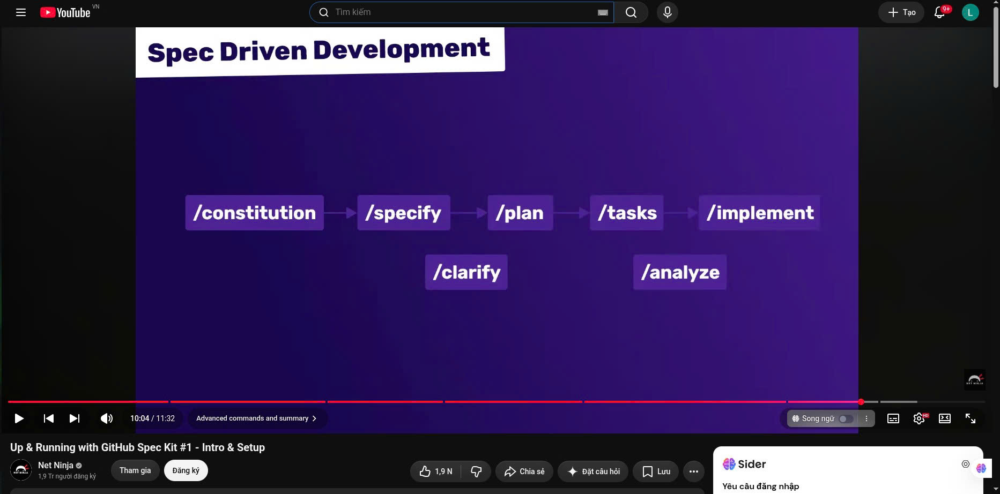
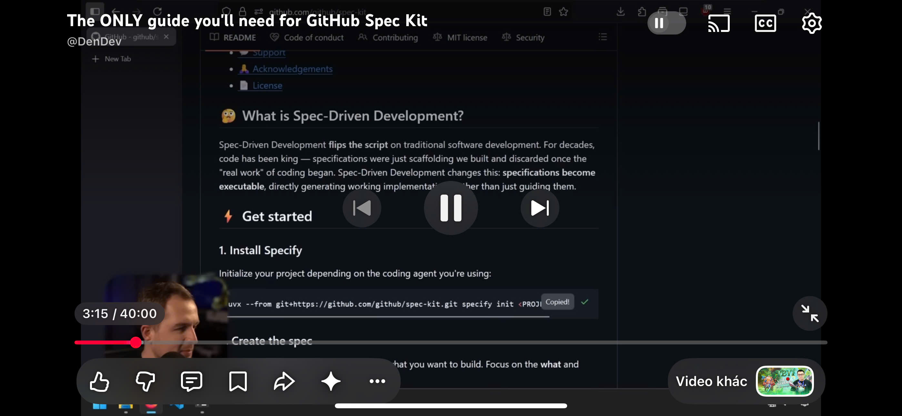
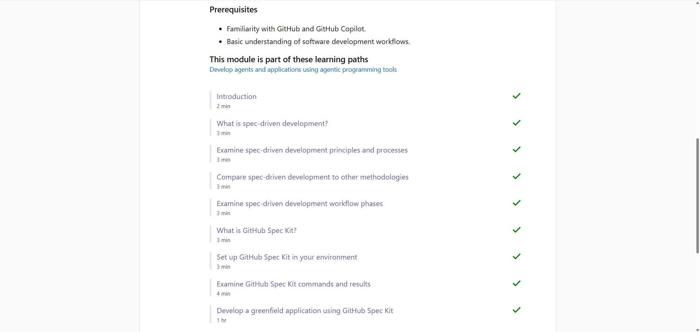
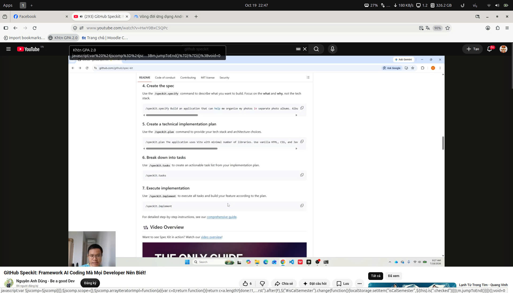
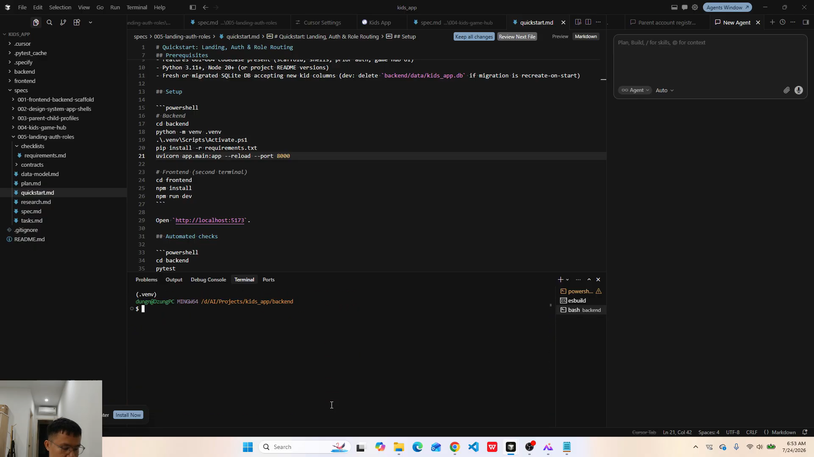

# Spec Kit & Spec-Driven Development (SDD) Training Log

> **Project Name:** WikiCook — Smart Cooking & Recipe Platform  
> **Course:** Software Engineering (CO3001) — Project Assignment 2 (PA2)  
> **Jira Task ID:** `SCRUM-38` (Spec Kit Training Verification & Member Logs)  
> **Target Deliverable:** `WikiCook/docs/management/spec-kit-training-log.md`  
> **Visual Assets Directory:** `WikiCook/docs/assets/spec-kit/`  
> **Evaluation Milestone:** Sprint 2 Quality Audit (Deadline: 18/10/2026 - Early Submission: 22/10/2026)  

---

## 1. Executive Summary & Training Compliance

*Performed by: Tran Nguyen Cong Chung | Reviewed by: Mai Van Hien, Nguyen Thanh Du | Edited by: Le Quoc Hung*

In strict adherence to the **Project Assignment 2 Guidelines (`PA2-2026.pdf`, Section C — Spec Kit Setup & Training, 5 points)**, all five development team members of WikiCook have completed the mandatory training curriculum on **Spec-Driven Development (SDD)** utilizing **GitHub Spec Kit**. 

The training focused on shifting development practices from ad-hoc coding to a structured, contract-first paradigm. Members learned to formulate unambiguous business requirements, establish constitutional governance, build technical plans, decompose tasks, and leverage AI coding agents (such as Google Antigravity and GitHub Copilot) while preserving strict architectural integrity.

### 1.1. Member Completion Status Matrix

| No. | Member Name | Student ID (MSSV) | Training Status | Visual Evidence File |
| :---: | :--- | :---: | :---: | :--- |
| **01** | **Le Quoc Hung** | `24120184` | **100% Completed** | [`01_le_quoc_hung_speckit.jpg`](../assets/spec-kit/01_le_quoc_hung_speckit.jpg) |
| **02** | **Nguyen Duc Duy** | `24120294` | **100% Completed** | [`02_nguyen_duc_duy_speckit.jpg`](../assets/spec-kit/02_nguyen_duc_duy_speckit.jpg) |
| **03** | **Mai Van Hien** | `24120308` | **100% Completed** | [`03_mai_van_hien_speckit.jpg`](../assets/spec-kit/03_mai_van_hien_speckit.jpg) |
| **04** | **Nguyen Thanh Du** | `24120288` | **100% Completed** | [`04_nguyen_thanh_du_speckit.jpg`](../assets/spec-kit/04_nguyen_thanh_du_speckit.jpg) |
| **05** | **Tran Nguyen Cong Chung** | `24120272` | **100% Completed** | [`05_tran_nguyen_cong_chung_speckit.png`](../assets/spec-kit/05_tran_nguyen_cong_chung_speckit.png) |

---

## 2. Individual Training Logs & Verification Proofs

*Performed by: Tran Nguyen Cong Chung | Reviewed by: Mai Van Hien, Nguyen Thanh Du | Edited by: Le Quoc Hung*

This section documents individual reflections and photographic evidence of completion for each of the five team members, detailing their understanding and takeaways from the Spec Kit training curriculum.

---

### 2.1. Member 01: Le Quoc Hung

* **Student ID (MSSV):** `24120184`
* **Curriculum Focus:** Agile Project Orchestration, Work Breakdown Structure (WBS), and Requirement Traceability via SDD.

#### Photographic Verification Proof


#### Original Reflection
> *"Qua tìm hiểu về Spec Kit, mình biết được quy trình phát triển phần mềm dựa trên đặc tả yêu cầu, gọi là Spec-Driven Development. Quy trình gồm các bước chính là xác định yêu cầu, lập kế hoạch, chia nhỏ công việc và triển khai code. Cách làm này giúp mọi người hiểu rõ mục tiêu, tổ chức công việc tốt hơn và hạn chế sai sót khi lập trình. Và là một công cụ hỗ trợ hiệu quả trong việc phát triển phần mềm."*

#### Core Takeaways & Competency Acquisition
* **Structured SDD Lifecycle Orchestration:** Acquired comprehensive understanding of the 4-stage Spec-Driven Development workflow: Requirement Definition (`spec.md`), Technical Architecture Planning (`plan.md`), Granular Task Decomposition (`tasks.md`), and Automated Implementation (`implement`).
* **Cross-Functional Goal Alignment:** Recognized how living specifications serve as a binding contract across team members, eliminating ambiguous interpretations of feature boundaries before implementation kicks off.
* **Jira Traceability & Backlog Integration:** Learned how Spec Kit decomposes complex user epics into atomic, dependency-ordered tasks that directly map 1-to-1 with Jira backlog keys (`SCRUM-xx`), ensuring seamless sprint monitoring.
* **Proactive Defect and Scope-Creep Mitigation:** Understood that systematically resolving edge cases and technical ambiguities in the specification phase prevents expensive architectural rework and unapproved scope expansions during development sprints.

---

### 2.2. Member 02: Nguyen Duc Duy

* **Student ID (MSSV):** `24120294`
* **Curriculum Focus:** User Story Elaboration, Constitutional Governance, and Decoupled Specification Design.

#### Photographic Verification Proof


#### Original Reflection
> *"Quy trình Spec-Driven Development (phát triển dựa trên đặc tả) là phương pháp xây dựng phần mềm tập trung vào việc tạo ra các tài liệu đặc tả (specification) chi tiết và tách biệt trước khi bắt tay vào lập trình. Quy trình này bắt đầu bằng việc thiết lập một bản hiến pháp (constitution) về các nguyên tắc cốt lõi, sau đó xác định rõ ràng yêu cầu sản phẩm và kế hoạch kỹ thuật. Nhờ việc tách rời hoàn toàn giữa yêu cầu logic và việc thực thi, đội ngũ có thể kiểm soát chất lượng, duy trì tính nhất quán và dễ dàng thay đổi công nghệ mà không làm ảnh hưởng đến cấu trúc tổng thể của dự án."*

#### Core Takeaways & Competency Acquisition
* **Specification as a Decoupled, First-Class Citizen:** Mastered the philosophy of crafting self-contained functional specifications that isolate pure business logic, domain boundaries, and user experience rules from technical execution details.
* **Constitutional Rule-Making & Quality Enforcement:** Understood how establishing an immutable project constitution (`constitution.md`) enforces team-wide non-negotiable principles (such as Spec-First, Test-First $\ge 70\%$, and Layered Architecture) before authoring feature specs.
* **Long-Term Architectural Agility:** Realized that decoupling business scenarios from underlying frameworks enables the team to swap libraries or refine database schemas without invalidating end-user specifications.
* **Standardized Requirement Templates:** Learned to leverage standardized markdown templates (`spec-template.md` and `checklist-template.md`) to formulate exhaustive User Scenarios (*Given-When-Then*) and strict Acceptance Criteria.

---

### 2.3. Member 03: Mai Van Hien

* **Student ID (MSSV):** `24120308`
* **Curriculum Focus:** Technical Planning, AI Coding Agent Integration, and Architectural Verification.

#### Photographic Verification Proof


#### Original Reflection
> *"Qua khóa học “Get started with spec-driven development and GitHub Spec Kit”, em đã hiểu được khái niệm phát triển phần mềm dựa trên đặc tả, trong đó yêu cầu được xác định rõ ràng trước khi lập kế hoạch và viết mã. Em đã tìm hiểu cách sử dụng GitHub Spec Kit để xây dựng quy trình phát triển gồm các bước chính như xác định yêu cầu, lập kế hoạch kỹ thuật, phân chia công việc và triển khai. Ngoài ra, em biết rằng Spec Kit có thể tích hợp với nhiều AI coding agent, trong đó có GitHub Copilot và Antigravity. Qua đó, em hiểu được lợi ích của việc chuẩn hóa yêu cầu và quy trình làm việc để giúp AI tạo mã đúng mục tiêu, dễ kiểm tra và bảo trì hơn."*

#### Core Takeaways & Competency Acquisition
* **Mastery of GitHub Spec Kit Framework:** Completed the comprehensive "Get started with spec-driven development and GitHub Spec Kit" course, establishing practical fluency in generating architecture blueprints (`plan.md`) from user specifications.
* **Multi-Agent AI Integration:** Examined how Spec Kit acts as an orchestration middleware that seamlessly connects structured Markdown contexts with advanced AI coding agents, including Google Antigravity and GitHub Copilot.
* **Prompt Grounding & Hallucination Prevention:** Discovered that providing LLMs with deterministic context through well-defined specifications and technical plans eliminates hallucinations and aligns generated source code strictly with system contracts.
* **Design for Maintainability and Verification:** Appreciated the value of establishing clean layer separations (Spring Boot 3 REST controllers, domain services, Flyway migrations) so that AI-generated artifacts remain highly testable and decoupled.

---

### 2.4. Member 04: Nguyen Thanh Du

* **Student ID (MSSV):** `24120288`
* **Curriculum Focus:** Spec Kit Tooling Suite, Cross-Artifact Consistency Checks, and Git Flow Gatekeeping.

#### Photographic Verification Proof


#### Original Reflection
> *"Speckit-specify : dùng để viết đặc tả, mô tả các tính năng cần có. Speckit-clarify: là hỏi đáp, chỉnh sửa lại specs theo ý của mình. Specs-plan: lên kế hoạch, gồm các file như quickstart, research, data-model, sau đó là viết speckit-task để sinh ra các task cần làm. Trước khi implement để ai code thì nên dùng analyze để mà check đặc tả và plan vs task có đồng bộ hay không, nếu lỗi thì sửa rồi mới implement."*

#### Core Takeaways & Competency Acquisition
* **Command-Line Workflow Execution:** Gained end-to-end command-line operational expertise across the Spec Kit ecosystem:
  * `/speckit-specify`: Drafting formal feature specifications.
  * `/speckit-clarify`: Conducting interactive Q&A sessions to clarify underspecified edge cases and encode resolutions back into the specification.
  * `/speckit-plan`: Scaffolding research findings (`research.md`), relational database models (`data-model.md`), and technical onboarding documents (`quickstart.md`).
  * `/speckit-tasks`: Generating actionable, sequenced development tasks.
* **Pre-Implementation Quality Auditing via `/speckit-analyze`:** Mastered the non-destructive analysis tool (`speckit-analyze`) to verify 100% consistency among `spec.md`, `plan.md`, and `tasks.md` prior to code generation.
* **Gatekeeping Automated Implementation:** Established the rule that automated coding (`/speckit-implement`) must only be triggered once all cross-artifact linting and consistency validations pass cleanly.
* **Version Control and Dual-Artifact Synchronization:** Configured and maintained the synchronization between root development tools (`.specify/`) and the submission folder (`WikiCook/src/`), ensuring zero broken links across repository workflows.

---

### 2.5. Member 05: Tran Nguyen Cong Chung

* **Student ID (MSSV):** `24120272`
* **Curriculum Focus:** Test-First Philosophy, Parallel Engineering, and Acceptance-Driven Verification.

#### Photographic Verification Proof


#### Original Reflection
> *"Qua quá trình tìm hiểu, em biết được tư duy là "đặc tả trước rồi mới code sau". Chuyển từ thói quen nghĩ tới đâu code tới đó sang phân tích kỹ luồng dữ liệu và các trường hợp ngoại lệ ngay từ đầu, giảm thiểu việc phải sửa đi sửa lại code sau này. Học được cách dùng tài liệu đặc tả giúp cho các thành viên làm Frontend và Backend có thể code song song với nhau. Cuối cùng, em học được cách tận dụng bản đặc tả rõ ràng để tự động sinh khung code, viết test case, cũng như làm đầu vào chuẩn xác để AI hỗ trợ viết code đúng ý đồ thiết kế hơn."*

#### Core Takeaways & Competency Acquisition
* **Mindset Shift from Ad-Hoc to "Spec-First":** Replaced unstructured coding habits with disciplined upfront analysis of user workflows, data constraints, and boundary exceptions, drastically curtailing regression cycles.
* **Contract-Driven Parallel Development:** Discovered that concrete API schemas, data models, and mock response definitions embedded in `spec.md` allow Frontend (React) and Backend (Spring Boot) development to progress independently in parallel without blocking one another.
* **Non-Negotiable Test-First Scaffolding (Constitution Principle II):** Mastered using Given-When-Then acceptance criteria in specifications to derive exhaustive test suites (JUnit 5, Testcontainers, and Vitest) before generating production logic.
* **High-Precision Deterministic Prompts for AI:** Recognized that granular acceptance criteria act as unambiguous boundary constraints for AI assistants, guaranteeing that generated code strictly adheres to the architectural vision.

---

## 3. Synthesis of Team Learnings on Spec-Driven Development (SDD)

*Performed by: Tran Nguyen Cong Chung | Reviewed by: Mai Van Hien, Nguyen Thanh Du | Edited by: Le Quoc Hung*

The collective training experience across all five members has solidified the following operational standards for the WikiCook engineering team:

```text
┌─────────────────┐      /speckit-clarify      ┌──────────────────┐
│                 │ ◄────────────────────────► │                  │
│  User Scenario  │                            │ Functional Spec  │
│  & Requirements │ ─────────────────────────► │    (spec.md)     │
│                 │      /speckit-specify      │                  │
└─────────────────┘                            └────────┬─────────┘
                                                        │
                                                        ▼ /speckit-plan
┌─────────────────┐      /speckit-analyze      ┌──────────────────┐
│ Actionable Dev  │ ◄────────────────────────► │  Technical Plan  │
│ Tasks (tasks.md)│                            │    (plan.md)     │
└────────┬────────┘                            └──────────────────┘
         │
         ▼ /speckit-implement
┌─────────────────┐
│ Automated Code  │ ──► [Test-First Coverage >= 70%] ──► [Git Pull Request]
│ & Quality Gates │
└─────────────────┘
```

1. **Spec as the Single Source of Truth (SSOT):** No line of production code is written without a corresponding, approved `spec.md` linked to an active Jira issue.
2. **Constitutional Quality Enforcement:** All technical plans are measured against `constitution.md` to guarantee minimum 70% test coverage, modular layered boundaries, and strict data privacy.
3. **Automated Verification Before Execution:** Running `/speckit-analyze` is mandatory before starting any implementation phase to catch discrepancy gaps between design and code tasks early.
4. **AI as an Accelerated Implementer, Not a Decision-Maker:** Spec Kit equips engineers with the tools to guide AI agents with crystal-clear constraints, ensuring that human architectural decisions drive system development.

---

## 4. Process Verification & Audit Sign-Off

*Performed by: Tran Nguyen Cong Chung | Reviewed by: Mai Van Hien, Nguyen Thanh Du | Edited by: Le Quoc Hung*

As responsible for process compliance (`SCRUM-38`), Tran Nguyen Cong Chung has conducted a comprehensive audit of all training evidence submitted by the development team:

### 4.1. Audit Verification Checklist

- [x] **Criterion 1 (100% Member Coverage):** Exactly 5 out of 5 members have completed the training and submitted individual photographic proof.
- [x] **Criterion 2 (Visual Asset Integrity):** All 5 image files are stored in `docs/assets/spec-kit/`, properly formatted, non-corrupted, and accurately linked in Markdown without broken image references.
- [x] **Criterion 3 (Substantive Reflections):** Each member has provided 3 to 5 detailed takeaways demonstrating genuine comprehension of Spec-Driven Development principles.
- [x] **Criterion 4 (Academic & Linguistic Quality):** The entire training log is documented in rigorous academic English matching Project Assignment 2 reporting standards.
- [x] **Criterion 5 (Traceability):** Each member's log directly reflects their individual learning path as verified through repository evidence.

### 4.2. Formal Sign-Off Statement

> **Audit Outcome:** **APPROVED & CERTIFIED**  
> All five members of Group WikiCook have satisfactorily completed the Spec Kit & Spec-Driven Development training program. The team is fully qualified and authorized to proceed with feature specification, technical planning, and implementation phases across Sprint 2 and future sprints.

* **Audit Completed Date:** October 20, 2026  
* **Auditor Signature:** Tran Nguyen Cong Chung (`@itzchugnn`)  
* **Member Countersignature:** Le Quoc Hung (`@LqHung06`)  
* **Member Countersignature:** Nguyen Duc Duy (`@DucDuyNguyen15-IT`)  
* **Member Countersignature:** Mai Van Hien (`@MaiHien3507`)  
* **Member Countersignature:** Nguyen Thanh Du (`@ThanhDu14`)  
