# USE-CASE MODEL: WIKICOOK

**Course:** CS300 - CSC13002 - Introduction to Software Engineering  
**Project Name:** WikiCook — Intelligent Culinary & Meal Planning Ecosystem  
**Team:** Group 05  
**Document Title:** Use-Case Model (Mermaid) covering the 10 product features of Vision Document §5  
**Sprint Cycle:** Sprint 03 (Project Assignment 3 — Part C, 10 Points)  
**Document Version:** 0.2 (Draft for Standup 1 on 30/10/2026 — freeze on 02/11/2026)  
**Date:** October 29, 2026

---

## DOCUMENT METADATA & RESPONSIBILITY MATRIX

| Section | Section Title | Performed by (Author) | Reviewed by | Edited by | Jira Task |
| :---: | :--- | :---: | :---: | :---: | :---: |
| **Section 1** | Introduction | **Nguyễn Đức Duy (DucDuyNguyen15-IT)** | **Mai Văn Hiển (MaiHien3507)** | **Nguyễn Đức Duy (DucDuyNguyen15-IT)** | `SCRUM-49` |
| **Section 2** | Actors | **Nguyễn Đức Duy (DucDuyNguyen15-IT)** | **Mai Văn Hiển (MaiHien3507)** | **Nguyễn Đức Duy (DucDuyNguyen15-IT)** | `SCRUM-49` |
| **Section 3** | System Overview Diagram | **Nguyễn Đức Duy (DucDuyNguyen15-IT)** | **Mai Văn Hiển (MaiHien3507)** | **Nguyễn Đức Duy (DucDuyNguyen15-IT)** | `SCRUM-49` |
| **Section 4** | Use-Case Diagrams by Feature | **Nguyễn Đức Duy (DucDuyNguyen15-IT)** | **Mai Văn Hiển (MaiHien3507)** | **Nguyễn Đức Duy (DucDuyNguyen15-IT)** | `SCRUM-49` |
| **Section 5** | Use-Case Catalogue & Traceability | **Nguyễn Đức Duy (DucDuyNguyen15-IT)** | **Mai Văn Hiển (MaiHien3507)** | **Nguyễn Đức Duy (DucDuyNguyen15-IT)** | `SCRUM-49` |
| **Section 6** | Coverage Check & Open Issues | **Nguyễn Đức Duy (DucDuyNguyen15-IT)** | **Mai Văn Hiển (MaiHien3507)** | **Nguyễn Đức Duy (DucDuyNguyen15-IT)** | `SCRUM-49` |

### Revision History

| Date | Version | Description | Author |
| :---: | :---: | :--- | :--- |
| **29/10/2026** | `v0.1` | Initial draft: 8 actors with generalization, system overview, 11 use-case diagrams (one per Vision §5 feature plus the shared Recipe Detail page), catalogue of 64 use cases with traceability to Vision §5, specs and user stories, and coverage check (`SCRUM-49`). | Nguyễn Đức Duy (`DucDuyNguyen15-IT`) |
| **29/10/2026** | `v0.2` | Aligned with the Use-Case Specifications v1.1 (`SCRUM-51`): added `UC-060-05 «include» UC-060-02` (`OQ-060-01`), closed open issue 3, updated the status of the open issues. | Nguyễn Đức Duy (`DucDuyNguyen15-IT`) |

---

## 1. INTRODUCTION
*Performed by: Nguyễn Đức Duy (DucDuyNguyen15-IT) | Reviewed by: Mai Văn Hiển (MaiHien3507) | Edited by: Nguyễn Đức Duy (DucDuyNguyen15-IT)*

### 1.1. Purpose

This document is the Use-Case Model of WikiCook. It shows who interacts with the system (actors), what goals they achieve (use cases) and how the use cases depend on each other (`«include»`, `«extend»` and actor generalization). It is the index for the Use-Case Specifications in [`use-case-specification.md`](use-case-specification.md): every use case drawn here has exactly one owner who writes its specification under `SCRUM-50` – `SCRUM-54`, and every use case ID used there must come from Section 5 of this document.

### 1.2. Scope

The model covers all ten features of [Vision Document](vision-document.md) §5 and the twelve feature specifications in `specs/` (`010`, `011`, `020`, `030`, `031`, `040`, `050`, `060`, `070`, `080`, `090`, `100`). It describes the **complete** behaviour of each specification, not only the slice implemented in Sprint 3. For example, `040` User Stories 3–5 are deferred to PA4 for Part E, but their use cases are still part of this model.

### 1.3. Notation

Mermaid has no native UML use-case diagram, so the diagrams use `flowchart LR` with the following conventions:

| UML element | Mermaid representation |
| :--- | :--- |
| Actor | Rectangle labelled `«actor»` (person actors in blue, external systems in grey) |
| Use case | Rounded (stadium) node labelled with its ID and name |
| System boundary | `subgraph` titled with the feature name |
| Use case of another feature | Stadium node with a dashed border, placed outside the boundary |
| Association | Solid line without arrowhead (`---`) |
| `«include»` | Dashed arrow from the base use case to the included use case |
| `«extend»` | Dashed arrow from the extending use case to the base use case |
| Generalization | Thick arrow from the child actor to the parent actor |

### 1.4. Use-Case Identifiers

Every use case has the ID `UC-<spec>-<NN>`, where `<spec>` is the three-digit specification number and `<NN>` is a two-digit sequence inside that specification. The IDs `UC-040-01` – `UC-040-05` and `UC-050-01` – `UC-050-05` are kept exactly as already published in `use-case-specification.md` (`SCRUM-53`). In diagrams, the hyphens are written as underscores in node names (`UC020_01`) because Mermaid does not allow hyphens there; the visible label keeps the official ID.

### 1.5. Sources

- [Vision Document](vision-document.md) v1.1 — §3.2 User Summary, §5 Product Features, §5.11 Feature Traceability.
- Feature specifications `specs/010` – `specs/100` — user stories, functional requirements and the permission matrix of `specs/010-user-authentication-roles/spec.md`.
- [Use-Case Specifications](use-case-specification.md) v1.1 — use cases of `040`, `050` (`SCRUM-53`), `020` and `060` (`SCRUM-51`).
- [Sprint 03 Report](../management/reports/sprint-03/sprint-03-report.md) — Meeting 1, Decision 3 (the model must cover all ten features).

---

## 2. ACTORS
*Performed by: Nguyễn Đức Duy (DucDuyNguyen15-IT) | Reviewed by: Mai Văn Hiển (MaiHien3507) | Edited by: Nguyễn Đức Duy (DucDuyNguyen15-IT)*

### 2.1. Actor Catalogue

| Actor | Type | Description | Source |
| :--- | :--- | :--- | :--- |
| **Guest** | Primary, person | Visitor without an account. Can search, read published recipes and reviews, and register or sign in. | `010` FR-020, permission matrix |
| **Member** | Primary, person | Signed-in user (the busy home cook of Vision §3.2). Owns a dietary profile, meal plans, shopping lists, collections, reviews and recipe drafts. Reviewing and submitting recipes require a verified email. | `010` FR-020, `011`, `060` FR-001 |
| **Contributor** | Primary, person | Member granted the "Verified Contributor" badge by an Administrator. Has the same use cases as Member; the badge is shown on their recipes. Their recipes still go through moderation. | `010` permission matrix, `060` |
| **Moderator** | Primary, person | Reviews submitted recipes and proposed ingredients, and processes reports about recipes, reviews, Cooksnaps and users. | `010` permission matrix, `100` US1–US2 |
| **Administrator** | Primary, person | Has every Moderator capability and also manages accounts and roles, taxonomies, featured recipes, nutrition estimates and the audit trail. | `010` FR-022, `100` US3–US6, `090` US7 |
| **LLM Service** | Secondary, external system | Large language model and embedding API used to arrange AI meal plans, estimate nutrition and embed recipes for retrieval. | `031`, `090` |
| **Google OAuth** | Secondary, external system | Identity provider for "Sign in with Google". | `010` US5 |
| **Email Service** | Secondary, external system | Sends verification, password-reset and account-status emails. | `010` US2, US4; `100` US3 |

### 2.2. Actor Generalization

The person actors form an inheritance chain that follows the permission matrix of spec `010`: each child actor can perform every use case of its parent. Contributor and Moderator both specialise Member, and Administrator specialises Moderator.

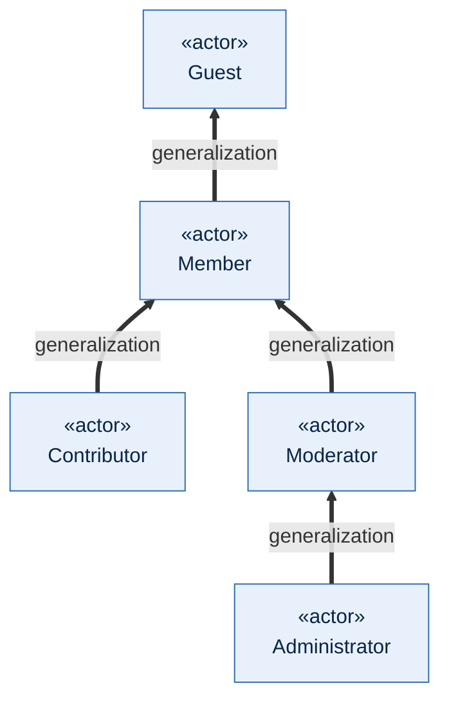

Because of this generalization, the diagrams in Section 4 connect each use case only to the **lowest** actor that may perform it. For example, a use case associated with Guest is also available to every signed-in actor.

---

## 3. SYSTEM OVERVIEW DIAGRAM
*Performed by: Nguyễn Đức Duy (DucDuyNguyen15-IT) | Reviewed by: Mai Văn Hiển (MaiHien3507) | Edited by: Nguyễn Đức Duy (DucDuyNguyen15-IT)*

The overview shows the ten features of Vision §5 as use-case packages inside the WikiCook boundary and the actors that interact with each package. The detailed use cases of each package are drawn in Section 4.

Contributor is omitted from the overview because it has no use case of its own; it inherits every Member use case (Section 2.2).

---

## 4. USE-CASE DIAGRAMS BY FEATURE
*Performed by: Nguyễn Đức Duy (DucDuyNguyen15-IT) | Reviewed by: Mai Văn Hiển (MaiHien3507) | Edited by: Nguyễn Đức Duy (DucDuyNguyen15-IT)*

One diagram per Vision §5 feature (4.1 – 4.10), plus one cross-feature diagram for the shared Recipe Detail page (4.11). Use cases of another feature appear with a dashed border and only where a relationship crosses the feature boundary.

### 4.1. Feature 5.1 — User Authentication & Dietary Profile (`010`, `011`)

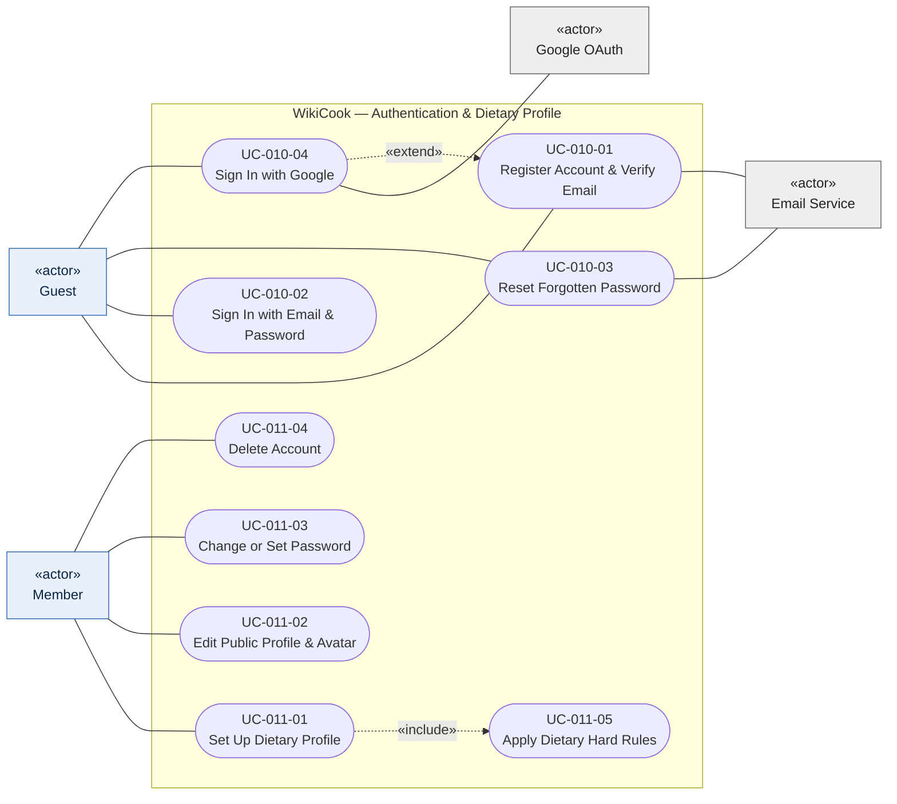

- `UC-010-04` extends `UC-010-01`: a first Google sign-in creates the account instead of the email registration form (`010` US5).
- `UC-011-05` is the single definition of hard rules (allergens, excluded ingredients) and preferences required by `011` US5. Setting up the profile includes it to validate the input, and search (`UC-020-03`) and the AI planner (`UC-031-01`) include it to filter recipes.
- Role-based access (`010` US3) has no separate use case: it is modelled by the actor generalization in Section 2.2 and by role changes in `UC-100-03`.

### 4.2. Feature 5.2 — Smart Recipe Discovery & Filters (`020`)

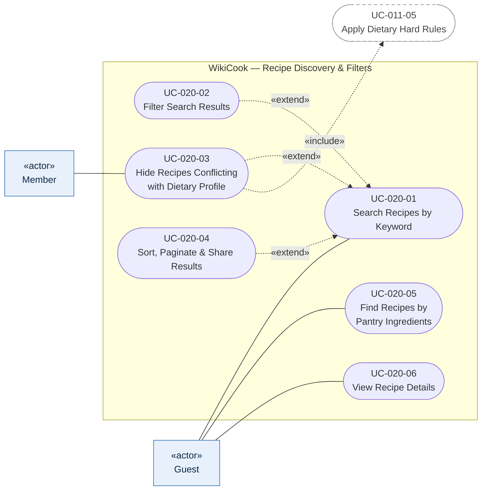

- Filters, sorting and paging extend the keyword search; homepage quick presets ("Under 30 minutes", "Vegetarian") are a shortcut into `UC-020-02` (`020` FR-001).
- `UC-020-03` extends the search only when a signed-in Member has a dietary profile, so it is associated with Member and not with Guest (`020` US3).
- `UC-020-05` comes from Vision §5.2 (pantry matching), which spec `020` currently lists as out of scope; see Section 6.2, issue 1.
- `UC-020-06` is the shared Recipe Detail page that many other features extend; see Section 4.11.

### 4.3. Feature 5.3 — Weekly Meal Planner, Manual and AI (`030`, `031`)

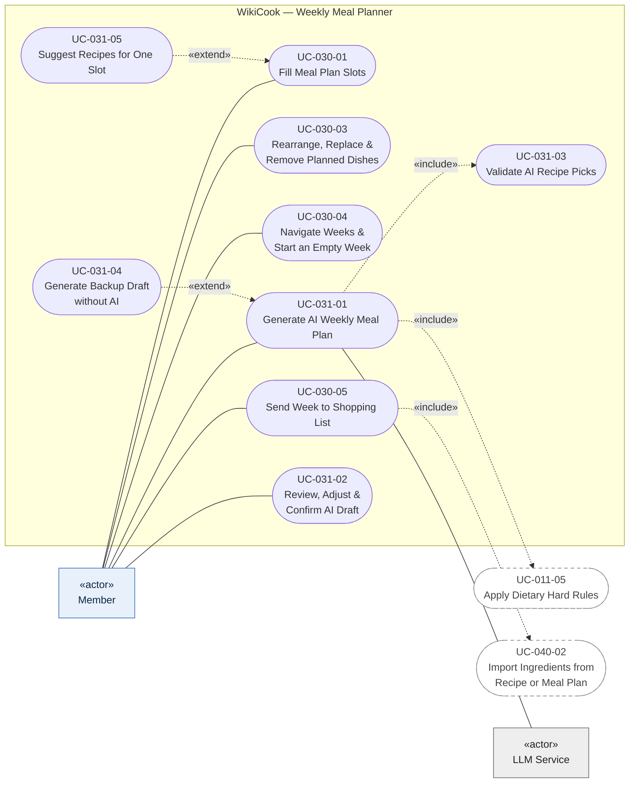

- `UC-030-02` (Add Recipe to Plan from Detail Page) belongs to this feature but is drawn in Section 4.11 because it extends `UC-020-06`.
- `UC-031-01` always includes the hard-rule filter and the validation of every AI pick against the catalogue (`031` US1, US3). Not enough suitable recipes (`031` US4) and the fair-use limit (`031` US5) are alternative flows of `UC-031-01`.
- `UC-031-04` extends `UC-031-01` when the LLM Service fails or times out, so the user still gets a draft (`031` US6).
- `UC-031-05` extends manual slot filling with recommendations for the selected meal (`031` US7).
- `UC-031-06` (Sync Recipe Embeddings, `031` US8) is triggered by moderation and is drawn in Section 4.10.

### 4.4. Feature 5.4 — Smart Shopping List (`040`)

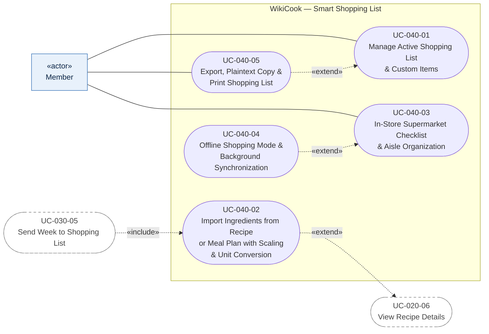

- Use-case IDs and names are unchanged from `use-case-specification.md` (`SCRUM-53`).
- `UC-040-02` is reached in two ways: from the "Add to shopping list" button on the Recipe Detail page (extends `UC-020-06`, task T048) and from a confirmed meal plan (included by `UC-030-05`).
- `UC-040-04` extends the in-store checklist when the connection is lost (`040` US4).

### 4.5. Feature 5.5 — Hands-free Cooking Mode & Timers (`050`)

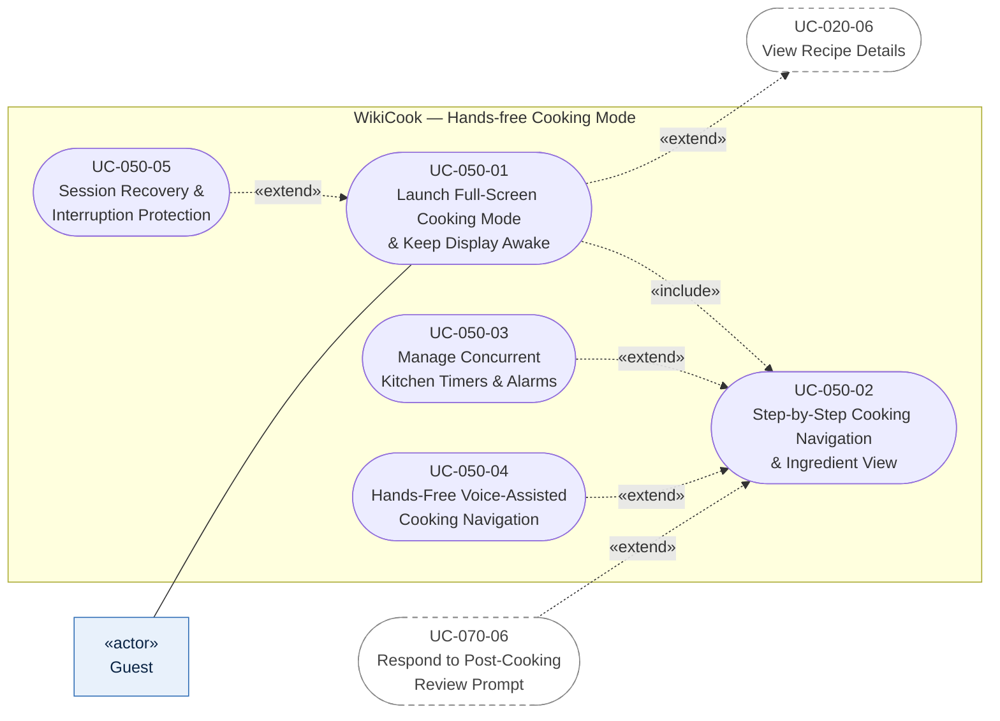

- The primary actor is Guest, as in `UC-050-01` of `use-case-specification.md`: anyone who can read a published recipe can cook it. Signed-in actors inherit the use case.
- Timers (step with a duration) and voice commands are optional behaviour inside step navigation, so they extend `UC-050-02`.
- When the cook finishes the last step, `UC-070-06` extends the session with the review prompt (`070` US6).

### 4.6. Feature 5.6 — Community Recipe Contribution (`060`)

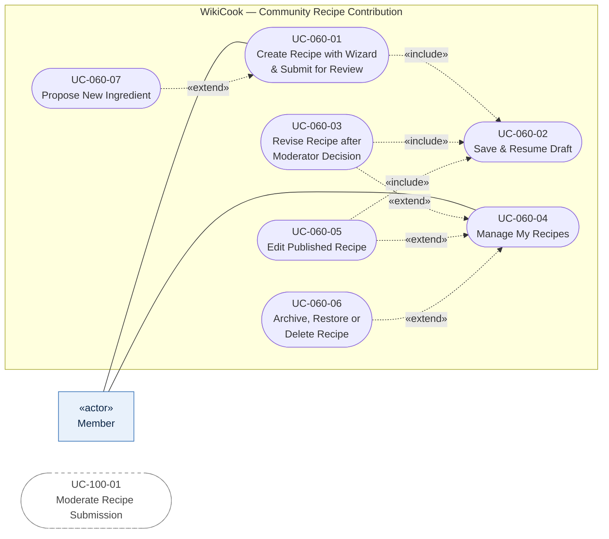

- Submitting requires a verified email (`060` FR-001, `010` FR-006); an unverified Member can only save drafts. This is a precondition of `UC-060-01`, not a separate actor.
- The wizard always includes draft saving and auto-save (`060` US2); revising a recipe after "Revision Requested" and editing a published recipe (a revision, `060` FR-027) reopen the wizard and also include it.
- `UC-060-07` extends the ingredient step when the ingredient is not in the shared catalogue; the Moderator approves it together with the recipe in `UC-100-01` (`060` clarification Q3).
- Revising, editing a published recipe and archiving/restoring/deleting are actions offered on the "My Recipes" page, so they extend `UC-060-04`. The decision that triggers `UC-060-03` comes from `UC-100-01` (shown unconnected because it is a state change, not a use-case relationship).

### 4.7. Feature 5.7 — Social Cooksnaps & Reviews (`070`)

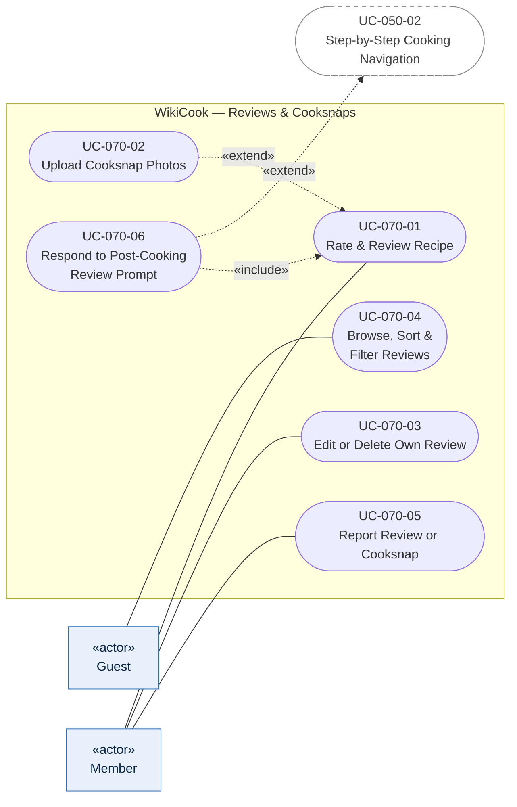

- Reviewing, posting Cooksnaps and reporting require a signed-in Member with a verified email (`010` permission matrix).
- A Cooksnap is attached to a review, so `UC-070-02` extends `UC-070-01` (`070` US2).
- Reports created in `UC-070-05` are handled by the Moderator in `UC-100-02`.

### 4.8. Feature 5.8 — Custom Recipe Collections (`080`)

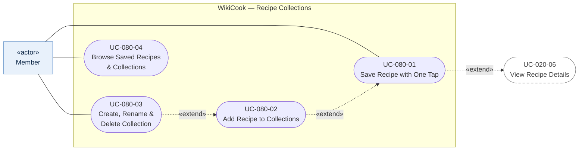

- Saving is a one-tap action on the Recipe Detail page; the "Save to collection" dialog that follows it is `UC-080-02` (`080` US1, US2).
- A new collection can be created directly from that dialog, so `UC-080-03` also extends `UC-080-02`.
- Recipes taken down after being saved (`080` US5) are an alternative flow of `UC-080-04`.

### 4.9. Feature 5.9 — Nutrition & Allergen Analyzer (`090`)

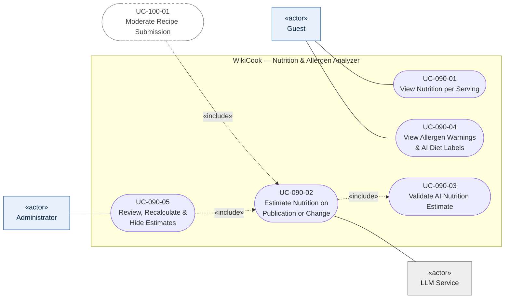

- Estimation runs once when a recipe or an approved revision is published, without blocking publication (`090` US2, US5), so it is included by the moderation use case.
- Every LLM answer is checked for plausibility before it is stored; implausible output is discarded (`090` US3).
- Allergen badges come from the curated ingredient–allergen links, not from the LLM (`090` US4, `020` clarification Q1); AI diet labels are shown separately as suggestions.
- Calories used by the search filter and the planner (`090` US6) are read by `UC-020-02` and `UC-030-01`; they are not a separate user goal.

### 4.10. Feature 5.10 — Admin Content Moderation (`100`)

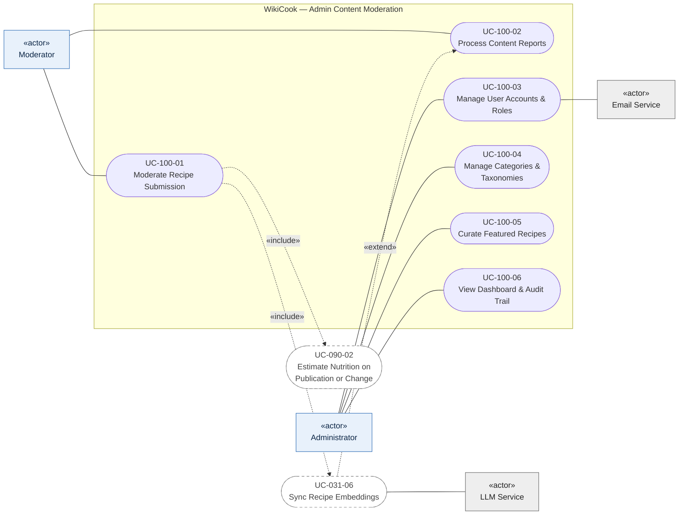

- Administrator inherits `UC-100-01` and `UC-100-02` from Moderator (Section 2.2).
- When a recipe is approved, `UC-100-01` includes the nutrition estimate and the embedding update, so the AI planner can suggest the new recipe (`031` US8). When a report leads to taking a recipe down, `UC-031-06` extends `UC-100-02` to remove it from the AI index.
- Proposed ingredients from `UC-060-07` are approved or rejected inside `UC-100-01`.
- `UC-100-03` covers role changes, suspension and banning, including the rules of `010` FR-022a and FR-023 (role hierarchy, last active Administrator); account-status emails go through the Email Service.

### 4.11. Cross-Feature Diagram — Recipe Detail Page (`UC-020-06`)

The Recipe Detail page is the shared screen where most features meet. Duy (`SCRUM-51`) owns the page frame; the other owners fill their blocks. This diagram is the contract for which use cases start from the page.

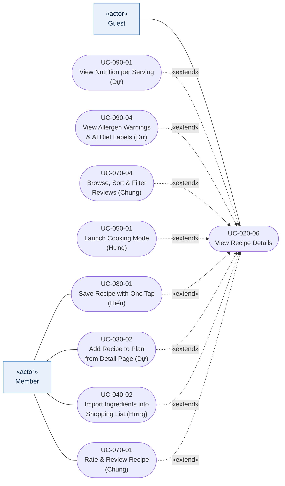

| Page block / button | Use case | Visible to | Owner |
| :--- | :--- | :--- | :--- |
| Recipe header, ingredients, steps, serving selector | `UC-020-06` | Guest and above | Nguyễn Đức Duy |
| Nutrition block, allergen badges, AI diet labels | `UC-090-01`, `UC-090-04` | Guest and above | Nguyễn Thành Dự |
| "Add to meal plan" | `UC-030-02` | Member and above | Nguyễn Thành Dự |
| "Add to shopping list" | `UC-040-02` | Member and above | Lê Quốc Hưng |
| "Start cooking" | `UC-050-01` | Guest and above | Lê Quốc Hưng |
| "Save" / "Save to collection" | `UC-080-01` | Member and above | Mai Văn Hiển |
| Reviews and Cooksnaps section, "Write a review" | `UC-070-04`, `UC-070-01` | Read: Guest; write: Member | Trần Nguyễn Công Chung |

When a Guest presses a Member-only button, the page asks them to sign in (screen `AU08-SignInPrompt`) and returns to the same recipe afterwards; this alternative flow belongs to `UC-020-06`.

---

## 5. USE-CASE CATALOGUE & TRACEABILITY
*Performed by: Nguyễn Đức Duy (DucDuyNguyen15-IT) | Reviewed by: Mai Văn Hiển (MaiHien3507) | Edited by: Nguyễn Đức Duy (DucDuyNguyen15-IT)*

This table is the official list of use-case IDs. Every row must have a specification in `use-case-specification.md` written by the owner in the last column; every specification there must use an ID from this table.

| UC ID | Use Case Name | Primary Actor | Vision §5 | Spec · User Story | UC Spec Owner (Jira) |
| :--- | :--- | :--- | :---: | :--- | :--- |
| `UC-010-01` | Register Account & Verify Email | Guest | 5.1 | `010` US2 | Mai Văn Hiển (`SCRUM-50`) |
| `UC-010-02` | Sign In with Email & Password | Guest | 5.1 | `010` US1 | Mai Văn Hiển (`SCRUM-50`) |
| `UC-010-03` | Reset Forgotten Password | Guest | 5.1 | `010` US4 | Mai Văn Hiển (`SCRUM-50`) |
| `UC-010-04` | Sign In with Google | Guest | 5.1 | `010` US5 | Mai Văn Hiển (`SCRUM-50`) |
| `UC-011-01` | Set Up Dietary Profile | Member | 5.1 | `011` US1 | Mai Văn Hiển (`SCRUM-50`) |
| `UC-011-02` | Edit Public Profile & Avatar | Member | 5.1 | `011` US2 | Mai Văn Hiển (`SCRUM-50`) |
| `UC-011-03` | Change or Set Password | Member | 5.1 | `011` US3 | Mai Văn Hiển (`SCRUM-50`) |
| `UC-011-04` | Delete Account | Member | 5.1 | `011` US4 | Mai Văn Hiển (`SCRUM-50`) |
| `UC-011-05` | Apply Dietary Hard Rules *(included)* | — | 5.1 | `011` US5 | Mai Văn Hiển (`SCRUM-50`) |
| `UC-020-01` | Search Recipes by Keyword | Guest | 5.2 | `020` US1 | Nguyễn Đức Duy (`SCRUM-51`) |
| `UC-020-02` | Filter Search Results | Guest | 5.2 | `020` US2; `090` US6 | Nguyễn Đức Duy (`SCRUM-51`) |
| `UC-020-03` | Hide Recipes Conflicting with Dietary Profile | Member | 5.2 | `020` US3 | Nguyễn Đức Duy (`SCRUM-51`) |
| `UC-020-04` | Sort, Paginate & Share Results | Guest | 5.2 | `020` US4 | Nguyễn Đức Duy (`SCRUM-51`) |
| `UC-020-05` | Find Recipes by Pantry Ingredients | Guest | 5.2 | Vision §5.2 only *(see 6.2, issue 1)* | Nguyễn Đức Duy (`SCRUM-51`) |
| `UC-020-06` | View Recipe Details | Guest | 5.2 | Shared page (`SCRUM-51`); `030` US2, `040` T048 | Nguyễn Đức Duy (`SCRUM-51`) |
| `UC-030-01` | Fill Meal Plan Slots | Member | 5.3 | `030` US1, US6, US7; `090` US6 | Nguyễn Thành Dự (`SCRUM-52`) |
| `UC-030-02` | Add Recipe to Plan from Detail Page | Member | 5.3 | `030` US2 | Nguyễn Thành Dự (`SCRUM-52`) |
| `UC-030-03` | Rearrange, Replace & Remove Planned Dishes | Member | 5.3 | `030` US3 | Nguyễn Thành Dự (`SCRUM-52`) |
| `UC-030-04` | Navigate Weeks & Start an Empty Week | Member | 5.3 | `030` US4 | Nguyễn Thành Dự (`SCRUM-52`) |
| `UC-030-05` | Send Week to Shopping List | Member | 5.3 | `030` US5 | Nguyễn Thành Dự (`SCRUM-52`) |
| `UC-031-01` | Generate AI Weekly Meal Plan | Member | 5.3 | `031` US1, US4, US5 | Nguyễn Thành Dự (`SCRUM-52`) |
| `UC-031-02` | Review, Adjust & Confirm AI Draft | Member | 5.3 | `031` US2 | Nguyễn Thành Dự (`SCRUM-52`) |
| `UC-031-03` | Validate AI Recipe Picks *(included)* | — | 5.3 | `031` US3 | Nguyễn Thành Dự (`SCRUM-52`) |
| `UC-031-04` | Generate Backup Draft without AI | Member | 5.3 | `031` US6 | Nguyễn Thành Dự (`SCRUM-52`) |
| `UC-031-05` | Suggest Recipes for One Slot | Member | 5.3 | `031` US7 | Nguyễn Thành Dự (`SCRUM-52`) |
| `UC-031-06` | Sync Recipe Embeddings *(included / extending)* | — | 5.3 | `031` US8 | Nguyễn Thành Dự (`SCRUM-52`) |
| `UC-040-01` | Manage Active Shopping List & Custom Items | Member | 5.4 | `040` US1 | Lê Quốc Hưng (`SCRUM-53`) |
| `UC-040-02` | Import Ingredients from Recipe or Meal Plan with Scaling & Unit Conversion | Member | 5.4 | `040` US2 | Lê Quốc Hưng (`SCRUM-53`) |
| `UC-040-03` | In-Store Supermarket Checklist & Aisle Organization | Member | 5.4 | `040` US3 | Lê Quốc Hưng (`SCRUM-53`) |
| `UC-040-04` | Offline Shopping Mode & Background Synchronization | Member | 5.4 | `040` US4 | Lê Quốc Hưng (`SCRUM-53`) |
| `UC-040-05` | Export, Plaintext Copy & Print Shopping List | Member | 5.4 | `040` US5 | Lê Quốc Hưng (`SCRUM-53`) |
| `UC-050-01` | Launch Full-Screen Cooking Mode & Keep Display Awake | Guest | 5.5 | `050` US1 | Lê Quốc Hưng (`SCRUM-53`) |
| `UC-050-02` | Step-by-Step Cooking Navigation & Ingredient View | Guest | 5.5 | `050` US2 | Lê Quốc Hưng (`SCRUM-53`) |
| `UC-050-03` | Manage Concurrent Kitchen Timers & Alarms | Guest | 5.5 | `050` US3 | Lê Quốc Hưng (`SCRUM-53`) |
| `UC-050-04` | Hands-Free Voice-Assisted Cooking Navigation | Guest | 5.5 | `050` US4 | Lê Quốc Hưng (`SCRUM-53`) |
| `UC-050-05` | Session Recovery & Interruption Protection | Guest | 5.5 | `050` US5 | Lê Quốc Hưng (`SCRUM-53`) |
| `UC-060-01` | Create Recipe with Wizard & Submit for Review | Member | 5.6 | `060` US1 | Nguyễn Đức Duy (`SCRUM-51`) |
| `UC-060-02` | Save & Resume Draft | Member | 5.6 | `060` US2 | Nguyễn Đức Duy (`SCRUM-51`) |
| `UC-060-03` | Revise Recipe after Moderator Decision | Member | 5.6 | `060` US3 | Nguyễn Đức Duy (`SCRUM-51`) |
| `UC-060-04` | Manage My Recipes | Member | 5.6 | `060` US4 | Nguyễn Đức Duy (`SCRUM-51`) |
| `UC-060-05` | Edit Published Recipe | Member | 5.6 | `060` US5 | Nguyễn Đức Duy (`SCRUM-51`) |
| `UC-060-06` | Archive, Restore or Delete Recipe | Member | 5.6 | `060` US6 | Nguyễn Đức Duy (`SCRUM-51`) |
| `UC-060-07` | Propose New Ingredient | Member | 5.6 | `060` US1 scenario 4, FR-006, FR-007, clarification Q3 | Nguyễn Đức Duy (`SCRUM-51`) |
| `UC-070-01` | Rate & Review Recipe | Member | 5.7 | `070` US1 | Trần Nguyễn Công Chung (`SCRUM-54`) |
| `UC-070-02` | Upload Cooksnap Photos | Member | 5.7 | `070` US2 | Trần Nguyễn Công Chung (`SCRUM-54`) |
| `UC-070-03` | Edit or Delete Own Review | Member | 5.7 | `070` US3 | Trần Nguyễn Công Chung (`SCRUM-54`) |
| `UC-070-04` | Browse, Sort & Filter Reviews | Guest | 5.7 | `070` US4 | Trần Nguyễn Công Chung (`SCRUM-54`) |
| `UC-070-05` | Report Review or Cooksnap | Member | 5.7 | `070` US5 | Trần Nguyễn Công Chung (`SCRUM-54`) |
| `UC-070-06` | Respond to Post-Cooking Review Prompt | Member | 5.7 | `070` US6 | Trần Nguyễn Công Chung (`SCRUM-54`) |
| `UC-080-01` | Save Recipe with One Tap | Member | 5.8 | `080` US1 | Mai Văn Hiển (`SCRUM-50`) |
| `UC-080-02` | Add Recipe to Collections | Member | 5.8 | `080` US2 | Mai Văn Hiển (`SCRUM-50`) |
| `UC-080-03` | Create, Rename & Delete Collection | Member | 5.8 | `080` US3 | Mai Văn Hiển (`SCRUM-50`) |
| `UC-080-04` | Browse Saved Recipes & Collections | Member | 5.8 | `080` US4, US5 | Mai Văn Hiển (`SCRUM-50`) |
| `UC-090-01` | View Nutrition per Serving | Guest | 5.9 | `090` US1 | Nguyễn Thành Dự (`SCRUM-52`) |
| `UC-090-02` | Estimate Nutrition on Publication or Change *(included)* | — | 5.9 | `090` US2, US5 | Nguyễn Thành Dự (`SCRUM-52`) |
| `UC-090-03` | Validate AI Nutrition Estimate *(included)* | — | 5.9 | `090` US3 | Nguyễn Thành Dự (`SCRUM-52`) |
| `UC-090-04` | View Allergen Warnings & AI Diet Labels | Guest | 5.9 | `090` US4 | Nguyễn Thành Dự (`SCRUM-52`) |
| `UC-090-05` | Review, Recalculate & Hide Estimates | Administrator | 5.9 | `090` US7 | Nguyễn Thành Dự (`SCRUM-52`) |
| `UC-100-01` | Moderate Recipe Submission | Moderator | 5.10 | `100` US1 | Trần Nguyễn Công Chung (`SCRUM-54`) |
| `UC-100-02` | Process Content Reports | Moderator | 5.10 | `100` US2 | Trần Nguyễn Công Chung (`SCRUM-54`) |
| `UC-100-03` | Manage User Accounts & Roles | Administrator | 5.10 | `100` US3; `010` US3 | Trần Nguyễn Công Chung (`SCRUM-54`) |
| `UC-100-04` | Manage Categories & Taxonomies | Administrator | 5.10 | `100` US4 | Trần Nguyễn Công Chung (`SCRUM-54`) |
| `UC-100-05` | Curate Featured Recipes | Administrator | 5.10 | `100` US5 | Trần Nguyễn Công Chung (`SCRUM-54`) |
| `UC-100-06` | View Dashboard & Audit Trail | Administrator | 5.10 | `100` US6 | Trần Nguyễn Công Chung (`SCRUM-54`) |

**Totals:** 64 use cases — Mai Văn Hiển 13, Nguyễn Đức Duy 13, Nguyễn Thành Dự 16, Lê Quốc Hưng 10, Trần Nguyễn Công Chung 12. Use cases marked *(included)* have no primary actor because they only run inside another use case; their specification can be written at the Brief level and linked from the base use case.

---

## 6. COVERAGE CHECK & OPEN ISSUES
*Performed by: Nguyễn Đức Duy (DucDuyNguyen15-IT) | Reviewed by: Mai Văn Hiển (MaiHien3507) | Edited by: Nguyễn Đức Duy (DucDuyNguyen15-IT)*

### 6.1. Coverage

**Vision features.** All ten features of Vision §5 have a diagram in Section 4 (5.1 → 4.1, …, 5.10 → 4.10) and at least four use cases in Section 5.

**Specification user stories.** Every user story of the twelve specifications maps to a use case; user stories that describe a system rule or an exception rather than a separate user goal are covered as an included use case, an alternative flow or the actor generalization:

| Spec | User stories | Covered by |
| :---: | :---: | :--- |
| `010` | 5 | `UC-010-01` – `04`; US3 (role-based access) by Section 2.2 and `UC-100-03` |
| `011` | 5 | `UC-011-01` – `05` |
| `020` | 4 | `UC-020-01` – `04` |
| `030` | 7 | `UC-030-01` – `05`; US6 (unavailable recipes) and US7 (phone, lost connection) as alternative flows of `UC-030-01` |
| `031` | 8 | `UC-031-01` – `06`; US4 (not enough recipes) and US5 (fair-use limit) as alternative flows of `UC-031-01` |
| `040` | 5 | `UC-040-01` – `05` |
| `050` | 5 | `UC-050-01` – `05` |
| `060` | 6 | `UC-060-01` – `07` |
| `070` | 6 | `UC-070-01` – `06` |
| `080` | 5 | `UC-080-01` – `04`; US5 (recipes no longer available) as an alternative flow of `UC-080-04` |
| `090` | 7 | `UC-090-01` – `05`; US6 (calories for search and planner) inside `UC-020-02` and `UC-030-01` |
| `100` | 6 | `UC-100-01` – `06` |

**Old internal user stories.** The Sprint 3 plan in `project-plan.md` listed only US-01 – US-07. The model keeps all of them and adds the three features they did not cover:

| Old user story | Use cases |
| :--- | :--- |
| US-01 Register, sign in, set up dietary profile | `UC-010-01` – `04`, `UC-011-01` |
| US-02 Find recipes by ingredients at hand | `UC-020-01` – `05` |
| US-03 AI weekly meal plan | `UC-031-01` – `06` (manual planner `UC-030-01` – `05` as fallback) |
| US-04 Shopping list with merged ingredients | `UC-040-01` – `05` |
| US-05 Publish a recipe | `UC-060-01` – `07` |
| US-06 Hands-free cooking mode | `UC-050-01` – `05` |
| US-07 Moderate recipes and manage categories | `UC-100-01` – `06` |
| *(not covered before)* Reviews & Cooksnaps, Collections, Nutrition | `UC-070-01` – `06`, `UC-080-01` – `04`, `UC-090-01` – `05` |

### 6.2. Open Issues (to resolve before the freeze on 02/11/2026)

| # | Issue | Proposal | Owner | Status (29/10) |
| :---: | :--- | :--- | :--- | :--- |
| 1 | Vision §5.2 promises pantry matching ("find recipes by the ingredients in my fridge", old US-02), but spec `020` lists it as out of scope, so `UC-020-05` has no functional requirements yet. | Keep `UC-020-05` in the model and write it at the Brief level, marked as a planned increment; state the same in Vision §5.2 during `SCRUM-60`. | Nguyễn Đức Duy (PO) | **Partly done** — `UC-020-05` written at Brief level in UC Spec v1.1; Vision §5.2 to be updated in `SCRUM-60`. |
| 2 | Vision §5.11 refers to a specification `101-admin-analytics` that does not exist; analytics and the audit trail are `100` US6. | Map 5.10 to `100` only (`UC-100-06`) and correct §5.11 in `SCRUM-60`. | Nguyễn Đức Duy | **Open** — to be corrected in Vision §5.11 (`SCRUM-60`). |
| 3 | `UC-020-06` View Recipe Details has no user story in `020` (detail content is out of scope there), although `SCRUM-51` assigns the page frame to Duy. | Specify it in `SCRUM-51` from the blocks agreed in Section 4.11; each block owner confirms their row of the table. | Nguyễn Đức Duy, all owners | **Resolved** — specified as `UC-020-06` with extension points `EP-1` – `EP-6` (UC Spec §6); owners confirm their rows (UC Spec `OQ-020-03`). |
| 4 | `UC-050-01` uses Guest as primary actor (as in `SCRUM-53`); spec `050` should confirm that cooking mode needs no account. | Hưng confirms; if sign-in is required, change the association to Member. | Lê Quốc Hưng | **Open** |
| 5 | Included use cases (`UC-011-05`, `UC-031-03`, `UC-031-06`, `UC-090-02`, `UC-090-03`) have no human primary actor. | Write them at the Brief level with "Trigger" instead of "Primary Actor"; the reviewer of each owner checks consistency. | Hiển, Dự | **Open** |
