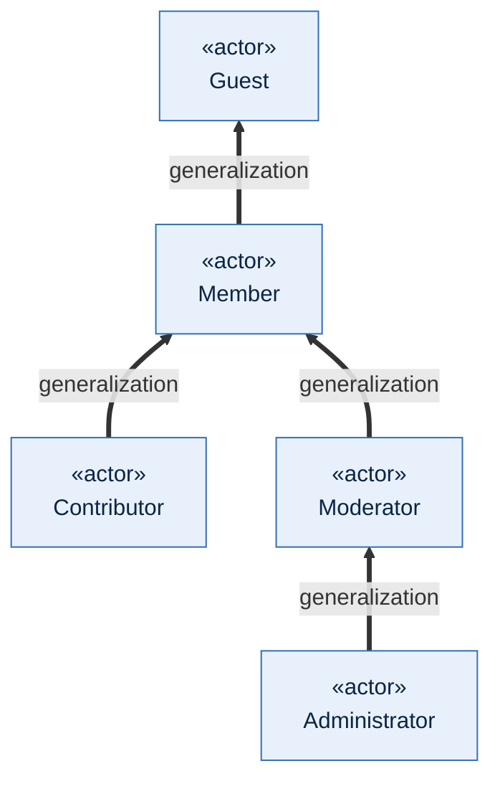
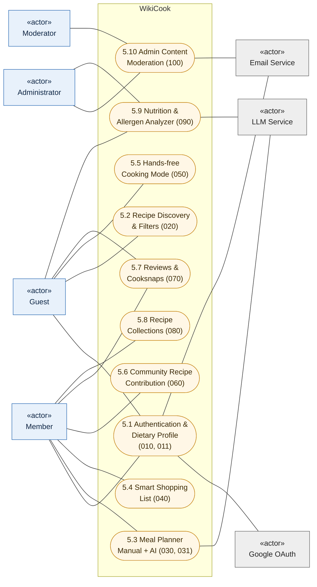

# USE-CASE MODEL: WIKICOOK

**Course:** CS300 - CSC13002 - Introduction to Software Engineering  
**Project Name:** WikiCook — Intelligent Culinary & Meal Planning Ecosystem  
**Team:** Group 05  
**Document Title:** Use-Case Model (Mermaid) covering the 10 product features of Vision Document §5  
**Sprint Cycle:** Sprint 03 (Project Assignment 3 — Part C, 10 Points)  
**Document Version:** 0.1 (Draft for Standup 1 on 30/10/2026 — freeze on 02/11/2026)  
**Date:** October 29, 2026

---

## DOCUMENT METADATA & RESPONSIBILITY MATRIX

| Section | Section Title | Performed by (Author) | Reviewed by | Edited by | Jira Task |
| :---: | :--- | :---: | :---: | :---: | :---: |
| **Section 1** | Introduction | **Nguyễn Đức Duy (DucDuyNguyen15-IT)** | **Mai Văn Hiển (MaiHien3507)** | **Nguyễn Đức Duy (DucDuyNguyen15-IT)** | `SCRUM-49` |
| **Section 2** | Actors | **Nguyễn Đức Duy (DucDuyNguyen15-IT)** | **Mai Văn Hiển (MaiHien3507)** | **Nguyễn Đức Duy (DucDuyNguyen15-IT)** | `SCRUM-49` |
| **Section 3** | System Overview Diagram | **Nguyễn Đức Duy (DucDuyNguyen15-IT)** | **Mai Văn Hiển (MaiHien3507)** | **Nguyễn Đức Duy (DucDuyNguyen15-IT)** | `SCRUM-49` |
| **Section 4** | Use-Case Diagrams by Feature | **Nguyễn Đức Duy (DucDuyNguyen15-IT)** | **Mai Văn Hiển (MaiHien3507)** | **Nguyễn Đức Duy (DucDuyNguyen15-IT)** | `SCRUM-49` |
| **Section 5** | Use-Case Catalogue & Traceability | **Nguyễn Đức Duy (DucDuyNguyen15-IT)** | **Mai Văn Hiển (MaiHien3507)** | **Nguyễn Đức Duy (DucDuyNguyen15-IT)** | `SCRUM-49` |
| **Section 6** | Coverage Check & Open Issues | **Nguyễn Đức Duy (DucDuyNguyen15-IT)** | **Mai Văn Hiển (MaiHien3507)** | **Nguyễn Đức Duy (DucDuyNguyen15-IT)** | `SCRUM-49` |

### Revision History

| Date | Version | Description | Author |
| :---: | :---: | :--- | :--- |
| **29/10/2026** | `v0.1` | Initial draft: 8 actors with generalization, system overview, 11 use-case diagrams (one per Vision §5 feature plus the shared Recipe Detail page), catalogue of 64 use cases with traceability to Vision §5, specs and user stories, and coverage check (`SCRUM-49`). | Nguyễn Đức Duy (`DucDuyNguyen15-IT`) |

---

## 1. INTRODUCTION
*Performed by: Nguyễn Đức Duy (DucDuyNguyen15-IT) | Reviewed by: Mai Văn Hiển (MaiHien3507) | Edited by: Nguyễn Đức Duy (DucDuyNguyen15-IT)*

### 1.1. Purpose

This document is the Use-Case Model of WikiCook. It shows who interacts with the system (actors), what goals they achieve (use cases) and how the use cases depend on each other (`«include»`, `«extend»` and actor generalization). It is the index for the Use-Case Specifications in [`use-case-specification.md`](use-case-specification.md): every use case drawn here has exactly one owner who writes its specification under `SCRUM-50` – `SCRUM-54`, and every use case ID used there must come from Section 5 of this document.

### 1.2. Scope

The model covers all ten features of [Vision Document](vision-document.md) §5 and the twelve feature specifications in `specs/` (`010`, `011`, `020`, `030`, `031`, `040`, `050`, `060`, `070`, `080`, `090`, `100`). It describes the **complete** behaviour of each specification, not only the slice implemented in Sprint 3. For example, `040` User Stories 3–5 are deferred to PA4 for Part E, but their use cases are still part of this model.

### 1.3. Notation

Mermaid has no native UML use-case diagram, so the diagrams use `flowchart LR` with the following conventions:

| UML element | Mermaid representation |
| :--- | :--- |
| Actor | Rectangle labelled `«actor»` (person actors in blue, external systems in grey) |
| Use case | Rounded (stadium) node labelled with its ID and name |
| System boundary | `subgraph` titled with the feature name |
| Use case of another feature | Stadium node with a dashed border, placed outside the boundary |
| Association | Solid line without arrowhead (`---`) |
| `«include»` | Dashed arrow from the base use case to the included use case |
| `«extend»` | Dashed arrow from the extending use case to the base use case |
| Generalization | Thick arrow from the child actor to the parent actor |

### 1.4. Use-Case Identifiers

Every use case has the ID `UC-<spec>-<NN>`, where `<spec>` is the three-digit specification number and `<NN>` is a two-digit sequence inside that specification. The IDs `UC-040-01` – `UC-040-05` and `UC-050-01` – `UC-050-05` are kept exactly as already published in `use-case-specification.md` (`SCRUM-53`). In diagrams, the hyphens are written as underscores in node names (`UC020_01`) because Mermaid does not allow hyphens there; the visible label keeps the official ID.

### 1.5. Sources

- [Vision Document](vision-document.md) v1.1 — §3.2 User Summary, §5 Product Features, §5.11 Feature Traceability.
- Feature specifications `specs/010` – `specs/100` — user stories, functional requirements and the permission matrix of `specs/010-user-authentication-roles/spec.md`.
- [Use-Case Specifications](use-case-specification.md) v1.0 — existing use cases of `040` and `050`.
- [Sprint 03 Report](../management/reports/sprint-03/sprint-03-report.md) — Meeting 1, Decision 3 (the model must cover all ten features).

---

## 2. ACTORS
*Performed by: Nguyễn Đức Duy (DucDuyNguyen15-IT) | Reviewed by: Mai Văn Hiển (MaiHien3507) | Edited by: Nguyễn Đức Duy (DucDuyNguyen15-IT)*

### 2.1. Actor Catalogue

| Actor | Type | Description | Source |
| :--- | :--- | :--- | :--- |
| **Guest** | Primary, person | Visitor without an account. Can search, read published recipes and reviews, and register or sign in. | `010` FR-020, permission matrix |
| **Member** | Primary, person | Signed-in user (the busy home cook of Vision §3.2). Owns a dietary profile, meal plans, shopping lists, collections, reviews and recipe drafts. Reviewing and submitting recipes require a verified email. | `010` FR-020, `011`, `060` FR-001 |
| **Contributor** | Primary, person | Member granted the "Verified Contributor" badge by an Administrator. Has the same use cases as Member; the badge is shown on their recipes. Their recipes still go through moderation. | `010` permission matrix, `060` |
| **Moderator** | Primary, person | Reviews submitted recipes and proposed ingredients, and processes reports about recipes, reviews, Cooksnaps and users. | `010` permission matrix, `100` US1–US2 |
| **Administrator** | Primary, person | Has every Moderator capability and also manages accounts and roles, taxonomies, featured recipes, nutrition estimates and the audit trail. | `010` FR-022, `100` US3–US6, `090` US7 |
| **LLM Service** | Secondary, external system | Large language model and embedding API used to arrange AI meal plans, estimate nutrition and embed recipes for retrieval. | `031`, `090` |
| **Google OAuth** | Secondary, external system | Identity provider for "Sign in with Google". | `010` US5 |
| **Email Service** | Secondary, external system | Sends verification, password-reset and account-status emails. | `010` US2, US4; `100` US3 |

### 2.2. Actor Generalization

The person actors form an inheritance chain that follows the permission matrix of spec `010`: each child actor can perform every use case of its parent. Contributor and Moderator both specialise Member, and Administrator specialises Moderator.

Because of this generalization, the diagrams in Section 4 connect each use case only to the **lowest** actor that may perform it. For example, a use case associated with Guest is also available to every signed-in actor.

---

## 3. SYSTEM OVERVIEW DIAGRAM
*Performed by: Nguyễn Đức Duy (DucDuyNguyen15-IT) | Reviewed by: Mai Văn Hiển (MaiHien3507) | Edited by: Nguyễn Đức Duy (DucDuyNguyen15-IT)*

The overview shows the ten features of Vision §5 as use-case packages inside the WikiCook boundary and the actors that interact with each package. The detailed use cases of each package are drawn in Section 4.

Contributor is omitted from the overview because it has no use case of its own; it inherits every Member use case (Section 2.2).

---
