# USE-CASE SPECIFICATIONS: WIKICOOK CORE MODULES (040 & 050)

**Course:** CS300 - CSC13002 - Introduction to Software Engineering  
**Project Name:** WikiCook — Intelligent Culinary & Meal Planning Ecosystem  
**Document Title:** Detailed Use-Case Specifications for Feature 040 (Shopping List) & Feature 050 (Cooking Mode)  
**Sprint Cycle:** Sprint 03 (Project Assignment 3 — Part D, 45 Points)  
**Document Version:** 1.0 (Initial Draft Baseline for Peer Review — SCRUM-53)  
**Status:** Proposal / Ready for Review *(Aligned with Spec 040 & Spec 050; pending final Use-Case Model freeze in SCRUM-49)*

---

## DOCUMENT METADATA & RESPONSIBILITY MATRIX

| Document Section | Section Title | Performed by (Author) | Reviewed by | Edited by | Jira Task |
| :---: | :--- | :---: | :---: | :---: | :---: |
| **Section 1** | Use-Case Specifications for Feature 040: Smart Shopping List (`UC-040-01` – `UC-040-05`) | **Lê Quốc Hưng (LqHung06)** | **Trần Nguyễn Công Chung (itzchugnn)** | **Lê Quốc Hưng (LqHung06)** | `SCRUM-53` |
| **Section 2** | Use-Case Specifications for Feature 050: Cooking Mode (`UC-050-01` – `UC-050-05`) | **Lê Quốc Hưng (LqHung06)** | **Trần Nguyễn Công Chung (itzchugnn)** | **Lê Quốc Hưng (LqHung06)** | `SCRUM-53` |
| **Section 3** | Traceability Matrix (Requirements & User Stories to Use Cases) | **Lê Quốc Hưng (LqHung06)** | **Trần Nguyễn Công Chung (itzchugnn)** | **Lê Quốc Hưng (LqHung06)** | `SCRUM-53` |
| **Section 4** | Prototype Screen Mapping & UI Asset Gap Analysis (for SCRUM-58) | **Lê Quốc Hưng (LqHung06)** | **Trần Nguyễn Công Chung (itzchugnn)** | **Lê Quốc Hưng (LqHung06)** | `SCRUM-53` |
| **Section 5** | Open Questions & Domain Assumptions | **Lê Quốc Hưng (LqHung06)** | **Trần Nguyễn Công Chung (itzchugnn)** | **Lê Quốc Hưng (LqHung06)** | `SCRUM-53` |
| **Section 6** | Use-Case Specifications for Feature 020: Recipe Discovery & Recipe Detail (`UC-020-01` – `UC-020-06`) | **Nguyễn Đức Duy (DucDuyNguyen15-IT)** | **Nguyễn Thành Dự (ThanhDu14)** | **Nguyễn Đức Duy (DucDuyNguyen15-IT)** | `SCRUM-51` |
| **Section 7** | Use-Case Specifications for Feature 060: Community Recipe Contribution (`UC-060-01` – `UC-060-07`) | **Nguyễn Đức Duy (DucDuyNguyen15-IT)** | **Nguyễn Thành Dự (ThanhDu14)** | **Nguyễn Đức Duy (DucDuyNguyen15-IT)** | `SCRUM-51` |
| **Section 8** | Traceability, Screen Mapping & Open Questions for Features 020 & 060 | **Nguyễn Đức Duy (DucDuyNguyen15-IT)** | **Nguyễn Thành Dự (ThanhDu14)** | **Nguyễn Đức Duy (DucDuyNguyen15-IT)** | `SCRUM-51` |
| **Section 9** | Use-Case Specifications for Feature 010: User Authentication & Roles (`UC-010-01` – `UC-010-04`) | **Mai Văn Hiển (MaiHien3507)** | **Nguyễn Đức Duy (DucDuyNguyen15-IT)** | **Mai Văn Hiển (MaiHien3507)** | `SCRUM-50` |
| **Section 10** | Use-Case Specifications for Feature 011: User Profile & Dietary Profile (`UC-011-01` – `UC-011-05`) | **Mai Văn Hiển (MaiHien3507)** | **Nguyễn Đức Duy (DucDuyNguyen15-IT)** | **Mai Văn Hiển (MaiHien3507)** | `SCRUM-50` |
| **Section 11** | Use-Case Specifications for Feature 080: Recipe Bookmarks & Custom Collections (`UC-080-01` – `UC-080-04`) | **Mai Văn Hiển (MaiHien3507)** | **Nguyễn Đức Duy (DucDuyNguyen15-IT)** | **Mai Văn Hiển (MaiHien3507)** | `SCRUM-50` |
| **Section 12** | Use-Case Specifications for Feature 070: Community Reviews & Cooksnaps (`UC-070-01` – `UC-070-06`) | **Trần Nguyễn Công Chung (itzchugnn)** | **Mai Văn Hiển (MaiHien3507)** | **Trần Nguyễn Công Chung (itzchugnn)** | `SCRUM-54` |
| **Section 13** | Use-Case Specifications for Feature 100: Administration & Content Moderation (`UC-100-01` – `UC-100-06`) | **Trần Nguyễn Công Chung (itzchugnn)** | **Mai Văn Hiển (MaiHien3507)** | **Trần Nguyễn Công Chung (itzchugnn)** | `SCRUM-54` |
| **Section 14** | Use-Case Specifications for Feature 030: Weekly Meal Planner, Manual (`UC-030-01` – `UC-030-05`) | **Nguyễn Thành Dự (ThanhDu14)** | **Lê Quốc Hưng (LqHung06)** | **Nguyễn Thành Dự (ThanhDu14)** | `SCRUM-52` |
| **Section 15** | Use-Case Specifications for Feature 031: AI Weekly Meal Planner (`UC-031-01` – `UC-031-06`) | **Nguyễn Thành Dự (ThanhDu14)** | **Lê Quốc Hưng (LqHung06)** | **Nguyễn Thành Dự (ThanhDu14)** | `SCRUM-52` |
| **Section 16** | Use-Case Specifications for Feature 090: Nutrition & Allergen Analyzer (`UC-090-01` – `UC-090-05`) | **Nguyễn Thành Dự (ThanhDu14)** | **Lê Quốc Hưng (LqHung06)** | **Nguyễn Thành Dự (ThanhDu14)** | `SCRUM-52` |
| **Section 17** | Traceability, Screen Mapping & Open Questions for Features 030, 031 & 090 | **Nguyễn Thành Dự (ThanhDu14)** | **Lê Quốc Hưng (LqHung06)** | **Nguyễn Thành Dự (ThanhDu14)** | `SCRUM-52` |

### Revision History

| Date | Version | Description | Author |
| :---: | :---: | :--- | :--- |
| **28/10/2026** | `v1.0` | Initialized detailed Use-Case Specifications for all 10 use cases across Feature 040 and Feature 050, defining 8 mandatory sections per use case, exhaustive alternative flows, and UI prototype mapping (`SCRUM-53`). | Lê Quốc Hưng (`LqHung06`) |
| **29/10/2026** | `v1.1` | Added Sections 6–8: use-case specifications for Feature 020 (`UC-020-01` – `UC-020-06`, including the shared Recipe Detail page) and Feature 060 (`UC-060-01` – `UC-060-07`), with traceability, prototype screen mapping and open questions (`SCRUM-51`). Use-case IDs follow the Use-Case Model v0.1 (`SCRUM-49`). | Nguyễn Đức Duy (`DucDuyNguyen15-IT`) |
| **30/10/2026** | `v1.2` | Added Sections 9–11: 13 use-case specifications for Feature 010 (`UC-010-01` – `UC-010-04`), Feature 011 (`UC-011-01` – `UC-011-05`) and Feature 080 (`UC-080-01` – `UC-080-04`), with traceability, prototype screen mapping and open questions (`SCRUM-50`, first draft). Use-case IDs follow the Use-Case Model v0.1 (`SCRUM-49`). | Mai Văn Hiển (`MaiHien3507`) |
| **31/10/2026** | `v1.3` | Added Sections 12–13: 12 detailed use-case specifications for Feature 070 (`UC-070-01` – `UC-070-06`) and Feature 100 (`UC-100-01` – `UC-100-06`), complete with author self-review guard, cascading rating recalculation, mass-report auto-quarantine, concurrency inspection presence, traceability matrices, prototype screen mapping and open questions (`SCRUM-54`, first draft). Use-case IDs and titles strictly follow the Use-Case Model v0.1 (`SCRUM-49`). | Trần Nguyễn Công Chung (`itzchugnn`) |
| **03/11/2026** | `v1.4` | Added Sections 14–17: 16 use-case specifications for Feature 030 (`UC-030-01` – `UC-030-05`), Feature 031 (`UC-031-01` – `UC-031-06`) and Feature 090 (`UC-090-01` – `UC-090-05`), with every AI failure flow (LLM error, timeout, unusable answer, not enough recipes, allergy violation, daily quota, backup draft with the manual planner still usable), traceability, prototype screen mapping and open questions (`SCRUM-52`, first draft for review). Written against the 02/11/2026 Clarification of spec 030 (up to 4 dishes per meal). Use-case IDs follow the Use-Case Model (`SCRUM-49`). | Nguyễn Thành Dự (`ThanhDu14`) |

> [!NOTE]
> **Use-Case Model Alignment Notice:** The formal Use-Case Model (`docs/requirements/use-case-model.md`) is currently being drafted by Nguyễn Đức Duy under `SCRUM-49` (freeze date: November 02, 2026). The Use Case IDs (`UC-040-01` through `UC-040-05` and `UC-050-01` through `UC-050-05`) and titles documented herein represent the official engineering proposal derived directly from ratified specifications `specs/040-shopping-list/spec.md` and `specs/050-cooking-mode/spec.md`. Once `SCRUM-49` completes model freeze on November 02, any identifier discrepancies will be reconciled during the review phase (`SCRUM-53` final edition, due November 03).

---

## 1. USE-CASE SPECIFICATIONS FOR FEATURE 040: SMART SHOPPING LIST & INGREDIENT AGGREGATION
*Performed by: Lê Quốc Hưng (LqHung06) | Reviewed by: Trần Nguyễn Công Chung (itzchugnn) | Edited by: Lê Quốc Hưng (LqHung06)*

### UC-040-01: Manage Active Shopping List & Custom Items
*Performed by: Lê Quốc Hưng (LqHung06) | Reviewed by: Trần Nguyễn Công Chung (itzchugnn) | Edited by: Lê Quốc Hưng (LqHung06)*

#### 1. Name and Identifier
- **Use Case ID:** `UC-040-01`
- **Use Case Name:** Manage Active Shopping List Lifecycle and Custom Grocery Items

#### 2. Actor(s)
- **Primary Actor:** **Busy Home Cook** (Authenticated Member per Spec 010 & Vision §3.2).

#### 3. Description
Enables an authenticated user to maintain a centralized active shopping list (`ShoppingList` status `ACTIVE`), add ad-hoc custom grocery and household items with custom quantities and units, edit the list title inline, archive the active list to history (`ShoppingList` status `ARCHIVED`), and restore an archived list from history with purchase states reset.

#### 4. Preconditions
- The user is authenticated with a valid session token (`Member` role per Spec 010).
- The device browser has network access or local cache access to the application.

#### 5. Basic Flow
1. **Navigate to List:** The actor navigates to the `/shopping-list` route via the main navigation bar or mobile tab bar.
2. **Display Active List:** The system queries for an active list owned by the user. Finding one, the system displays the shopping list screen showing the list title, total item count, progress meter, categorized aisle sections, and the floating action button `"+ Thêm món"` (Add Item).
3. **Trigger Add Custom Item:** The actor taps the `"+ Thêm món"` button.
4. **Display Input Dialog:** The system opens the add-item dialog modal featuring fields for Item Name (text, mandatory), Quantity (numeric, optional), Unit (dropdown/text, optional), and Aisle Category (dropdown defaulting to "Đồ dùng khác" / General).
5. **Enter Details:** The actor enters the item name (e.g., "Nước rửa chén"), enters quantity `1`, selects unit "chai", confirms the aisle "Đồ dùng khác", and taps "Thêm vào danh sách".
6. **Persist and Render:** The system validates the input, creates a new `ShoppingListItem` entity (setting `isChecked = false`, `isCleared = false`, `isManuallyEdited = false`), appends it to the active shopping list, and renders it immediately under the "Đồ dùng khác" header with an optimistic UI update.
7. **Rename List:** The actor clicks on the shopping list title header. The title morphs into an inline editable text field. The actor modifies the title (e.g., "Tiệc cuối tuần nhà Hưng") and presses `Enter` or clicks outside (blur).
8. **Save Title:** The system validates the title (length 1–60 characters), updates the `ShoppingList.title` attribute in the local store and on the server, and returns to normal text display.
9. **Archive List:** After completing their shopping cycle, the actor taps the list action menu (`...`) and selects "Lưu trữ danh sách" (Archive List).
10. **Confirm Archival:** The system displays a confirmation dialog. The actor confirms.
11. **Transition State:** The system sets `ShoppingList.status = 'ARCHIVED'`, sets `archivedAt = now()`, moves the list to the "Lịch sử mua sắm" (History) archive, initializes a new blank active shopping list titled `"Danh sách mua sắm [Ngày/Tháng]"`, and displays the fresh empty list to the actor.

#### 6. Alternative Flows
- **AF 1.1: First-Time User Initialization (No Active List Exists):**
  - *Trigger:* At Step 2, the user opens the shopping list view for the first time, or after all previous lists were archived.
  - *Steps:*
    1. The system detects no `ACTIVE` shopping list exists for `userId`.
    2. The system automatically initializes a new default active shopping list with title `"Danh sách mua sắm [DD/MM/YYYY]"`, `itemCount = 0`, and status `'ACTIVE'`.
    3. The system renders the empty state view (`SL02-Empty`) displaying helpful import shortcuts: *"Nhập từ kế hoạch tuần"* (Import from Meal Plan) and *"Thêm món tự nhập"* (Add Custom Item).
  - *Outcome:* An active list is ready for use without throwing null reference errors.
- **AF 1.2: Restore Archived List from History:**
  - *Trigger:* The actor opens the "Lịch sử mua sắm" (History) drawer and selects a previously archived list.
  - *Steps:*
    1. The system displays the historical list in read-only audit mode showing past items and timestamp.
    2. The actor taps "Khôi phục làm danh sách hiện hành" (Restore as active list).
    3. The system displays a confirmation modal: *"Khôi phục danh sách này sẽ lưu trữ danh sách đang hoạt động hiện tại. Bạn có muốn tiếp tục?"*.
    4. The actor confirms.
    5. The system transitions the current active list to `ARCHIVED`.
    6. The system transitions the selected historical list to `ACTIVE`, resets all item completion states (`isChecked = false`, `isCleared = false`, `clearedAt = null`), preserves all ingredient names, quantities, units, and custom aisle assignments, and navigates to the active shopping list view.
  - *Outcome:* The user has a fresh, uncompleted checklist populated with their favorite historical items.
- **AF 1.3: Exceeding 200 Items Upper Ceiling:**
  - *Trigger:* At Step 5, the actor attempts to add a custom item when the active list already contains 200 items.
  - *Steps:*
    1. The system evaluates `ShoppingList.itemCount >= 200` (FR-025, Edge Case 6).
    2. The system blocks creation of the 201st item and displays an inline warning banner: *"Danh sách đã đạt giới hạn tối đa 200 món. Vui lòng hoàn thành hoặc lưu trữ danh sách hiện tại trước khi thêm món mới."*.
  - *Outcome:* List size is capped, safeguarding client memory and IndexedDB mobile performance.
- **AF 1.4: Empty or Whitespace-Only Custom Item Name:**
  - *Trigger:* At Step 5, the actor leaves the Item Name field empty or enters whitespace only.
  - *Steps:*
    1. The system highlights the field with a red validation error: *"Tên món không được để trống"*.
    2. The submit button remains disabled until valid non-empty text is entered.

#### 7. Postconditions
- The active shopping list contains the newly created or restored items.
- All additions and title modifications are persisted locally and synchronized to the backend.

#### 8. Special Requirements
- **Optimistic UI:** Custom items must appear in the checklist in $< 50$ms prior to server network confirmation.

#### UI Screen References & Asset Gaps (SCRUM-58)
- **Basic Flow:** [`SL01-List.dc.html`](../analysis-and-design/ui-ux/screens/SL01-List.dc.html), [`SL04-AddItem.dc.html`](../analysis-and-design/ui-ux/screens/SL04-AddItem.dc.html).
- **Alternative Flows:** [`SL02-Empty.dc.html`](../analysis-and-design/ui-ux/screens/SL02-Empty.dc.html), [`SL07-History.dc.html`](../analysis-and-design/ui-ux/screens/SL07-History.dc.html).
- **UI Asset Gap for SCRUM-58:** Needs confirmation modal screenshot for AF 1.2 ("Lưu trữ danh sách cũ để khôi phục").
- **Prototype Screenshots (SCRUM-58):**
  - **Shopping list grouped by aisle (`SL01-List`):**
    - **Mobile View (iPhone 12 Pro):**  
      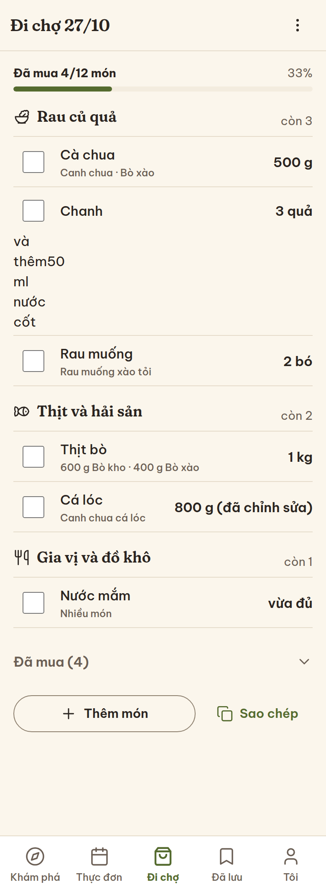
    - **Desktop Web View:**  
      
  - **Add item to list dialog (`SL04-AddItem`):**
    - **Mobile View (iPhone 12 Pro):**  
      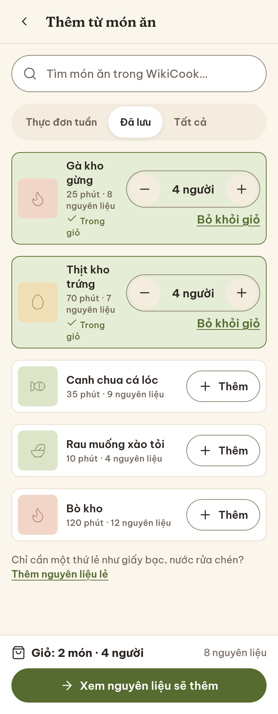
    - **Desktop Web View:**  
      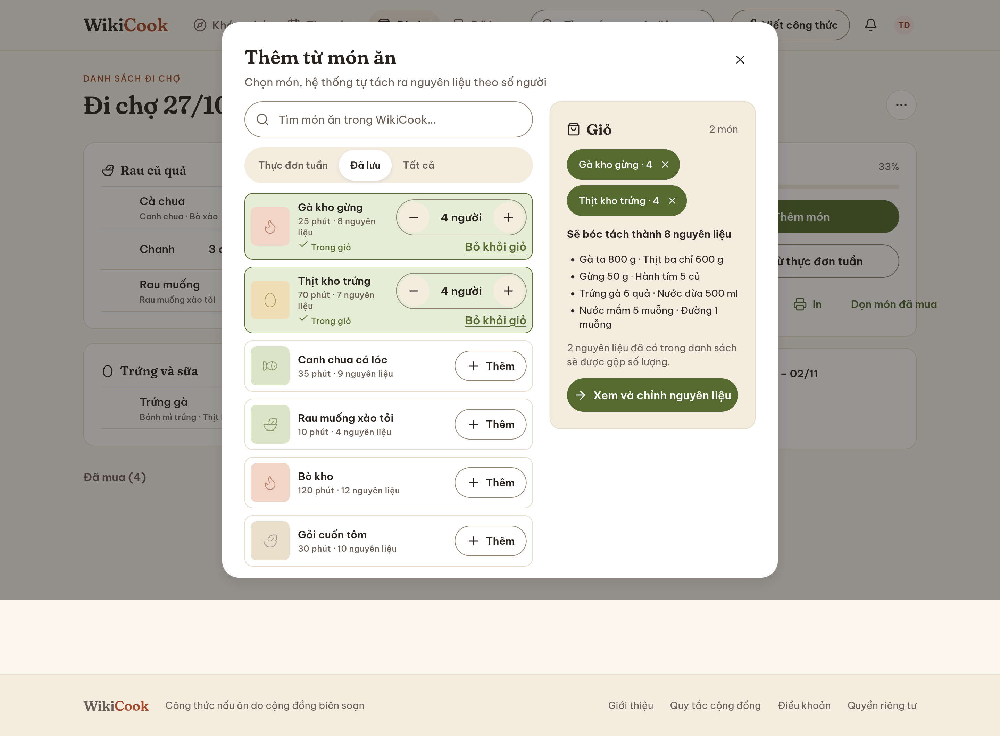
  - **Empty shopping list (`SL02-Empty`):**
    - **Mobile View (iPhone 12 Pro):**  
      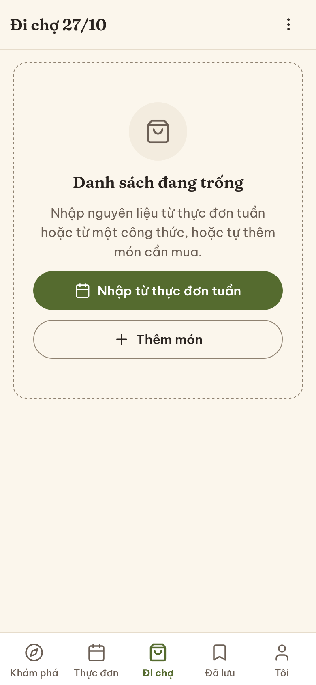
    - **Desktop Web View:**  
      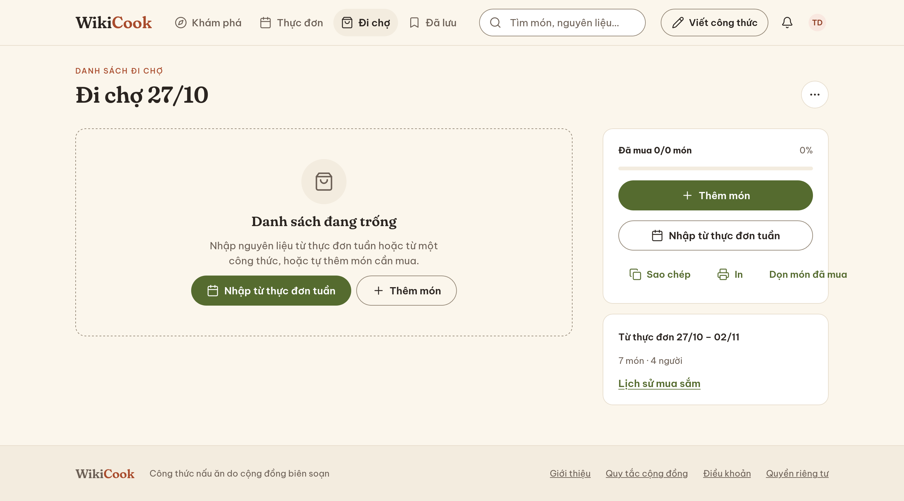
  - **Shopping history drawer (`SL07-History`):**
    - **Mobile View (iPhone 12 Pro):**  
      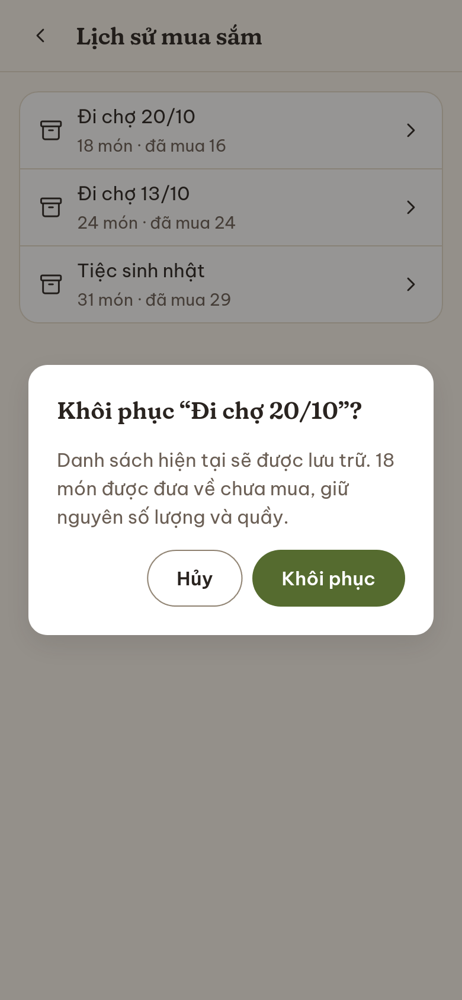
    - **Desktop Web View:**  
      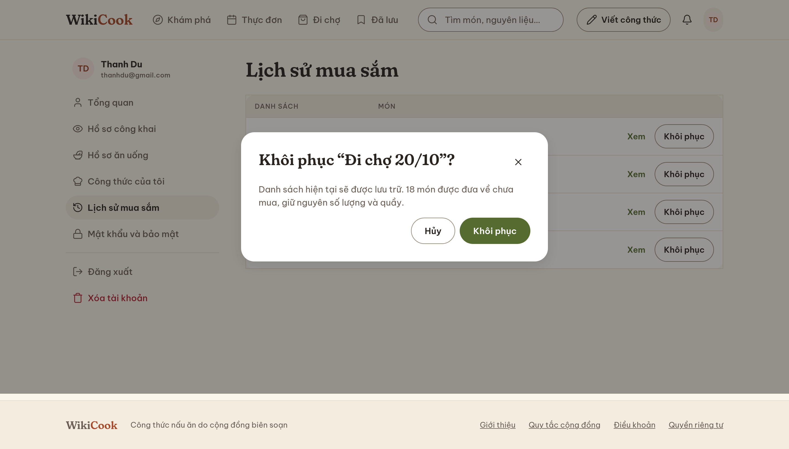

---

### UC-040-02: Import Ingredients from Recipe or Meal Plan with Scaling & Unit Conversion
*Performed by: Lê Quốc Hưng (LqHung06) | Reviewed by: Trần Nguyễn Công Chung (itzchugnn) | Edited by: Lê Quốc Hưng (LqHung06)*

#### 1. Name and Identifier
- **Use Case ID:** `UC-040-02`
- **Use Case Name:** Import Ingredients from Recipe or Meal Plan with Serving Scaling and Unit Normalization

#### 2. Actor(s)
- **Primary Actor:** **Busy Home Cook** (Member).
- **Supporting Systems:** Recipe Module (060), Meal Planner Module (030/031).

#### 3. Description
Allows a cook to import ingredient sets into their active shopping list from an individual published recipe or an entire 7-day Weekly Meal Plan. The system dynamically scales quantities based on target servings, displays an interactive pre-import checklist (`PreImportBottomSheet`) allowing 1-tap staple exclusion, merges duplicate ingredients, converts compatible metric units ($g \leftrightarrow kg$, $ml \leftrightarrow l$), separates incompatible units, and records recipe contribution provenance.

#### 4. Preconditions
- The user is viewing a `PUBLISHED` recipe detail view (`specs/020`) or a confirmed Weekly Meal Plan (`specs/030`/`031`).
- An active shopping list exists (or system auto-initializes one per AF 1.1).

#### 5. Basic Flow
1. **Trigger Import from Recipe:** On the recipe detail page (e.g., "Bò Kho", base serving 2), the actor taps "Thêm vào danh sách mua sắm".
2. **Select Servings:** The system displays the `PreImportBottomSheet` showing a serving size selector initialized to the user's default household size (e.g., 4 servings, representing a $2.0\times$ multiplier).
3. **Scale Quantities:** The system dynamically calculates scaled quantities for all ingredients using $\text{Scaled Quantity} = \text{Base Quantity} \times (\text{Target Servings} / \text{Base Servings})$. For discrete units (e.g., eggs, cabbage), fractional quantities are rounded up to the nearest whole integer ($\lceil x \rceil$).
4. **Present Pre-Import Checklist:** The system renders the ingredients with all checkboxes enabled by default.
5. **Deselect Pantry Staples:** The actor taps the 1-click utility button *"Bỏ chọn gia vị cơ bản"*. The system immediately unchecks common kitchen staples (salt, sugar, fish sauce, cooking oil, black pepper, MSG) while keeping fresh produce and proteins checked.
6. **Confirm Import:** The actor taps "Xác nhận thêm vào danh sách" (Confirm Import).
7. **Merge and Aggregate:** The system matches incoming ingredients against existing items on the active shopping list by canonical `ingredientId`:
   - *Duplicate Match with Compatible Metric Units:* Existing item has 600g beef; incoming recipe contributes 400g beef. The system sums the quantity ($1000\text{g}$) and applies bidirectional conversion rule: values $\ge 1000\text{g}$ convert to "1 kg".
   - *State Reset:* If the existing item was previously checked (`isChecked = true`), the system unchecks it (`isChecked = false`), updates the total quantity, and highlights it with a temporary badge.
   - *Provenance Recording:* The system appends a `ShoppingListItemSource` snapshot record storing the recipe ID, recipe title, and contributed quantity.
8. **Feedback and Navigation:** The system closes the bottom sheet and displays a confirmation toast: *"Đã thêm 8 nguyên liệu vào danh sách mua sắm"*, with a quick-action button *"Xem danh sách"*.

#### 6. Alternative Flows
- **AF 2.1: Bulk Import from 7-Day Weekly Meal Plan:**
  - *Trigger:* The actor taps "Tạo danh sách mua sắm" from the Weekly Meal Plan view (`specs/030`/`031`).
  - *Steps:*
    1. If an active list already has items, the system presents a decision modal: *"Gộp thêm vào danh sách hiện tại"* (Append & Merge) or *"Lưu trữ danh sách cũ và tạo mới"* (Archive & New).
    2. The actor selects "Gộp thêm vào danh sách hiện tại".
    3. The system opens `PreImportBottomSheet` aggregating ingredients from all 21 scheduled meals.
    4. The actor confirms.
    5. The system performs batch deduplication, unit conversion, and aisle assignment across all ingredients in $< 1.0$ second (SC-004).
  - *Outcome:* The active list incorporates all planned ingredients for the entire week.
- **AF 2.2: Import from Empty Meal Plan:**
  - *Trigger:* The actor triggers shopping list generation from a meal plan containing zero dishes.
  - *Steps:*
    1. The system evaluates the planned meal collection and detects zero scheduled dishes.
    2. The system aborts generation and displays an informational prompt: *"Kế hoạch tuần chưa có món ăn. Vui lòng thêm món trước khi tạo danh sách mua sắm."* (Edge Case 1).
  - *Outcome:* Generation is canceled without creating an empty corrupted list.
- **AF 2.3: Incompatible Measurement Units (Discrete vs Volume/Mass):**
  - *Trigger:* At Step 7, incoming ingredient shares canonical `ingredientId` with an existing item, but units are incompatible (e.g., Recipe 1 contributed "3 quả chanh"; incoming Recipe 2 contributes "50 ml nước cốt chanh").
  - *Steps:*
    1. The system detects incompatible unit types (countable discrete vs liquid volume).
    2. Rather than calculating an invalid mathematical sum, the system groups them under the primary ingredient header "Chanh" and renders two separate, distinct sub-rows: `"3 quả"` and `"50 ml"` (FR-008, Clarification Q1).
  - *Outcome:* Quantities are preserved accurately without corrupting recipe measurements.
- **AF 2.4: Qualitative Ingredient Handling:**
  - *Trigger:* Incoming recipe specifies qualitative measures (e.g., "Hành lá: một ít", "Tiêu: tùy khẩu vị").
  - *Steps:*
    1. The system identifies qualitative non-numeric strings.
    2. The system bypasses arithmetic multiplication and renders the qualitative text as an isolated sub-item row without numerical summing (FR-008, Clarification Q1).
- **AF 2.5: Rapid Duplicate Submission Debouncing:**
  - *Trigger:* The actor rapidly double-clicks the "Xác nhận thêm vào danh sách" button.
  - *Steps:*
    1. The client-side UI detects subsequent clicks within a 2.0-second window.
    2. The system debounces the action, disables the button with a loading spinner, and processes only the first request (Edge Case 4).
  - *Outcome:* Eliminates accidental duplicate item injection.
- **AF 2.6: Source Recipe Unpublished or Deleted After Import:**
  - *Trigger:* A recipe author deletes or unpublishes a recipe previously imported into the shopping list.
  - *Steps:*
    1. The user inspects the shopping list item provenance breakdown.
    2. The system references the frozen `ShoppingListItemSource.recipeTitleSnapshot` captured at the time of import (Clarification Q2, Edge Case 2).
    3. The breakdown continues to display the original recipe name without throwing a 404 error.

#### 7. Postconditions
- Ingredients are merged into the active shopping list with mathematical accuracy.
- Item provenance records are persisted.
- Unpurchased counters and aisle categories update accordingly.

#### 8. Special Requirements
- **Math Precision:** Serving scaling arithmetic MUST maintain exact continuous 2-decimal precision in provenance and ceiling rounding ($\lceil x \rceil$) on countable grocery units.
- **Performance:** Bulk generation of 21 meals (80–120 raw ingredients) MUST complete in $< 1.0$s on client devices (SC-004).

#### UI Screen References & Asset Gaps (SCRUM-58)
- **Basic Flow:** [`SL03-ImportPreview.dc.html`](../analysis-and-design/ui-ux/screens/SL03-ImportPreview.dc.html), [`SL04b-Breakdown.dc.html`](../analysis-and-design/ui-ux/screens/SL04b-Breakdown.dc.html).
- **Alternative Flows:** [`W-SL03-ImportPreview.dc.html`](../analysis-and-design/ui-ux/screens/W-SL03-ImportPreview.dc.html) (Desktop dialog variant).
- **UI Asset Gap for SCRUM-58:** Pre-import modal showing the active "Bỏ chọn gia vị cơ bản" state.
- **Prototype Screenshots (SCRUM-58):**
  - **Preview of ingredients imported from recipes (`SL03-ImportPreview`):**
    - **Mobile View (iPhone 12 Pro):**  
      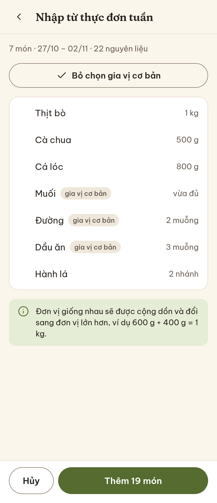
    - **Desktop Web View:**  
      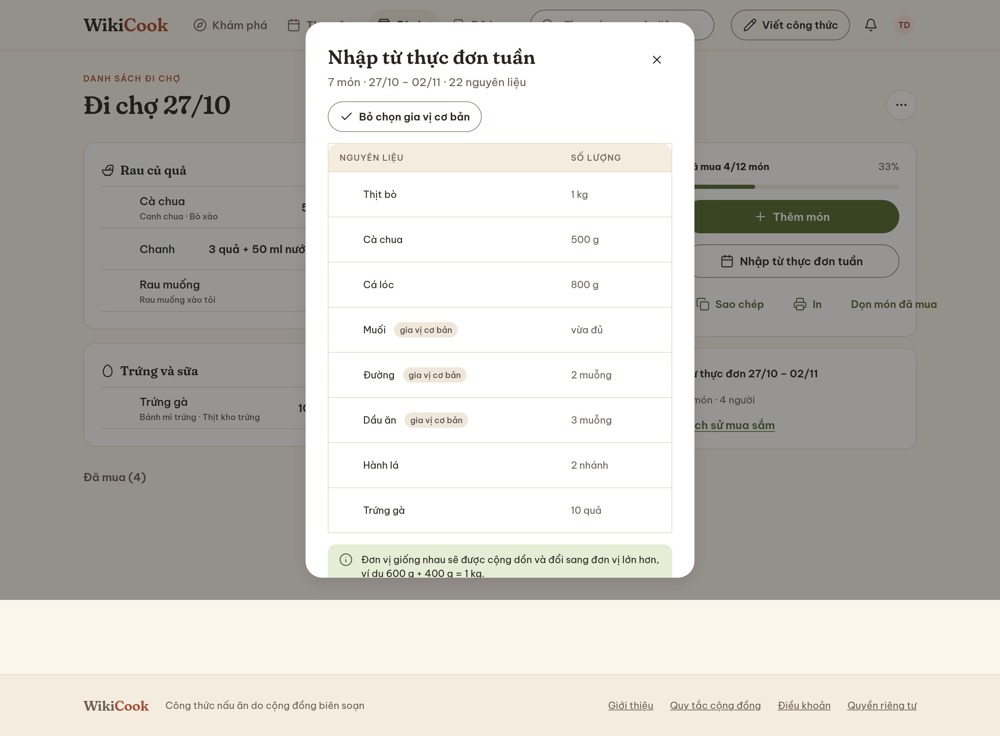
  - **Ingredient source breakdown (`SL04b-Breakdown`):**
    - **Mobile View (iPhone 12 Pro):**  
      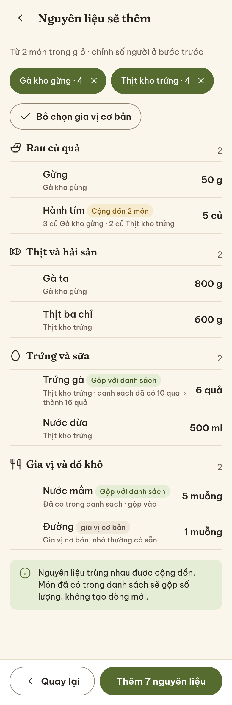
    - **Desktop Web View:**  
      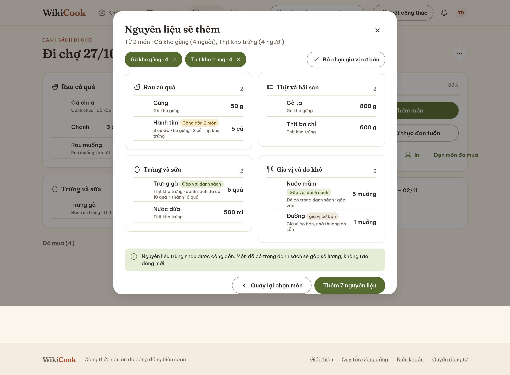

---

### UC-040-03: In-Store Supermarket Checklist & Aisle Organization
*Performed by: Lê Quốc Hưng (LqHung06) | Reviewed by: Trần Nguyễn Công Chung (itzchugnn) | Edited by: Lê Quốc Hưng (LqHung06)*

#### 1. Name and Identifier
- **Use Case ID:** `UC-040-03`
- **Use Case Name:** In-Store Checklist Operation, Single-Handed Check, Undo Soft-Clear, and Aisle Reassignment

#### 2. Actor(s)
- **Primary Actor:** **Busy Home Cook** (Member, holding device in one hand in supermarket).

#### 3. Description
Provides the primary in-store shopping experience. Items are grouped under standard supermarket department headers. The actor checks off items with oversized touch targets, sees items cross out and move to a collapsed "Đã mua" (Purchased) section within 50ms, inspects a live progress meter, soft-clears purchased items with a 5-second undo toast, and reassigns items to different aisles with optional permanent preference persistence.

#### 4. Preconditions
- The active shopping list contains at least one item.
- The user is in the shopping list view.

#### 5. Basic Flow
1. **View Aisle Groupings:** The actor views the active list. Items are organized under standardized aisle category headers:
   - "Rau củ quả" (Produce)
   - "Thịt & Hải sản" (Meat & Seafood)
   - "Trứng & Sữa" (Dairy & Eggs)
   - "Gia vị & Đồ khô" (Pantry & Spices)
   - "Thực phẩm đông lạnh" (Frozen)
   - "Đồ dùng khác" (General / Household)
   Each header displays an icon and an unpurchased item badge count.
2. **Check Off Item:** As the actor places an item (e.g., "Cà chua, 500g") into their supermarket cart, they tap the checkbox (dimension $\ge 48 \times 48$px).
3. **Optimistic Visual Update:** In $< 50$ms, the system updates the checkbox to checked, strikes through the text, decrements the category badge count, and updates the top sticky progress bar (e.g., *"Đã mua 5/12 món (42%)"*).
4. **Relocate to Purchased Section:** The item smoothly animates and relocates into a collapsed `"Đã mua"` subsection at the bottom of the category.
5. **Soft-Clear Purchased Items:** After checking several items, the actor taps "Xóa các món đã mua" (Clear Purchased Items) at the bottom of the list.
6. **Execute Soft-Clear:** The system sets `isCleared = true` on all checked items, instantly hides them from the active checklist view, and displays a 5-second transient undo snackbar: *"Đã xóa 5 món đã mua. [Hoàn tác]"*.
7. **Complete Shopping Trip:** The actor proceeds through all aisles until the progress bar reaches 100% (*"Đã mua 12/12 món (100%)"*).

#### 6. Alternative Flows
- **AF 3.1: Accidental Checkbox Tap (Uncheck Item):**
  - *Trigger:* The actor accidentally checks the wrong item.
  - *Steps:*
    1. The actor expands the `"Đã mua"` subsection and taps the checked box.
    2. In $< 50$ms, the system resets `isChecked = false`, removes strikethrough styling, increments the category badge count, updates the progress bar, and returns the item to its active category position.
  - *Outcome:* Accidental check is immediately reversed.
- **AF 3.2: Undo Soft-Clear within 5 Seconds:**
  - *Trigger:* At Step 6, the actor taps the "[Hoàn tác]" button on the undo snackbar within 5 seconds.
  - *Steps:*
    1. The system catches the undo event before expiration.
    2. The system resets `isCleared = false` on the soft-cleared batch and restores them to the `"Đã mua"` subsection.
  - *Outcome:* Cleared items reappear without data loss.
- **AF 3.3: Inspect Soft-Cleared Items on Demand:**
  - *Trigger:* The actor wishes to audit items cleared earlier during their trip.
  - *Steps:*
    1. The actor taps the footer toggle `"Xem các món đã dọn dẹp (5)"`.
    2. The system expands an inline drawer displaying all soft-cleared items (`isCleared = true`) with their checked state and timestamps (Clarification Q11).
  - *Outcome:* The actor verifies items against physical store receipt.
- **AF 3.4: Manual Quantity Override and Inline Zero Deletion:**
  - *Trigger:* The store only sells beef in 600g pre-packs, but the list requests 500g.
  - *Steps:*
    1. The actor taps the item quantity to open the edit popover (`SL05-ItemDetail`).
    2. The actor enters `600` and saves. The system sets `isManuallyEdited = true` and displays an `(đã chỉnh sửa)` tag.
    3. *Sub-variation (Zero Quantity):* If the actor enters `0` or a negative number, the system displays an inline confirmation: *"Số lượng bằng 0. Bạn có muốn xóa món này khỏi danh sách?"* with options "Xóa" or "Hủy" (Edge Case 3). If confirmed, the item is deleted.
- **AF 3.5: Supermarket Aisle Reassignment and Preference Persistence:**
  - *Trigger:* An ingredient is categorized as "Gia vị & Đồ khô", but the actor's local market stocks it in "Rau củ quả".
  - *Steps:*
    1. The actor taps the item options menu and selects "Chuyển quầy" (`SL06-MoveAisle`).
    2. The modal displays available aisles and an optional checkbox: *"Ghi nhớ quầy này cho các lần mua sau"*.
    3. The actor selects "Rau củ quả", checks the persistence box, and confirms.
    4. The system relocates the item immediately on the active list, and creates/updates a `UserAislePreference` entity for that `(userId, ingredientId)` pair.
  - *Outcome:* Future recipe imports will automatically categorize this ingredient under "Rau củ quả" for this user.

#### 7. Postconditions
- Item completion states, quantities, and aisle adjustments are persisted.
- Cleared items remain preserved for history auditing upon list archival.

#### 8. Special Requirements
- **Ergonomics & Touch Target:** All interactive checkboxes MUST be at least $48 \times 48$ pixels (FR-013) to facilitate single-handed mobile usage.
- **Latency:** Checkbox state transitions and progress meter recalculations MUST execute in $< 50$ms (SC-002).

#### UI Screen References & Asset Gaps (SCRUM-58)
- **Basic Flow:** [`SL01-List.dc.html`](../analysis-and-design/ui-ux/screens/SL01-List.dc.html).
- **Alternative Flows:** [`SL05-ItemDetail.dc.html`](../analysis-and-design/ui-ux/screens/SL05-ItemDetail.dc.html), [`SL06-MoveAisle.dc.html`](../analysis-and-design/ui-ux/screens/SL06-MoveAisle.dc.html).
- **UI Asset Gap for SCRUM-58:** Screenshot of the 5-second transient undo snackbar.
- **Prototype Screenshots (SCRUM-58):**
  - **Purchased (checked) items list (`SL01-CheckedItems`):**
    - **Mobile View (iPhone 12 Pro):**  
      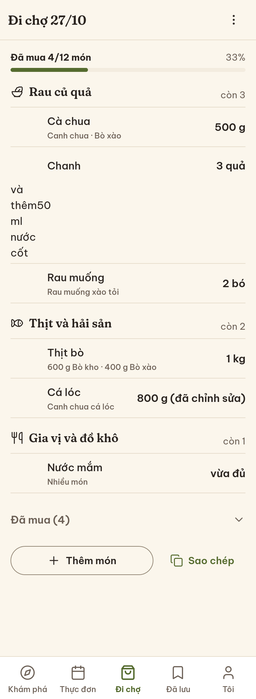
    - **Desktop Web View:**  
      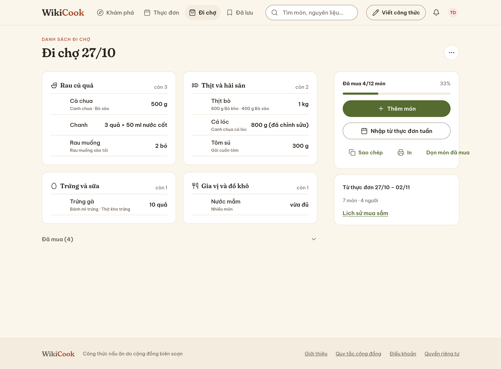
  - **Item detail and quantity editing (`SL05-ItemDetail`):**
    - **Mobile View (iPhone 12 Pro):**  
      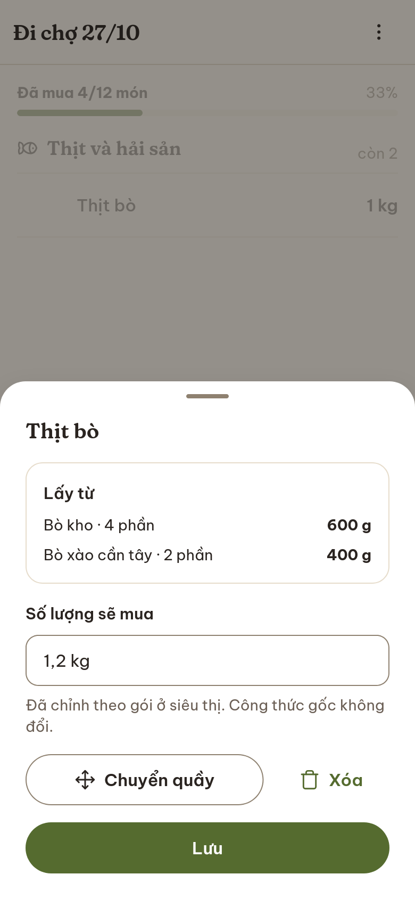
    - **Desktop Web View:**  
      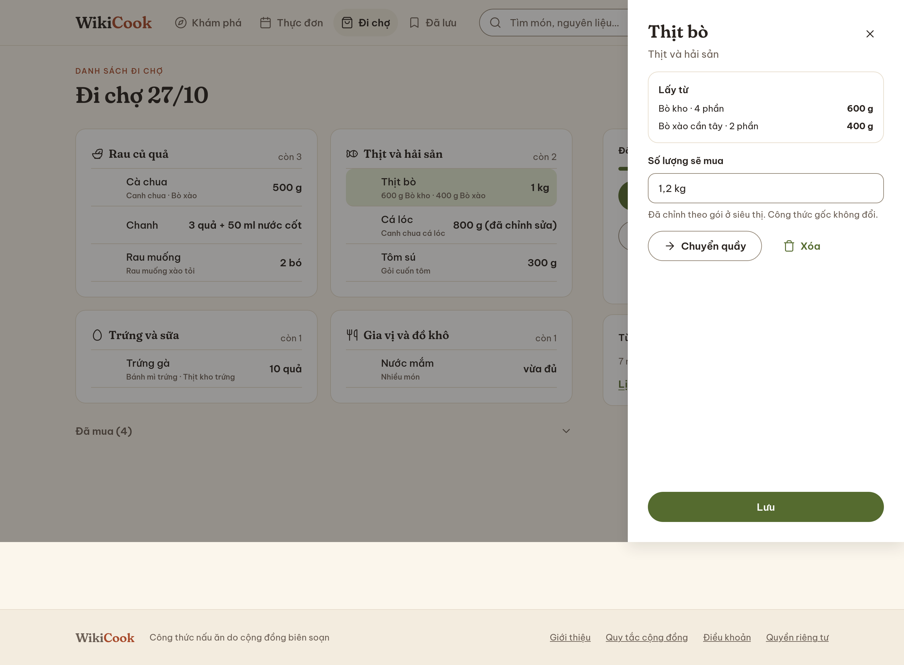
  - **Move item to another aisle dialog (`SL06-MoveAisle`):**
    - **Mobile View (iPhone 12 Pro):**  
      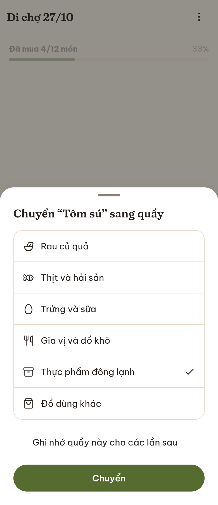
    - **Desktop Web View:**  
      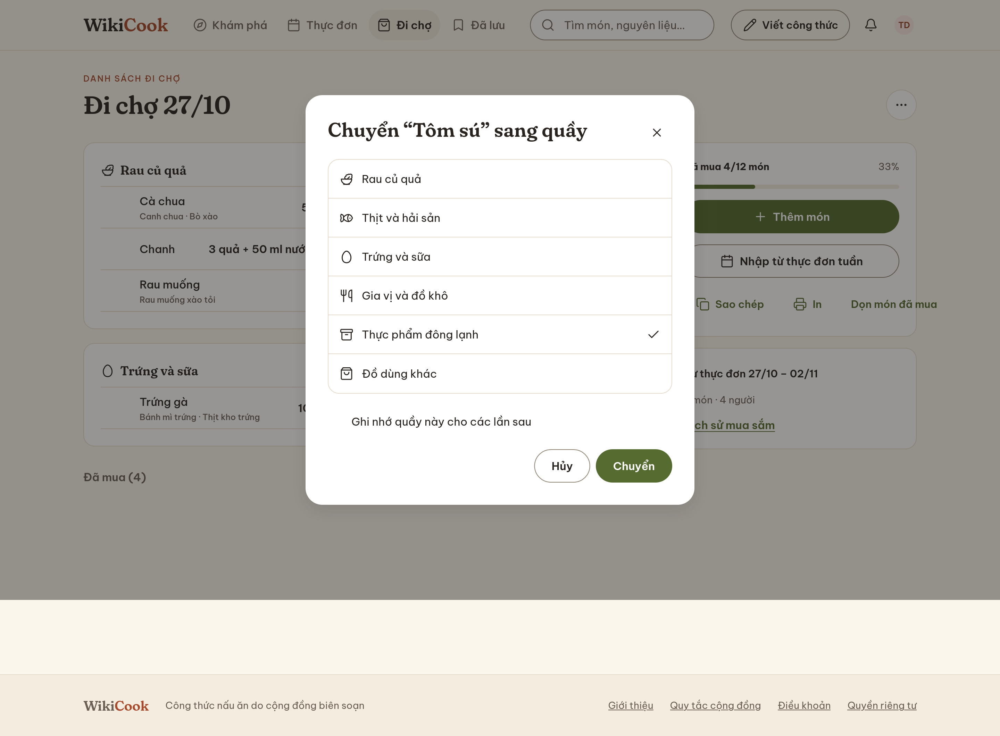

---

### UC-040-04: Offline Shopping Mode & Background Synchronization
*Performed by: Lê Quốc Hưng (LqHung06) | Reviewed by: Trần Nguyễn Công Chung (itzchugnn) | Edited by: Lê Quốc Hưng (LqHung06)*

#### 1. Name and Identifier
- **Use Case ID:** `UC-040-04`
- **Use Case Name:** Local-First Offline Shopping and Resilient Background Synchronization

#### 2. Actor(s)
- **Primary Actor:** **Busy Home Cook** (Member in basement supermarket cellular dead zone).

#### 3. Description
Guarantees uninterrupted shopping list usability when cellular and Wi-Fi signals drop inside a commercial supermarket. The user can view the complete list, check off items, edit quantities, and add custom items offline. Session authentication tokens (JWT) are prevented from kicking the user out while offline. Upon signal restoration, pending mutations synchronize to the backend within 3.0 seconds, resolving conflicts using last-write-wins with preference for checked items.

#### 4. Preconditions
- The active shopping list has been loaded at least once on the client browser while online.
- Browser supports HTML5 LocalStorage and IndexedDB.

#### 5. Basic Flow
1. **Network Disconnection:** The actor enters a basement supermarket. Mobile network connectivity drops to offline (`navigator.onLine = false`).
2. **Display Offline Status:** The system detects the `offline` event and displays a non-blocking subtle banner at the top: *"Đang ngoại tuyến — Dữ liệu được lưu an toàn trên máy"* (`SL08-Offline`).
3. **Execute Offline Interactions:** The actor continues shopping offline without network access: checks off items, modifies item quantities, adds custom items, and deletes unwanted items.
4. **Local Persistence & Mutation Queue:** The system intercepts all mutation API calls, updates the local IndexedDB database immediately, and enqueues mutation events with UTC timestamps into a persistent local offline queue.
5. **Network Restoration:** The actor finishes shopping and approaches the supermarket checkout near the store entrance. The device regains cellular connectivity (`navigator.onLine = true`).
6. **Trigger Background Sync:** The system's background sync engine detects network recovery, changes the status banner to *"Đang đồng bộ..."*, and flushes the queued mutation events to synchronize to the backend in a single batch.
7. **Sync Completion:** The server processes the mutations and returns the reconciled list state. In $< 3.0$ seconds (SC-003), the sync queue empties, the banner transitions to a brief green check *"Đã đồng bộ dữ liệu"*, and smoothly fades away.

#### 6. Alternative Flows
- **AF 4.1: Authentication Session (JWT) Expiration While Offline:**
  - *Trigger:* The user's JWT access token expires while they are shopping in the cellular dead zone.
  - *Steps:*
    1. The client-side security interceptor detects token expiry during an offline interaction.
    2. In strict compliance with FR-020, the system suppresses redirecting the browser to `/login`.
    3. The application permits unrestricted reading, checklist toggling, and local edits, maintaining full in-store functionality.
    4. Upon network restoration at Step 5, the system attempts silent token refresh; if refresh fails, the user is prompted to re-authenticate only after pending local mutations have been safely stored.
  - *Outcome:* The user is never stranded with an inaccessible shopping list at checkout due to token expiry.
- **AF 4.2: Conflict Resolution on Simultaneous Multi-Shopper In-Store Edits:**
  - *Trigger:* Two family members on the same account simultaneously shop in different supermarket aisles using separate devices.
  - *Steps:*
    1. Shopper A checks off "Sữa tươi" on Device A while offline.
    2. Shopper B checks off "Trứng gà" on Device B online.
    3. Upon Device A reconnecting, the backend receives conflicting item states.
    4. The synchronization algorithm applies conflict resolution rules:
       - Item completion state resolves via **Logical OR** (`is_checked = A.is_checked || B.is_checked`) per FR-021 and Edge Case 5, guaranteeing no item purchased by either shopper is un-checked.
       - Conflicting quantity edits follow per-item timestamp **Last-Write-Wins**.
  - *Outcome:* Both shopping baskets are accurately merged without loss of checked items.
- **AF 4.3: Remote-Dependent Operations Attempted Offline:**
  - *Trigger:* While offline, the actor taps "Tạo shopping list từ Kế hoạch tuần mới".
  - *Steps:*
    1. The system checks `navigator.onLine`.
    2. Because weekly meal plan generation requires server-side recipe aggregation and database queries, the system disallows the action.
    3. The system displays a non-blocking toast: *"Cần kết nối mạng để tải kế hoạch tuần mới"* (US4 AC5, within the context of FR-019 and FR-021 regarding offline resilience).
    4. The current local active list remains completely undisturbed.

#### 7. Postconditions
- All offline modifications are committed locally and synchronized to the central database.
- Synchronization queue is purged.

#### 8. Special Requirements
- **Sync Speed:** Complete queue transmission and reconciliation MUST finish within 3.0 seconds of signal recovery (SC-003).
- **Storage Resilience:** Client-side store MUST reserve at least 1.0 MB storage to handle queued mutations without quota exceptions.

#### UI Screen References & Asset Gaps (SCRUM-58)
- **Basic Flow:** [`SL08-Offline.dc.html`](../analysis-and-design/ui-ux/screens/SL08-Offline.dc.html).
- **UI Asset Gap for SCRUM-58:** Screenshot of the sync success toast banner ("Đã đồng bộ dữ liệu").
- **Prototype Screenshots (SCRUM-58):**
  - **Offline / connection-lost status banner (`SL08-Offline`):**
    - **Mobile View (iPhone 12 Pro):**  
      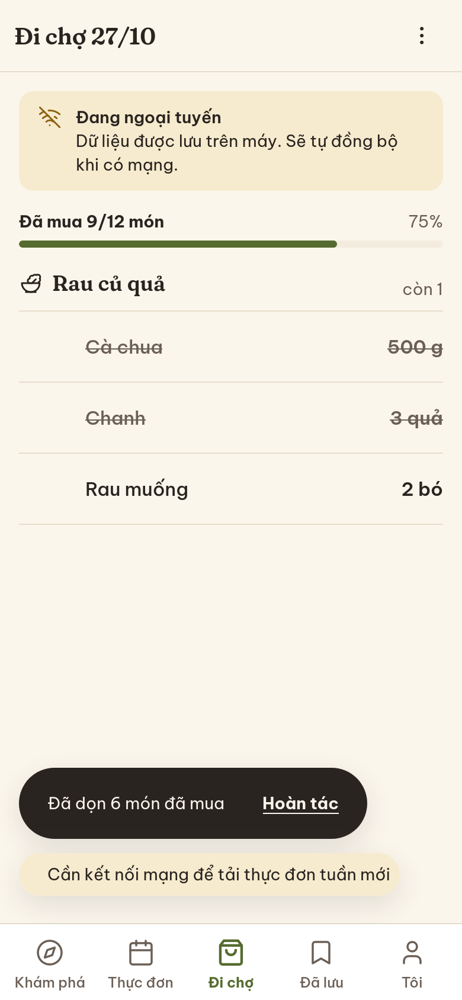
    - **Desktop Web View:**  
      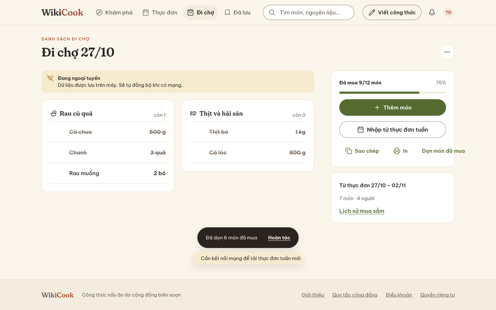

---

### UC-040-05: Export, Plaintext Copy & Print Shopping List
*Performed by: Lê Quốc Hưng (LqHung06) | Reviewed by: Trần Nguyễn Công Chung (itzchugnn) | Edited by: Lê Quốc Hưng (LqHung06)*

#### 1. Name and Identifier
- **Use Case ID:** `UC-040-05`
- **Use Case Name:** Export Shopping List, Copy Formatted Plaintext, and Print Paper Checklist

#### 2. Actor(s)
- **Primary Actor:** **Busy Home Cook** (Member delegating grocery shopping to a family member).

#### 3. Description
Allows a user to export the active shopping list into clean, structured plain text formatted with supermarket aisle emojis and checkable brackets `[ ]` for sharing via messaging apps (Zalo, SMS, Messenger), or print a paper checklist using an ink-saving high-contrast 2-column stylesheet.

#### 4. Preconditions
- The active shopping list contains at least one item.

#### 5. Basic Flow
1. **Open Share Menu:** In the shopping list view, the actor taps the "Chia sẻ" (Share) action button.
2. **Select Copy Plaintext:** The actor selects "Sao chép danh sách" (Copy List).
3. **Format Text:** The system reads the active list, filters unpurchased items (or all items, depending on user settings), groups items under aisle headers with appropriate icons, and generates a structured text string:
   ```text
   🛒 DANH SÁCH MUA SẮM WIKICOOK (28/10/2026)

   🥬 RAU CỦ QUẢ
   [ ] Cà chua: 500 g
   [ ] Hành lá: 2 nhánh

   🥩 THỊT & HẢI SẢN
   [ ] Thịt bò: 1 kg
   ```
4. **Copy to Clipboard:** The system writes the string to the system clipboard via `navigator.clipboard.writeText()` and displays a confirmation toast: *"Đã sao chép danh sách vào clipboard"*.
5. **Share via Messaging:** The actor switches to Zalo/SMS and pastes the text to send to their family member.

#### 6. Alternative Flows
- **AF 5.1: Print Paper Checklist:**
  - *Trigger:* The actor selects "In danh sách" (Print List) or presses `Ctrl+P`.
  - *Steps:*
    1. The system invokes `window.print()`.
    2. The browser print engine applies dedicated print CSS media queries (`@media print` per FR-024):
       - Web headers, search bars, navigation bars, floating buttons, and footers are suppressed (`display: none`).
       - Background colors are forced to pure white and typography to high-contrast monochrome black to save printer ink.
       - Items are formatted into an ink-saving 2-column paper checklist layout with printable square checkboxes.
    3. The actor confirms printing on their local printer.
  - *Outcome:* A clean physical paper checklist is generated.
- **AF 5.2: Clipboard API Access Denied by Browser:**
  - *Trigger:* The browser security settings block programmatic clipboard writing.
  - *Steps:*
    1. `navigator.clipboard.writeText` fails with a permissions error.
    2. The system catches the error and opens a modal displaying the formatted text inside a selectable `<textarea>` with a button "Chọn tất cả" (Select All), allowing manual copying (`Ctrl+C`).
  - *Outcome:* User obtains the formatted text without crash.

#### 7. Postconditions
- Clipboard contains the formatted grocery list string, or print preview is rendered.

#### 8. Special Requirements
- **Print Optimization:** Print media styles MUST eliminate all background fills, navigation controls, and floating action buttons, formatting the list in a compact 2-column layout.

#### UI Screen References & Asset Gaps (SCRUM-58)
- **Basic Flow:** [`SL01-List.dc.html`](../analysis-and-design/ui-ux/screens/SL01-List.dc.html) (Share popover menu).
- **UI Asset Gap for SCRUM-58:** Dedicated print stylesheet preview screenshot (`@media print` 2-column rendering).
- **Prototype Screenshots (SCRUM-58):**
  - **Shopping list with the share / copy-as-text / print menu (`SL01-List`):**
    - **Mobile View (iPhone 12 Pro):**  
      
    - **Desktop Web View:**  
      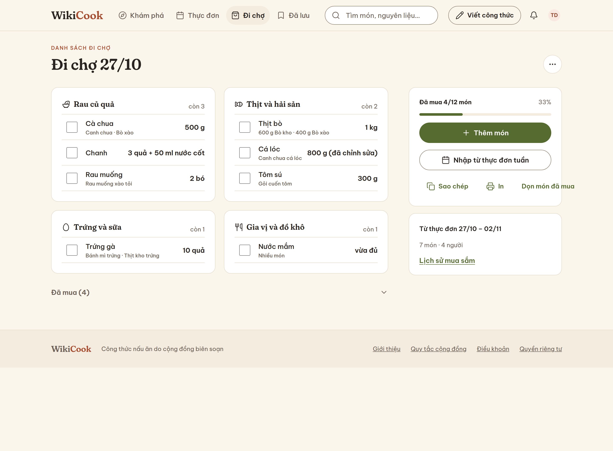

---

## 2. USE-CASE SPECIFICATIONS FOR FEATURE 050: HANDS-FREE COOKING MODE & CONCURRENT TIMERS
*Performed by: Lê Quốc Hưng (LqHung06) | Reviewed by: Trần Nguyễn Công Chung (itzchugnn) | Edited by: Lê Quốc Hưng (LqHung06)*

### UC-050-01: Launch Full-Screen Cooking Mode & Keep Display Awake
*Performed by: Lê Quốc Hưng (LqHung06) | Reviewed by: Trần Nguyễn Công Chung (itzchugnn) | Edited by: Lê Quốc Hưng (LqHung06)*

#### 1. Name and Identifier
- **Use Case ID:** `UC-050-01`
- **Use Case Name:** Launch Dedicated Full-Screen Cooking View and Maintain Display Awake State (Wake Lock)

#### 2. Actor(s)
- **Primary Actor:** **Busy Home Cook** (Member or Guest cook at kitchen counter per Vision §3.2).

#### 3. Description
Provides the initial transition into the kitchen execution environment. From any published recipe, the cook enters an immersive, distraction-free full-screen viewer showing Step 1 in bold typography readable from 1.5 meters. The system automatically acquires Screen Wake Lock to prevent the display from sleeping, primes Web Audio context for future timer alarms via the initiation tap, and provides a high-contrast dark theme toggle.

#### 4. Preconditions
- The user is viewing a `PUBLISHED` recipe detail view (`specs/020`/`060`).
- The recipe contains at least one instruction step with valid text.

#### 5. Basic Flow
1. **Initiate Cooking:** The actor taps the prominent "Bắt đầu nấu" (Start Cooking) button on the recipe overview page.
2. **Capture Audio Gesture:** The system intercepts the tap gesture to initialize and prime the browser's `AudioContext` (`AudioContext.resume()`), ensuring subsequent timer alerts play unhindered by browser autoplay policies (Edge Case 1).
3. **Transition to Full Screen:** The system requests full-screen mode (`document.documentElement.requestFullscreen()`), hiding website headers, search bars, sidebars, and tab navigation.
4. **Acquire Screen Wake Lock:** The system calls `navigator.wakeLock.request('screen')`. The OS grants the wake lock.
5. **Render Step 1:** The system initializes `CookingSession` for this `recipeId`, sets `currentStepIndex = 0` (Step 1), and renders the full-screen view (`CK01-Step`):
   - Oversized step number "Bước 1 / N"
   - Scalable large instruction text (FR-006) readable from a distance of 1.5 meters, maintaining a minimum 7:1 contrast ratio in High-Contrast Mode (NFR-001)
   - Embedded step ingredients (or "Xem nguyên liệu" button)
   - Oversized bottom navigation controls
   - Header bar with High-Contrast toggle, Voice toggle, and Exit button.
6. **Maintain Illumination:** The actor places the phone on a kitchen stand. The screen remains continuously illuminated throughout the cooking session without dimming.

#### 6. Alternative Flows
- **AF 1.1: Screen Wake Lock Unsupported or Denied by OS/Battery Saver:**
  - *Trigger:* The cook's browser/hardware does not support the Screen Wake Lock API, or the mobile device has Battery Saver mode engaged.
  - *Steps:*
    1. `navigator.wakeLock.request` throws an exception or returns rejected.
    2. The system catches the error gracefully (FR-004, NFR-005).
    3. The system renders a non-intrusive notification banner at the top: *"Thiết bị không hỗ trợ giữ sáng tự động. Vui lòng kiểm tra cài đặt màn hình của bạn."*.
    4. Cooking Mode continues operating normally.
  - *Outcome:* The user is informed to adjust system timeout manually; application does not crash.
- **AF 1.2: Wake Lock Re-Acquisition on Tab Visibility Change:**
  - *Trigger:* The cook temporarily switches to another mobile app (e.g., answering a phone call) and returns to Cooking Mode.
  - *Steps:*
    1. The OS releases the active wake lock upon tab backgrounding.
    2. When the user returns to the Cooking Mode tab (`document.visibilityState === 'visible'`), the system automatically re-requests `navigator.wakeLock.request('screen')`.
    3. The wake lock is successfully re-acquired.
  - *Outcome:* Screen stays awake after app switching.
- **AF 1.3: Toggle High-Contrast Mode:**
  - *Trigger:* Kitchen lighting conditions produce glare on the counter.
  - *Steps:*
    1. The actor taps the High-Contrast icon on the top toolbar.
    2. The system toggles the color palette to an ultra-high-contrast theme (`#000000` pure black background, bold white typography, amber action buttons) adhering to WCAG 2.1 AAA $7:1$ contrast ratio (`CK02-StepHC`).
    3. Tapping again toggles back to standard clean light mode.
  - *Outcome:* Maximum glanceability in varied lighting.
- **AF 1.4: Incomplete Recipe Data Error:**
  - *Trigger:* The recipe lacks published instruction step text.
  - *Steps:*
    1. The system detects zero valid steps or unparseable recipe data.
    2. The system aborts full-screen entry and displays an alert: *"Dữ liệu công thức không đầy đủ để bắt đầu nấu. Vui lòng thử lại sau."*.

#### 7. Postconditions
- Full-screen cooking viewer is active.
- Screen Wake Lock is engaged (if supported).
- Audio context is primed.
- Cooking session envelope `cooking_session_{recipeId}` is initialized in LocalStorage.

#### 8. Special Requirements
- **Readability & Contrast:** Text MUST maintain minimum $7:1$ contrast ratio (WCAG AAA) in high-contrast mode and be legible from 1.5 meters away (NFR-001).
- **Latency:** Initial transition to full-screen view MUST execute in $< 100$ms (NFR-002).

#### UI Screen References & Asset Gaps (SCRUM-58)
- **Basic Flow:** [`CK01-Step.dc.html`](../analysis-and-design/ui-ux/screens/CK01-Step.dc.html).
- **Alternative Flows:** [`CK02-StepHC.dc.html`](../analysis-and-design/ui-ux/screens/CK02-StepHC.dc.html).
- **UI Asset Gap for SCRUM-58:** Screen Wake Lock unsupported warning banner.
- **Prototype Screenshots (SCRUM-58):**
  - **Full-screen step-by-step cooking mode (`CK01-StepView`):**
    - **Mobile View (iPhone 12 Pro):**  
      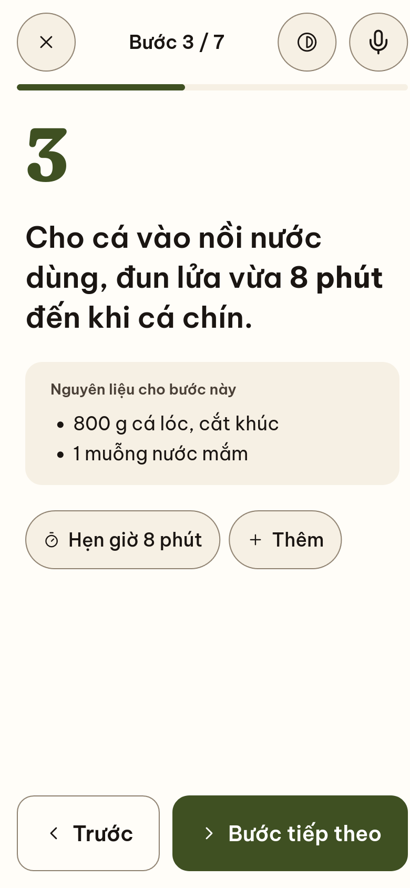
    - **Desktop Web View:**  
      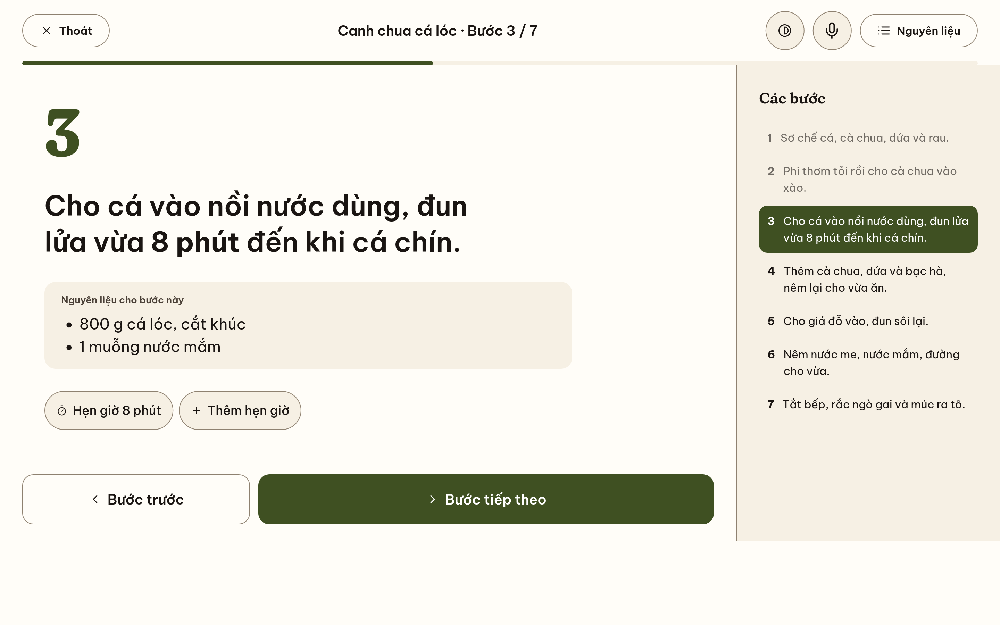
  - **High-contrast kitchen display mode (`CK01b-HighContrast`):**
    - **Mobile View (iPhone 12 Pro):**  
      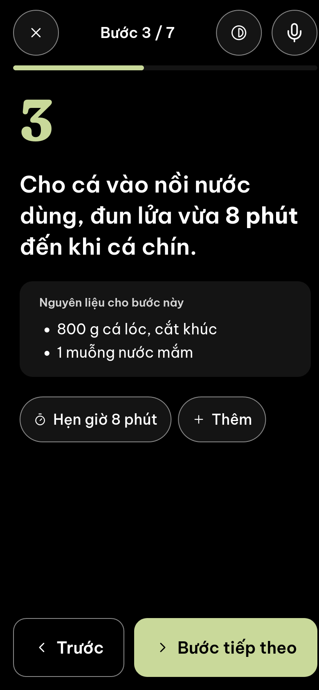
    - **Desktop Web View:**  
      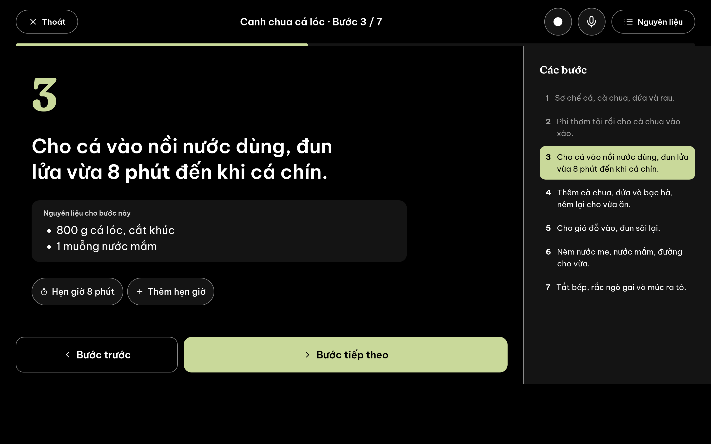

---

### UC-050-02: Step-by-Step Cooking Navigation & Ingredient View
*Performed by: Lê Quốc Hưng (LqHung06) | Reviewed by: Trần Nguyễn Công Chung (itzchugnn) | Edited by: Lê Quốc Hưng (LqHung06)*

#### 1. Name and Identifier
- **Use Case ID:** `UC-050-02`
- **Use Case Name:** Oversized Step Navigation, Keyboard Controls, and Step Ingredient Checklist

#### 2. Actor(s)
- **Primary Actor:** **Busy Home Cook** (Hands wet, greasy, or occupied).

#### 3. Description
Enables the cook to navigate forward and backward through recipe instructions using oversized touch targets ($64 \times 64$px) operable by wrist/forearm, or via keyboard shortcuts (`Spacebar`, Arrow keys). Displays specific ingredients needed for the active step, or provides a sliding drawer to inspect all recipe ingredients if step mappings are absent.

#### 4. Preconditions
- The user is in Cooking Mode on Step $N$ of $M$.

#### 5. Basic Flow
1. **View Active Step:** The cook views Step 2 ("Ướp thịt bò với tiêu và tỏi trong 15 phút").
2. **View Step Ingredients:** The embedded ingredient panel directly beneath the instruction shows only the ingredients needed for this step: `"Thịt bò: 500g"`, `"Tỏi băm: 2 tép"`, `"Tiêu: 1/2 thìa cà phê"`.
3. **Advance to Next Step (Touch):** Having finished marinating, the cook uses their forearm to press the oversized primary button `"Bước tiếp theo"` ($64 \times 64$px at bottom right).
4. **Transition to Step 3:** In $< 100$ms, the system transitions smoothly to Step 3, updates the progress counter to "Bước 3 / 5", and reloads the instruction text and relevant step ingredients.
5. **Return to Previous Step:** Needing to re-verify a prior instruction, the cook taps `"Bước trước"` at bottom left. The view returns to Step 2.

#### 6. Alternative Flows
- **AF 2.1: Navigation via Hardware Keyboard:**
  - *Trigger:* The cook has an external Bluetooth keyboard, tablet keyboard folio, or desktop workstation in the kitchen.
  - *Steps:*
    1. The cook presses `Spacebar` or `Right Arrow` key.
    2. The system advances to the next step immediately.
    3. The cook presses `Left Arrow` key.
    4. The system returns to the previous step.
  - *Outcome:* Zero-screen-touch navigation for users with keyboards.
- **AF 2.2: Recipe Lacks Granular Step-Level Ingredient Mappings:**
  - *Trigger:* The source recipe (`specs/060`) contains steps but lacks per-step ingredient linkage data.
  - *Steps:*
    1. The system identifies that `InstructionStep.ingredientsUsed` is null or empty.
    2. The system renders a floating quick-access button: `"Xem nguyên liệu"` (View Ingredients) with an ingredient count badge (`CK05-Ingredients`).
    3. The cook taps the button.
    4. A sliding drawer opens displaying the complete recipe ingredient checklist with checkable items.
    5. The cook taps "Đóng" to resume step view.
  - *Outcome:* Cook can verify ingredients at any step even without upstream granular data.
- **AF 2.3: Final Step Completion (Finish Cooking):**
  - *Trigger:* The cook reaches Step $M$ (final step) and taps `"Hoàn thành nấu ăn"`.
  - *Steps:*
    1. The system checks if any countdown timers are currently `RUNNING`.
    2. *Case A (No Active Timers):* The system releases the Screen Wake Lock, exits full-screen mode, purges `cooking_session_{recipeId}` from LocalStorage, and redirects to the recipe detail page with a celebratory banner: *"Chúc mừng bạn đã hoàn thành món ăn!"* (`CK09-Finished`).
    3. *Case B (Active Timers Remain):* The system triggers the timer exit confirmation flow (detailed in UC-050-05 AF 5.2).

#### 7. Postconditions
- Current step index is updated in memory and persisted to `cooking_session_{recipeId}` in LocalStorage.
- Screen Wake Lock remains active.

#### 8. Special Requirements
- **Touch Targets:** Navigation touch targets MUST have a minimum dimension of $64 \times 64$ pixels (FR-007, SC-001) to support forearm/wrist activation.
- **Transition Latency:** Step transitions MUST execute in $< 100$ms (NFR-002).

#### UI Screen References & Asset Gaps (SCRUM-58)
- **Basic Flow:** [`CK01-Step.dc.html`](../analysis-and-design/ui-ux/screens/CK01-Step.dc.html).
- **Alternative Flows:** [`CK05-Ingredients.dc.html`](../analysis-and-design/ui-ux/screens/CK05-Ingredients.dc.html), [`CK09-Finished.dc.html`](../analysis-and-design/ui-ux/screens/CK09-Finished.dc.html).
- **UI Asset Gap for SCRUM-58:** None (Screens CK01, CK05, CK09 cover all states).
- **Prototype Screenshots (SCRUM-58):**
  - **In-cooking ingredients drawer (`CK02-Ingredients`):**
    - **Mobile View (iPhone 12 Pro):**  
      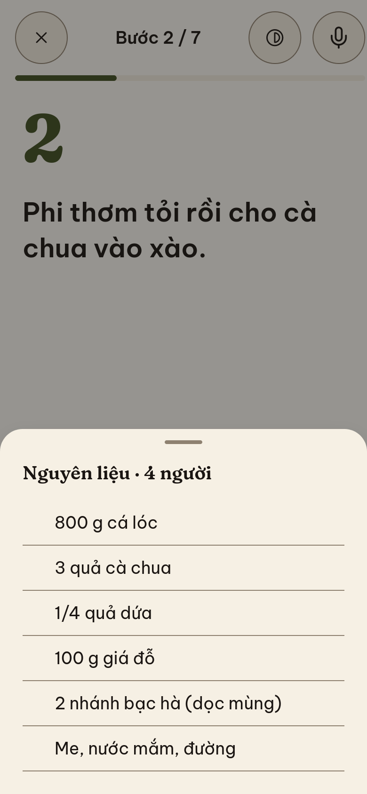
    - **Desktop Web View:**  
      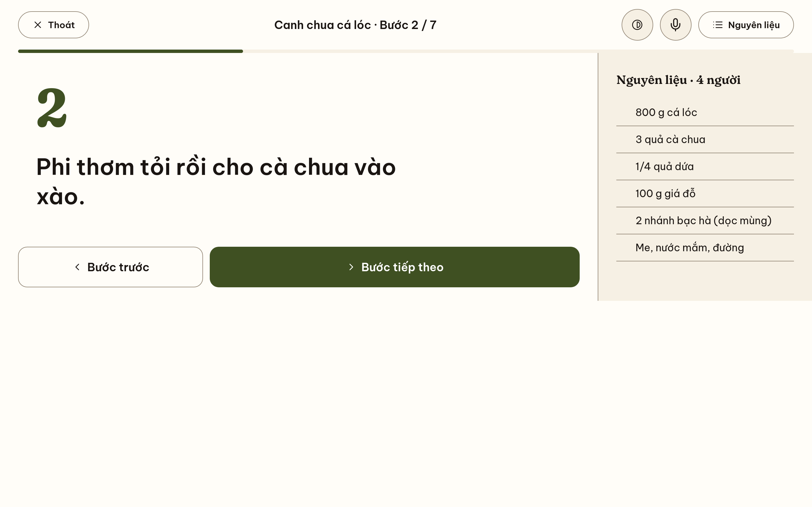
  - **Dish completed screen (`CK03-Finished`):**
    - **Mobile View (iPhone 12 Pro):**  
      
    - **Desktop Web View:**  
      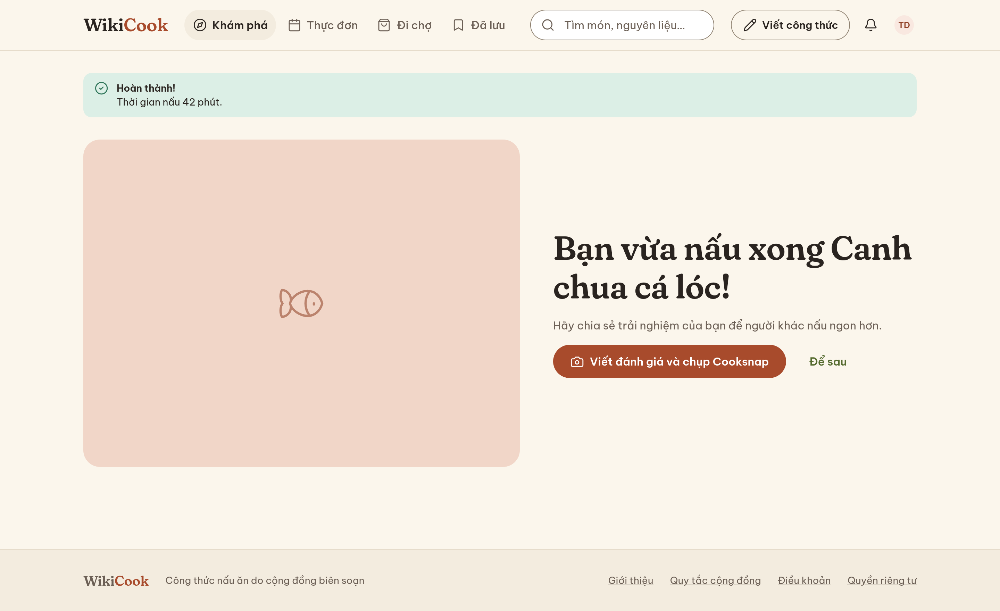

---

### UC-050-03: Manage Concurrent Kitchen Timers & Alarms
*Performed by: Lê Quốc Hưng (LqHung06) | Reviewed by: Trần Nguyễn Công Chung (itzchugnn) | Edited by: Lê Quốc Hưng (LqHung06)*

#### 1. Name and Identifier
- **Use Case ID:** `UC-050-03`
- **Use Case Name:** Create, Execute, Extend Concurrent Countdown Timers and Manage Alarms

#### 2. Actor(s)
- **Primary Actor:** **Busy Home Cook** (Managing multi-phase culinary tasks).

#### 3. Description
Provides parallel kitchen countdown timers directly integrated into cooking steps. The system automatically parses duration expressions from step text to provide 1-tap timer buttons, allows manual timer creation with custom labels, supports concurrent execution of multiple timers without clock drift, enables in-flight extension (`+1 phút`, `+5 phút`), emits an audible alarm and screen flash for up to 60 seconds upon expiration, and transitions unacknowledged timers to a persistent "Overdue" status.

#### 4. Preconditions
- Cooking Mode is active.

#### 5. Basic Flow
1. **Auto-Detect Duration:** On Step 3 ("Hầm thịt trong 30 phút trên lửa nhỏ"), the system's text parser detects `"30 phút"` and renders a prominent button: `"Bắt đầu hẹn giờ: 30 phút"`.
2. **Start Auto-Timer:** The cook taps the button. The system creates a `KitchenTimer` (`status = 'RUNNING'`, `targetEndTimestamp = now + 1800000ms`, label: "Bước 3 - Hầm thịt") and mounts a persistent timer card.
3. **Add Second Custom Timer:** Needing to boil eggs simultaneously, the cook taps `"+ Thêm hẹn giờ"` (`CK04-AddTimer`).
4. **Configure Custom Timer:** The cook sets duration to 8 minutes, enters label "Luộc trứng lòng đào", and taps "Bắt đầu". The system creates a second `KitchenTimer` running concurrently.
5. **Concurrent Countdown:** As the cook navigates between steps, a persistent floating timer drawer displays both active timers counting down real-time seconds.
6. **Extend Timer In-Flight:** After 25 minutes, the cook checks the meat and decides it needs more simmering. On the 30-minute timer card, the cook taps the quick-add chip `"+5 phút"`. The system immediately extends `targetEndTimestamp` by 300 seconds and updates total duration without resetting state.
7. **Timer Expiration & Alarm:** The 8-minute egg timer reaches `00:00:00`.
   - The system triggers the repeating audio alarm sound via Web Audio API.
   - The device vibrates (on supported Android devices).
   - The screen perimeter pulses with an animated red/amber border.
   - The timer card displays a bold flashing badge: `"Hết giờ: Luộc trứng lòng đào"`.
8. **Silence Alarm:** The cook taps anywhere on the screen or presses the `Spacebar`. The alarm sound and vibration immediately silence, and the timer card transitions to `"Hoàn thành"` (Acknowledged EXPIRED).

#### 6. Alternative Flows
- **AF 3.1: Instruction Step with Duration Range:**
  - *Trigger:* Step text states "Xào rau muống trong 3-5 phút".
  - *Steps:*
    1. The parser identifies a duration range (lower: 3 min, upper: 5 min).
    2. The system renders the primary timer button with the upper bound `"Hẹn giờ 5 phút"`, and a secondary chip `"Hẹn giờ 3 phút"` (US3 Acceptance Scenario 2).
    3. The cook selects their preferred duration.
  - *Outcome:* Range ambiguity is resolved cleanly for the cook.
- **AF 3.2: Unattended Expired Timer (60-Second Auto-Mute & Overdue Badge):**
  - *Trigger:* A timer reaches `00:00:00`, but the cook is in another room or washing dishes and does not silence it immediately.
  - *Steps:*
    1. The audio alarm sounds continuously for up to 60 seconds.
    2. At second 60, in strict compliance with FR-013, the system **automatically mutes the audio alarm** to avoid battery depletion and acoustic nuisance.
    3. The timer remains in the `EXPIRED` state (`acknowledgedAt = null`), displaying a persistent red pulsating overdue badge: `"Đã quá hạn X phút"` (incrementing elapsed minutes) until the user taps to dismiss (`CK03-TimerOverdue`).
  - *Outcome:* Eliminates endless ringing while maintaining visual urgency.
- **AF 3.3: Multiple Simultaneous Timer Expirations:**
  - *Trigger:* Two independent timers expire within seconds of each other.
  - *Steps:*
    1. The system plays a single unified alarm audio loop.
    2. Both expired timer cards are highlighted simultaneously in red.
    3. Silencing via single screen tap silences the audio for both, transitioning both cards to completed state.
  - *Outcome:* Prevents overlapping audio distortions or multiple screeching tones.
- **AF 3.4: Tab Backgrounding & Hardware Clock Differential:**
  - *Trigger:* The cook minimizes the browser tab while timers are running.
  - *Steps:*
    1. Browser throttles `setInterval` ticks in background.
    2. The timer engine calculates remaining time strictly using `remainingMs = targetEndTimestamp - Date.now()` (hardware clock differential per Edge Case 2).
    3. When the tab regains focus, remaining durations display with exact zero cumulative drift.
  - *Outcome:* Clock accuracy is 100% immune to background CPU throttling.
- **AF 3.5: Pause, Resume, and Delete Kitchen Timers (FR-011):**
  - *Trigger:* The cook needs to temporarily pause a timer, resume a paused timer, or delete an unwanted timer card.
  - *Steps:*
    1. *Pause Timer:* On a `RUNNING` timer card, the cook taps the "Tạm dừng" (Pause) button. The system reconciles the remaining duration against the hardware clock: if `now >= deadline`, the timer transitions to `EXPIRED`; if not expired, the timer transitions to `PAUSED` and records `remainingMs` (`specs/050-cooking-mode/data-model.md §2`).
    2. *Resume Timer:* On a `PAUSED` timer card, the cook taps the "Tiếp tục" (Resume) button. The system transitions the timer back to `RUNNING` and sets a new target deadline: `targetEndTimestamp = Date.now() + remainingMs`.
    3. *Delete Timer:* On any timer card (idle, running, paused, or expired), the cook taps the "Xóa" (Delete) button. The system transitions the timer to `DISMISSED` and immediately purges it from the session timer list. If this was the only sounding timer, the audible alarm output stops immediately.
  - *Outcome:* Granular control over individual timers without affecting other concurrent running timers. (Silencing an expired timer transitions it to acknowledged `EXPIRED` displaying "Hoàn thành", distinct from `DISMISSED`).

#### 7. Postconditions
- Active timers are persisted in `cooking_session_{recipeId}` in LocalStorage.
- Completed timers remain visible until dismissed.

#### 8. Special Requirements
- **Audio Autoplay & 60s Mute:** Audio MUST play unblocked and auto-silence at exactly 60 seconds if unacknowledged (FR-013).
- **Drift Tolerance:** Cumulative timer drift MUST remain $< 1.0$ second per 60 minutes (NFR-003).

#### UI Screen References & Asset Gaps (SCRUM-58)
- **Basic Flow:** [`CK01-Step.dc.html`](../analysis-and-design/ui-ux/screens/CK01-Step.dc.html), [`CK04-AddTimer.dc.html`](../analysis-and-design/ui-ux/screens/CK04-AddTimer.dc.html).
- **Alternative Flows:** [`CK03-TimerOverdue.dc.html`](../analysis-and-design/ui-ux/screens/CK03-TimerOverdue.dc.html).
- **UI Asset Gap for SCRUM-58:** Screenshot of multiple simultaneous expired timer cards.
- **Prototype Screenshots (SCRUM-58):**
  - **Add parallel timer dialog (`CK04-AddTimer`):**
    - **Mobile View (iPhone 12 Pro):**  
      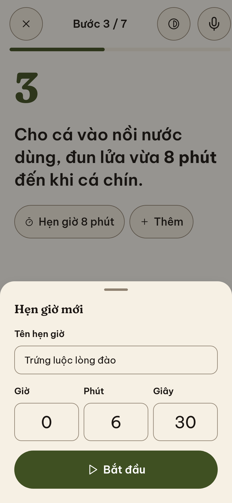
    - **Desktop Web View:**  
      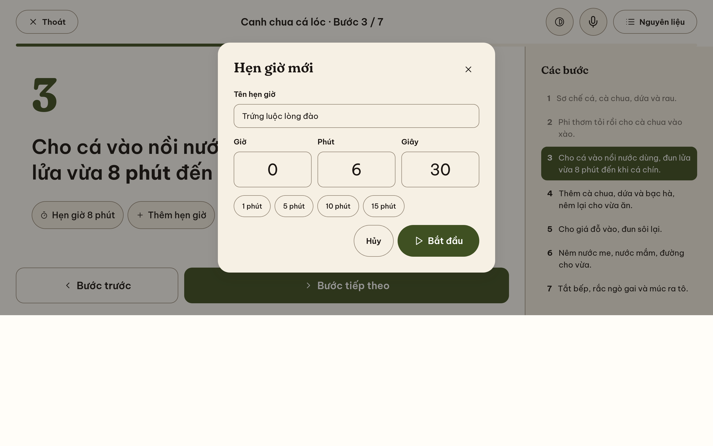
  - **Overdue timer alarm (`CK05-TimerOverdue`):**
    - **Mobile View (iPhone 12 Pro):**  
      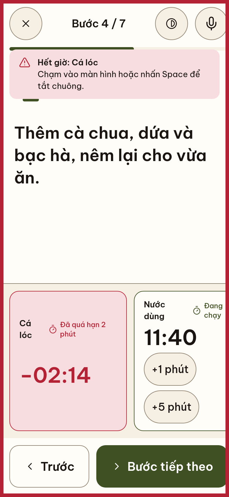
    - **Desktop Web View:**  
      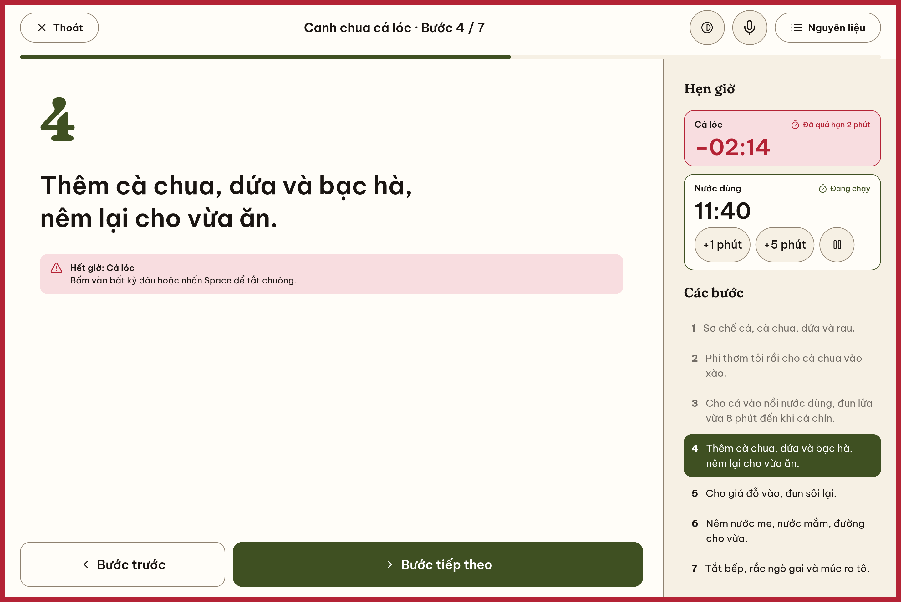

---

### UC-050-04: Hands-Free Voice-Assisted Cooking Navigation
*Performed by: Lê Quốc Hưng (LqHung06) | Reviewed by: Trần Nguyễn Công Chung (itzchugnn) | Edited by: Lê Quốc Hưng (LqHung06)*

#### 1. Name and Identifier
- **Use Case ID:** `UC-050-04`
- **Use Case Name:** Push-to-Talk Vietnamese Voice Command Control and Speech Synthesis

#### 2. Actor(s)
- **Primary Actor:** **Busy Home Cook** (Hands thoroughly coated with dough, oil, or food).

#### 3. Description
Provides an optional online progressive enhancement allowing the cook to advance steps, return to previous steps, start timers, silence alarms, and listen to step directions read aloud using localized Vietnamese voice commands without touching the screen. Filters out kitchen background noise using strict acoustic confidence thresholding ($\ge 70\%$).

#### 4. Preconditions
- The device has an active Internet connection.
- The browser supports the Web Speech API (`SpeechRecognition`).
- The user has granted microphone permissions.

#### 5. Basic Flow
1. **Activate Voice:** The cook taps the microphone icon on the top header (`CK06-Voice`).
2. **Listening State:** The system activates the microphone and renders a glowing animated visual indicator: `"Đang lắng nghe..."`.
3. **Speak Command:** The cook speaks clearly: `"Tiếp theo"` (Next).
4. **Evaluate Audio & Confidence:** The browser speech recognition engine processes the utterance in Vietnamese (`vi-VN`) and returns transcription "tiếp theo" with confidence $92\%$.
5. **Execute Action:** The system validates confidence $\ge 70\%$ (FR-016), triggers a brief green border pulse confirmation, and advances Cooking Mode to the next step within 1.0 second.
6. **Command "Đọc lại" (Read Aloud):** On the next step, the cook speaks: `"Đọc lại"`. The system matches the command and utilizes the Web Speech Synthesis API (`window.speechSynthesis`) with a Vietnamese voice package (`vi-VN`) to speak the entire instruction text aloud.
7. **Silence Alarm via Voice:** When a timer alarm sounds, the cook speaks: `"Tắt chuông"`. The system silences the alarm immediately.
8. **Command "Hẹn giờ" (Timer Action):** The cook speaks: `"Hẹn giờ"`. The system matches the command with recognition confidence $\ge 70\%$, triggers a green border pulse visual confirmation, and initiates the corresponding timer action within 1.0 second (US4 AC2, FR-015).

#### 6. Alternative Flows
- **AF 4.1: Kitchen Noise & Low Confidence Rejection:**
  - *Trigger:* While voice listening is active, sizzling oil, a range hood fan, or running tap water produces ambiguous acoustic noise.
  - *Steps:*
    1. Speech engine returns a candidate with recognition confidence $< 70\%$ (or non-matching noise).
    2. The system strictly rejects the input (FR-016).
    3. The system flashes a brief amber notice: *"Không rõ khẩu lệnh"* and **strictly refrains from altering steps or triggering timers**.
  - *Outcome:* False step transitions are prevented.
- **AF 4.2: Network Drop While Using Voice:**
  - *Trigger:* Internet connectivity drops while Cooking Mode is in voice listening mode.
  - *Steps:*
    1. Speech recognition engine throws a network error.
    2. The system catches the error, turns off the microphone, and displays a non-blocking message: *"Tính năng giọng nói tạm ngừng do mất kết nối mạng"* (FR-015, Acceptance Scenario 4.4).
    3. All step navigation, ingredient drawers, and timer countdowns continue operating 100% offline via touch and keyboard.
  - *Outcome:* Application gracefully degrades without freezing.
- **AF 4.3: Vietnamese Speech Synthesis Voice Package Unavailable:**
  - *Trigger:* Cook speaks "Đọc lại", but the client operating system lacks a Vietnamese (`vi-VN`) Text-to-Speech voice installed.
  - *Steps:*
    1. `speechSynthesis.getVoices()` reveals zero `vi-VN` voices.
    2. The system triggers fallback behavior: plays an audible earcon chime, flashes the step text border in blue, and displays an informational toast: *"Thiết bị chưa hỗ trợ giọng đọc tiếng Việt"* (Clarification Q3, Edge Case 7).
  - *Outcome:* Fallback succeeds without throwing uncaught exceptions.
- **AF 4.4: 30-Second Inactivity Auto-Sleep:**
  - *Trigger:* The cook does not issue any voice command for 30 seconds after activating.
  - *Steps:*
    1. An idle timer reaches 30 seconds.
    2. The system automatically deactivates the microphone to preserve battery and respect household audio privacy (Acceptance Scenario 4.5).
  - *Outcome:* Microphone does not remain open indefinitely.
- **AF 4.5: Microphone Permission Denied:**
  - *Trigger:* User denies browser microphone prompt.
  - *Steps:*
    1. Permission is denied.
    2. The microphone icon is disabled with a tooltip: *"Cần cấp quyền microphone trong cài đặt trình duyệt để dùng giọng nói"*. Touch and keyboard navigation remain fully functional.

#### 7. Postconditions
- Voice commands execute respective state changes.
- Microphone deactivates upon timeout or completion.

#### 8. Special Requirements
- **Confidence Gate:** Voice commands MUST be discarded if acoustic confidence is $< 70\%$ (FR-016).
- **Execution Latency:** Command processing to UI transition MUST complete within 1.0 second (Acceptance Scenario 4.2).

#### UI Screen References & Asset Gaps (SCRUM-58)
- **Basic Flow:** [`CK06-Voice.dc.html`](../analysis-and-design/ui-ux/screens/CK06-Voice.dc.html).
- **UI Asset Gap for SCRUM-58:** Amber indicator toast for rejected low-confidence audio ("Không rõ khẩu lệnh").
- **Prototype Screenshots (SCRUM-58):**
  - **Hands-free voice command listening state (`CK06-VoiceListening`):**
    - **Mobile View (iPhone 12 Pro):**  
      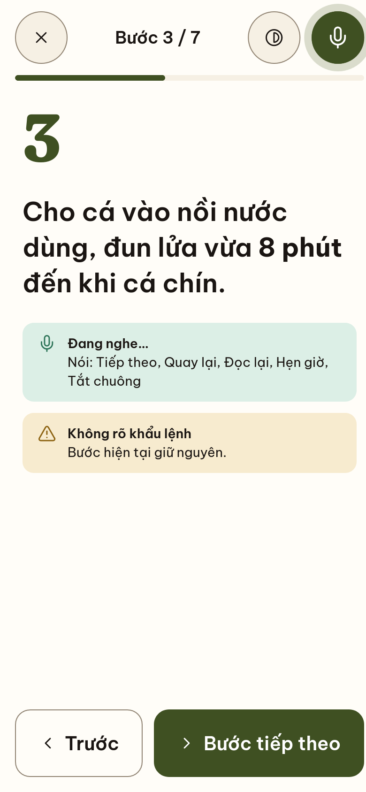
    - **Desktop Web View:**  
      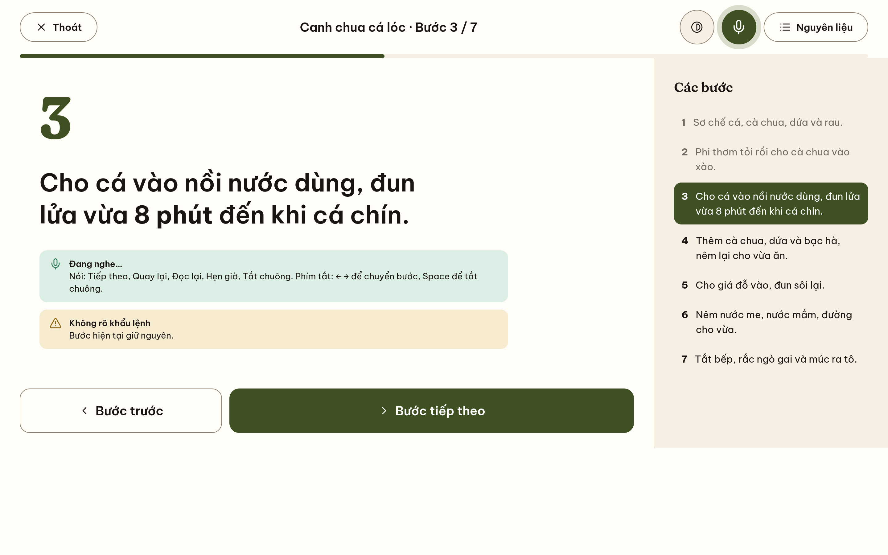

---

### UC-050-05: Session Recovery & Interruption Protection
*Performed by: Lê Quốc Hưng (LqHung06) | Reviewed by: Trần Nguyễn Công Chung (itzchugnn) | Edited by: Lê Quốc Hưng (LqHung06)*

#### 1. Name and Identifier
- **Use Case ID:** `UC-050-05`
- **Use Case Name:** Restore Interrupted Cooking Session and Protect Timers on Exit

#### 2. Actor(s)
- **Primary Actor:** **Busy Home Cook** (Accidentally refreshed, closed tab, or exited mode).

#### 3. Description
Safeguards the cooking progress and active timers against catastrophic loss caused by browser reloads (F5), accidental tab closures, or memory reclamation. The session state is continuously cached locally under key `cooking_session_{recipe_id}` with a 4-hour validity window. Upon returning, the user can resume their exact step and view recalculated countdowns (or overdue alerts). When attempting to exit while timers are active, the system warns the user and provides a floating background widget.

#### 4. Preconditions
- A cooking session was active on recipe $R$ within the past 4 hours.
- Session data exists in browser `localStorage`.

#### 5. Basic Flow
1. **Interruption Event:** The cook is on Step 3 of "Phở Bò" with an active 15-minute timer running. The browser tab is accidentally closed or refreshed (F5).
2. **Re-Open Recipe Page:** The cook navigates back to the recipe page within 10 minutes.
3. **Detect Active Session:** The system inspects LocalStorage, identifies key `cooking_session_{recipe_id}` created 10 minutes ago ($< 4$ hours), and reads stored state: `currentStepIndex = 2` (Step 3), active timers array, and start timestamp.
4. **Display Resume Prompt:** The system displays a prominent modal dialog (`CK07-Resume`):
   *"Tiếp tục phiên nấu ăn? Bạn đang nấu dở ở Bước 3 với 1 bộ đếm giờ đang chạy."*
   With two primary buttons: `"Tiếp tục"` (Resume) and `"Bắt đầu lại"` (Start Over).
5. **Confirm Resume:** The cook taps `"Tiếp tục"`.
6. **Reconstruct State:** The system re-enters full-screen Cooking Mode directly at Step 3:
   - Screen Wake Lock is re-acquired.
   - For the running timer, the system recalculates: $\text{remainingDurationSeconds} = \text{targetEndTimestamp} - \text{now()}$.
   - The timer resumes counting down smoothly from approximately 5 minutes remaining.

#### 6. Alternative Flows
- **AF 5.1: Timer Expired While Browser Tab Was Closed:**
  - *Trigger:* The timer reached zero while the browser tab was closed.
  - *Steps:*
    1. At Step 4, when the session is resumed, the system evaluates `now() > targetEndTimestamp`.
    2. The system computes expired elapsed minutes: $\Delta t = \text{now()} - \text{targetEndTimestamp}$.
    3. The system mounts the timer card immediately in a high-priority red alert state showing: `"Đã quá hạn 4 phút"` (Edge Case 6, Acceptance Scenario 5.4).
  - *Outcome:* The cook is immediately informed that their food has exceeded the target cooking time.
- **AF 5.2: Exit Cooking Mode with Active Timers Running:**
  - *Trigger:* The cook taps "Thoát" or "Hoàn thành nấu ăn" while one or more timers are still actively counting down (`status = 'RUNNING'`).
  - *Steps:*
    1. The system intercepts the exit command (FR-019, Clarification Q5, Edge Case 8).
    2. The system displays a warning dialog (`CK08-ExitTimers`):
       *"Bạn vẫn còn 1 bộ đếm giờ đang chạy. Bạn muốn xử lý như thế nào?"*
       Options:
       - Option A: *"Tiếp tục chạy bộ đếm giờ"* (Keep Timers Running in Background).
       - Option B: *"Hủy tất cả và thoát"* (Discard All Timers & Exit).
    3. If Option A is selected, full-screen mode exits, but the system mounts a compact floating countdown widget at the bottom of the recipe page, keeping the countdown active.
    4. If Option B is selected, all timers are terminated, the session envelope in LocalStorage is purged, and the recipe overview returns to default state.
  - *Outcome:* Active food preparation is protected from accidental timer cancellation.
- **AF 5.3: Session Older Than 4-Hour Expiration Window (TTL Expired):**
  - *Trigger:* The cook returns to the recipe page 6 hours after initiating Cooking Mode.
  - *Steps:*
    1. The system checks session timestamp: `now() - startedAt > 4 hours`.
    2. In strict compliance with FR-017, the system automatically purges the expired `cooking_session_{recipe_id}` from LocalStorage.
    3. The recipe loads in its default initial state without displaying the resume prompt.
  - *Outcome:* Stale abandoned sessions are garbage-collected cleanly.
- **AF 5.4: Concurrent Multi-Recipe Cooking Sessions (Independent Tabs):**
  - *Trigger:* The cook is preparing Recipe A ("Bò Kho") in Tab 1, and simultaneously opens Recipe B ("Cơm Tấm") in Tab 2 and launches Cooking Mode.
  - *Steps:*
    1. Tab 1 writes to key `cooking_session_recipe_A`.
    2. Tab 2 writes to key `cooking_session_recipe_B`.
    3. Both tabs maintain isolated LocalStorage envelopes, countdown clocks, and step indexes without data collision or timer state corruption (Clarification Q2, Edge Case 3).
  - *Outcome:* Multiple dishes can be prepared in parallel across browser tabs.

#### 7. Postconditions
- Session state is either seamlessly resumed or purged cleanly based on user decision.

#### 8. Special Requirements
- **TTL Limit:** LocalStorage session expiration MUST enforce a strict 4-hour window (FR-017).
- **Timer Recalculation:** Timer restoration MUST use absolute hardware clock comparison to avoid elapsed time discrepancies (SC-005).

#### UI Screen References & Asset Gaps (SCRUM-58)
- **Basic Flow:** [`CK07-Resume.dc.html`](../analysis-and-design/ui-ux/screens/CK07-Resume.dc.html).
- **Alternative Flows:** [`CK08-ExitTimers.dc.html`](../analysis-and-design/ui-ux/screens/CK08-ExitTimers.dc.html).
- **UI Asset Gap for SCRUM-58:** Compact floating background widget screenshot on the recipe overview page.
- **Prototype Screenshots (SCRUM-58):**
  - **Resume unfinished cooking session (`CK07-ResumeSession`):**
    - **Mobile View (iPhone 12 Pro):**  
      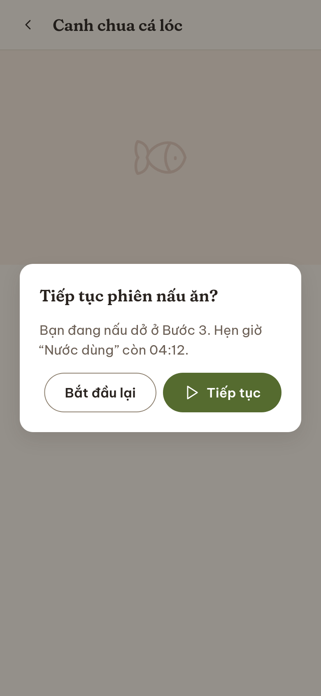
    - **Desktop Web View:**  
      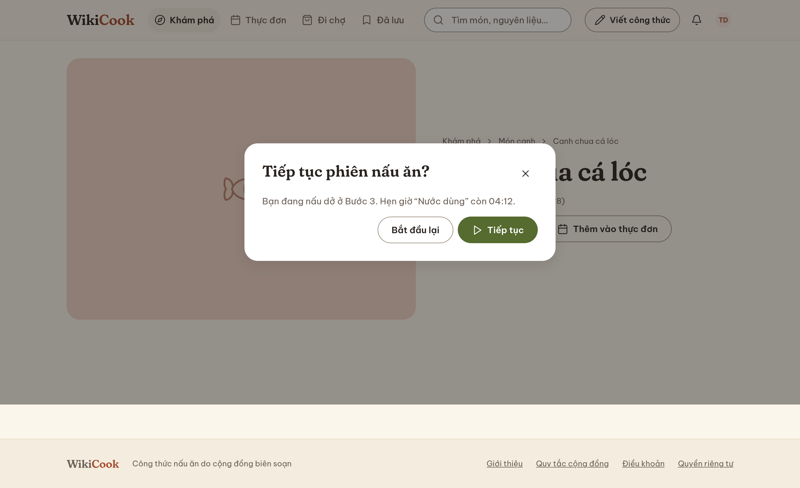
  - **Exit warning while timers are still running (`CK08-ExitConfirm`):**
    - **Mobile View (iPhone 12 Pro):**  
      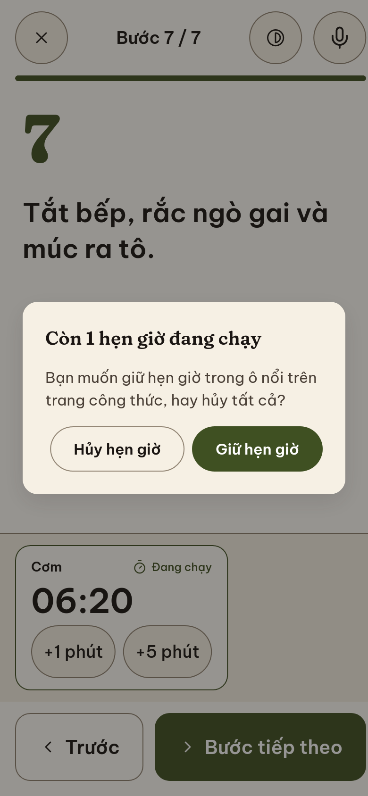
    - **Desktop Web View:**  
      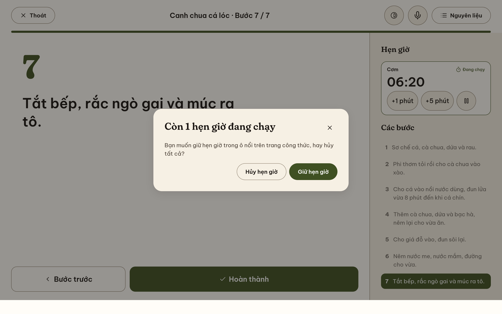

---

## 3. TRACEABILITY MATRIX: REQUIREMENTS & USER STORIES TO USE CASES
*Performed by: Lê Quốc Hưng (LqHung06) | Reviewed by: Trần Nguyễn Công Chung (itzchugnn) | Edited by: Lê Quốc Hưng (LqHung06)*

### 3.1. Feature 040 (Smart Shopping List) Traceability

| Use Case ID | Use Case Name | User Stories Covered | Functional Requirements (FR) | Success Criteria |
| :---: | :--- | :---: | :--- | :---: |
| **`UC-040-01`** | Manage Active Shopping List & Custom Items | `US1` (AC 1–5) | `FR-001`, `FR-012`, `FR-022`, `FR-025` | - |
| **`UC-040-02`** | Import Ingredients with Scaling & Unit Conversion | `US2` (AC 1–8) | `FR-002`, `FR-003`, `FR-004`, `FR-005`, `FR-006`, `FR-007`, `FR-008`, `FR-009`, `FR-016` | `SC-001`, `SC-004`, `SC-005` |
| **`UC-040-03`** | In-Store Checklist & Aisle Organization | `US3` (AC 1–6) | `FR-010`, `FR-011`, `FR-013`, `FR-014`, `FR-015`, `FR-017`, `FR-018` | `SC-002` |
| **`UC-040-04`** | Offline Shopping & Background Sync | `US4` (AC 1–5) | `FR-019`, `FR-020`, `FR-021` | `SC-003` |
| **`UC-040-05`** | Export, Plaintext Copy & Print Shopping List | `US5` (AC 1–2) | `FR-023`, `FR-024` | - |

*Verification:* 100% of Feature 040 requirements (25/25 FRs, 5/5 USs, 26 Acceptance Scenarios) are mapped.

---

### 3.2. Feature 050 (Hands-Free Cooking Mode) Traceability

| Use Case ID | Use Case Name | User Stories Covered | Functional Requirements (FR) | Non-Functional Requirements | Success Criteria |
| :---: | :--- | :---: | :--- | :--- | :---: |
| **`UC-050-01`** | Launch Cooking Mode & Keep Display Awake | `US1` (AC 1–5) | `FR-001`, `FR-002`, `FR-003`, `FR-004`, `FR-005` | `NFR-001`, `NFR-002`, `NFR-005` | `SC-002` |
| **`UC-050-02`** | Step Navigation & Ingredient View | `US2` (AC 1–6) | `FR-006`, `FR-007`, `FR-008`, `FR-009` | `NFR-001`, `NFR-002`, `NFR-006` | `SC-001` |
| **`UC-050-03`** | Concurrent Kitchen Timers & Alarms | `US3` (AC 1–8) | `FR-010`, `FR-011`, `FR-012`, `FR-013`, `FR-014` | `NFR-003`, `NFR-004` | `SC-004` |
| **`UC-050-04`** | Hands-Free Voice-Assisted Navigation | `US4` (AC 1–6) | `FR-015`, `FR-016` | `NFR-002`, `NFR-005` | `SC-003` |
| **`UC-050-05`** | Session Recovery & Interruption Protection | `US5` (AC 1–7) | `FR-017`, `FR-018`, `FR-019` | `NFR-004`, `NFR-005` | `SC-005` |

*Verification:* 100% of Feature 050 requirements (19/19 FRs, 5/5 USs, 32 Acceptance Scenarios) are mapped.

---

## 4. PROTOTYPE SCREEN MAPPING & UI ASSET GAP ANALYSIS (FOR SCRUM-58)
*Performed by: Lê Quốc Hưng (LqHung06) | Reviewed by: Trần Nguyễn Công Chung (itzchugnn) | Edited by: Lê Quốc Hưng (LqHung06)*

To support Trần Nguyễn Công Chung (`@itzchugnn`) in task **`SCRUM-58`** (embedding prototype screenshots directly alongside basic and alternative flows in this document), the table below cross-references all available `.dc.html` prototype screens in `docs/analysis-and-design/ui-ux/screens/` and highlights specific visual gaps requiring supplemental screenshot captures:

| Use Case ID | Flow / Step Reference | Existing Screen ID & Filename | Description of Prototype View | Asset Status & Action for SCRUM-58 |
| :---: | :--- | :--- | :--- | :---: |
| `UC-040-01` | Basic Flow (Step 2) | `SL01-List.dc.html` | Active shopping list with aisle categories and checkboxes | **Available** |
| `UC-040-01` | Basic Flow (Step 4–6) | `SL04-AddItem.dc.html` | Custom grocery item entry dialog | **Available** |
| `UC-040-01` | Alt Flow 1.1 | `SL02-Empty.dc.html` | Empty shopping list with import shortcuts | **Available** |
| `UC-040-01` | Alt Flow 1.2 | `SL07-History.dc.html` | Historical archived shopping lists drawer | **Available** |
| `UC-040-01` | Alt Flow 1.2 | *Gap 040-A* | Confirmation modal to restore archived list | **GAP: Chung to generate screenshot** |
| `UC-040-02` | Basic Flow (Step 1–5) | `SL03-ImportPreview.dc.html` | Pre-import bottom sheet with serving multiplier | **Available** |
| `UC-040-02` | Basic Flow (Step 7) | `SL04b-Breakdown.dc.html` | Multi-recipe ingredient provenance breakdown | **Available** |
| `UC-040-02` | Alt Flow 2.1 | `W-SL03-ImportPreview.dc.html` | Desktop wide-dialog variant for Weekly Meal Plan | **Available** |
| `UC-040-03` | Basic Flow (Step 1–4) | `SL01-List.dc.html` | Checked items in collapsed "Đã mua" subsection | **Available** |
| `UC-040-03` | Alt Flow 3.2 | *Gap 040-B* | 5-second transient undo snackbar for cleared items | **GAP: Chung to generate screenshot** |
| `UC-040-03` | Alt Flow 3.4 | `SL05-ItemDetail.dc.html` | Item quantity override popover & unit indicator | **Available** |
| `UC-040-03` | Alt Flow 3.5 | `SL06-MoveAisle.dc.html` | Aisle reassignment modal with persistence checkbox | **Available** |
| `UC-040-04` | Basic Flow (Step 2–4) | `SL08-Offline.dc.html` | Offline banner with local queuing indicator | **Available** |
| `UC-040-04` | Basic Flow (Step 7) | *Gap 040-C* | Toast notification confirming successful sync | **GAP: Chung to generate screenshot** |
| `UC-040-05` | Basic Flow (Step 1–4) | `SL01-List.dc.html` | Share options popover ("Sao chép văn bản") | **Available** |
| `UC-040-05` | Alt Flow 5.1 | *Gap 040-D* | Clean 2-column print preview (`@media print`) | **GAP: Chung to generate screenshot** |
| `UC-050-01` | Basic Flow (Step 5) | `CK01-Step.dc.html` | Full-screen step view with wake lock active | **Available** |
| `UC-050-01` | Alt Flow 1.3 | `CK02-StepHC.dc.html` | Pure black `#000000` High-Contrast dark theme | **Available** |
| `UC-050-01` | Alt Flow 1.1 | *Gap 050-A* | Screen wake lock unsupported notification banner | **GAP: Chung to generate screenshot** |
| `UC-050-02` | Basic Flow (Step 1–5) | `CK01-Step.dc.html` | Oversized forearm navigation buttons ($64 \times 64$px) | **Available** |
| `UC-050-02` | Alt Flow 2.2 | `CK05-Ingredients.dc.html` | Sliding drawer displaying complete ingredients | **Available** |
| `UC-050-02` | Alt Flow 2.3 | `CK09-Finished.dc.html` | Cooking completion view with return button | **Available** |
| `UC-050-03` | Basic Flow (Step 1–2) | `CK01-Step.dc.html` | Quick-start auto-detected timer button | **Available** |
| `UC-050-03` | Basic Flow (Step 3–4) | `CK04-AddTimer.dc.html` | Custom timer configuration dialog | **Available** |
| `UC-050-03` | Alt Flow 3.2 | `CK03-TimerOverdue.dc.html` | Flashing red "Đã quá hạn X phút" overdue badge | **Available** |
| `UC-050-03` | Alt Flow 3.3 | *Gap 050-B* | Coordinated alert card for multiple simultaneous timers | **GAP: Chung to generate screenshot** |
| `UC-050-04` | Basic Flow (Step 1–5) | `CK06-Voice.dc.html` | Animated listening microphone state | **Available** |
| `UC-050-04` | Alt Flow 4.1 | *Gap 050-C* | Amber warning notice "Không rõ khẩu lệnh" | **GAP: Chung to generate screenshot** |
| `UC-050-05` | Basic Flow (Step 4–6) | `CK07-Resume.dc.html` | Cooking session resume prompt modal dialog | **Available** |
| `UC-050-05` | Alt Flow 5.2 | `CK08-ExitTimers.dc.html` | Exit confirmation modal with active timers warning | **Available** |
| `UC-050-05` | Alt Flow 5.2 | *Gap 050-D* | Compact floating background timer widget on recipe | **GAP: Chung to generate screenshot** |

---

## 5. OPEN QUESTIONS & DOMAIN ASSUMPTIONS
*Performed by: Lê Quốc Hưng (LqHung06) | Reviewed by: Trần Nguyễn Công Chung (itzchugnn) | Edited by: Lê Quốc Hưng (LqHung06)*

### 5.1. Open Questions (For Team Alignment)

1. **`[OQ-050-01]` Guest Actor Access to Cooking Mode:**
   - *Issue:* Spec 040 explicitly enforces authentication (`Member` role, FR-001) for maintaining shopping lists. However, Spec 050 allows entering Cooking Mode from any published recipe detail page without explicitly demanding a login session.
   - *Current Stance in UC-050-01:* Guest users are permitted to launch Cooking Mode; their session state is stored strictly in client-side LocalStorage without cloud backup.
   - *Status:* Pending confirmation from Product Owner Nguyễn Đức Duy (`SCRUM-49`) during Use-Case Model freeze on November 02.

2. **`[OQ-050-02]` Timer Extension on Paused / Expired Timers (A04):**
   - *Issue:* In `specs/050-cooking-mode/data-model.md`, decision `A04` notes that the spec currently defines quick-add extension chips (`+1 phút`, `+5 phút`) solely for `RUNNING` timers.
   - *Current Stance in UC-050-03:* Extension chips are rendered exclusively when the timer is in the `RUNNING` state. Paused or expired timers require explicit restart or unpause before extension.
   - *Status:* Documented as conservative behavior; awaiting team review.

3. **`[OQ-040-01]` Cross-Tab Shopping List Synchronization:**
   - *Issue:* If a user opens the active shopping list in two simultaneous browser tabs on the same desktop, does mutation in Tab A trigger an immediate Web Storage event in Tab B?
   - *Current Stance in UC-040-04:* Handled via standard IndexedDB and server polling upon reconnect; live multi-tab WebSocket co-editing is out of scope for PA3.

---

### 5.2. Domain Assumptions Reaffirmed
- **Metric Scaling Thresholds:** $1000\text{g} = 1\text{kg}$; $1000\text{ml} = 1\text{l}$. Non-convertible qualitative units (e.g., "thìa canh", "nhánh", "quả") remain on discrete sub-rows.
- **Audible Alert Bound:** The timer expiration alert plays a continuous alarm for a maximum of 60 seconds, auto-muting thereafter to prevent battery exhaustion.
- **Session Expiration:** Cooking sessions in LocalStorage enforce a strict 4-hour TTL window from initialization.

---

## 6. USE-CASE SPECIFICATIONS FOR FEATURE 020: RECIPE DISCOVERY, FILTERS & RECIPE DETAIL
*Performed by: Nguyễn Đức Duy (DucDuyNguyen15-IT) | Reviewed by: Nguyễn Thành Dự (ThanhDu14) | Edited by: Nguyễn Đức Duy (DucDuyNguyen15-IT)*

> [!NOTE]
> **Sources:** `specs/020-recipe-search-filter/spec.md` (US1–US4, FR-001 – FR-026, NFR-001 – NFR-007), [Vision Document](vision-document.md) §5.2 and the Use-Case Model [`use-case-model.md`](use-case-model.md) §4.2 and §4.11 (`SCRUM-49`). Actors follow the model: **Guest** is any visitor; **Member** is a signed-in user and inherits every use case of Guest. `UC-020-05` is written at the Brief level (planned increment); `UC-020-06` is the shared Recipe Detail page whose blocks are owned by other features (see §4.11 of the model).

### UC-020-01: Search Recipes by Keyword
*Performed by: Nguyễn Đức Duy (DucDuyNguyen15-IT) | Reviewed by: Nguyễn Thành Dự (ThanhDu14) | Edited by: Nguyễn Đức Duy (DucDuyNguyen15-IT)*

#### 1. Name and Identifier
- **Use Case ID:** `UC-020-01`
- **Use Case Name:** Search Published Recipes by Keyword (Diacritic- and Case-Insensitive)

#### 2. Actor(s)
- **Primary Actor:** **Guest** — any visitor, signed in or not (Vision §3.2 "Busy Home Cook"; Member inherits this use case).

#### 3. Description
Lets any visitor type the name of a dish or an ingredient and immediately see matching **published** recipes. The keyword is matched against recipe name, description, ingredient names and tags, ignoring letter case and Vietnamese diacritics ("pho bo" finds "Phở bò"; "đ" ↔ "d"). Results are ranked by relevance and shown as numbered pages of 20 recipe cards. This is the base use case of Feature 020: filters (`UC-020-02`), dietary exclusion (`UC-020-03`) and sorting/paging/sharing (`UC-020-04`) extend it.

#### 4. Preconditions
- The actor can reach the WikiCook web application (no account is required).
- The recipe catalogue contains recipes in `PUBLISHED` status (`060` FR-023). Recipes in any other status are never searchable (FR-002).

#### 5. Basic Flow
1. **Open Home Page:** The actor opens the home page (`/`). The system shows the greeting "Hôm nay nấu gì?", a prominent search box and at least three one-tap quick filters ("Dưới 30 phút", "Món chay", "Dễ làm") (FR-001).
2. **Enter Keyword:** The actor types `ga` into the search box and presses `Enter` (or taps the search icon).
3. **Normalize Keyword:** The system trims the keyword, limits it to 100 characters, treats every character as plain text, and normalizes it by removing diacritics and letter case (FR-004, FR-006).
4. **Show Loading State:** Within 300 ms the system navigates to the results page and shows skeleton result cards (FR-025).
5. **Execute Search:** The system searches only `PUBLISHED` recipes, matching the normalized keyword against recipe name, description, ingredient names and tags (FR-002, FR-003).
6. **Rank Results:** The system orders matches by relevance: name matches above tag/ingredient matches, which rank above description-only matches; recipes matching more of the keyword's words rank higher; ties are broken by publication date, newest first, then by a stable unique order (FR-005, FR-015).
7. **Display Results:** The system shows the results page with the heading "Kết quả cho “ga”", the total number of matching recipes (e.g., "42 công thức") and the first page of 20 cards. Each card shows the cover image, recipe name, total time (preparation + cooking), difficulty, average rating and number of reviews (FR-013, FR-016).
8. **Update Address:** The system writes the keyword, sort order and page into the page address so the search can be reloaded, shared and navigated with Back/Forward (FR-023; detailed in `UC-020-04`).
9. **Open a Recipe:** The actor selects a card (e.g., "Gà kho gừng"). The use case ends and `UC-020-06` View Recipe Details begins.

#### 6. Alternative Flows
- **AF 1.1: Empty or Whitespace-Only Keyword (Browse All):**
  - *Trigger:* At Step 2, the actor submits an empty search box or only spaces.
  - *Steps:*
    1. The system treats the keyword as blank (FR-006).
    2. The system lists all published recipes, newest first, with the total count (US1 AS6).
  - *Outcome:* The actor browses the whole catalogue; "Relevance" sorting is not offered (`UC-020-04`).
- **AF 1.2: Keyword Longer Than 100 Characters:**
  - *Trigger:* At Step 3, the keyword exceeds 100 characters.
  - *Steps:*
    1. The system cuts the keyword to its first 100 characters.
    2. The system runs the search and displays an inline notice that the keyword was shortened.
- **AF 1.3: Special Characters in Keyword:**
  - *Trigger:* At Step 2, the keyword contains quotes, `%`, `*`, `<`, `>` or emoji.
  - *Steps:*
    1. The system treats them as plain text: they are not wildcards and never change the meaning of the query (NFR-004).
    2. The keyword echoed in "Kết quả cho “…”" is displayed escaped, never interpreted as markup.
- **AF 1.4: No Matching Recipes:**
  - *Trigger:* At Step 5, no published recipe matches.
  - *Steps:*
    1. The system shows the empty state "Không tìm thấy “pho cuon chay”" with suggestions: check spelling, use a shorter keyword, remove the last filter (one tap) or clear all filters.
    2. The system offers the quick filters as "Thử nhanh" shortcuts.
  - *Outcome:* The actor can recover in one tap without retyping.
- **AF 1.5: Network or Server Failure:**
  - *Trigger:* At Step 5, the request fails or times out.
  - *Steps:*
    1. The system shows "Không tải được kết quả" with the explanation "Từ khóa và bộ lọc vẫn được giữ nguyên." and a "Thử lại" button (FR-025).
    2. The actor taps "Thử lại"; the system repeats the same search with the same keyword, filters, sort order and page.
- **AF 1.6: Repeated Submissions and Out-of-Order Responses:**
  - *Trigger:* The actor taps "Search" several times, or types a new keyword before the previous response arrives.
  - *Steps:*
    1. The system ignores duplicate submissions of the same search.
    2. When a newer search has started, the system discards any older response that arrives later (FR-026).
  - *Outcome:* The displayed results always belong to the latest search.
- **AF 1.7: Search Rate Limit Exceeded:**
  - *Trigger:* A single client sends more than 60 searches per minute (NFR-007).
  - *Steps:*
    1. The system refuses further searches for the rest of the window.
    2. The system shows a friendly "please slow down" message; the current results stay on screen.
- **AF 1.8: Card Without Cover Image or Reviews:**
  - *Trigger:* At Step 7, a recipe has no cover image or no reviews.
  - *Steps:*
    1. The system shows a neutral placeholder image instead of the cover.
    2. The system shows "Chưa có đánh giá" instead of the rating.

#### 7. Postconditions
- **Success:** The results page shows the published recipes that match the keyword, ranked by relevance, with the total count, and the page address reflects the search state.
- **Always:** No search history is stored per user and no data about unpublished recipes (titles, counts or authors) is revealed (NFR-005).

#### 8. Special Requirements
- **Performance:** 95% of searches, with or without filters, return results in under 1 second with 10,000 published recipes (NFR-001, SC-001).
- **Diacritic Matching:** For a test set of 30 common Vietnamese dish names typed without diacritics, the intended recipe appears on the first page in 100% of cases (SC-002).
- **Security:** Keywords are validated on the server and can never change the meaning of a query or inject content into the page (NFR-004).
- **Accessibility & Language:** The search box is keyboard-operable with a visible label; the updated result count is announced to screen readers (NFR-006). All texts are in Vietnamese and kept in the shared string store (NFR-003).

#### UI Screen References & Asset Gaps (SCRUM-58)
- **Basic Flow:** [`SR01-Home.dc.html`](../analysis-and-design/ui-ux/screens/SR01-Home.dc.html), [`SR02-Results.dc.html`](../analysis-and-design/ui-ux/screens/SR02-Results.dc.html).
- **Alternative Flows:** [`SR04-NoResults.dc.html`](../analysis-and-design/ui-ux/screens/SR04-NoResults.dc.html) (AF 1.4), [`SR07-LoadingError.dc.html`](../analysis-and-design/ui-ux/screens/SR07-LoadingError.dc.html) (Step 4, AF 1.5).
- **UI Asset Gap for SCRUM-58:** No screen yet for the shortened-keyword notice (AF 1.2) and the rate-limit message (AF 1.7) — *Gap 020-A*.
- **Prototype Screenshots (SCRUM-58):**
  - **Home page search box (`SE01-HomeSearch`):**
    - **Mobile View (iPhone 12 Pro):**  
      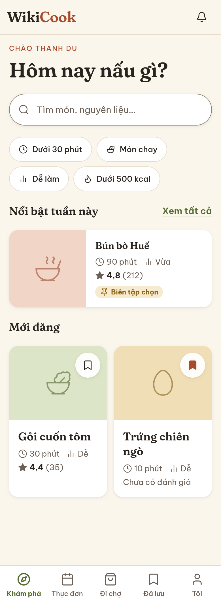
    - **Desktop Web View:**  
      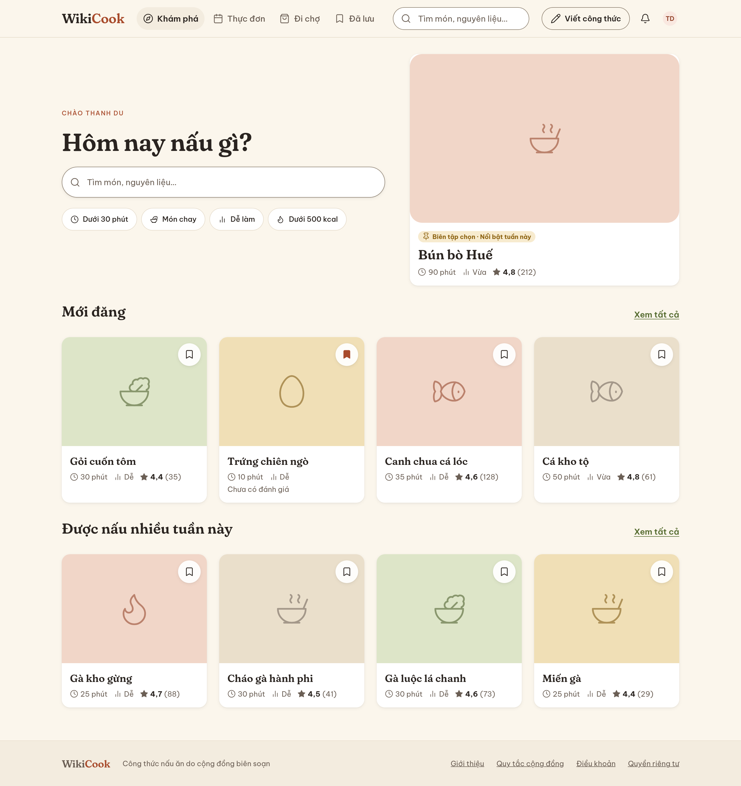
  - **Recipe search results list (`SE02-SearchResults`):**
    - **Mobile View (iPhone 12 Pro):**  
      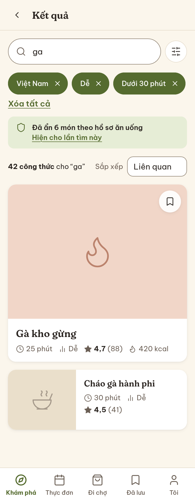
    - **Desktop Web View:**  
      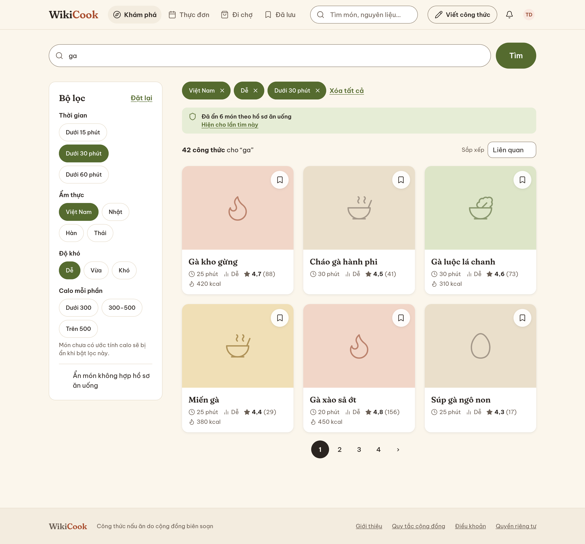

---

### UC-020-02: Filter Search Results
*Performed by: Nguyễn Đức Duy (DucDuyNguyen15-IT) | Reviewed by: Nguyễn Thành Dự (ThanhDu14) | Edited by: Nguyễn Đức Duy (DucDuyNguyen15-IT)*

#### 1. Name and Identifier
- **Use Case ID:** `UC-020-02`
- **Use Case Name:** Narrow Search Results with Combinable Filters and Quick Filters

#### 2. Actor(s)
- **Primary Actor:** **Guest** (Vision §3.2 "Health-conscious cook with limited time"; Member inherits this use case).

#### 3. Description
Extends `UC-020-01` at the results page. The actor narrows the results by total time, cuisine, difficulty, cooking method, category and calories per serving. Filters from different groups combine with **AND**; several values inside one group combine with **OR** (total time allows one choice only). Active filters are shown as removable chips. On narrow screens the filters open in a bottom sheet. Home-page quick filters are a shortcut into this use case.

#### 4. Preconditions
- The actor is on the results page of `UC-020-01` (with or without a keyword), or on the home page for a quick filter.
- Cuisines, categories and cooking methods are loaded from the lists managed by administrators (`100`); they are not hard-coded (FR-009).

#### 5. Basic Flow
*(Wide screen, ≥ 768 px)*
1. **View Filter Panel:** On the results page the system shows the filter groups: Total time (≤ 15, ≤ 30, ≤ 60, > 60 minutes), Cuisine, Difficulty (Dễ, Vừa, Khó), Cooking method, Category and Calories per serving (< 300, 300–500, 500–800, > 800 kcal) (FR-007).
2. **Select Filters:** The actor selects cuisine "Việt Nam" and total time "Dưới 30 phút".
3. **Apply Filters:** The system combines the two groups with AND and returns only Vietnamese recipes whose preparation + cooking time is 30 minutes or less (FR-008, US2 AS3).
4. **Reset Page and Refresh:** The system returns to page 1, updates the result count and cards, and writes the filters into the page address (FR-017, FR-023).
5. **Show Chips:** The system shows each active filter as a removable chip ("Việt Nam ×", "Dưới 30 phút ×") and a "Xóa tất cả" action (FR-011).
6. **Add a Value in the Same Group:** The actor also selects cuisine "Nhật Bản". The system shows recipes of either cuisine that still satisfy the time filter (OR inside the group, US2 AS2).
7. **Remove One Chip:** The actor removes the chip "Nhật Bản". The system refreshes the results without resetting the keyword or the other filters (US2 AS5).
8. **Clear All:** The actor taps "Xóa tất cả". The system removes all filters but keeps the keyword (US2 AS8).

#### 6. Alternative Flows
- **AF 2.1: Quick Filter from the Home Page:**
  - *Trigger:* On the home page the actor taps a quick filter (e.g., "Dưới 30 phút").
  - *Steps:*
    1. The system opens the results page with that filter already applied and no keyword (US2 AS6).
  - *Outcome:* Filtered results are reached in at most 2 taps (SC-006).
- **AF 2.2: Mobile Bottom Sheet (screen < 768 px):**
  - *Trigger:* At Step 1, the screen is narrower than 768 px and the actor taps "Bộ lọc".
  - *Steps:*
    1. The system opens the filters in a bottom sheet.
    2. While the actor changes options, the sheet shows the number of matching results on its apply button ("Hiện N kết quả").
    3. The actor taps "Hiện N kết quả"; the system applies the filters and continues at Step 4.
    4. *Alternative:* The actor closes the sheet without applying; the system discards the changes and keeps the previous filters (FR-012).
- **AF 2.3: Calories Filter Active:**
  - *Trigger:* At Step 2, the actor selects a calories range (e.g., 300–500 kcal).
  - *Steps:*
    1. The system shows only recipes whose estimated calories per serving (from `090`) are in that range.
    2. The system excludes recipes without a calorie estimate and shows a note explaining this (FR-010, US2 AS4).
  - *Note:* While Feature 090 provides no estimates, the calories group is hidden rather than broken (spec 020 Assumptions).
- **AF 2.4: Filters Leave No Results:**
  - *Trigger:* At Step 3, no recipe matches all selected filters (a filter option with no matches is still selectable).
  - *Steps:*
    1. The system shows the empty state with a one-tap action that removes the last filter (e.g., "Bỏ lọc “Khó”") and "Xóa tất cả bộ lọc".
- **AF 2.5: Filter Value No Longer Exists:**
  - *Trigger:* A cuisine, category or cooking method in the page address was removed by an administrator.
  - *Steps:*
    1. The system ignores the unknown value without an error page and applies the remaining filters (FR-024).

#### 7. Postconditions
- **Success:** Only recipes satisfying every active filter group are shown, starting from page 1; active filters are visible as chips and are part of the page address.
- **Cancelled (mobile sheet closed without applying):** The previous filters and results are unchanged.

#### 8. Special Requirements
- **Usability:** At least 90% of test participants find a recipe matching three given criteria (e.g., Vietnamese, under 30 minutes, Easy) in under 30 seconds (SC-003).
- **Responsiveness:** Filters and quick filters are fully usable from 360 px wide, with touch targets of at least 44 × 44 px (NFR-002).
- **Accessibility:** Filters and chips are operable by keyboard only and have visible labels (NFR-006).
- **Diet type is not automatic:** "Vegetarian" or "Keto" is only offered as a normal filter the actor chooses; it is never applied from the dietary profile (FR-022).

#### UI Screen References & Asset Gaps (SCRUM-58)
- **Basic Flow:** [`SR02-Results.dc.html`](../analysis-and-design/ui-ux/screens/SR02-Results.dc.html) (active filters as chips).
- **Alternative Flows:** [`SR01-Home.dc.html`](../analysis-and-design/ui-ux/screens/SR01-Home.dc.html) (AF 2.1), [`SR03-FilterSheet.dc.html`](../analysis-and-design/ui-ux/screens/SR03-FilterSheet.dc.html) (AF 2.2), [`SR04-NoResults.dc.html`](../analysis-and-design/ui-ux/screens/SR04-NoResults.dc.html) (AF 2.4).
- **UI Asset Gap for SCRUM-58:** No screen shows the note "recipes without a calorie estimate are hidden" (AF 2.3) — *Gap 020-B*.
- **Prototype Screenshots (SCRUM-58):**
  - **Advanced search filters (`SE03-FilterSheet`):**
    - **Mobile View (iPhone 12 Pro):**  
      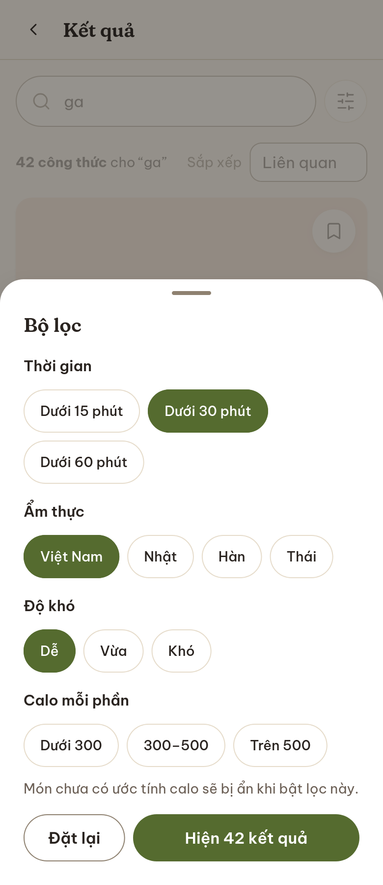
    - **Desktop Web View:**  
      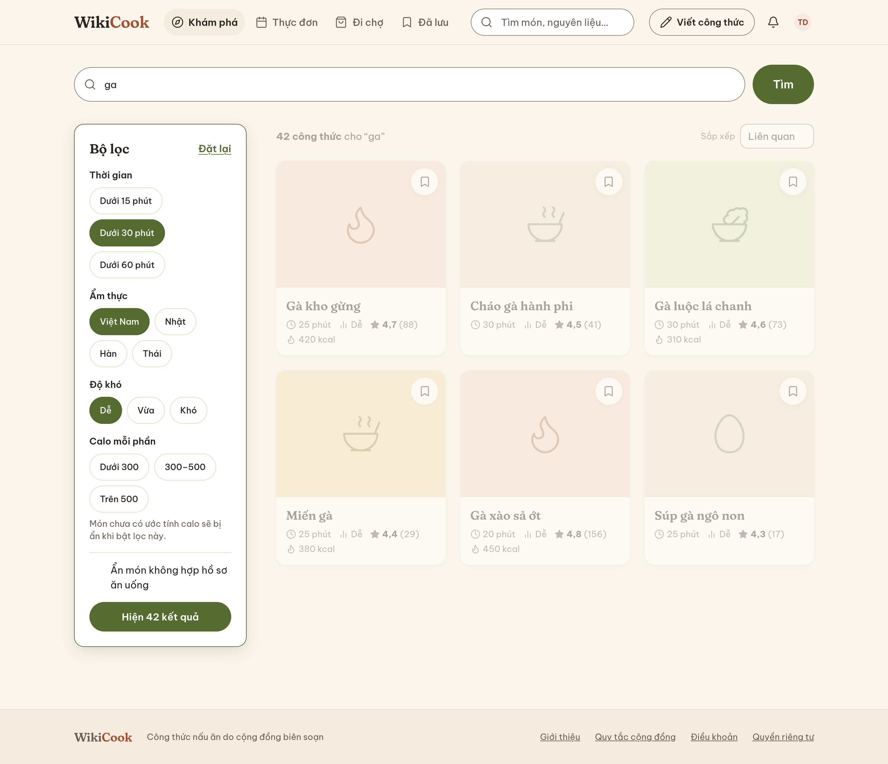

---

### UC-020-03: Hide Recipes Conflicting with Dietary Profile
*Performed by: Nguyễn Đức Duy (DucDuyNguyen15-IT) | Reviewed by: Nguyễn Thành Dự (ThanhDu14) | Edited by: Nguyễn Đức Duy (DucDuyNguyen15-IT)*

#### 1. Name and Identifier
- **Use Case ID:** `UC-020-03`
- **Use Case Name:** Automatically Hide Recipes that Contain the Member's Allergens or Excluded Ingredients

#### 2. Actor(s)
- **Primary Actor:** **Member** with a non-empty dietary profile (Vision §3.2 "User with a food allergy").
- **Included Use Case:** `UC-011-05` Apply Dietary Hard Rules (single definition of the exclusion rule, shared with the AI planner `UC-031-01`).

#### 3. Description
Extends `UC-020-01` when the actor is signed in and has a dietary profile. Every search automatically hides recipes that contain an ingredient linked to one of the Member's allergens or an ingredient the Member excluded. The page tells the actor how many recipes were hidden and offers to show them **for the current search only**, each with a warning naming the conflict. The only source for "this ingredient contains this allergen" is the allergen links of the shared ingredient catalogue; AI-estimated allergen tags from `090` are display-only (FR-018).

#### 4. Preconditions
- The actor is signed in as Member (or a higher role) with a valid session.
- The actor's dietary profile (`011`) lists at least one allergen or excluded ingredient.
- `UC-020-01` has been started (a keyword search or browse-all).

#### 5. Basic Flow
1. **Start Search:** The Member searches `ga` as in `UC-020-01` Steps 1–5.
2. **Load Profile:** The system reads the Member's current dietary profile: allergen "Đậu phộng" and excluded ingredient "Ngò rí".
3. **Apply Hard Rules (include `UC-011-05`):** The system marks every matching recipe that contains an ingredient linked to peanut in the ingredient catalogue, or that lists coriander, as conflicting (FR-018).
4. **Hide Conflicts:** The system removes the conflicting recipes from the results and from the total count.
5. **Show Notice:** The system shows the notice "Đã ẩn 6 món theo hồ sơ ăn uống" with the action "Hiện cho lần tìm này" (FR-019).
6. **Continue Browsing:** The actor continues with the remaining results; filters (`UC-020-02`) and sorting/paging (`UC-020-04`) operate on the filtered set.

#### 6. Alternative Flows
- **AF 3.1: Show Hidden Recipes for This Search:**
  - *Trigger:* At Step 5, the actor taps "Hiện cho lần tìm này".
  - *Steps:*
    1. The system adds the hidden recipes back to the results.
    2. Each such card carries a visible warning naming the conflict (e.g., "Có đậu phộng", "Có ngò rí"), and a banner reads "Đang hiện 4 món không hợp hồ sơ — Chỉ áp dụng cho lần tìm này. Tìm mới sẽ ẩn lại." (FR-020).
    3. When the actor changes the keyword or leaves the results page, the system switches the dietary filter back on automatically. Changing filters, sort order or page keeps the override for the same search.
  - *Outcome:* The actor sees everything but cannot miss the warning; the override never persists.
- **AF 3.2: Every Match Is Hidden:**
  - *Trigger:* At Step 4, all matching recipes conflict with the profile.
  - *Steps:*
    1. The system shows the empty state "Cả 4 món đều bị ẩn" explaining that all N matches were hidden by the dietary profile (US3 AS6).
    2. The system offers "Hiện cho lần tìm này" (continues at AF 3.1) and "Sửa hồ sơ ăn uống" (opens `UC-011-01`).
- **AF 3.3: Empty Dietary Profile or Guest:**
  - *Trigger:* The actor is a Guest, or a Member whose profile has no allergens and no excluded ingredients.
  - *Steps:*
    1. The extension condition is false: nothing is hidden and no notice is shown (US3 AS4).
- **AF 3.4: Session Expires During the Search:**
  - *Trigger:* At Step 2, the session token is no longer valid.
  - *Steps:*
    1. The system continues the search as for a Guest, so dietary exclusion is switched off.
    2. The system shows a notice asking the actor to sign in again to apply their profile.
- **AF 3.5: Profile Changed Since the Last Search:**
  - *Trigger:* The Member updated the dietary profile in `UC-011-01`.
  - *Steps:*
    1. At the next search, Step 2 reads the new profile and the new rules apply immediately (US3 AS5).

#### 7. Postconditions
- **Success:** No recipe containing the Member's allergens or excluded ingredients is shown unless the actor explicitly chose the per-search override; the number of hidden recipes is displayed whenever it is greater than zero.
- **Always:** The override is not stored in the profile and ends with the current search.

#### 8. Special Requirements
- **Safety:** With the override off, 0 recipes containing the user's allergens or excluded ingredients appear in acceptance tests (SC-004).
- **Single Rule:** The exclusion rule is defined once (`UC-011-05`) and applied identically by search and the AI Weekly Meal Planner `031` (FR-021).
- **Diet Type:** Diet type from the profile (e.g., vegetarian, keto) is a preference, not a hard rule, and is never applied automatically (FR-022).

#### UI Screen References & Asset Gaps (SCRUM-58)
- **Basic Flow:** [`SR02-Results.dc.html`](../analysis-and-design/ui-ux/screens/SR02-Results.dc.html) (notice "Đã ẩn 6 món theo hồ sơ ăn uống").
- **Alternative Flows:** [`SR06-ShownWithWarning.dc.html`](../analysis-and-design/ui-ux/screens/SR06-ShownWithWarning.dc.html) (AF 3.1), [`SR05-AllHidden.dc.html`](../analysis-and-design/ui-ux/screens/SR05-AllHidden.dc.html) (AF 3.2).
- **UI Asset Gap for SCRUM-58:** No screen for the "sign in again to apply your profile" notice (AF 3.4) — *Gap 020-C*.
- **Prototype Screenshots (SCRUM-58):**
  - **Filter vs. dietary preference conflict warning (`SE04-FilterConflict`):**
    - **Mobile View (iPhone 12 Pro):**  
      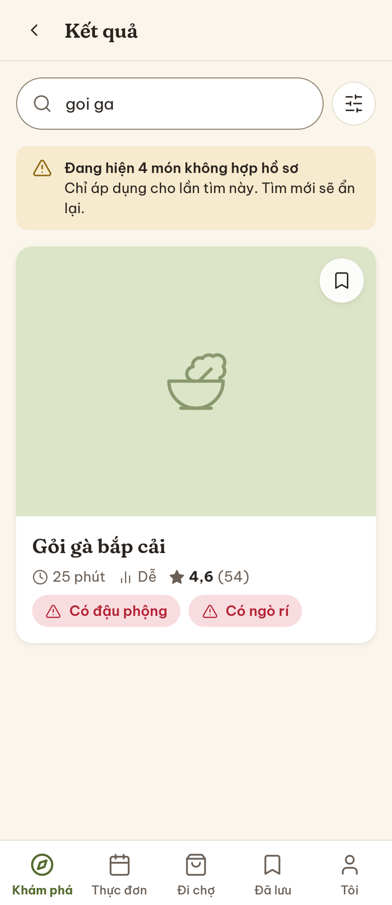
    - **Desktop Web View:**  
      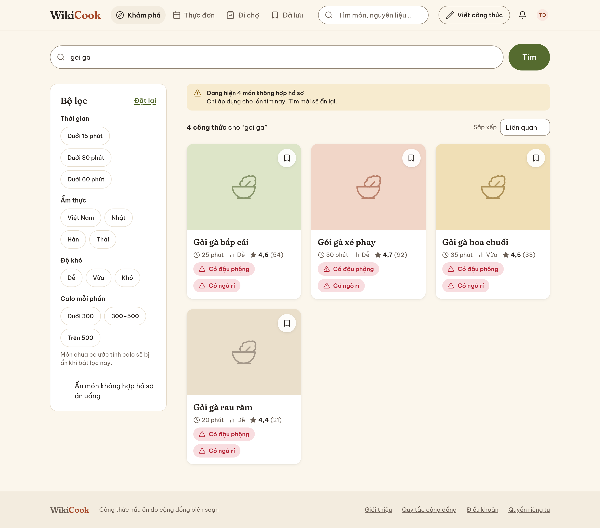
  - **All results hidden due to allergies state (`SE05-AllHidden`):**
    - **Mobile View (iPhone 12 Pro):**  
      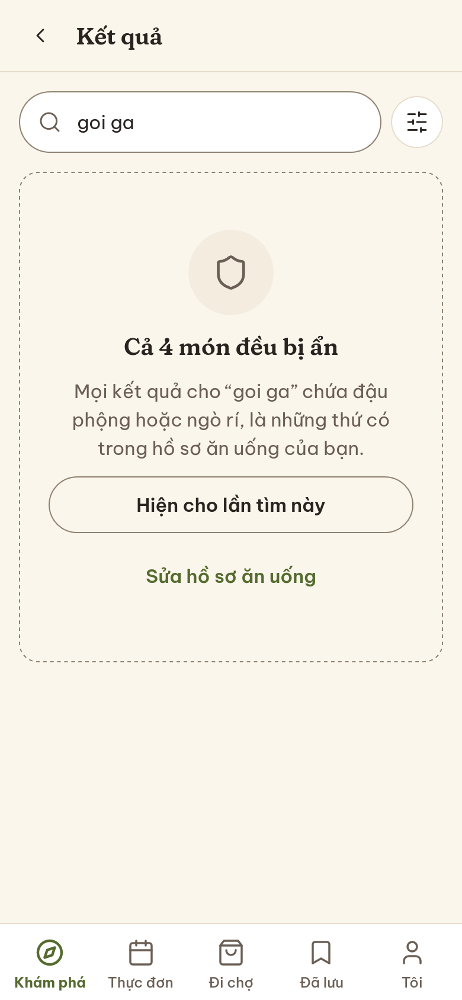
    - **Desktop Web View:**  
      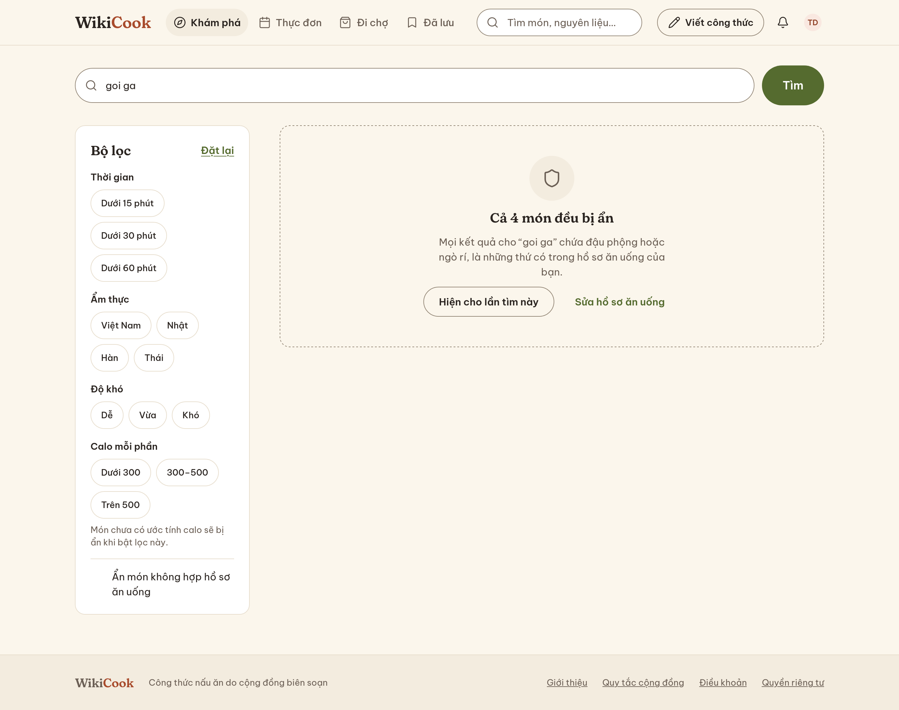

---

### UC-020-04: Sort, Paginate & Share Results
*Performed by: Nguyễn Đức Duy (DucDuyNguyen15-IT) | Reviewed by: Nguyễn Thành Dự (ThanhDu14) | Edited by: Nguyễn Đức Duy (DucDuyNguyen15-IT)*

#### 1. Name and Identifier
- **Use Case ID:** `UC-020-04`
- **Use Case Name:** Sort Results, Move Between Pages and Share or Restore a Search by its Address

#### 2. Actor(s)
- **Primary Actor:** **Guest** (Vision §3.2 "User comparing options with family"; Member inherits this use case).

#### 3. Description
Extends `UC-020-01` at the results page. The actor changes the sort order (Relevance, Newest, Top rated, Quickest), moves between numbered pages of 20 recipes and shares the page address. The keyword, filters, sort order and page always live in the address, so reloading, sharing and the browser Back/Forward buttons restore exactly the same search.

#### 4. Preconditions
- The actor is on the results page of `UC-020-01`, or opens a results address shared by someone else.

#### 5. Basic Flow
1. **View Default Order:** The system shows results sorted by Relevance ("Liên quan") when a keyword is present, or by Newest when there is none (FR-014).
2. **Change Sort Order:** The actor opens "Sắp xếp" and chooses "Top rated".
3. **Re-order:** The system ranks recipes with at least 3 reviews by average rating (then by review count), followed by recipes with fewer than 3 reviews ordered by average rating, then by recipes without reviews; ties are broken by newest first, then by a stable unique order (FR-014a, FR-015).
4. **Return to Page 1:** The system shows page 1 of the re-ordered list and updates the address (FR-017, FR-023).
5. **Go to Another Page:** The actor selects page 2 in the numbered pagination.
6. **Show Next Page:** The system shows recipes 21–40, scrolls to the top of the results and updates the address (FR-016, US4 AS3).
7. **Share:** The actor copies the page address and sends it to a family member.
8. **Restore from Address:** The family member opens the address (also as a Guest). The system restores the same keyword, filters, sort order and page and shows the same results (US4 AS4).
9. **Navigate Back:** The actor presses the browser Back button. The system restores the previous search state step by step (page 1, then the previous sort order) (US4 AS5).

#### 6. Alternative Flows
- **AF 4.1: Sorting Without a Keyword:**
  - *Trigger:* At Step 2, the search has no keyword.
  - *Steps:*
    1. The system does not offer "Relevance"; the options are Newest, Top rated and Quickest (FR-014).
- **AF 4.2: Invalid Values in the Address:**
  - *Trigger:* At Step 8, the address contains an unknown sort value, an unknown filter value or a page number beyond the last page.
  - *Steps:*
    1. The system ignores unknown values and falls back to the defaults.
    2. For a page number beyond the last page, the system shows the last valid page.
  - *Outcome:* No error page is ever shown for a malformed address (FR-024, US4 AS6).
- **AF 4.3: Only One Page of Results:**
  - *Trigger:* At Step 5, there are 20 results or fewer.
  - *Steps:*
    1. The system hides the pagination control; the total count is still displayed.
- **AF 4.4: Shared Address Opened by a Member with a Dietary Profile:**
  - *Trigger:* At Step 8, the recipient is a signed-in Member with a dietary profile.
  - *Steps:*
    1. The system restores the shared state and additionally applies the recipient's own dietary exclusion (`UC-020-03`); the per-search override of the sender is not part of the address and is not transferred.
  - *Outcome:* Results may differ from the sender's only by the recipes hidden for the recipient's safety.

#### 7. Postconditions
- **Success:** The results are shown in the chosen order and page, and the page address fully describes the search state.
- **Always:** Search state is kept only in the address and the current session; nothing is stored per user (spec 020 Key Entities — Search State).

#### 8. Special Requirements
- **Shareability:** 100% of shared search links reproduce the same keyword, filters, sort order, page and results when opened in another browser (SC-005).
- **Stable Paging:** Tie-breaking guarantees that pages never repeat or skip recipes for an unchanged catalogue (FR-015).
- **Pagination Style:** Numbered pages of 20 only — no infinite scroll or "load more" (FR-016, Clarification 2026-10-08).
- **Accessibility:** The sort control and pagination are keyboard-operable (NFR-006).

#### UI Screen References & Asset Gaps (SCRUM-58)
- **Basic Flow:** [`SR02-Results.dc.html`](../analysis-and-design/ui-ux/screens/SR02-Results.dc.html) (sort control "Sắp xếp · Liên quan").
- **UI Asset Gap for SCRUM-58:** No screen shows the open sort menu and the numbered pagination control — *Gap 020-D*.
- **Prototype Screenshots (SCRUM-58):**
  - **No matching results state (`SE06-EmptyResults`):**
    - **Mobile View (iPhone 12 Pro):**  
      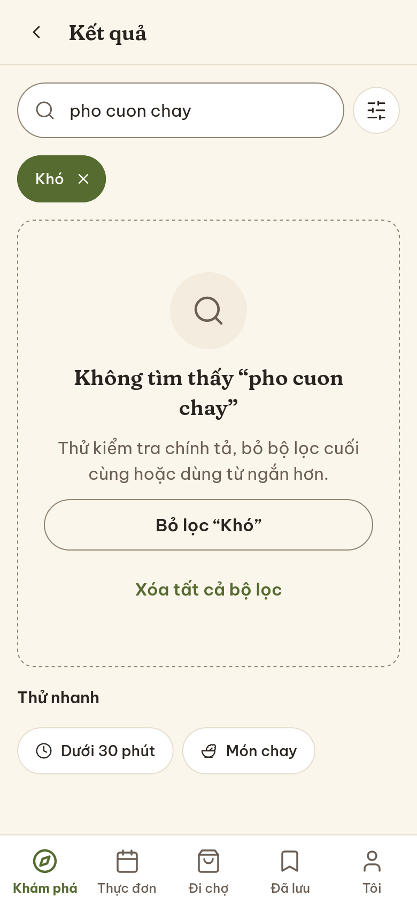
    - **Desktop Web View:**  
      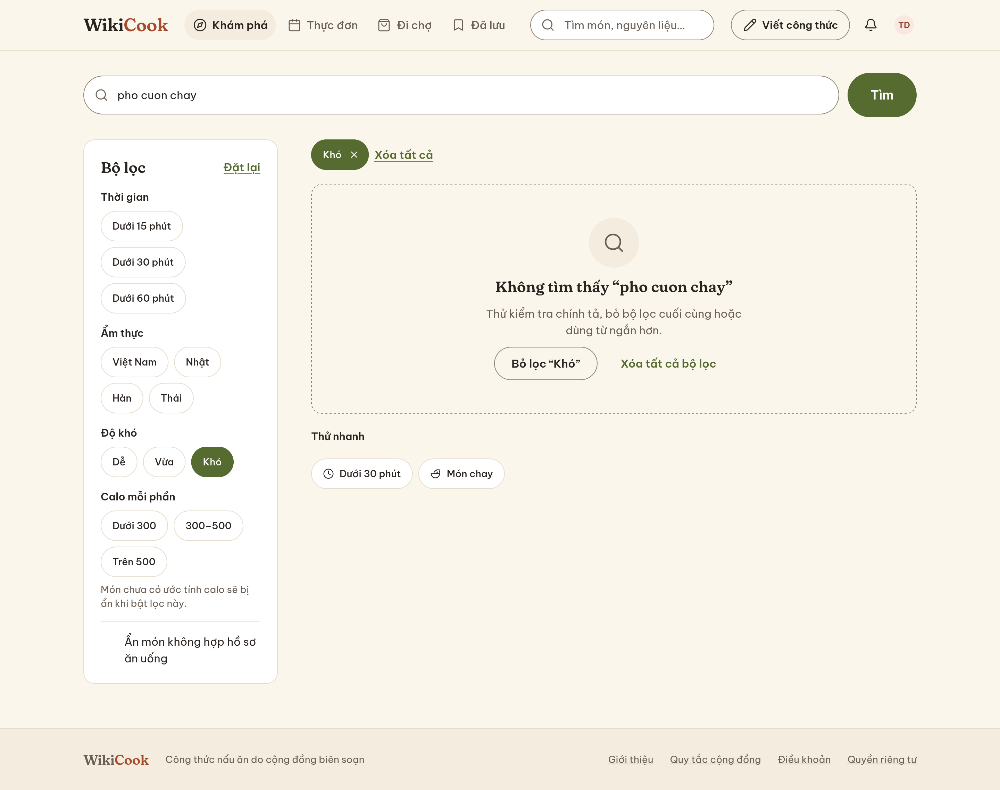

---

### UC-020-05: Find Recipes by Pantry Ingredients *(Brief — planned increment)*
*Performed by: Nguyễn Đức Duy (DucDuyNguyen15-IT) | Reviewed by: Nguyễn Thành Dự (ThanhDu14) | Edited by: Nguyễn Đức Duy (DucDuyNguyen15-IT)*

> [!IMPORTANT]
> Vision §5.2 promises "find recipes by the ingredients in my fridge", but `specs/020-recipe-search-filter/spec.md` lists it as **out of scope** for this release. Following Use-Case Model §6.2 issue 1, this use case is kept in the model and written at the **Brief** level only. It has no functional requirements and is not implemented in Sprint 3. The fully dressed version will be written when a specification is created for it.

#### 1. Name and Identifier
- **Use Case ID:** `UC-020-05`
- **Use Case Name:** Find Recipes by the Ingredients Available at Home

#### 2. Actor(s)
- **Primary Actor:** **Guest** (Vision §3.2 "Budget-conscious student"; Member inherits this use case).

#### 3. Description
The actor enters the ingredients they already have (e.g., "trứng", "cà chua", "hành lá"). The system lists published recipes that can be cooked with those ingredients, ranked by how many of the recipe's required (non-optional) ingredients are covered, and shows for each recipe which ingredients are still missing.

#### 4. Preconditions
- Same as `UC-020-01`. A specification defining the matching and ranking rules exists *(not yet — planned increment)*.

#### 5. Basic Flow (outline)
1. The actor opens the "Tìm theo nguyên liệu có sẵn" entry and adds ingredients from the shared ingredient catalogue (diacritic-insensitive suggestions, as in `060` FR-007).
2. The system finds published recipes that use the selected ingredients.
3. The system ranks them by the share of required ingredients covered and shows "Thiếu 2 nguyên liệu" on each card.
4. The actor opens a recipe (`UC-020-06`).

#### 6. Alternative Flows (outline)
- **AF 5.1:** No recipe uses the selected ingredients → empty state suggesting fewer ingredients.
- **AF 5.2:** Signed-in Member with a dietary profile → `UC-020-03` applies to these results as well.

#### 7. Postconditions
- The actor sees recipes they can cook with what they have, with missing ingredients listed.

#### 8. Special Requirements
- To be defined in the future specification. Expected to reuse NFR-001 (under 1 second) and NFR-004 (safe input) of spec 020.

#### UI Screen References & Asset Gaps (SCRUM-58)
- **UI Asset Gap for SCRUM-58:** No prototype screens; none are required for PA3 because the use case is a planned increment.
- **Prototype Screenshots (SCRUM-58):** Not applicable for PA3: this is a planned increment (brief use case) and no prototype screen has been designed yet; it is scheduled with the pantry search work in a later sprint.

---

### UC-020-06: View Recipe Details
*Performed by: Nguyễn Đức Duy (DucDuyNguyen15-IT) | Reviewed by: Nguyễn Thành Dự (ThanhDu14) | Edited by: Nguyễn Đức Duy (DucDuyNguyen15-IT)*

> [!NOTE]
> Spec 020 excludes "the content of the recipe detail page", and no single spec owns the page. Following Use-Case Model §4.11 and §6.2 issue 3, this use case specifies the **page frame** (header, ingredients, equipment, steps, video, serving selector, access rules). The other blocks are separate use cases that **extend** it at the extension points below; each block owner confirms their row in §4.11 of the model.

#### 1. Name and Identifier
- **Use Case ID:** `UC-020-06`
- **Use Case Name:** View the Details of a Published Recipe (Shared Recipe Detail Page)

#### 2. Actor(s)
- **Primary Actor:** **Guest** (Member and higher roles inherit this use case).

#### 3. Description
Shows one published recipe as readers see it: header (cover, name, category and cuisine, author, rating, total time, difficulty, servings), the ingredient list in the author's groups and order, equipment, numbered steps with photos and timer durations, and the optional video. It is the hub from which most other features start: nutrition, saving, meal planning, shopping list, cooking mode and reviews are offered as page blocks or buttons that extend this use case.

#### 4. Preconditions
- The actor followed a link to a recipe: a search result card (`UC-020-01`), a collection, a meal-plan slot, a shopping-list source, a notification or a shared address.

#### 5. Basic Flow
1. **Request Recipe:** The actor selects the card "Canh chua cá lóc" on the results page.
2. **Load Recipe:** The system loads the recipe and checks that it is `PUBLISHED`. If the recipe has a revision under review (`UC-060-05`), the system loads the current published version, not the revision.
3. **Display Header:** The system shows the cover image, name, "Canh · Việt Nam", author name and avatar, average rating with review count (e.g., "4,6 (128)"), total time "35 phút", difficulty "Dễ" and servings "4 người".
4. **Display Ingredients:** The system lists the ingredients under the author's group headings and in the author's order, each with quantity, unit and note (e.g., "800 g cá lóc", "Me chua vừa đủ"); optional ingredients are marked as optional.
5. **Display Equipment, Steps and Video:** The system lists the equipment, then the numbered steps with their photos and timer durations, then the embedded YouTube or TikTok video if the author added one.
6. **Render Extension Blocks:** The system renders the blocks of the extending use cases at their extension points (see below).
7. **Change Servings:** The actor changes "Khẩu phần" from 4 to 2. The system recalculates the displayed quantities proportionally; ingredients with the unit "vừa đủ" (to taste) are not scaled. The stored recipe is unchanged.
8. **Continue:** The actor reads the recipe or chooses one of the actions offered at the extension points. The use case ends when the actor leaves the page.

**Extension Points** (contract agreed in Use-Case Model §4.11):

| Extension Point | Page Block / Button | Extending Use Case | Visible to | Owner |
| :--- | :--- | :--- | :--- | :--- |
| `EP-1 Nutrition` | Nutrition block "Dinh dưỡng", allergen badges, AI diet labels | `UC-090-01`, `UC-090-04` | Guest and above | Nguyễn Thành Dự |
| `EP-2 Plan` | "Thêm vào thực đơn" | `UC-030-02` | Member and above | Nguyễn Thành Dự |
| `EP-3 Shop` | "Thêm vào danh sách đi chợ" | `UC-040-02` | Member and above | Lê Quốc Hưng |
| `EP-4 Cook` | "Bắt đầu nấu" | `UC-050-01` | Guest and above | Lê Quốc Hưng |
| `EP-5 Save` | "Lưu công thức" / "Lưu vào bộ sưu tập" | `UC-080-01` | Member and above | Mai Văn Hiển |
| `EP-6 Reviews` | Reviews and Cooksnaps section, "Viết đánh giá" | `UC-070-04` (read), `UC-070-01` (write) | Read: Guest; write: Member | Trần Nguyễn Công Chung |

#### 6. Alternative Flows
- **AF 6.1: Guest Presses a Member-Only Button:**
  - *Trigger:* At Step 8, a Guest taps "Lưu công thức", "Thêm vào thực đơn", "Thêm vào danh sách đi chợ" or "Viết đánh giá".
  - *Steps:*
    1. The system shows the sign-in prompt explaining that the action needs an account, with "Đăng nhập" and "Đăng ký".
    2. The actor signs in (`UC-010-02` or `UC-010-04`) or registers (`UC-010-01`).
    3. The system returns the actor to the same recipe and the same scroll position, and resumes the requested action.
    4. *Alternative:* The actor dismisses the prompt; the page stays unchanged.
- **AF 6.2: Recipe No Longer Available:**
  - *Trigger:* At Step 2, the recipe exists but is `ARCHIVED` or was unpublished after the actor's results were loaded.
  - *Steps:*
    1. The system shows the message "Công thức này không còn khả dụng" with a link back to search, instead of an error page (spec 020 Edge Cases; `060` US6 AS1).
- **AF 6.3: Recipe Not Found or Not Visible to the Actor:**
  - *Trigger:* At Step 2, the address points to a recipe that does not exist, or to a `DRAFT`, `PENDING`, `REJECTED` or `REVISION_REQUESTED` recipe of another user.
  - *Steps:*
    1. The system shows the "Không tìm thấy trang" page (404) without any hint that the recipe exists (`060` FR-002, NFR-004).
  - *Note:* The author previews their own unpublished recipe in step 6 of the wizard (`UC-060-01`), not on this page.
- **AF 6.4: Optional Content Missing:**
  - *Trigger:* At Steps 3–5, the recipe has no cover image, no reviews or no video, or the video was removed from YouTube/TikTok.
  - *Steps:*
    1. The system shows a neutral placeholder instead of the cover and "Chưa có đánh giá" instead of the rating.
    2. The system hides the video block; the rest of the recipe stays visible (`060` Edge Cases).
- **AF 6.5: Extension Block Unavailable:**
  - *Trigger:* At Step 6, an extending feature cannot provide its block (e.g., no nutrition estimate yet).
  - *Steps:*
    1. The system shows that block's own unavailable state (defined in the extending use case) and renders the rest of the page normally.
  - *Outcome:* A failing block never prevents the recipe from being read.
- **AF 6.6: Network Failure While Loading:**
  - *Trigger:* At Step 2, the request fails.
  - *Steps:*
    1. The system shows an error state with "Thử lại"; if the device is fully offline, the system shows the offline page.
    2. The actor taps "Thử lại" and the system repeats Step 2.

#### 7. Postconditions
- **Success:** The actor sees the published version of the recipe with all available blocks; changing servings affects only the display.
- **Always:** No data of unpublished recipes or revisions under review is revealed to anyone other than the author and moderators (`060` FR-002).

#### 8. Special Requirements
- **Safe Rendering:** All author-entered text (name, description, notes, steps) is displayed as plain text, never as markup (`060` NFR-003).
- **Responsiveness:** The page is fully usable from 360 px wide; buttons have touch targets of at least 44 × 44 px (`020` NFR-002).
- **Accessibility & Language:** Headings, buttons and the serving selector are keyboard-operable with visible labels; texts are in Vietnamese in the shared string store (`020` NFR-003, NFR-006).
- **Independence of Blocks:** Each extension block loads independently, so the header, ingredients and steps are shown even when a block fails (AF 6.5).

#### UI Screen References & Asset Gaps (SCRUM-58)
- **Basic Flow:** [`NU01-Detail.dc.html`](../analysis-and-design/ui-ux/screens/NU01-Detail.dc.html) (header, "Khẩu phần", "Nguyên liệu", "Các bước", "Bắt đầu nấu", "Thêm vào thực đơn").
- **Alternative Flows:** [`AU08-SignInPrompt.dc.html`](../analysis-and-design/ui-ux/screens/AU08-SignInPrompt.dc.html) (AF 6.1), [`CM01-NotFound.dc.html`](../analysis-and-design/ui-ux/screens/CM01-NotFound.dc.html) (AF 6.3), [`CM04-OfflinePage.dc.html`](../analysis-and-design/ui-ux/screens/CM04-OfflinePage.dc.html) (AF 6.6).
- **UI Asset Gap for SCRUM-58:** No screen for "Công thức này không còn khả dụng" (AF 6.2) — *Gap 020-E*; NU01 does not yet show the equipment list, video block and the "Thêm vào danh sách đi chợ" / "Lưu công thức" buttons in one view — *Gap 020-F*.
- **Prototype Screenshots (SCRUM-58):**
  - **Shared recipe detail page (`SE07-RecipeDetailShared`):**
    - **Mobile View (iPhone 12 Pro):**  
      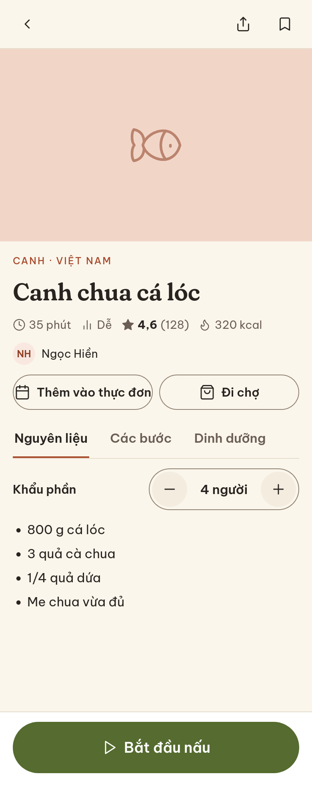
    - **Desktop Web View:**  
      

---

## 7. USE-CASE SPECIFICATIONS FOR FEATURE 060: COMMUNITY RECIPE CONTRIBUTION
*Performed by: Nguyễn Đức Duy (DucDuyNguyen15-IT) | Reviewed by: Nguyễn Thành Dự (ThanhDu14) | Edited by: Nguyễn Đức Duy (DucDuyNguyen15-IT)*

> [!NOTE]
> **Sources:** `specs/060-recipe-editor/spec.md` (US1–US6, FR-001 – FR-033, NFR-001 – NFR-007, Clarifications 2026-10-08), [Vision Document](vision-document.md) §5.6 and Use-Case Model §4.6 (`SCRUM-49`). The primary actor is **Member** (Vision §3.2 "Recipe contributor"); Verified Contributor, Moderator and Administrator inherit these use cases. The **Moderator** is a secondary actor: their decisions are made in `UC-100-01` Moderate Recipe Submission and only change the recipe status seen here.
>
> **Recipe lifecycle (author transitions, FR-023):** `DRAFT → PENDING` (submit), `PENDING → DRAFT` (withdraw), `REVISION_REQUESTED → PENDING` (resubmit), `PUBLISHED → ARCHIVED` (archive), `ARCHIVED → PUBLISHED` (restore). Moderator transitions (FR-024): `PENDING → PUBLISHED | REJECTED | REVISION_REQUESTED`.

### UC-060-01: Create Recipe with Wizard & Submit for Review
*Performed by: Nguyễn Đức Duy (DucDuyNguyen15-IT) | Reviewed by: Nguyễn Thành Dự (ThanhDu14) | Edited by: Nguyễn Đức Duy (DucDuyNguyen15-IT)*

#### 1. Name and Identifier
- **Use Case ID:** `UC-060-01`
- **Use Case Name:** Create a Recipe with the 6-Step Wizard and Submit it for Moderation

#### 2. Actor(s)
- **Primary Actor:** **Member** (signed in, active account; a verified email is needed only for the final submission).
- **Secondary Actor:** **Moderator** (receives the submission in `UC-100-01`).
- **Included Use Case:** `UC-060-02` Save & Resume Draft. **Extending Use Case:** `UC-060-07` Propose New Ingredient.

#### 3. Description
The Member writes a recipe one step at a time in a six-step wizard — (1) General information, (2) Ingredients, (3) Equipment, (4) Steps, (5) Video, (6) Review — with validation on every "Next". The draft is saved automatically throughout (`UC-060-02`). At the last step the Member sees the recipe as readers will see it and submits it; the recipe moves from `DRAFT` to `PENDING` and enters the moderation queue.

#### 4. Preconditions
- The actor is signed in with an active (not suspended or banned) account of role Member or higher (FR-001).
- The actor has fewer than 20 open drafts (FR-030).
- The device is online for the first save of a new recipe (spec 060 Assumptions).

#### 5. Basic Flow
1. **Start Wizard:** On "Công thức của tôi" the actor taps "Tạo mới". The system creates a new `DRAFT` and opens step 1 with a progress bar showing the six steps (US1 AS1).
2. **Step 1 — General Information:** The actor enters name "Canh chua cá lóc" (5–100 characters), a short description (≤ 500), uploads a cover photo (JPEG/PNG/WebP, ≤ 5 MB), selects cuisine "Việt Nam", category "Canh", cooking method "Nấu", up to 10 tags, difficulty "Dễ", preparation time 15 and cooking time 40 minutes (0–1,440 each, total > 0) and servings 4 (1–50) (FR-005, FR-014).
3. **Validate and Advance:** The actor taps "Tiếp". The system validates step 1, saves the draft (`UC-060-02`) and opens step 2 (FR-013, FR-016).
4. **Step 2 — Ingredients:** The actor types `ca loc`. Within 500 ms the system suggests catalogue ingredients ignoring diacritics and case ("Cá lóc"). The actor chooses it and fills quantity `800`, unit `g`, note "cắt khúc" (≤ 100 characters) and leaves "optional" unchecked (FR-006, FR-007, NFR-002).
5. **Group and Order:** The actor adds more rows (1–50 in total), creates the group "Phần nước dùng", moves "Me chua" and "Cà chua" into it and reorders rows with drag-and-drop or the move up / move down buttons (FR-008, NFR-005).
6. **Step 3 — Equipment:** The actor selects "Nồi" from the equipment list maintained by administrators (zero or more items) (FR-009).
7. **Step 4 — Steps:** The actor adds steps (1–30), each with text (1–1,000 characters), at most one optional photo and at most one optional timer between 10 seconds and 24 hours (e.g., 15 minutes); steps can be reordered or deleted (FR-010).
8. **Step 5 — Video:** The actor pastes a YouTube link. The system validates that it is a YouTube or TikTok video page and shows a preview (FR-011).
9. **Step 6 — Review:** The system shows the recipe as readers will see it ("Người đọc sẽ thấy") and confirms that no required item is missing (FR-012).
10. **Submit:** The actor taps "Gửi duyệt" and confirms in the dialog.
11. **Validate on Server:** The system re-validates all required items of steps 1, 2 and 4 on the server, checks the email is verified and the daily submission limit, and treats repeated clicks as one submission (FR-003, FR-022, FR-025, FR-030).
12. **Change Status:** The system sets the status to `PENDING`, records a status-history entry (time, actor, message), and places the recipe in the moderation queue of `UC-100-01` (FR-029).
13. **Confirm:** The system shows a confirmation; the recipe becomes read-only for the author and appears under the tab "Chờ duyệt" on "Công thức của tôi" (US1 AS9). It is not visible to other Members (FR-002).

#### 6. Alternative Flows
- **AF 1.1: Step Validation Fails:**
  - *Trigger:* At Step 3 (or any "Tiếp"), a required field of the current step is missing or invalid.
  - *Steps:*
    1. The system keeps the actor on the step and shows a message next to each invalid field (US1 AS2).
    2. The draft is still saved with the invalid content (FR-015).
  - *Note:* Moving backward, or jumping back through the progress bar, never validates (FR-013).
- **AF 1.2: Email Not Verified:**
  - *Trigger:* At Step 10, the actor's email is not verified.
  - *Steps:*
    1. "Gửi duyệt" is disabled; the system shows "Email chưa xác minh — Bạn vẫn lưu nháp được." with a "Xác minh email" link (US1 AS10).
    2. The actor can keep saving the draft and submit after verifying (`UC-010-01`).
- **AF 1.3: Missing Items at Review:**
  - *Trigger:* At Step 9, required items are missing or invalid.
  - *Steps:*
    1. The system lists each item (e.g., "Còn 2 mục cần hoàn thành: Ảnh bìa · Bước 1; Thời gian nấu · Bước 1") with a link to the step that fixes it (US1 AS8).
    2. "Gửi duyệt" stays disabled until the list is empty; the actor follows a link, fixes the item and returns to step 6.
- **AF 1.4: Invalid Image:**
  - *Trigger:* At Step 2 or 7, the actor chooses a file that is not JPEG/PNG/WebP or is larger than 5 MB.
  - *Steps:*
    1. The system refuses the file before uploading and states the allowed types and size (FR-014, SC-003).
  - *Server check:* The server verifies the real file type and size, not only the file name (NFR-003).
- **AF 1.5: Image Upload Fails Midway:**
  - *Trigger:* At Step 2 or 7, the upload is interrupted.
  - *Steps:*
    1. That image shows "Tải lên thất bại — Thử lại"; all other typed data stays.
    2. The draft can still be saved without the image; the actor retries later.
- **AF 1.6: Quantity Formats and "To Taste":**
  - *Trigger:* At Step 4, the actor types a quantity.
  - *Steps:*
    1. The system accepts "1/2", "0,5", "0.5" and "1 1/2"; it refuses zero, negative and non-numeric values.
    2. If the unit is "vừa đủ" (to taste), no quantity is required.
- **AF 1.7: Same Catalogue Ingredient Twice in One Group:**
  - *Trigger:* At Step 4–5, the actor adds an ingredient already present in the same group.
  - *Steps:*
    1. The system warns and asks the actor to merge the rows or keep both. The same ingredient in different groups (salt for the marinade and for the broth) is allowed without warning.
- **AF 1.8: Ingredient Not in the Catalogue:**
  - *Trigger:* At Step 4, no catalogue ingredient matches.
  - *Steps:* Extension point `Ingredient not found` → `UC-060-07` Propose New Ingredient; the flow then returns to Step 4.
- **AF 1.9: Unsupported Video Link:**
  - *Trigger:* At Step 8, the link is not a YouTube or TikTok video page.
  - *Steps:*
    1. The system refuses it with a message naming the two accepted platforms (US1 AS7). The video step is optional and can be left empty.
- **AF 1.10: Daily Submission Limit Reached:**
  - *Trigger:* At Step 11, the actor already submitted 10 recipes today.
  - *Steps:*
    1. The system refuses the submission and shows the time when submitting becomes possible again; the recipe stays `DRAFT` (FR-030).
- **AF 1.11: Draft Limit Reached:**
  - *Trigger:* At Step 1, the actor already has 20 open drafts.
  - *Steps:*
    1. The system does not create a new draft and asks the actor to finish or delete an existing one (FR-030).
- **AF 1.12: Taxonomy Value Removed:**
  - *Trigger:* A cuisine, category or equipment item used in the draft was removed by an administrator.
  - *Steps:*
    1. When the draft is next opened, the system flags the field; it must be changed before submitting.
- **AF 1.13: Account Suspended While Editing:**
  - *Trigger:* At any save, the account has been suspended or banned.
  - *Steps:*
    1. The system refuses the save and shows the reason; existing drafts are kept.

#### 7. Postconditions
- **Success:** The recipe is `PENDING`, read-only for its author, visible only to the author, Moderators and Administrators, and recorded in the status history; it appears in the moderation queue.
- **Failure / Abandoned:** The recipe stays `DRAFT` with all typed data saved (`UC-060-02`); no partial or duplicate submission exists (SC-004).

#### 8. Special Requirements
- **Server Enforcement:** Every permission, status transition and validation rule is enforced on the server, regardless of the interface; 100% of invalid transitions attempted directly are refused (FR-003, SC-005).
- **Usability:** At least 90% of test participants create and submit a recipe with 8 ingredients and 6 steps in under 10 minutes on their first try (SC-001).
- **Input Limits:** Counters are shown for name (100), description (500), step (1,000) and note (100); text over the limit cannot be entered. HTML or script is stored and shown as plain text (NFR-003).
- **Responsiveness & Accessibility:** Usable from 360 px; reordering also works with move up / move down buttons; every field has a visible label, errors are announced next to their field and the wizard is keyboard-operable (NFR-005, NFR-006).

#### UI Screen References & Asset Gaps (SCRUM-58)
- **Basic Flow:** [`RE02-General.dc.html`](../analysis-and-design/ui-ux/screens/RE02-General.dc.html), [`RE03-Ingredients.dc.html`](../analysis-and-design/ui-ux/screens/RE03-Ingredients.dc.html), [`RE04-Equipment.dc.html`](../analysis-and-design/ui-ux/screens/RE04-Equipment.dc.html), [`RE05-Steps.dc.html`](../analysis-and-design/ui-ux/screens/RE05-Steps.dc.html), [`RE06-Video.dc.html`](../analysis-and-design/ui-ux/screens/RE06-Video.dc.html), [`RE07-Review.dc.html`](../analysis-and-design/ui-ux/screens/RE07-Review.dc.html).
- **Alternative Flows:** [`RE02-General.dc.html`](../analysis-and-design/ui-ux/screens/RE02-General.dc.html) (AF 1.1 — step 1 with errors), [`RE07-Review.dc.html`](../analysis-and-design/ui-ux/screens/RE07-Review.dc.html) (AF 1.2, AF 1.3).
- **UI Asset Gap for SCRUM-58:** No screens for the submit confirmation dialog and success message (Steps 10–13), image errors (AF 1.4, AF 1.5) and the submission/draft limit messages (AF 1.10, AF 1.11) — *Gap 060-A*.
- **Prototype Screenshots (SCRUM-58):**
  - **Recipe wizard – Step 1: Basic information (`RC01-Step1`):**
    - **Mobile View (iPhone 12 Pro):**  
      
    - **Desktop Web View:**  
      
  - **Recipe wizard – Step 2: Ingredients & servings (`RC02-Step2`):**
    - **Mobile View (iPhone 12 Pro):**  
      
    - **Desktop Web View:**  
      
  - **Recipe wizard – Step 4: Cooking steps (`RC03-Step4`):**
    - **Mobile View (iPhone 12 Pro):**  
      
    - **Desktop Web View:**  
      
  - **Recipe wizard – Review and publish (`RC04-Review`):**
    - **Mobile View (iPhone 12 Pro):**  
      
    - **Desktop Web View:**  
      

---

### UC-060-02: Save & Resume Draft
*Performed by: Nguyễn Đức Duy (DucDuyNguyen15-IT) | Reviewed by: Nguyễn Thành Dự (ThanhDu14) | Edited by: Nguyễn Đức Duy (DucDuyNguyen15-IT)*

#### 1. Name and Identifier
- **Use Case ID:** `UC-060-02`
- **Use Case Name:** Save a Recipe Draft Manually or Automatically and Resume it Without Data Loss

#### 2. Actor(s)
- **Primary Actor:** **Member** (Vision §3.2 "Home cook writing a long recipe").
- **Included by:** `UC-060-01` and `UC-060-03`.

#### 3. Description
Keeps every character the author types. The draft is saved on demand ("Lưu nháp"), automatically when the author changes step, and after 30 seconds of unsaved changes. When the network drops, changes are kept on the device and sent when it returns; when the session expires, the author signs in again in place without retyping. A draft reopens on the step where the author stopped. Concurrent changes from two devices are never overwritten silently.

#### 4. Preconditions
- The actor is editing a recipe in the wizard (`UC-060-01` or `UC-060-03`), or is on "Công thức của tôi" with at least one draft.

#### 5. Basic Flow
1. **Save Manually:** On any step the actor taps "Lưu nháp". The system saves the recipe as `DRAFT` even if required fields are missing, stores the current step as the last active step, and updates the indicator to "Đã lưu lúc 14:32" (FR-015, US2 AS1).
2. **Autosave:** The actor keeps typing. After 30 seconds of unsaved changes, or when the actor moves to another step, the system saves automatically; the indicator shows "Đang lưu…" then "Đã lưu lúc hh:mm" (FR-016, FR-017).
3. **Leave:** The actor closes the tab after the last save.
4. **Reopen:** Later, the actor opens "Công thức của tôi", tab "Nháp", and taps "Tiếp tục" on the draft.
5. **Restore:** The system opens the wizard on the last active step with all data restored (FR-020, US2 AS6).

#### 6. Alternative Flows
- **AF 2.1: Network Lost While Editing:**
  - *Trigger:* At Step 2, the device goes offline.
  - *Steps:*
    1. The system keeps the changes on the device and shows "Đang ngoại tuyến · đã lưu trên máy" (US2 AS3).
    2. When the connection returns, the system sends the changes automatically and shows "Đã lưu lúc hh:mm".
- **AF 2.2: Session Expired:**
  - *Trigger:* At Step 1 or 2, the server rejects the save because the session expired.
  - *Steps:*
    1. The system keeps the unsaved changes and shows a sign-in dialog in place, without leaving the wizard (US2 AS4).
    2. The actor signs in; the system saves the pending changes without retyping (FR-018).
- **AF 2.3: Leaving with Unsaved Changes:**
  - *Trigger:* At Step 3, there are changes not yet saved.
  - *Steps:*
    1. The system warns the actor before leaving the page or closing the tab (FR-019).
    2. The actor chooses to stay (and save) or to leave.
- **AF 2.4: Draft Changed on Another Device:**
  - *Trigger:* At Step 1 or 2, the server version is newer than the version this device last saved.
  - *Steps:*
    1. The system does not overwrite; it shows "Bản nháp đã được sửa ở thiết bị khác" with "Giữ bản trên máy này" and "Dùng bản mới nhất" (FR-021, US2 AS7).
    2. The actor chooses one; the system saves that version and discards the other.
- **AF 2.5: Repeated Save Requests:**
  - *Trigger:* The actor double-clicks "Lưu nháp", or an autosave and a manual save overlap.
  - *Steps:*
    1. The system stores exactly one version for the same change (FR-022).
- **AF 2.6: New Recipe Started Offline:**
  - *Trigger:* At Step 1, a brand-new recipe has never been saved and the device is offline.
  - *Steps:*
    1. The system keeps the typed data on the device and tells the actor that the first save needs a connection; it saves as soon as the connection returns.

#### 7. Postconditions
- **Success:** The latest content of the draft and its last active step are stored on the server; the indicator shows the time of the last save.
- **Offline:** All changes are stored on the device and queued for saving; nothing typed is lost.

#### 8. Special Requirements
- **Data Safety:** In tests that drop the network, close the tab or expire the session, 0 characters of typed content are lost (NFR-001, SC-002).
- **Performance:** 95% of draft saves (excluding image uploads) complete in under 2 seconds (NFR-002).
- **Visibility:** The save state ("Đã lưu", "Đang lưu…", "Ngoại tuyến") is always visible in the wizard (FR-017).
- **Privacy:** Drafts are reachable only by their author, including by guessing the address (NFR-004).

#### UI Screen References & Asset Gaps (SCRUM-58)
- **Basic Flow:** [`RE07-Review.dc.html`](../analysis-and-design/ui-ux/screens/RE07-Review.dc.html) (indicator "Đã lưu lúc 14:32", "Lưu nháp"), [`RE01-MyRecipes.dc.html`](../analysis-and-design/ui-ux/screens/RE01-MyRecipes.dc.html) ("Tiếp tục").
- **Alternative Flows:** [`RE03-Ingredients.dc.html`](../analysis-and-design/ui-ux/screens/RE03-Ingredients.dc.html) (AF 2.1 — "Đang ngoại tuyến · đã lưu trên máy"), [`RE10-Conflict.dc.html`](../analysis-and-design/ui-ux/screens/RE10-Conflict.dc.html) (AF 2.4).
- **UI Asset Gap for SCRUM-58:** No screens for the in-place sign-in dialog (AF 2.2) and the leave-page warning (AF 2.3) — *Gap 060-B*.
- **Prototype Screenshots (SCRUM-58):**
  - **Recipe wizard review step with the "Saved at" indicator and "Save draft" (`RE07-Review`):**
    - **Mobile View (iPhone 12 Pro):**  
      
    - **Desktop Web View:**  
      
  - **My Recipes list where a saved draft is resumed (`RE01-MyRecipes`):**
    - **Mobile View (iPhone 12 Pro):**  
      
    - **Desktop Web View:**  
      
  - **Alternative flow: edit conflict between two devices (`RE10-Conflict`):**
    - **Mobile View (iPhone 12 Pro):**  
      
    - **Desktop Web View:**  
      

---

### UC-060-03: Revise Recipe after Moderator Decision
*Performed by: Nguyễn Đức Duy (DucDuyNguyen15-IT) | Reviewed by: Nguyễn Thành Dự (ThanhDu14) | Edited by: Nguyễn Đức Duy (DucDuyNguyen15-IT)*

#### 1. Name and Identifier
- **Use Case ID:** `UC-060-03`
- **Use Case Name:** Read the Moderator's Decision, Revise and Resubmit, Withdraw, or Copy a Rejected Recipe

#### 2. Actor(s)
- **Primary Actor:** **Member** (author of the recipe).
- **Secondary Actor:** **Moderator** (made the decision in `UC-100-01`; sees the resubmission and what changed).
- **Included Use Case:** `UC-060-02` Save & Resume Draft. Extends `UC-060-04` Manage My Recipes.

#### 3. Description
Closes the moderation loop from the author's side. A recipe set to `REVISION_REQUESTED` shows the moderator's note at the top of the wizard; the author edits and resubmits it. A `REJECTED` recipe is read-only with its reason and can be copied to a new draft or deleted. A `PENDING` recipe can be withdrawn back to `DRAFT`.

#### 4. Preconditions
- The actor is the author of the recipe and is signed in.
- A Moderator set the recipe to `REVISION_REQUESTED` with a note, or to `REJECTED` with a reason (FR-024), or the recipe is `PENDING` (AF 3.2).

#### 5. Basic Flow
*(Revision requested)*
1. **Find the Recipe:** On "Công thức của tôi" the actor opens the tab "Cần sửa". The card "Bò kho bánh mì" shows the moderator's note "“Vui lòng thêm ảnh cho bước 3 và ghi rõ đơn vị nguyên liệu.”".
2. **Open for Revision:** The actor taps "Sửa và gửi lại". The system opens the wizard with the banner "Ghi chú của kiểm duyệt viên · 26/10" and the note at the top (US3 AS1).
3. **Edit:** The actor goes to step 4 and adds a photo to step 3, then to step 2 and corrects units. Every change is saved (`UC-060-02`).
4. **Resubmit:** On step 6 the actor taps "Gửi lại để duyệt" and confirms.
5. **Validate and Change Status:** The system validates as in `UC-060-01` Step 11, sets the status from `REVISION_REQUESTED` to `PENDING`, records the history entry and keeps the previous submission so the Moderator can see what changed (FR-023, FR-029, US3 AS2).
6. **Confirm:** The recipe moves to the tab "Chờ duyệt" and becomes read-only.

#### 6. Alternative Flows
- **AF 3.1: Recipe Rejected:**
  - *Trigger:* At Step 1, the recipe is under "Bị từ chối".
  - *Steps:*
    1. The actor taps "Xem". The system shows the recipe read-only with "Lý do: Trùng lặp" (US3 AS3, FR-026).
    2. The actor taps "Sao chép sang nháp mới". The system creates a new `DRAFT` with the same content (subject to the 20-draft limit) and opens it in the wizard; the rejected recipe is unchanged.
    3. *Alternative:* The actor taps "Xóa" → `UC-060-06` AF 6.2.
- **AF 3.2: Withdraw a Pending Recipe:**
  - *Trigger:* The recipe is under "Chờ duyệt" and the actor taps "Rút lại".
  - *Steps:*
    1. The system asks for confirmation; the actor confirms.
    2. The system sets the status to `DRAFT`, removes it from the moderation queue and records the history entry (US3 AS4). The recipe can now be edited as a draft.
- **AF 3.3: Attempt to Edit a Pending Recipe:**
  - *Trigger:* The actor tries to edit a `PENDING` recipe (e.g., from an old address).
  - *Steps:*
    1. The system refuses and suggests withdrawing it first (US3 AS5).
- **AF 3.4: Proposed Ingredient Rejected:**
  - *Trigger:* The Moderator rejected an ingredient proposed in `UC-060-07`.
  - *Steps:*
    1. The recipe returns as "Cần sửa" with a note asking the author to pick a catalogue ingredient; the proposed row is marked; the flow continues at Step 2.
- **AF 3.5: Recipe Approved:**
  - *Trigger:* The Moderator approved the submission.
  - *Steps:*
    1. The next time the actor opens "Công thức của tôi", the recipe appears under "Đã đăng" with its publication date (US3 AS6). No action is required.
- **AF 3.6: Resubmission Refused:**
  - *Trigger:* At Step 5, a required item is missing or the daily limit of 10 submissions is reached.
  - *Steps:*
    1. Same handling as `UC-060-01` AF 1.3 and AF 1.10; the recipe stays `REVISION_REQUESTED`.

#### 7. Postconditions
- **Success (resubmit):** The recipe is `PENDING` again, the Moderator can see what changed since the previous submission, and the history records the transition.
- **Success (withdraw):** The recipe is `DRAFT` and no longer in the moderation queue.
- **Success (copy):** A new `DRAFT` exists; the `REJECTED` recipe is unchanged and read-only.

#### 8. Special Requirements
- **Findability:** Authors can find the reason for any rejection or revision request within 2 clicks from "Công thức của tôi" (SC-006).
- **Read-only States:** `PENDING`, `REJECTED` and `ARCHIVED` recipes cannot be edited; this is enforced on the server (FR-026, FR-003).

#### UI Screen References & Asset Gaps (SCRUM-58)
- **Basic Flow:** [`RE01-MyRecipes.dc.html`](../analysis-and-design/ui-ux/screens/RE01-MyRecipes.dc.html) (tab "Cần sửa", "Sửa và gửi lại"), [`RE08-RevisionNote.dc.html`](../analysis-and-design/ui-ux/screens/RE08-RevisionNote.dc.html).
- **Alternative Flows:** [`RE09-Rejected.dc.html`](../analysis-and-design/ui-ux/screens/RE09-Rejected.dc.html) (AF 3.1), [`RE01-MyRecipes.dc.html`](../analysis-and-design/ui-ux/screens/RE01-MyRecipes.dc.html) ("Rút lại", AF 3.2).
- **UI Asset Gap for SCRUM-58:** No screen for the withdraw confirmation (AF 3.2) — *Gap 060-C*.
- **Prototype Screenshots (SCRUM-58):**
  - **Moderator review notes (`RC05-ModeratorNotes`):**
    - **Mobile View (iPhone 12 Pro):**  
      
    - **Desktop Web View:**  
      

---

### UC-060-04: Manage My Recipes
*Performed by: Nguyễn Đức Duy (DucDuyNguyen15-IT) | Reviewed by: Nguyễn Thành Dự (ThanhDu14) | Edited by: Nguyễn Đức Duy (DucDuyNguyen15-IT)*

#### 1. Name and Identifier
- **Use Case ID:** `UC-060-04`
- **Use Case Name:** View and Act on All of My Recipes Grouped by Status

#### 2. Actor(s)
- **Primary Actor:** **Member** (Vision §3.2 "Contributor with several recipes").
- **Extending Use Cases:** `UC-060-03`, `UC-060-05`, `UC-060-06`.

#### 3. Description
One page, "Công thức của tôi", lists all recipes of the author in tabs by status with counts. Each card shows the information the author needs and only the actions valid for that status. The actions are the extension points from which revising, editing a published recipe and archiving/restoring/deleting start.

#### 4. Preconditions
- The actor is signed in (Member or higher).

#### 5. Basic Flow
1. **Open Page:** The actor opens "Tôi" → "Công thức của tôi".
2. **Load List:** The system loads only the actor's own recipes and shows the tabs "Nháp", "Chờ duyệt", "Cần sửa", "Đã đăng", "Bị từ chối", "Lưu trữ", each with a count (e.g., "Nháp 2", "Đã đăng 5") (FR-031, US4 AS1).
3. **Show Cards:** In the selected tab the system lists recipes most recently updated first, 20 per page. Each card shows cover image, name, status, last updated date and, where relevant, the rejection reason or moderator note (FR-032, US4 AS2).
4. **Offer Valid Actions:** For each card the system offers only the actions valid for its status (US4 AS3):

   | Status | Actions offered | Leads to |
   | :--- | :--- | :--- |
   | `DRAFT` (Nháp) | "Tiếp tục", "Xóa" | `UC-060-02`; `UC-060-06` |
   | `PENDING` (Chờ duyệt) | "Xem", "Rút lại" | read-only view; `UC-060-03` AF 3.2 |
   | `REVISION_REQUESTED` (Cần sửa) | "Sửa và gửi lại" | `UC-060-03` |
   | `PUBLISHED` (Đã đăng) | "Xem", "Sửa", "Lưu trữ" | `UC-020-06`; `UC-060-05`; `UC-060-06` |
   | `REJECTED` (Bị từ chối) | "Xem", "Sao chép sang nháp mới", "Xóa" | `UC-060-03` AF 3.1; `UC-060-06` |
   | `ARCHIVED` (Lưu trữ) | "Xem", "Khôi phục" | read-only view; `UC-060-06` |

5. **Choose Action:** The actor chooses an action; the corresponding use case begins. Otherwise the actor taps "Tạo mới" to start `UC-060-01`.

#### 6. Alternative Flows
- **AF 4.1: No Recipes Yet:**
  - *Trigger:* At Step 2, the actor has no recipes.
  - *Steps:*
    1. The system shows an empty state inviting the actor to create their first recipe, with "Tạo mới" (US4 AS4).
- **AF 4.2: Loading Fails:**
  - *Trigger:* At Step 2, the request fails.
  - *Steps:*
    1. The system shows an error message with "Thử lại"; the actor retries (US4 AS5, FR-033).
- **AF 4.3: Action No Longer Valid:**
  - *Trigger:* At Step 5, the status changed in the meantime (e.g., the Moderator approved the recipe while the actor tried "Rút lại").
  - *Steps:*
    1. The server refuses the invalid transition (FR-003, SC-005).
    2. The system reloads the list and shows the recipe in its new tab with its current actions.
- **AF 4.4: More Than 20 Recipes in a Tab:**
  - *Trigger:* At Step 3, the tab has more than 20 recipes.
  - *Steps:*
    1. The system shows numbered pages of 20 (FR-031).

#### 7. Postconditions
- The actor sees the up-to-date status of each of their recipes; no recipe of another user is listed.

#### 8. Special Requirements
- **Findability:** The reason for any rejection or revision request is reachable within 2 clicks (SC-006).
- **States:** The page provides loading, empty, error (with "Thử lại") and data states (FR-033).
- **Privacy:** Only the author's recipes are returned by the server, whatever parameters are sent (NFR-004).

#### UI Screen References & Asset Gaps (SCRUM-58)
- **Basic Flow:** [`RE01-MyRecipes.dc.html`](../analysis-and-design/ui-ux/screens/RE01-MyRecipes.dc.html) (tabs, counts, cards and actions for every status).
- **UI Asset Gap for SCRUM-58:** No screens for the empty state (AF 4.1) and the loading error (AF 4.2) — *Gap 060-D*.
- **Prototype Screenshots (SCRUM-58):**
  - **My Recipes management tab (`RC06-MyRecipes`):**
    - **Mobile View (iPhone 12 Pro):**  
      
    - **Desktop Web View:**  
      

---

### UC-060-05: Edit Published Recipe
*Performed by: Nguyễn Đức Duy (DucDuyNguyen15-IT) | Reviewed by: Nguyễn Thành Dự (ThanhDu14) | Edited by: Nguyễn Đức Duy (DucDuyNguyen15-IT)*

#### 1. Name and Identifier
- **Use Case ID:** `UC-060-05`
- **Use Case Name:** Edit a Published Recipe through a Reviewed Revision Without Taking it Offline

#### 2. Actor(s)
- **Primary Actor:** **Member** (author of the recipe).
- **Secondary Actor:** **Moderator** (approves or rejects the revision in `UC-100-01`).
- Extends `UC-060-04` Manage My Recipes.

#### 3. Description
The author corrects or improves a recipe that is already `PUBLISHED`. The change is a separate **revision** that goes through moderation, while readers keep seeing the current published version. When the revision is approved it replaces the published content, and the recipe keeps its identity, reviews, ratings, bookmarks and meal-plan entries (Clarification 2026-10-08, FR-027).

#### 4. Preconditions
- The actor is the author and is signed in with a verified email.
- The recipe is `PUBLISHED`.

#### 5. Basic Flow
1. **Choose Edit:** On the tab "Đã đăng" the actor taps "Sửa" on "Gà nướng mật ong".
2. **Create Revision:** The system creates a revision that copies the published content and opens it in the wizard with a banner explaining that readers keep seeing the current version until the change is approved (US5 AS1).
3. **Edit:** The actor changes the cooking time and step 2. The revision is saved like a draft (save behaviour of `UC-060-02`).
4. **Submit Revision:** On step 6 the actor taps "Gửi duyệt" and confirms. The system validates as in `UC-060-01` Step 11 and sends the revision to the moderation queue; the published version stays unchanged and visible to everyone.
5. **Moderator Approves:** In `UC-100-01` the Moderator approves the revision.
6. **Replace Content:** The system replaces the published content with the revision, keeps the recipe ID, reviews, ratings, bookmarks and meal-plan entries, records the history entry and triggers the publish event for nutrition estimation and the planner index (`090`, `031`); a failure there does not block publication (US5 AS2).

#### 6. Alternative Flows
- **AF 5.1: Revision Already in Progress:**
  - *Trigger:* At Step 1, the recipe already has an open revision.
  - *Steps:*
    1. The system opens the existing revision instead of creating a second one (US5 AS4).
- **AF 5.2: Revision Rejected or Needs Changes:**
  - *Trigger:* At Step 5, the Moderator rejects the revision or requests changes.
  - *Steps:*
    1. The published version is unaffected (US5 AS3).
    2. The revision shows the moderator's message; for "needs changes" the author revises and resubmits as in `UC-060-03`.
- **AF 5.3: Email Not Verified:**
  - *Trigger:* At Step 4, the actor's email is no longer verified (e.g., after an email change).
  - *Steps:* Same as `UC-060-01` AF 1.2.

#### 7. Postconditions
- **During review:** Exactly one open revision exists; readers see the unchanged published version.
- **After approval:** The published recipe shows the new content with the same identity and all its reviews, ratings, bookmarks and meal-plan references.
- **After rejection:** The published recipe is unchanged.

#### 8. Special Requirements
- **Single Revision:** At most one open revision per recipe (spec 060 Key Entities — Recipe Revision).
- **Non-blocking Integrations:** Failures of nutrition estimation or planner indexing after approval never block publication (spec 060 Integration Points).

#### UI Screen References & Asset Gaps (SCRUM-58)
- **Basic Flow:** [`RE01-MyRecipes.dc.html`](../analysis-and-design/ui-ux/screens/RE01-MyRecipes.dc.html) ("Sửa" on a published recipe), wizard screens `RE02` – `RE07`.
- **UI Asset Gap for SCRUM-58:** No screen shows the revision banner "readers keep seeing the current version" (Step 2) — *Gap 060-E*.
- **Prototype Screenshots (SCRUM-58):**
  - **My Recipes with "Edit" on a published recipe (`RE01-MyRecipes`):**
    - **Mobile View (iPhone 12 Pro):**  
      
    - **Desktop Web View:**  
      
  - **Recipe wizard, first step (general information) (`RE02-General`):**
    - **Mobile View (iPhone 12 Pro):**  
      
    - **Desktop Web View:**  
      

---

### UC-060-06: Archive, Restore or Delete Recipe
*Performed by: Nguyễn Đức Duy (DucDuyNguyen15-IT) | Reviewed by: Nguyễn Thành Dự (ThanhDu14) | Edited by: Nguyễn Đức Duy (DucDuyNguyen15-IT)*

#### 1. Name and Identifier
- **Use Case ID:** `UC-060-06`
- **Use Case Name:** Archive a Published Recipe, Restore an Archived Recipe, or Delete a Draft or Rejected Recipe

#### 2. Actor(s)
- **Primary Actor:** **Member** (author of the recipe). Extends `UC-060-04` Manage My Recipes.

#### 3. Description
Housekeeping of the author's recipes. Archiving takes a published recipe offline without losing it; restoring brings it back unchanged without a new review; deleting permanently removes a draft or rejected recipe with its photos. Published and archived recipes cannot be deleted, so reviews and other users' saved references are never broken.

#### 4. Preconditions
- The actor is the author and is signed in.
- The recipe is `PUBLISHED` (archive), `ARCHIVED` (restore), or `DRAFT` / `REJECTED` (delete).

#### 5. Basic Flow
*(Archive)*
1. **Choose Archive:** On the tab "Đã đăng" the actor taps "Lưu trữ" on "Chè bắp".
2. **Confirm:** The system explains that the recipe will disappear from search and its public page; the actor confirms.
3. **Archive:** The system sets the status to `ARCHIVED` and records the history entry (FR-023).
4. **Effect:** The recipe disappears from search (`UC-020-01`); its public page shows "Công thức này không còn khả dụng" (`UC-020-06` AF 6.2); it appears under "Lưu trữ" (US6 AS1).

#### 6. Alternative Flows
- **AF 6.1: Restore an Archived Recipe:**
  - *Trigger:* On the tab "Lưu trữ" the actor taps "Khôi phục".
  - *Steps:*
    1. The system sets the status to `PUBLISHED` with the same content, without a new moderation review, and records the history entry (US6 AS2, Clarification 2026-10-08).
    2. The recipe is searchable and publicly visible again.
- **AF 6.2: Delete a Draft or Rejected Recipe:**
  - *Trigger:* On the tab "Nháp" or "Bị từ chối" the actor taps "Xóa".
  - *Steps:*
    1. The system asks for confirmation, stating that deletion is permanent.
    2. The actor confirms; the system permanently removes the recipe together with its photos (FR-028, US6 AS3).
- **AF 6.3: Delete Not Allowed:**
  - *Trigger:* The recipe is `PUBLISHED` or `ARCHIVED`.
  - *Steps:*
    1. "Xóa" is not offered (archive instead); a delete request sent directly to the server is refused (US6 AS4, FR-003).
- **AF 6.4: Cancel:**
  - *Trigger:* At Step 2 or in AF 6.2, the actor cancels the confirmation.
  - *Steps:*
    1. Nothing changes.
- **AF 6.5: Edit an Archived Recipe:**
  - *Trigger:* The actor wants to change an archived recipe.
  - *Steps:*
    1. The system explains that archived recipes must be restored before editing (FR-026); after AF 6.1 the actor continues with `UC-060-05`.

#### 7. Postconditions
- **Archive:** The recipe is `ARCHIVED`, hidden from search and public view, and keeps its content, reviews and ratings.
- **Restore:** The recipe is `PUBLISHED` with unchanged content.
- **Delete:** The recipe and its photos no longer exist.

#### 8. Special Requirements
- **Referential Safety:** Only `DRAFT` and `REJECTED` recipes can be deleted, so no review, collection or meal plan points to a deleted recipe (FR-028).
- **Audit:** Every archive and restore is recorded with time, actor and message (FR-029).

#### UI Screen References & Asset Gaps (SCRUM-58)
- **Basic Flow:** [`RE01-MyRecipes.dc.html`](../analysis-and-design/ui-ux/screens/RE01-MyRecipes.dc.html) ("Lưu trữ", "Xóa" and the archived example card).
- **UI Asset Gap for SCRUM-58:** No screens for the archive and delete confirmation dialogs (Step 2, AF 6.2) — *Gap 060-F*.
- **Prototype Screenshots (SCRUM-58):**
  - **My Recipes with "Archive" / "Delete" actions and an archived card (`RE01-MyRecipes`):**
    - **Mobile View (iPhone 12 Pro):**  
      
    - **Desktop Web View:**  
      

---

### UC-060-07: Propose New Ingredient
*Performed by: Nguyễn Đức Duy (DucDuyNguyen15-IT) | Reviewed by: Nguyễn Thành Dự (ThanhDu14) | Edited by: Nguyễn Đức Duy (DucDuyNguyen15-IT)*

#### 1. Name and Identifier
- **Use Case ID:** `UC-060-07`
- **Use Case Name:** Propose an Ingredient that Is Not in the Shared Catalogue

#### 2. Actor(s)
- **Primary Actor:** **Member** (author editing step 2 of the wizard).
- **Secondary Actor:** **Moderator** (approves or rejects the proposal together with the recipe in `UC-100-01`).
- Extends `UC-060-01` at the extension point `Ingredient not found` (step 2); the same extension applies when the wizard is reopened in `UC-060-03` and `UC-060-05`.

#### 3. Description
When the ingredient the author needs is not in the shared catalogue, the author proposes it inside the recipe. The proposal is visible only inside that recipe until a Moderator approves it together with the recipe; on approval it becomes a catalogue ingredient that search, nutrition and the shopping list can use (Clarification 2026-10-08).

#### 4. Preconditions
- The actor is on step 2 of the wizard and has typed an ingredient name for which no catalogue ingredient matches (ignoring diacritics and case).

#### 5. Basic Flow
1. **Search Without Match:** The actor types `la lot`. The system finds no catalogue ingredient and shows the option "Đề xuất “la lot” làm nguyên liệu mới".
2. **Propose:** The actor chooses the option and corrects the name to "Lá lốt".
3. **Add Row:** The system adds an ingredient row marked "mới · chờ duyệt" and stores the proposal with status "proposed", linked to this recipe only (FR-006).
4. **Complete Row:** The actor fills quantity, unit and note as for any row; the flow returns to `UC-060-01` Step 4.
5. **Review with Recipe:** When the recipe is submitted, the proposal is shown to the Moderator together with the recipe (`UC-100-01`).
6. **Approval:** When the Moderator approves, the ingredient becomes an approved catalogue ingredient; its allergens and supermarket aisle are set at that time (spec 060 Integration Points).

#### 6. Alternative Flows
- **AF 7.1: Name Matches an Existing Ingredient:**
  - *Trigger:* At Step 2, the proposed name matches a catalogue ingredient when diacritics and case are ignored (e.g., "hanh la" → "Hành lá").
  - *Steps:*
    1. The system suggests the existing ingredient instead of creating a new proposal (FR-007, spec 060 Edge Cases).
    2. The actor chooses the existing ingredient; the use case ends.
- **AF 7.2: Proposal Rejected:**
  - *Trigger:* At Step 6, the Moderator rejects the proposed ingredient.
  - *Steps:*
    1. The recipe returns as "Cần sửa" with a note asking the author to pick a catalogue ingredient (`UC-060-03` AF 3.4).
- **AF 7.3: Row Removed Before Submission:**
  - *Trigger:* The actor deletes the proposed row before submitting.
  - *Steps:*
    1. The system discards the proposal; nothing reaches the moderators.

#### 7. Postconditions
- **Before approval:** The proposed ingredient exists only inside this recipe and is not offered to other authors or used by search, nutrition or the shopping list.
- **After approval:** It is an approved catalogue ingredient available to everyone.

#### 8. Special Requirements
- **Suggestion Speed:** Ingredient suggestions appear within 500 ms after the actor pauses typing (NFR-002).
- **Duplicate Prevention:** An existing catalogue ingredient is always suggested before a new one can be proposed (FR-007).

#### UI Screen References & Asset Gaps (SCRUM-58)
- **Basic Flow:** [`RE03-Ingredients.dc.html`](../analysis-and-design/ui-ux/screens/RE03-Ingredients.dc.html) (propose option and row "mới · chờ duyệt").
- **Alternative Flows:** [`AD11-IngredientProposals.dc.html`](../analysis-and-design/ui-ux/screens/AD11-IngredientProposals.dc.html) (moderator side of Steps 5–6, owned by `UC-100-01`).
- **UI Asset Gap for SCRUM-58:** None for the author side.
- **Prototype Screenshots (SCRUM-58):**
  - **Ingredients step with the "propose new ingredient" option and a pending row (`RE03-Ingredients`):**
    - **Mobile View (iPhone 12 Pro):**  
      
    - **Desktop Web View:**  
      
  - **Moderator view of proposed ingredients (`AD11-IngredientProposals`):**
    - **Desktop Web View:**  
      

---

## 8. TRACEABILITY, SCREEN MAPPING & OPEN QUESTIONS FOR FEATURES 020 & 060
*Performed by: Nguyễn Đức Duy (DucDuyNguyen15-IT) | Reviewed by: Nguyễn Thành Dự (ThanhDu14) | Edited by: Nguyễn Đức Duy (DucDuyNguyen15-IT)*

### 8.1. Feature 020 (Recipe Discovery & Filters) Traceability

| Use Case ID | Use Case Name | User Stories Covered | Functional Requirements (FR) | Non-Functional Requirements | Success Criteria |
| :---: | :--- | :---: | :--- | :--- | :---: |
| **`UC-020-01`** | Search Recipes by Keyword | `US1` (AS 1–7) | `FR-001`, `FR-002`, `FR-003`, `FR-004`, `FR-005`, `FR-006`, `FR-013`, `FR-016`, `FR-025`, `FR-026` | `NFR-001`, `NFR-003`, `NFR-004`, `NFR-005`, `NFR-006`, `NFR-007` | `SC-001`, `SC-002` |
| **`UC-020-02`** | Filter Search Results | `US2` (AS 1–8) | `FR-001`, `FR-007`, `FR-008`, `FR-009`, `FR-010`, `FR-011`, `FR-012`, `FR-017`, `FR-022`, `FR-024` | `NFR-002`, `NFR-006` | `SC-003`, `SC-006` |
| **`UC-020-03`** | Hide Recipes Conflicting with Dietary Profile | `US3` (AS 1–6) | `FR-018`, `FR-019`, `FR-020`, `FR-021`, `FR-022` | — | `SC-004` |
| **`UC-020-04`** | Sort, Paginate & Share Results | `US4` (AS 1–6) | `FR-014`, `FR-014a`, `FR-015`, `FR-016`, `FR-017`, `FR-023`, `FR-024` | `NFR-006` | `SC-005` |
| **`UC-020-05`** | Find Recipes by Pantry Ingredients *(Brief)* | — (Vision §5.2 only) | — *(out of scope in spec 020)* | — | — |
| **`UC-020-06`** | View Recipe Details | — (shared page; Use-Case Model §4.11) | Spec 020 Edge Cases (unavailable recipe, placeholder, no reviews); `060` `FR-002` | `020` `NFR-002`, `NFR-003`, `NFR-006`; `060` `NFR-003`, `NFR-004` | — |

*Verification:* All 27 functional requirements of spec 020 (`FR-001` – `FR-026` plus `FR-014a`), 7/7 NFRs, 4/4 user stories (27 acceptance scenarios) and `SC-001` – `SC-006` are mapped. `SC-007` (every acceptance scenario has an automated test) applies to all four fully dressed use cases.

### 8.2. Feature 060 (Community Recipe Contribution) Traceability

| Use Case ID | Use Case Name | User Stories Covered | Functional Requirements (FR) | Non-Functional Requirements | Success Criteria |
| :---: | :--- | :---: | :--- | :--- | :---: |
| **`UC-060-01`** | Create Recipe with Wizard & Submit for Review | `US1` (AS 1–3, 5–10) | `FR-001` – `FR-014`, `FR-022`, `FR-023`, `FR-025`, `FR-029`, `FR-030` | `NFR-002`, `NFR-003`, `NFR-005`, `NFR-006`, `NFR-007` | `SC-001`, `SC-003`, `SC-004`, `SC-005` |
| **`UC-060-02`** | Save & Resume Draft | `US2` (AS 1–7) | `FR-015`, `FR-016`, `FR-017`, `FR-018`, `FR-019`, `FR-020`, `FR-021`, `FR-022` | `NFR-001`, `NFR-002`, `NFR-004` | `SC-002`, `SC-004` |
| **`UC-060-03`** | Revise Recipe after Moderator Decision | `US3` (AS 1–6) | `FR-023`, `FR-024`, `FR-025`, `FR-026`, `FR-029`, `FR-030` | — | `SC-006` |
| **`UC-060-04`** | Manage My Recipes | `US4` (AS 1–5) | `FR-003`, `FR-031`, `FR-032`, `FR-033` | `NFR-004` | `SC-005`, `SC-006` |
| **`UC-060-05`** | Edit Published Recipe | `US5` (AS 1–4) | `FR-027` | — | — |
| **`UC-060-06`** | Archive, Restore or Delete Recipe | `US6` (AS 1–4) | `FR-023`, `FR-026`, `FR-028`, `FR-029` | — | `SC-005` |
| **`UC-060-07`** | Propose New Ingredient | `US1` (AS 4) | `FR-006`, `FR-007` | `NFR-002` | — |

*Verification:* All 33 functional requirements of spec 060 (`FR-001` – `FR-033`), 7/7 NFRs, 6/6 user stories (36 acceptance scenarios) and `SC-001` – `SC-006` are mapped. `SC-007` applies to all seven use cases.

### 8.3. Prototype Screen Mapping & UI Asset Gaps (for SCRUM-58)

| Use Case ID | Flow / Step Reference | Existing Screen ID & Filename | Description of Prototype View | Asset Status & Action for SCRUM-58 |
| :---: | :--- | :--- | :--- | :---: |
| `UC-020-01` | Basic Flow (Steps 1–2) | `SR01-Home.dc.html` | Home page with search box and quick filters | **Available** |
| `UC-020-01` | Basic Flow (Step 7) | `SR02-Results.dc.html` | Results with count, cards, chips and dietary notice | **Available** |
| `UC-020-01` | Step 4, AF 1.5 | `SR07-LoadingError.dc.html` | Skeleton loading and error with "Thử lại" | **Available** |
| `UC-020-01` | AF 1.4, `UC-020-02` AF 2.4 | `SR04-NoResults.dc.html` | Empty state with suggestions and "Bỏ lọc" | **Available** |
| `UC-020-01` | AF 1.2, AF 1.7 | *Gap 020-A* | Shortened-keyword notice; rate-limit message | **GAP** |
| `UC-020-02` | AF 2.2 | `SR03-FilterSheet.dc.html` | Mobile bottom sheet with "Hiện N kết quả" | **Available** |
| `UC-020-02` | AF 2.3 | *Gap 020-B* | Note that recipes without calorie estimate are hidden | **GAP** |
| `UC-020-03` | AF 3.1 | `SR06-ShownWithWarning.dc.html` | Hidden recipes shown with conflict warnings | **Available** |
| `UC-020-03` | AF 3.2 | `SR05-AllHidden.dc.html` | All matches hidden by dietary profile | **Available** |
| `UC-020-03` | AF 3.4 | *Gap 020-C* | "Sign in again to apply your profile" notice | **GAP** |
| `UC-020-04` | Steps 2–6 | *Gap 020-D* | Open sort menu; numbered pagination | **GAP** |
| `UC-020-06` | Basic Flow | `NU01-Detail.dc.html` | Recipe detail with servings, ingredients, steps, actions | **Available** |
| `UC-020-06` | AF 6.1 | `AU08-SignInPrompt.dc.html` | Guest asked to sign in for a Member-only action | **Available** |
| `UC-020-06` | AF 6.3 / AF 6.6 | `CM01-NotFound.dc.html`, `CM04-OfflinePage.dc.html` | Not found (404); offline page | **Available** |
| `UC-020-06` | AF 6.2 | *Gap 020-E* | "Công thức này không còn khả dụng" | **GAP** |
| `UC-020-06` | Steps 5–6 | *Gap 020-F* | Equipment, video and all action buttons in one view | **GAP** |
| `UC-060-01` | Steps 2–9, AF 1.1–1.3 | `RE02` – `RE07` | Six wizard steps, step-1 errors, preview with missing items | **Available** |
| `UC-060-01` | Steps 10–13, AF 1.4, 1.5, 1.10, 1.11 | *Gap 060-A* | Submit confirmation and success; image errors; limit messages | **GAP** |
| `UC-060-02` | AF 2.1 / AF 2.4 | `RE03-Ingredients.dc.html`, `RE10-Conflict.dc.html` | Offline indicator; version conflict dialog | **Available** |
| `UC-060-02` | AF 2.2, AF 2.3 | *Gap 060-B* | In-place sign-in; leave-page warning | **GAP** |
| `UC-060-03` | Basic Flow / AF 3.1 | `RE08-RevisionNote.dc.html`, `RE09-Rejected.dc.html` | Moderator note in wizard; rejected read-only | **Available** |
| `UC-060-03` | AF 3.2 | *Gap 060-C* | Withdraw confirmation | **GAP** |
| `UC-060-04` | Basic Flow | `RE01-MyRecipes.dc.html` | Tabs with counts and actions per status | **Available** |
| `UC-060-04` | AF 4.1, AF 4.2 | *Gap 060-D* | Empty state; loading error | **GAP** |
| `UC-060-05` | Step 2 | *Gap 060-E* | Revision banner in the wizard | **GAP** |
| `UC-060-06` | Step 2, AF 6.2 | *Gap 060-F* | Archive and delete confirmation dialogs | **GAP** |
| `UC-060-07` | Basic Flow | `RE03-Ingredients.dc.html` | Propose option and "mới · chờ duyệt" row | **Available** |

### 8.4. Open Questions (For Team Alignment)

1. **`[OQ-020-01]` Pantry Matching (`UC-020-05`):**
   - *Issue:* Vision §5.2 promises search by ingredients at hand; spec 020 lists it as out of scope.
   - *Current Stance:* Written at the Brief level as a planned increment (Use-Case Model §6.2 issue 1). Vision §5.2 will say so in `SCRUM-60`.
   - *Owner:* Nguyễn Đức Duy (PO).
2. **`[OQ-020-02]` Serving Selector on the Recipe Detail Page (`UC-020-06` Step 7):**
   - *Issue:* Spec 060 says scaling by servings is done by `040` and `050`; the prototype `NU01` shows a "Khẩu phần" control on the detail page.
   - *Current Stance:* The detail page scales displayed quantities proportionally without unit conversion; "vừa đủ" is not scaled. The rounding and unit-conversion rules of `UC-040-02` should be reused so the page, the shopping list and cooking mode show the same numbers.
   - *Owner:* Nguyễn Đức Duy with Lê Quốc Hưng (`040`, `050`).
3. **`[OQ-020-03]` Extension Points of the Recipe Detail Page:**
   - *Issue:* `UC-020-06` defines six extension points (`EP-1` – `EP-6`) from Use-Case Model §4.11.
   - *Action:* Each block owner (Dự, Hưng, Hiển, Chung) confirms the extension point, button label and visibility of their row before the freeze on 02/11/2026.
4. **`[OQ-060-01]` Draft Saving Inside a Revision (`UC-060-05`):**
   - *Issue:* A revision of a published recipe is edited in the same wizard and saved like a draft, but the Use-Case Model v0.1 draws `«include» UC-060-02` only from `UC-060-01` and `UC-060-03`.
   - *Proposal:* Add `UC-060-05 «include» UC-060-02` to Use-Case Model §4.6 before the freeze.
   - *Owner:* Nguyễn Đức Duy (`SCRUM-49`).
5. **`[OQ-060-02]` Prototype Offers a Proposal for an Existing Ingredient:**
   - *Issue:* `RE03-Ingredients` shows both the catalogue match "Hành lá" and the option "Đề xuất “hanh la” làm nguyên liệu mới", while spec 060 Edge Cases says a proposal matching an existing name ignoring diacritics is replaced by the existing ingredient.
   - *Proposal:* Hide the propose option when an exact accent-insensitive match exists (`UC-060-07` AF 7.1); update the prototype.
   - *Owner:* UI owner of `RE03`, reviewed by Nguyễn Đức Duy.
6. **`[OQ-060-03]` Archiving a Recipe with an Open Revision:**
   - *Issue:* Spec 060 does not say what happens to an open revision (`UC-060-05`) when the author archives the published recipe.
   - *Proposal:* Refuse archiving while a revision is `PENDING`, and discard a revision that is still a draft after confirmation.
   - *Owner:* Nguyễn Đức Duy with Trần Nguyễn Công Chung (`UC-100-01`).
7. **`[OQ-060-04]` Archived Recipes in Collections, Meal Plans and Shopping Lists:**
   - *Issue:* Spec 060 Integration Points leave open how archived recipes appear in `080`, `030` and `040`.
   - *Proposal:* They stay in the user's collections and plans with the label "Không còn khả dụng" and open the message of `UC-020-06` AF 6.2.
   - *Owner:* Mai Văn Hiển (`080`), Nguyễn Thành Dự (`030`), Lê Quốc Hưng (`040`).
8. **`[OQ-060-05]` Supermarket Aisle of a Proposed Ingredient:**
   - *Issue:* Spec 060 Integration Points ask who sets the aisle of a catalogue ingredient.
   - *Current Stance in `UC-060-07`:* The Moderator sets allergens and aisle when approving; the author does not choose them.
   - *Owner:* Lê Quốc Hưng (`040`) and Trần Nguyễn Công Chung (`100`) to confirm.

---

## 9. USE-CASE SPECIFICATIONS FOR FEATURE 010: USER AUTHENTICATION & ROLES
*Performed by: Mai Văn Hiển (MaiHien3507) | Reviewed by: Nguyễn Đức Duy (DucDuyNguyen15-IT) | Edited by: Mai Văn Hiển (MaiHien3507)*

> [!NOTE]
> **Sources:** `specs/010-user-authentication-roles/spec.md` (US1–US5, FR-001 – FR-026 including `FR-022a` and `FR-024a`, NFR-001 – NFR-009, SC-001 – SC-007), [Vision Document](vision-document.md) §5.1, the Use-Case Model [`use-case-model.md`](use-case-model.md) §4.1 (`SCRUM-49`) and the project constitution (`.specify/memory/constitution.md`, Principles IV and V). Actors follow the model: **Guest** is a visitor without a session; **Email Service** and **Google OAuth** are secondary systems. `UC-010-04` extends `UC-010-01`. Role-based access (`010` US3) has no use case of its own in the model: it is carried by the actor generalization (model §2.2), by `UC-100-03` (role changes) and by the alternative flows `AF 2.9`, `AF 2.15` and `AF 2.16` below (see `[OQ-010-01]` in Section 9.3).

### UC-010-01: Register Account & Verify Email
*Performed by: Mai Văn Hiển (MaiHien3507) | Reviewed by: Nguyễn Đức Duy (DucDuyNguyen15-IT) | Edited by: Mai Văn Hiển (MaiHien3507)*

#### 1. Name and Identifier
- **Use Case ID:** `UC-010-01`
- **Use Case Name:** Register Account with Email and Password and Verify the Email Address

#### 2. Actor(s)
- **Primary Actor:** **Guest** — a visitor without an account (Vision §3.2 "Busy Home Cook").
- **Secondary Actor:** **Email Service** — delivers the verification email.

#### 3. Description
Lets a visitor create a WikiCook account with a display name, an email address, a password and its confirmation. The system creates the account with the **Member** role in an *unverified* state and sends a single-use verification link that is valid for 24 hours. An unverified account can sign in but cannot publish content (recipes, reviews, Cooksnaps, comments) until the link is opened. An account that stays unverified for 7 days after registration is deleted automatically with all its data. `UC-010-04` (Sign In with Google) extends this use case: a first Google sign-in creates the account instead of this form.

#### 4. Preconditions
- The actor can reach the WikiCook web application over an encrypted connection (NFR-002).
- The actor is not signed in. A signed-in user who opens the sign-up page is redirected to the home page (see `AF 1.14`).
- The email service is available to send the verification email (spec 010 Assumptions).

#### 5. Basic Flow
1. **Open Sign-Up Page:** The actor opens the sign-up page, either directly or from the "Tạo tài khoản" link of the sign-in page.
2. **Display Form:** The system shows the sign-up form with the fields display name (with a counter such as "9/50"), email, password (with the live rule checklist "Ít nhất 8 ký tự", "Có chữ cái", "Có chữ số") and password confirmation, the button "Tạo tài khoản", the link "Đã có tài khoản? Đăng nhập" and the button "Đăng ký với Google" (FR-001, FR-004).
3. **Enter Details:** The actor types a display name, an email address, a password and the same password again.
4. **Submit:** The actor presses "Tạo tài khoản". The system disables the button until a response arrives so that a double-click cannot create two accounts or send two emails.
5. **Normalize and Validate:** The system trims surrounding spaces from the email and treats it as case-insensitive (FR-002). It validates on the server (constitution Principle IV): display name 1–50 characters, email of at most 254 characters, password of 8–128 characters with at least one letter and one digit, password different from the email, and password confirmation equal to the password (FR-001, FR-004). The password is kept exactly as typed.
6. **Check Uniqueness and Block List:** The system checks that no account uses the normalized email (FR-002) and that its one-way hash is not on the Blocked Email list (FR-026).
7. **Create Account:** The system creates the account with the **Member** role (FR-003), marks it as *unverified*, stores only a BCrypt hash of the password (NFR-001; constitution Principle IV) and records the registration time that starts the 7-day clock (FR-005).
8. **Issue Verification Link:** The system creates a single-use verification token that expires after 24 hours and asks the Email Service to send the link to the actor (FR-005).
9. **Show "Check Your Email":** The system shows the confirmation page with the email address, the 24-hour validity of the link, the note that publishing recipes, reviews and Cooksnaps needs a verified email while saving recipes and planning meals still works, the button "Mở ứng dụng email" and the button "Gửi lại email" with a countdown (FR-006, FR-017).
10. **Open Verification Link:** The actor opens the link from the email within 24 hours.
11. **Verify:** The system finds an unused, unexpired token, marks the account as verified, marks the token as used and shows a confirmation that the email is verified, inviting the actor to sign in (`UC-010-02`) (US2 AS4).

#### 6. Alternative Flows
- **AF 1.1: Email Already Registered:**
  - *Trigger:* At Step 6, an account already uses the normalized email (US2 AS2).
  - *Steps:*
    1. The system refuses the registration and creates no account.
    2. The system shows a message suggesting that the actor sign in or reset the password, with links to `UC-010-02` and `UC-010-03`.
    3. The values the actor typed, except the passwords, stay in the form.
  - *Outcome:* One email can belong to only one account (FR-002).
- **AF 1.2: Password Does Not Meet the Rules:**
  - *Trigger:* At Step 5, the password is shorter than 8 or longer than 128 characters, or has no letter, or has no digit (US2 AS3, FR-004).
  - *Steps:*
    1. The system shows next to the password field which rule failed ("Mật khẩu chưa đạt yêu cầu" with the failed items of the checklist highlighted).
    2. No account is created.
- **AF 1.3: Password Equals the Email Address:**
  - *Trigger:* At Step 5, the password is identical to the email the actor typed (FR-004).
  - *Steps:*
    1. The system rejects the password with a field-level message and creates no account.
- **AF 1.4: Password Confirmation Does Not Match:**
  - *Trigger:* At Step 5, the confirmation differs from the password (FR-001).
  - *Steps:*
    1. The system shows a field-level message at the confirmation field and creates no account.
- **AF 1.5: Invalid Display Name:**
  - *Trigger:* At Step 5, the display name is empty, only spaces, or longer than 50 characters (Edge Cases "Very long input"; `011` FR-002).
  - *Steps:*
    1. The system shows a field-level message stating the 1–50 character rule and creates no account.
    2. A display name with leading or trailing spaces is trimmed before it is checked and stored as plain text.
- **AF 1.6: Invalid or Too-Long Email:**
  - *Trigger:* At Step 5, the email is empty, is not a valid address, or is longer than 254 characters (Edge Cases "Very long input").
  - *Steps:*
    1. The system shows a field-level message at the email field and creates no account.
- **AF 1.7: Email on the Blocked Email List:**
  - *Trigger:* At Step 6, the hash of the email matches an entry created when a banned account deleted itself (FR-026).
  - *Steps:*
    1. The system refuses the registration and creates no account. The plain email is never stored on the list.
  - *Outcome:* A banned user cannot return with the same email (see `[OQ-010-05]` for the message text).
- **AF 1.8: Repeated Submission:**
  - *Trigger:* At Step 4, the actor double-clicks "Tạo tài khoản" or sends the same request twice.
  - *Steps:*
    1. The system processes exactly one request, creates at most one account and sends at most one email (Edge Cases "Double-click on submit").
- **AF 1.9: Verification Email Not Delivered or Not Received:**
  - *Trigger:* After Step 9, the email does not arrive or delivery fails (Edge Cases "Email delivery failure").
  - *Steps:*
    1. The actor presses "Gửi lại email" once the countdown (for example "Gửi lại được sau 00:45") reaches zero.
    2. The system issues a new verification link and sends it. Earlier unused links are handled as described in `[OQ-010-03]`.
    3. The registration time and the 7-day deadline do not change (FR-005).
- **AF 1.10: Verification Email Request Limit Exceeded:**
  - *Trigger:* At AF 1.9, the actor has already requested 3 verification emails for the same address within 15 minutes (FR-017).
  - *Steps:*
    1. The system sends no further email and tells the actor to wait before trying again, showing the remaining wait.
- **AF 1.11: Verification Link Expired:**
  - *Trigger:* At Step 10, the actor opens a link older than 24 hours (US2 AS6).
  - *Steps:*
    1. The system tells the actor that the link has expired: "Link xác minh chỉ dùng được trong 24 giờ", and offers "Gửi link mới".
    2. The system also reminds the actor that an account unverified after 7 days is deleted with all its data.
    3. The actor requests a new link (AF 1.9 and AF 1.10 apply).
- **AF 1.12: Verification Link Already Used or Invalid:**
  - *Trigger:* At Step 10, the token was already used, was never issued, or its account no longer exists (FR-005: single-use).
  - *Steps:*
    1. The system tells the actor that the link is not valid and, when the account still exists and is unverified, offers to send a new one.
    2. When the account is already verified, the system invites the actor to sign in instead.
- **AF 1.13: Account Left Unverified for 7 Days:**
  - *Trigger:* 7 days pass after registration without a successful verification (FR-005, Edge Cases "Unverified account reaches 7 days").
  - *Steps:*
    1. The system deletes the account and all its data completely and emits the data-deletion event to specs `011`, `060` and `080` (Integration Points).
    2. If the user is signed in at that moment, the next request ends the session.
    3. The email address becomes free to register again immediately and is **not** added to the Blocked Email list.
  - *Outcome:* Registration can be repeated with the same email at once.
- **AF 1.14: Already Signed-In User:**
  - *Trigger:* At Step 1, a signed-in user opens the sign-up page (Edge Cases "Already signed in").
  - *Steps:*
    1. The system redirects the user to the home page.
- **AF 1.15: Register with Google Instead:**
  - *Trigger:* At Step 2, the actor chooses "Đăng ký với Google".
  - *Steps:*
    1. The use case continues as `UC-010-04` (extension). The email registration form is not used.

#### 7. Postconditions
- **Success (Step 9):** A new **Member** account exists in the *unverified* state with a hashed password and a pending single-use verification token; one verification email has been requested.
- **Success (Step 11):** The account is *verified*; the token is consumed and cannot be reused; the actor may sign in and publish content.
- **Failure:** No account and no token exist. Typed values except passwords remain in the form.
- **Time-out (AF 1.13):** The account and all its data no longer exist and the email is free.

#### 8. Special Requirements
- **Security:** Passwords are hashed with BCrypt and are never stored, logged or shown in readable form (NFR-001; constitution Principle IV). All validation is repeated on the server with Bean Validation, not only in the browser. Errors never expose stack traces or internal details. All pages and requests use an encrypted connection (NFR-002).
- **Privacy:** The message of AF 1.1 intentionally tells the visitor to sign in or reset the password (US2 AS2); the sign-in and reset flows do not reveal registered emails (NFR-003).
- **Usability:** The form is fully usable from 360 px wide with Vietnamese as the default language (NFR-006; constitution Principle V). Strings are kept in the shared string store.
- **Accessibility:** Keyboard-only operation, a visible label on every field, and errors announced next to the related field (NFR-007).
- **Performance / Success:** A new visitor reaches the verified, signed-in state in under 3 minutes, excluding email delivery delay (SC-001).
- **Testing:** Every acceptance scenario of US2 has at least one automated test written first (SC-007; constitution Principle II).

#### UI Screen References & Asset Gaps (SCRUM-58)
- **Basic Flow:** [`AU02-Register.dc.html`](../analysis-and-design/ui-ux/screens/AU02-Register.dc.html) (Steps 2–5), [`AU03-CheckEmail.dc.html`](../analysis-and-design/ui-ux/screens/AU03-CheckEmail.dc.html) (Step 9).
- **Alternative Flows:** [`AU02-Register.dc.html`](../analysis-and-design/ui-ux/screens/AU02-Register.dc.html) (AF 1.2, password rules failed), [`AU03-CheckEmail.dc.html`](../analysis-and-design/ui-ux/screens/AU03-CheckEmail.dc.html) (AF 1.9, countdown and 3-per-15-minutes note), [`AU04-LinkExpired.dc.html`](../analysis-and-design/ui-ux/screens/AU04-LinkExpired.dc.html) (AF 1.11).
- **UI Asset Gap for SCRUM-58:** Needs screens for the "email already registered" error (AF 1.1), the "email verified" confirmation (Step 11), and the "request limit reached" state of the resend button (AF 1.10). See Section 9.2 (Gaps 010-A, 010-B, 010-C).
- **Prototype Screenshots (SCRUM-58):**
  - **Account registration screen (`AU02-Register`):**
    - **Mobile View (iPhone 12 Pro):**  
      
    - **Desktop Web View:**  
      
  - **Check-your-email verification screen (`AU03-CheckEmail`):**
    - **Mobile View (iPhone 12 Pro):**  
      
    - **Desktop Web View:**  
      

---

### UC-010-02: Sign In with Email & Password
*Performed by: Mai Văn Hiển (MaiHien3507) | Reviewed by: Nguyễn Đức Duy (DucDuyNguyen15-IT) | Edited by: Mai Văn Hiển (MaiHien3507)*

#### 1. Name and Identifier
- **Use Case ID:** `UC-010-02`
- **Use Case Name:** Sign In with Email and Password, Stay Signed In and Sign Out

#### 2. Actor(s)
- **Primary Actor:** **Guest** — a registered visitor who is not signed in; after success the actor acts as **Member** (or the role stored on the account: Contributor, Moderator, Administrator).
- **Secondary Actor:** **Email Service** — sends the lockout notification (AF 2.3).

#### 3. Description
Lets a registered user authenticate with an email and a password so that the personalized features (dietary profile, meal planner, shopping list, collections, reviews and recipe submission) become available. The system applies one generic error for a wrong email or password, locks the account for 15 minutes after 5 consecutive failures, refuses suspended and banned accounts, offers "Remember me", returns the user to the page they asked for, and ends the session on sign-out. The use case also covers the sign-in prompt shown to a Guest who presses a Member-only action.

#### 4. Preconditions
- The actor can reach the WikiCook web application over an encrypted connection (NFR-002).
- The actor has a registered account (`UC-010-01` or `UC-010-04`). The account may be unverified (AF 2.7).
- The actor is not currently signed in (AF 2.8).

#### 5. Basic Flow
1. **Open Sign-In Page:** The actor opens the sign-in page directly or is sent to it by a protected page (AF 2.9).
2. **Display Form:** The system shows the sign-in form with email, password, a "Remember me" checkbox, the links "Quên mật khẩu" (to `UC-010-03`) and "Tạo tài khoản" (to `UC-010-01`), and the button "Continue with Google" (to `UC-010-04`).
3. **Enter Credentials:** The actor types the email — in any letter case and possibly with surrounding spaces, for example `" An@Mail.com "` — and the password, and optionally ticks "Remember me".
4. **Submit:** The actor submits the form.
5. **Normalize and Validate:** The system trims surrounding spaces from the email and ignores letter case (US1 AS7, FR-002). The password is not trimmed (Edge Cases "Password with leading/trailing spaces").
6. **Check Lock:** The system checks that sign-in for the normalized email is not locked after repeated failures (FR-012).
7. **Verify Credentials:** The system verifies the password against the stored BCrypt hash (FR-007; constitution Principle IV).
8. **Check Account Status:** Only when the credentials are correct, the system checks that the account is not suspended or banned (FR-013).
9. **Create Session:** The system creates a session for this device. With "Remember me" the session lasts up to 30 days; without it the session ends after 24 hours of inactivity or when the browser is closed (FR-009). The counter of consecutive failures is reset to zero.
10. **Record Audit Entry:** The system records an audit entry for the successful sign-in: who, what, when and target account (FR-025).
11. **Redirect:** The system redirects the actor to the internal page that was originally requested, or to the home page when there was none (US1 AS1, FR-011), where the actor's display name is shown.

#### 6. Alternative Flows
- **AF 2.1: Wrong Password:**
  - *Trigger:* At Step 7, the password does not match (US1 AS2).
  - *Steps:*
    1. The system refuses the sign-in with the generic message "Email or password is incorrect" and clears the password field (FR-008).
    2. The system increases the counter of consecutive failures for the normalized email and records a failure audit entry (FR-025).
- **AF 2.2: Email Not Registered:**
  - *Status:* Proposed, pending clarification of spec 010 (`[OQ-010-02]`): spec 010 does not say whether unregistered emails are counted toward the lockout; the steps below follow option A of the decision.
  - *Trigger:* At Step 7, no account uses the normalized email (US1 AS3).
  - *Steps:*
    1. The system performs a dummy password-hash comparison so that the response time is comparable to AF 2.1 (NFR-003).
    2. The system shows exactly the same message as in AF 2.1, with no hint that the email does not exist (FR-008).
    3. The system counts the failure against the normalized email in a temporary counter that expires after 15 minutes, exactly as for a registered account (see AF 2.3).
    4. The system records a failure audit entry that references no account and does not store the email in readable form.
- **AF 2.3: Account Locked After Repeated Failures:**
  - *Status:* Proposed, pending clarification of spec 010 (`[OQ-010-02]`): the lock for an unregistered email and its neutral lock screen are not in spec 010; the lock for a registered account follows `FR-012`.
  - *Trigger:* At Step 6, sign-in for the normalized email is locked; or at AF 2.1 or AF 2.2, the failure is the 5th consecutive failed attempt for the same normalized email within 15 minutes, whether or not an account uses it (FR-012).
  - *Steps:*
    1. The system locks sign-in for that email for 15 minutes and records a lockout audit entry (FR-025).
    2. Only when an account exists, the system asks the Email Service to notify the account owner (FR-012). No email is sent otherwise.
    3. The system shows the same "Không thể đăng nhập" screen for every email, with the retry time, the neutral note "Nếu email này đã đăng ký, chúng tôi đã gửi thông báo", and the button "Đặt lại mật khẩu" (`UC-010-03`).
    4. While the lock is active, correct credentials are also refused with this screen.
  - *Outcome:* A visitor cannot tell a locked real account from a locked unknown email (NFR-003). The lock is time-based only; whether a password reset ends it is left to spec 010 (`[OQ-010-02]`).
- **AF 2.4: Account Suspended:**
  - *Trigger:* At Step 8, the credentials are correct but the account is suspended for a limited time (FR-013).
  - *Steps:*
    1. The system does not create a session.
    2. The system shows that the account is suspended with the reason category and the end date (for example "Tài khoản bị đình chỉ đến 04/11/2026", "Lý do: Đăng nội dung quảng cáo lặp lại"), and, as the prototype adds, that published content stays visible.
    3. The system records a failure audit entry.
- **AF 2.5: Account Banned:**
  - *Trigger:* At Step 8, the credentials are correct but the account is banned (FR-013).
  - *Steps:*
    1. The system does not create a session and shows that the account is banned with the reason category and no end date.
    2. The system records a failure audit entry.
  - *Outcome:* How a banned user reaches the account-closure page described in spec `011` Assumptions is not specified yet (see `[OQ-010-04]`).
- **AF 2.6: Invalid Input:**
  - *Trigger:* At Step 5, the email or password is empty, the email is longer than 254 characters, or the password is longer than 128 characters (Edge Cases "Very long input").
  - *Steps:*
    1. The system shows a field-level validation message and does not count the attempt as a failed sign-in.
- **AF 2.7: Unverified Account Signs In:**
  - *Trigger:* At Step 9, the account has not verified its email (US2 AS5).
  - *Steps:*
    1. The system signs the actor in normally and shows a reminder to verify the email, with a way to request a new link (`UC-010-01` AF 1.9).
    2. Actions that publish content — submitting recipes, reviews, Cooksnaps and comments — are blocked until the email is verified (FR-006).
- **AF 2.8: Already Signed-In User:**
  - *Trigger:* At Step 1, a signed-in user opens the sign-in page (Edge Cases "Already signed in").
  - *Steps:*
    1. The system redirects the user to the home page.
- **AF 2.9: Sign-In Required by a Protected Action:**
  - *Trigger:* A Guest presses a Member-only action, for example Save, add to the meal plan or write a review, or opens a Member-only page (US3 AS1).
  - *Steps:*
    1. The system keeps the Guest on the page and shows the prompt "Lưu “Canh chua cá lóc”?" with the text that signing in is needed to save recipes, add them to the meal plan and write reviews, and the buttons "Đăng nhập", "Tạo tài khoản" and "Để sau".
    2. The actor chooses "Đăng nhập" and the use case continues at Step 2 with the current page remembered.
    3. After a successful sign-in the system returns the actor to the same place (Step 11). For a single save tap, the save is completed automatically (`UC-080-01`).
    4. Choosing "Để sau" closes the prompt and changes nothing.
- **AF 2.10: Redirect Target Outside WikiCook:**
  - *Trigger:* At Step 11, the remembered target points to an external site (Edge Cases "Redirect after sign-in").
  - *Steps:*
    1. The system ignores the target and redirects the actor to the home page.
- **AF 2.11: Session Without "Remember Me" Ends:**
  - *Trigger:* The actor did not tick "Remember me" and is inactive for 24 hours or closes the browser (US1 AS6, FR-009).
  - *Steps:*
    1. The system ends the session. The next request must sign in again (restart at Step 1).
  - *Outcome:* With "Remember me", the actor is still signed in when reopening the browser within 30 days (US1 AS5).
- **AF 2.12: Session Expires While Filling a Form:**
  - *Trigger:* The session expires while the actor writes a recipe or fills another form (Edge Cases).
  - *Steps:*
    1. The system asks the actor to sign in again and warns the actor before leaving the page, so that unsaved form content is not silently lost.
- **AF 2.13: Sign Out:**
  - *Trigger:* A signed-in user chooses "Sign out" (US1 AS4, FR-010).
  - *Steps:*
    1. The system ends the session immediately.
    2. Pressing the browser Back button does not show member-only content, and member-only pages are no longer reachable.
    3. Sessions on other devices stay active (Edge Cases "Simultaneous sessions").
- **AF 2.14: Account Suspended or Banned While Signed In:**
  - *Trigger:* An Administrator suspends or bans the account while the user has an active session (Edge Cases "Suspended / banned account", FR-024).
  - *Steps:*
    1. At the user's next request the system ends the session and shows the account-status message of AF 2.4 or AF 2.5.
- **AF 2.15: Role Lowered While Signed In:**
  - *Trigger:* An Administrator lowers the role of a signed-in user (US3 AS5, FR-024).
  - *Steps:*
    1. No later than the user's next request, the system applies the new role. A privileged action the user is no longer allowed to do is refused (FR-021).
    2. The user sees an in-app notice naming the new role and the permissions that changed, once, at the next request or sign-in (FR-024a). No email is sent for a role change.
- **AF 2.16: Signed-In User Without Permission:**
  - *Trigger:* A signed-in user opens a page or calls an action that the role does not allow, for example a Member opens a moderation or administration page (US3 AS2, FR-021).
  - *Steps:*
    1. The system refuses on the server, shows the page "Bạn không có quyền xem trang này" and reveals nothing about the content of the page.
    2. A Moderator who tries to change another user's role is refused in the same way (US3 AS3, FR-022).
- **AF 2.17: Google Provider Unavailable:**
  - *Trigger:* The Google sign-in provider cannot be reached (NFR-005).
  - *Steps:*
    1. The email-and-password form of this use case keeps working normally.

#### 7. Postconditions
- **Success:** A session exists for this device with the correct lifetime; the failure counter is zero; an audit entry of the success is stored; the actor sees the requested page or the home page with the display name.
- **Failure (AF 2.1 – AF 2.6):** No session exists; a failure is counted and audited; the account may be locked.
- **Sign-out (AF 2.13):** The session is ended on this device only.

#### 8. Special Requirements
- **Security:** Passwords are never stored, logged or shown (NFR-001); error messages and response time do not reveal whether an email is registered (NFR-003); transport is encrypted (NFR-002); Spring Security and BCrypt are used (constitution Principle IV); permissions are enforced by the server on every request, not by hiding buttons (FR-021; constitution Principle IV).
- **Auditability:** Sign-in successes and failures, lockouts and role changes are audited and retained for at least 90 days (FR-025, NFR-008).
- **Performance:** 95% of sign-in attempts complete in under 2 seconds with up to 100 concurrent users (NFR-004); a returning user can sign in in under 15 seconds (SC-002).
- **Usability and accessibility:** Usable from 360 px wide, Vietnamese by default, keyboard-only operation, visible labels and field-level announcements (NFR-006, NFR-007).
- **Reliability:** Zero accounts can be accessed after 5 wrong passwords within 15 minutes (SC-005) and 100% of protected actions are refused for unauthorized roles (SC-004).

#### UI Screen References & Asset Gaps (SCRUM-58)
- **Basic Flow:** [`W-AU01-Login.dc.html`](../analysis-and-design/ui-ux/screens/W-AU01-Login.dc.html) (Steps 2–5, 11; the web variant — there is no mobile `AU01`). It also shows the generic error of AF 2.1 ("Email hoặc mật khẩu không đúng"), the warning that 5 failures in a row lock the account for 15 minutes, "Ghi nhớ (30 ngày)", "Quên mật khẩu?", the Google button, and the guest-save context of AF 2.9.
- **Alternative Flows:** [`AU07-Locked.dc.html`](../analysis-and-design/ui-ux/screens/AU07-Locked.dc.html) (AF 2.3, AF 2.4, AF 2.5), [`AU08-SignInPrompt.dc.html`](../analysis-and-design/ui-ux/screens/AU08-SignInPrompt.dc.html) (AF 2.9), [`AU09-AccessDenied.dc.html`](../analysis-and-design/ui-ux/screens/AU09-AccessDenied.dc.html) (AF 2.16).
- **UI Asset Gap for SCRUM-58:** Needs the unverified-email reminder (AF 2.7), the session-expired prompt (AF 2.12) and the role-change notice (AF 2.15). See Section 9.2 (Gaps 010-F to 010-H).
- **Prototype Screenshots (SCRUM-58):**
  - **Sign-in dialog (`W-AU01-Login`):**
    - **Mobile View (iPhone 12 Pro):**  
      
    - **Desktop Web View:**  
      

---

### UC-010-03: Reset Forgotten Password
*Performed by: Mai Văn Hiển (MaiHien3507) | Reviewed by: Nguyễn Đức Duy (DucDuyNguyen15-IT) | Edited by: Mai Văn Hiển (MaiHien3507)*

#### 1. Name and Identifier
- **Use Case ID:** `UC-010-03`
- **Use Case Name:** Reset a Forgotten Password Through an Emailed Link

#### 2. Actor(s)
- **Primary Actor:** **Guest** — a registered user who cannot sign in because the password is forgotten.
- **Secondary Actor:** **Email Service** — delivers the reset link.

#### 3. Description
Lets a registered user regain access without contacting support. The user requests a reset for an email address; the system always answers with the same neutral message, and sends a single-use link that is valid for 30 minutes only when the address belongs to an account. Opening the link allows the user to set a new password that meets the password rules; the link is then consumed and every other session of the user is signed out.

#### 4. Preconditions
- The actor can reach the WikiCook web application over an encrypted connection (NFR-002).
- The actor can read email at the registered address.
- The email service is available (spec 010 Assumptions).

#### 5. Basic Flow
1. **Open Request Page:** On the sign-in page (or from the locked-account screen) the actor chooses "Quên mật khẩu".
2. **Display Request Form:** The system shows the page "Quên mật khẩu" with the text "Nhập email đã đăng ký, chúng tôi sẽ gửi link đặt lại mật khẩu", the email field and the button to send.
3. **Enter Email:** The actor types the email and submits.
4. **Normalize:** The system trims surrounding spaces and ignores letter case (FR-002).
5. **Answer Neutrally:** The system always shows "Nếu email này đã đăng ký, link đặt lại mật khẩu đã được gửi. Link có hiệu lực 30 phút." with the actions "Gửi lại link" and "Quay lại đăng nhập", whether or not the email is registered (US4 AS1, FR-014). Content and response time are the same in both cases (NFR-003).
6. **Issue Link:** When the email belongs to an account and the request limit is not exceeded, the system invalidates every earlier reset link of that account, creates a new single-use token that expires after 30 minutes, and asks the Email Service to send the link (FR-015, FR-017).
7. **Open Link:** The actor opens the link within 30 minutes.
8. **Validate Token:** The system checks that the token is the latest one, is unused and is not expired, and shows the page "Đặt mật khẩu mới" for the account with the fields new password and confirmation, the rule checklist and the note that other devices will be signed out.
9. **Enter New Password:** The actor types a new password and its confirmation and presses "Lưu mật khẩu".
10. **Validate and Save:** The system validates the password on the server (8–128 characters, at least one letter and one digit, different from the user's email — FR-004), stores its BCrypt hash and marks the token as used (FR-015).
11. **End Other Sessions:** The system signs the user out of all other sessions (FR-016) and records an audit entry for the password reset (FR-025).
12. **Confirm:** The system confirms the change and invites the actor to sign in (`UC-010-02`). The new password works and the old password no longer does (US4 independent test).

#### 6. Alternative Flows
- **AF 3.1: Email Not Registered:**
  - *Trigger:* At Step 6, no account uses the email (US4 AS1).
  - *Steps:*
    1. The system sends no email and shows the same neutral message as in Step 5, with no hint that the address is unknown (NFR-003).
- **AF 3.2: Request Limit Exceeded:**
  - *Trigger:* At Step 3, the actor has already requested 3 emails for the same address within 15 minutes (FR-017).
  - *Steps:*
    1. The system sends no further email. The limit is counted per email address, whether or not it is registered, so the answer does not reveal registration (see `[OQ-010-06]`).
- **AF 3.3: Several Requests in a Row:**
  - *Trigger:* At Step 6, the actor requests more than one link (US4 AS4, FR-015).
  - *Steps:*
    1. The system invalidates every earlier link each time a newer one is issued.
    2. Only the most recent link works.
- **AF 3.4: Link Expired, Already Used or Invalid:**
  - *Trigger:* At Step 7, the link is older than 30 minutes, was already used, or was replaced by a newer link (US4 AS3).
  - *Steps:*
    1. The system tells the actor that the link is invalid and offers to request a new one (back to Step 2).
- **AF 3.5: New Password Breaks the Rules:**
  - *Trigger:* At Step 10, the new password is shorter than 8 or longer than 128 characters, has no letter or no digit, or equals the user's email (FR-004).
  - *Steps:*
    1. The system shows which rule failed next to the field and does not change the password.
    2. The link stays usable until it expires or until a password is saved.
- **AF 3.6: Confirmation Does Not Match:**
  - *Trigger:* At Step 10, the confirmation differs from the new password.
  - *Steps:*
    1. The system shows a field-level message and does not change the password.
- **AF 3.7: Email Delivery Failure:**
  - *Trigger:* After Step 6, the email does not arrive or delivery fails (Edge Cases "Email delivery failure").
  - *Steps:*
    1. The actor presses "Gửi lại link" and the flow repeats from Step 3, limited to 3 requests per 15 minutes (FR-017).
- **AF 3.8: Account Locked After Failed Sign-Ins:**
  - *Trigger:* At Step 1, the actor comes from the locked-account screen (`UC-010-02` AF 2.3).
  - *Steps:*
    1. The flow is the same as the basic flow. Whether a successful reset also ends the lock is not specified (see `[OQ-010-02]`).
- **AF 3.9: Invalid Email Input:**
  - *Trigger:* At Step 3, the email is empty or longer than 254 characters (Edge Cases "Very long input").
  - *Steps:*
    1. The system shows a field-level message and sends nothing.

#### 7. Postconditions
- **Success:** The account has the new password hash; the token is consumed; every earlier reset token is invalid; all other sessions of the user are ended; an audit entry of the reset exists.
- **Failure or neutral answer:** The password is unchanged. For an unknown email nothing is stored or sent.

#### 8. Special Requirements
- **Security:** Reset links are single-use and expire after 30 minutes (FR-015); passwords are never stored or logged (NFR-001); the same answer and the same response time are given for known and unknown emails (NFR-003); requests are limited to 3 per 15 minutes per address (FR-017).
- **Usability and accessibility:** Usable from 360 px wide, Vietnamese by default, keyboard-only, labelled fields (NFR-006, NFR-007).
- **Success criterion:** 95% of users who request a reset can sign in again within 5 minutes (SC-006).

#### UI Screen References & Asset Gaps (SCRUM-58)
- **Basic Flow:** [`AU05-ForgotPassword.dc.html`](../analysis-and-design/ui-ux/screens/AU05-ForgotPassword.dc.html) (Steps 2–5), [`AU06-ResetPassword.dc.html`](../analysis-and-design/ui-ux/screens/AU06-ResetPassword.dc.html) (Steps 8–10).
- **Alternative Flows:** [`AU07-Locked.dc.html`](../analysis-and-design/ui-ux/screens/AU07-Locked.dc.html) (AF 3.8, entry from the locked-account screen), [`AU05-ForgotPassword.dc.html`](../analysis-and-design/ui-ux/screens/AU05-ForgotPassword.dc.html) (AF 3.1 and AF 3.7 look the same as the neutral message).
- **UI Asset Gap for SCRUM-58:** Needs the "reset link invalid or expired" screen (AF 3.4), the "password changed" confirmation (Step 12) and the failed-rule state of the new-password form (AF 3.5). See Section 9.2 (Gaps 010-I, 010-J, 010-K).
- **Prototype Screenshots (SCRUM-58):**
  - **Forgot password screen (`AU05-ForgotPassword`):**
    - **Mobile View (iPhone 12 Pro):**  
      
    - **Desktop Web View:**  
      
  - **Reset password screen (`AU06-ResetPassword`):**
    - **Mobile View (iPhone 12 Pro):**  
      
    - **Desktop Web View:**  
      

---

### UC-010-04: Sign In with Google
*Performed by: Mai Văn Hiển (MaiHien3507) | Reviewed by: Nguyễn Đức Duy (DucDuyNguyen15-IT) | Edited by: Mai Văn Hiển (MaiHien3507)*

#### 1. Name and Identifier
- **Use Case ID:** `UC-010-04`
- **Use Case Name:** Sign In or Register with a Google Account

#### 2. Actor(s)
- **Primary Actor:** **Guest** — a visitor who prefers not to remember another password (Vision §3.2 "Busy Home Cook").
- **Secondary Actor:** **Google OAuth** — the identity provider that authenticates the user and returns the verified email.

#### 3. Description
Lets a visitor continue with a Google account that has a verified email. If no WikiCook account uses that email, a verified **Member** account is created (this is the extension of `UC-010-01`). If a **verified** account already uses the email, the user is signed in to that existing account without creating a duplicate. If an **unverified** email-and-password account uses the email, that account is reset as a brand-new one so that the real email owner never inherits data or a password set by someone else.

#### 4. Preconditions
- The actor can reach the WikiCook web application and the Google sign-in provider over an encrypted connection (NFR-002).
- The actor owns a Google account whose email is verified by Google (FR-018).
- The actor is not signed in (AF 4.9).

#### 5. Basic Flow
1. **Choose Google:** On the sign-in or sign-up page the actor chooses "Continue with Google" ("Đăng ký với Google" on the sign-up page).
2. **Redirect to Google:** The system redirects the actor to the Google consent screen (secondary actor).
3. **Consent:** The actor selects a Google account and grants consent.
4. **Receive Identity:** Google returns to WikiCook with the identity: provider user identifier, email, whether the email is verified, and name.
5. **Check Email:** The system checks that the email is present and verified by Google (FR-018) and that its one-way hash is not on the Blocked Email list (FR-026).
6. **Find Account:** The system searches for an account that uses the email and for a linked Google identity. None is found.
7. **Create Account:** The system creates a **verified Member** account (US5 AS1, FR-003), takes the display name from the Google account, and stores a Linked External Identity (provider, provider user identifier, email).
8. **Create Session:** The system creates a session for this device and records an audit entry for the sign-in (FR-025).
9. **Redirect:** The system redirects the actor to the originally requested internal page or to the home page (FR-011).
10. **Repeat Sign-In (verification):** On a later visit the actor repeats Steps 1–5 and the system finds the same account and signs the actor in without creating another one (US5 independent test).

#### 6. Alternative Flows
- **AF 4.1: Email Matches a Verified Account:**
  - *Trigger:* At Step 6, a **verified** account already uses the email (US5 AS2, FR-019).
  - *Steps:*
    1. The system links the Google identity to that existing account and does not create a duplicate.
    2. The system signs the actor in to the existing account with the same data and the same role, then continues at Step 8.
- **AF 4.2: Email Matches an Unverified Account (Reset as New Account):**
  - *Trigger:* At Step 6, an **unverified** email-and-password account uses the email (US5 AS2, FR-019).
  - *Steps:*
    1. The system deletes all data created before verification: display name, dietary profile (`011`), recipe drafts and other recipes (`060`), collections and bookmarks (`080`) and any other data.
    2. The system disables the old password and ends every earlier session of that account.
    3. The system takes the display name from the Google account and marks the account as verified.
    4. The system emits the "account reset" event to specs `011`, `060` and `080` (Integration Points). Data created after verification is never affected.
    5. The system links the Google identity and continues at Step 8.
  - *Outcome:* The email owner starts with a clean account (see `[OQ-010-07]` for failure handling).
- **AF 4.3: Consent Cancelled or Denied:**
  - *Trigger:* At Step 3, the actor cancels or denies consent (US5 AS3).
  - *Steps:*
    1. The system returns the actor to the sign-in page with a neutral message and creates no account.
- **AF 4.4: Google Account Without a Usable Email:**
  - *Trigger:* At Step 5, the Google account has no email address or the email is not verified (Edge Cases "Google account without an email address").
  - *Steps:*
    1. The system refuses the sign-in with a message suggesting registration with email and password (`UC-010-01`) and creates no account.
- **AF 4.5: Email on the Blocked Email List:**
  - *Trigger:* At Step 5, the hash of the Google email matches the Blocked Email list (FR-026).
  - *Steps:*
    1. The system refuses to create the account and shows a refusal message.
- **AF 4.6: Matched Account Suspended or Banned:**
  - *Trigger:* At AF 4.1, the existing account is suspended or banned (FR-013).
  - *Steps:*
    1. The system does not create a session and shows the same status message as `UC-010-02` AF 2.4 or AF 2.5.
    2. The system records a failure audit entry (FR-025).
- **AF 4.7: Google Provider Unreachable:**
  - *Trigger:* At Step 2 or Step 4, the provider cannot be reached or returns an error (NFR-005).
  - *Steps:*
    1. The system tells the actor that Google sign-in is not available now and returns to the sign-in page.
    2. Email-and-password sign-in (`UC-010-02`) stays fully available.
- **AF 4.8: Display Name From Google Is Not Valid:**
  - *Trigger:* At Step 7, the name returned by Google is empty or longer than 50 characters (FR-001 limit; see `[OQ-010-08]`).
  - *Steps:*
    1. The system applies the same 1–50 character rule as registration before storing the display name.
- **AF 4.9: Already Signed-In User:**
  - *Trigger:* At Step 1, a signed-in user opens the page (Edge Cases "Already signed in").
  - *Steps:*
    1. The system redirects the user to the home page.

#### 7. Postconditions
- **Success (new account):** A verified Member account and one Linked External Identity exist; a session is active; an audit entry is stored.
- **Success (existing verified account):** The Google identity is linked to the existing account; no new account exists.
- **Success (reset of an unverified account):** The account holds no data from before verification, has no usable password, is verified, and has the Google display name; events were sent to `011`, `060` and `080`.
- **Failure:** No session is created and no account or identity is created.

#### 8. Special Requirements
- **Security:** The OAuth client secret is kept in environment variables and is never committed (constitution Principle IV); transport is encrypted (NFR-002); the data of an unverified account is deleted so that no third party can pre-load an email owner's account with an allergy profile or a password (FR-019).
- **Availability:** Email-and-password sign-in remains available when Google is unreachable (NFR-005).
- **Scope:** Apple sign-in and two-factor authentication are out of scope (spec 010 Out of scope).
- **Testing:** Every acceptance scenario of US5 has at least one automated test (SC-007; constitution Principle II).

#### UI Screen References & Asset Gaps (SCRUM-58)
- **Basic Flow:** [`AU02-Register.dc.html`](../analysis-and-design/ui-ux/screens/AU02-Register.dc.html) (Step 1, the "Đăng ký với Google" button); the Google consent screen (Steps 2–3) belongs to Google and needs no prototype.
- **Alternative Flows:** No prototype screen exists for AF 4.3, AF 4.4, AF 4.5 or AF 4.7.
- **UI Asset Gap for SCRUM-58:** Needs the neutral "Google sign-in cancelled" message (AF 4.3), the "Google account has no verified email" refusal (AF 4.4) and the "Google unavailable" message (AF 4.7). See Section 9.2 (Gaps 010-L, 010-M, 010-N).
- **Prototype Screenshots (SCRUM-58):**
  - **Register / sign-in screen with the "Continue with Google" button (`AU02-Register`):**
    - **Mobile View (iPhone 12 Pro):**  
      
    - **Desktop Web View:**  
      

---

### 9.1. Feature 010 (User Authentication & Roles) Traceability

| Use Case ID | Use Case Name | User Stories Covered | Functional Requirements (FR) | Non-Functional Requirements | Success Criteria | Vision Feature |
| :---: | :--- | :---: | :--- | :--- | :---: | :---: |
| **`UC-010-01`** | Register Account & Verify Email | `US2` (AS 1–6) | `FR-001`, `FR-002`, `FR-003`, `FR-004`, `FR-005`, `FR-006`, `FR-017`, `FR-026` | `NFR-001`, `NFR-002`, `NFR-006`, `NFR-007` | `SC-001`, `SC-003`, `SC-007` | §5.1 |
| **`UC-010-02`** | Sign In with Email & Password | `US1` (AS 1–7); `US3` (AS 1–5, through `AF 2.9`, `AF 2.15`, `AF 2.16`); `US2` (AS 5) | `FR-007`, `FR-008`, `FR-009`, `FR-010`, `FR-011`, `FR-012`, `FR-013`, `FR-020`, `FR-021`, `FR-022`, `FR-022a`, `FR-024`, `FR-024a`, `FR-025` | `NFR-001`, `NFR-002`, `NFR-003`, `NFR-004`, `NFR-005`, `NFR-006`, `NFR-007`, `NFR-008` | `SC-002`, `SC-004`, `SC-005`, `SC-007` | §5.1 |
| **`UC-010-03`** | Reset Forgotten Password | `US4` (AS 1–4) | `FR-014`, `FR-015`, `FR-016`, `FR-017`, `FR-004`, `FR-025` | `NFR-001`, `NFR-002`, `NFR-003`, `NFR-006`, `NFR-007` | `SC-006`, `SC-007` | §5.1 |
| **`UC-010-04`** | Sign In with Google | `US5` (AS 1–3) | `FR-018`, `FR-019`, `FR-003`, `FR-011`, `FR-026` | `NFR-002`, `NFR-005` | `SC-007` | §5.1 |

*Verification:* User stories `US1`, `US2`, `US4` and `US5` and their 20 acceptance scenarios map to one use case each. `US3` (role-based access) has no dedicated use case in the Use-Case Model: its Guest scenario is `AF 2.9`, its permission scenarios are `AF 2.15` and `AF 2.16`, and role changes by an Administrator belong to `UC-100-03`. `FR-021`, `FR-022`, `FR-022a`, `FR-023` and the permission matrix are enforced by every Member-only use case in the model as a special requirement. `FR-023` (last active Administrator) and the Administrator-side part of `FR-022`, `FR-022a`, `FR-024a` and `FR-025` are performed through `UC-100-03`. The emails of `FR-024a` (account suspended or banned, suspension ended, ban lifted) are sent when an Administrator acts or when the status changes (spec `100`); `UC-010-02` covers only the in-app role-change notice of `FR-024a` (`AF 2.15`). See `[OQ-010-01]`.

### 9.2. Prototype Screen Mapping & UI Asset Gaps (for SCRUM-58)

| Use Case ID | Flow / Step Reference | Existing Screen ID & Filename | Description of Prototype View | Asset Status & Action for SCRUM-58 |
| :---: | :--- | :--- | :--- | :---: |
| `UC-010-01` | Basic Flow (Steps 2–5), AF 1.2 | `AU02-Register.dc.html` | Sign-up form with display name counter, password rule checklist, Google button | **Available** |
| `UC-010-01` | Basic Flow (Step 9), AF 1.9 | `AU03-CheckEmail.dc.html` | "Kiểm tra hộp thư", resend countdown, 3-per-15-minutes note | **Available** |
| `UC-010-01` | AF 1.11 | `AU04-LinkExpired.dc.html` | Expired verification link with "Gửi link mới" and the 7-day warning | **Available** |
| `UC-010-01` | AF 1.1 | *Gap 010-A* | Sign-up with "email already registered" message and links to sign in or reset | **GAP** |
| `UC-010-01` | Basic Flow (Step 11) | *Gap 010-B* | "Email verified" confirmation with the action to sign in | **GAP** |
| `UC-010-01` | AF 1.10 | *Gap 010-C* | Resend button after the 3-request limit is reached, with the remaining wait | **GAP** |
| `UC-010-02` | Basic Flow (Steps 2–5, 11), AF 2.1, AF 2.2, AF 2.9 | `W-AU01-Login.dc.html` | Web sign-in form with the generic error, the 5-failures lock warning, "Ghi nhớ (30 ngày)", "Quên mật khẩu?", Google button and the guest-save context | **Available** (web variant only; Gap 010-D and Gap 010-E withdrawn) |
| `UC-010-02` | AF 2.3, AF 2.4, AF 2.5 | `AU07-Locked.dc.html` | Locked account until a time with "Đặt lại mật khẩu"; suspended account with end date and reason; note for banned accounts | **Available** |
| `UC-010-02` | AF 2.7 | *Gap 010-F* | Reminder banner to verify the email, with the request for a new link | **GAP** |
| `UC-010-02` | AF 2.9 | `AU08-SignInPrompt.dc.html` | Guest presses Save: "Đăng nhập / Tạo tài khoản / Để sau" | **Available** |
| `UC-010-02` | AF 2.12 | *Gap 010-G* | Session expired: sign in again, with the leave-page warning | **GAP** |
| `UC-010-02` | AF 2.15 | *Gap 010-H* | One-time in-app notice of the new role and the permissions that changed | **GAP** |
| `UC-010-02` | AF 2.16 | `AU09-AccessDenied.dc.html` | "Bạn không có quyền xem trang này" | **Available** |
| `UC-010-03` | Basic Flow (Steps 2–5), AF 3.1 | `AU05-ForgotPassword.dc.html` | Request form and the neutral "Đã gửi yêu cầu" message with "Gửi lại link" | **Available** |
| `UC-010-03` | Basic Flow (Steps 8–10) | `AU06-ResetPassword.dc.html` | New-password form with rule checklist and the note about other devices | **Available** |
| `UC-010-03` | AF 3.4 | *Gap 010-I* | Reset link invalid, used or expired, with the action to request a new one | **GAP** |
| `UC-010-03` | Basic Flow (Step 12) | *Gap 010-J* | "Password changed" confirmation with the action to sign in | **GAP** |
| `UC-010-03` | AF 3.5 | *Gap 010-K* | New-password form with the failed rule highlighted | **GAP** |
| `UC-010-04` | Basic Flow (Step 1) | `AU02-Register.dc.html` | "Đăng ký với Google" button (the sign-in button is in `W-AU01-Login.dc.html`) | **Available** |
| `UC-010-04` | AF 4.3 | *Gap 010-L* | Back on the sign-in page with a neutral "Google sign-in cancelled" message | **GAP** |
| `UC-010-04` | AF 4.4 | *Gap 010-M* | Refusal: Google account has no verified email, with the suggestion to register by email | **GAP** |
| `UC-010-04` | AF 4.7 | *Gap 010-N* | "Google sign-in is not available now", email sign-in still shown | **GAP** |

*Note:* `AF 1.3` – `AF 1.8`, `AF 1.12` – `AF 1.15`, `AF 2.6`, `AF 2.8`, `AF 2.10` – `AF 2.11`, `AF 2.13` – `AF 2.14`, `AF 2.17`, `AF 3.2` – `AF 3.3`, `AF 3.6` – `AF 3.9` and `AF 4.1` – `AF 4.2`, `AF 4.5` – `AF 4.6`, `AF 4.8` – `AF 4.9` are validation messages, redirects or background behaviour that reuse the screens above and need no separate screenshot.

*Desktop variants:* every screen listed in this table also has a web variant named `W-<ID>` in the same folder (for example `W-AU02-Register.dc.html`). The mobile files are listed because the flows are written for the 360 px layout (constitution Principle V). `AU01` exists only as `W-AU01-Login.dc.html`.

### 9.3. Open Questions (For Team Alignment)

*Decisions of 30/10/2026 by Mai Văn Hiển are recorded under each item. Changes to specs `010` need Duy's approval through a PR; the use cases above change only where a decision is stated in the flow.*

1. **`[OQ-010-01]` Role-Based Access Has No Use Case (`US3`):**
   - *Issue:* Spec 010 has five user stories but the Use-Case Model has four use cases for feature 010; `US3` is modelled only by the actor generalization and by `UC-100-03`. The prototype nevertheless contains `AU08` and `AU09` for it.
   - *Current Stance:* The Guest and permission scenarios of `US3` are written as alternative flows `AF 2.9`, `AF 2.15` and `AF 2.16` of `UC-010-02`.
   - *Proposal:* Either keep this stance, or add a Brief use case `UC-010-05 Enforce Role-Based Access` to the model before the freeze on 02/11/2026.
   - *Owner:* Mai Văn Hiển with Nguyễn Đức Duy (`SCRUM-49`).
   - *Decision (30/10/2026, Mai Văn Hiển):* Keep. `AF 2.9`, `AF 2.15` and `AF 2.16` stay; Duy confirms during review.
2. **`[OQ-010-02]` Lockout Details:**
   - *Issue:* The spec does not say whether a successful password reset ends an active lock, nor what the lock screen shows for an unregistered email (a lock message appears only for real accounts, which can reveal that the account exists and conflicts with `NFR-003`).
   - *Current Stance:* Unknown emails are counted and get the same lock screen (`AF 2.2`, `AF 2.3`).
   - *Depends on this question:* `UC-010-02` `AF 2.2` and `AF 2.3` (both marked "Proposed"). `UC-010-03` `AF 3.8` states the open point about the lock and a reset but proposes nothing.
   - *Owner:* Mai Văn Hiển (spec 010 owner) to decide.
   - *Decision (30/10/2026, Mai Văn Hiển):* Option A: count failures per normalized email including unregistered ones; same lock screen with the retry time and a neutral note; the `FR-012` email only when an account exists. Open, pending clarification of spec 010 (Duy approves by PR). "A successful reset clears the lock" is not in the flows. For `/speckit-plan`: the unknown-email counter expires after 15 minutes and is limited per IP address; audit entries never store an unknown email in readable form.
3. **`[OQ-010-03]` Older Verification Links After a Resend:**
   - *Issue:* `FR-015` invalidates earlier links only for password reset. For verification, the spec says only "single-use and expires after 24 hours".
   - *Current Stance:* `AF 1.9` does not state whether older unused verification links stay valid.
   - *Owner:* Mai Văn Hiển.
   - *Decision (30/10/2026, Mai Văn Hiển):* Fix spec 010: one sentence in `FR-005` — a new verification link invalidates earlier ones, as `FR-015` does for reset links. Then update `AF 1.9`.
4. **`[OQ-010-04]` How a Banned User Reaches Account Closure:**
   - *Issue:* A banned user may delete the account (`010` FR-026, `011` FR-037b), but sign-in is refused for banned accounts (`FR-013`). Spec `011` Assumptions leave the route to the restricted account-closure page to spec 010 and the plan.
   - *Current Stance:* `AF 2.5` shows only the ban message.
   - *Owner:* Mai Văn Hiển, to be settled before `/speckit-plan`.
   - *Decision (30/10/2026, Mai Văn Hiển):* Defer to `/speckit-plan`. To close it earlier, add to `FR-013` a restricted session for the account-closure page. Includes `[OQ-011-06]`.
5. **`[OQ-010-05]` Message for a Blocked Email:**
   - *Issue:* `FR-026` says registration and Google account creation are refused for blocked emails but gives no message text; a message that names the block would reveal that the email belonged to a banned account.
   - *Current Stance:* `AF 1.7` and `AF 4.5` refuse without stating a reason.
   - *Owner:* Mai Văn Hiển.
   - *Decision (30/10/2026, Mai Văn Hiển):* Fix spec 010 (small): `FR-026` refuses with a neutral message, no reason.
6. **`[OQ-010-06]` Answer When the Reset Request Limit Is Exceeded:**
   - *Issue:* `FR-017` limits requests but does not say what the user sees, and `NFR-003` forbids revealing registered emails.
   - *Current Stance:* `AF 3.2` counts requests per address and gives no registration-dependent answer.
   - *Owner:* Mai Văn Hiển.
   - *Decision (30/10/2026, Mai Văn Hiển):* Fix spec 010 (small): add "try again in X minutes". Counting per address is already right.
7. **`[OQ-010-07]` Atomicity of the Unverified-Account Reset:**
   - *Issue:* `FR-019` lists the data deleted when Google takes over an unverified account but does not say what happens if one of the receiving specs (`011`, `060`, `080`) fails to delete its data.
   - *Current Stance:* `AF 4.2` assumes the whole reset succeeds or the sign-in is not completed.
   - *Owner:* Mai Văn Hiển with the owners of `011`, `060`, `080`.
   - *Decision (30/10/2026, Mai Văn Hiển):* Fix spec 010 and ask Duy: the reset is all-or-nothing; Duy confirms that `060` has a deletion handler.
8. **`[OQ-010-08]` Display Name and Session Lifetime for Google Accounts:**
   - *Issue:* `FR-019` takes the display name from Google only for the reset case, and the spec does not say whether a Google sign-in uses "Remember me".
   - *Current Stance:* `AF 4.8` applies the 1–50 character rule to the Google name; the session follows the default lifetime of `FR-009` without "Remember me".
   - *Owner:* Mai Văn Hiển.
   - *Decision (30/10/2026, Mai Văn Hiển):* Keep; record in a clarification after 03/11.
9. **`[OQ-010-09]` Prototype `AU03` Offers "Đổi địa chỉ email":**
   - *Issue:* The check-email screen shows "Đổi địa chỉ email", but spec 010 has no such function and spec `011` states that the email cannot be changed in this release.
   - *Current Stance:* No flow is written for it; it is not a requirement.
   - *Proposal:* Remove the link from `AU03` (Chung, `SCRUM-58`) or add the function to the spec first.
   - *Owner:* Mai Văn Hiển with Trần Nguyễn Công Chung.
   - *Decision (30/10/2026, Mai Văn Hiển):* Pass to Chung: remove "Đổi địa chỉ email" from `AU03`, because spec 011 says the email cannot be changed.
10. **`[OQ-010-10]` Other Unspecified Cases:**
    - *Issue:* The spec does not state whether registration signs the user in automatically (the prototype `AU03` suggests it does), whether verification signs the user in, whether a suspended, banned, unverified or Google-only account may request a password reset, or what a lock does to a Google sign-in.
    - *Current Stance:* The flows above do not describe these cases; they are not invented.
    - *Owner:* Mai Văn Hiển.
    - *Decision (30/10/2026, Mai Văn Hiển):* Defer until after 03/11. The cases listed in this item stay out of the flows.

---

## 10. USE-CASE SPECIFICATIONS FOR FEATURE 011: USER PROFILE & DIETARY PROFILE
*Performed by: Mai Văn Hiển (MaiHien3507) | Reviewed by: Nguyễn Đức Duy (DucDuyNguyen15-IT) | Edited by: Mai Văn Hiển (MaiHien3507)*

> [!NOTE]
> **Sources:** `specs/011-user-profile-dietary/spec.md` (US1–US5, FR-001 – FR-042 including `FR-037a` and `FR-037b`, NFR-001 – NFR-008, SC-001 – SC-008), `specs/010-user-authentication-roles/spec.md` (account status, Blocked Email list, password rules), [Vision Document](vision-document.md) §5.1, the Use-Case Model [`use-case-model.md`](use-case-model.md) §4.1 and §5 (`SCRUM-49`) and the project constitution (Principles IV and V). The actor is **Member** (a signed-in user; Contributor, Moderator and Administrator inherit it). `UC-011-01` includes `UC-011-05`; `UC-011-05` is also included by `UC-020-03` and `UC-031-01`. By agreement with spec 010, editing the display name, changing or setting a password, deleting the account and the dietary profile are owned by this feature.

### UC-011-01: Set Up Dietary Profile
*Performed by: Mai Văn Hiển (MaiHien3507) | Reviewed by: Nguyễn Đức Duy (DucDuyNguyen15-IT) | Edited by: Mai Văn Hiển (MaiHien3507)*

#### 1. Name and Identifier
- **Use Case ID:** `UC-011-01`
- **Use Case Name:** Set Up, Edit and Clear the Dietary Profile

#### 2. Actor(s)
- **Primary Actor:** **Member** — a signed-in user, for example a cook with a food allergy and a family to feed (Vision §3.2).
- **Included Use Case:** `UC-011-05` Apply Dietary Hard Rules (defines how the saved values are used).

#### 3. Description
Lets a signed-in user record, in one place and once, what must be avoided and how the user likes to eat: allergens (from a fixed list), excluded ingredients (from the shared ingredient catalogue, up to 50), one diet type, preferred cuisines, household size (1–20) and maximum total cooking time (10–240 minutes). Every field is optional. The saved profile is the single source of truth that search (`020`), the meal planner (`030`) and the AI planner (`031`) read. Saving replaces the whole profile at once, and clearing every field is allowed.

#### 4. Preconditions
- The actor is signed in with the Member role or above and the account is active (`UC-010-02`); Guests have no profile page (FR-001).
- The ingredient catalogue, the fixed list of allergens, the fixed list of diet types and the cuisines managed by Administrators (spec `100`) are available to the form (FR-009, FR-011, FR-012, FR-013).

#### 5. Basic Flow
1. **Open Profile Area:** The actor opens the "Tôi" page, which shows the dietary summary (for example "Dị ứng đậu phộng · 4 người"), and chooses "Hồ sơ ăn uống". While data loads, the system shows a skeleton within 300 ms (FR-039).
2. **Show Empty State:** The actor has no dietary profile, so the system shows the empty state "Cho chúng tôi biết bạn tránh gì và thích ăn gì", states that no item is required, explains the difference between hard rules and preferences, and offers "Bắt đầu" (US1 AS1).
3. **Open Form:** The actor presses "Bắt đầu". The system shows the form with the group "Quy tắc bắt buộc" (allergens and excluded ingredients) and the group "Sở thích" (diet type, household size, maximum time, preferred cuisines).
4. **Choose Allergens:** The actor selects any number of allergens, for example "Đậu phộng", from the fixed list kept by the system. Free text is not accepted (US1 AS2, FR-009).
5. **Choose Excluded Ingredients:** The actor types "ngo" in the excluded-ingredients field. The system suggests matching approved catalogue ingredients, ignoring diacritics and letter case, within 300 ms of the last keystroke. The actor picks "Ngò rí". The counter shows the number used out of 50 (US1 AS3, FR-011, NFR-001).
6. **Choose Preferences:** The actor picks at most one diet type, for example "Ăn chay"; enters a household size, for example 4; enters a maximum total time, for example 45 minutes; and picks any number of preferred cuisines (US1 AS4, AS5; FR-012 – FR-015).
7. **Save:** The actor presses "Lưu hồ sơ". The system disables the button until a response arrives (FR-041).
8. **Validate on the Server:** The system checks every value: allergen identifiers exist in the fixed list; excluded ingredients are approved catalogue ingredients and at most 50; at most one diet type; household size is a whole number from 1 to 20 or empty; maximum time is a whole number from 10 to 240 or empty (FR-016, FR-040).
9. **Apply Definitions (include `UC-011-05`):** The system classifies allergens and excluded ingredients as hard rules and diet type, maximum time and preferred cuisines as preferences, as defined by `UC-011-05`.
10. **Store Atomically:** The system replaces the whole dietary profile in one operation, all fields or none (FR-017, NFR-007), and records an audit entry that contains no dietary detail (FR-042).
11. **Confirm:** The system shows a success message. After a reload, and on another device, the saved values are shown (US1 AS6). From the actor's next search, dish added or generation, the new profile is used (US1 AS8, FR-024).

#### 6. Alternative Flows
- **AF 1.1: Edit an Existing Profile:**
  - *Trigger:* At Step 2, the actor already has a dietary profile.
  - *Steps:*
    1. The system skips the empty state and shows the form filled with the saved values.
    2. The actor changes any values and the flow continues at Step 7.
- **AF 1.2: Clear Every Value:**
  - *Trigger:* At Step 7, the actor removes every value and saves (US1 AS7, FR-017).
  - *Steps:*
    1. The system accepts the empty profile and stores "no dietary profile".
    2. After reload the empty state of Step 2 is shown again.
  - *Outcome:* The user is treated as having no hard rules and no preferences (`UC-011-05` AF 5.1).
- **AF 1.3: Invalid Household Size:**
  - *Trigger:* At Step 6, the actor enters 0, 21, a negative number, a decimal, or text (US1 AS5).
  - *Steps:*
    1. The system refuses the value with a clear field-level message and saves nothing.
- **AF 1.4: Invalid Maximum Cooking Time:**
  - *Trigger:* At Step 6, the actor enters 5, 241, a decimal, or text (US1 AS5, FR-015).
  - *Steps:*
    1. The system refuses the value with a clear field-level message and saves nothing. An empty time is accepted.
- **AF 1.5: Value Not in the Catalogue or the Fixed List:**
  - *Trigger:* At Step 4 or Step 5, the actor tries to add free text that is not an allergen of the fixed list or an ingredient of the catalogue (FR-009, FR-011).
  - *Steps:*
    1. The system does not add the value and shows that only listed values can be chosen.
- **AF 1.6: More Than 50 Excluded Ingredients:**
  - *Trigger:* At Step 5, the actor adds the 51st ingredient (Edge Cases "Excluded ingredient list very long").
  - *Steps:*
    1. The system refuses the 51st ingredient with a message explaining the limit of 50.
- **AF 1.7: Invalid Data Sent by a Modified Client:**
  - *Trigger:* At Step 8, the server receives an allergen identifier that does not exist, a household size of 0, or another invalid value (Edge Cases "Invalid data returned to the server").
  - *Steps:*
    1. The system refuses the request with field-level messages and leaves the stored profile unchanged (FR-016).
- **AF 1.8: Leaving With Unsaved Changes:**
  - *Trigger:* At Steps 3–6, the actor leaves the page with edited fields (Edge Cases "Unsaved changes").
  - *Steps:*
    1. The system asks for confirmation before leaving. Nothing is saved silently.
- **AF 1.9: Network Failure While Saving:**
  - *Trigger:* At Step 7, the connection is lost or the request fails (FR-039).
  - *Steps:*
    1. The system shows an error message with "Try again" and keeps everything the actor typed in the form.
    2. The stored profile is unchanged.
- **AF 1.10: Session Expired While Editing:**
  - *Trigger:* At Steps 3–7, the session expires (Edge Cases "Session expired while editing").
  - *Steps:*
    1. The system asks the actor to sign in again (`UC-010-02`).
    2. After sign-in the actor returns to the profile page with the typed values still in the form where the browser allows.
    3. The save is never silently dropped or applied to another account.
- **AF 1.11: Two Tabs or Devices Saving at Once:**
  - *Trigger:* At Step 7, another tab or device saved the profile after this form was loaded (Edge Cases "Two tabs/devices saving at once").
  - *Steps:*
    1. The later save wins for the whole form.
    2. The earlier tab is told on its next save that the profile changed and can reload.
- **AF 1.12: Repeated Clicks on Save:**
  - *Trigger:* At Step 7, the actor presses "Lưu hồ sơ" several times (FR-041).
  - *Steps:*
    1. The system processes exactly one request. No duplicate effect occurs.
- **AF 1.13: Catalogue Changed Since the Last Visit:**
  - *Trigger:* At Step 1 or Step 3, an excluded ingredient was merged into another ingredient, an excluded ingredient was deleted, or an allergen was removed from the fixed list (FR-019, Edge Cases).
  - *Steps:*
    1. For a merge, the system has already moved the exclusion to the target ingredient and keeps one entry when the target was also excluded, so there is no duplicate and the limit of 50 is not exceeded.
    2. For a deletion of an ingredient or of an allergen, the system has already removed it from the profile.
    3. The system shows a notice about the change the next time the owner opens the profile.
- **AF 1.14: Profile Cannot Be Loaded:**
  - *Trigger:* At Step 1, loading fails because the device is offline, the session is invalid, or the server returns an error (FR-039).
  - *Steps:*
    1. The system shows the error state with a clear message and "Try again", without losing what the user had typed.
- **AF 1.15: Another User, Guest or Administrator Requests the Profile:**
  - *Trigger:* At any time, someone other than the owner asks the server for the dietary profile or household size (FR-006, FR-018).
  - *Steps:*
    1. The server refuses the request. This also applies to an Administrator, who may see only email and account information.
    2. The data does not appear in any public page, search result, log, error message, export or audit entry (NFR-005).
- **AF 1.16: Guest Opens the Profile Page:**
  - *Trigger:* At Step 1, a Guest opens the profile page (FR-001).
  - *Steps:*
    1. The system asks the Guest to sign in (`UC-010-02` AF 2.9) and returns to the page afterwards.
- **AF 1.17: Suspended or Banned Account:**
  - *Trigger:* At Step 7, an old session belongs to an account that was suspended or banned (Edge Cases "Suspended or banned account").
  - *Steps:*
    1. The system refuses the change; the account cannot edit its profile.
- **AF 1.18: Save Rate Limit Reached:**
  - *Trigger:* At Step 7, the actor exceeds the limit of profile saves and avatar uploads (default 20 per hour per user, NFR-008).
  - *Steps:*
    1. The system refuses the save with a friendly message and keeps the typed values.

#### 7. Postconditions
- **Success:** One dietary profile is stored for the user (or none when everything was cleared); it is the only copy, and other features read it through the server. Saved values apply from the next user action; existing meal plans and shopping lists do not change (FR-024, FR-025).
- **Failure:** The stored profile is unchanged and the typed values stay in the form where possible.

#### 8. Special Requirements
- **Privacy and security:** The whole dietary profile, including household size, is readable only by the owner; Administrators cannot read it (FR-006, FR-018, NFR-005). Every permission check and every validation is done on the server with Bean Validation (FR-040; constitution Principle IV).
- **Data integrity:** Saving the profile is all-or-nothing (NFR-007, FR-017).
- **Performance:** Opening the profile page and saving complete in under 1 second for 95% of requests; ingredient suggestions appear within 300 ms of the last keystroke for 95% of requests with a catalogue of 10,000 ingredients (NFR-001; constitution Principle V). Suggestions return the intended ingredient in the top 5 for 100% of a 30-name test set typed without diacritics (SC-007).
- **Usability and accessibility:** Fully usable from 360 px wide with touch targets of at least 44 × 44 px, Vietnamese by default with all strings in the shared string store, keyboard-only multi-selects, visible labels and errors announced next to the field (NFR-002, NFR-003, NFR-006).
- **Usability target:** 90% of participants complete a profile with one allergen, one excluded ingredient and a household size in under 2 minutes (SC-001).
- **Testing:** Every acceptance scenario of US1 has at least one automated test (SC-008; constitution Principle II).

#### UI Screen References & Asset Gaps (SCRUM-58)
- **Basic Flow:** [`PF01-Me.dc.html`](../analysis-and-design/ui-ux/screens/PF01-Me.dc.html) (Step 1), [`PF02-DietEmpty.dc.html`](../analysis-and-design/ui-ux/screens/PF02-DietEmpty.dc.html) (Step 2), [`PF03-DietForm.dc.html`](../analysis-and-design/ui-ux/screens/PF03-DietForm.dc.html) (Steps 3–7).
- **Alternative Flows:** [`PF03-DietForm.dc.html`](../analysis-and-design/ui-ux/screens/PF03-DietForm.dc.html) (AF 1.1, edit mode).
- **UI Asset Gap for SCRUM-58:** Needs the field-level validation states (AF 1.3, AF 1.4, AF 1.6), the save-failed state with "Try again" (AF 1.9) and the notice about merged or deleted ingredients (AF 1.13). See Section 10.2 (Gaps 011-A to 011-C).
- **Prototype Screenshots (SCRUM-58):**
  - **Dietary profile & food preferences screen (`PR02-DietaryProfile`):**
    - **Mobile View (iPhone 12 Pro):**  
      
    - **Desktop Web View:**  
      

---

### UC-011-02: Edit Public Profile & Avatar
*Performed by: Mai Văn Hiển (MaiHien3507) | Reviewed by: Nguyễn Đức Duy (DucDuyNguyen15-IT) | Edited by: Mai Văn Hiển (MaiHien3507)*

#### 1. Name and Identifier
- **Use Case ID:** `UC-011-02`
- **Use Case Name:** Edit Display Name, Bio and Avatar and View the Public Profile

#### 2. Actor(s)
- **Primary Actor:** **Member** — a signed-in community member who wants other cooks to recognise the name next to the recipes.
- **Supporting Actors:** **Guest** and other users view the public profile; an **Administrator** may view a user's email and account information (AF 2.8).

#### 3. Description
Lets a signed-in user change the display name (1–50 characters), write a short bio (up to 300 characters) and set or remove an avatar (JPEG, PNG or WebP, at most 5 MB). The public part of a profile — display name, avatar, bio and the user's published recipes — can be viewed by anyone, including Guests. The private part is split in two levels: email and account information (owner and Administrators) and the dietary profile with household size (owner only).

#### 4. Preconditions
- The actor is signed in with the Member role or above and the account is active (`UC-010-02`). Guests have no profile page (FR-001).
- The email address is shown read-only; it cannot be changed in this release (Assumptions).

#### 5. Basic Flow
1. **Open Public Profile Editor:** The actor opens the "Tôi" page and chooses "Hồ sơ công khai".
2. **Display Form:** The system shows the avatar with "Đổi ảnh" and "Xóa ảnh" and the note "Ảnh phải là JPEG, PNG hoặc WebP, tối đa 5 MB", the display name with a counter (for example "9/50"), the bio with a counter (for example "68/300") and the note "Liên kết không bấm được", and the reminder that others see only the name, avatar, bio and published recipes while email and dietary profile are never shown.
3. **Change Display Name:** The actor edits the display name to 1–50 characters.
4. **Write Bio:** The actor types a bio of up to 300 characters; line breaks are kept (Edge Cases).
5. **Choose Avatar:** The actor chooses "Đổi ảnh" and selects a PNG of 2 MB. The system checks type and size on the form before any upload and shows a preview immediately (US2 AS3, FR-004).
6. **Save:** The actor presses "Lưu thay đổi". The system disables the button until a response arrives (FR-041).
7. **Validate on the Server:** The system trims the display name and checks it is 1–50 characters, not blank and without control characters; checks the bio length; verifies that the file is really an image of an allowed type, within the size and pixel limits (FR-002, FR-003, FR-004, FR-040).
8. **Store:** The system stores the display name and the bio as plain text, removes EXIF location data from the image, resizes it to one avatar per user, and records an audit entry without the content (FR-042, NFR-004).
9. **Confirm and Propagate:** The system confirms. The new name and avatar are shown wherever the user appears — recipes, reviews, Cooksnaps — from the next page load, without changing the stored content (US2 AS1, FR-007).
10. **View as Others Do:** Anyone, signed in or not, opens the public profile and sees only display name, avatar, bio and the user's published recipes in pages (US2 AS6, FR-005); the user's email, dietary profile and household size are never shown.

#### 6. Alternative Flows
- **AF 2.1: Invalid Display Name:**
  - *Trigger:* At Step 7, the display name is empty, only spaces or control characters, or longer than 50 characters (US2 AS2).
  - *Steps:*
    1. The system refuses it with a clear message and keeps what the actor typed. Leading and trailing spaces are trimmed; the name is stored and displayed as plain text, never as markup.
- **AF 2.2: Bio Longer Than 300 Characters:**
  - *Trigger:* At Step 4 or Step 7, the bio exceeds 300 characters (Edge Cases).
  - *Steps:*
    1. The form and the server both refuse it. Line breaks are kept and links are not clickable.
- **AF 2.3: Avatar of Wrong Type or Too Large:**
  - *Trigger:* At Step 5, the file is not JPEG, PNG or WebP, or is larger than 5 MB (US2 AS4).
  - *Steps:*
    1. The system refuses it on the form before any upload, naming the allowed types and the size limit.
- **AF 2.4: File Is Not Really an Image:**
  - *Trigger:* At Step 7, the file passed the form check but is not a real image — the extension was changed, the file is corrupted, or its pixel dimensions are extreme (Edge Cases "Avatar that is not really an image").
  - *Steps:*
    1. The server refuses the file and the stored avatar is unchanged.
- **AF 2.5: Remove the Avatar:**
  - *Trigger:* At Step 5, the actor chooses "Xóa ảnh" (US2 AS5).
  - *Steps:*
    1. After saving, the system shows the neutral default avatar again.
- **AF 2.6: Guest or Another User Views the Public Profile:**
  - *Trigger:* At Step 10, a Guest or any signed-in user opens a public profile (US2 AS6, FR-005).
  - *Steps:*
    1. The system shows only display name, avatar, bio and "Công thức đã đăng" in pages (for example "1–4 / 12").
- **AF 2.7: Non-Owner Requests Private Data:**
  - *Trigger:* A signed-in user who is not the owner requests another user's email, account information or dietary data (US2 AS7, FR-006).
  - *Steps:*
    1. The server refuses what the user may not see; it is not merely hidden in the interface.
- **AF 2.8: Administrator Opens a User's Profile:**
  - *Trigger:* An Administrator opens a user's profile (US2 AS8, FR-006).
  - *Steps:*
    1. The system shows the email and the account information.
    2. The system does **not** show the dietary profile or the household size (least privilege).
    3. The Administrator cannot edit the profile, the dietary profile or the password of the user.
- **AF 2.9: Leaving With Unsaved Changes:**
  - *Trigger:* At Steps 3–5, the actor leaves with edited fields (Edge Cases "Unsaved changes").
  - *Steps:*
    1. The system asks for confirmation. Nothing is saved silently.
- **AF 2.10: Network Failure While Saving:**
  - *Trigger:* At Step 6, the request fails (Edge Cases "Network loss while saving").
  - *Steps:*
    1. The system shows an error message with "Try again" and keeps everything the actor typed.
- **AF 2.11: Session Expired While Editing:**
  - *Trigger:* At Steps 3–6, the session expires (Edge Cases).
  - *Steps:*
    1. The system asks the actor to sign in again, returns to the profile page afterwards with the typed values where the browser allows, and never drops the save silently or applies it to another account.
- **AF 2.12: Repeated Clicks on Save:**
  - *Trigger:* At Step 6, the actor presses "Lưu thay đổi" several times (FR-041).
  - *Steps:*
    1. Only one request is processed.
- **AF 2.13: Upload and Save Rate Limit Reached:**
  - *Trigger:* At Step 6, the actor exceeds the limit of avatar uploads and profile saves (default 20 per hour per user, NFR-008).
  - *Steps:*
    1. The system refuses with a friendly message and keeps the typed values.
- **AF 2.14: Suspended or Banned Account:**
  - *Trigger:* At Step 6, an old session belongs to an account that was suspended or banned (Edge Cases).
  - *Steps:*
    1. The system refuses the change. The public profile of a banned user follows the rules of spec 010 (see `[OQ-011-03]`).
- **AF 2.15: Profile Cannot Be Loaded:**
  - *Trigger:* At Step 2, loading fails (FR-039).
  - *Steps:*
    1. The system shows the error state with a clear message and "Try again".
- **AF 2.16: Guest Opens the Editor:**
  - *Trigger:* At Step 1, a Guest opens the editor (FR-001).
  - *Steps:*
    1. The system asks the Guest to sign in (`UC-010-02` AF 2.9).

#### 7. Postconditions
- **Success:** The display name, the bio and the avatar are stored; the new name and avatar appear wherever the user is shown from the next page load; the public profile shows only the public data.
- **Failure:** Nothing is stored; the previous values and the previous avatar stay.

#### 8. Special Requirements
- **Security:** User text is displayed as plain text (NFR-004; constitution Principle IV); avatars are verified as real images on the server and served so that they cannot run as code; EXIF location data is removed; all validation and permission checks are on the server (FR-040).
- **Privacy:** Email and account information are visible only to the owner and Administrators; the dietary profile only to the owner (FR-006, NFR-005); `SC-004` requires zero leaks in tests with a second account, a Guest and an Administrator account.
- **File rule:** The avatar rule (JPEG/PNG/WebP, 5 MB) is the same as the image rule of spec `060` (FR-004).
- **Usability and accessibility:** Usable from 360 px with touch targets of at least 44 × 44 px; keyboard-only avatar picker; Vietnamese strings in the shared string store (NFR-002, NFR-003, NFR-006).
- **Testing:** Every acceptance scenario of US2 has at least one automated test (SC-008); 100% of avatar files with a wrong type or over 5 MB are refused on the form before upload (SC-003).

#### UI Screen References & Asset Gaps (SCRUM-58)
- **Basic Flow:** [`PF01-Me.dc.html`](../analysis-and-design/ui-ux/screens/PF01-Me.dc.html) (Step 1), [`PF04-EditProfile.dc.html`](../analysis-and-design/ui-ux/screens/PF04-EditProfile.dc.html) (Steps 2–9), [`PF05-PublicProfile.dc.html`](../analysis-and-design/ui-ux/screens/PF05-PublicProfile.dc.html) (Step 10).
- **Alternative Flows:** [`PF05-PublicProfile.dc.html`](../analysis-and-design/ui-ux/screens/PF05-PublicProfile.dc.html) (AF 2.6).
- **UI Asset Gap for SCRUM-58:** Needs the error states for the display name, the bio and the avatar file (AF 2.1 – AF 2.4), the Administrator's view of a user's profile (AF 2.8) and the public profile of a user without published recipes (see `[OQ-011-02]`). See Section 10.2 (Gaps 011-D to 011-F).
- **Prototype Screenshots (SCRUM-58):**
  - **User profile page (`PR01-ProfileView`):**
    - **Mobile View (iPhone 12 Pro):**  
      
    - **Desktop Web View:**  
      
  - **Edit profile screen (`PR03-EditProfile`):**
    - **Mobile View (iPhone 12 Pro):**  
      
    - **Desktop Web View:**  
      

---

### UC-011-03: Change or Set Password
*Performed by: Mai Văn Hiển (MaiHien3507) | Reviewed by: Nguyễn Đức Duy (DucDuyNguyen15-IT) | Edited by: Mai Văn Hiển (MaiHien3507)*

#### 1. Name and Identifier
- **Use Case ID:** `UC-011-03`
- **Use Case Name:** Change the Password or Set a Password for a Google-Only Account

#### 2. Actor(s)
- **Primary Actor:** **Member** — a signed-in, security-conscious user.
- **Secondary Actor:** **Google OAuth** — re-authenticates a Google-only user before a password is set (AF 3.6).

#### 3. Description
Lets a signed-in user who has a password change it by giving the current password, a new password that satisfies the rules of spec 010 and its confirmation; all other sessions of the user are then signed out while the current one stays. A user who signs in only with Google and has no password sees "Set password" instead; setting it requires a recent Google re-authentication, and afterwards the account behaves as a password account.

#### 4. Preconditions
- The actor is signed in with the Member role or above and the account is active (`UC-010-02`).
- The actor has a password (basic flow), or signs in only with Google and has none (AF 3.6).

#### 5. Basic Flow
1. **Open Security Settings:** The actor opens the "Tôi" page and chooses "Mật khẩu và bảo mật".
2. **Display Form:** The system shows "Đổi mật khẩu" with the fields "Mật khẩu hiện tại", "Mật khẩu mới" with its rule checklist, "Nhập lại mật khẩu mới" and the note "Các thiết bị khác sẽ bị đăng xuất. Thiết bị này vẫn giữ đăng nhập." (US3 AS1).
3. **Enter Passwords:** The actor types the current password, a new password and its confirmation.
4. **Submit:** The actor presses "Đổi mật khẩu". The system disables the button until a response arrives (FR-041).
5. **Verify Current Password:** The system verifies the current password against the stored hash. Failures are rate-limited as sign-in failures are (FR-027, FR-030).
6. **Validate New Password:** The system checks on the server that the new password meets the password rules of spec 010 (8–128 characters, at least one letter and one digit, different from the email), differs from the current password, and equals its confirmation (FR-027).
7. **Store and End Other Sessions:** The system stores the BCrypt hash of the new password, signs the user out of every other session and keeps the current session (FR-028, NFR-004), and records an audit entry without any password (FR-042).
8. **Confirm:** The system shows a confirmation. Other devices are rejected at their next request (US3 AS4, SC-005).

#### 6. Alternative Flows
- **AF 3.1: Wrong Current Password:**
  - *Trigger:* At Step 5, the current password is not correct (US3 AS2).
  - *Steps:*
    1. The system refuses the change with a generic message ("Mật khẩu hiện tại không đúng") that reveals nothing beyond "incorrect" (FR-030).
    2. The password is not changed.
- **AF 3.2: Repeated Wrong Current Passwords:**
  - *Status:* Proposed, pending clarification of spec 011 (`[OQ-011-04]`): the counter is separate from the sign-in counter and does not lock signing in; `FR-030` only says the limit works "as sign-in failures are".
  - *Trigger:* At AF 3.1, wrong current passwords are repeated (FR-030).
  - *Steps:*
    1. The system limits further attempts in the same way as sign-in failures (spec 010 `FR-012`) and tells the actor when to try again.
- **AF 3.3: New Password Breaks the Rules:**
  - *Trigger:* At Step 6, the new password is shorter than 8 or longer than 128 characters, has no letter or no digit, or equals the email (US3 AS3).
  - *Steps:*
    1. The system refuses it, naming the rule that failed, and does not change the password.
- **AF 3.4: New Password Equals the Current Password:**
  - *Trigger:* At Step 6, the new password is identical to the current one (US3 AS3, FR-027).
  - *Steps:*
    1. The system refuses it with a message and does not change the password.
- **AF 3.5: Confirmation Does Not Match:**
  - *Trigger:* At Step 6, the confirmation differs from the new password.
  - *Steps:*
    1. The system shows a field-level message and does not change the password.
- **AF 3.6: Google-Only Account Sets a Password:**
  - *Status:* Proposed, pending clarification of spec 011 (`[OQ-011-04]`) for Step 6 only: setting a password also signs out the other sessions; `FR-028` mentions only a change. Steps 1–5 follow `FR-029`.
  - *Trigger:* At Step 1, the account signs in only with Google and has no password (US3 AS5, FR-029).
  - *Steps:*
    1. The system shows "Đặt mật khẩu" instead of "Đổi mật khẩu", without a current-password field, with the text that the actor must first confirm with Google.
    2. The actor presses "Xác nhận với Google rồi đặt mật khẩu". The system redirects the actor to Google to re-authenticate (US3 AS6).
    3. After a recent successful Google re-authentication, the system shows the form for the new password and its confirmation.
    4. The system validates the new password as in Step 6 and stores its hash.
    5. From then on the account can sign in with email and password, and the screen shows "Đổi mật khẩu" (US3 AS5).
    6. The system signs the user out of every other session, as after a password change.
- **AF 3.7: Google Re-Authentication Cancelled, Failed or Not Recent:**
  - *Trigger:* At AF 3.6, the actor cancels the Google screen, Google fails, or the last sign-in is not recent.
  - *Steps:*
    1. The system does not accept a password and nothing changes. The actor must authenticate with Google again (FR-029).
- **AF 3.8: Stale Page for a Google-Only Account:**
  - *Trigger:* A Google-only account submits "Change password" from an out-of-date tab (Edge Cases).
  - *Steps:*
    1. The server refuses the request and the page switches to "Set password".
- **AF 3.9: Repeated Clicks:**
  - *Trigger:* At Step 4, the actor presses the button several times (FR-041).
  - *Steps:*
    1. Only one request is processed.
- **AF 3.10: Network Failure or Session Expired:**
  - *Status:* Proposed, pending clarification of spec 011 (`[OQ-011-04]`) for the cleared password fields only: the Edge Cases keep typed values, so this is a deliberate exception.
  - *Trigger:* At Step 4, the request fails or the session has expired (FR-039).
  - *Steps:*
    1. The system shows a clear message, the password is not changed, and for an expired session the actor signs in again (`UC-010-02`). Typed values stay in the form as in the Edge Cases, except the password fields, which are cleared.
- **AF 3.11: Suspended or Banned Account:**
  - *Trigger:* At Step 4, an old session belongs to an account that was suspended or banned (Edge Cases).
  - *Steps:*
    1. The system refuses the change.
- **AF 3.12: Administrator or Another User Changes the Password:**
  - *Trigger:* An Administrator or another user tries to change the password of a user (FR-006).
  - *Steps:*
    1. The server refuses. No one but the owner can change a password in this use case; forgotten passwords are handled by `UC-010-03`.

#### 7. Postconditions
- **Success (change):** The account has the new password hash; every other session of the user is ended and the current one remains; an audit entry exists.
- **Success (set):** The account now has a password and can sign in with email and password as well as with Google.
- **Failure:** The password is unchanged and all sessions stay as they were.

#### 8. Special Requirements
- **Security:** Passwords are hashed with BCrypt and are never logged, stored in readable form or returned (NFR-004; constitution Principle IV); the failure message reveals nothing beyond "incorrect" (FR-030); all validation is on the server (FR-040).
- **Success criterion:** After a password change, 100% of the user's other sessions are rejected at their next request while the current session continues (SC-005).
- **Usability and accessibility:** Usable from 360 px with touch targets of at least 44 × 44 px; keyboard-only operation; errors announced next to the field (NFR-002, NFR-006).
- **Testing:** Every acceptance scenario of US3 has at least one automated test (SC-008).

#### UI Screen References & Asset Gaps (SCRUM-58)
- **Basic Flow:** [`PF01-Me.dc.html`](../analysis-and-design/ui-ux/screens/PF01-Me.dc.html) (Step 1), [`PF06-Security.dc.html`](../analysis-and-design/ui-ux/screens/PF06-Security.dc.html) (Steps 2–8, change-password form with the "wrong current password" message).
- **Alternative Flows:** [`PF06-Security.dc.html`](../analysis-and-design/ui-ux/screens/PF06-Security.dc.html) (AF 3.1, AF 3.6 – "Tài khoản chỉ dùng Google").
- **UI Asset Gap for SCRUM-58:** Needs the success confirmation (Step 8), the rule-failed state (AF 3.3), the throttled state after repeated failures (AF 3.2) and the form of "Đặt mật khẩu" after the Google re-authentication (AF 3.6 Step 3). See Section 10.2 (Gaps 011-G to 011-I).
- **Prototype Screenshots (SCRUM-58):**
  - **Password & security screen (change-password form) (`PF06-Security`):**
    - **Mobile View (iPhone 12 Pro):**  
      
    - **Desktop Web View:**  
      

---

### UC-011-04: Delete Account
*Performed by: Mai Văn Hiển (MaiHien3507) | Reviewed by: Nguyễn Đức Duy (DucDuyNguyen15-IT) | Edited by: Mai Văn Hiển (MaiHien3507)*

#### 1. Name and Identifier
- **Use Case ID:** `UC-011-04`
- **Use Case Name:** Delete One's Own Account After Re-Authentication and Confirmation

#### 2. Actor(s)
- **Primary Actor:** **Member** — a user who wants to leave and not be tracked after leaving.
- **Secondary Actor:** **Google OAuth** — re-authenticates a Google-only user (AF 4.2).

#### 3. Description
Lets a user delete the own account and personal data immediately, in one step that cannot be undone. The user must re-authenticate (password, or Google for a Google-only account) **and** type `DELETE`, on a screen that lists the data deleted and the data kept anonymously. Published recipes stay with the author shown as "Người dùng đã xóa"; reviews and ratings stay anonymously without changing rating totals; all other recipes, Cooksnaps, the dietary profile, meal plans, shopping lists and collections are deleted. The last active Administrator cannot delete the account, a temporarily suspended account cannot delete itself until the suspension ends, and a banned account may delete itself but its email hash goes onto the Blocked Email list.

#### 4. Preconditions
- The actor is signed in (`UC-010-02`) with an account that is active, or a banned account that has reached the account-closure page (see `[OQ-010-04]`).
- The actor can authenticate again with the password, or with Google for a Google-only account.

#### 5. Basic Flow
1. **Open Account Section:** The actor opens the "Tôi" page and chooses "Xóa tài khoản".
2. **Display Confirmation Screen:** The system shows "Xóa tài khoản — Hành động này không thể hoàn tác" with two lists: the data that will be deleted — profile, avatar and dietary profile; drafts and unpublished recipes (with their number); meal plans, shopping lists and collections; Cooksnaps (with the number of photos) — and the data kept in anonymous form as "Người dùng đã xóa" — published recipes (number) and reviews and ratings (number) (FR-031, US4 AS1).
3. **Re-Authenticate:** The actor enters the password ("Nhập mật khẩu để xác nhận").
4. **Type Confirmation Word:** The actor types `DELETE` in capital letters. The delete button "Xóa vĩnh viễn tài khoản" stays disabled until `DELETE` is typed exactly (FR-031).
5. **Confirm:** The actor presses the button. The system accepts only one request (FR-041).
6. **Check Rules:** The system verifies the password, checks that the account is not the last active Administrator (FR-037) and not temporarily suspended (FR-037a).
7. **Delete Atomically:** In one all-or-nothing operation (FR-032, NFR-007) the system:
   1. deletes every recipe that is not PUBLISHED — draft, pending, revision requested, rejected, archived (FR-034);
   2. keeps published recipes and shows their author as "Người dùng đã xóa" without name, avatar or profile link (FR-033);
   3. keeps reviews and ratings anonymously, with the average rating and review count of each recipe unchanged, and deletes Cooksnaps (FR-035);
   4. deletes the dietary profile, meal plans, shopping lists and collections (FR-036);
   5. removes the account, ends all sessions and makes the credentials stop working (FR-032);
   6. leaves nothing on the Blocked Email list, so the same email can register again at once (FR-038);
   7. records an audit entry that is anonymised after the deletion (FR-042; spec 010 `FR-025`).
8. **Say Goodbye:** The system shows "Tạm biệt, hẹn gặp lại": the account and personal data are deleted and published recipes stay for the community, with a button "Về trang chủ" (US4 AS3). Signing in with the same credentials fails afterwards.

#### 6. Alternative Flows
- **AF 4.1: Wrong Credentials, Cancelled Re-Authentication or Wrong Confirmation Word:**
  - *Trigger:* At Step 3–6, the password is wrong, the Google sign-in is cancelled, or the word is not exactly `DELETE` (US4 AS2).
  - *Steps:*
    1. The system deletes nothing and tells the actor why.
- **AF 4.2: Google-Only Account:**
  - *Trigger:* At Step 3, the account has no password (US4 AS1, FR-031).
  - *Steps:*
    1. The system asks the actor to re-authenticate with Google instead of entering a password.
    2. After a successful Google re-authentication and the word `DELETE`, the flow continues at Step 5.
- **AF 4.3: Last Active Administrator:**
  - *Trigger:* At Step 6, the actor is the last active Administrator (not suspended, banned or deleted) (US4 AS8, FR-037; spec 010 `FR-023`).
  - *Steps:*
    1. The system refuses with a message to appoint another Administrator first and changes nothing.
- **AF 4.4: Temporarily Suspended Account:**
  - *Trigger:* At Step 6, the account is suspended and the suspension has not ended (US4 AS10, FR-037a).
  - *Steps:*
    1. The system refuses with the end date of the suspension and changes nothing.
    2. After the suspension ends the account may delete itself normally.
- **AF 4.5: Banned Account:**
  - *Trigger:* At Step 6, the account is banned (US4 AS11, FR-037b).
  - *Steps:*
    1. The system deletes the account as in Step 7.
    2. In the same all-or-nothing operation it stores only a one-way hash of the email on the Blocked Email list of spec 010, never the plain email.
    3. Registration and Google account creation with that email are refused afterwards (`UC-010-01` AF 1.7, `UC-010-04` AF 4.5).
- **AF 4.6: Account That Was Not Banned:**
  - *Trigger:* After Step 7, any account other than a banned one has been deleted (US4 AS12, FR-038).
  - *Steps:*
    1. The same email can register again immediately as a brand-new account with no link to the old data.
    2. No hash of the email is kept.
- **AF 4.7: Deletion Fails Midway:**
  - *Trigger:* At Step 7, a server error interrupts the operation (US4 AS9).
  - *Steps:*
    1. The account is either fully deleted or fully intact — never half-deleted.
    2. When the actor retries, the result is again all or nothing.
- **AF 4.8: Another Session Is Open:**
  - *Trigger:* At Step 7, the user has other open sessions (Edge Cases).
  - *Steps:*
    1. The other sessions end at once and their next request asks for sign-in.
- **AF 4.9: Repeated Clicks:**
  - *Trigger:* At Step 5, the actor presses the button several times (FR-041).
  - *Steps:*
    1. Only one request is processed. No duplicate effect occurs.
- **AF 4.10: Actor Cancels:**
  - *Trigger:* At Steps 2–4, the actor leaves the confirmation screen.
  - *Steps:*
    1. Nothing is deleted and the account is unchanged.
- **AF 4.11: Network Failure or Session Expired:**
  - *Trigger:* At Step 5, the request fails or the session has expired (FR-039).
  - *Steps:*
    1. The system shows a clear message and nothing is deleted. For an expired session the actor signs in again (`UC-010-02`).

#### 7. Postconditions
- **Success:** The account and its personal data no longer exist; published recipes remain under "Người dùng đã xóa"; reviews and ratings remain anonymously with unchanged totals; all other recipes, Cooksnaps and the listed personal data are gone; audit entries are kept in anonymised form for the retention period; the email is free, except for a banned account whose email hash is on the Blocked Email list.
- **Failure:** The account and all data are intact.

#### 8. Special Requirements
- **Data integrity:** The deletion is immediate, permanent (no grace period or undo) and all-or-nothing (FR-032, NFR-007); 100% of data items are in the stated state in tests including one forced failure midway (SC-006).
- **Security:** Re-authentication and the word `DELETE` are both mandatory and checked on the server (FR-031, FR-040); no password is logged (NFR-004).
- **Privacy:** Only a one-way hash of the email of a banned account is kept, never the plain email (FR-037b); audit entries do not contain personal details after deletion.
- **Usability and accessibility:** The confirmation screen is usable from 360 px with touch targets of at least 44 × 44 px and keyboard-only operation (NFR-002, NFR-006).
- **Testing:** Every acceptance scenario of US4 has at least one automated test (SC-008; constitution Principle II).

#### UI Screen References & Asset Gaps (SCRUM-58)
- **Basic Flow:** [`PF01-Me.dc.html`](../analysis-and-design/ui-ux/screens/PF01-Me.dc.html) (Step 1), [`PF07-DeleteAccount.dc.html`](../analysis-and-design/ui-ux/screens/PF07-DeleteAccount.dc.html) (Steps 2–5), [`PF08-Goodbye.dc.html`](../analysis-and-design/ui-ux/screens/PF08-Goodbye.dc.html) (Step 8).
- **Alternative Flows:** No prototype screen exists for AF 4.1 – AF 4.4.
- **UI Asset Gap for SCRUM-58:** Needs the refusal messages for the last Administrator (AF 4.3) and for a temporarily suspended account (AF 4.4), the error state for a wrong credential or a wrong confirmation word (AF 4.1) and the Google re-authentication variant of the form (AF 4.2). See Section 10.2 (Gaps 011-J to 011-M).
- **Prototype Screenshots (SCRUM-58):**
  - **Delete account screen / dialog (`PR04-DeleteAccount`):**
    - **Mobile View (iPhone 12 Pro):**  
      
    - **Desktop Web View:**  
      

---

### UC-011-05: Apply Dietary Hard Rules *(included use case)*
*Performed by: Mai Văn Hiển (MaiHien3507) | Reviewed by: Nguyễn Đức Duy (DucDuyNguyen15-IT) | Edited by: Mai Văn Hiển (MaiHien3507)*

#### 1. Name and Identifier
- **Use Case ID:** `UC-011-05`
- **Use Case Name:** Apply the Shared Definition of Hard Rules, Preferences and Default Servings

#### 2. Actor(s)
- **Primary Actor:** None. This use case has a **Trigger** instead (Use-Case Model §6.2, issue 5): it runs only inside another use case.
- **Invoking Use Cases:** `UC-011-01` (validation and definitions), `UC-020-03` (hide recipes in search), `UC-031-01` (generate the AI plan) and the recipe picker of the meal planner (`030`). The signed-in **Member** is the person whose profile is read.

#### 3. Description
Defines in one place what the dietary profile means, so that search, the meal planner and the AI planner treat the same user in the same way. **Hard rules** are allergens and excluded ingredients: the system never chooses automatically a recipe that breaks one, and if such a recipe is shown anyway it carries a warning naming each conflict. **Preferences** are diet type, maximum total cooking time and preferred cuisines: they only rank results or pre-fill forms. **Default servings** are the household size, or 2 when it is empty.

#### 4. Preconditions
- The invoking use case runs for a signed-in user whose profile may be read by the server (FR-025). For a Guest no profile exists (AF 5.8).
- The ingredient ↔ allergen links of the ingredient catalogue (owned by spec `060`, `ingredient_allergens`) are the only source of "this ingredient contains this allergen" (FR-010).

#### 5. Basic Flow
1. **Trigger:** An invoking use case needs to choose, filter, rank or pre-fill recipes for the signed-in user and passes the candidate recipes.
2. **Read Profile:** The system reads the dietary profile of the owner through the server. It is never copied into the tables of other features (FR-025).
3. **Find Conflicts:** For each candidate recipe, the system decides that it breaks a hard rule if it contains at least one ingredient that is in the user's excluded ingredients, or that is linked in the catalogue to one of the user's allergens (FR-021). This single rule is used by specs `020`, `030` and `031`.
4. **Report Conflicts:** The system returns, per recipe, every conflicting allergen and ingredient by name.
5. **Hand Back the Decision:** The invoking use case presents the recipe: search hides it and lets the user reveal it, the planner lists it last with a confirmation, the AI planner removes it completely (FR-020). A recipe that is shown despite a conflict carries a warning naming each conflicting allergen or ingredient (US5 AS2).
6. **Apply Preferences:** The system supplies diet type, maximum total time and preferred cuisines only for ranking or pre-filling; they never remove a recipe on their own (FR-022, US5 AS3).
7. **Supply Default Servings:** When a module needs a number of servings, the system gives the household size (for example 4), or 2 when it is empty (FR-023, US5 AS4).
8. **Apply From the Next Action:** Edits to the profile apply from the next search, dish added or generation and never change existing meal plans or shopping lists (FR-024, US5 AS5).

#### 6. Alternative Flows
- **AF 5.1: User Has No Dietary Profile:**
  - *Trigger:* At Step 2, all fields are empty (FR-026).
  - *Steps:*
    1. The system treats the user as having no hard rules and no preferences and returns the candidates unchanged.
    2. The invoking use case still works and may invite the user to complete the profile (`UC-011-01`).
- **AF 5.2: Recipe Ingredient Has No Allergen Link:**
  - *Trigger:* At Step 3, an ingredient has no allergen link in the catalogue (FR-010).
  - *Steps:*
    1. The system does not treat the ingredient as containing an allergen. Allergen labels estimated by AI (spec `090`) are never used for filtering.
- **AF 5.3: Recipe Shown Despite a Conflict:**
  - *Trigger:* At Step 5, the user asked to see a recipe that breaks a hard rule (US5 AS2).
  - *Steps:*
    1. The system attaches a warning that names every conflicting allergen or ingredient.
- **AF 5.4: Preferences Confirmed as Hard Rules in the AI Planner Dialog:**
  - *Trigger:* At Step 6, in the AI planner dialog the user confirms diet type and maximum cooking time as hard rules (FR-022, US5 AS3).
  - *Steps:*
    1. For that one generation only, the invoking use case treats them as hard rules.
    2. The saved profile is not changed.
- **AF 5.5: Household Size Empty:**
  - *Trigger:* At Step 7, the household size is empty (FR-023).
  - *Steps:*
    1. The system returns 2 as the default servings for every module, never the servings of the recipe.
- **AF 5.6: Profile Edited After Earlier Actions:**
  - *Trigger:* At Step 8, a meal plan or shopping list was created before the edit (US5 AS5).
  - *Steps:*
    1. The existing plan and list stay unchanged. The new profile applies from the next action.
- **AF 5.7: Catalogue Changed:**
  - *Trigger:* At Step 2, an excluded ingredient was merged, an ingredient was deleted, or an allergen was removed (FR-019).
  - *Steps:*
    1. The system uses the already updated profile, in which the exclusion moved to the merge target or was removed (`UC-011-01` AF 1.13).
- **AF 5.8: Guest or Non-Owner:**
  - *Trigger:* At Step 2, the request comes from a Guest, another user, or an Administrator (FR-006, FR-018, FR-025).
  - *Steps:*
    1. The system reads no profile. A Guest is treated as a user with no profile (AF 5.1); another user's profile is never read.
- **AF 5.9: Profile Cannot Be Read:**
  - *Trigger:* At Step 2, the server cannot read the profile because of a failure.
  - *Steps:*
    1. The spec does not define the behaviour. Because wrongly showing an unsafe recipe is a safety risk, this case is raised in `[OQ-011-01]` and no flow is invented here.

#### 7. Postconditions
- **Success:** The invoking use case receives, per recipe, the list of conflicting allergens and ingredients, the preferences for ranking and the default servings; nothing is stored or changed by this use case.
- **Failure:** See `[OQ-011-01]`.

#### 8. Special Requirements
- **Safety:** With any saved profile, zero recipes that break a hard rule are chosen automatically by specs `020`, `030` and `031` in acceptance tests (SC-002).
- **Privacy:** Allergy data is sensitive health information and is shared with no third party except the AI service, only as anonymous constraints required by spec `031` (NFR-005).
- **Consistency:** FR-020 – FR-026 are authoritative; specs `020`, `030` and `031` must not use different wording (spec 011 Integration Points). Other modules read the profile only through the server (FR-025).
- **Testing:** Every acceptance scenario of US5 has at least one automated test (SC-008).

#### UI Screen References & Asset Gaps (SCRUM-58)
- **Basic Flow:** No own screen. The explanation shown to the user is in [`PF02-DietEmpty.dc.html`](../analysis-and-design/ui-ux/screens/PF02-DietEmpty.dc.html) ("Quy tắc bắt buộc và sở thích") and [`PF03-DietForm.dc.html`](../analysis-and-design/ui-ux/screens/PF03-DietForm.dc.html) (groups "Quy tắc bắt buộc" and "Sở thích"). Screens that apply the rules belong to `UC-020-03` (`SR05-AllHidden`, `SR06-ShownWithWarning`) and `UC-031-01`.
- **Alternative Flows:** None needed in this feature.
- **UI Asset Gap for SCRUM-58:** None for this use case. See Section 10.2.
- **Prototype Screenshots (SCRUM-58):**
  - **Dietary profile form whose hard rules (allergens, excluded ingredients) are applied (`PF03-DietForm`):**
    - **Mobile View (iPhone 12 Pro):**  
      
    - **Desktop Web View:**  
      

---

### 10.1. Feature 011 (User Profile & Dietary Profile) Traceability

| Use Case ID | Use Case Name | User Stories Covered | Functional Requirements (FR) | Non-Functional Requirements | Success Criteria | Vision Feature |
| :---: | :--- | :---: | :--- | :--- | :---: | :---: |
| **`UC-011-01`** | Set Up Dietary Profile | `US1` (AS 1–8) | `FR-001`, `FR-006`, `FR-008`, `FR-009`, `FR-010`, `FR-011`, `FR-012`, `FR-013`, `FR-014`, `FR-015`, `FR-016`, `FR-017`, `FR-018`, `FR-019`, `FR-024`, `FR-025`, `FR-039` – `FR-042` | `NFR-001`, `NFR-002`, `NFR-003`, `NFR-005`, `NFR-006`, `NFR-007`, `NFR-008` | `SC-001`, `SC-004`, `SC-007`, `SC-008` | §5.1 |
| **`UC-011-02`** | Edit Public Profile & Avatar | `US2` (AS 1–8) | `FR-001`, `FR-002`, `FR-003`, `FR-004`, `FR-005`, `FR-006`, `FR-007`, `FR-039`, `FR-040`, `FR-041`, `FR-042` | `NFR-002`, `NFR-003`, `NFR-004`, `NFR-005`, `NFR-006`, `NFR-008` | `SC-003`, `SC-004`, `SC-008` | §5.1 |
| **`UC-011-03`** | Change or Set Password | `US3` (AS 1–6) | `FR-027`, `FR-028`, `FR-029`, `FR-030`, `FR-039`, `FR-040`, `FR-041`, `FR-042` | `NFR-002`, `NFR-004`, `NFR-006` | `SC-005`, `SC-008` | §5.1 |
| **`UC-011-04`** | Delete Account | `US4` (AS 1–12) | `FR-031`, `FR-032`, `FR-033`, `FR-034`, `FR-035`, `FR-036`, `FR-037`, `FR-037a`, `FR-037b`, `FR-038`, `FR-041`, `FR-042` | `NFR-002`, `NFR-004`, `NFR-006`, `NFR-007` | `SC-006`, `SC-008` | §5.1 |
| **`UC-011-05`** | Apply Dietary Hard Rules *(included)* | `US5` (AS 1–5) | `FR-010`, `FR-019`, `FR-020`, `FR-021`, `FR-022`, `FR-023`, `FR-024`, `FR-025`, `FR-026` | `NFR-005` | `SC-002`, `SC-008` | §5.1 |

*Verification:* All 5 user stories of spec 011 (39 acceptance scenarios), all 44 functional requirements (`FR-001` – `FR-042` including `FR-037a` and `FR-037b`), the 8 NFRs and `SC-001` – `SC-008` are mapped. `FR-006` is spread over `UC-011-01`, `UC-011-02` and `UC-011-03` because it governs who may read or change each part of the profile.

### 10.2. Prototype Screen Mapping & UI Asset Gaps (for SCRUM-58)

| Use Case ID | Flow / Step Reference | Existing Screen ID & Filename | Description of Prototype View | Asset Status & Action for SCRUM-58 |
| :---: | :--- | :--- | :--- | :---: |
| `UC-011-01` | Basic Flow (Step 1) | `PF01-Me.dc.html` | "Tôi" page with the dietary summary and the links to profile, security, delete | **Available** |
| `UC-011-01` | Basic Flow (Step 2) | `PF02-DietEmpty.dc.html` | Empty state "Cho chúng tôi biết bạn tránh gì và thích ăn gì" with "Bắt đầu" | **Available** |
| `UC-011-01` | Basic Flow (Steps 3–7), AF 1.1 | `PF03-DietForm.dc.html` | Form with allergens, excluded ingredients (1/50), diet type, household size, maximum time, cuisines | **Available** |
| `UC-011-01` | AF 1.3, AF 1.4, AF 1.6 | *Gap 011-A* | Form with field-level errors for household size, time and the 51st ingredient | **GAP** |
| `UC-011-01` | AF 1.9, AF 1.14 | *Gap 011-B* | Save failed or profile not loaded, with "Try again" and the typed values kept | **GAP** |
| `UC-011-01` | AF 1.13 | *Gap 011-C* | Notice that an excluded ingredient was merged, deleted or an allergen removed | **GAP** |
| `UC-011-02` | Basic Flow (Steps 1–9) | `PF04-EditProfile.dc.html` | Avatar with change and remove, display name 9/50, bio 68/300, privacy note | **Available** |
| `UC-011-02` | Basic Flow (Step 10), AF 2.6 | `PF05-PublicProfile.dc.html` | Public profile with name, avatar, bio and paged published recipes | **Available** |
| `UC-011-02` | AF 2.1 – AF 2.4 | *Gap 011-D* | Editor with errors: invalid name, bio over 300, wrong avatar type or size | **GAP** |
| `UC-011-02` | AF 2.8 | *Gap 011-E* | Administrator's view of a user: email and account information only | **GAP** |
| `UC-011-02` | AF 2.6 (no recipes) | *Gap 011-F* | Public profile of a user without published recipes | **GAP** (see `[OQ-011-02]`) |
| `UC-011-03` | Basic Flow (Steps 2–5), AF 3.1, AF 3.6 | `PF06-Security.dc.html` | Change-password form with the wrong-current-password message; "Tài khoản chỉ dùng Google" with "Đặt mật khẩu" | **Available** |
| `UC-011-03` | Basic Flow (Step 8) | *Gap 011-G* | "Password changed" confirmation | **GAP** |
| `UC-011-03` | AF 3.2, AF 3.3 | *Gap 011-H* | Rule-failed state and throttled state after repeated wrong passwords | **GAP** |
| `UC-011-03` | AF 3.6 (Step 3) | *Gap 011-I* | Set-password form shown after the Google re-authentication | **GAP** |
| `UC-011-04` | Basic Flow (Steps 2–5) | `PF07-DeleteAccount.dc.html` | Lists of data deleted and kept, password field, type DELETE, disabled button | **Available** |
| `UC-011-04` | Basic Flow (Step 8) | `PF08-Goodbye.dc.html` | "Tạm biệt, hẹn gặp lại" with "Về trang chủ" | **Available** |
| `UC-011-04` | AF 4.1 | *Gap 011-J* | Wrong password or wrong confirmation word, nothing deleted | **GAP** |
| `UC-011-04` | AF 4.2 | *Gap 011-K* | Delete screen for a Google-only account asking for Google re-authentication | **GAP** |
| `UC-011-04` | AF 4.3 | *Gap 011-L* | Refusal for the last active Administrator | **GAP** |
| `UC-011-04` | AF 4.4 | *Gap 011-M* | Refusal for a temporarily suspended account with the end date | **GAP** |
| `UC-011-05` | Basic Flow | `PF02-DietEmpty.dc.html`, `PF03-DietForm.dc.html` | Explanation of hard rules and preferences in the profile screens | **Available** |

*Note:* `AF 1.2`, `AF 1.5`, `AF 1.7`, `AF 1.8`, `AF 1.10` – `AF 1.12`, `AF 1.15` – `AF 1.18`, `AF 2.5`, `AF 2.7`, `AF 2.9` – `AF 2.16`, `AF 3.4` – `AF 3.5`, `AF 3.7` – `AF 3.12`, `AF 4.5` – `AF 4.11` and `AF 5.1` – `AF 5.9` reuse the screens above, are background behaviour, or are server refusals that show a message in a screen already listed.

*Desktop variants:* every screen listed in this table also has a web variant named `W-<ID>` in the same folder (for example `W-AU02-Register.dc.html`). The mobile files are listed because the flows are written for the 360 px layout (constitution Principle V). `AU01` exists only as `W-AU01-Login.dc.html`.

### 10.3. Open Questions (For Team Alignment)

*Decisions of 30/10/2026 by Mai Văn Hiển are recorded under each item. Changes to specs `011` need Duy's approval through a PR; the use cases above change only where a decision is stated in the flow.*

1. **`[OQ-011-01]` Behaviour When the Profile Cannot Be Read (`UC-011-05` AF 5.9):**
   - *Issue:* The spec does not say whether a module that cannot read the dietary profile must hide recipes, refuse to generate a plan, or continue as if there were no profile. Continuing silently could show an unsafe recipe to a user with an allergy.
   - *Current Stance:* No flow is invented. The safe choice (refuse to choose recipes automatically and say why) is proposed for the specs of `020`, `030` and `031`.
   - *Owner:* Mai Văn Hiển with Nguyễn Đức Duy (`020`) and Nguyễn Thành Dự (`030`, `031`).
   - *Decision (30/10/2026, Mai Văn Hiển):* Fix spec 011, highest priority: a new FR after `FR-026` — a module that cannot read the profile does not choose recipes automatically and shows the reason. Add one Integration Points row for `020`, `030` and `031`. Not for an expired session (treated as a Guest).
2. **`[OQ-011-02]` Empty and Error States of the Public Profile (`UC-011-02`):**
   - *Issue:* `FR-039` defines four states for "the profile page" but does not say what a visitor sees on a public profile with no published recipes or on a profile that does not exist or belongs to a deleted user.
   - *Current Stance:* Only the data state is written; a deleted user appears as "Người dùng đã xóa" without a profile link (`FR-033`).
   - *Owner:* Mai Văn Hiển.
   - *Decision (30/10/2026, Mai Văn Hiển):* Fix spec 011 (small): `FR-039` — no recipes shows an empty state; a missing or deleted profile shows the generic 404.
3. **`[OQ-011-03]` Public Profile of a Suspended or Banned User:**
   - *Issue:* Edge Cases say it "follows the rules of spec 010", but spec 010 defines no such rule.
   - *Current Stance:* `AF 2.14` only states that the account cannot edit.
   - *Owner:* Mai Văn Hiển (specs `010` and `011`).
   - *Decision (30/10/2026, Mai Văn Hiển):* Proposed, not yet decided: a suspended user's profile stays viewable, a banned user's is 404; Hiển decides after asking Chung; record in spec 010.
4. **`[OQ-011-04]` Details of Password-Change Failures (`UC-011-03`):**
   - *Issue:* `FR-030` limits wrong current passwords "as sign-in failures are", but it is not stated whether this lock also blocks signing in; it is also not stated whether "Set password" signs out other sessions (`FR-028` mentions only a change), or whether typed passwords are kept after a network failure.
   - *Current Stance:* `AF 3.2`, `AF 3.6` and `AF 3.10` mark the proposed rules as "Proposed" until the clarification of spec 011 is approved.
   - *Owner:* Mai Văn Hiển.
   - *Decision (30/10/2026, Mai Văn Hiển):* Proposed: a separate counter that does not lock sign-in; "Set password" also signs out other sessions; password fields cleared on failure (a deliberate exception to the Edge Cases). Pending clarification of spec 011; `AF 3.2`, `AF 3.6` and `AF 3.10` are marked "Proposed".
5. **`[OQ-011-05]` Re-Authentication Rate Limit on Account Deletion:**
   - *Issue:* `FR-030` limits wrong passwords for password change only. A stolen session could use the deletion screen to guess the password without limit.
   - *Current Stance:* `AF 4.1` only refuses; no limit is described.
   - *Owner:* Mai Văn Hiển, to be settled before `/speckit-plan`.
   - *Decision (30/10/2026, Mai Văn Hiển):* Open — proposed, awaiting clarification of spec 011: wrong current passwords on "Change password" and on "Delete account" share one counter per user (5 wrong passwords within 15 minutes, both actions refused for 15 minutes with the time to retry), separate from the sign-in counter so it never locks sign-in; Google-only accounts re-authenticate with Google and have no password to guess (`FR-030`). `AF 4.1` stays unchanged for now. After the clarification is approved, add `AF 4.12: Too Many Wrong Passwords` to `UC-011-04` and update this item.
6. **`[OQ-011-06]` How a Banned User Reaches Account Deletion:**
   - *Issue:* Same as `[OQ-010-04]`: spec 011 Assumptions leave the route to spec 010.
   - *Current Stance:* `UC-011-04` allows a banned account to delete itself once it reaches the account-closure page.
   - *Owner:* Mai Văn Hiển.
   - *Decision (30/10/2026, Mai Văn Hiển):* Merged into `[OQ-010-04]`, deferred.
7. **`[OQ-011-07]` Items Still Owned by Other Specs:**
   - *Issue:* Spec 011 Integration Points mark as "to be confirmed" the anonymous reviews (`070`), the deletion of Cooksnaps (`070`), the deletion of meal plans, shopping lists and collections (`030`, `040`, `080`) and the "deleted user" author of published recipes (`060`).
   - *Current Stance:* `UC-011-04` Step 7 follows spec 011 `FR-033` – `FR-036`; the owners must confirm.
   - *Owner:* Trần Nguyễn Công Chung (`070`), Nguyễn Thành Dự (`030`), Lê Quốc Hưng (`040`), Nguyễn Đức Duy (`060`).
   - *Decision (30/10/2026, Mai Văn Hiển):* Pass to Trần Nguyễn Công Chung (`070`), Nguyễn Thành Dự (`030`), Lê Quốc Hưng (`040`) and Nguyễn Đức Duy (`060`), due 02/11.
8. **`[OQ-011-08]` Prototype `PF07` Shows Only the Password Variant:**
   - *Issue:* The delete screen shows the password field but spec `FR-031` also requires a Google re-authentication variant.
   - *Current Stance:* The variant is described in `AF 4.2` and listed as Gap 011-K; no UI is invented.
   - *Owner:* Trần Nguyễn Công Chung (`SCRUM-58`).
   - *Decision (30/10/2026, Mai Văn Hiển):* Closed — already tracked as Gap 011-K.

---

## 11. USE-CASE SPECIFICATIONS FOR FEATURE 080: RECIPE BOOKMARKS & CUSTOM COLLECTIONS
*Performed by: Mai Văn Hiển (MaiHien3507) | Reviewed by: Nguyễn Đức Duy (DucDuyNguyen15-IT) | Edited by: Mai Văn Hiển (MaiHien3507)*

> [!NOTE]
> **Sources:** `specs/080-bookmark-collection/spec.md` (US1–US5, FR-001 – FR-026, NFR-001 – NFR-007, SC-001 – SC-010), `specs/010-user-authentication-roles/spec.md` (permission matrix "Bookmark"), [Vision Document](vision-document.md) §5.8 and the Use-Case Model [`use-case-model.md`](use-case-model.md) §4.8 and §5 (`SCRUM-49`) and the project constitution (Principles IV and V). The actor is **Member** (a signed-in user with an active account; Contributor, Moderator and Administrator inherit it). In the model `UC-080-01` extends `UC-020-06` (the Save button is extension point `EP-5` of the Recipe Detail page), `UC-080-02` extends `UC-080-01`, and `UC-080-03` extends `UC-080-02`. Spec 080 has five user stories but the model has four use cases: `US4` (browse) and `US5` (recipes that are no longer available) are both written in `UC-080-04`, as the model states (see `[OQ-080-01]`). Terms: **"Đã lưu"** is the built-in list that holds every saved recipe; a **collection** is a themed subset of it.

### UC-080-01: Save Recipe with One Tap
*Performed by: Mai Văn Hiển (MaiHien3507) | Reviewed by: Nguyễn Đức Duy (DucDuyNguyen15-IT) | Edited by: Mai Văn Hiển (MaiHien3507)*

#### 1. Name and Identifier
- **Use Case ID:** `UC-080-01`
- **Use Case Name:** Save or Unsave a Published Recipe with One Tap, with Immediate Feedback and Undo

#### 2. Actor(s)
- **Primary Actor:** **Member** — a busy home cook browsing recipes (Vision §3.2).
- **Extended Use Case:** `UC-020-06` View Recipe Details (extension point `EP-5 Save`).
- **Extending Use Case:** `UC-080-02` Add Recipe to Collections (offered after a save).

#### 3. Description
Lets a signed-in user save a published recipe to the built-in list "Đã lưu" with one tap on the save icon, on the recipe detail page or on any recipe card, and remove it again. The icon changes state immediately, a short confirmation offers to add the recipe to a collection, and every removal can be undone for 5 seconds. A Guest who taps the icon is sent to sign-in and brought back, and the recipe is saved without a second tap. Saved recipes need an internet connection; nothing is queued or kept on the device.

#### 4. Preconditions
- The actor is signed in with the Member role or above and the account is active (`UC-010-02`; FR-001).
- The recipe is in `PUBLISHED` status (FR-009).
- The device has an internet connection (FR-024).

#### 5. Basic Flow
1. **View Recipe:** The actor opens the detail page of a published recipe the actor has not saved. The save icon is in the unsaved state, announced to screen readers as "Lưu công thức" (FR-006, NFR-006).
2. **Tap Save:** The actor taps the save icon. The system disables repeated taps for this action (FR-023).
3. **Show Saved State:** The icon switches to the saved state within 100 ms, before the server answers (FR-007, NFR-001).
4. **Store:** The system checks on the server that the actor may use collections and that the recipe is `PUBLISHED`, checks that "Đã lưu" holds fewer than 1,000 recipes, and adds the recipe to "Đã lưu" with the recipe name as saved and the time added (FR-001, FR-009, FR-011). "Đã lưu" was created with the account; for an older account it is created the first time (Assumptions).
5. **Confirm:** The system shows the short confirmation "Đã lưu công thức" with the action "Thêm vào bộ sưu tập" (starts `UC-080-02`) (US1 AS1).
6. **Show Status Everywhere:** On the detail page a line reads "Đã lưu" and, when the recipe is in collections, "· trong N bộ sưu tập"; the recipe's cards in every list show the saved state (US1 AS7).
7. **Persist:** The saved state is still there after a reload and on another device (SC-004).

#### 6. Alternative Flows
- **AF 1.1: Save from a Recipe Card:**
  - *Trigger:* At Step 2, the actor taps the save icon on a recipe card in search results, the home page, "Đã lưu" or a collection (US1 AS2).
  - *Steps:*
    1. The system does the same as on the detail page; the card does not open.
- **AF 1.2: Unsave a Recipe That Is in No Collection:**
  - *Trigger:* At Step 2, the actor taps the filled icon of a saved recipe that is in no collection (US1 AS3).
  - *Steps:*
    1. The system removes the recipe from "Đã lưu" and switches the icon to the unsaved state.
    2. The system shows a confirmation with "Undo" for 5 seconds (FR-008).
- **AF 1.3: Unsave a Recipe That Is in Collections:**
  - *Trigger:* At Step 2, the recipe is also in one or more collections (US1 AS4, FR-006).
  - *Steps:*
    1. The system asks for confirmation, for example "Bỏ lưu “Gà kho gừng”?" with the number and names of the collections the recipe will also leave, and the note "Bạn có 5 giây để hoàn tác", and the buttons "Hủy" and "Bỏ lưu".
    2. On "Bỏ lưu" the system removes the recipe from "Đã lưu" and from all those collections and shows "Undo" for 5 seconds.
    3. On "Hủy" nothing changes.
- **AF 1.4: Undo:**
  - *Trigger:* After AF 1.2 or AF 1.3, the actor chooses "Undo" within 5 seconds (US1 AS5, FR-008).
  - *Steps:*
    1. The system restores the exact previous state: the recipe is back in "Đã lưu" and in every former collection at its original position.
    2. When the recipe was archived or removed in the meantime, it comes back as a "Không còn khả dụng" item instead of being refused. This is the one exception to FR-009.
- **AF 1.5: Undo Would Exceed a Limit:**
  - *Trigger:* At AF 1.4, another device filled "Đã lưu" or a collection in the meantime (Edge Cases).
  - *Steps:*
    1. The system refuses the undo with the limit message and stores nothing, so nothing is half-restored.
- **AF 1.6: Undo Offer Ends:**
  - *Trigger:* The 5 seconds pass or the actor leaves the page (Edge Cases "Undo after the page was left").
  - *Steps:*
    1. The undo offer disappears; the removal stays.
- **AF 1.7: Guest Taps Save:**
  - *Trigger:* At Step 2, the actor is not signed in (US1 AS6, FR-004).
  - *Steps:*
    1. The system shows the sign-in prompt of `UC-010-02` AF 2.9 ("Lưu “Canh chua cá lóc”?" with "Đăng nhập", "Tạo tài khoản", "Để sau"); the Save extension point behaves as in `UC-020-06` AF 6.1.
    2. After sign-in or registration the system returns the actor to the same page and saves the recipe to "Đã lưu" without a second tap.
    3. When the actor chooses "Để sau", nothing is saved.
- **AF 1.8: "Đã lưu" Is Full:**
  - *Trigger:* At Step 4, "Đã lưu" already holds 1,000 recipes (US1 AS8, FR-011).
  - *Steps:*
    1. The system does not save the recipe and the icon stays in the unsaved state.
    2. The system shows "Danh sách Đã lưu đã đầy" with a link to "Đã lưu" and, when it contains items that are no longer available, the suggestion to remove them.
- **AF 1.9: Recipe Is Not Published:**
  - *Trigger:* At Step 4, the recipe is a draft, pending, rejected or archived, for example because the page is stale (Edge Cases, FR-009).
  - *Steps:*
    1. The system refuses with "Công thức này không còn khả dụng" and the icon stays in the unsaved state.
- **AF 1.10: Network or Server Failure:**
  - *Trigger:* At Step 4, the change cannot be stored (US1 AS9, FR-007, FR-024).
  - *Steps:*
    1. When the failure is known, the icon returns to its previous state and a message explains that the recipe was not saved.
- **AF 1.11: No Connection:**
  - *Trigger:* At Step 2, the device is offline (US1 AS10, FR-024).
  - *Steps:*
    1. The icon returns to its previous state at once, without waiting for a server response, and the offline message says the change needs an internet connection.
    2. Nothing is queued: when the connection returns, nothing is sent.
- **AF 1.12: Repeated Taps or Already Saved:**
  - *Trigger:* At Step 2, the actor double-taps, or the recipe is already saved on another tab or device (FR-010, FR-023).
  - *Steps:*
    1. The system changes nothing and shows no error; a recipe is never listed twice in "Đã lưu".
- **AF 1.13: Session Expires While Saving:**
  - *Trigger:* At Step 4, the session has expired (Edge Cases).
  - *Steps:*
    1. The change is not stored. The system asks the actor to sign in again and returns to the same page, where the save is repeated automatically for a single save tap.
- **AF 1.14: Account Without Permission, Suspended or Banned:**
  - *Trigger:* At Step 4, an old session belongs to an account that was suspended or banned (FR-001, Edge Cases).
  - *Steps:*
    1. The server refuses the change. A suspended or banned user cannot sign in, so the collections are unreachable and stay unchanged.
- **AF 1.15: Unverified Email or Own Recipe:**
  - *Trigger:* At Step 2, the account has an unverified email, or the actor is the author of the recipe (Edge Cases).
  - *Steps:*
    1. Saving works normally: collections are private and publish nothing (spec 010 `FR-006` blocks only publishing), and an author can save the own published recipe like any other.
- **AF 1.16: Recipe Is in a Meal Plan:**
  - *Trigger:* At AF 1.2 or AF 1.3, the unsaved recipe is planned in the meal planner (spec `030`).
  - *Steps:*
    1. Dishes already planned are not changed or removed; the recipe only stops appearing in the planner's "From my collections" view (Edge Cases).

#### 7. Postconditions
- **Success (save):** The recipe is in "Đã lưu" exactly once; the icon is in the saved state on the detail page and every card.
- **Success (unsave):** The recipe is in neither "Đã lưu" nor any collection; the undo is offered for 5 seconds; no recipe was deleted.
- **Failure or refusal:** The lists and the icon are as before; a message states why.

#### 8. Special Requirements
- **Performance:** The icon reacts within 100 ms of a tap; 95% of saves are stored within 1 second under normal load (up to 100 concurrent users) and with lists at their limits (NFR-001, SC-001).
- **Integrity:** A failed action never leaves a recipe half-added or half-removed across "Đã lưu" and collections, never leaves a recipe in a collection without being in "Đã lưu", and never deletes a recipe (NFR-007, SC-008).
- **Privacy and security:** Only the owner can see or change the lists; the server checks every request (FR-002; constitution Principle IV).
- **Usability and accessibility:** Save icons have a touch target of at least 44 × 44 px and announce "Đã lưu" or "Lưu công thức" to screen readers; every action is operable by keyboard; Vietnamese strings are kept in the shared string store (NFR-004, NFR-005, NFR-006; constitution Principle V).
- **Offline rule:** The save icon fails at once when offline and is never queued (FR-024, SC-009).
- **Testing:** Every acceptance scenario of US1 has at least one automated test (SC-010; constitution Principle II).

#### UI Screen References & Asset Gaps (SCRUM-58)
- **Basic Flow:** [`BM05-SavedToast.dc.html`](../analysis-and-design/ui-ux/screens/BM05-SavedToast.dc.html) (Steps 5–6, detail page with "Đã lưu · trong 2 bộ sưu tập" and the confirmation with "Thêm vào bộ sưu tập").
- **Alternative Flows:** [`BM06-UnsaveConfirm.dc.html`](../analysis-and-design/ui-ux/screens/BM06-UnsaveConfirm.dc.html) (AF 1.3), [`BM05-SavedToast.dc.html`](../analysis-and-design/ui-ux/screens/BM05-SavedToast.dc.html) (AF 1.8, "Danh sách Đã lưu đã đầy (1.000)" with "Xem"), [`AU08-SignInPrompt.dc.html`](../analysis-and-design/ui-ux/screens/AU08-SignInPrompt.dc.html) (AF 1.7), [`BM03-CollectionDetail.dc.html`](../analysis-and-design/ui-ux/screens/BM03-CollectionDetail.dc.html) (undo toast "Hoàn tác" pattern).
- **UI Asset Gap for SCRUM-58:** Needs the unsave-with-undo confirmation on the detail page (AF 1.2), and the failure and offline messages of the save icon (AF 1.10, AF 1.11), and the "recipe no longer available" refusal (AF 1.9). See Section 11.2 (Gaps 080-A to 080-C).
- **Prototype Screenshots (SCRUM-58):**
  - **One-tap quick save (`CL01-SaveOneTap`):**
    - **Mobile View (iPhone 12 Pro):**  
      
    - **Desktop Web View:**  
      

---

### UC-080-02: Add Recipe to Collections
*Performed by: Mai Văn Hiển (MaiHien3507) | Reviewed by: Nguyễn Đức Duy (DucDuyNguyen15-IT) | Edited by: Mai Văn Hiển (MaiHien3507)*

#### 1. Name and Identifier
- **Use Case ID:** `UC-080-02`
- **Use Case Name:** Put a Recipe into One or More Collections with the "Save to Collection" Dialog

#### 2. Actor(s)
- **Primary Actor:** **Member** — a home cook who plans by theme, for example "Canh chua cá" in both "Weeknight dinners" and "Vietnamese classics".
- **Extended Use Case:** `UC-080-01` Save Recipe with One Tap.
- **Extending Use Case:** `UC-080-03` Create, Rename & Delete Collection (inline creation).

#### 3. Description
Lets a signed-in user add a published recipe to one or more collections, or remove it from some, in a single dialog. The dialog lists the user's collections with a checkbox each, ticked for those that already contain the recipe. Confirming applies every addition and removal together, all or none, and adds the recipe to "Đã lưu" first when it was not saved. A new collection can be created inside the dialog.

#### 4. Preconditions
- The actor is signed in with the Member role or above and the account is active (`UC-010-02`; FR-001).
- The recipe is in `PUBLISHED` status (FR-009) and the device has an internet connection (FR-024).

#### 5. Basic Flow
1. **Open the Dialog:** The actor chooses "Lưu vào bộ sưu tập" on the detail page or the card menu, or "Thêm vào bộ sưu tập" in the confirmation of `UC-080-01` (US2 AS1).
2. **List Collections:** The system opens the dialog (as a bottom sheet on narrow screens, NFR-004) and lists all the actor's collections by most recently updated, with a checkbox each, ticked for the collections that contain the recipe. "Đã lưu" is not listed because it always contains every recipe of a collection (FR-012).
3. **Mark Full Collections:** A collection that already holds 500 recipes is labelled "Đã đầy" and cannot be ticked (US2 AS7).
4. **Choose:** The actor ticks and unticks collections.
5. **Confirm:** The actor presses "Xong". The system accepts one request only (FR-023).
6. **Store Together:** The system adds the recipe to "Đã lưu" first when it was not saved, then adds it to every newly ticked collection and removes it from every unticked one, in one all-or-nothing step (FR-013, NFR-007). Each collection's last-updated time changes.
7. **Confirm Result:** The system closes the dialog and shows a confirmation that names the result, for example "Đã thêm vào 2 bộ sưu tập" (US2 AS2). The recipe is now in the chosen collections and in "Đã lưu".

#### 6. Alternative Flows
- **AF 2.1: Recipe Was Not Saved Yet:**
  - *Trigger:* At Step 6, the recipe is not in "Đã lưu" and the actor ticked at least one collection (US2 AS3).
  - *Steps:*
    1. The system also adds the recipe to "Đã lưu".
- **AF 2.2: Untick Every Collection:**
  - *Trigger:* At Step 5, the actor unticked every collection and confirms (US2 AS4, FR-013).
  - *Steps:*
    1. The system removes the recipe from all collections and leaves it in "Đã lưu". Unsaving is done only with the save icon or from "Đã lưu".
- **AF 2.3: Create a New Collection Inside the Dialog:**
  - *Trigger:* At Step 4, the actor chooses "Tạo bộ sưu tập mới" and enters a valid name (US2 AS5, FR-014).
  - *Steps:*
    1. The use case `UC-080-03` runs (extension): the collection is created, appears ticked in the list, and the recipe is added to it when the actor confirms.
    2. When the name is a duplicate, too long or empty, or the limit of 50 collections is reached, the messages of `UC-080-03` AF 3.1 – AF 3.3 are shown (for example "Bạn đã có bộ sưu tập tên này") and the dialog stays open.
- **AF 2.4: Close Without Confirming:**
  - *Trigger:* At Step 4, the actor closes the dialog (US2 AS6).
  - *Steps:*
    1. Nothing changes.
- **AF 2.5: Collection Is Full:**
  - *Trigger:* At Step 3, a collection holds 500 recipes (US2 AS7, FR-012).
  - *Steps:*
    1. The collection is labelled "Đã đầy" and cannot be ticked; other collections and "Đã lưu" are unaffected.
- **AF 2.6: "Đã lưu" Is Full:**
  - *Trigger:* At Step 6, the recipe is not saved and "Đã lưu" holds 1,000 recipes (US2 AS8).
  - *Steps:*
    1. Nothing is added and the message "Danh sách Đã lưu đã đầy" is shown as in `UC-080-01` AF 1.8.
    2. A recipe that is already saved can still be added to collections that are not full (Edge Cases).
- **AF 2.7: Change Cannot Be Stored:**
  - *Trigger:* At Step 6, a network or server failure prevents storing (US2 AS9, FR-024).
  - *Steps:*
    1. The dialog stays open with the actor's choices kept, and a message offers "Try again". No part of the change is stored.
- **AF 2.8: No Connection:**
  - *Trigger:* At Step 1 or Step 5, the device is offline (Edge Cases "No connection").
  - *Steps:*
    1. The action fails at once with the offline message and the dialog keeps its previous state. Nothing is queued.
- **AF 2.9: Actor Has No Collection Yet:**
  - *Trigger:* At Step 2, the actor has no collection (FR-022).
  - *Steps:*
    1. The dialog shows its empty state with a way forward: "Tạo bộ sưu tập mới".
- **AF 2.10: Dialog Loading or Load Error:**
  - *Trigger:* At Step 2, the list is loading or cannot be loaded (FR-022).
  - *Steps:*
    1. The dialog shows a loading state, or an error state with "Thử lại" for a server failure.
- **AF 2.11: Recipe No Longer Published:**
  - *Trigger:* At Step 6, the recipe was archived or removed after the page was loaded (FR-009).
  - *Steps:*
    1. The system refuses with "Công thức này không còn khả dụng" and stores nothing.
- **AF 2.12: Already in the Collection or Not There:**
  - *Trigger:* At Step 6, the recipe is already in a ticked collection or is already absent from an unticked one (FR-010).
  - *Steps:*
    1. The system changes nothing for that collection and shows no error; a recipe appears at most once per collection.
- **AF 2.13: Collection Deleted on Another Device:**
  - *Trigger:* At Step 6, a ticked collection no longer exists (Edge Cases).
  - *Steps:*
    1. The action fails with a message that the collection no longer exists, and the actor is taken back to the collections list.
- **AF 2.14: Repeated Confirmation:**
  - *Trigger:* At Step 5, the actor presses "Xong" several times (FR-023).
  - *Steps:*
    1. Exactly one result is produced.
- **AF 2.15: Session Expired:**
  - *Trigger:* At Step 6, the session has expired.
  - *Steps:*
    1. The change is not stored; the actor signs in again and returns to the same page (`UC-010-02`).
- **AF 2.16: Guest Chooses "Lưu vào bộ sưu tập":**
  - *Trigger:* At Step 1, the actor is not signed in (FR-004).
  - *Steps:*
    1. The system sends the Guest to sign-in and returns the Guest to the same page afterwards (`UC-010-02` AF 2.9).
- **AF 2.17: Two Devices at the Same Time:**
  - *Trigger:* At Step 6, another device changed the same collections (Edge Cases).
  - *Steps:*
    1. The last change wins per collection and recipe; the other device shows the current state on its next load.

#### 7. Postconditions
- **Success:** The recipe is in exactly the ticked collections and in "Đã lưu"; every recipe in any collection is also in "Đã lưu".
- **Failure or refusal:** No list changed; the dialog or a message tells the actor why.

#### 8. Special Requirements
- **Integrity:** Either all additions and removals are stored or none (FR-013, NFR-007); a recipe is never in a collection without being in "Đã lưu" (SC-008).
- **Privacy:** Only the actor's own collections are listed (FR-002, NFR-002).
- **Performance:** 95% of dialog confirmations are stored within 1 second (NFR-001); a user can put a recipe into 3 collections, including a new one, in under 20 seconds (SC-002).
- **Usability and accessibility:** The dialog is a bottom sheet on narrow screens, usable from 360 px, keyboard-only, with touch targets of at least 44 × 44 px (NFR-004, NFR-006).
- **Testing:** Every acceptance scenario of US2 has at least one automated test (SC-010).

#### UI Screen References & Asset Gaps (SCRUM-58)
- **Basic Flow:** [`BM04-SaveDialog.dc.html`](../analysis-and-design/ui-ux/screens/BM04-SaveDialog.dc.html) (Steps 2–5, with "Đã đầy", "Tạo bộ sưu tập mới" and "Xong"), [`BM05-SavedToast.dc.html`](../analysis-and-design/ui-ux/screens/BM05-SavedToast.dc.html) (Step 1, the "Thêm vào bộ sưu tập" action).
- **Alternative Flows:** [`BM04-SaveDialog.dc.html`](../analysis-and-design/ui-ux/screens/BM04-SaveDialog.dc.html) (AF 2.3 with the message "Bạn đã có bộ sưu tập tên này", AF 2.5).
- **UI Asset Gap for SCRUM-58:** Needs the dialog empty state (AF 2.9), the save-failed state with "Try again" (AF 2.7) and the result confirmation "Đã thêm vào 2 bộ sưu tập" (Step 7). See Section 11.2 (Gaps 080-D to 080-F).
- **Prototype Screenshots (SCRUM-58):**
  - **Choose collection dialog (`CL02-SaveToCollection`):**
    - **Mobile View (iPhone 12 Pro):**  
      
    - **Desktop Web View:**  
      

---

### UC-080-03: Create, Rename & Delete Collection
*Performed by: Mai Văn Hiển (MaiHien3507) | Reviewed by: Nguyễn Đức Duy (DucDuyNguyen15-IT) | Edited by: Mai Văn Hiển (MaiHien3507)*

#### 1. Name and Identifier
- **Use Case ID:** `UC-080-03`
- **Use Case Name:** Create, Rename and Delete a Collection Without Deleting Any Recipe

#### 2. Actor(s)
- **Primary Actor:** **Member** — a home cook with many saved recipes who wants a tidy cookbook.
- **Extended Use Case:** `UC-080-02` Add Recipe to Collections (a collection can also be created from the dialog).

#### 3. Description
Lets a signed-in user create collections such as "Món chay" with a name of 1–50 characters that is unique among the user's collections (ignoring letter case and surrounding spaces, and different from "Đã lưu"), rename them, and delete them. Deleting a collection never deletes, unsaves or changes a recipe. The user may have at most 50 collections, not counting the built-in "Đã lưu", which can neither be renamed nor deleted.

#### 4. Preconditions
- The actor is signed in with the Member role or above and the account is active (`UC-010-02`; FR-001).
- The device has an internet connection (FR-025).

#### 5. Basic Flow
1. **Open Collections List:** The actor opens "Bộ sưu tập của tôi".
2. **Start Creation:** The actor chooses "Tạo bộ sưu tập" ("Tạo").
3. **Enter Name:** The actor enters a name, for example "Món chay", of 1–50 characters (US3 AS1).
4. **Validate:** The system trims spaces, checks the length, checks that the name is not used by another collection of the actor and is not "Đã lưu" (ignoring letter case), and checks that the actor has fewer than 50 collections (FR-011, FR-015). The name is validated on the server and always shown as plain text (NFR-003).
5. **Create:** The system creates an empty collection and opens it; the collections list shows it with 0 recipes.
6. **Rename:** The actor chooses the collection menu and "Đổi tên", enters "Món chay cuối tuần" and confirms. The system validates it as in Step 4 and shows the new name everywhere the collection appears (US3 AS3).
7. **Request Deletion:** The actor chooses "Xóa bộ sưu tập". The system shows a confirmation that names the collection and the number of recipes it holds and states that the recipes stay in "Đã lưu" and are not deleted (US3 AS4, FR-016).
8. **Confirm Deletion:** The actor confirms. The system deletes the collection and its items only: no recipe is deleted, unsaved or changed, recipes that are also in other collections stay there, and other collections are not affected (US3 AS5, FR-016).

#### 6. Alternative Flows
- **AF 3.1: Duplicate Name or "Đã lưu":**
  - *Trigger:* At Step 4 or Step 6, the name equals another collection of the actor or "Đã lưu", ignoring letter case and surrounding spaces (US3 AS2, FR-015).
  - *Steps:*
    1. The system refuses with "Bạn đã có bộ sưu tập tên này" and keeps what the actor typed.
- **AF 3.2: Empty, Too Long or Special-Character Name:**
  - *Trigger:* At Step 3 or Step 6, the name is empty, only spaces, or longer than 50 characters; or it contains `<`, `>`, emoji or quotes (Edge Cases).
  - *Steps:*
    1. An empty, spaces-only or too-long name is refused with a message.
    2. Other characters are accepted and always displayed as plain text.
- **AF 3.3: Limit of 50 Collections Reached:**
  - *Trigger:* At Step 4, the actor already has 50 collections (US3 AS7, FR-011), whether creating from the list page or from the dialog of `UC-080-02`.
  - *Steps:*
    1. The system refuses with "Bạn đã có tối đa 50 bộ sưu tập" and suggests deleting one. "Đã lưu" does not count toward the 50.
- **AF 3.4: Built-In "Đã lưu":**
  - *Trigger:* At Step 6 or Step 7, the actor opens the menu of "Đã lưu" (US3 AS6, FR-005).
  - *Steps:*
    1. Rename and delete are not offered.
- **AF 3.5: Rename to the Same Name on Two Devices:**
  - *Trigger:* At Step 6, two devices rename collections to the same name (Edge Cases).
  - *Steps:*
    1. The second request is refused as a duplicate.
- **AF 3.6: Deletion Cancelled:**
  - *Trigger:* At Step 7, the actor cancels the confirmation.
  - *Steps:*
    1. Nothing changes.
- **AF 3.7: Collection Deleted on Another Device:**
  - *Trigger:* At Step 6 to Step 8, the collection was already deleted on another device (Edge Cases).
  - *Steps:*
    1. The action fails with a message that the collection no longer exists, and the actor is taken back to the collections list.
- **AF 3.8: Network or Server Failure:**
  - *Trigger:* At Step 5, Step 6 or Step 8, the change cannot be stored (FR-024).
  - *Steps:*
    1. The screen returns to its previous state and says that the change was not saved.
- **AF 3.9: No Connection:**
  - *Trigger:* At any step, the device is offline (FR-025).
  - *Steps:*
    1. The page shows the offline message shared with the meal planner with "Thử lại"; all actions are locked and nothing is queued.
- **AF 3.10: Repeated Submission:**
  - *Trigger:* At Step 3, Step 6 or Step 8, the actor submits the same action several times (FR-023).
  - *Steps:*
    1. Exactly one result is produced.
- **AF 3.11: Session Expired:**
  - *Trigger:* At any step, the session has expired.
  - *Steps:*
    1. The change is not stored; the actor signs in again and returns to the same page (`UC-010-02`).
- **AF 3.12: Guest Opens the Collections Page:**
  - *Trigger:* At Step 1, the actor is not signed in (FR-004).
  - *Steps:*
    1. The system sends the Guest to sign-in and returns the Guest afterwards (`UC-010-02` AF 2.9).
- **AF 3.13: Recipes of the Deleted Collection Are Planned:**
  - *Trigger:* At Step 8, recipes of the deleted collection are in a meal plan (spec `030`).
  - *Steps:*
    1. Dishes already planned are unchanged; the recipes only stop appearing in the planner's "From my collections" view (Edge Cases).

#### 7. Postconditions
- **Success (create):** A new empty collection exists with a unique name; the number of the actor's collections increased by one.
- **Success (rename):** The new name is shown everywhere; the items are unchanged.
- **Success (delete):** The collection and its items are gone; every recipe is still published, still in "Đã lưu" and still in the other collections that held it.
- **Failure or refusal:** Nothing changes; a message states why.

#### 8. Special Requirements
- **Limits:** At most 50 collections per user not counting "Đã lưu"; names of 1–50 characters (FR-011, FR-015); in limit tests the 51st collection is refused in 100% of cases with the matching message and no partial change (SC-007).
- **Integrity:** Deleting a collection deletes or unsaves 0 recipes in 100% of tests (SC-006, NFR-007).
- **Security and privacy:** Names are validated on the server and displayed as plain text (NFR-003; constitution Principle IV); only the owner can see, rename or delete a collection and its name (FR-002, NFR-002).
- **Usability and accessibility:** Usable from 360 px, keyboard-only, Vietnamese by default (NFR-004, NFR-005, NFR-006).
- **Testing:** Every acceptance scenario of US3 has at least one automated test (SC-010).

#### UI Screen References & Asset Gaps (SCRUM-58)
- **Basic Flow:** [`BM01-Collections.dc.html`](../analysis-and-design/ui-ux/screens/BM01-Collections.dc.html) (Steps 1–2, the button "Tạo" and the list with "Đã lưu" marked "Mặc định"), [`BM04-SaveDialog.dc.html`](../analysis-and-design/ui-ux/screens/BM04-SaveDialog.dc.html) (Steps 3–4, creation inside the dialog with the duplicate-name message).
- **Alternative Flows:** [`BM04-SaveDialog.dc.html`](../analysis-and-design/ui-ux/screens/BM04-SaveDialog.dc.html) (AF 3.1, "Bạn đã có bộ sưu tập tên này").
- **UI Asset Gap for SCRUM-58:** Needs the create-collection dialog on the list page, the rename dialog, the delete confirmation (Step 7), and the 50-collection limit message (AF 3.3). See Section 11.2 (Gaps 080-G to 080-J).
- **Prototype Screenshots (SCRUM-58):**
  - **Collections list with "Create" and the default "Saved" collection (`BM01-Collections`):**
    - **Mobile View (iPhone 12 Pro):**  
      
    - **Desktop Web View:**  
      
  - **Save dialog, incl. the duplicate-name message (`BM04-SaveDialog`):**
    - **Mobile View (iPhone 12 Pro):**  
      
    - **Desktop Web View:**  
      

---

### UC-080-04: Browse Saved Recipes & Collections
*Performed by: Mai Văn Hiển (MaiHien3507) | Reviewed by: Nguyễn Đức Duy (DucDuyNguyen15-IT) | Edited by: Mai Văn Hiển (MaiHien3507)*

#### 1. Name and Identifier
- **Use Case ID:** `UC-080-04`
- **Use Case Name:** Browse "Đã lưu" and Collections, Including Recipes That Are No Longer Available

#### 2. Actor(s)
- **Primary Actor:** **Member** — a home cook deciding what to cook, who picks from dishes already trusted (proposal 3.8 "quick recall").
- **Supporting Use Case Consumer:** The meal planner (spec `030`) reads the actor's own collections for its "From my collections" view (FR-026).

#### 3. Description
Lets a signed-in user see all saved recipes and collections at a glance and open one to browse its recipes as recipe cards, sorted by most recently added or by name, in pages of 20. The user can remove a recipe from a collection (it stays in "Đã lưu") or unsave it. A recipe that was archived by its author or removed by a moderator after being saved stays in place as a "Không còn khả dụng" item that shows only its name; the user can remove it, or remove all such items at once, and it is never removed automatically. This use case covers user stories US4 and US5 of spec 080.

#### 4. Preconditions
- The actor is signed in with the Member role or above and the account is active (`UC-010-02`; FR-001).
- The device has an internet connection (FR-025).

#### 5. Basic Flow
1. **Open the List Page:** The actor opens "Bộ sưu tập của tôi". The system shows a loading state (skeleton) while the data loads (FR-022).
2. **Show Lists:** The system shows "Đã lưu" first with its count out of the limit (for example "86 / 1.000 công thức") and the label "Mặc định", then the collections by most recently updated, each with its name, number of recipes and a preview of up to 4 photos of available recipes (US4 AS1, FR-017).
3. **Open a List:** The actor opens "Đã lưu" or a collection, for example "Cơm tối trong tuần".
4. **Show Recipes:** The system shows the recipes as the shared recipe card (as in search, spec `020`), most recently added first, in numbered pages of 20, with the total count (for example "12 công thức") and the sort options "Mới thêm" and "Tên A–Z" (US4 AS3, FR-018).
5. **Change Sort:** The actor chooses "Tên A–Z". The system re-orders the recipes and returns to page 1 (US4 AS7).
6. **Remove from the Collection:** The actor chooses "Bỏ khỏi bộ sưu tập" on a card. The system removes the recipe from this collection only; it stays in "Đã lưu" and in other collections. The system shows a confirmation such as "Đã bỏ “Canh bí” khỏi bộ sưu tập" with "Hoàn tác" for 5 seconds (US4 AS5, FR-019, FR-008).
7. **Open a Recipe:** The actor selects an available recipe card. The use case ends and `UC-020-06` View Recipe Details begins.

#### 6. Alternative Flows
- **AF 4.1: Nothing Saved and No Collection:**
  - *Trigger:* At Step 1, the actor has saved no recipe and created no collection (US4 AS2).
  - *Steps:*
    1. The system shows an empty state that explains how to save recipes ("Bạn chưa lưu công thức nào"), shows "Đã lưu" as empty, and offers "Khám phá công thức" and "Tạo bộ sưu tập".
- **AF 4.2: Empty Collection:**
  - *Trigger:* At Step 3, the actor opens a collection without recipes (US4 AS4).
  - *Steps:*
    1. The system says the collection has no recipes yet and offers "Khám phá công thức".
- **AF 4.3: Unsave from "Đã lưu":**
  - *Trigger:* At Step 6, the actor chooses "Bỏ lưu" on a card in "Đã lưu" (US4 AS6).
  - *Steps:*
    1. The system removes the recipe as in `UC-080-01` AF 1.2 and AF 1.3: from "Đã lưu" and from every collection, with a confirmation when it is in collections, and with Undo.
- **AF 4.4: Guest Opens a Collections Page:**
  - *Trigger:* At Step 1, a Guest opens "Bộ sưu tập của tôi" or a collection address (US4 AS8, FR-004).
  - *Steps:*
    1. The system sends the Guest to sign-in and brings the Guest back afterwards (`UC-010-02` AF 2.9).
- **AF 4.5: No Connection:**
  - *Trigger:* At Step 1 or Step 3, the device has no connection, or the connection drops while a page is open (US4 AS9, FR-025).
  - *Steps:*
    1. The system shows no list. The offline message shared with the meal planner ("Cần kết nối mạng", spec `030` `FR-027`, `FR-028`) says an internet connection is needed and offers "Thử lại".
    2. All actions are locked, nothing is kept on the device for offline viewing, and the page reloads by itself when the connection returns or when the actor retries while online.
- **AF 4.6: Server Failure:**
  - *Trigger:* At Step 1 or Step 3, the server cannot return the lists (FR-022).
  - *Steps:*
    1. The system shows the error state with "Thử lại".
- **AF 4.7: Unavailable Item:**
  - *Trigger:* At Step 4, a saved recipe was archived by its author or removed by a moderator (US5 AS1, AS2; FR-020).
  - *Steps:*
    1. The item stays in its normal position in the sort order and shows only the recipe name as it was saved and the label "Không còn khả dụng", with no photo.
    2. When the actor selects it, the recipe detail page does not open; a message says the recipe is no longer available and offers "Bỏ khỏi bộ sưu tập" (in a collection) or "Bỏ lưu" (in "Đã lưu").
- **AF 4.8: Bar for Unavailable Items:**
  - *Trigger:* At Step 4, the list contains at least one unavailable item (US5 AS3, FR-021).
  - *Steps:*
    1. The system shows a bar at the top with the number of such items (for example "1 món không còn khả dụng") and the action "Bỏ tất cả món không còn khả dụng".
    2. When the list contains none, neither the bar nor the action is shown.
- **AF 4.9: Remove All Unavailable Items in a Collection:**
  - *Trigger:* At AF 4.8, the actor chooses the action in a collection (US5 AS4, FR-021).
  - *Steps:*
    1. The system asks for confirmation.
    2. On confirmation it removes those items from that collection only; they stay in "Đã lưu".
- **AF 4.10: Remove All Unavailable Items in "Đã lưu":**
  - *Trigger:* At AF 4.8, the actor chooses the action in "Đã lưu" (US5 AS5, FR-021).
  - *Steps:*
    1. The system asks for confirmation that states how many collections are affected.
    2. On confirmation it removes those recipes from "Đã lưu" and from every collection.
- **AF 4.11: Recipe Restored:**
  - *Trigger:* At Step 4, an archived or removed recipe was restored to `PUBLISHED` (US5 AS6).
  - *Steps:*
    1. The item appears as a normal recipe card again in the same position, without any action by the actor.
- **AF 4.12: Time Passes:**
  - *Trigger:* Any amount of time passes while an item is unavailable (US5 AS7).
  - *Steps:*
    1. The item is never removed automatically; only the actor removes it. Unavailable items keep counting toward the limits.
- **AF 4.13: Counts and Previews:**
  - *Trigger:* At Step 2, a list contains unavailable items (US5 AS8).
  - *Steps:*
    1. Counts include unavailable items, and previews use only available recipes.
- **AF 4.14: Collection of Another User or Not Existing:**
  - *Trigger:* At Step 3, the actor, or any user or role including an Administrator, opens a collection address that does not exist or belongs to another user (FR-003, Edge Cases).
  - *Steps:*
    1. The system shows "Không tìm thấy bộ sưu tập", exactly as for a collection that does not exist, and reveals nothing about it, not even through counts, links or error messages (NFR-002).
- **AF 4.15: Collection Deleted on Another Device:**
  - *Trigger:* At Step 3 to Step 6, the open collection no longer exists (Edge Cases).
  - *Steps:*
    1. Actions on it fail with a message that the collection no longer exists, and the actor is taken back to the collections list.
- **AF 4.16: Remove Action Fails:**
  - *Trigger:* At Step 6, the removal cannot be stored (FR-024).
  - *Steps:*
    1. The screen returns to its previous state and says that the change was not saved.
- **AF 4.17: Undo Offer Ends:**
  - *Trigger:* At Step 6, the 5 seconds pass or the actor leaves the page (Edge Cases).
  - *Steps:*
    1. The undo offer disappears; the removal stays.
- **AF 4.18: Photo Missing or Not Loading:**
  - *Trigger:* At Step 4, the photo of an available recipe is missing or fails to load (Edge Cases).
  - *Steps:*
    1. The card shows a placeholder and the name still shows. Unavailable items never show a photo.
- **AF 4.19: Very Long Names:**
  - *Trigger:* At Step 2 or Step 4, a recipe or collection name is very long (Edge Cases).
  - *Steps:*
    1. The name is shortened on cards and in the dialog; the full name is shown on hover or focus and on the detail page.
- **AF 4.20: Two Devices:**
  - *Trigger:* Another device changed the same lists (Edge Cases).
  - *Steps:*
    1. The last change wins per collection and recipe; this device shows the current state on its next load.
- **AF 4.21: Session Expired:**
  - *Trigger:* At any step, the session has expired.
  - *Steps:*
    1. The system asks the actor to sign in again and returns the actor to the same page (`UC-010-02`).
- **AF 4.22: Suspended or Banned Account:**
  - *Trigger:* The account is suspended or banned (Edge Cases).
  - *Steps:*
    1. The collections are not reachable because the user cannot sign in; they are kept unchanged. If the account is deleted (`UC-011-04`), "Đã lưu", all collections and their items are deleted with it and recipes are not affected.

#### 7. Postconditions
- **Success:** The actor has seen the lists and recipes. Any removal leaves the recipe in "Đã lưu" (when removed from a collection) and deletes no recipe.
- **Failure or offline:** No list data is shown or kept on the device; the previous state is unchanged.
- **For the meal planner (FR-026):** The system provides, for the signed-in user only, the list of the user's collections with "Đã lưu" first and the available (`PUBLISHED`) recipes of a chosen one, paged and searchable by recipe name; unavailable items are not offered there.

#### 8. Special Requirements
- **Privacy:** Nobody but the owner can see a collection, its name or its contents, including Moderators and Administrators; collections cannot be shared or made public; in privacy tests 0 requests by another user reveal a collection (FR-002, NFR-002, SC-005).
- **Performance:** 95% of collection pages are fully shown within 2 seconds under normal load (up to 100 concurrent users) and with lists at their limits (NFR-001); a user finds a saved recipe within 15 seconds in 90% of tests (SC-003).
- **Offline:** Pages come back within 5 seconds of the connection returning (SC-009); no saved-recipe data is kept on the device (FR-025).
- **Integrity:** 0 archived recipes disappear from "Đã lưu" or collections without the user removing them (SC-006).
- **Usability and accessibility:** Usable from 360 px, keyboard-only; Vietnamese strings in the shared string store; recipe cards are the shared component (NFR-004, NFR-005, NFR-006; constitution Principle V).
- **Testing:** Every acceptance scenario of US4 and US5 has at least one automated test (SC-010).

#### UI Screen References & Asset Gaps (SCRUM-58)
- **Basic Flow:** [`BM01-Collections.dc.html`](../analysis-and-design/ui-ux/screens/BM01-Collections.dc.html) (Steps 1–2), [`BM03-CollectionDetail.dc.html`](../analysis-and-design/ui-ux/screens/BM03-CollectionDetail.dc.html) (Steps 3–6, with sort chips "Mới thêm" and "Tên A–Z" and the "Hoàn tác" toast).
- **Alternative Flows:** [`BM02-Empty.dc.html`](../analysis-and-design/ui-ux/screens/BM02-Empty.dc.html) (AF 4.1), [`BM03-CollectionDetail.dc.html`](../analysis-and-design/ui-ux/screens/BM03-CollectionDetail.dc.html) (AF 4.7, AF 4.8: "1 món không còn khả dụng", "Bỏ tất cả món không còn khả dụng", the "Bò lúc lắc — Không còn khả dụng" item with "Bỏ khỏi bộ sưu tập"), [`CM04-OfflinePage.dc.html`](../analysis-and-design/ui-ux/screens/CM04-OfflinePage.dc.html) (AF 4.5), [`CM01-NotFound.dc.html`](../analysis-and-design/ui-ux/screens/CM01-NotFound.dc.html) (AF 4.14), [`AU08-SignInPrompt.dc.html`](../analysis-and-design/ui-ux/screens/AU08-SignInPrompt.dc.html) (AF 4.4).
- **UI Asset Gap for SCRUM-58:** Needs the empty-collection state (AF 4.2), the server-failure state (AF 4.6), the confirmations of "Bỏ tất cả" (AF 4.9, AF 4.10), the message shown when an unavailable item is selected (AF 4.7) and the detail page of "Đã lưu". See Section 11.2 (Gaps 080-K to 080-N).
- **Prototype Screenshots (SCRUM-58):**
  - **Collections grid (`CL03-CollectionsGrid`):**
    - **Mobile View (iPhone 12 Pro):**  
      
    - **Desktop Web View:**  
      

---

### 11.1. Feature 080 (Recipe Bookmarks & Custom Collections) Traceability

| Use Case ID | Use Case Name | User Stories Covered | Functional Requirements (FR) | Non-Functional Requirements | Success Criteria | Vision Feature |
| :---: | :--- | :---: | :--- | :--- | :---: | :---: |
| **`UC-080-01`** | Save Recipe with One Tap | `US1` (AS 1–10) | `FR-001`, `FR-002`, `FR-004`, `FR-005`, `FR-006`, `FR-007`, `FR-008`, `FR-009`, `FR-010`, `FR-011`, `FR-023`, `FR-024` | `NFR-001`, `NFR-004`, `NFR-005`, `NFR-006`, `NFR-007` | `SC-001`, `SC-004`, `SC-009`, `SC-010` | §5.8 |
| **`UC-080-02`** | Add Recipe to Collections | `US2` (AS 1–9) | `FR-004`, `FR-009`, `FR-010`, `FR-011`, `FR-012`, `FR-013`, `FR-014`, `FR-022`, `FR-023`, `FR-024` | `NFR-001`, `NFR-002`, `NFR-004`, `NFR-006`, `NFR-007` | `SC-002`, `SC-008`, `SC-010` | §5.8 |
| **`UC-080-03`** | Create, Rename & Delete Collection | `US3` (AS 1–7) | `FR-005`, `FR-011`, `FR-015`, `FR-016`, `FR-023`, `FR-024`, `FR-025` | `NFR-002`, `NFR-003`, `NFR-004`, `NFR-005`, `NFR-006`, `NFR-007` | `SC-006`, `SC-007`, `SC-010` | §5.8 |
| **`UC-080-04`** | Browse Saved Recipes & Collections | `US4` (AS 1–9); `US5` (AS 1–8) | `FR-002`, `FR-003`, `FR-004`, `FR-008`, `FR-017`, `FR-018`, `FR-019`, `FR-020`, `FR-021`, `FR-022`, `FR-024`, `FR-025`, `FR-026` | `NFR-001`, `NFR-002`, `NFR-004`, `NFR-005`, `NFR-006` | `SC-003`, `SC-005`, `SC-006`, `SC-009`, `SC-010` | §5.8 |

*Verification:* All 5 user stories of spec 080 (43 acceptance scenarios), all 26 functional requirements (`FR-001` – `FR-026`), the 7 NFRs and `SC-001` – `SC-010` are mapped. `US4` and `US5` are both written in `UC-080-04`, following Use-Case Model §4.8. `FR-026` (data for the meal planner) is provided by `UC-080-04`; the planner's use cases (`UC-030-01`) consume it. `FR-001` and `FR-002` (access and ownership) apply to all four use cases as preconditions and special requirements.

### 11.2. Prototype Screen Mapping & UI Asset Gaps (for SCRUM-58)

| Use Case ID | Flow / Step Reference | Existing Screen ID & Filename | Description of Prototype View | Asset Status & Action for SCRUM-58 |
| :---: | :--- | :--- | :--- | :---: |
| `UC-080-01` | Basic Flow (Steps 5–6) | `BM05-SavedToast.dc.html` | Detail page "Đã lưu · trong 2 bộ sưu tập", confirmation "Đã lưu công thức" with "Thêm vào bộ sưu tập" | **Available** |
| `UC-080-01` | AF 1.3 | `BM06-UnsaveConfirm.dc.html` | "Bỏ lưu “Gà kho gừng”?" naming the 2 collections, 5-second undo note | **Available** |
| `UC-080-01` | AF 1.7 | `AU08-SignInPrompt.dc.html` | Guest taps Save: sign-in prompt | **Available** |
| `UC-080-01` | AF 1.8 | `BM05-SavedToast.dc.html` | "Danh sách Đã lưu đã đầy (1.000)" with "Xem" | **Available** |
| `UC-080-01` | AF 1.2, AF 1.4 | *Gap 080-A* | Confirmation with "Undo" after unsaving a recipe that is in no collection | **GAP** |
| `UC-080-01` | AF 1.10, AF 1.11 | *Gap 080-B* | Save icon returns to unsaved with "not saved" and offline messages | **GAP** |
| `UC-080-01` | AF 1.9 | *Gap 080-C* | "Công thức này không còn khả dụng" refusal message when saving (the full page `NU04-Unavailable.dc.html` already exists; only the save-time message is missing) | **GAP** |
| `UC-080-02` | Basic Flow (Steps 2–5), AF 2.3, AF 2.5 | `BM04-SaveDialog.dc.html` | Dialog with ticks, "Đã đầy", "Tạo bộ sưu tập mới", duplicate-name message, "Xong" | **Available** |
| `UC-080-02` | AF 2.9 | *Gap 080-D* | Dialog empty state when the user has no collection | **GAP** |
| `UC-080-02` | AF 2.7 | *Gap 080-E* | Dialog stays open with choices kept and "Try again" | **GAP** |
| `UC-080-02` | Basic Flow (Step 7) | *Gap 080-F* | Result confirmation "Đã thêm vào 2 bộ sưu tập" | **GAP** |
| `UC-080-03` | Basic Flow (Steps 1–2) | `BM01-Collections.dc.html` | Collections list with "Tạo" and the default list "Đã lưu" | **Available** |
| `UC-080-03` | AF 3.1 | `BM04-SaveDialog.dc.html` | "Bạn đã có bộ sưu tập tên này" | **Available** |
| `UC-080-03` | Basic Flow (Steps 3–4) | *Gap 080-G* | Create-collection dialog on the list page | **GAP** |
| `UC-080-03` | Basic Flow (Step 6) | *Gap 080-H* | Rename dialog / collection menu | **GAP** |
| `UC-080-03` | Basic Flow (Step 7) | *Gap 080-I* | Delete confirmation with the name, the recipe count and "recipes stay in Đã lưu" | **GAP** |
| `UC-080-03` | AF 3.3 | *Gap 080-J* | "Bạn đã có tối đa 50 bộ sưu tập" with the suggestion to delete one | **GAP** |
| `UC-080-04` | Basic Flow (Steps 1–2) | `BM01-Collections.dc.html` | "Đã lưu 86 / 1.000 công thức", collections with counts | **Available** |
| `UC-080-04` | Basic Flow (Steps 3–6), AF 4.7, AF 4.8 | `BM03-CollectionDetail.dc.html` | Sort chips, recipe cards, unavailable item, bar "Bỏ tất cả món không còn khả dụng", undo toast | **Available** |
| `UC-080-04` | AF 4.1 | `BM02-Empty.dc.html` | "Bạn chưa lưu công thức nào" with "Khám phá công thức" and "Tạo bộ sưu tập" | **Available** |
| `UC-080-04` | AF 4.5 | `CM04-OfflinePage.dc.html` | "Cần kết nối mạng" with "Thử lại" | **Available** |
| `UC-080-04` | AF 4.14 | `CM01-NotFound.dc.html` | Not found; the text mentions other users' collections | **Available** (see `[OQ-080-03]`) |
| `UC-080-04` | AF 4.4 | `AU08-SignInPrompt.dc.html` | Guest sent to sign-in | **Available** |
| `UC-080-04` | AF 4.2 | *Gap 080-K* | Empty collection detail with "Khám phá công thức" | **GAP** |
| `UC-080-04` | AF 4.6 | *Gap 080-L* | Server-failure state with "Thử lại" | **GAP** |
| `UC-080-04` | AF 4.9, AF 4.10 | *Gap 080-M* | Confirmations of "Bỏ tất cả món không còn khả dụng" (collection and "Đã lưu" with the number of affected collections) | **GAP** |
| `UC-080-04` | AF 4.7 (item selected) | *Gap 080-N* | Message when an unavailable item is selected, with the remove action; and the detail page of "Đã lưu" | **GAP** |
| `UC-080-01` / `UC-080-04` | AF 1.1, AF 4.3 | *Gap 080-O* | Recipe-card menu with "Lưu vào bộ sưu tập" and "Bỏ lưu" (closes `[OQ-080-05]`) | **GAP** |

*Note:* `AF 1.1`, `AF 1.5` – `AF 1.6`, `AF 1.12` – `AF 1.16`, `AF 2.1` – `AF 2.2`, `AF 2.4`, `AF 2.6`, `AF 2.8`, `AF 2.10` – `AF 2.17`, `AF 3.2`, `AF 3.4` – `AF 3.13`, `AF 4.3`, `AF 4.11` – `AF 4.13` and `AF 4.15` – `AF 4.22` reuse the screens above, are background behaviour, or are messages in screens already listed.

*Desktop variants:* every screen listed in this table also has a web variant named `W-<ID>` in the same folder (for example `W-AU02-Register.dc.html`). The mobile files are listed because the flows are written for the 360 px layout (constitution Principle V). `AU01` exists only as `W-AU01-Login.dc.html`.

### 11.3. Open Questions (For Team Alignment)

*Decisions of 30/10/2026 by Mai Văn Hiển are recorded under each item. Changes to specs `080` need Duy's approval through a PR; the use cases above change only where a decision is stated in the flow.*

1. **`[OQ-080-01]` Five User Stories, Four Use Cases:**
   - *Issue:* Spec 080 has five user stories; the Use-Case Model defines four use cases and says recipes taken down after saving (`US5`) are an alternative flow of `UC-080-04`.
   - *Current Stance:* `US4` and `US5` are written together in `UC-080-04` (22 alternative flows). If the reviewer prefers, `US5` can be split into a separate use case (for example `UC-080-05`), which would need a change to the model before the freeze on 02/11/2026.
   - *Owner:* Mai Văn Hiển with Nguyễn Đức Duy (`SCRUM-49`).
   - *Decision (30/10/2026, Mai Văn Hiển):* Keep. If Duy wants `UC-080-05`, change the model before 02/11.
2. **`[OQ-080-02]` Save Button and Recipe Detail Extension Point `EP-5`:**
   - *Issue:* `UC-020-06` defines `EP-5 Save` as the buttons "Lưu công thức" / "Lưu vào bộ sưu tập" visible to Member and above, and lets a Guest see the button and be asked to sign in. Spec 080 FR-001 and the permission matrix allow only Members to save.
   - *Current Stance:* `AF 1.7` shows the button to Guests and sends them to sign-in (US1 AS6, FR-004).
   - *Owner:* Mai Văn Hiển with Nguyễn Đức Duy.
   - *Decision (30/10/2026, Mai Văn Hiển):* Pass to Duy: spec 080 matches `UC-020-06` `AF 6.1`. The error is the "Visible to" column of the `EP` table; rename it to "Allowed to act".
3. **`[OQ-080-03]` Wording of the "Not Found" Message:**
   - *Issue:* Spec 080 Edge Cases specify "Không tìm thấy bộ sưu tập", but the shared prototype `CM01-NotFound` shows "Không tìm thấy trang" with a note about other users' collections.
   - *Current Stance:* `AF 4.14` follows the spec; the prototype text needs to be reconciled.
   - *Owner:* Trần Nguyễn Công Chung (`SCRUM-58`) with Mai Văn Hiển.
   - *Decision (30/10/2026, Mai Văn Hiển):* Pass to Chung, no spec change: add the variant "Không tìm thấy bộ sưu tập" to `CM01`.
4. **`[OQ-080-04]` Open Integration Points of Spec 080:**
   - *Issue:* Spec 080 Integration Points leave to other owners: the planner slot showing no photo for unavailable recipes (`030`), whether moderator removal ever hard-deletes a published recipe (`100`), and the use of bookmarks as an AI preference signal (`031`, not used yet).
   - *Current Stance:* `UC-080-04` follows spec 080 `FR-020`; nothing is invented for these points.
   - *Owner:* Nguyễn Thành Dự (`030`, `031`) and Trần Nguyễn Công Chung (`100`).
   - *Decision (30/10/2026, Mai Văn Hiển):* Pass to Nguyễn Thành Dự (`030`, `031`) and Trần Nguyễn Công Chung (`100`). The use cases do not change.
5. **`[OQ-080-05]` Prototype Shows the Dialog Opened from Spec-Unspecified Entry Points:**
   - *Issue:* Spec 080 lists "the card menu" as an entry to the dialog, but no prototype screen shows a card menu, and `BM03` does not show the "Bỏ lưu" action of `AS6` of `US4`.
   - *Current Stance:* Described in `AF 1.1` and `AF 4.3`; listed as a gap, not drawn.
   - *Owner:* Trần Nguyễn Công Chung (`SCRUM-58`).
   - *Decision (30/10/2026, Mai Văn Hiển):* Closed, tracked as Gap 080-O.


---

## 12. USE-CASE SPECIFICATIONS FOR FEATURE 070: COMMUNITY REVIEWS & COOKSNAPS
*Performed by: Trần Nguyễn Công Chung (itzchugnn) | Reviewed by: Mai Văn Hiển (MaiHien3507) | Edited by: Trần Nguyễn Công Chung (itzchugnn)*

### UC-070-01: Rate & Review Recipe
*Performed by: Trần Nguyễn Công Chung (itzchugnn) | Reviewed by: Mai Văn Hiển (MaiHien3507) | Edited by: Trần Nguyễn Công Chung (itzchugnn)*

#### 1. Name and Identifier
- **Use Case ID:** `UC-070-01`
- **Use Case Name:** Rate & Review Recipe

#### 2. Actor(s)
- **Primary Actor:** **Home Cook** (Authenticated Member per Spec 010).
- **Secondary Actor / Systems:** **Recipe Management Service** (Spec 060), **Notification System**.

#### 3. Description
Enables an authenticated user to leave feedback on a published recipe by selecting a 1-to-5 star rating, writing detailed comments, and optionally sharing substitution advice or cooking tips. The system guarantees that each user can only submit one active review per recipe, **prevents recipe authors from rating their own creations** (to preserve rating integrity), and updates the recipe's aggregate score and review count in real time.

#### 4. Preconditions
- The user is logged in with a valid JWT token (`Member` role or higher).
- The recipe exists and is in `PUBLISHED` status.
- The user has not previously reviewed this recipe (`SELECT COUNT(*) FROM reviews WHERE user_id = :userId AND recipe_id = :recipeId AND status = 'VISIBLE'` evaluates to 0).
- **The user is not the author of the recipe** (`recipes.author_id != auth.user_id`). Recipe owners may upload Cooksnaps through other flows, but are explicitly excluded from submitting star ratings to prevent self-inflation of the aggregate score.

#### 5. Basic Flow
1. **Open Recipe:** The user navigates to the target recipe page (`/recipes/:id`) and scrolls down to the reviews section.
2. **Author Guard Check:** The frontend checks whether the current user is the recipe author. If `recipe.author_id == auth.user_id`, the `"Viết đánh giá"` button is **hidden entirely** from the UI. Instead, the author sees a contextual note: *"Bạn là tác giả công thức này — bạn có thể xem đánh giá, nhưng không thể tự chấm điểm."*
3. **Start Review:** The user (non-author) clicks the `"Viết đánh giá"` (Write Review) button.
4. **Show Review Form:** The application displays the review modal (`RV02-WriteReview`), presenting:
   - Recipe thumbnail and title.
   - 5-star rating selector (unselected by default).
   - Comment box with a live character counter (`0/2000`).
   - Optional input field for cooking tips (`0/500`).
   - Image attachment zone for Cooksnaps.
5. **Enter Feedback:**
   - The user selects a rating from 1 to 5 stars (e.g., 4 stars).
   - The user enters a written review of at least 10 characters (e.g., *"Nước dùng chua thanh rất vừa miệng, cá lóc nấu chín tới không bị tanh."*).
   - The user optionally enters a tip (e.g., *"Có thể dùng me tươi thay thế sốt me đóng chai."*).
6. **Submit:** The user clicks `"Gửi đánh giá"`.
7. **Client Validation:** The frontend checks:
   - Rating is selected ($1 \le \text{rating} \le 5$).
   - Comment is between 10 and 2000 characters after trimming whitespace.
   - Tip does not exceed 500 characters.
8. **Send API Call:** The browser sends a `POST /api/v1/recipes/:id/reviews` request with the JSON payload `{ rating, comment, tip }`.
9. **Process on Server:**
   - The server authenticates the request, strips potential XSS tags from text inputs, and verifies the recipe is still `PUBLISHED`.
   - **Author self-review guard:** Server verifies `recipes.author_id != auth.user_id`. If the submitter is the author, returns HTTP 403 Forbidden with error code `SELF_REVIEW_FORBIDDEN`.
   - **Review velocity check (anti-spam):** Server verifies the user has already submitted 5 or more reviews within the past 10 minutes (`SELECT COUNT(*) FROM reviews WHERE user_id = :userId AND created_at > NOW() - INTERVAL '10 minutes'`). If count $\ge 5$, returns HTTP 429 Too Many Requests with message *"Bạn đang đánh giá quá nhanh. Vui lòng đợi vài phút trước khi tiếp tục."*.
   - Opens a database transaction:
     - Inserts a new row into `reviews` (`user_id`, `recipe_id`, `rating`, `comment`, `substitution_tip`, `status = 'VISIBLE'`, `created_at = NOW()`).
     - Atomically recalculates the recipe's aggregate values:
       $$\text{review\_count} = \text{COUNT}(*) \quad \text{WHERE status = 'VISIBLE'}$$
       $$\text{rating\_avg} = \text{COALESCE}(\text{ROUND}(\text{AVG}(\text{rating}), 1), 0.0) \quad \text{WHERE status = 'VISIBLE'}$$
       across all visible reviews for this `recipe_id`.
     - Commits the transaction.
10. **Update UI:** The server returns HTTP 201 Created. The modal closes, a success toast displays *"Đánh giá của bạn đã được đăng thành công"*, the aggregate score and star chart update, and the new review appears at the top with a `"Mới"` (New) badge.

#### 6. Alternative Flows
- **AF 1.1: Guest User Attempts to Review:**
  - *Trigger:* An unauthenticated user clicks `"Đăng nhập để đánh giá"`.
  - *Steps:*
    1. The app saves the current page URL as redirect destination.
    2. Navigates the user to the login screen (`AU08-SignInPrompt` / `W-AU01-Login`).
    3. Once authenticated, returns the user directly back to `/recipes/:id#reviews` with the review modal open.
- **AF 1.2: Comment Under 10 Characters:**
  - *Trigger:* User types fewer than 10 non-whitespace characters (e.g., *"Ngon lắm"*).
  - *Steps:*
    1. The form highlights the textarea with a red border and displays: *"Nhận xét phải có ít nhất 10 ký tự"*.
    2. Form submission is prevented; no API call is made.
- **AF 1.3: No Star Rating Selected:**
  - *Trigger:* User writes a comment but forgets to click any star.
  - *Steps:*
    1. The form displays an error prompt near the stars: *"Vui lòng chọn số sao đánh giá (1–5 sao)"*.
    2. Focus moves to the star rating component.
- **AF 1.4: Duplicate Review Detected:**
  - *Trigger:* User already submitted a review from another tab or device.
  - *Steps:*
    1. The database partial unique index throws a duplicate key exception.
    2. The API returns HTTP 409 Conflict (`REVIEW_ALREADY_EXISTS`).
    3. The frontend displays: *"Bạn đã có bài đánh giá cho món này. Bạn có muốn chuyển sang chỉnh sửa bài viết không?"*.
    4. If accepted, the form reloads in edit mode (`RV04-OwnReview`).
- **AF 1.5: Recipe Inactive or Archived During Submission:**
  - *Trigger:* Recipe status changes to `ARCHIVED` or `REJECTED` while user is writing.
  - *Steps:*
    1. The backend rejects the insert with HTTP 422 Unprocessable Entity.
    2. The UI shows an alert: *"Công thức này đã bị gỡ hoặc lưu trữ, không thể nhận đánh giá mới"*.
    3. The review modal closes and redirects to recipe search.
- **AF 1.6: Recipe Author Attempts to Submit Rating:**
  - *Trigger:* The author of the recipe attempts to bypass the hidden UI and calls the API directly to submit a review.
  - *Steps:*
    1. Server detects `recipes.author_id == auth.user_id`.
    2. Rejects request with HTTP 403 Forbidden (`SELF_REVIEW_FORBIDDEN`).
    3. No review is created. Audit log records the attempted self-review for monitoring.
  - *Design Rationale:* Recipe authors have an inherent conflict of interest when rating their own content. Allowing self-ratings would undermine the aggregate score's credibility and mislead future cooks relying on community feedback to select recipes.
- **AF 1.7: Suspected Clone Account Spam (Velocity Anomaly):**
  - *Trigger:* A user account attempts to submit a 6th review within a rolling 10-minute window, suggesting automated or coordinated rating manipulation.
  - *Steps:*
    1. Server counts recent review submissions: `SELECT COUNT(*) FROM reviews WHERE user_id = :userId AND created_at > NOW() - INTERVAL '10 minutes'`.
    2. If count ≥ 5, returns HTTP 429 Too Many Requests.
    3. Frontend displays: *"Bạn đang đánh giá quá nhanh. Vui lòng đợi vài phút trước khi tiếp tục."*.
    4. If the velocity threshold is breached 3 times within 24 hours, the system writes an entry to `audit_logs` (`action = 'REVIEW_VELOCITY_FLAGGED'`, `target_type = 'USER'`) and surfaces an operational alert flag on `AD01-Dashboard`.

#### 7. Postconditions
- **Database:** A row is inserted in `reviews`; `recipes.rating_avg` and `recipes.review_count` are recalculated.
- **UI:** The button changes from `"Viết đánh giá"` to `"Chỉnh sửa đánh giá của bạn"`.
- **Author view:** If the current user is the recipe author, the `"Viết đánh giá"` button remains hidden; authors see their recipe's rating summary in read-only mode.

#### 8. Special Requirements
- **Performance:** Review submission and aggregate calculation must finish within 200ms using atomic SQL updates.
- **Accessibility:** Star controls must support keyboard input (`Tab`, Arrow keys, `Space`/`Enter` to select) and explicit ARIA labels.
- **Anti-Spam:** Review velocity check enforced at $\le 5$ reviews per 10-minute window per user. Repeated breaches write to audit log and alert on dashboard.

#### UI Screen References & Asset Gaps (SCRUM-58)
- **Screens:** [`RV01-Reviews.dc.html`](../analysis-and-design/ui-ux/screens/RV01-Reviews.dc.html), [`RV02-WriteReview.dc.html`](../analysis-and-design/ui-ux/screens/RV02-WriteReview.dc.html).
- **Gaps:** *Gap 070-A* — Success toast notification after review submission (Basic Flow Step 10). *Gap 070-I* — Contextual author guard banner replacing "Viết đánh giá" button (Basic Flow Step 2). *Gap 070-J* — Anti-spam HTTP 429 warning toast ("Đang đánh giá quá nhanh", AF 1.7).
- **Prototype Screenshots (SCRUM-58):**
  - **Recipe reviews section (`RV01-Reviews`):**
    - **Mobile View (iPhone 12 Pro):**  
      
    - **Desktop Web View:**  
      
  - **Write review & star rating dialog (`RV02-WriteReview`):**
    - **Mobile View (iPhone 12 Pro):**  
      
    - **Desktop Web View:**  
      

---

### UC-070-02: Upload Cooksnap Photos
*Performed by: Trần Nguyễn Công Chung (itzchugnn) | Reviewed by: Mai Văn Hiển (MaiHien3507) | Edited by: Trần Nguyễn Công Chung (itzchugnn)*

#### 1. Name and Identifier
- **Use Case ID:** `UC-070-02`
- **Use Case Name:** Upload Cooksnap Photos

#### 2. Actor(s)
- **Primary Actor:** **Home Cook** (Authenticated Member).
- **Secondary Actor / Systems:** **Media Storage Pipeline** (Image Resizer & EXIF Stripper).

#### 3. Description
Allows users to attach up to 3 photos of their finished dish (Cooksnaps) to their review. The system enforces strict format and size limits, strips out privacy-sensitive EXIF metadata (such as GPS coordinates), generates lightweight thumbnails, and lets viewers view full-resolution photos in a lightbox.

#### 4. Preconditions
- The user is writing or editing their own review.
- The user grants device file/camera access.

#### 5. Basic Flow
1. **Attach Photos:** In the review form (`RV02-WriteReview`), the user clicks the `"Thêm ảnh Cooksnap"` tile.
2. **Select Files:** The file picker opens; user selects 1 to 3 images (`.jpg`, `.png`, `.webp`).
3. **Client-Side Checks:** The browser verifies:
   - Format is valid (JPEG, PNG, or WebP).
   - Each file is $\le 5$ MB.
   - Total count does not exceed 3 photos.
4. **Render Previews:** The app creates local preview thumbnails in the form with a small `"Xóa"` ($\times$) button on each and displays an upload progress bar with per-file status indicator (*Gap 070-K*).
5. **Submit Review / Cooksnap:** User completes comment/stars (if submitting with review) or clicks upload in the Cooksnap composer.
6. **Upload Files (API Call):**
   - **Case 1 (upload together with the first review):** The client sends `POST /api/v1/recipes/:id/reviews` with `Content-Type: multipart/form-data` containing both the text fields (`rating`, `comment`, `substitution_tip`) and the binary image parts (`cooksnaps[]`).
   - **Case 2 (standalone upload without review text):** The client calls the dedicated endpoint `POST /api/v1/recipes/:id/cooksnaps` with `Content-Type: multipart/form-data` (optional `caption`). To delete a single Cooksnap photo, the client calls `DELETE /api/v1/cooksnaps/:cooksnapId`.
7. **Server Processing:**
   - Validates image magic bytes to verify actual MIME type.
   - Strips all EXIF metadata (specifically GPS coordinates and camera serial numbers).
   - Generates a 400px wide WebP thumbnail for fast loading.
   - Stores master images and thumbnails in object storage (`/uploads/cooksnaps/:recipeId/:userId/`).
   - Inserts records into the `cooksnaps` table referencing `recipe_id` and `user_id` with `status = 'VISIBLE'`.
8. **Display on Page:** When the recipe reloads, the review displays the Cooksnap photo grid (`RV01-Reviews`).
9. **Open Lightbox:** Clicking any photo opens the full-screen lightbox (`RV03-Lightbox`) with skeleton loading state (*Gap 070-B*), swipe navigation, author name, and zoom controls.

#### 6. Alternative Flows
- **AF 2.1: Image File Exceeds 5 MB:**
  - *Trigger:* User selects a file larger than 5 MB.
  - *Steps:*
    1. The client rejects the oversized file immediately.
    2. Displays an error banner: *"Ảnh vượt quá 5 MB. Vui lòng chọn ảnh nhỏ hơn."*.
    3. Any valid files selected alongside are retained.
- **AF 2.2: Unsupported File Format:**
  - *Trigger:* User picks an unapproved file format (e.g., GIF, BMP, HEIC, PDF).
  - *Steps:*
    1. The client displays error banner on `RV02`: *"Định dạng không hỗ trợ. Vui lòng chọn JPEG, PNG hoặc WebP."*.
    2. The invalid file is excluded from staging.
- **AF 2.3: More Than 3 Photos Selected:**
  - *Trigger:* User tries to add a 4th image.
  - *Steps:*
    1. The upload tile turns disabled with a tooltip: *"Tối đa 3 ảnh cho mỗi đánh giá"*.
- **AF 2.4: Removing a Staged Photo:**
  - *Trigger:* User clicks the `"Xóa"` icon on a preview thumbnail before submitting.
  - *Steps:*
    1. The photo is removed from upload memory.
    2. The upload tile re-enables and photo count adjusts (e.g., `2/3`).
- **AF 2.5: Upload Network Timeout:**
  - *Trigger:* Network drops during file upload.
  - *Steps:*
    1. Request times out after 15 seconds.
    2. The form retains user text and selected images in local state.
    3. Displays a retry prompt: *"Tải ảnh thất bại do lỗi kết nối. Dữ liệu đánh giá của bạn đã được lưu nháp."* with a `"Thử lại"` button.

#### 7. Postconditions
- **Database:** Rows added to `cooksnaps` (`recipe_id`, `user_id`, `storage_key`, `content_type`, `size_bytes`, `caption`, `status = 'VISIBLE'`).
- **Storage:** Cleaned images and thumbnails stored in persistent storage (`/uploads/cooksnaps/:recipeId/:userId/`).

#### 8. Special Requirements
- **Privacy:** 100% of EXIF GPS coordinates must be purged before saving to storage.
- **Performance:** Server-side thumbnail generation must complete in $< 800$ms per 5 MB image.

#### UI Screen References & Asset Gaps (SCRUM-58)
- **Screens:** [`RV02-WriteReview.dc.html`](../analysis-and-design/ui-ux/screens/RV02-WriteReview.dc.html), [`RV01-Reviews.dc.html`](../analysis-and-design/ui-ux/screens/RV01-Reviews.dc.html), [`RV03-Lightbox.dc.html`](../analysis-and-design/ui-ux/screens/RV03-Lightbox.dc.html).
- **Gaps:** *Gap 070-K* — Image upload progress bar with per-file status indicator (Basic Flow Step 4). *Gap 070-B* — Lightbox skeleton loading state (Basic Flow Step 9).
- **Prototype Screenshots (SCRUM-58):**
  - **Cooksnap photo lightbox (`RV03-CooksnapLightbox`):**
    - **Mobile View (iPhone 12 Pro):**  
      
    - **Desktop Web View:**  
      

---

### UC-070-03: Edit or Delete Own Review
*Performed by: Trần Nguyễn Công Chung (itzchugnn) | Reviewed by: Mai Văn Hiển (MaiHien3507) | Edited by: Trần Nguyễn Công Chung (itzchugnn)*

#### 1. Name and Identifier
- **Use Case ID:** `UC-070-03`
- **Use Case Name:** Edit or Delete Own Review

#### 2. Actor(s)
- **Primary Actor:** **Review Author** (Authenticated Member).
- **Secondary Actor / Systems:** **Recipe Management Service** (Spec 060).

#### 3. Description
Allows users to update their previously submitted reviews (changing rating, text, or photos) or permanently soft-delete them. Deletion automatically hides associated Cooksnap photos and updates the recipe's aggregate score.

#### 4. Preconditions
- User is logged in.
- User has an existing active review on this recipe (`reviews.user_id = auth.user_id` and `reviews.status = 'VISIBLE'`).

#### 5. Basic Flow (Branch A: Edit Review)
1. **Find Own Review:** The user navigates to the recipe page and locates their own review card (`RV04-OwnReview`), identified by a `"Bạn"` (You) badge.
2. **Open Options:** User clicks the kebab menu button (`⋮`).
3. **Choose Edit:** User selects `"Chỉnh sửa"` (Edit) from the menu.
4. **Open Form with Data:** The review form (`RV02-WriteReview`) opens with existing values pre-filled (stars, comment, tips, current Cooksnaps).
5. **Update Details:** User updates the star rating (e.g., from 4 to 5 stars), edits the text, removes an old photo, and attaches a new one.
6. **Save Changes:** User clicks `"Lưu thay đổi"`.
7. **Persist Updates:** Client sends `PUT /api/v1/recipes/:id/reviews/:reviewId`.
8. **Server Execution:**
   - Confirms the active user owns the review.
   - Updates `reviews` table (`rating`, `comment`, `substitution_tip`, `updated_at = NOW()`).
   - Marks removed Cooksnaps as `status = 'HIDDEN'` (or deletes via `DELETE /api/v1/cooksnaps/:cooksnapId`) and inserts new photos.
   - Recalculates the recipe's `rating_avg` if stars changed.
9. **UI Confirmation:** The modal closes with a toast *"Đã cập nhật đánh giá thành công"*, showing the updated review with an `"(đã chỉnh sửa)"` label (*Gap 070-C*).

#### 5b. Alternative Flow (Branch B: Delete Review)
1. **Choose Delete:** At Step 3 above, user selects `"Xóa"` (Delete).
2. **Show Warning:** A confirmation modal opens (`W-RV04b-DeleteConfirm`):
   - Title: *"Xóa đánh giá này?"*
   - Description: *"Hành động không thể hoàn tác. Điểm sao và ảnh Cooksnap của bạn sẽ bị gỡ."*
   - Buttons: `"Hủy"` and `"Xóa"`.
3. **Confirm:** User clicks `"Xóa"`.
4. **Send Delete Call:** Browser sends `DELETE /api/v1/recipes/:id/reviews/:reviewId`.
5. **Server Soft Deletion / Hiding:**
   - Verifies ownership.
   - Sets `reviews.status = 'HIDDEN'`.
   - Sets `cooksnaps.status = 'HIDDEN'` for linked user Cooksnaps on this recipe (`WHERE recipe_id = :recipeId AND user_id = :userId`).
   - **Cascading aggregate recalculation** — updates recipe counts using the atomic formula excluding hidden reviews:
     $$\text{review\_count} = \text{COUNT}(*) \quad \text{WHERE status = 'VISIBLE'}$$
     $$\text{rating\_avg} = \text{COALESCE}(\text{ROUND}(\text{AVG}(\text{rating}), 1), 0.0) \quad \text{WHERE status = 'VISIBLE'}$$
   - **Consistency guarantee:** This recalculation is triggered by *any* event that changes a review's status — whether initiated by the author (self-hide/delete), by a Moderator (hide via `UC-100-02`), or by system automation (spam account suspension). The service-layer method `RecipeAggregateService.recalculate(recipeId)` is the single source of truth for both `rating_avg` and `review_count`, ensuring no code path can alter review status without updating the parent recipe's scores.
6. **UI Refresh:** The review card is removed from the list, the review summary updates, and the button reverts back to `"Viết đánh giá"`. If no reviews remain, the empty state (`RV06-Empty`) is shown.

#### 6. Alternative Flows
- **AF 3.1: Attempting to Edit Another User's Review:**
  - *Trigger:* Malicious user crafts an API request to modify someone else's review ID.
  - *Steps:*
    1. Server detects `review.user_id != session.user_id`.
    2. Rejects request with HTTP 403 Forbidden.
- **AF 3.2: User Cancels Deletion:**
  - *Trigger:* User clicks `"Hủy"` in the delete dialog.
  - *Steps:*
    1. Modal closes. No data is changed.
- **AF 3.3: Review Was Already Deleted by Moderator:**
  - *Trigger:* Admin removed the review while user was preparing to edit.
  - *Steps:*
    1. Server returns HTTP 404 Not Found.
    2. Frontend shows: *"Đánh giá này không còn tồn tại hoặc đã bị gỡ bỏ."* and reloads the reviews.

#### 7. Postconditions
- **Database:**
  - Edit: `reviews.updated_at` updated; `recipes.rating_avg` recalculated via `RecipeAggregateService.recalculate(recipeId)` if star rating changed.
  - Delete: `reviews.status = 'HIDDEN'` and author's `cooksnaps.status = 'HIDDEN'` set; `rating_avg` and `review_count` fully recalculated (not merely decremented) using `WHERE status = 'VISIBLE'` to prevent drift from accumulated rounding.
  - Admin Hide (cross-reference `UC-100-02`): When a Moderator hides a review through the report resolution flow (`status = 'HIDDEN'`), the same `RecipeAggregateService.recalculate(recipeId)` method is invoked, guaranteeing that the recipe's public score accurately reflects only reviews with `status = 'VISIBLE'` at all times.
> **[OQ-070-05]:** The current schema has no `reviews.hidden_reason`. Proposal: add the columns `hidden_reason VARCHAR(300) NULL` and `hidden_by BIGINT NULL (FK → users SET NULL)` to the `reviews` table, following the existing pattern of `recipe_nutrition.hidden_reason`.
- **UI:** Review card is updated or removed.

#### 8. Special Requirements
- **Data Retention:** Hidden Cooksnap files (`status = 'HIDDEN'`) are retained for 30 days before purge to support moderation audit and recovery.

#### UI Screen References & Asset Gaps (SCRUM-58)
- **Screens:** [`RV04-OwnReview.dc.html`](../analysis-and-design/ui-ux/screens/RV04-OwnReview.dc.html), [`W-RV04b-DeleteConfirm.dc.html`](../analysis-and-design/ui-ux/screens/W-RV04b-DeleteConfirm.dc.html).
- **Gaps:** *Gap 070-C* — Inline `(đã chỉnh sửa)` label on modified reviews (Branch A Step 9).
- **Prototype Screenshots (SCRUM-58):**
  - **Edit own review (`RV04-EditReview`):**
    - **Mobile View (iPhone 12 Pro):**  
      
    - **Desktop Web View:**  
      
  - **Delete review confirmation dialog (`W-RV04b-DeleteConfirm`):**
    - **Mobile View (iPhone 12 Pro):**  
      *Desktop-only dialog: the prototype has no mobile variant of this confirmation (`W-RV04b-DeleteConfirm`).*
    - **Desktop Web View:**  
      

---

### UC-070-04: Browse, Sort & Filter Reviews
*Performed by: Trần Nguyễn Công Chung (itzchugnn) | Reviewed by: Mai Văn Hiển (MaiHien3507) | Edited by: Trần Nguyễn Công Chung (itzchugnn)*

#### 1. Name and Identifier
- **Use Case ID:** `UC-070-04`
- **Use Case Name:** Browse, Sort & Filter Reviews

#### 2. Actor(s)
- **Primary Actor:** **Home Cook / Visitor** (Guest or Member).
- **Secondary Actor / Systems:** **Search Indexer**.

#### 3. Description
Enables any visitor to view community reviews and Cooksnaps on a recipe page. Users can inspect the average score and rating breakdown, sort reviews by newest, oldest, highest/lowest rating, or **most helpful** (based on community upvotes), filter for reviews with photos only, and load additional reviews via pagination.

#### 4. Preconditions
- The target recipe is published and accessible.

#### 5. Basic Flow
1. **View Reviews:** User navigates to the recipe reviews section (`RV01-Reviews`).
2. **Display Summary:** System shows:
   - Average rating score (e.g., `4,6 / 5` with gold stars).
   - Total counters (`"128 đánh giá · 41 ảnh"`).
   - 5-bar distribution chart showing percentages for each star level.
3. **Load Reviews:** System displays the first 10 reviews sorted by newest first (`sort=created_at,desc`).
4. **Change Sort:** User clicks the sort dropdown (`#rs`) and selects from available options:
   - `"Mới nhất"` (Newest) — default, `sort=created_at,desc`
   - `"Cũ nhất"` (Oldest) — `sort=created_at,asc` (per `FR-012`)
   - `"Điểm cao nhất"` (Highest Rated) — `sort=rating,desc`
   - `"Điểm thấp nhất"` (Lowest Rated) — `sort=rating,asc`
   - `"Hữu ích nhất"` (Most Helpful) — `sort=helpful_count,desc` — prioritizes reviews that received the most upvotes from the community, surfacing insightful reviews with cooking tips and Cooksnaps.
5. **Update List:** App calls `GET /api/v1/recipes/:id/reviews?sort=<field>,<direction>&page=0&size=10`. The list reorders smoothly.
6. **Upvote a Review ("Hữu ích"):** Authenticated users can click the `"👍 Hữu ích"` button on any review card (not their own) (*Gap 070-G*). Each user can upvote a given review only once. Clicking again removes the upvote (toggle behavior). The upvote count (`helpful_count`) is displayed next to the button (e.g., *"42 người thấy hữu ích"*).
7. **Filter by Photos:** User taps the chip filter `"Chỉ có Cooksnap"`.
8. **Show Photo Reviews:** App queries `has_cooksnaps=true` and displays only reviews that contain photos.
9. **Load Next Page:** User scrolls to the bottom and clicks `"Xem thêm đánh giá"`.
10. **Append Items:** The next 10 reviews are fetched (`page=1`) and appended to the feed.

#### 6. Alternative Flows
- **AF 4.1: Recipe Has No Reviews Yet:**
  - *Trigger:* `review_count = 0`.
  - *Steps:*
    1. The rating bar chart is hidden.
    2. Shows empty state (`RV06-Empty`): *"Chưa có đánh giá nào. Hãy là người đầu tiên chia sẻ!"*.
    3. Displays the `"Viết đánh giá"` CTA.
- **AF 4.2: Photo Filter Returns No Results:**
  - *Trigger:* User selects `"Chỉ có Cooksnap"` but no reviews contain photos.
  - *Steps:*
    1. Displays filter empty state (*Gap 070-D*): *"Không tìm thấy đánh giá nào có ảnh Cooksnap."*.
    2. Shows button `"Xóa bộ lọc"` (Reset filter).
- **AF 4.3: Review by a Deleted Account:**
  - *Trigger:* Author of a review deleted their account.
  - *Steps:*
    1. Review is displayed with author name `"Người dùng đã xóa"` (`wk-avatar--deleted`).
    2. Review text, rating, and Cooksnaps remain intact to protect recipe score accuracy.

#### 7. Postconditions
- **Database:** Read-only query for browse/sort/filter.
> **[OQ-070-04]:** The current schema has no `reviews.helpful_count` column. Proposal: add `helpful_count INTEGER DEFAULT 0` to the `reviews` table and a `review_votes (review_id, user_id, created_at)` table in migration V501. To be confirmed with the Part E engineer before the next sprint.

#### 8. Special Requirements
- **Performance:** Review summary block and first page of reviews must load within 300ms.
- **Responsiveness:** Cooksnap gallery must adjust from 1 column on mobile to 3 columns on desktop.
- **Upvote Integrity:** Users cannot upvote their own reviews. The `"👍 Hữu ích"` button is hidden on the user's own review card (`RV04-OwnReview`). Direct API call returns HTTP 422 (`CANNOT_VOTE_OWN_REVIEW`).

#### UI Screen References & Asset Gaps (SCRUM-58)
- **Screens:** [`RV01-Reviews.dc.html`](../analysis-and-design/ui-ux/screens/RV01-Reviews.dc.html), [`W-RV01-Reviews.dc.html`](../analysis-and-design/ui-ux/screens/W-RV01-Reviews.dc.html), [`RV06-Empty.dc.html`](../analysis-and-design/ui-ux/screens/RV06-Empty.dc.html).
- **Gaps:** *Gap 070-D* — Filter empty state ("Không tìm thấy đánh giá nào có ảnh Cooksnap", AF 4.2). *Gap 070-G* — Active upvote state button and count display on review cards (Basic Flow Step 6).
- **Prototype Screenshots (SCRUM-58):**
  - **No reviews yet state (`RV05-EmptyReviews`):**
    - **Mobile View (iPhone 12 Pro):**  
      
    - **Desktop Web View:**  
      

---

### UC-070-05: Report Review or Cooksnap
*Performed by: Trần Nguyễn Công Chung (itzchugnn) | Reviewed by: Mai Văn Hiển (MaiHien3507) | Edited by: Trần Nguyễn Công Chung (itzchugnn)*

#### 1. Name and Identifier
- **Use Case ID:** `UC-070-05`
- **Use Case Name:** Report Review or Cooksnap

#### 2. Actor(s)
- **Primary Actor:** **Community Member** (Authenticated Member).
- **Secondary Actor / Systems:** **Moderation Queue** (Spec 100), **Moderator**.

#### 3. Description
Allows community members to report reviews or Cooksnap photos that violate community standards (e.g., spam, offensive language, harmful advice, explicit photos). Reports are placed in the admin moderation queue for staff review.

#### 4. Preconditions
- User is logged in.
- Target review is active and was not written by the user.
- User has not previously reported this exact item.

#### 5. Basic Flow
1. **Click Report:** User taps the flag icon (`🚩 Báo cáo`) on another user's review card (`RV01-Reviews`).
2. **Open Dialog:** Report sheet opens (`RV05-Report`) with reason options:
   - `"Ngôn ngữ thô tục"` (`ABUSIVE_LANGUAGE`)
   - `"Spam / quảng cáo"` (`SPAM` - default)
   - `"Nội dung không phù hợp"` (`INAPPROPRIATE_CONTENT`)
   - `"Thông tin sai lệch"` (`MISLEADING_INFO`)
   - `"Khác"` (`OTHER`)
   - Optional details field (`0/1000`).
3. **Select Reason:** User selects `"Spam / quảng cáo"` and types an explanation (e.g., *"Đánh giá chứa link bán hàng giả mạo"*).
4. **Submit:** User clicks `"Gửi báo cáo"`.
5. **Send API Call:** Client dispatches `POST /api/v1/reports` with `{ target_type: "REVIEW", target_id: 128, reason: "SPAM", details: "..." }`.
6. **Server Storage:**
   - Verifies target exists and user hasn't reported it before.
   - Maps report target to the dedicated FK column per schema constraint `CHECK (num_nonnulls(recipe_id, review_id, cooksnap_id, reported_user_id) = 1)`:
     - Review report $\rightarrow$ server sets `reports.review_id = :reviewId` (the other FKs stay `NULL`).
     - Báo cáo cooksnap $\rightarrow$ server sets `reports.cooksnap_id = :cooksnapId`.
     - User report $\rightarrow$ server sets `reports.reported_user_id = :userId`.
     - Recipe report $\rightarrow$ server sets `reports.recipe_id = :recipeId`.
   - Inserts record into `reports` with `status = 'OPEN'`.
7. **Enqueue:** The report appears in the admin moderation dashboard (`AD05-Reports`).
8. **UI Confirmation:** The modal closes and shows toast: *"Cảm ơn bạn đã báo cáo. Đội ngũ kiểm duyệt sẽ xem xét nội dung này."*. The flag icon turns gray/disabled for this user.

#### 6. Alternative Flows
- **AF 5.1: Guest Attempts to Report:**
  - *Trigger:* Unauthenticated user clicks the report flag.
  - *Steps:*
    1. Prompts modal: *"Vui lòng đăng nhập để gửi báo cáo vi phạm"*.
    2. Redirects to `/login`.
- **AF 5.2: Duplicate Report Submission:**
  - *Trigger:* User tries to report the same review again.
  - *Steps:*
    1. Server catches unique constraint violation and returns HTTP 409 Conflict.
    2. Frontend displays duplicate report warning banner (*Gap 070-E*): *"Bạn đã báo cáo nội dung này rồi. Chúng tôi đang xem xét."*.
- **AF 5.3: Reporting Own Content:**
  - *Trigger:* User attempts to report their own review.
  - *Steps:*
    1. The flag icon is hidden on the user's own cards (`RV04-OwnReview`).
    2. Direct API call returns HTTP 422 Unprocessable Entity (`CANNOT_REPORT_SELF`).

#### 7. Postconditions
- **Database:** A row is inserted into `reports` with `status = 'OPEN'`.
- **Admin System:** Report counter increments on `AD01-Dashboard`.

#### 8. Special Requirements
- **Rate Limit:** Maximum 10 reports per user per hour (HTTP 429 Too Many Requests) to prevent report-spamming.
- **Confidentiality:** The author of the reported review is never informed of who filed the report.
- **Mass-Report Auto-Escalation:** When open reports for an item reach **≥ 10 distinct reports** (evaluated independently per target FK):
  - For REVIEW reports:
    `SELECT COUNT(*) FROM reports WHERE review_id = :reviewId AND status = 'OPEN'`
    When the threshold $\ge 10$ is reached:
    `UPDATE reviews SET status = 'HIDDEN' WHERE id = :reviewId`
  - For COOKSNAP reports:
    `SELECT COUNT(*) FROM reports WHERE cooksnap_id = :cooksnapId AND status = 'OPEN'`
    When the threshold $\ge 10$ is reached:
    `UPDATE cooksnaps SET status = 'HIDDEN' WHERE id = :cooksnapId`
  - The system automatically:
    1. Hides the reported content from public view (`status = 'HIDDEN'`) and keeps the data for moderator inspection.
    2. Raises the report bundle to high priority in the moderation queue (`AD05-Reports`) with a red `"Khẩn cấp"` (Urgent) badge (*Gap 070-H*).
    3. For a review: triggers `RecipeAggregateService.recalculate(recipeId)` so the hidden review is excluded at once (`WHERE status = 'VISIBLE'`) from `rating_avg` and `review_count`, preventing spam reviews from skewing the score while moderation is pending.
    4. Writes an audit log entry into `audit_logs` (`action = 'AUTO_HIDE_MASS_REPORTED'`, `target_type = 'REVIEW'` or `'COOKSNAP'`, `target_id`, `details = {"report_count": 10, "auto_action": "HIDDEN"}`).
- **Anti-Coordinated-Abuse Safeguard:** To counter coordinated abuse (mass troll reports), auto-hide is **reversible** — a moderator can restore the content with the `"Khôi phục nội dung"` (Restore Content) action:
  - Review: `UPDATE reviews SET status = 'VISIBLE' WHERE id = :reviewId` and recalculate the aggregate with `WHERE status = 'VISIBLE'`.
  - Cooksnap: `UPDATE cooksnaps SET status = 'VISIBLE' WHERE id = :cooksnapId`.
  - The related reports are updated at the same time: `UPDATE reports SET status = 'DISMISSED', handled_by = auth.user_id, handled_at = NOW()`.

#### UI Screen References & Asset Gaps (SCRUM-58)
- **Screens:** [`RV05-Report.dc.html`](../analysis-and-design/ui-ux/screens/RV05-Report.dc.html), [`W-RV05-Report.dc.html`](../analysis-and-design/ui-ux/screens/W-RV05-Report.dc.html).
- **Gaps:** *Gap 070-E* — Duplicate report warning banner (AF 5.2). *Gap 070-H* — Auto-hidden content notification badge & restoration action in moderation panel (Special Requirements).
- **Prototype Screenshots (SCRUM-58):**
  - **Report review dialog (`RV06-ReportDialog`):**
    - **Mobile View (iPhone 12 Pro):**  
      
    - **Desktop Web View:**  
      

---

### UC-070-06: Respond to Post-Cooking Review Prompt
*Performed by: Trần Nguyễn Công Chung (itzchugnn) | Reviewed by: Mai Văn Hiển (MaiHien3507) | Edited by: Trần Nguyễn Công Chung (itzchugnn)*

#### 1. Name and Identifier
- **Use Case ID:** `UC-070-06`
- **Use Case Name:** Respond to Post-Cooking Review Prompt

#### 2. Actor(s)
- **Primary Actor:** **Home Cook** (Member who completed cooking).
- **Secondary Actor / Systems:** **Cooking Mode Service** (Spec 050).

#### 3. Description
Provides an immediate call to action when a user finishes a Cooking Mode session (Spec 050). A completion card encourages the cook to rate the recipe and take a Cooksnap photo while the dish is fresh.

#### 4. Preconditions
- User is logged in.
- User completed all steps in Cooking Mode (`CK09-Finished`).
- All active kitchen timers are completed or dismissed.

#### 5. Basic Flow
1. **Finish Cooking:** In Cooking Mode, the user finishes the last step and clicks `"Hoàn thành nấu ăn"`.
2. **Show Celebration Screen:** Cooking Mode releases screen wake lock and shows the completion view (`CK09-Finished`):
   - Cooking time summary: *"Hoàn thành! Thời gian nấu 42 phút."*.
   - Dish details: *"Bạn vừa nấu xong Canh chua cá lóc!"*.
   - Call to action: *"Hãy chia sẻ trải nghiệm của bạn để người khác nấu ngon hơn."*.
   - Primary button: `"Viết đánh giá và chụp Cooksnap"`.
   - Secondary button: `"Để sau"` (Later).
3. **Accept Prompt:** User clicks `"Viết đánh giá và chụp Cooksnap"`.
4. **Open Review Form:** Exits Cooking Mode and opens the review composer (`RV02-WriteReview`) pre-linked to this recipe.
5. **Take Photo Shortcut:** On mobile devices, clicking the photo button launches the camera viewfinder directly to snap the hot dish (*Gap 070-F*).
6. **Submit:** User completes text/rating and submits per `UC-070-01`.

#### 6. Alternative Flows
- **AF 6.1: User Dismisses Prompt ("Để sau"):**
  - *Trigger:* User clicks `"Để sau"` or back arrow.
  - *Steps:*
    1. Prompt closes. Returns user to recipe page or home feed.
    2. The prompt will not reappear for this finished session.
- **AF 6.2: User Already Reviewed Recipe in the Past:**
  - *Trigger:* User cooks a recipe they previously reviewed.
  - *Steps:*
    1. System detects existing review.
    2. Primary button changes to: `"Cập nhật đánh giá & Thêm ảnh mới"`.
    3. Clicking routes directly to edit mode (`UC-070-03`).
- **AF 6.3: Guest Finishes Cooking Session:**
  - *Trigger:* Unauthenticated user finishes Cooking Mode.
  - *Steps:*
    1. Card displays `"Đăng nhập để lưu thành tích & chia sẻ đánh giá"`.
    2. Clicking redirects to login dialog.

#### 7. Postconditions
- **Database:** Creates review and Cooksnaps upon submission.
- **Session:** Cooking session in `localStorage` marked as completed.

#### 8. Special Requirements
- **Transition:** Switching from Cooking Mode to review composer must execute within 150ms without screen flicker.

#### UI Screen References & Asset Gaps (SCRUM-58)
- **Screens:** [`CK09-Finished.dc.html`](../analysis-and-design/ui-ux/screens/CK09-Finished.dc.html), [`RV02-WriteReview.dc.html`](../analysis-and-design/ui-ux/screens/RV02-WriteReview.dc.html).
- **Gaps:** *Gap 070-F* — Camera viewfinder shortcut overlay on mobile (Basic Flow Step 5).
- **Prototype Screenshots (SCRUM-58):**
  - **Cooking finished screen with the review prompt (`CK09-Finished`):**
    - **Mobile View (iPhone 12 Pro):**  
      
    - **Desktop Web View:**  
      
  - **Review composer opened from the prompt (`RV02-WriteReview`):**
    - **Mobile View (iPhone 12 Pro):**  
      
    - **Desktop Web View:**  
      

---

### 12.1. Feature 070 (Community Reviews & Cooksnaps) Traceability
| Use Case ID | Use Case Name | User Stories | Functional Requirements (FR) | Success Criteria | Enhancements (v2) |
| :---: | :--- | :---: | :--- | :---: | :--- |
| **`UC-070-01`** | Rate & Review Recipe | `US1` (AC 1–6) | `FR-001`, `FR-002`, `FR-003`, `FR-004`, `FR-005`, `FR-009` | `SC-001`, `SC-003` | Author self-review prevention, review velocity anti-spam |
| **`UC-070-02`** | Upload Cooksnap Photos | `US2` (AC 1–7) | `FR-006`, `FR-007`, `FR-008` | `SC-002` | — |
| **`UC-070-03`** | Edit or Delete Own Review | `US3` (AC 1–5) | `FR-009`, `FR-010`, `FR-011` | `SC-001`, `SC-003` | Cascading aggregate recalculation on admin hide/delete |
| **`UC-070-04`** | Browse, Sort & Filter Reviews | `US4` (AC 1–5) | `FR-012`, `FR-013`, `FR-014`, `FR-017`, `FR-019` | `SC-001` | "Hữu ích nhất" (Most helpful) sort (proposed in V501 per `[OQ-070-04]`), upvote toggle |
| **`UC-070-05`** | Report Review or Cooksnap | `US5` (AC 1–5) | `FR-015`, `FR-016` | `SC-004`, `SC-005` | Mass-report auto-escalation (≥10 reports → auto-hide) |
| **`UC-070-06`** | Respond to Post-Cooking Review Prompt | `US6` (AC 1–4) | `FR-018` | `SC-001` | — |

*Coverage:* **100% (19/19 FRs, 6/6 USs, 5/5 Success Criteria). Enhanced with 5 architectural improvements (v2).**

### 12.2. Prototype Screen Mapping & UI Asset Gaps (for SCRUM-58)
*Performed by: Trần Nguyễn Công Chung (itzchugnn) | Reviewed by: Mai Văn Hiển (MaiHien3507) | Edited by: Trần Nguyễn Công Chung (itzchugnn)*

To support task **`SCRUM-58`** (embedding prototype screenshots directly alongside basic and alternative flows in this document), the table below cross-references all available prototype screens for Feature 070 in `docs/analysis-and-design/ui-ux/screens/` and catalogues specific visual gaps requiring screenshot captures:

| Use Case ID | Flow / Step Reference | Existing Screen ID & Filename | Description of Prototype View | Asset Status & Action for SCRUM-58 |
| :---: | :--- | :--- | :--- | :---: |
| `UC-070-01` | Basic Flow (Step 1–2) | `RV01-Reviews.dc.html` | Reviews section summary, score display, rating breakdown | **Available** |
| `UC-070-01` | Basic Flow (Step 2) | *Gap 070-I* | Contextual author guard banner replacing "Viết đánh giá" button | **GAP: Chung to generate screenshot** |
| `UC-070-01` | Basic Flow (Step 4) | `RV02-WriteReview.dc.html` | Star rating selector, comment field, tip input modal | **Available** |
| `UC-070-01` | Basic Flow (Step 10) | *Gap 070-A* | Success toast notification after review submission | **GAP: Chung to generate screenshot** |
| `UC-070-01` | AF 1.7 | *Gap 070-J* | Anti-spam HTTP 429 warning toast ("Đang đánh giá quá nhanh") | **GAP: Chung to generate screenshot** |
| `UC-070-02` | Basic Flow (Step 2–4) | `RV02-WriteReview.dc.html` | Multi-image dropzone with thumbnail previews and caption inputs | **Available** |
| `UC-070-02` | Basic Flow (Step 4) | *Gap 070-K* | Image upload progress bar with per-file status indicator | **GAP: Chung to generate screenshot** |
| `UC-070-02` | Basic Flow (Step 9) | *Gap 070-B* | Full-screen Cooksnap lightbox skeleton loading state | **GAP: Chung to generate screenshot** |
| `UC-070-02` | Basic Flow (Step 9) | `RV03-Lightbox.dc.html` | Full-screen Cooksnap image lightbox with pan and zoom | **Available** |
| `UC-070-02` | AF 2.2 | `RV02-WriteReview.dc.html` | Unsupported format error banner (JPEG, PNG, WebP) | **Available** |
| `UC-070-03` | Basic Flow (Step 1–4) | `RV04-OwnReview.dc.html` | Author's own review edit mode with pre-filled inputs and update button | **Available** |
| `UC-070-03` | Branch A (Step 9) | *Gap 070-C* | Inline `(đã chỉnh sửa)` label on modified reviews | **GAP: Chung to generate screenshot** |
| `UC-070-03` | Branch B (Step 2) | `W-RV04b-DeleteConfirm.dc.html` | Destructive review deletion confirmation modal dialog | **Available** |
| `UC-070-04` | Basic Flow (Step 1–4) | `RV01-Reviews.dc.html` | Filter chips ("Tất cả", "Có ảnh Cooksnap", "5 sao") and sort options | **Available** |
| `UC-070-04` | Basic Flow (Step 6) | *Gap 070-G* | Active upvote state button on review card ("Hữu ích (X)") | **GAP: Chung to generate screenshot** |
| `UC-070-04` | AF 4.1 | `RV06-Empty.dc.html` | Empty reviews state with prompt "Chưa có nhận xét nào" | **Available** |
| `UC-070-04` | AF 4.2 | *Gap 070-D* | Filter empty state ("Không tìm thấy đánh giá nào có ảnh Cooksnap") | **GAP: Chung to generate screenshot** |
| `UC-070-05` | Basic Flow (Step 2–5) | `RV05-Report.dc.html` | Content report bottom sheet with violation reason checkboxes | **Available** |
| `UC-070-05` | AF 5.2 | *Gap 070-E* | Duplicate report warning banner ("Bạn đã báo cáo nội dung này") | **GAP: Chung to generate screenshot** |
| `UC-070-05` | Special Requirements | *Gap 070-H* | Auto-hidden content notification badge in moderation panel (Mass-Report) | **GAP: Chung to generate screenshot** |
| `UC-070-06` | Basic Flow (Step 1–3) | `CK09-Finished.dc.html` | Cooking completion celebration view with review prompt callout | **Available** |
| `UC-070-06` | Basic Flow (Step 5) | *Gap 070-F* | Mobile camera viewfinder shortcut overlay | **GAP: Chung to generate screenshot** |

*Desktop variants:* `RV01`, `RV05` have matching desktop web variants (`W-RV01-Reviews.dc.html`, `W-RV05-Report.dc.html`) adhering to constitution Principle V (responsive across 360px mobile and 1280px desktop).

### 12.3. Open Questions & Domain Assumptions (For Team Alignment)
*Performed by: Trần Nguyễn Công Chung (itzchugnn) | Reviewed by: Mai Văn Hiển (MaiHien3507) | Edited by: Trần Nguyễn Công Chung (itzchugnn)*

#### 12.3.1. Open Questions (For Team Alignment)
1. **`[OQ-070-01]` Guest Actor Interaction with Cooksnaps Lightbox & Helpful Votes:**
   - *Issue:* Can unauthenticated guests browse Cooksnap photo lightboxes (`RV03`) and click helpful votes?
   - *Current Stance in UC-070-04:* Guests have unrestricted read access to browse reviews, view rating distributions, and open photo lightboxes. However, clicking "Hữu ích" (upvote) or "Viết đánh giá" prompts an authentication modal (`AU08-SignInPrompt`) per `FR-001` and `NFR-002`.
   - *Status:* Proposal aligned with Vision §5.7; pending final Use-Case Model freeze on November 02.
2. **`[OQ-070-02]` Spec 070 Scope Amendments & Architectural Enhancements:**
   - *Issue:* Specifications for Feature 070 in the ratified Spec 070 did not formally define author self-review guard, rate limiting, review upvoting (`review_votes`), or mass-report auto-hide.
   - *Current Stance in UC-070-01–05:* These architectural enhancements (v2) are specified to satisfy cross-cutting security, anti-spam, community engagement, and moderation resilience needs. They are documented as proposed amendments to Spec 070 for formal team ratification.
   - *Status:* Documented for Product Owner and Tech Lead alignment.
3. **`[OQ-070-04]` Review Helpful Votes & Counters (Schema Gap):**
   - *Issue:* The current schema has no `reviews.helpful_count` column and no `review_votes` table.
   - *Current Stance in UC-070-04:* Proposal: add `helpful_count INTEGER DEFAULT 0` to the `reviews` table and a `review_votes (review_id, user_id, created_at)` table in migration V501. To be confirmed with the Part E engineer before the next sprint.
   - *Status:* Open for team alignment.
4. **`[OQ-070-05]` Review Hidden Reason & Moderation Tracking (Schema Gap):**
   - *Issue:* The current schema has no `reviews.hidden_reason`.
   - *Current Stance in UC-070-03 & UC-100-02:* Proposal: add the columns `hidden_reason VARCHAR(300) NULL` and `hidden_by BIGINT NULL (FK → users SET NULL)` to the `reviews` table, following the existing pattern of `recipe_nutrition.hidden_reason`.
   - *Status:* Open for team alignment.

#### 12.3.2. Domain Assumptions Reaffirmed
- **Aggregate Score Precision:** Recipe average rating `rating_avg` is stored and computed as a numeric floating value rounded to exactly 1 decimal place ($1.0$ to $5.0$).
- **Anti-Spam Velocity Threshold:** Review submission enforces a limit of $\le 5$ reviews per 10-minute sliding window per user account.
- **Cascading Aggregate Consistency:** Any event modifying review status (`HIDE`, `RESTORE`, `SUBMIT`) MUST synchronously trigger `RecipeAggregateService.recalculate(recipeId)` using the single source of truth formula:
  $$\text{review\_count} = \text{COUNT}(*) \quad \text{WHERE status = 'VISIBLE'}$$
  $$\text{rating\_avg} = \text{COALESCE}(\text{ROUND}(\text{AVG}(\text{rating}), 1), 0.0) \quad \text{WHERE status = 'VISIBLE'}$$


---

## 13. USE-CASE SPECIFICATIONS FOR FEATURE 100: ADMINISTRATION & CONTENT MODERATION
*Performed by: Trần Nguyễn Công Chung (itzchugnn) | Reviewed by: Mai Văn Hiển (MaiHien3507) | Edited by: Trần Nguyễn Công Chung (itzchugnn)*

### UC-100-01: Moderate Recipe Submission
*Performed by: Trần Nguyễn Công Chung (itzchugnn) | Reviewed by: Mai Văn Hiển (MaiHien3507) | Edited by: Trần Nguyễn Công Chung (itzchugnn)*

#### 1. Name and Identifier
- **Use Case ID:** `UC-100-01`
- **Use Case Name:** Moderate Recipe Submission

#### 2. Actor(s)
- **Primary Actor:** **Content Moderator** or **System Administrator** (`Moderator` / `Administrator` role per Spec 010).
- **Secondary Actor / Systems:** **Recipe Service** (Spec 060), **AI Event Bus** (Spec 031 / 090), **Notification Service**.

#### 3. Description
Provides an administrative interface to inspect user-submitted recipes in `PENDING` status. The moderator checks ingredients, steps, photos, and revision history, then approves (`PUBLISHED`), rejects (`REJECTED` with required reason), or requests author revisions (`REVISION_REQUESTED`). Includes bulk action capabilities, guards against self-moderation and concurrent modification conflicts, and **real-time presence awareness** to notify when another staff member is currently inspecting the same queue item.

#### 4. Preconditions
- Actor is authenticated with `ROLE_MODERATOR` or `ROLE_ADMINISTRATOR`.
- Target recipes have status `PENDING`.

#### 5. Basic Flow (Individual Recipe Approval)
1. **Open Queue:** Moderator opens `/admin/queue` via sidebar navigation (`AD02-Queue`).
2. **Display Queue:** System queries pending recipes, ordered FIFO (oldest first, 20 per page). Shows recipe title, cover photo, author name, cuisine, wait time, resubmission badge, and selection checkbox.
3. **Inspect Recipe:** Moderator clicks `"Xem chi tiết"` on a recipe row (e.g., *"Bò kho bánh mì"*).
4. **View Inspection Pane:** System shows split review screen (`AD03-ReviewDetail`):
   - Left: Title, cover photo, cooking times, servings, ingredients, and instructions.
   - Right: Diff view showing edits against prior version (if resubmitted) and previous review notes.
5. **Approve:** Moderator confirms the content meets quality standards and clicks `"Duyệt và đăng"`.
6. **Check Self-Moderation Guard:** Server verifies `recipe.author_id != auth.user_id`.
7. **Execute State Change:** Server opens a database transaction:
   - Sets `recipes.status = 'PUBLISHED'` and `recipes.published_at = NOW()`.
   - Inserts record into `moderation_actions` (`recipe_id`, `moderator_id`, `action = 'APPROVED'`).
   - Inserts record into `audit_logs` (`target_type = 'RECIPE'`, `target_id`, `new_value = {"status": "PUBLISHED"}`).
   - Commits transaction.
8. **Trigger Background Tasks:** Asynchronously publishes a `RECIPE_PUBLISHED` internal event to trigger:
   - Vector embedding calculation for AI search (Spec 031).
   - Automatic nutritional breakdown calculation (Spec 090).
9. **UI Refresh:** API returns HTTP 200 OK. UI displays toast *"Đã duyệt và xuất bản công thức Bò kho bánh mì"*, closes review modal, and removes the item from the queue list.

#### 6. Alternative Flows
- **AF 1.1: Rejecting Recipe with Reason:**
  - *Trigger:* At Step 5, moderator decides content violates guidelines and clicks `"Từ chối"`.
  - *Steps:*
    1. Rejection dialog opens (`AD04-RejectDialog`).
    2. Moderator selects required reason code: `"Vi phạm bản quyền"`, `"Nội dung không phù hợp"`, `"Chất lượng thấp"`, `"Trùng lặp"`, or `"Khác"`.
    3. Moderator optionally adds feedback notes (up to 1,000 characters).
    4. Clicks `"Từ chối"`.
    5. Server sets `recipes.status = 'REJECTED'`, logs action, and sends notification to author's dashboard (`RE09-Rejected`).
- **AF 1.2: Requesting Author Revision:**
  - *Trigger:* Recipe needs minor fixes (e.g., unclear measurements, missing step photos).
  - *Steps:*
    1. Moderator clicks `"Yêu cầu chỉnh sửa"`.
    2. Revision dialog opens requiring feedback notes.
    3. Moderator enters note (e.g., *"Vui lòng thêm ảnh minh họa cho bước 3 và chuẩn hóa đơn vị sả thành cây."*) and submits.
    4. Server sets `recipes.status = 'REVISION_REQUESTED'`, logs action, and author receives notice with button `"Chỉnh sửa và gửi lại"` (`RE08-RevisionNote`).
- **AF 1.3: Self-Moderation Guard Triggered:**
  - *Trigger:* A moderator tries to review their own recipe submission.
  - *Steps:*
    1. Checkbox is disabled on `AD02-Queue` with badge: `"của bạn · không tự duyệt"`.
    2. Direct API call returns HTTP 403 Forbidden with error `SELF_MODERATION_FORBIDDEN`.
- **AF 1.4: Concurrent Moderation Conflict (Post-Action Detection):**
  - *Trigger:* Mod A and Mod B open the same recipe; Mod B approves while Mod A is still reading, then Mod A clicks Reject.
  - *Steps:*
    1. Server executes conditional update: `UPDATE recipes SET status = ... WHERE id = :id AND status = 'PENDING'`.
    2. Zero rows match because status is already `PUBLISHED`.
    3. API returns HTTP 409 Conflict (`MODERATION_CONFLICT`).
    4. Frontend shows banner (*Gap 100-A*): *"Công thức này đã được xử lý bởi người kiểm duyệt khác. Hàng đợi đang được làm mới."* and reloads the queue.
- **AF 1.4b: Concurrent Inspection Real-time Presence (Optional enhancement - SHOULD, post-MVP):**
  - *Trigger:* Mod A opens a recipe detail pane (`AD03-ReviewDetail`) while Mod B is already viewing the same recipe.
  - *Steps:*
    1. When a moderator opens a recipe for inspection, the frontend sends a lightweight WebSocket/SSE heartbeat to the presence channel: `INSPECT_START { recipe_id, moderator_id, moderator_name, timestamp }`.
    2. The server maintains an in-memory presence registry (e.g., Redis hash `moderation:presence:<recipe_id>` → `{ moderator_id, display_name, last_heartbeat }`) with a 60-second TTL auto-eviction.
    3. Upon opening the same recipe, Mod A's UI receives the presence list and displays a non-blocking banner at the top of the inspection pane (*Gap 100-G*): *"⚠️ Đức Duy đang xem xét công thức này"* (with the other moderator's avatar and name).
    4. The banner serves as an **advisory notice only** — it does not lock the recipe or prevent either moderator from acting. The actual conflict resolution remains handled by the HTTP 409 mechanism in AF 1.4.
    5. When a moderator navigates away or closes the inspection pane, the frontend sends `INSPECT_END { recipe_id, moderator_id }`, removing them from the presence registry.
    6. If a moderator's heartbeat is not renewed within 60 seconds (e.g., browser crash, network loss), the TTL auto-evicts their presence entry.
  - *Design Rationale:* This proactive notification reduces wasted effort — if Mod A sees that Mod B is already reviewing the same recipe, they can choose to move on to the next item in the queue instead of duplicating work. The advisory-only approach avoids the complexity of pessimistic locking while still providing actionable awareness.
- **AF 1.5: Bulk Moderation Actions:**
  - *Trigger:* Moderator selects multiple recipes via checkboxes on `AD02-Queue` and clicks `"Duyệt hàng loạt"` or `"Từ chối hàng loạt"`.
  - *Steps:*
    1. For Bulk Approve: Confirmation dialog displays count. Upon confirmation, up to 20 recipes update in a single transaction.
    2. For Bulk Reject: Common rejection reason is selected and applied to all checked items.

#### 7. Postconditions
- **Database:** `recipes.status` set to `PUBLISHED`, `REJECTED`, or `REVISION_REQUESTED`. Logged in `moderation_actions` and `audit_logs`.
- **System:** Published recipe appears in public search and category feeds within 5 seconds.

#### 8. Special Requirements
- **Performance:** Queue initial page load must complete in $< 800$ms for 20 items.
- **Resilience:** Failure in AI embedding or nutrition services must not roll back recipe publication.
- **Presence Channel (Advisory Only):** WebSocket/SSE presence is informational only. There is no pessimistic lock; real conflicts are handled with HTTP 409 in AF 1.4. The presence indicator must degrade gracefully if the real-time connection is lost.

#### UI Screen References & Asset Gaps (SCRUM-58)
- **Screens:** [`AD02-Queue.dc.html`](../analysis-and-design/ui-ux/screens/AD02-Queue.dc.html), [`AD03-ReviewDetail.dc.html`](../analysis-and-design/ui-ux/screens/AD03-ReviewDetail.dc.html), [`AD04-RejectDialog.dc.html`](../analysis-and-design/ui-ux/screens/AD04-RejectDialog.dc.html).
- **Gaps:** *Gap 100-A* — HTTP 409 Concurrent Moderation conflict banner dialog (AF 1.4). *Gap 100-G* — Real-time "another moderator is viewing" presence banner on `AD03-ReviewDetail` (AF 1.4b).
- **Prototype Screenshots (SCRUM-58):**
  - **Admin recipe review queue (`AD02-Queue`):**
    - **Desktop Web View (1440x900):**  
      
  - **Pending recipe review detail (`AD03-ReviewDetail`):**
    - **Desktop Web View (1440x900):**  
      
  - **Reject recipe dialog (`AD04-RejectDialog`):**
    - **Desktop Web View (1440x900):**  
      

---

### UC-100-02: Process Content Reports
*Performed by: Trần Nguyễn Công Chung (itzchugnn) | Reviewed by: Mai Văn Hiển (MaiHien3507) | Edited by: Trần Nguyễn Công Chung (itzchugnn)*

#### 1. Name and Identifier
- **Use Case ID:** `UC-100-02`
- **Use Case Name:** Process Content Reports

#### 2. Actor(s)
- **Primary Actor:** **Content Moderator** or **System Administrator**.
- **Secondary Actor / Systems:** **Notification Service**, **Audit Service**.

#### 3. Description
Provides a triage interface for user reports on recipes, reviews, Cooksnaps, or abusive users. The moderator reviews the reported content in context, checks the author's violation history, and executes disciplinary actions (Hide, Delete, Warn, Suspend, or Dismiss).

#### 4. Preconditions
- Actor is authenticated with `ROLE_MODERATOR` or `ROLE_ADMINISTRATOR`.
- Open records exist in the `reports` table (`reports.status = 'OPEN'`).

#### 5. Basic Flow
1. **Open Reports:** Moderator opens `/admin/reports` via sidebar (`AD05-Reports`).
2. **Filter Queue:** System shows open reports (FIFO, `status = 'OPEN'`). Moderator filters by category chips: `"Tất cả"`, `"Công thức"`, `"Đánh giá"`, `"Cooksnap"`, or `"Người dùng"`.
3. **Select Report:** Moderator clicks `"Xem"` on Report #311 (reported spam review on *"Canh chua cá lóc"*).
4. **View Report Dossier:** System displays the review pane (`AD06-ReportDetail`):
   - Offending content: Full review text, star score, recipe context.
   - Reporter details: Reporter name (*Ngọc Hiền*), reason category (*Spam / Quảng cáo*), notes.
   - User history: Summary of past penalties (*"2 cảnh cáo · 0 lần đình chỉ · 3 báo cáo đang chờ"*).
   - Action controls: Radios for Hide, Delete, Warn, Suspend (with duration chips: `1 ngày`, `7 ngày`, `30 ngày`), and Dismiss.
5. **Choose Action:** Moderator selects `"Xóa nội dung"` (Delete Content) (`DELETE_CONTENT`).
6. **Confirm:** Moderator clicks `"Xác nhận xử lý"` (*Gap 100-B*).
7. **Server Processing:**
   - Offending review is hidden (`reviews.status = 'HIDDEN'`).
   - **Triggers cascading aggregate recalculation:** Invokes `RecipeAggregateService.recalculate(recipeId)` to recompute `rating_avg` and `review_count` on the parent recipe, excluding the now-hidden review (`WHERE status = 'VISIBLE'`). This ensures the recipe's public score immediately reflects the removal, maintaining data consistency between the moderation action and the public-facing recipe metrics.
   - Sets `reports.status = 'RESOLVED'`, `handled_by = auth.user_id`, `handled_at = NOW()`.
   - Inserts record into `moderation_actions` (`actor_id = auth.user_id`, `report_id`, `review_id`, `action = 'HIDE'`).
   - Writes immutable entry to `audit_logs` (`action = 'CONTENT_HIDDEN'`, `target_type = 'REVIEW'`, `target_id`).
   - Sends notification to reporter: *"Cảm ơn bạn đã báo cáo. Chúng tôi đã xử lý vi phạm."*.
8. **UI Refresh:** Toast confirms action, Report #311 is removed from queue, and open reports counter decrements.

#### 6. Alternative Flows
- **AF 2.1: Dismiss Report (No Violation Found):**
  - *Trigger:* Content does not violate community guidelines.
  - *Steps:*
    1. Moderator selects `"Bỏ qua (không vi phạm)"`.
    2. Clicks `"Xác nhận xử lý"`.
    3. Server sets `reports.status = 'DISMISSED'`, `handled_by = auth.user_id`, `handled_at = NOW()`. No penalty is applied to reported user.
- **AF 2.2: Report Filed Against a Staff Member / Moderator:**
  - *Trigger:* A community member reports content created by a Moderator or Administrator.
  - *Steps:*
    1. System identifies target author holds staff role.
    2. To prevent conflict of interest, the report is hidden from ordinary Moderators.
    3. The report is routed strictly to the Administrator queue; regular Moderators receive HTTP 403 Forbidden if accessed directly.
- **AF 2.3: Hide Content Temporarily:**
  - *Trigger:* Content requires investigation without immediate suspension.
  - *Steps:*
    1. Moderator selects `"Ẩn nội dung"`.
    2. Server sets `reviews.status = 'HIDDEN'`. The content is hidden from public pages but stays visible to administrators in the moderation table. (Proposed `hidden_reason` column per `[OQ-070-05]`.)
    3. **Aggregate recalculation triggered:** `RecipeAggregateService.recalculate(recipeId)` is invoked to exclude the hidden review from `rating_avg` and `review_count` (`WHERE status = 'VISIBLE'`). If the moderator later restores the content (via `"Khôi phục nội dung"`), the aggregate is recalculated again to re-include the restored review.
- **AF 2.4: Resolve Auto-Hidden (Mass-Reported) Content:**
  - *Trigger:* Moderator opens a reported bundle bearing the red `"Khẩn cấp"` badge (*Gap 100-H*) that was automatically hidden due to $\ge 10$ community reports.
  - *Steps:*
    1. Moderator reviews content context and reporter claims.
    2. If content does NOT violate guidelines (e.g., coordinated troll reporting against a legitimate recipe review), moderator clicks `"Khôi phục nội dung"` (Restore Content).
    3. Server sets `reviews.status = 'VISIBLE'` (hoặc `cooksnaps.status = 'VISIBLE'`).
    4. Synchronously triggers `RecipeAggregateService.recalculate(recipeId)` to restore the review into `rating_avg` and `review_count` (`WHERE status = 'VISIBLE'`).
    5. Sets all linked open reports to `reports.status = 'DISMISSED'`, `handled_by = auth.user_id`, `handled_at = NOW()`.
    6. Inserts `moderation_actions` record (`action = 'UNHIDE'`) and `audit_logs` record: `action = 'CONTENT_RESTORED'`, `target_type = 'REVIEW'`, `target_id`.
    7. UI displays toast *"Nội dung đã được khôi phục thành công"*.
- **AF 2.5: Suspend Reported User:**
  - *Trigger:* Target entity is an abusive user or moderator decides disciplinary account sanctions are warranted alongside content moderation.
  - *Steps:*
    1. In `AD06-ReportDetail`, moderator selects action `"Đình chỉ tài khoản"` with duration chip (`1 ngày`, `7 ngày`, `30 ngày`).
    2. Enters violation note and confirms.
    3. Server inserts row into `user_suspensions` (`user_id`, `kind = 'SUSPENSION'`, `reason`, `starts_at = NOW()`, `ends_at = NOW() + INTERVAL`, `created_by = auth.user_id`), and updates `users.status = 'SUSPENDED'`.
    4. Sets `reports.status = 'RESOLVED'`, `handled_by = auth.user_id`, `handled_at = NOW()`.
    5. Writes to `audit_logs` (`action = 'USER_SUSPENDED'`).

#### 7. Postconditions
- **Database:** `reports.status` set to `RESOLVED` or `DISMISSED` with `handled_by` and `handled_at`. Target content hidden (`status = 'HIDDEN'`) or restored (`status = 'VISIBLE'`); suspension recorded in `user_suspensions` if AF 2.5 selected; logged in `moderation_actions` and `audit_logs`.

#### 8. Special Requirements
- **Privacy:** Reported user is never shown the identity of the person who reported them.

#### UI Screen References & Asset Gaps (SCRUM-58)
- **Screens:** [`AD05-Reports.dc.html`](../analysis-and-design/ui-ux/screens/AD05-Reports.dc.html), [`AD06-ReportDetail.dc.html`](../analysis-and-design/ui-ux/screens/AD06-ReportDetail.dc.html).
- **Gaps:** *Gap 100-B* — Resolution confirmation dialog with preview (Basic Flow Step 6). *Gap 100-H* — Automated mass-report escalation badge and urgent triage filter (AF 2.4).
- **Prototype Screenshots (SCRUM-58):**
  - **Violation reports queue (`AD05-ReportsQueue`):**
    - **Desktop Web View (1440x900):**  
      
  - **Violation report detail (`AD06-ReportDetail`):**
    - **Desktop Web View (1440x900):**  
      

---

### UC-100-03: Manage User Accounts & Roles
*Performed by: Trần Nguyễn Công Chung (itzchugnn) | Reviewed by: Mai Văn Hiển (MaiHien3507) | Edited by: Trần Nguyễn Công Chung (itzchugnn)*

#### 1. Name and Identifier
- **Use Case ID:** `UC-100-03`
- **Use Case Name:** Manage User Accounts & Roles

#### 2. Actor(s)
- **Primary Actor:** **System Administrator** (Full access) or **Content Moderator** (Suspension access only).
- **Secondary Actor / Systems:** **Token Service** (Spec 010), **Audit Service**.

#### 3. Description
Provides account administration tools. Staff can search users (with 300ms input debounce), inspect account history and penalty records, issue temporary suspensions (1 to 30 days), enforce permanent bans (Administrator only, requiring double confirmation and instant JWT session revocation), and modify user authorization roles.

#### 4. Preconditions
- Actor is authenticated with `ROLE_MODERATOR` or `ROLE_ADMINISTRATOR`.

#### 5. Basic Flow (Temporary Suspension)
1. **Open Users Panel:** Staff opens `/admin/users` via sidebar (`AD07-Users`).
2. **Search Account:** Staff enters query in search box (e.g., `"ng"`). Client debounces 300ms before calling `GET /api/v1/admin/users?query=ng`.
3. **Display Results:** User table displays matching records: Display Name, Masked Email (`n***@gmail.com`), Role badge, Account Status, and recipe count.
4. **Inspect User:** Staff selects a user row (e.g., *"Khách lạ"*). The right panel shows avatar, join date, publication statistics, and infraction history.
5. **Issue Suspension:** Staff clicks `"Đình chỉ"`, selects duration from predefined chips (`1 / 7 / 14 / 30 ngày`, e.g., `14 ngày`), types reason (*"Tiếp tục đăng bình luận quấy rối sau 2 lần cảnh cáo"*), and submits.
6. **Persist:** Server inserts row in `user_suspensions` (`user_id`, `kind = 'SUSPENSION'`, `reason`, `starts_at = NOW()`, `ends_at = NOW() + INTERVAL '14 days'`, `created_by = auth.user_id`), sets `users.status = 'SUSPENDED'`, and writes to `audit_logs`.
7. **UI Feedback:** Status badge updates to amber: `"Đình chỉ đến [Date]"`.

#### 6. Alternative Flows
- **AF 3.1: Permanent Ban (Administrator Only):**
  - *Trigger:* Severe violation requiring permanent account termination.
  - *Steps:*
    1. Administrator clicks `"Cấm vĩnh viễn"`.
    2. Modal displays double-confirmation warning (*Gap 100-C*): *"Hành động này không thể hoàn tác. Toàn bộ phiên đăng nhập sẽ bị hủy và công thức của người dùng sẽ bị lưu trữ."*.
    3. Administrator enters reason and confirms.
    4. Database transaction:
       - Inserts `user_suspensions` (`user_id`, `kind = 'BAN'`, `reason`, `starts_at = NOW()`, `ends_at = NULL`, `created_by = auth.user_id`).
       - Updates `users.status = 'BANNED'`.
       - Archives all published recipes owned by this user.
       - Rejects any pending recipes from this user.
       - Revokes all active refresh tokens in Redis/DB to invalidate active sessions immediately.
       - Logs action in `audit_logs`.
    5. User status updates to dark red: `"Bị cấm vĩnh viễn"`.
- **AF 3.2: Role Promotion / Demotion (Administrator Only):**
  - *Trigger:* Administrator changes user role (`MEMBER` $\leftrightarrow$ `CONTRIBUTOR` $\leftrightarrow$ `MODERATOR`).
  - *Steps:*
    1. Administrator selects role dropdown on user panel (`AD07-Users`).
    2. Chooses new role.
    3. Confirms prompt: *"Xác nhận thay đổi vai trò của [User] thành [Role]?"*.
    4. Server updates `users.role` and logs `old_value` and `new_value` in `audit_logs`.
- **AF 3.3: Moderator Blocked from Admin Actions:**
  - *Trigger:* Moderator accesses user view.
  - *Steps:*
    1. `"Cấm vĩnh viễn"` and `"Vai trò"` dropdown are hidden from view.
    2. Direct API calls return HTTP 403 Forbidden (`ADMIN_PRIVILEGE_REQUIRED`).
- **AF 3.4: Lifting Suspension Early:**
  - *Trigger:* Successful appeal of an active suspension.
  - *Steps:*
    1. Staff clicks `"Gỡ đình chỉ"`.
    2. Server updates `user_suspensions` setting `lifted_at = NOW()`, `lifted_by = auth.user_id` where `user_id = :userId AND lifted_at IS NULL AND (ends_at IS NULL OR ends_at > NOW())`, sets `users.status = 'ACTIVE'`, logs to `audit_logs`, and account reverts to active.
- **AF 3.5: Moderator Exceeds Suspension Cap:**
  - *Trigger:* A Moderator submits a suspension longer than 30 days or with `kind = 'BAN'` (`ends_at = NULL`) via direct API call.
  - *Steps:*
    1. Server returns HTTP 403 Forbidden (`ADMIN_PRIVILEGE_REQUIRED`).
    2. No row is written to `user_suspensions`.

#### 7. Postconditions
- **Database:** `user_suspensions` created/updated (`kind`, `starts_at`, `ends_at`, `created_by`, `lifted_at`, `lifted_by`); `users.status` and `users.role` updated if modified; recorded in `audit_logs`.
- **Auth:** Banned user tokens invalidated immediately.

#### 8. Special Requirements
- **Privacy:** Email addresses must be masked in list view (`n***@gmail.com`).

#### UI Screen References & Asset Gaps (SCRUM-58)
- **Screens:** [`AD07-Users.dc.html`](../analysis-and-design/ui-ux/screens/AD07-Users.dc.html).
- **Gaps:** *Gap 100-C* — Double-confirmation modal dialog for Permanent Ban (AF 3.1 Step 2).
- **Prototype Screenshots (SCRUM-58):**
  - **User & role management (`AD07-Users`):**
    - **Desktop Web View (1440x900):**  
      

---

### UC-100-04: Manage Categories & Taxonomies
*Performed by: Trần Nguyễn Công Chung (itzchugnn) | Reviewed by: Mai Văn Hiển (MaiHien3507) | Edited by: Trần Nguyễn Công Chung (itzchugnn)*

#### 1. Name and Identifier
- **Use Case ID:** `UC-100-04`
- **Use Case Name:** Manage Categories & Taxonomies

#### 2. Actor(s)
- **Primary Actor:** **System Administrator** (`Administrator` role).
- **Secondary Actor / Systems:** **Recipe Editor** (Spec 060), **Search Filters** (Spec 020).

#### 3. Description
Enables Administrators to manage system classification data across Categories, Cuisines, Tags, and Master Ingredients. Administrators can create new taxonomy entries, rename items, and deactivate unused entries (`is_active = FALSE`). Prohibits hard-deleting taxonomy items that are linked to published recipes.

#### 4. Preconditions
- Actor has `ROLE_ADMINISTRATOR`.

#### 5. Basic Flow
1. **Open Taxonomy:** Administrator opens `/admin/taxonomy` (`AD08-Taxonomy`).
2. **Switch Domain:** Administrator clicks the `"Nguyên liệu"` (Master Ingredients) tab.
3. **View Ingredients List:** Table displays ingredient name, allergen tags (e.g., `"Đậu phộng"`), shopping aisle (`"Gia vị và đồ khô"`), recipe count (`"212 công thức"`), and status badge (`"Hoạt động"`).
4. **Create Item:** Administrator clicks `"+ Tạo mới"`.
5. **Fill Form:** In the taxonomy creation modal dialog (*Gap 100-D*), enters Name: `"Sốt tiêu đen"`, Aisle: `"Gia vị và đồ khô"`, Allergens: `"Không có"`.
6. **Submit:** Administrator clicks `"Lưu"`.
7. **Server Processing:**
   - Case-insensitive uniqueness check (`LOWER(name)`).
   - Inserts row in `ingredients` with `is_active = TRUE`.
   - Records action in `audit_logs`.
8. **UI Refresh:** Modal closes; new ingredient appears in list and is immediately available in recipe editor autocomplete.

#### 6. Alternative Flows
- **AF 4.1: Deactivation Guard (Preventing Hard Delete of Items in Use):**
  - *Trigger:* Administrator tries to delete an ingredient used by existing recipes (*"Đậu phộng"* used in 212 recipes).
  - *Steps:*
    1. UI row only provides `"Sửa"` (Edit); delete button is disabled with notice: *"Mục đang được dùng chỉ có thể vô hiệu hóa, không xóa được"*.
    2. Direct API call checks recipe count $> 0$ and returns HTTP 422 Unprocessable Entity.
    3. Administrator toggles status to `"Vô hiệu hóa"` (`is_active = FALSE`).
    4. Outcome: Item is excluded from new recipe creation forms, but existing recipes retain their ingredient link without broken data.
- **AF 4.2: Duplicate Item Name:**
  - *Trigger:* Administrator enters an existing name (case-insensitive).
  - *Steps:*
    1. Server returns HTTP 409 Conflict: *"Tên đã tồn tại. Vui lòng chọn tên khác."*.
    2. Input is highlighted red.
- **AF 4.3: Reviewing User-Proposed Ingredients:**
  - *Trigger:* User-submitted ingredients from recipe creation appear in proposals queue (`AD11-IngredientProposals`).
  - *Steps:*
    1. Administrator inspects proposed ingredient, submitting recipe, and note.
    2. Accepts and merges into master catalog, maps to an existing ingredient, or rejects proposal.

#### 7. Postconditions
- **Database:** Row added or status updated in taxonomy tables; logged in `audit_logs`.

#### 8. Special Requirements
- **Referential Integrity:** Foreign key cascade deletes from taxonomy to published recipes are strictly disabled.

#### UI Screen References & Asset Gaps (SCRUM-58)
- **Screens:** [`AD08-Taxonomy.dc.html`](../analysis-and-design/ui-ux/screens/AD08-Taxonomy.dc.html), [`AD11-IngredientProposals.dc.html`](../analysis-and-design/ui-ux/screens/AD11-IngredientProposals.dc.html).
- **Gaps:** *Gap 100-D* — Taxonomy creation modal dialog (Basic Flow Step 4–5).
- **Prototype Screenshots (SCRUM-58):**
  - **Category & taxonomy management (`AD08-Taxonomy`):**
    - **Desktop Web View (1440x900):**  
      

---

### UC-100-05: Curate Featured Recipes
*Performed by: Trần Nguyễn Công Chung (itzchugnn) | Reviewed by: Mai Văn Hiển (MaiHien3507) | Edited by: Trần Nguyễn Công Chung (itzchugnn)*

#### 1. Name and Identifier
- **Use Case ID:** `UC-100-05`
- **Use Case Name:** Curate Featured Recipes

#### 2. Actor(s)
- **Primary Actor:** **System Administrator** (`Administrator` role).
- **Secondary Actor / Systems:** **Homepage Banner Service**.

#### 3. Description
Enables Administrators to pin selected published recipes to prominent showcase slots on the homepage carousel. Administrators set display priority sequence (`display_order`), set optional auto-expiration dates (`featured_until`), and remove old pins. Maximum 10 recipes can be pinned simultaneously.

#### 4. Preconditions
- Actor has `ROLE_ADMINISTRATOR`.
- Target recipe has status `PUBLISHED`.

#### 5. Basic Flow
1. **Open Featured Panel:** Administrator opens `/admin/featured` (`AD09-Featured`).
2. **View Active Pins:** Table shows active pins with slot counter (`"8 / 10 vị trí trên trang chủ"`), ordered by priority: Display Order (1, 2, 3), Title, Author, Pinned Date, Expiry Date, and `"Gỡ ghim"` button.
3. **Search Recipe:** Administrator types title in search input (`"Tìm công thức đã đăng để ghim"`).
4. **Display Matches:** System shows published recipes not currently pinned.
5. **Configure Pin:** Administrator selects *"Bún bò Huế"*, sets Display Priority: `1`, Expiration Date: `15/11/2026`.
6. **Confirm:** Administrator clicks `"Ghim lên trang chủ"`.
7. **Server Processing:**
   - Validates active pin count $< 10$.
   - Inserts record into `featured_recipes` (`recipe_id`, `featured_by`, `featured_at = NOW()`, `featured_until`, `display_order = 1`).
   - Writes to `audit_logs`.
8. **UI Refresh:** Counter updates to `9 / 10`, and recipe appears at Position 1 on the homepage showcase.

#### 6. Alternative Flows
- **AF 5.1: Maximum Limit of 10 Reached:**
  - *Trigger:* Administrator tries to pin an 11th recipe.
  - *Steps:*
    1. UI disables pin action and alerts: *"Đã đạt giới hạn 10 công thức nổi bật. Vui lòng gỡ ghim một công thức trước khi thêm mới."*.
- **AF 5.2: Unpinning a Recipe:**
  - *Trigger:* Administrator clicks `"Gỡ ghim"` on a row.
  - *Steps:*
    1. Confirmation dialog: *"Bạn có chắc muốn gỡ công thức này khỏi trang chủ?"*.
    2. Server deletes `featured_recipes` record and logs action.
    3. Recipe remains published in general catalog but leaves homepage carousel.
- **AF 5.3: Automatic Expiration:**
  - *Trigger:* `featured_until` date passes.
  - *Steps:*
    1. Homepage query dynamically filters out expired pins (`WHERE featured_until IS NULL OR featured_until > NOW()`).
    2. Recipe leaves homepage carousel automatically without manual intervention.

#### 7. Postconditions
- **Database:** `featured_recipes` row created or deleted; logged in `audit_logs`.

#### 8. Special Requirements
- **Performance:** Homepage featured query must respond in $< 50$ms using indexed lookup or cache.

#### UI Screen References & Asset Gaps (SCRUM-58)
- **Screens:** [`AD09-Featured.dc.html`](../analysis-and-design/ui-ux/screens/AD09-Featured.dc.html).
- **Gaps:** *Gap 100-E* — Featured pin config dialog with datepicker (Basic Flow Step 4–5).
- **Prototype Screenshots (SCRUM-58):**
  - **Featured recipes curation (`AD09-Featured`):**
    - **Desktop Web View (1440x900):**  
      

---

### UC-100-06: View Dashboard & Audit Trail
*Performed by: Trần Nguyễn Công Chung (itzchugnn) | Reviewed by: Mai Văn Hiển (MaiHien3507) | Edited by: Trần Nguyễn Công Chung (itzchugnn)*

#### 1. Name and Identifier
- **Use Case ID:** `UC-100-06`
- **Use Case Name:** View Dashboard & Audit Trail

#### 2. Actor(s)
- **Primary Actor:** **System Administrator** (Full access) or **Content Moderator** (Dashboard metrics only).
- **Secondary Actor / Systems:** **PostgreSQL Engine**.

#### 3. Description
Provides system observability and governance accountability. The dashboard displays real-time health indicators (published recipes, pending queue size, user registrations, pending reports, top content). An immutable append-only audit log allows Administrators to inspect and filter all staff actions, disciplinary penalties, and role modifications.

#### 4. Preconditions
- Actor is authenticated with `ROLE_ADMINISTRATOR` (or `ROLE_MODERATOR` for Dashboard only).

#### 5. Basic Flow (Audit Trail Inspection)
1. **Open Audit Log:** Administrator opens `/admin/audit` (`AD10-AuditLog`).
2. **Display Log:** View shows list labeled: *"Chỉ đọc. Không thể sửa hay xóa"*.
3. **Filter Trail:** Administrator filters by:
   - Staff Actor: selects *"Đức Duy"*
   - Action Type: selects `USER_SUSPENDED`
   - Target Entity: selects `USER`
   - Date range: selects from `21/10/2026`.
4. **Fetch Log:** App calls `GET /api/v1/admin/audit?...`.
5. **Render Table:** System shows matching records with timestamp, actor, action code, target ID, and description (*"Đình chỉ 7 ngày, báo cáo #315"*).
6. **Inspect Payload:** Administrator clicks a row to expand the JSON diff view, showing exact `old_value` vs `new_value` and source IP address (*Gap 100-F*).

#### 5b. Operational Flow (Platform Health Dashboard)
1. **Open Dashboard:** Staff opens `/admin/dashboard` (`AD01-Dashboard`).
2. **Display Metrics:** System displays operational cards:
   - Published Recipes: `1.284` (`+36 tuần này`)
   - Pending Recipes Queue: `14` (`cũ nhất 2 ngày`)
   - Registered Users: `5.920` (`+212 tuần này`)
   - Open Reports Queue: `6` (`status = 'OPEN'`)
   - 7-Day Active Users: `1.430`
   - Reviews & Cooksnaps: `8.411`
   - Platform Average Rating: `4,4`
3. **Display Top Content:** Shows top recipes ranked by review count, average rating, and views (e.g., *Bún bò Huế*, *Canh chua cá lóc*).

#### 6. Alternative Flows
- **AF 6.1: Modification / Deletion Guard on Audit Log:**
  - *Trigger:* Any user or API client sends `PUT`, `PATCH`, or `DELETE` to `/api/v1/admin/audit/:id`.
  - *Steps:*
    1. Spring Security and controller mapping have no update/delete handlers.
    2. Server returns HTTP 405 Method Not Allowed or HTTP 403 Forbidden.
    3. PostgreSQL table permissions revoke `UPDATE` and `DELETE` grants from the application role, ensuring forensic immutability.
- **AF 6.2: Moderator Accessing Audit Log:**
  - *Trigger:* Moderator tries to access `/admin/audit`.
  - *Steps:*
    1. Link is hidden in sidebar.
    2. Direct URL access redirects to `/admin/dashboard` with toast: *"Bạn không có quyền truy cập nhật ký kiểm toán."*.

#### 7. Postconditions
- **Database:** Read-only query; no changes to data.

#### 8. Special Requirements
- **Forensic Immutability:** Audit records are append-only; no user role can modify or delete entries.
- **Query Performance:** Audit log filtering must return in $< 1.0$s across up to 1,000,000 records.

#### UI Screen References & Asset Gaps (SCRUM-58)
- **Screens:** [`AD10-AuditLog.dc.html`](../analysis-and-design/ui-ux/screens/AD10-AuditLog.dc.html), [`AD01-Dashboard.dc.html`](../analysis-and-design/ui-ux/screens/AD01-Dashboard.dc.html).
- **Gaps:** *Gap 100-F* — Expanded JSON diff modal for audit entries (Basic Flow Step 6).
- **Prototype Screenshots (SCRUM-58):**
  - **System metrics dashboard (`AD01-Dashboard`):**
    - **Desktop Web View (1440x900):**  
      
  - **Admin audit log (`AD10-AuditLog`):**
    - **Desktop Web View (1440x900):**  
      

---

### 13.1. Feature 100 (Administration & Content Moderation) Traceability
| Use Case ID | Use Case Name | User Stories | Functional Requirements (FR) | Success Criteria | Enhancements (v2) |
| :---: | :--- | :---: | :--- | :---: | :--- |
| **`UC-100-01`** | Moderate Recipe Submission | `US1` (AC 1–7) | `FR-001`–`FR-007`, `FR-017`, `FR-018` | `SC-001`–`SC-003` | Real-time concurrent inspection presence notification |
| **`UC-100-02`** | Process Content Reports | `US2` (AC 1–5) | `FR-008`, `FR-009` | `SC-004` | Cascading rating recalculation on hide/delete, mass-report auto-hide |
| **`UC-100-03`** | Manage User Accounts & Roles | `US3` (AC 1–7) | `FR-010`, `FR-011` | `SC-003`, `SC-005` | — |
| **`UC-100-04`** | Manage Categories & Taxonomies | `US4` (AC 1–6) | `FR-012` | `SC-003` | — |
| **`UC-100-05`** | Curate Featured Recipes | `US5` (AC 1–6) | `FR-013` | `SC-003`, `SC-005` | — |
| **`UC-100-06`** | View Dashboard & Audit Trail | `US6` (AC 1–6) | `FR-014`, `FR-015`, `FR-016` | `SC-003`, `SC-005` | — |

*Coverage:* **100% (18/18 FRs, 6/6 USs, 5/5 Success Criteria, 10/10 Edge Cases). Enhanced with concurrent moderation awareness and cascading aggregate consistency (v2).**

### 13.2. Prototype Screen Mapping & UI Asset Gaps (for SCRUM-58)
*Performed by: Trần Nguyễn Công Chung (itzchugnn) | Reviewed by: Mai Văn Hiển (MaiHien3507) | Edited by: Trần Nguyễn Công Chung (itzchugnn)*

To support task **`SCRUM-58`**, the table below cross-references all administrative screens in `docs/analysis-and-design/ui-ux/screens/` and catalogues specific visual gaps requiring screenshot captures:

| Use Case ID | Flow / Step Reference | Existing Screen ID & Filename | Description of Prototype View | Asset Status & Action for SCRUM-58 |
| :---: | :--- | :--- | :--- | :---: |
| `UC-100-01` | Basic Flow (Step 1–3) | `AD02-Queue.dc.html` | Moderation queue with status tabs (PENDING, REVISED), bulk filters | **Available** |
| `UC-100-01` | Basic Flow (Step 4–6) | `AD03-ReviewDetail.dc.html` | Recipe verification split view with safety checklist and approval button | **Available** |
| `UC-100-01` | AF 1.2, AF 1.3 | `AD04-RejectDialog.dc.html` | Rejection & revision dialog with reason tags and mandatory feedback text | **Available** |
| `UC-100-01` | AF 1.4 | *Gap 100-A* | HTTP 409 Concurrent Moderation conflict banner dialog | **GAP: Chung to generate screenshot** |
| `UC-100-01` | AF 1.4b | *Gap 100-G* | Concurrent moderator inspection presence badge ("Đức Duy đang xem") | **GAP: Chung to generate screenshot** |
| `UC-100-02` | Basic Flow (Step 1–4) | `AD05-Reports.dc.html` | Content reports queue sorted by urgency with violation chips | **Available** |
| `UC-100-02` | Basic Flow (Step 5–7) | `AD06-ReportDetail.dc.html` | Report detail investigation view with reported snippet and action buttons | **Available** |
| `UC-100-02` | Basic Flow (Step 6) | *Gap 100-B* | Resolution confirmation dialog with action preview | **GAP: Chung to generate screenshot** |
| `UC-100-02` | AF 2.4 | *Gap 100-H* | Automated mass-report escalation badge and urgent triage filter | **GAP: Chung to generate screenshot** |
| `UC-100-03` | Basic Flow (Step 1–3) | `AD07-Users.dc.html` | User governance table with role chips, account status, search bar | **Available** |
| `UC-100-03` | Basic Flow (Step 5) | `AD07-Users.dc.html` | Disciplinary suspension modal (duration chips 1/7/14/30 days, reason) | **Available** |
| `UC-100-03` | AF 3.1 (Step 2) | *Gap 100-C* | Double-confirmation modal dialog for Permanent Ban | **GAP: Chung to generate screenshot** |
| `UC-100-04` | Basic Flow (Step 1–4) | `AD08-Taxonomy.dc.html` | Taxonomy table with 4 tabs (Categories, Cuisines, Tags, Ingredients), usage count and Active/Inactive status | **Available** |
| `UC-100-04` | Basic Flow (Step 4–5) | *Gap 100-D* | Taxonomy item creation modal dialog | **GAP: Chung to generate screenshot** |
| `UC-100-05` | Basic Flow (Step 1–3) | `AD09-Featured.dc.html` | Homepage featured recipe curation grid with active and scheduled slots | **Available** |
| `UC-100-05` | Basic Flow (Step 4–5) | *Gap 100-E* | Featured recipe scheduling modal with calendar datepicker | **GAP: Chung to generate screenshot** |
| `UC-100-06` | Basic Flow (Step 1–6) | `AD10-AuditLog.dc.html` | Append-only forensic audit log table with actor, action, and target filters | **Available** |
| `UC-100-06` | Basic Flow (Step 6) | *Gap 100-F* | Expanded JSON diff modal showing old_value vs new_value audit payload | **GAP: Chung to generate screenshot** |
| `UC-100-06` | Flow 5b (Step 1–3) | `AD01-Dashboard.dc.html` | Platform health metrics dashboard with operational cards and top content | **Available** |

*All administrative prototype views are designed for desktop resolution (1280px) with responsive card stacking for mobile tablet inspectability.*

### 13.3. Open Questions & Domain Assumptions (For Team Alignment)
*Performed by: Trần Nguyễn Công Chung (itzchugnn) | Reviewed by: Mai Văn Hiển (MaiHien3507) | Edited by: Trần Nguyễn Công Chung (itzchugnn)*

#### 13.3.1. Open Questions (For Team Alignment)
1. **`[OQ-100-01]` Moderator vs Administrator Privilege Boundary on Disciplinary Penalties:**
   - *Issue:* Which disciplinary actions may a Content Moderator perform?
   - *Current Stance in UC-100-03:* Per Spec 100 FR-011, Moderators may suspend accounts for 1–30 days; permanent ban and role change are reserved for Administrators (`ADMIN_PRIVILEGE_REQUIRED`).
   - *Status:* Aligned with Spec 100 FR-011 and the permission matrix.
2. **`[OQ-100-02]` Forensic Retention vs GDPR Right-to-be-Forgotten on Audit Logs:**
   - *Issue:* When a user requests account deletion (`UC-011-04`), how does the system reconcile personal data erasure with the immutable audit log (`UC-100-06`)?
   - *Current Stance in UC-100-06:* In compliance with legal compliance auditing, `audit_logs` records retain historical actor IDs and forensic action timestamps, but personally identifiable information (display name, email) is anonymized (`[DELETED_USER_xxxxx]`), preserving forensic integrity without violating privacy rights.
   - *Status:* Proposal documented for team review with Mai Văn Hiển (`SCRUM-50`).
3. **`[OQ-100-03]` Architectural Approval for Redis / WebSocket Presence Infrastructure:**
   - *Issue:* Real-time concurrent inspection presence (`AF 1.4b`) proposes Redis hash keys and WebSocket/SSE channels. Are these technologies formally approved in the project core stack?
   - *Current Stance in UC-100-01:* Real-time presence is marked as an optional enhancement (`SHOULD`, post-MVP). The system's baseline conflict prevention relies strictly on optimistic concurrency with HTTP 409 Conflict (`AF 1.4`), which functions entirely within standard PostgreSQL and HTTP APIs without external messaging infrastructure dependencies.
   - *Status:* Pending architecture review and core stack approval.

#### 13.3.2. Domain Assumptions Reaffirmed
- **Forensic Immutability:** Audit records in `audit_logs` are strictly append-only. Application database credentials explicitly revoke `UPDATE` and `DELETE` grants on this table.
- **Concurrent Moderation Awareness (Advisory Only):** The moderation queue employs WebSocket / Server-Sent Events (SSE) presence tracking as an advisory notification to alert staff when another moderator opens the same submission, avoiding duplicate review decisions. This mechanism does not lock the recipe; race conditions are safely resolved via optimistic concurrency control (HTTP 409 Conflict).
- **Automated Quarantine Threshold:** When an active review or Cooksnap accumulates $\ge 10$ unique community reports (`reports.status = 'OPEN'`), the system automatically transitions its status to `HIDDEN` pending moderator review, synchronously triggering aggregate score recalculation for reviews (`WHERE status = 'VISIBLE'`).

---

## 14. USE-CASE SPECIFICATIONS FOR FEATURE 030: WEEKLY MEAL PLANNER (MANUAL)
*Performed by: Nguyễn Thành Dự (ThanhDu14) | Reviewed by: Lê Quốc Hưng (LqHung06) | Edited by: Nguyễn Thành Dự (ThanhDu14)*

> [!NOTE]
> **Sources:** `specs/030-meal-planner/spec.md` (US1–US7, FR-001 – FR-032 including `FR-007a` – `FR-007c`, NFR-001 – NFR-006, SC-001 – SC-008, Clarifications of 08/10 and 02/11/2026), `specs/030-meal-planner/contracts/openapi.yaml` (base path `/api/v1`), `specs/090-nutrition-analysis/spec.md` (`US6`, `FR-022`), [Vision Document](vision-document.md) §5.3 and the Use-Case Model [`use-case-model.md`](use-case-model.md) §4.3 and §4.11 (`SCRUM-49`). The actor is **Member** (a signed-in user with an active account; Contributor, Moderator and Administrator inherit it). In the model `UC-030-02` extends `UC-020-06` (extension point `EP-2 Plan`), `UC-031-05` extends `UC-030-01`, and `UC-030-05` includes `UC-040-02`. Spec 030 has seven user stories and the model has five use cases: `US6` (recipes no longer available) and `US7` (phone and lost connection) are alternative flows of `UC-030-01` and apply to every planner use case, as the model states. Vietnamese labels are the strings of the implemented planner (`src/frontend/src/features/meal-planner/strings.vi.ts`), which follow screens `MP01` – `MP07`.
>
> **Terms:** a **week** runs Monday → Sunday in Vietnam time (UTC+7); a **meal** is breakfast ("Sáng"), lunch ("Trưa") or dinner ("Tối") of one day; a **dish** is one planned recipe inside a meal with its own servings. Since the Clarification of 02/11/2026 a meal holds **0 to 4 dishes** in the order the user arranged them; plain rice is assumed and is never planned. The spec and the screens still say "slot" in places; in this section a slot is one meal of one day.

### UC-030-01: Fill Meal Plan Slots
*Performed by: Nguyễn Thành Dự (ThanhDu14) | Reviewed by: Lê Quốc Hưng (LqHung06) | Edited by: Nguyễn Thành Dự (ThanhDu14)*

#### 1. Name and Identifier
- **Use Case ID:** `UC-030-01`
- **Use Case Name:** Open the Weekly Planner and Fill Its Meals with Published Recipes through the Recipe Picker

#### 2. Actor(s)
- **Primary Actor:** **Member** — a busy home cook planning the family's week (Vision §3.2).
- **Supporting Use Cases:** `UC-011-05` Apply Dietary Hard Rules (conflict labels in the picker), `UC-080-04` (the "Bộ sưu tập" view reads the actor's collections, spec 080 `FR-026`), `UC-090-02` (stored calories for the day total).
- **Extending Use Case:** `UC-031-05` Suggest Recipes for One Slot (the "Gợi ý" list at the top of the picker).

#### 3. Description
Lets a signed-in user open the Meal Planner on the current week, see each day's three meals and put published WikiCook recipes into them with the recipe picker. The picker searches published recipes by name, offers the user's saved collections, ranks results for the meal and the user's profile, and puts recipes that break the user's allergies, excluded ingredients or diet type last with a warning. Each dish shows the recipe's photo, name and total cooking time, has its own servings (by default the household size from the profile) and is saved at once, without a "Save" button. Each day shows an estimated calorie total per person from spec 090. Recipes later archived or removed stay in the calendar under their old name, marked "Không còn khả dụng". The planner needs an internet connection: without it the calendar is replaced by an offline message.

#### 4. Preconditions
- The actor is signed in with the Member role or above and the account is active (`UC-010-02`; FR-001).
- The device has an internet connection (FR-027).
- At least one recipe is in `PUBLISHED` status (only these can be chosen, FR-010).

#### 5. Basic Flow
1. **Open Planner:** The actor opens "Thực đơn" from the main navigation.
2. **Load Week:** The system works out the current week in Vietnam time and loads the actor's plan for it (`GET /api/v1/meal-plans/{weekStart}`). Only the actor's own plan is returned (FR-002, FR-006, NFR-004). A week without a plan is shown empty; no plan row is needed until the first dish is added.
3. **Show Calendar:** The system shows the week with its date range in the header (for example "27/10 – 02/11") and today's column highlighted. Each day shows "Sáng", "Trưa" and "Tối" in this order; each meal lists its dishes in order and, while it holds fewer than 4 dishes, offers "Thêm món" (FR-003, FR-004; US1 AS1). Each day with dishes shows its calorie total (Step 12).
4. **Start Adding:** The actor selects "Thêm món" on a meal, for example "Tối" of Wednesday.
5. **Open Picker:** The system opens the recipe picker titled with the meal and day ("Chọn món · Tối T4"), with a search box ("Tìm trong tất cả công thức") and the views "Tất cả" and "Bộ sưu tập" (FR-007; US1 AS2). When suggestions are available, the "Gợi ý" list of `UC-031-05` is shown above the results (FR-007c).
6. **Show Ordered Results:** Without search text, the system lists published recipes ordered by (1) suited to this meal before not suited, (2) matching the actor's preferred cuisines, (3) within the actor's maximum cooking time, and (4) name match quality (FR-007a). Recipes not suited to the meal carry the label "Không hợp bữa này". Snacks, drinks and desserts, which suit no main meal, are not offered (Assumptions).
7. **Search:** The actor types part of a name, for example "trứng". The system searches published recipes by name, accent-insensitive ("trung" finds "trứng"), and keeps the same order: for a breakfast meal, breakfast recipes come first (US1 AS3; SC-007).
8. **Choose Recipe:** The actor selects "Chọn" on a recipe that breaks no hard rule.
9. **Store Dish:** The system checks on the server that the actor owns the week, that the recipe is still `PUBLISHED` and that the meal holds fewer than 4 dishes, then adds the dish at the end of the meal (`POST /api/v1/meal-plans/{weekStart}/meals/{day}/{meal}/items`). The dish keeps the recipe name as it is now, the source "manual" and the time added (FR-004, FR-010, FR-030). The plan for the week is created with the first dish, at most one per user and week (FR-002).
10. **Set Servings:** The dish's servings are the household size of the actor's profile (spec 011), for example "4 người" (FR-011, FR-012; US1 AS5).
11. **Show Dish:** The picker closes and the dish appears at the end of the meal with the recipe photo, name and total cooking time ("40 phút · 4 phần"). The change is already saved; there is no "Save" button, and the dish is there after a reload or on another device (FR-005, FR-018; US1 AS5, AS9; SC-004).
12. **Update Day Total:** The day shows "~1.240 kcal/người", the sum of calories per serving of each dish of the day that has a shown estimate (spec 090 `FR-022`), with the disclaimer "Số liệu dinh dưỡng do AI ước tính, chỉ mang tính tham khảo" (FR-032; spec 090 `FR-016`). Dish servings scale shopping quantities, not this per-person total (spec 090 Assumptions).
13. **Repeat:** The actor repeats Steps 4–11 for other meals. The same recipe may be added to several meals, or twice to the same meal (FR-004; Edge Cases).

#### 6. Alternative Flows
- **AF 1.1: Guest Opens the Planner:**
  - *Trigger:* At Step 1, the actor is not signed in, or opens the planner URL directly (US2 AS5, FR-001).
  - *Steps:*
    1. The system shows no calendar and sends the actor to sign-in (`UC-010-02`).
    2. After sign-in the system returns the actor to the planner on the same week.
- **AF 1.2: Pick from Collections:**
  - *Trigger:* At Step 5, the actor selects "Bộ sưu tập" (US1 AS2, FR-007).
  - *Steps:*
    1. The system lists the actor's collections with "Đã lưu" first and, for the chosen one, its published recipes, paged and searchable by name (spec 080 `FR-026`). Recipes of the collection that are no longer available are not offered.
    2. The same order and conflict labels as Step 6 apply. The actor continues at Step 8.
    3. When the actor has saved no recipe, the system shows "Bộ sưu tập của bạn chưa có công thức nào." and the actor can return to "Tất cả".
- **AF 1.3: No Recipe Matches the Search:**
  - *Trigger:* At Step 7, no published recipe matches the text (US1 AS10).
  - *Steps:*
    1. The system shows "Không tìm thấy công thức phù hợp." and suggests trying a different name. The "Gợi ý" list, if shown, stays.
- **AF 1.4: Recipe Breaks a Hard Rule:**
  - *Trigger:* At Step 6 or 7, a recipe contains an ingredient linked to one of the actor's allergens, an excluded ingredient, or does not fit the actor's diet type (`UC-011-05`; FR-007b; US1 AS4).
  - *Steps:*
    1. The system lists the recipe after all other results with a label naming the conflict, for example "Có đậu phộng – bạn bị dị ứng", "Có ngò rí – bạn đã loại trừ" or "Có thịt bò – không hợp chế độ ăn của bạn". The diet type is derived from the kinds of the catalogue ingredients, never from AI diet labels (FR-030; spec 090 `FR-019`).
    2. When the actor selects "Chọn" on such a recipe, the system asks "Món này không hợp hồ sơ của bạn" with the conflict, and the buttons "Hủy" and "Vẫn thêm".
    3. On "Vẫn thêm" the flow continues at Step 9; on "Hủy" nothing is added and the picker stays open.
  - *Design Rationale:* The picker is a manual choice, so a conflicting recipe is shown last and confirmed rather than hidden; automatic choices of the AI planner never include it (`UC-031-03`).
- **AF 1.5: Suggestions Not Available:**
  - *Trigger:* At Step 5, the suggestions of `UC-031-05` are not ready within 3 seconds or the AI planner is switched off (FR-007c, FR-031; spec 031 `FR-037`).
  - *Steps:*
    1. The system shows no "Gợi ý" list and no error; the ordered results work as in Step 6.
- **AF 1.6: Profile Has No Household Size:**
  - *Trigger:* At Step 10, the actor's profile has no household size (US1 AS6, FR-012).
  - *Steps:*
    1. The dish's servings are the recipe's own number of servings.
- **AF 1.7: Change the Servings of a Dish:**
  - *Trigger:* After Step 11, the actor opens the dish menu (`UC-030-03` Step 1) and changes "Số phần" with "Bớt" or "Thêm" (US1 AS7, FR-011).
  - *Steps:*
    1. The system accepts a whole number from 1 to 20 and saves it at once (`PATCH /api/v1/meal-plans/{weekStart}/items/{itemId}/servings`).
    2. Only this dish changes; the other dishes of the meal keep their servings.
- **AF 1.8: Servings Out of Range:**
  - *Trigger:* At AF 1.7, the value is below 1, above 20 or not a whole number (Edge Cases).
  - *Steps:*
    1. The system refuses the value with "Số phần từ 1 đến 20." and keeps the old value.
- **AF 1.9: Meal Already Holds 4 Dishes:**
  - *Trigger:* At Step 3, a meal holds 4 dishes (US1 AS11, FR-004).
  - *Steps:*
    1. The meal shows "Đủ 4 món" and offers no "Thêm món".
    2. Any other way of adding to it (from the recipe page, "Chuyển sang…", the AI planner) is refused with "Bữa này đã đủ 4 món."; the dishes already there do not change.
- **AF 1.10: Meal Filled on Another Device:**
  - *Trigger:* At Step 9, another device or tab added dishes to the same meal and this add would make a fifth dish (Edge Cases "Two devices").
  - *Steps:*
    1. Adds from both devices succeed while the meal has room; the add that would make a fifth dish is refused with "Bữa này đã đủ 4 món." (NFR-005; SC-005).
    2. The system reloads the week so the actor sees the current meal.
- **AF 1.11: Recipe Archived While the Picker Is Open:**
  - *Trigger:* At Step 9, the recipe is no longer `PUBLISHED` (Edge Cases, FR-010).
  - *Steps:*
    1. The system adds nothing, shows "Công thức này không còn khả dụng." and refreshes the picker list.
- **AF 1.12: Open the Recipe of a Dish:**
  - *Trigger:* After Step 11, the actor selects the photo or name of an available dish, or "Xem công thức" in its menu (US1 AS8, FR-005).
  - *Steps:*
    1. The system opens the recipe detail page (`UC-020-06`).
- **AF 1.13: Planned Recipe No Longer Available:**
  - *Trigger:* At Step 3, a planned recipe has been archived by its author (spec 060) or removed by a moderator (spec 100) since it was added (US6 AS1, FR-020).
  - *Steps:*
    1. The dish keeps the recipe name as it was when added, shows a placeholder image and the label "Không còn khả dụng", and offers "Thay món" (`UC-030-03` AF 3.4) and "Xóa" (`UC-030-03` AF 3.5).
    2. When the actor selects its name, the recipe detail page does not open; the system shows "Công thức này đã bị gỡ khỏi WikiCook. Hãy thay bằng món khác hoặc xóa." (US6 AS2).
    3. The dish is not counted in the day total and is left out of the shopping list (`UC-030-05` AF 5.2).
- **AF 1.14: Recipe Photo Missing:**
  - *Trigger:* At Step 11, the recipe has no photo or it fails to load (Edge Cases).
  - *Steps:*
    1. The dish shows a placeholder image ("Không có ảnh"); name and time still show.
- **AF 1.15: Very Long Recipe Name:**
  - *Trigger:* At Step 11, the name does not fit (Edge Cases).
  - *Steps:*
    1. The name is shortened in the meal; the full name is shown on hover or focus and on the detail page.
- **AF 1.16: Save Fails:**
  - *Trigger:* At Step 9 or AF 1.7, the server cannot save the change (FR-019).
  - *Steps:*
    1. The planner returns the meal to its state before the change and shows "Thay đổi chưa được lưu. Vui lòng thử lại.".
- **AF 1.17: Session Expires:**
  - *Trigger:* At Step 9 or AF 1.7, the session has expired (Edge Cases).
  - *Steps:*
    1. The change is not saved. The system shows "Phiên đăng nhập đã hết hạn.", asks the actor to sign in again (`UC-010-02`) and returns the actor to the same week.
- **AF 1.18: No Connection When Opening:**
  - *Trigger:* At Step 2, the device is offline (US7 AS2, FR-027, FR-028).
  - *Steps:*
    1. The system shows no calendar. The offline message "Cần kết nối mạng — Thực đơn cần internet để xem và chỉnh sửa. Trang sẽ tự tải lại khi có mạng." offers "Thử lại".
    2. No plan data is kept on the device, so an older copy is never shown.
- **AF 1.19: Connection Lost While the Planner Is Open:**
  - *Trigger:* At any step, the connection drops (US7 AS3, FR-028).
  - *Steps:*
    1. The system replaces the calendar with the offline message of AF 1.18; no edit can be made. An open picker or dialog closes.
    2. When a change was being saved, the actor is told it was not saved (AF 1.16) before the offline message is shown (US7 AS4). Dishes already saved on the server are never lost (NFR-006).
- **AF 1.20: Connection Returns:**
  - *Trigger:* At AF 1.18 or AF 1.19, the connection comes back or the actor selects "Thử lại" while online (US7 AS5, FR-029).
  - *Steps:*
    1. The system reloads the week being viewed from the server and shows the calendar again, within 5 seconds of the connection returning (SC-006).
    2. When "Thử lại" is selected while still offline, the message stays.
- **AF 1.21: Week Cannot Be Loaded:**
  - *Status:* Proposed — spec 030 states the offline case only; the message is the one already used by the implemented planner.
  - *Trigger:* At Step 2, the device is online but the server does not answer or returns an error.
  - *Steps:*
    1. The system shows "Không tải được thực đơn." with "Thử lại", and no calendar.
- **AF 1.22: Phone Layout:**
  - *Trigger:* At Step 3, the screen is narrower than the desktop layout (from 360 px) (US7 AS1, FR-026).
  - *Steps:*
    1. The system shows one day at a time, starting with today, with the day strip "T2 … CN" and the controls "Ngày trước" and "Ngày sau".
    2. The day header holds the day's calorie total (FR-032). All other steps are the same as on desktop.
- **AF 1.23: Day Total with Missing Data:**
  - *Trigger:* At Step 12, some or all dishes of the day have no shown estimate (calculating, failed or hidden; spec 090 `US6` AS4–AS5).
  - *Steps:*
    1. When some dishes have an estimate, the total sums only those and adds "N món chưa có số liệu", for example "~1.240 kcal/người · 1 món chưa có số liệu".
    2. When no dish of the day has an estimate, no number is shown, only "Chưa có số liệu dinh dưỡng".
    3. A day without dishes shows no total.
- **AF 1.24: Dietary Profile Cannot Be Read:**
  - *Status:* Proposed — follows the decision on `[OQ-011-01]` of Section 10.3 (a module that cannot read the profile does not choose recipes automatically and shows the reason); spec 030 is to be updated with it, see `[OQ-030-05]`.
  - *Trigger:* At Step 6, the profile service does not answer.
  - *Steps:*
    1. The picker still lists published recipes by meal and name, but shows no conflict labels and the notice that the dietary profile could not be checked, so the actor knows the order and warnings are not applied.
    2. The "Gợi ý" list is hidden (it depends on the hard rules, `UC-031-05`).
- **AF 1.25: Meals Left Empty by the AI Planner:**
  - *Trigger:* At Step 3, a meal was marked "Chọn món" by the AI planner (`UC-031-03`) and confirmed (Edge Cases).
  - *Steps:*
    1. After confirmation it is a normal empty meal with "Thêm món"; inside an open draft, selecting "Chọn món" starts this use case at Step 5 for that meal.
- **AF 1.26: Household Size Changed Later:**
  - *Trigger:* The actor changes the household size in the profile (`UC-011-01`) after dishes were planned (FR-013).
  - *Steps:*
    1. Dishes already planned keep their servings; only dishes added afterwards use the new default.
- **AF 1.27: Account Deleted:**
  - *Trigger:* The actor deletes the account (`UC-011-04`; Edge Cases).
  - *Steps:*
    1. All of the actor's meal plans and their dishes are deleted with the account. Recipes are not affected.

#### 7. Postconditions
- **Success:** The meal holds the new dish at its end with the chosen recipe, name, servings and source "manual"; the meal holds at most 4 dishes; the change is stored on the server and visible on every device of the actor.
- **Failure or refusal:** The meal is as before and a message states why; no dish is half-added (NFR-005).
- **Offline:** No calendar is shown and nothing is stored on the device.

#### 8. Special Requirements
- **Performance:** 95% of week views are fully shown within 2 seconds and 95% of edits are confirmed as saved within 1 second, under normal load (up to 100 concurrent users) (NFR-001); one dish in each of the 21 meals takes under 10 minutes (SC-001).
- **Integrity:** A meal never holds more than 4 dishes, including concurrent adds (NFR-005, SC-005).
- **Privacy:** A user's meal plans are visible only to that user; the server checks the owner on every request (FR-006, NFR-004; constitution Principle IV).
- **Usability and accessibility:** Usable from 360 px with touch targets large enough for kitchen use; Vietnamese strings in the shared string store; every action by keyboard; each meal announces its day, meal and dishes to screen readers, for example "Thứ Hai, bữa trưa, Phở bò" (NFR-002, NFR-003; constitution Principle V).
- **Independence from AI:** The manual planner stays fully usable when the AI planner is unavailable (FR-031).
- **Testing:** Every acceptance scenario of US1, US6 and US7 has at least one automated test (SC-008; constitution Principle II).

#### UI Screen References & Asset Gaps (SCRUM-58)
- **Basic Flow:** [`MP01-Week.dc.html`](../analysis-and-design/ui-ux/screens/MP01-Week.dc.html) (Steps 3, 11–12, phone day view with "Khoảng 1.240 kcal / người · 1 món chưa có số liệu · AI ước tính"), [`MP04-Picker.dc.html`](../analysis-and-design/ui-ux/screens/MP04-Picker.dc.html) (Steps 5–8, "Chọn món · Tối T4", "Đã ẩn món chứa đậu phộng và ngò rí theo hồ sơ của bạn.").
- **Alternative Flows:** [`MP01-Week.dc.html`](../analysis-and-design/ui-ux/screens/MP01-Week.dc.html) (AF 1.13, "Bò lúc lắc — Không còn khả dụng" with "Thay món" and "Xóa"), [`MP07-Offline.dc.html`](../analysis-and-design/ui-ux/screens/MP07-Offline.dc.html) (AF 1.18 – AF 1.20), [`AU08-SignInPrompt.dc.html`](../analysis-and-design/ui-ux/screens/AU08-SignInPrompt.dc.html) (AF 1.1), [`AI09-SlotSuggest.dc.html`](../analysis-and-design/ui-ux/screens/AI09-SlotSuggest.dc.html) (Step 5, "Gợi ý").
- **UI Asset Gap for SCRUM-58:** `MP04` says conflicting recipes are hidden, but FR-007b lists them last with a label and a confirmation (AF 1.4); the meal with several dishes and "Đủ 4 món" (AF 1.9); the picker empty states (AF 1.2, AF 1.3); the "not saved" message (AF 1.16). See Section 17.2 (Gaps 030-A to 030-E).
- **Prototype Screenshots (SCRUM-58):**
  - **Weekly meal plan calendar (`MP01-Week`):**
    - **Mobile View (iPhone 12 Pro):**  
      
    - **Desktop Web View:**  
      
  - **Recipe picker for adding to the plan (`MP02-RecipePicker`):**
    - **Mobile View (iPhone 12 Pro):**  
      
    - **Desktop Web View:**  
      

---

### UC-030-02: Add Recipe to Plan from Detail Page
*Performed by: Nguyễn Thành Dự (ThanhDu14) | Reviewed by: Lê Quốc Hưng (LqHung06) | Edited by: Nguyễn Thành Dự (ThanhDu14)*

#### 1. Name and Identifier
- **Use Case ID:** `UC-030-02`
- **Use Case Name:** Add the Recipe Being Read to a Chosen Week, Day and Meal of the Plan

#### 2. Actor(s)
- **Primary Actor:** **Member** — a home cook browsing recipes.
- **Extended Use Case:** `UC-020-06` View Recipe Details (extension point `EP-2 Plan`, button "Thêm vào thực đơn").

#### 3. Description
Lets a signed-in user add the published recipe they are reading straight into one meal of their plan, without going back to the planner and searching for it again. A dialog asks for the week, the day and the meal, lists the dishes the meal already holds and adds the recipe at the end of it. A meal that already holds 4 dishes cannot be chosen. A Guest is sent to sign-in and brought back to the same recipe with the dialog open again.

#### 4. Preconditions
- The actor is on the detail page of a recipe in `PUBLISHED` status that suits at least one main meal (FR-010; Assumptions).
- The actor is signed in with the Member role or above (for a Guest see AF 2.1).
- The device has an internet connection (FR-027).

#### 5. Basic Flow
1. **Choose Add:** The actor selects "Thêm vào thực đơn" on the recipe page.
2. **Open Dialog:** The system opens the dialog "Thêm vào thực đơn" with the recipe name, the week (default: the current week), the days "T2 … CN" with dates and the meals "Sáng", "Trưa", "Tối" (FR-008; US2 AS1).
3. **Choose Day and Meal:** The actor chooses a day and a meal, for example Wednesday and "Trưa". The system loads that week's plan if needed.
4. **Show Meal Content:** When the meal already holds dishes, the dialog shows "Bữa này đã có: Cơm gà, Canh bí" and the hint "Món mới được thêm vào cuối bữa." (US2 AS3).
5. **Confirm:** The actor selects "Xác nhận".
6. **Store Dish:** The system does the same checks as `UC-030-01` Step 9 (owner, recipe `PUBLISHED`, fewer than 4 dishes) and adds the dish at the end of the meal, with the servings of FR-012 (household size, or the recipe's servings) (US2 AS2).
7. **Confirm Result:** The dialog closes and the system shows "Đã thêm vào Trưa Thứ Tư." with the link "Xem thực đơn", which opens the planner on that week (US2 AS2; SC-002).

#### 6. Alternative Flows
- **AF 2.1: Guest Chooses Add:**
  - *Trigger:* At Step 1, the actor is not signed in (US2 AS4, FR-009).
  - *Steps:*
    1. The button reads "Đăng nhập để thêm vào thực đơn"; selecting it sends the actor to sign-in (`UC-010-02`); the extension point behaves as in `UC-020-06` AF 6.1.
    2. After sign-in the system returns the actor to the same recipe page and opens the dialog again at Step 2.
- **AF 2.2: Choose Another Week:**
  - *Trigger:* At Step 2, the actor moves the week to an earlier or later one.
  - *Steps:*
    1. The dialog shows that week's days with dates; past weeks may be chosen because past weeks stay editable (FR-023). A week that crosses a month or year shows the right dates (Edge Cases).
- **AF 2.3: Meal Already Holds 4 Dishes:**
  - *Trigger:* At Step 3, the chosen meal holds 4 dishes (US2 AS3, FR-008).
  - *Steps:*
    1. The dialog lists the 4 dishes and says "Bữa này đã đủ 4 món. Chọn bữa khác."; "Xác nhận" is disabled.
- **AF 2.4: Meal Filled Meanwhile:**
  - *Trigger:* At Step 6, another device filled the meal after the dialog was opened (Edge Cases).
  - *Steps:*
    1. The system adds nothing and shows "Bữa này đã đủ 4 món."; the dialog stays open so the actor can choose another meal.
- **AF 2.5: Cancel:**
  - *Trigger:* At Steps 2–5, the actor selects "Hủy", presses Escape or clicks outside (US2 AS3).
  - *Steps:*
    1. The dialog closes and nothing changes.
- **AF 2.6: Recipe No Longer Published:**
  - *Trigger:* At Step 6, the recipe was archived or removed while the page was open (FR-010).
  - *Steps:*
    1. The system adds nothing and shows "Công thức này không còn khả dụng.".
- **AF 2.7: Recipe Suits No Main Meal:**
  - *Trigger:* At Step 1, the recipe is a snack, drink or dessert that suits no main meal (Assumptions).
  - *Steps:*
    1. The page does not offer "Thêm vào thực đơn" for this recipe.
- **AF 2.8: Recipe Breaks the Actor's Hard Rules:**
  - *Status:* Proposed — FR-007b covers the picker only; the detail page already highlights the actor's allergens in the allergen area (`UC-090-04` Step 4). See `[OQ-030-03]`.
  - *Trigger:* At Step 2, the recipe conflicts with the actor's allergies, excluded ingredients or diet type.
  - *Steps:*
    1. The dialog shows the same conflict label as the picker ("Có đậu phộng – bạn bị dị ứng"); the actor can still confirm, as in `UC-030-01` AF 1.4.
- **AF 2.9: Save Fails, No Connection or Session Expired:**
  - *Trigger:* At Step 6, the server cannot save, the device is offline or the session has expired.
  - *Steps:*
    1. The system adds nothing and shows "Thay đổi chưa được lưu. Vui lòng thử lại.", "Không có kết nối mạng." or "Phiên đăng nhập đã hết hạn." respectively; for an expired session the actor signs in again and returns to the recipe page as in AF 2.1.

#### 7. Postconditions
- **Success:** The chosen meal holds the recipe at its end with default servings and source "manual"; the meal holds at most 4 dishes; the actor can open the planner on that week.
- **Failure or cancel:** The plan is unchanged.

#### 8. Special Requirements
- **Performance:** Adding a recipe from its page to a chosen day and meal takes under 15 seconds (SC-002).
- **Consistency:** Same storage and rules as `UC-030-01` (one endpoint, FR-008, FR-010, FR-012).
- **Usability and accessibility:** The dialog is operable by keyboard and closes with Escape; usable from 360 px; Vietnamese strings in the shared string store (NFR-002, NFR-003).
- **Testing:** Every acceptance scenario of US2 has at least one automated test (SC-008).

#### UI Screen References & Asset Gaps (SCRUM-58)
- **Basic Flow:** [`NU01-Detail.dc.html`](../analysis-and-design/ui-ux/screens/NU01-Detail.dc.html) (Step 1, button "Thêm vào thực đơn"), [`MP05-AddFromRecipe.dc.html`](../analysis-and-design/ui-ux/screens/MP05-AddFromRecipe.dc.html) (Steps 2–5).
- **Alternative Flows:** [`AU08-SignInPrompt.dc.html`](../analysis-and-design/ui-ux/screens/AU08-SignInPrompt.dc.html) (AF 2.1).
- **UI Asset Gap for SCRUM-58:** `MP05` still shows the rule before 02/11/2026 ("Trưa Thứ Tư đã có “Cơm gà” — Món mới sẽ thay thế. Bạn có thể hoàn tác."); it must show "Bữa này đã có: …" and the full-meal state instead (Step 4, AF 2.3). The result confirmation with "Xem thực đơn" (Step 7) is not drawn. See Section 17.2 (Gaps 030-F, 030-G).
- **Prototype Screenshots (SCRUM-58):**
  - **Add dish to meal dialog (`MP03-AddModal`):**
    - **Mobile View (iPhone 12 Pro):**  
      
    - **Desktop Web View:**  
      

---

### UC-030-03: Rearrange, Replace & Remove Planned Dishes
*Performed by: Nguyễn Thành Dự (ThanhDu14) | Reviewed by: Lê Quốc Hưng (LqHung06) | Edited by: Nguyễn Thành Dự (ThanhDu14)*

#### 1. Name and Identifier
- **Use Case ID:** `UC-030-03`
- **Use Case Name:** Move a Dish to Another Meal, Reorder, Replace or Remove Dishes and Clear a Day from the Dish Menu

#### 2. Actor(s)
- **Primary Actor:** **Member** — a home cook whose week does not go as planned.
- **Supporting Use Case:** `UC-030-01` (the recipe picker used by "Đổi món"). The AI draft (`UC-031-02`) uses the same actions.

#### 3. Description
Lets the user change the plan as the week changes: move a dish to another meal of the same week (it is added at the end of that meal), change the order of the dishes of a meal, replace a dish with another recipe while keeping its servings and position, remove one dish, or clear a whole day after confirming. All actions are in the dish menu "⋮"; there is no drag-and-drop (Clarification 02/11/2026). Every accepted change is saved at once; a move either completes fully or not at all, and a failed save puts the calendar back as it was.

#### 4. Preconditions
- `UC-030-01` Preconditions hold, and the planner shows a week that holds at least one dish.

#### 5. Basic Flow
1. **Open Dish Menu:** The actor hovers or focuses a dish, which shows only its "⋮" button, and selects it or the dish itself (US3 AS4). The system opens the menu titled with the meal and date ("Trưa · Thứ Tư 29/10") with "Xem công thức", "Đổi món", "Chuyển sang…", "Lên trên" and "Xuống dưới" (only in a meal with two or more dishes), "Số phần" and "Xóa khỏi thực đơn" (FR-015, FR-016).
2. **Choose Move:** The actor selects "Chuyển sang…".
3. **Choose Target:** The system shows "Chuyển “Canh chua cá lóc”" with the hint "Chọn bữa đích. Món được thêm vào cuối bữa; bữa đã đủ 4 món không nhận thêm." and every day and meal of the week. Meals that hold 4 dishes are shown as "Đủ 4 món" and cannot be chosen; for a meal that holds dishes, the target reads "Thêm vào sau <last dish>" (US3 AS2, FR-014).
4. **Confirm Move:** The actor chooses a meal, for example "Trưa" of Thursday, and selects "Chuyển đến Trưa T5".
5. **Store Move:** The system checks on the server that the dish still exists unchanged and that the target meal holds fewer than 4 dishes, then removes the dish from its meal and adds it at the end of the target meal in one step (`POST /api/v1/meal-plans/{weekStart}/items/{itemId}/move`). Servings and source are kept (NFR-005).
6. **Show Result:** The dish appears at the end of the target meal and leaves its original meal; the other dishes of both meals keep their order (US3 AS1). Day totals of both days are updated (`UC-030-01` Step 12).

#### 6. Alternative Flows
- **AF 3.1: Reorder Inside a Meal:**
  - *Trigger:* At Step 2, in a meal with two or more dishes, the actor selects "Lên trên" or "Xuống dưới" (US3 AS3, FR-015).
  - *Steps:*
    1. The system swaps the dish with its neighbour and saves the new order at once (same move endpoint, same meal).
    2. "Lên trên" is not offered for the first dish and "Xuống dưới" not for the last.
- **AF 3.2: Target Meal Filled Meanwhile:**
  - *Trigger:* At Step 5, the target meal reached 4 dishes on another device (US3 AS2).
  - *Steps:*
    1. Nothing changes; the system shows "Bữa này đã đủ 4 món." and the dish stays in its original meal and position.
- **AF 3.3: Close "Chuyển sang…" Without Confirming:**
  - *Trigger:* At Steps 3–4, the actor selects "Hủy" or "Quay lại", presses Escape or clicks outside (Edge Cases).
  - *Steps:*
    1. Nothing changes.
- **AF 3.4: Replace a Dish:**
  - *Trigger:* At Step 2, the actor selects "Đổi món", or "Thay món" on a dish marked "Không còn khả dụng" (US3 AS5, FR-016).
  - *Steps:*
    1. The system opens the recipe picker of `UC-030-01` (Steps 5–8, with its alternative flows) for this meal.
    2. The chosen recipe takes the place of this dish only, keeping its servings and position (`PUT /api/v1/meal-plans/{weekStart}/items/{itemId}`); the recipe name is stored as it is now.
    3. Closing the picker without choosing changes nothing.
- **AF 3.5: Remove a Dish:**
  - *Trigger:* At Step 2, the actor selects "Xóa khỏi thực đơn" (or "Xóa" on an unavailable dish) (US3 AS6, FR-016).
  - *Steps:*
    1. The system removes only that dish (`DELETE /api/v1/meal-plans/{weekStart}/items/{itemId}`); the remaining dishes of the meal close up and keep their order.
- **AF 3.6: Clear a Day:**
  - *Trigger:* The actor selects "Xóa cả ngày" on a day with one or more dishes (US3 AS7, FR-017).
  - *Steps:*
    1. The system asks "Xóa mọi món của Thứ Tư?" with "Không thể hoàn tác thao tác này." and the buttons "Hủy" and "Xác nhận".
    2. On "Xác nhận", all meals of that day become empty (`DELETE /api/v1/meal-plans/{weekStart}/days/{day}`).
    3. On "Hủy" nothing changes.
- **AF 3.7: Dish Changed Elsewhere:**
  - *Trigger:* At Step 5 or AF 3.1 – AF 3.6, the dish or day was changed or removed on another device after this one loaded the week (Edge Cases).
  - *Steps:*
    1. The server refuses the edit; the system shows "Kế hoạch đã thay đổi ở nơi khác. Đã tải lại tuần." and reloads the week.
- **AF 3.8: Save Fails:**
  - *Trigger:* At Step 5 or AF 3.1 – AF 3.6, the server cannot save the change (US3 AS8, FR-019).
  - *Steps:*
    1. The calendar returns to its state before the edit and shows "Thay đổi chưa được lưu. Vui lòng thử lại."; no dish is lost or duplicated (NFR-005; SC-005).
- **AF 3.9: No Connection or Session Expired:**
  - *Trigger:* At any step, the connection is lost or the session has expired.
  - *Steps:*
    1. As `UC-030-01` AF 1.17 and AF 1.19: the edit is not saved, and the offline message or the sign-in prompt is shown.
- **AF 3.10: Edit a Dish That Is No Longer Available:**
  - *Trigger:* At Step 1, the dish is marked "Không còn khả dụng" (FR-020).
  - *Steps:*
    1. Its menu offers only "Thay món" (AF 3.4) and "Xóa" (AF 3.5); "Xem công thức" is not offered.
    2. The actor may still move or reorder it.
- **AF 3.11: Keyboard and Touch:**
  - *Trigger:* At Step 1, the actor uses only the keyboard, or touch on a phone (FR-015, NFR-003; US7 AS1).
  - *Steps:*
    1. The menu, "Chuyển sang…" and the confirmation work the same with pointer, touch and keyboard on every layout. On the phone layout every meal of the week can be chosen as a target, not only those of the day shown.
- **AF 3.12: Move to Another Week:**
  - *Trigger:* The actor wants a dish in a different week (Assumptions).
  - *Steps:*
    1. Not supported: "Chuyển sang…" offers only the meals of the week being viewed. The actor removes the dish and adds it again in the other week.

#### 7. Postconditions
- **Success:** The plan matches the edit: the dish is at the end of the target meal, in the new order, replaced with servings and position kept, removed, or the day is empty; no meal holds more than 4 dishes; the change is stored on the server.
- **Failure, cancel or refusal:** The plan is exactly as before; no dish is lost or duplicated.

#### 8. Special Requirements
- **Integrity:** A move or reorder completes fully or not at all; a meal never ends up with more than 4 dishes; a dish is never lost or duplicated by a failed move (NFR-005; SC-005).
- **Performance:** 95% of edits confirmed as saved within 1 second (NFR-001).
- **Usability:** At least 90% of test participants complete "plan 3 dinners, move one, remove one" on the first attempt, on desktop and on a phone (SC-003).
- **Accessibility:** All actions by keyboard; no drag-and-drop is needed for anything (NFR-003; Clarification 02/11/2026).
- **Testing:** Every acceptance scenario of US3 has at least one automated test (SC-008).

#### UI Screen References & Asset Gaps (SCRUM-58)
- **Basic Flow:** [`MP02-SlotMenu.dc.html`](../analysis-and-design/ui-ux/screens/MP02-SlotMenu.dc.html) (Step 1, menu "Trưa · Thứ Tư 29/10" with "Xem công thức", "Đổi món", "Chuyển sang…", "Số phần", "Xóa khỏi thực đơn"), [`MP03-MoveTo.dc.html`](../analysis-and-design/ui-ux/screens/MP03-MoveTo.dc.html) (Steps 3–4).
- **Alternative Flows:** [`MP04-Picker.dc.html`](../analysis-and-design/ui-ux/screens/MP04-Picker.dc.html) (AF 3.4), [`MP01-Week.dc.html`](../analysis-and-design/ui-ux/screens/MP01-Week.dc.html) (AF 3.10), [`MP07-Offline.dc.html`](../analysis-and-design/ui-ux/screens/MP07-Offline.dc.html) (AF 3.9).
- **UI Asset Gap for SCRUM-58:** `MP03` still shows the swap rule before 02/11/2026 ("Bữa đã có món sẽ được đổi chỗ", "Sẽ đổi chỗ với món đang chuyển"); it must show "Thêm vào sau …" and "Đủ 4 món" (Step 3). `MP02` lacks "Lên trên" / "Xuống dưới" (AF 3.1). The "Xóa cả ngày" confirmation (AF 3.6) and the "plan changed elsewhere" message (AF 3.7) are not drawn. See Section 17.2 (Gaps 030-H to 030-K).
- **Prototype Screenshots (SCRUM-58):**
  - **Meal slot options menu (`MP04-SlotMenu`):**
    - **Mobile View (iPhone 12 Pro):**  
      
    - **Desktop Web View:**  
      
  - **Move dish to another meal dialog (`MP05-MoveToSlot`):**
    - **Mobile View (iPhone 12 Pro):**  
      
    - **Desktop Web View:**  
      

---

### UC-030-04: Navigate Weeks & Start an Empty Week
*Performed by: Nguyễn Thành Dự (ThanhDu14) | Reviewed by: Lê Quốc Hưng (LqHung06) | Edited by: Nguyễn Thành Dự (ThanhDu14)*

#### 1. Name and Identifier
- **Use Case ID:** `UC-030-04`
- **Use Case Name:** Browse Previous and Next Weeks, Return to This Week and Start Planning an Empty Week by Hand or with AI

#### 2. Actor(s)
- **Primary Actor:** **Member** — a home cook preparing the coming week or reusing ideas from a past one.
- **Supporting Use Case:** `UC-031-01` Generate AI Weekly Meal Plan (started from "Tạo bằng AI").

#### 3. Description
Lets the user move from the current week to the previous or next week and back to "Tuần này", with the week's date range in the header. Past weeks stay viewable and editable. A week without dishes shows an empty state that offers adding a dish by hand or generating the week with AI (spec 031).

#### 4. Preconditions
- `UC-030-01` Preconditions hold, and the planner shows a week.

#### 5. Basic Flow
1. **Go to Another Week:** The actor selects "Tuần sau" (or "Tuần trước").
2. **Load Week:** The system loads the actor's plan for that week (`GET /api/v1/meal-plans/{weekStart}`) and shows it with its date range in the header, for example "03/11 – 09/11/2026" (FR-021; US4 AS1). A week that crosses a month or year is shown as one week with the right dates, for example "29/12 – 04/01" (Edge Cases).
3. **Show Empty State:** The week has no dishes, so the system shows "Tuần này chưa có món" with "Thêm từng món vào ô trống, hoặc để AI tạo nháp cả tuần dựa trên hồ sơ ăn uống." and the actions "Thêm món" and "Tạo bằng AI" (FR-022; US4 AS3).
4. **Start with AI:** The actor selects "Tạo bằng AI".
5. **Open AI Planner:** The system starts `UC-031-01` for this week (US4 AS4).
6. **Return:** Later the actor selects "Tuần này"; the planner shows the current week again (US4 AS2).

#### 6. Alternative Flows
- **AF 4.1: Start by Hand:**
  - *Trigger:* At Step 4, the actor selects "Thêm món" instead (US4 AS3).
  - *Steps:*
    1. The planner starts `UC-030-01` at Step 5 for the first meal of the first day shown, or the actor chooses a meal on the calendar.
- **AF 4.2: Week Already Has Dishes:**
  - *Trigger:* At Step 3, the week holds dishes.
  - *Steps:*
    1. The calendar is shown as in `UC-030-01` Step 3; "Tạo bằng AI" stays in the header while the week has an empty meal (spec 031 `FR-001`).
    2. When no meal of the week is empty, "Tạo bằng AI" is disabled with the hint that the week has no empty meal (spec 031 Edge Cases).
- **AF 4.3: Past Week:**
  - *Trigger:* At Step 2, the week has ended (US4 AS5, FR-023).
  - *Steps:*
    1. Its dishes are shown and can still be edited with `UC-030-01` and `UC-030-03`.
    2. "Tạo bằng AI" is not offered, because the AI planner does not plan past days (spec 031 `FR-001`, Edge Cases). An empty past week therefore shows only "Thêm món" (see `[OQ-030-02]`).
- **AF 4.4: AI Planner Unavailable:**
  - *Trigger:* At Step 3, the AI planner is switched off (FR-031).
  - *Steps:*
    1. The empty state shows "Thêm từng món vào ô trống để bắt đầu lên thực đơn." and only "Thêm món"; every manual action works.
- **AF 4.5: Unconfirmed AI Draft Open:**
  - *Trigger:* At Step 1, an AI draft of the current week is not confirmed (spec 031 `FR-022`).
  - *Steps:*
    1. The system asks before the draft is lost, as in `UC-031-02` AF 2.6; the week changes only if the actor accepts.
- **AF 4.6: Moving Between Days on a Phone:**
  - *Trigger:* At Step 1, the phone layout is shown (FR-026).
  - *Steps:*
    1. "Ngày trước" and "Ngày sau" move between the days of the week shown; "Tuần trước", "Tuần sau" and "Tuần này" change the week. Opening another week shows its Monday, or today when it is the current week.
- **AF 4.7: Week Cannot Be Loaded or No Connection:**
  - *Trigger:* At Step 2, the device is offline or the server fails.
  - *Steps:*
    1. As `UC-030-01` AF 1.18 and AF 1.21. "Tuần này" and the arrows come back with the calendar.
- **AF 4.8: Invalid Week in the Address:**
  - *Trigger:* At Step 2, the address holds a date that is not a Monday or cannot be read.
  - *Steps:*
    1. The server refuses it ("Tuần không hợp lệ.") and the planner opens the current week.

#### 7. Postconditions
- **Success:** The planner shows the chosen week; an empty week offers both ways to start. Moving between weeks changes no data.
- **AI started:** `UC-031-01` runs for that week.

#### 8. Special Requirements
- **Time zone:** "Today" and "this week" are decided in Vietnam time (UTC+7) (FR-002; Assumptions).
- **Retention:** Users can move between weeks without a limit; plans are kept as long as the account exists (Assumptions).
- **Performance:** 95% of week views fully shown within 2 seconds (NFR-001).
- **Testing:** Every acceptance scenario of US4 has at least one automated test (SC-008).

#### UI Screen References & Asset Gaps (SCRUM-58)
- **Basic Flow:** [`MP06-EmptyWeek.dc.html`](../analysis-and-design/ui-ux/screens/MP06-EmptyWeek.dc.html) (Steps 2–4), [`MP01-Week.dc.html`](../analysis-and-design/ui-ux/screens/MP01-Week.dc.html) (Step 6, "Tuần này").
- **Alternative Flows:** [`MP07-Offline.dc.html`](../analysis-and-design/ui-ux/screens/MP07-Offline.dc.html) (AF 4.7), [`AI04-LeaveDraft.dc.html`](../analysis-and-design/ui-ux/screens/AI04-LeaveDraft.dc.html) (AF 4.5).
- **UI Asset Gap for SCRUM-58:** `MP06` shows "Chép từ tuần trước", which no spec defines, and its day strip shows the dates of the previous week (27–02) under the header "03/11 – 09/11". The empty past week (AF 4.3) and the disabled "Tạo bằng AI" (AF 4.2) are not drawn. See Section 17.2 (Gaps 030-L, 030-M) and `[OQ-030-01]`.
- **Prototype Screenshots (SCRUM-58):**
  - **Empty week (no plan yet) state (`MP06-EmptyWeek`):**
    - **Mobile View (iPhone 12 Pro):**  
      
    - **Desktop Web View:**  
      

---

### UC-030-05: Send Week to Shopping List
*Performed by: Nguyễn Thành Dự (ThanhDu14) | Reviewed by: Lê Quốc Hưng (LqHung06) | Edited by: Nguyễn Thành Dự (ThanhDu14)*

#### 1. Name and Identifier
- **Use Case ID:** `UC-030-05`
- **Use Case Name:** Hand Every Available Dish of the Viewed Week, with Its Servings, to the Shopping List Import

#### 2. Actor(s)
- **Primary Actor:** **Member** — a home cook about to go to the market.
- **Included Use Case:** `UC-040-02` Import Ingredients from Recipe or Meal Plan with Scaling & Unit Conversion (owned by Lê Quốc Hưng, Section 1).

#### 3. Description
Turns the week being viewed into a shopping list in one step. The planner gathers every available dish of the week with its servings and hands them to the Shopping List's meal-plan import, which shows the ingredient preview and asks whether to merge into the current list or archive it and start a new one. Dishes marked "Không còn khả dụng" are left out and the user is told how many. The planner only hands the dishes over; merging, scaling and the list itself belong to spec 040.

#### 4. Preconditions
- `UC-030-01` Preconditions hold, and the week being viewed holds at least one available dish (FR-025).

#### 5. Basic Flow
1. **Choose Shopping:** The actor selects "Đi chợ" on the week.
2. **Gather Dishes:** The system collects every available dish of the week being viewed with its recipe and servings (`GET /api/v1/meal-plans/{weekStart}/shopping-handoff`); a recipe planned several times is handed over once per dish (FR-024).
3. **Hand Over:** The system starts `UC-040-02` from its meal-plan trigger ("Tạo danh sách mua sắm", `UC-040-02` AF 2.1) with these dishes (US5 AS1).
4. **Preview and Choose:** `UC-040-02` shows the ingredient preview and the choice "merge into current list" or "archive and start a new list"; the actor completes it there.

#### 6. Alternative Flows
- **AF 5.1: Week Has No Available Dish:**
  - *Trigger:* At Step 1, the week has no dish, or only dishes marked "Không còn khả dụng" (US5 AS2, FR-025).
  - *Steps:*
    1. "Đi chợ" is disabled with the hint "Cần ít nhất một món trong tuần để tạo danh sách đi chợ.".
- **AF 5.2: Some Dishes Are No Longer Available:**
  - *Trigger:* At Step 2, the week holds dishes marked "Không còn khả dụng" (US5 AS3, FR-025).
  - *Steps:*
    1. Those dishes are left out. Before handing over, the system shows "2 món không còn khả dụng sẽ không được đưa vào danh sách đi chợ." with "Các món còn lại của tuần vẫn được chuyển sang danh sách đi chợ." and the buttons "Hủy" and "Tiếp tục".
    2. On "Tiếp tục" the flow continues at Step 3; on "Hủy" nothing is handed over.
- **AF 5.3: Hand-Off Fails:**
  - *Trigger:* At Step 2 or 3, the server cannot gather the dishes or the Shopping List does not answer.
  - *Steps:*
    1. The system shows "Không tạo được danh sách đi chợ. Vui lòng thử lại."; the plan and the current shopping list are unchanged.
- **AF 5.4: No Connection or Session Expired:**
  - *Trigger:* At Step 1 or 2.
  - *Steps:*
    1. As `UC-030-01` AF 1.17 and AF 1.19; nothing is handed over.
- **AF 5.5: Cancel in the Shopping List:**
  - *Trigger:* At Step 4, the actor leaves the preview without choosing.
  - *Steps:*
    1. The current shopping list is unchanged (`UC-040-02`); the plan is never changed by this use case.
- **AF 5.6: Hand-Off After Confirming an AI Draft:**
  - *Trigger:* The actor confirmed an AI draft (`UC-031-02` Step 5).
  - *Steps:*
    1. The same hand-off runs for the whole week, including dishes placed by hand (spec 031 Assumptions).

#### 7. Postconditions
- **Success:** `UC-040-02` has received exactly the available dishes of the viewed week with their servings, and the user was told how many unavailable dishes were skipped. The meal plan is unchanged.
- **Failure or cancel:** Neither the plan nor the shopping list changes.

#### 8. Special Requirements
- **Contract:** The planner hands over recipe and servings per dish; how ingredients are merged and servings scaled is defined by spec 040 and agreed between the owners of 030 and 040 (Assumptions; `specs/030-meal-planner/contracts/integration.md`).
- **Testing:** Every acceptance scenario of US5 has at least one automated test (SC-008).

#### UI Screen References & Asset Gaps (SCRUM-58)
- **Basic Flow:** [`MP01-Week.dc.html`](../analysis-and-design/ui-ux/screens/MP01-Week.dc.html) (Step 1, "Đi chợ"); the preview belongs to the screens of `UC-040-02` (Section 1).
- **UI Asset Gap for SCRUM-58:** The skipped-dishes confirmation (AF 5.2), the disabled "Đi chợ" with its hint (AF 5.1) and the hand-off failure (AF 5.3) are not drawn. In `MP01` "Đi chợ" is also the name of a tab in the bottom navigation, so the week action needs a distinct label or icon. See Section 17.2 (Gap 030-N).
- **Prototype Screenshots (SCRUM-58):**
  - **Weekly planner with the "Shopping" hand-off action (`MP01-Week`):**
    - **Mobile View (iPhone 12 Pro):**  
      
    - **Desktop Web View:**  
      
  - **Shopping-list import preview that receives the week (`SL03-ImportPreview`):**
    - **Mobile View (iPhone 12 Pro):**  
      
    - **Desktop Web View:**  
      

---

## 15. USE-CASE SPECIFICATIONS FOR FEATURE 031: AI WEEKLY MEAL PLANNER
*Performed by: Nguyễn Thành Dự (ThanhDu14) | Reviewed by: Lê Quốc Hưng (LqHung06) | Edited by: Nguyễn Thành Dự (ThanhDu14)*

> [!NOTE]
> **Sources:** `specs/031-ai-weekly-meal-planner/spec.md` (US1–US8, FR-001 – FR-038 including `FR-007a`, `FR-008a`, `FR-009a`, `FR-025a`, NFR-001 – NFR-006, SC-001 – SC-009, Clarifications of 08/10, 18/10 and 02/11/2026), `specs/031-ai-weekly-meal-planner/contracts/openapi.yaml` (base path `/api/v1`), `specs/031-ai-weekly-meal-planner/research.md` (R7 result check, R8 backup draft), [Project Proposal](project-proposal.md) §4 (flow 4.2, inputs 4.3, output 4.6, errors 4.7, limits 4.8), [Vision Document](vision-document.md) §5.3, the Use-Case Model [`use-case-model.md`](use-case-model.md) §4.3 and §4.10 (`SCRUM-49`) and the project constitution (Principle IV: the AI is called only by the backend). The primary actor is **Member**; the **LLM Service** is the secondary actor (language model and embedding API). In the model `UC-031-01` includes `UC-011-05` and `UC-031-03`, `UC-031-04` extends `UC-031-01`, `UC-031-05` extends `UC-030-01`, and `UC-031-06` is included by `UC-100-01` and extends `UC-100-02`. Not enough recipes (`US4`) and the fair-use limit (`US5`) are alternative flows of `UC-031-01`. `UC-031-03` and `UC-031-06` have no human actor and are written with a **Trigger** (Use-Case Model §7, issue 5). The AI planner screens (`AI01` – `AI09`) are not implemented yet, so Vietnamese labels follow those screens and the spec.
>
> **Terms:** a **slot** is one meal of one day (Clarification 02/11/2026); an **empty slot** is a meal with no dish. For each selected empty slot the AI plans a **full Vietnamese meal**: breakfast 1 dish; lunch and dinner a soup, a main dish and a vegetable dish (3 dishes); plain rice is assumed. **Hard rules** are allergies, excluded ingredients, diet type and maximum cooking time (FR-009); **preferences** are preferred cuisines, meal suitability, variety and ingredient reuse (FR-010). A **draft** is the unsaved result shown on the calendar; a **counted generation** is one that ends with an AI draft (FR-026).

### UC-031-01: Generate AI Weekly Meal Plan
*Performed by: Nguyễn Thành Dự (ThanhDu14) | Reviewed by: Lê Quốc Hưng (LqHung06) | Edited by: Nguyễn Thành Dự (ThanhDu14)*

#### 1. Name and Identifier
- **Use Case ID:** `UC-031-01`
- **Use Case Name:** Generate a Draft for the Empty Meals of a Week from the Dietary Profile with the AI

#### 2. Actor(s)
- **Primary Actor:** **Member** — a busy home cook who does not want to decide up to 21 meals by hand.
- **Secondary Actor:** **LLM Service** — arranges the week from the candidates it is given (called only by WikiCook's server).
- **Included Use Cases:** `UC-011-05` Apply Dietary Hard Rules, `UC-031-03` Validate AI Recipe Picks.
- **Extending Use Case:** `UC-031-04` Generate Backup Draft without AI.

#### 3. Description
From the Meal Planner, the user asks the AI to fill the empty meals of the week being viewed. A constraint dialog is pre-filled from the dietary profile; changes made there apply to this generation only. The system first removes every recipe that breaks a hard rule, retrieves the best-fitting published recipes as candidates and only then asks the AI to arrange the week from those candidates. Every pick is checked before the user sees it. The result appears on the calendar as a draft labelled "AI"; dishes the user already placed are never touched. When there are not enough suitable recipes the user is told what to relax; each user has 5 counted generations per rolling hour; when the AI fails, times out or the platform's daily quota is used up, a backup draft is built without the AI.

#### 4. Preconditions
- The actor is signed in with the Member role or above and the planner shows the current or a future week (FR-001; `UC-030-04`).
- The week has at least one empty slot on a day that is not in the past (FR-001, FR-003).
- The device has an internet connection (spec 030 FR-027).

#### 5. Basic Flow
1. **Start:** The actor selects "Tạo bằng AI" on the planner (or in the empty state of `UC-030-04`).
2. **Load Options:** The system reads, on the server, the actor's dietary profile through `UC-011-05`, the empty slots of the week, the days that are not in the past and the remaining generations of the actor in the last 60 minutes (`GET /api/v1/ai-planner/weeks/{weekStart}/options`).
3. **Show Constraint Dialog:** The system opens "Tạo thực đơn bằng AI" with "AI chỉ chọn món có trong WikiCook. Kiểm tra lại các điều kiện cho lần tạo này." and, pre-filled from the profile (FR-002; US1 AS1):
   - allergies and excluded ingredients (for example "Không đậu phộng", "Không ngò rí"), with the link "Sửa trong hồ sơ ăn uống";
   - servings ("Số người ăn: 4 người", the household size), diet type ("Chỉ món ăn chay"), maximum cooking time per dish ("Tối đa 45 phút mỗi món") and preferred cuisines ("Ưu tiên món Việt, Nhật");
   - the days and meals to fill: all remaining days of the week (from today in the current week, Monday → Sunday in a future week) and all three meals are selected, and only empty slots are counted ("Chỉ ô trống (14)") (FR-003; US1 AS2);
   - the remaining count ("Còn 4/5 lượt tạo trong 60 phút.") (FR-025; US5 AS1);
   - the disclaimer "Thực đơn do AI tạo dựa trên hồ sơ của bạn, hãy tự kiểm tra dị ứng và cân bằng dinh dưỡng" (FR-028; US1 AS7).
4. **Adjust (Optional):** The actor unticks a day or a meal, or changes a constraint, for example the maximum time to 30 minutes. The change is used for this generation only; the saved profile is not changed (FR-004; US1 AS3).
5. **Generate:** The actor selects "Tạo thực đơn".
6. **Validate:** The system checks, in the browser and again on the server, that at least one day and one meal are selected, servings is 1–20 or "Theo công thức", and the maximum cooking time is empty or at least 10 minutes (FR-005).
7. **Check Limits:** The server checks that the actor has a generation left in the rolling 60-minute window and that the platform's daily AI quota for the planner is not used up (FR-025, FR-025a).
8. **Show Progress:** The planner shows "Đang chọn món cho tuần — Kiểm tra dị ứng và thời gian nấu cho từng món. Thường mất dưới 20 giây." with "Hủy" (FR-023; US1 AS4) (`POST /api/v1/ai-planner/weeks/{weekStart}/generations`).
9. **Filter by Hard Rules:** The server removes every published recipe that breaks a hard rule: an ingredient linked to an allergen or excluded by the actor (`UC-011-05`), a diet type that does not fit (derived from the kinds of the catalogue ingredients, never from AI diet labels, FR-009a), or a total cooking time above the maximum (FR-008a, FR-009).
10. **Retrieve Candidates:** From the remaining recipes, the server retrieves for each requested meal and role (breakfast dish; soup, main dish, vegetable dish) the candidates that best fit the meal and the preferences, using the prepared recipe data of `UC-031-06` (FR-008a, FR-010). It checks that there are at least as many suitable recipes as dishes to fill, so no recipe has to repeat (FR-012).
11. **Ask the AI:** The server sends the LLM Service only the planning constraints, the slots to fill and the candidates (identifier, name, meal, role, cuisine, time, main ingredients) — never the actor's name, email or other account data (NFR-002, NFR-003). It asks for one candidate per role of each slot, no recipe used twice, meals matched to the right dish and ingredients reused where possible (FR-007a, FR-010, FR-011).
12. **Check Picks:** The AI answers within 60 seconds; the system runs `UC-031-03` on the answer. Wrong picks are removed and their slots marked "Chọn món" (FR-013).
13. **Count and Record:** The generation ended with an AI draft, so it counts as one of the actor's 5 per hour. The attempt is recorded with user, time, requested slot count, outcome "draft", number of removed picks and "counted" (FR-026, FR-032).
14. **Show Draft:** The planner shows the draft on the calendar with the banner "Bản nháp AI · chưa lưu — Gợi ý do AI tạo, hãy kiểm tra trước khi lưu" and a summary such as "13 món mới · 1 ô cần bạn chọn · món bạn đã chọn giữ nguyên." Only the selected empty slots are filled; every AI dish is a published recipe with the "AI" label, the chosen servings and a short reason ("Món chay, dưới 45 phút"); dishes the actor placed are unchanged (FR-007, FR-015, FR-016; US1 AS5–AS6). The actor continues with `UC-031-02`.

#### 6. Alternative Flows
- **AF 1.1: Week Has No Empty Slot:**
  - *Trigger:* At Step 1, every meal of the remaining days holds a dish (Edge Cases).
  - *Steps:*
    1. "Tạo bằng AI" is disabled with the hint that the week has no empty slot.
- **AF 1.2: Past Week or Late on Sunday:**
  - *Trigger:* At Step 1, the week has ended, or it is the current week and no meal is left today or later (Edge Cases).
  - *Steps:*
    1. For a past week "Tạo bằng AI" is not offered (`UC-030-04` AF 4.3).
    2. In the current week, past days cannot be selected; when no selectable meal remains, the button is disabled.
- **AF 1.3: Profile Has No Dietary Information:**
  - *Trigger:* At Step 3, the profile has no allergies, exclusions, diet type, time or cuisines (US1 AS8, FR-006).
  - *Steps:*
    1. The dialog still allows generating and shows a notice suggesting completing the profile for better results, with a link to the profile page (`UC-011-01`).
- **AF 1.4: Profile Has No Household Size:**
  - *Trigger:* At Step 3, the household size is missing (FR-002; Clarification 18/10/2026).
  - *Steps:*
    1. Servings shows "Theo công thức": each dish uses its recipe's own servings, as in `UC-030-01` AF 1.6.
    2. The actor may instead enter one number from 1 to 20 to apply to every dish.
- **AF 1.5: Invalid Constraints:**
  - *Trigger:* At Step 4 or 6, no day or no meal is ticked, servings is outside 1–20, or the maximum time is below 10 minutes (FR-005; Edge Cases).
  - *Steps:*
    1. "Tạo thực đơn" stays disabled while no day or no meal is selected.
    2. Other invalid values are refused with a message next to the field; nothing is sent to the server and no generation is used.
- **AF 1.6: Hourly Limit Reached:**
  - *Trigger:* At Step 2 or 7, the actor has 5 counted generations in the last 60 minutes (US5 AS2, FR-025).
  - *Steps:*
    1. The dialog shows "Bạn đã dùng hết 5 lượt tạo — Lượt tiếp theo mở lại lúc 15:20. Trong lúc chờ, bạn vẫn tự thêm món vào thực đơn được." with "Về thực đơn", and the note "“Tạo lại” cũng tính là một lượt. Bản nháp dự phòng khi AI lỗi không tính.".
    2. "Tạo thực đơn" is disabled; manual planning and slot suggestions (`UC-031-05`) still work (FR-036).
- **AF 1.7: Platform Daily Quota Reached:**
  - *Trigger:* At Step 7, the planner's share of the platform-wide daily AI quota is used up (FR-025a; the quota is shared with nutrition estimation, spec 090 FR-020).
  - *Steps:*
    1. The system does not call the AI and goes straight to `UC-031-04`, which shows the notice "AI đã hết lượt hôm nay". The generation is not counted.
- **AF 1.8: Not Enough Suitable Recipes:**
  - *Trigger:* At Step 10, fewer suitable published recipes remain after the hard rules than dishes to fill — including when there are more than zero (US4 AS1, FR-012; Edge Cases).
  - *Steps:*
    1. No draft is produced and no recipe is repeated to fill the gap. The system shows, for example, "Chỉ tìm được 6 món phù hợp — Với dị ứng đậu phộng, chỉ món ăn chay và tối đa 45 phút, WikiCook chưa đủ món cho 14 ô. AI không lặp món để lấp chỗ trống.".
    2. It suggests concrete changes: increase the maximum cooking time, remove preferred cuisines, or select fewer days or meals, with "Nới điều kiện", which returns to Step 4 with the last constraints (US4 AS2, FR-024).
    3. The attempt is recorded with outcome "not enough recipes" and is not counted (US4 AS3, FR-026).
- **AF 1.9: No Recipe for One Role:**
  - *Trigger:* At Step 10, enough recipes exist overall, but none is left for one role of a meal, for example no vegetable dish suited to dinner (FR-007a).
  - *Steps:*
    1. That role is left out; the meal is filled with the other roles and is marked "Chọn món" in the draft, as in `UC-031-03`.
- **AF 1.10: Actor Cancels the Wait:**
  - *Trigger:* At Step 8, the actor selects "Hủy" before the draft appears (US1 AS4).
  - *Steps:*
    1. The system stops the request (`DELETE /api/v1/ai-planner/generations/{requestId}`); the week is unchanged.
    2. The attempt is recorded as "cancelled" and is not counted (US5 AS4).
- **AF 1.11: AI Fails or Is Unreachable:**
  - *Trigger:* At Step 11, the LLM Service returns an error or cannot be reached (US6 AS1, FR-027).
  - *Steps:*
    1. The system continues with `UC-031-04` within 2 seconds. The generation is not counted.
- **AF 1.12: AI Takes Longer than 60 Seconds:**
  - *Trigger:* At Step 12, no AI result is ready 60 seconds after Step 5 (US6 AS2, FR-023).
  - *Steps:*
    1. The AI attempt ends and the system continues with `UC-031-04`. The generation is recorded as "timeout" and is not counted.
- **AF 1.13: AI Result Unusable:**
  - *Trigger:* At Step 12, the answer cannot be read or has the wrong slots (US3 AS5, FR-014).
  - *Steps:*
    1. `UC-031-03` retries once; if the second answer is also unusable, the system continues with `UC-031-04`.
- **AF 1.14: Connection Lost During Generation:**
  - *Trigger:* At Step 8, the device loses its connection (Edge Cases).
  - *Steps:*
    1. The planner shows the offline message of `UC-030-01` AF 1.18. The draft is lost; if no draft appeared, the generation is not counted.
- **AF 1.15: Session Expires:**
  - *Trigger:* At Step 5 – 8, the session has expired (Edge Cases).
  - *Steps:*
    1. Nothing is generated; the actor signs in again (`UC-010-02`) and returns to the same week.
- **AF 1.16: Dietary Profile Cannot Be Read:**
  - *Status:* Proposed — follows the decision on `[OQ-011-01]` (Section 10.3); spec 031 is to be updated with it, see `[OQ-030-05]`.
  - *Trigger:* At Step 2 or 9, the profile service does not answer.
  - *Steps:*
    1. The system does not generate, because the hard rules cannot be checked. It shows that the dietary profile could not be read and suggests trying again later or planning by hand. Nothing is counted.
- **AF 1.17: Allergen in a Dish the Actor Placed:**
  - *Trigger:* At Step 14, a dish the actor placed by hand breaks a hard rule (Edge Cases).
  - *Steps:*
    1. It is kept as is: the AI fills empty slots only and does not check or change the actor's own dishes.
- **AF 1.18: Generation in Two Tabs:**
  - *Trigger:* The actor generates in two tabs (Edge Cases).
  - *Steps:*
    1. Each tab has its own draft; both count separately if both end with an AI draft. Confirming in one tab does not change the other until it reloads (`UC-031-02` AF 2.8).

#### 7. Postconditions
- **Success:** A draft exists in the current page only — not on the server and not on other devices; every AI dish in it is published and breaks no hard rule; the week's saved plan is unchanged until `UC-031-02` confirms; one counted generation is recorded.
- **Not enough recipes, cancel, failure:** No AI draft; the week is unchanged; the attempt is recorded and not counted. On failure the backup draft of `UC-031-04` may be shown instead.

#### 8. Special Requirements
- **Safety:** 0 drafts contain a recipe that breaks a hard rule, whatever the AI returns (NFR-004; SC-003).
- **Performance:** 90% of successful generations show a draft within 30 seconds; no generation waits longer than 60 seconds (NFR-001; SC-002). An empty week to a confirmed 21-dish plan takes under 3 minutes (SC-001).
- **Security and privacy:** Only the server calls the AI; the AI key never reaches the browser; only planning constraints and recipe data are sent (NFR-002, NFR-003; constitution Principle IV). Recipe names are user content and are treated as untrusted text in the request (research R6).
- **Quality:** When enough recipes exist, at least 90% of requested slots are filled on average across 20 test generations; 0 drafts repeat a recipe among AI slots (SC-004, SC-005).
- **Fair use:** The 6th counted generation within an hour is refused in 100% of tests; failed generations never reduce the remaining count (SC-007).
- **Availability:** An AI outage does not affect any other WikiCook feature (NFR-006).
- **Usability:** The dialog and the progress state are usable from 360 px, in Vietnamese, without technical text (NFR-005).

#### UI Screen References & Asset Gaps (SCRUM-58)
- **Basic Flow:** [`AI01-Constraints.dc.html`](../analysis-and-design/ui-ux/screens/AI01-Constraints.dc.html) (Steps 3–5), [`AI02-Generating.dc.html`](../analysis-and-design/ui-ux/screens/AI02-Generating.dc.html) (Step 8), [`AI03-Draft.dc.html`](../analysis-and-design/ui-ux/screens/AI03-Draft.dc.html) (Step 14).
- **Alternative Flows:** [`AI06-NotEnough.dc.html`](../analysis-and-design/ui-ux/screens/AI06-NotEnough.dc.html) (AF 1.8), [`AI07-LimitReached.dc.html`](../analysis-and-design/ui-ux/screens/AI07-LimitReached.dc.html) (AF 1.6), [`AI08-Fallback.dc.html`](../analysis-and-design/ui-ux/screens/AI08-Fallback.dc.html) (AF 1.7, AF 1.11 – AF 1.13), [`MP07-Offline.dc.html`](../analysis-and-design/ui-ux/screens/MP07-Offline.dc.html) (AF 1.14).
- **UI Asset Gap for SCRUM-58:** `AI06` offers "Dùng 6 món, phần còn lại tự chọn", but FR-012 produces no draft (AF 1.8, `[OQ-031-02]`); `AI01` shows allergies and exclusions under "Luôn áp dụng", not editable for one generation as FR-002 and FR-004 allow (`[OQ-031-01]`); the empty-profile notice (AF 1.3), "Theo công thức" (AF 1.4), the disclaimer inside `AI01` (Step 3) and the profile-read failure (AF 1.16) are not drawn. See Section 17.2 (Gaps 031-A to 031-D).
- **Prototype Screenshots (SCRUM-58):**
  - **AI suggestion criteria & constraints (`AI01-Constraints`):**
    - **Mobile View (iPhone 12 Pro):**  
      
    - **Desktop Web View:**  
      
  - **AI generating the meal plan state (`AI02-Generating`):**
    - **Mobile View (iPhone 12 Pro):**  
      
    - **Desktop Web View:**  
      

---

### UC-031-02: Review, Adjust & Confirm AI Draft
*Performed by: Nguyễn Thành Dự (ThanhDu14) | Reviewed by: Lê Quốc Hưng (LqHung06) | Edited by: Nguyễn Thành Dự (ThanhDu14)*

#### 1. Name and Identifier
- **Use Case ID:** `UC-031-02`
- **Use Case Name:** Review and Edit the Draft with the Planner Tools, Then Save It to the Week or Discard or Regenerate It

#### 2. Actor(s)
- **Primary Actor:** **Member** — the home cook who stays in control of what the family eats.
- **Supporting Use Cases:** `UC-030-01` (picker for "Chọn món"), `UC-030-03` (move, reorder, replace, remove inside the draft), `UC-030-05` (shopping hand-off after saving), `UC-031-01` (regenerate).

#### 3. Description
The draft produced by `UC-031-01` or `UC-031-04` stays on the calendar, unsaved, until the user decides. The user can fill the slots marked "Chọn món", and move, reorder, replace or remove dishes with the same tools and rules as the manual planner; these changes stay in the draft. "Lưu thực đơn" saves the draft dishes into the week with their "AI" or "Auto" label and opens the Shopping List import for the week. "Bỏ nháp" returns the week exactly to how it was; "Tạo lại" reopens the constraint dialog with the last constraints. Leaving the page with an unconfirmed draft asks first.

#### 4. Preconditions
- A draft is shown on the planner for the week (`UC-031-01` Step 14 or `UC-031-04` Step 5). The draft exists only in this page.

#### 5. Basic Flow
1. **Review Draft:** The actor reads the draft: each AI dish shows its photo, name, time, the "AI" label and a short reason; dishes the actor had placed show "bạn đã chọn"; slots needing a choice show "Chọn món" (FR-015, FR-016). The disclaimer of FR-028 is visible (US1 AS7).
2. **Adjust:** The actor moves, reorders, replaces or removes dishes with the dish menu, exactly as in `UC-030-03`, including the 4-dish limit per meal. The changes are kept in the draft and nothing is saved yet (FR-017; US2 AS1).
3. **Choose a Dish for a Marked Slot:** The actor selects "Chọn món" on a marked slot; the recipe picker of `UC-030-01` opens for it, with the suggestions of `UC-031-05`, and the chosen recipe joins the draft (FR-015; US3 AS3).
4. **Save:** The actor selects "Lưu thực đơn" (Confirm).
5. **Store Draft:** The server checks each draft dish again: its slot must still have no dish saved from elsewhere and its recipe must still be `PUBLISHED`. It saves the accepted dishes into the week's plan in one step, with their servings and the source "AI planner" (shown as "AI") or "auto backup" (shown as "Auto") (`POST /api/v1/ai-planner/weeks/{weekStart}/confirm`) (FR-018; spec 030 FR-030).
6. **Show Result:** The draft banner disappears, the calendar shows the saved week with the labels kept, and the system shows "Đã lưu 13 món vào thực đơn tuần" (US2 AS2).
7. **Hand to Shopping List:** The system opens the Shopping List's meal-plan import for the whole week (`UC-030-05` AF 5.6 → `UC-040-02`), with the ingredient preview and the choice "merge into current list" or "archive and start a new list" (FR-018).

#### 6. Alternative Flows
- **AF 2.1: Discard the Draft:**
  - *Trigger:* At Step 1–4, the actor selects "Bỏ nháp" (US2 AS3, FR-020).
  - *Steps:*
    1. The draft disappears and the week returns exactly to how it was before generation. The generation stays counted if it was an AI draft.
- **AF 2.2: Regenerate:**
  - *Trigger:* At Step 1–4, the actor selects "Tạo lại" (US2 AS5, FR-021).
  - *Steps:*
    1. The constraint dialog of `UC-031-01` opens with the last used constraints and the remaining count.
    2. On "Tạo thực đơn" `UC-031-01` runs from Step 6; the new result replaces the current draft, including the actor's edits to it. Dishes the actor placed before generation stay unchanged.
    3. A regeneration that ends with an AI draft counts as one generation (US5 AS3).
- **AF 2.3: Slot Filled on Another Device:**
  - *Trigger:* At Step 5, a slot of the draft received a dish on another device or tab after the draft was made (US2 AS6, FR-019).
  - *Steps:*
    1. That slot keeps the other device's dish; the AI dishes for it are not saved.
    2. Step 6 says how many dishes were skipped, for example "Đã lưu 11 món. 2 món AI không được lưu vì bữa đã có món.".
- **AF 2.4: Recipe Archived Between Draft and Save:**
  - *Trigger:* At Step 5, a draft recipe is no longer `PUBLISHED` (Edge Cases, FR-019).
  - *Steps:*
    1. That dish is not saved; its slot is marked "Chọn món" and the actor is told how many dishes were skipped.
- **AF 2.5: Save with Slots Still Marked "Chọn món":**
  - *Trigger:* At Step 4, some slots are still marked.
  - *Steps:*
    1. The other dishes are saved; marked slots become normal empty meals with "Thêm món" (spec 030 Edge Cases; `UC-030-01` AF 1.25).
- **AF 2.6: Leave with an Unconfirmed Draft:**
  - *Trigger:* At Step 1–4, the actor tries to leave the planner, change week, reload or close the page (US2 AS4, FR-022).
  - *Steps:*
    1. The system asks "Bỏ bản nháp? — 13 món AI gợi ý chưa được lưu vào thực đơn. Nếu rời trang, bản nháp sẽ mất." with "Ở lại" and "Bỏ nháp".
    2. On "Ở lại" the draft stays; on "Bỏ nháp" the draft is lost and the navigation continues. When the browser closes or reloads the page, its own leave-page prompt is used.
- **AF 2.7: Save Fails:**
  - *Status:* Proposed — spec 031 states the skip rules of FR-019 only; the rule follows spec 030 FR-019.
  - *Trigger:* At Step 5, the server cannot save the draft.
  - *Steps:*
    1. Nothing is saved, the draft stays on the calendar unchanged and the system shows "Thay đổi chưa được lưu. Vui lòng thử lại.".
- **AF 2.8: Draft Open in Two Tabs:**
  - *Trigger:* The actor has a draft in two tabs (Edge Cases).
  - *Steps:*
    1. Each tab keeps its own draft. When the actor saves in the second tab, slots filled by the first are skipped as in AF 2.3.
- **AF 2.9: Connection Lost While the Draft Is Open:**
  - *Trigger:* At Step 1–5, the connection drops (Edge Cases).
  - *Steps:*
    1. The planner shows the offline message of `UC-030-01` AF 1.19; the unconfirmed draft is lost. When the connection returns the saved week is reloaded without the draft.
- **AF 2.10: Session Expires While the Draft Is Open:**
  - *Trigger:* At Step 5, the session has expired (Edge Cases).
  - *Steps:*
    1. The draft is lost; the actor signs in again and returns to the same week.
- **AF 2.11: Edit Rules Refuse an Action:**
  - *Trigger:* At Step 2, the actor moves a dish into a meal holding 4 dishes, or enters servings outside 1–20.
  - *Steps:*
    1. The draft refuses it with the messages of `UC-030-03` AF 3.2 and `UC-030-01` AF 1.8; the draft is unchanged.
- **AF 2.12: Shopping Import Not Completed:**
  - *Trigger:* At Step 7, the actor leaves the import preview or it fails (`UC-030-05` AF 5.3, AF 5.5).
  - *Steps:*
    1. The week stays saved; the actor can start the import later with "Đi chợ" (`UC-030-05`).

#### 7. Postconditions
- **Saved:** The week's plan holds the accepted draft dishes with "AI" or "Auto" labels and their servings, next to the actor's own dishes; no meal holds more than 4 dishes; skipped dishes were reported; the Shopping List import was opened for the week.
- **Discarded, left or lost:** The week's saved plan is exactly as before generation.

#### 8. Special Requirements
- **Control:** Nothing from the AI reaches the saved plan without "Lưu thực đơn" (proposal §4.2 steps 8–10).
- **Usability:** At least 80% of test participants confirm a generated plan after changing no more than 5 dishes (SC-006). Usable from 360 px (NFR-005).
- **Integrity:** Saving either stores all accepted dishes or none; the rules of spec 030 NFR-005 apply.
- **Testing:** Every acceptance scenario of US2 has at least one automated test (SC-009).

#### UI Screen References & Asset Gaps (SCRUM-58)
- **Basic Flow:** [`AI03-Draft.dc.html`](../analysis-and-design/ui-ux/screens/AI03-Draft.dc.html) (Steps 1–4, "Bỏ nháp", "Tạo lại", "Lưu thực đơn"), [`AI05-Saved.dc.html`](../analysis-and-design/ui-ux/screens/AI05-Saved.dc.html) (Steps 6–7, "Đã lưu 13 món vào thực đơn tuần" with "Xem danh sách đi chợ").
- **Alternative Flows:** [`AI04-LeaveDraft.dc.html`](../analysis-and-design/ui-ux/screens/AI04-LeaveDraft.dc.html) (AF 2.6), [`AI01-Constraints.dc.html`](../analysis-and-design/ui-ux/screens/AI01-Constraints.dc.html) (AF 2.2), [`MP02-SlotMenu.dc.html`](../analysis-and-design/ui-ux/screens/MP02-SlotMenu.dc.html) / [`MP03-MoveTo.dc.html`](../analysis-and-design/ui-ux/screens/MP03-MoveTo.dc.html) (Step 2).
- **UI Asset Gap for SCRUM-58:** `AI05` shows a link "Xem danh sách đi chợ" while FR-018 opens the import directly (`[OQ-031-03]`); the skipped-dishes message (AF 2.3, AF 2.4) is not drawn; `AI03` shows "Gợi ý khác" on a dish, which no spec defines. See Section 17.2 (Gaps 031-E, 031-F).
- **Prototype Screenshots (SCRUM-58):**
  - **AI meal plan draft preview & review (`AI03-DraftReview`):**
    - **Mobile View (iPhone 12 Pro):**  
      
    - **Desktop Web View:**  
      

---

### UC-031-03: Validate AI Recipe Picks *(included use case)*
*Performed by: Nguyễn Thành Dự (ThanhDu14) | Reviewed by: Lê Quốc Hưng (LqHung06) | Edited by: Nguyễn Thành Dự (ThanhDu14)*

#### 1. Name and Identifier
- **Use Case ID:** `UC-031-03`
- **Use Case Name:** Check Every AI Pick against the Catalogue and the Hard Rules before the Draft Is Shown

#### 2. Actor(s)
- **Trigger:** The answer of the LLM Service in `UC-031-01` Step 12 (no human primary actor; Use-Case Model §7, issue 5).
- **Including Use Case:** `UC-031-01`. The **Member** is the person whose constraints are checked.

#### 3. Description
The AI can be confidently wrong: it can name a recipe that does not exist, one that was just archived, one that contains the user's allergen, or the same recipe twice. This use case makes sure none of these ever reaches the user. The answer is read as a list of (day, meal, recipe) picks; an unreadable answer or one with the wrong slots is retried once. Each pick is checked again against the database and the hard rules; a wrong pick is removed and its slot is marked "Chọn món" for the user to choose by hand. The check holds whatever the AI returns, including text injected through recipe names.

#### 4. Preconditions
- `UC-031-01` reached Step 12 with the candidates, the requested slots and the constraints of this generation.

#### 5. Basic Flow
1. **Read the Answer:** The system reads the answer in the expected structure — one entry per requested slot and role with a recipe identifier, for example `{"slots":[{"day":"MONDAY","meal":"BREAKFAST","recipeId":123}]}` (research R6). Any text describing a new recipe is ignored; only identifiers are used (FR-008).
2. **Check the Slots:** The set of (day, meal) in the answer equals the set of requested empty slots (FR-014).
3. **Check Each Pick:** For each pick, the system checks that the recipe is one of the candidates given to the AI, still exists, is `PUBLISHED` at this moment, and breaks no hard rule of this generation — allergen, excluded ingredient, diet type derived from ingredient kinds, maximum cooking time — read again from the database (FR-009, FR-009a, FR-013).
4. **Check Repeats:** No recipe is used in more than one AI-filled slot; the first use in day → meal order is kept (FR-011; research R7).
5. **Mark Removed Picks:** Every removed pick leaves its slot (or its role in the meal) empty and marked "Chọn món" (US3 AS1–AS2).
6. **Count:** The system counts the removed picks for the record (FR-032) and for the draft summary "N ô cần bạn chọn" (FR-015; US3 AS4).
7. **Return:** The checked draft returns to `UC-031-01` Step 13.

#### 6. Alternative Flows
- **AF 3.1: Answer Cannot Be Read:**
  - *Trigger:* At Step 1, the answer is not in the expected structure (US3 AS5, FR-014).
  - *Steps:*
    1. The system asks the AI once more, saying what was wrong ("JSON không hợp lệ"), within the 60-second limit of the generation.
    2. If the second answer is also unusable, or too little time is left, the system continues with `UC-031-04`.
- **AF 3.2: Wrong Number of Slots:**
  - *Trigger:* At Step 2, the answer has fewer or more slots than requested, or slots that were not requested (US3 AS5, FR-014).
  - *Steps:*
    1. As AF 3.1, with the message naming the missing or extra slots ("Thiếu ô X, Y").
- **AF 3.3: Recipe Does Not Exist or Was Not a Candidate:**
  - *Trigger:* At Step 3, the identifier is unknown or was not given to the AI (US3 AS1).
  - *Steps:*
    1. The pick is removed and the slot marked "Chọn món" (Step 5).
- **AF 3.4: Recipe No Longer Published:**
  - *Trigger:* At Step 3, the recipe was archived or removed after the candidates were retrieved (US3 AS1, FR-030).
  - *Steps:*
    1. The pick is removed and the slot marked "Chọn món".
- **AF 3.5: Recipe Breaks a Hard Rule:**
  - *Trigger:* At Step 3, the recipe contains an allergen or excluded ingredient of the user, does not fit the diet type, or exceeds the maximum cooking time, for example because the recipe was edited after retrieval (US3 AS2, FR-009).
  - *Steps:*
    1. The pick is removed and the slot marked "Chọn món". It never appears anywhere in the draft (SC-003).
- **AF 3.6: Same Recipe Twice:**
  - *Trigger:* At Step 4, the AI used one recipe in several slots (FR-011).
  - *Steps:*
    1. The first use in day → meal order is kept; later uses are removed and marked "Chọn món" (research R7).
- **AF 3.7: Every Pick Removed:**
  - *Trigger:* At Step 5, no pick is left.
  - *Steps:*
    1. The draft shows every requested slot marked "Chọn món" and says how many need a manual choice. See `[OQ-031-04]` about using the backup draft instead.
- **AF 3.8: Answer Tries to Change Other Dishes:**
  - *Trigger:* At Step 2, the answer puts a recipe into a meal that already holds a dish.
  - *Steps:*
    1. This is a slot that was not requested and is handled as AF 3.2; the actor's own dishes are never changed (FR-007).

#### 7. Postconditions
- **Always:** Every dish of the returned draft exists, is published and breaks no hard rule of the generation; no recipe repeats among AI slots; every removed pick is a "Chọn món" slot and is counted.
- **Unusable twice:** No AI draft is returned; `UC-031-04` runs.

#### 8. Special Requirements
- **Safety:** 0 drafts contain a non-existent, unpublished or rule-breaking recipe; 100% of injected bad picks are removed (NFR-004; SC-003, SC-005).
- **Untrusted output:** The AI answer is data, never markup or instructions; only recipe identifiers from it are used (research R6, R7).
- **Testing:** A fake LLM returns unknown, archived, allergen-containing, repeated and malformed picks in automated tests (SC-009; constitution Principle II).

#### UI Screen References & Asset Gaps (SCRUM-58)
- **Basic Flow:** No own screen. The result is shown in [`AI03-Draft.dc.html`](../analysis-and-design/ui-ux/screens/AI03-Draft.dc.html) ("1 ô cần bạn chọn", "Không đủ món phù hợp cho bữa này", "Chọn món").
- **UI Asset Gap for SCRUM-58:** A draft where every slot is marked (AF 3.7). See Section 17.2 (Gap 031-G).
- **Prototype Screenshots (SCRUM-58):**
  - **AI draft after validation, with slots that need a manual pick (`AI03-Draft`):**
    - **Mobile View (iPhone 12 Pro):**  
      
    - **Desktop Web View:**  
      

---

### UC-031-04: Generate Backup Draft without AI
*Performed by: Nguyễn Thành Dự (ThanhDu14) | Reviewed by: Lê Quốc Hưng (LqHung06) | Edited by: Nguyễn Thành Dự (ThanhDu14)*

#### 1. Name and Identifier
- **Use Case ID:** `UC-031-04`
- **Use Case Name:** Build a Rule-Based Draft from the Filtered Candidates When the AI Cannot Help

#### 2. Actor(s)
- **Primary Actor:** **Member** — the home cook whose week must not be blocked by an AI outage.
- **Extended Use Case:** `UC-031-01` (extension point: the AI fails, times out, returns an unusable result twice, or the platform's daily quota is reached).

#### 3. Description
The AI provider is an outside service that can be slow or down, and the live demo must not depend on it. When `UC-031-01` cannot get a usable AI answer, the system builds a backup draft from the same hard-rule-filtered candidates using fixed rules — meal suitability first, no repeated recipe, then preferred cuisines and ingredient reuse — within 2 seconds. The draft carries the notice "Tạo tự động, không dùng AI", its dishes carry an "Auto" label, and it does not use up a generation. It can be edited, saved, regenerated or discarded like any draft.

#### 4. Preconditions
- `UC-031-01` reached Step 7 (daily quota) or Step 11–12 (AI failure, timeout, unusable answer twice) with the constraints and slots of this generation.

#### 5. Basic Flow
1. **Take Candidates:** The system uses the candidates of `UC-031-01` Step 9–10, so every one of them already passes the hard rules (FR-008a).
2. **Fill by Rules:** Going through the slots in day → meal order, for each role the system picks the unused candidate with the best score: suited to the meal and role, preferred cuisine, ingredients shared with dishes already chosen, and a different category from the previous day; ties follow the retrieval rank (FR-027; research R8). No recipe is used twice.
3. **Check Picks:** Each pick is read again as in `UC-031-03` Step 3, so a recipe archived in the meantime is not used.
4. **Record:** The attempt is recorded with the outcome "backup" and the reason (failure, timeout, unusable answer, daily quota) and is not counted (FR-026, FR-032; US6 AS4).
5. **Show Backup Draft:** Within 2 seconds of the failure, the planner shows the draft with "AI tạm thời không phản hồi — Đây là bản nháp chọn theo quy tắc, không dùng AI. Lượt này không bị trừ." and the notice "Tạo tự động, không dùng AI"; each dish carries "Auto" and the reason "Chọn theo hồ sơ, không dùng AI" (US6 AS1–AS3). The actor continues with `UC-031-02`.

#### 6. Alternative Flows
- **AF 4.1: Daily Quota Reached:**
  - *Trigger:* The extension started from `UC-031-01` AF 1.7 (FR-025a).
  - *Steps:*
    1. The draft shows the notice "AI đã hết lượt hôm nay" instead of "AI tạm thời không phản hồi"; everything else is the same.
- **AF 4.2: Rules Cannot Fill Every Slot:**
  - *Trigger:* At Step 2, no unused candidate is left for a role (US6 AS5).
  - *Steps:*
    1. That slot or role is marked "Chọn món" as in `UC-031-03`, and the draft says how many slots need a manual choice.
- **AF 4.3: Backup Draft Cannot Be Built:**
  - *Trigger:* At Step 1–3, the recipe data cannot be reached (US6 AS6, FR-027).
  - *Steps:*
    1. No draft is shown. The system shows a message suggesting trying again later or planning by hand; the week is unchanged and every manual planner action still works (spec 030 FR-031).
- **AF 4.4: Try the AI Again:**
  - *Trigger:* At Step 5, the actor selects "Thử lại AI".
  - *Steps:*
    1. This is "Tạo lại" (`UC-031-02` AF 2.2): the dialog opens with the same constraints; a new AI draft would count as one generation.

#### 7. Postconditions
- **Success:** A backup draft labelled "Auto" exists in the page, with 0 hard-rule violations and 0 repeated recipes; the remaining generation count is unchanged.
- **Failure:** No draft; the week and the count are unchanged; the manual planner works.

#### 8. Special Requirements
- **Performance:** With the AI switched off, 100% of generations with enough suitable recipes show a backup draft within 2 seconds of the failure, with 0 hard-rule violations and 0 repeated recipes (SC-002a; matches the fallback criterion in `docs/management/project-plan.md`).
- **Determinism:** The same constraints and catalogue give the same backup draft, so tests and the demo are repeatable (research R8).
- **Testing:** Every acceptance scenario of US6 has at least one automated test with the AI switched off (SC-009).

#### UI Screen References & Asset Gaps (SCRUM-58)
- **Basic Flow:** [`AI08-Fallback.dc.html`](../analysis-and-design/ui-ux/screens/AI08-Fallback.dc.html) (Step 5, "AI tạm thời không phản hồi", "Chọn theo hồ sơ, không dùng AI", "Thử lại AI").
- **UI Asset Gap for SCRUM-58:** `AI08` does not show the "Auto" label on dishes or the notice "Tạo tự động, không dùng AI" word for word; the daily-quota variant (AF 4.1) and the "cannot build" message (AF 4.3) are not drawn. See Section 17.2 (Gaps 031-H, 031-I).
- **Prototype Screenshots (SCRUM-58):**
  - **AI unavailable: backup draft built from the profile without AI (`AI08-Fallback`):**
    - **Mobile View (iPhone 12 Pro):**  
      
    - **Desktop Web View:**  
      

---

### UC-031-05: Suggest Recipes for One Slot
*Performed by: Nguyễn Thành Dự (ThanhDu14) | Reviewed by: Lê Quốc Hưng (LqHung06) | Edited by: Nguyễn Thành Dự (ThanhDu14)*

#### 1. Name and Identifier
- **Use Case ID:** `UC-031-05`
- **Use Case Name:** Show up to Five "Suggested for You" Recipes for the Meal Being Filled in the Recipe Picker, without Calling the Language Model

#### 2. Actor(s)
- **Primary Actor:** **Member** — a home cook filling the week by hand.
- **Extended Use Case:** `UC-030-01` Fill Meal Plan Slots (extension point: the recipe picker opens for a meal).

#### 3. Description
Most users fill or fix a few meals rather than generating a whole week. When the planner's recipe picker opens for a meal, the "Gợi ý" list shows up to 5 published recipes suited to that meal and ranked for the user's profile, none breaking a hard rule and none already planned that week. Each suggestion has a short reason. Suggestions use only the retrieval step over the prepared recipe data — never the language model — so they are fast, free and do not use up a generation; if they are not ready within 3 seconds the list is simply hidden.

#### 4. Preconditions
- `UC-030-01` reached Step 5, opened from an empty meal, from "Chọn món" of a draft, or from "Đổi món" (US7 AS1).

#### 5. Basic Flow
1. **Request Suggestions:** When the picker opens, the system asks the server for suggestions for this week, day and meal (`GET /api/v1/ai-planner/weeks/{weekStart}/suggestions`).
2. **Filter:** The server removes recipes that break the user's hard rules (`UC-011-05`; FR-034) and recipes already planned in the same week, including dishes of an open draft (FR-034; Edge Cases).
3. **Retrieve and Rank:** From the prepared recipe data (`UC-031-06`) the server retrieves recipes suited to the meal and ranks them by meal suitability, then preferred cuisines, then variety against the week's other dishes (FR-033, FR-034). It does not call the language model.
4. **Show List:** Within 3 seconds the picker shows "Gợi ý" above the results with up to 5 recipes, each with the "AI" label and a short reason such as "Món sáng · Việt Nam · 20 phút" or "Khác vị với bữa trưa, dưới 45 phút", and the AI disclaimer in short form (FR-035; US7 AS3; SC-008).
5. **Choose:** The actor selects "Chọn" on a suggestion.
6. **Add:** The dish is added as any picker choice (`UC-030-01` Step 9 – 11) and carries the "AI" label (FR-038; US7 AS4). The request does not count toward the 5 generations per hour (FR-036; US7 AS5).

#### 6. Alternative Flows
- **AF 5.1: Fewer than 5 or No Suitable Recipe:**
  - *Trigger:* At Step 3, fewer than 5 recipes are left (US7 AS6).
  - *Steps:*
    1. Only those are shown; when none is left, the list says there is no suggestion and the ordered results stay usable.
- **AF 5.2: Retrieval Slow or Unavailable:**
  - *Trigger:* At Step 1–4, the suggestions are not ready within 3 seconds or the retrieval step is down (US7 AS7, FR-037).
  - *Steps:*
    1. The "Gợi ý" list is hidden without an error; the picker works with the ordered results of spec 030 FR-007a.
- **AF 5.3: Only the Language Model Is Down:**
  - *Trigger:* The LLM Service fails for generation but retrieval works (US7 AS7).
  - *Steps:*
    1. Suggestions still show, because they never call the language model.
- **AF 5.4: Hourly Limit or Daily Quota Reached:**
  - *Trigger:* The actor has no generation left, or the platform's daily AI quota is used up (Edge Cases).
  - *Steps:*
    1. Suggestions still work and are not counted (FR-036).
- **AF 5.5: Picker Opened from a Draft:**
  - *Trigger:* At Step 1, the picker was opened from a slot of an open draft (Edge Cases).
  - *Steps:*
    1. Dishes of the draft count as already planned; the chosen recipe joins the draft, not the saved plan (`UC-031-02` Step 3).
- **AF 5.6: Suggested Recipe Archived Meanwhile:**
  - *Trigger:* At Step 6, the recipe is no longer `PUBLISHED`.
  - *Steps:*
    1. As `UC-030-01` AF 1.11: nothing is added, the message is shown and the suggestions are requested again.
- **AF 5.7: Dietary Profile Cannot Be Read:**
  - *Status:* Proposed — follows `[OQ-011-01]`.
  - *Trigger:* At Step 2, the profile service does not answer.
  - *Steps:*
    1. No suggestion is shown, because the hard rules cannot be checked; the ordered results work as in `UC-030-01` AF 1.24.
- **AF 5.8: Profile Has No Preferences:**
  - *Trigger:* At Step 3, the profile has no cuisines (and no hard rules).
  - *Steps:*
    1. Ranking uses meal suitability and variety only; the reason shows the meal and time.

#### 7. Postconditions
- **Success:** The picker showed up to 5 suggestions that fit the meal, break no hard rule and are not planned that week; a chosen suggestion is a planned (or draft) dish with the "AI" label; no generation was used and no language-model call was made.
- **Hidden:** The picker works with ordered results only.

#### 8. Special Requirements
- **Performance:** 90% of picker openings show "Gợi ý" within 3 seconds (SC-008).
- **Safety:** In 100% of tests every suggestion for a breakfast meal is a breakfast recipe that breaks no hard rule (same for lunch and dinner) (SC-008).
- **Cost:** No language-model call and no generation counted, however often the picker is opened (FR-033, FR-036; Clarification 18/10/2026).
- **Testing:** Every acceptance scenario of US7 has at least one automated test (SC-009).

#### UI Screen References & Asset Gaps (SCRUM-58)
- **Basic Flow:** [`AI09-SlotSuggest.dc.html`](../analysis-and-design/ui-ux/screens/AI09-SlotSuggest.dc.html) (Steps 4–5, "Gợi ý cho bữa tối — Tối Thứ Tư · hợp với Canh chua buổi trưa"), [`MP04-Picker.dc.html`](../analysis-and-design/ui-ux/screens/MP04-Picker.dc.html) (tab "Gợi ý").
- **UI Asset Gap for SCRUM-58:** `AI09` shows "Gợi ý khác" (more suggestions), which FR-033 does not define (a list of at most 5); the "no suggestion" state (AF 5.1) and the short disclaimer (Step 4) are not drawn. See Section 17.2 (Gap 031-J) and `[OQ-031-05]`.
- **Prototype Screenshots (SCRUM-58):**
  - **Smart dish suggestions for a meal slot (`AI04-SlotSuggest`):**
    - **Mobile View (iPhone 12 Pro):**  
      
    - **Desktop Web View:**  
      

---

### UC-031-06: Sync Recipe Embeddings *(included / extending use case)*
*Performed by: Nguyễn Thành Dự (ThanhDu14) | Reviewed by: Lê Quốc Hưng (LqHung06) | Edited by: Nguyễn Thành Dự (ThanhDu14)*

#### 1. Name and Identifier
- **Use Case ID:** `UC-031-06`
- **Use Case Name:** Keep the Searchable Recipe Data of the AI in Line with Publishing, Editing and Archiving

#### 2. Actor(s)
- **Trigger:** A recipe becomes `PUBLISHED` (moderator approval in `UC-100-01`, or the seed import of crawled data), an approved revision changes it (`UC-060-05`), or it is archived or removed (`UC-060-06`, `UC-100-02`) (no human primary actor; Use-Case Model §7, issue 5).
- **Secondary Actor:** **LLM Service** — the embedding API that turns a recipe description into a vector.
- **Including / Extended Use Cases:** included by `UC-100-01` Moderate Recipe Submission; extends `UC-100-02` Process Content Reports when a report leads to taking a recipe down.

#### 3. Description
The AI planner and the slot suggestions choose from a prepared, searchable description of every published recipe (the **Recipe Knowledge Entry**). This use case creates the entry when a recipe is published, refreshes it when an approved edit changes the recipe and removes it when the recipe is archived or removed, so that new recipes can be suggested within 24 hours and taken-down recipes are never suggested. A failure here never blocks publishing; a nightly reconcile run catches anything missed.

#### 4. Preconditions
- The recipe module publishes an event for the change (`specs/031-ai-weekly-meal-planner/contracts/integration.md` §2).

#### 5. Basic Flow
1. **Receive Event:** After a recipe is published, the system receives the publish event. Publication itself has already completed (FR-031).
2. **Build Description:** The system builds the recipe's searchable text from its name, category, cuisine, meals it suits, total cooking time and main ingredients.
3. **Get Embedding:** The server asks the embedding API for the vector of this text (server only, NFR-002).
4. **Store Entry:** The system stores or replaces the recipe's entry with the vector and the time it was refreshed. The recipe can now be a candidate in `UC-031-01` and `UC-031-05` (FR-029; US8 AS1).

#### 6. Alternative Flows
- **AF 6.1: Approved Edit:**
  - *Trigger:* At Step 1, an approved revision changed the recipe (US8 AS2).
  - *Steps:*
    1. Steps 2–4 run again; the entry is replaced, so choices use the updated recipe within 24 hours.
- **AF 6.2: Archived or Removed:**
  - *Trigger:* At Step 1, the recipe was archived by its author or removed after a report (US8 AS3; `UC-100-02`).
  - *Steps:*
    1. The system deletes the entry.
    2. Even before this happens, the recipe is never shown in a draft from the moment it is archived, because candidates and picks are read as `PUBLISHED` only (`UC-031-03`; FR-030).
- **AF 6.3: Embedding API Fails:**
  - *Trigger:* At Step 3, the API returns an error, times out or the quota is used up (US8 AS4).
  - *Steps:*
    1. Publishing and editing are not blocked or undone (FR-031).
    2. The entry stays missing or old; the nightly reconcile run finds published recipes without an up-to-date entry and entries of recipes no longer published, and fixes them, so the 24-hour limit holds (FR-029; plan phase 9, research "job đối soát hằng đêm").
- **AF 6.4: Seed Import of Crawled Recipes:**
  - *Trigger:* Many recipes are imported as `PUBLISHED` of the system account "WikiCook" (Clarification 18/10/2026).
  - *Steps:*
    1. Each imported recipe is handled as one publish event; entries that cannot be created at once are picked up by the nightly run.
- **AF 6.5: Restored Without Changes:**
  - *Trigger:* An archived recipe is restored (`UC-060-06`).
  - *Steps:*
    1. It is handled as a publish event: the entry is created again.

#### 7. Postconditions
- **Success:** Every published recipe has at most one entry, refreshed at most 24 hours after its last publish or approved edit; no entry is used for a recipe that is not published.
- **Failure:** Publication is unchanged; the entry is fixed by the nightly run.

#### 8. Special Requirements
- **Timeliness:** A newly published or edited recipe is available to the AI within 24 hours (FR-029).
- **Isolation:** Failure to refresh never blocks publishing or editing (FR-031); an AI outage affects no other feature (NFR-006).
- **Security:** Only the server calls the embedding API; only recipe data is sent, never author or user data (NFR-002, NFR-003).
- **Testing:** Every acceptance scenario of US8 has at least one automated test with a fake embedding client (SC-009).

#### UI Screen References & Asset Gaps (SCRUM-58)
- **Basic Flow:** No screen; background behaviour.
- **Prototype Screenshots (SCRUM-58):** Not applicable: this is a background job (embedding sync) with no user interface.

---

## 16. USE-CASE SPECIFICATIONS FOR FEATURE 090: NUTRITION & ALLERGEN ANALYZER
*Performed by: Nguyễn Thành Dự (ThanhDu14) | Reviewed by: Lê Quốc Hưng (LqHung06) | Edited by: Nguyễn Thành Dự (ThanhDu14)*

> [!NOTE]
> **Sources:** `specs/090-nutrition-analysis/spec.md` (US1–US7, FR-001 – FR-027, NFR-001 – NFR-009, SC-001 – SC-008, Clarifications of 18/10/2026), `specs/090-nutrition-analysis/contracts/openapi.yaml` (base path `/api/v1`), [Project Proposal](project-proposal.md) §3.9, [Vision Document](vision-document.md) §5.9, the Use-Case Model [`use-case-model.md`](use-case-model.md) §4.9 and §4.11 (`SCRUM-49`) and the project constitution (Principle IV: only the server calls the AI; Principle V: AI disclaimer). Actors: **Guest** (and every signed-in role, which inherits it) reads the figures; **Administrator** manages estimates; the **LLM Service** estimates. In the model `UC-090-01` and `UC-090-04` extend `UC-020-06` (extension point `EP-1 Nutrition`), `UC-100-01` includes `UC-090-02`, `UC-090-02` includes `UC-090-03`, and `UC-090-05` includes `UC-090-02`. `US6` (calories for search and the planner) is not a separate user goal: it is written in `UC-020-02` (calorie filter) and `UC-030-01` (Step 12, AF 1.23). `UC-090-02` and `UC-090-03` have no human actor and are written with a **Trigger** (Use-Case Model §7, issue 5).
>
> **Terms:** an **estimate** is the stored AI result for one published recipe: calories (kcal), protein, carbohydrates and fat (grams) **per serving**, plus suggested **diet labels** (only Gluten-Free, Dairy-Free, Nut-Free, Low-Sodium, Vegetarian, Vegan). Its **status** is calculating, available, available with low confidence, failed or hidden; a recipe with no estimate at all has "no data". **Allergen warnings** are not AI output: they come only from the moderator-curated links between catalogue ingredients and allergens. The estimate is calculated **once per approval** and read from storage afterwards; there is no automatic retry and no nightly run (Clarifications 18/10/2026).

### UC-090-01: View Nutrition per Serving
*Performed by: Nguyễn Thành Dự (ThanhDu14) | Reviewed by: Lê Quốc Hưng (LqHung06) | Edited by: Nguyễn Thành Dự (ThanhDu14)*

#### 1. Name and Identifier
- **Use Case ID:** `UC-090-01`
- **Use Case Name:** Read the Estimated Calories, Protein, Carbohydrates and Fat per Serving on the Recipe Page, with the AI Disclaimer

#### 2. Actor(s)
- **Primary Actor:** **Guest** — any visitor; Member and higher roles inherit it. Typical user: a health-conscious home cook (Vision §3.2).
- **Extended Use Case:** `UC-020-06` View Recipe Details (extension point `EP-1 Nutrition`).

#### 3. Description
Shows the nutrition block of a published recipe: calories, protein, carbohydrates and fat per serving with the recipe's number of servings, and the permanent disclaimer that the figures are AI estimates for reference only. The values are read from storage; opening a recipe never calls the AI. The block has four states — being calculated, no data, available, available with low confidence — and the rest of the page never waits for it.

#### 4. Preconditions
- The recipe is in `PUBLISHED` status and the actor is on its detail page (`UC-020-06`). No sign-in is needed.

#### 5. Basic Flow
1. **Open Nutrition:** The actor opens the tab "Dinh dưỡng" on the recipe page (next to "Nguyên liệu" and "Các bước").
2. **Read Stored Estimate:** The system reads the stored estimate of the published version (`GET /api/v1/recipes/{recipeId}/nutrition`). No AI request is made (FR-007; US2 AS3).
3. **Show Values:** The estimate is available, so the block shows "Mỗi phần · 4 phần", the label "AI", the calories as a whole number ("320 kcal") and protein, carbohydrates and fat in whole grams ("28 g Đạm", "18 g Tinh bột", "14 g Chất béo") (FR-014, FR-015; US1 AS1).
4. **Show Disclaimer:** Inside the block, without expanding anything, the system shows "Số liệu dinh dưỡng do AI ước tính, chỉ mang tính tham khảo" (FR-016; US1 AS2).
5. **Show Allergens and Labels:** In the same tab the allergen area and the AI diet labels of `UC-090-04` are shown.

#### 6. Alternative Flows
- **AF 1.1: Being Calculated:**
  - *Trigger:* At Step 2, the recipe was published moments ago and its estimate is queued or in progress (US1 AS3).
  - *Steps:*
    1. The block shows "Đang tính số liệu dinh dưỡng…" and the disclaimer instead of numbers; the rest of the page is fully usable.
- **AF 1.2: No Data:**
  - *Trigger:* At Step 2, the estimate failed, was hidden by an Administrator, or does not exist yet — for example for recipes published before this feature (US1 AS4).
  - *Steps:*
    1. The block shows "Chưa có số liệu dinh dưỡng" with the disclaimer, no numbers and no error details.
- **AF 1.3: Low Confidence:**
  - *Trigger:* At Step 3, some ingredients had no quantity ("to taste") and were left out (US1 AS5, FR-012).
  - *Steps:*
    1. The values are shown with the note "Độ tin cậy thấp: chưa tính “me chua vừa đủ”, “nước mắm vừa ăn”." listing those ingredients by name.
- **AF 1.4: Optional Ingredients Left Out:**
  - *Trigger:* At Step 3, the recipe has ingredients marked optional in the wizard (spec 060) (FR-013; Edge Cases).
  - *Steps:*
    1. The block lists them as not included ("Không tính: nguyên liệu tùy chọn …"). This alone does not make the estimate low confidence.
- **AF 1.5: Nothing to Estimate:**
  - *Trigger:* At Step 2, every ingredient is "to taste" or optional, so no AI request was made (Edge Cases).
  - *Steps:*
    1. The block shows "Chưa có số liệu dinh dưỡng" as in AF 1.2.
- **AF 1.6: Actor Changes the Servings Shown:**
  - *Trigger:* At Step 3, the actor changes "Khẩu phần" on the page, for example from 4 to 6 people (US1 AS6).
  - *Steps:*
    1. The ingredient quantities are scaled by `UC-020-06`; the per-serving values stay the same.
- **AF 1.7: Revision Pending or Approved:**
  - *Trigger:* At Step 2, the recipe has a revision (spec 060) (US5 AS1 – AS3).
  - *Steps:*
    1. While the revision is pending moderation, readers see the estimate of the published version.
    2. When an approved revision changed ingredients, quantities, units or servings, the old values stop being shown and the block is "being calculated" (AF 1.1) until the new estimate is stored (`UC-090-02` AF 2.2).
    3. When the approved revision changed only text, photos, steps or tags, the estimate is kept.
- **AF 1.8: Opened Offline or from Cache:**
  - *Trigger:* At Step 2, the device is offline (Edge Cases).
  - *Steps:*
    1. The block shows the last loaded values with the disclaimer, or nothing if they were never loaded. No AI request is ever made from the browser (FR-003).
- **AF 1.9: Nutrition Cannot Be Loaded:**
  - *Status:* Proposed — spec 090 requires only that an AI outage does not slow the page (NFR-002); the state follows "no data".
  - *Trigger:* At Step 2, the server does not answer for the block.
  - *Steps:*
    1. The block shows "Chưa có số liệu dinh dưỡng"; the rest of the page is unaffected.
- **AF 1.10: Recipe Not Published:**
  - *Trigger:* At Step 1, the recipe is archived or removed.
  - *Steps:*
    1. The page itself is not available (`UC-020-06`, `NU04-Unavailable`); a stored estimate is kept but not shown (Edge Cases).
- **AF 1.11: Calories Shown Elsewhere:**
  - *Trigger:* Calories of a recipe are shown outside the block — the planner day total (`UC-030-01` Step 12), search result cards (`UC-020-01`) or the recipe header.
  - *Steps:*
    1. Each place shows the AI disclaimer next to the value (FR-016) and only an estimate in an available state (FR-021, FR-022).

#### 7. Postconditions
- **Always:** The actor has seen the block in exactly one of its four states with the disclaimer; no AI call was made; the page was not slowed.

#### 8. Special Requirements
- **Isolation:** An AI outage does not increase the time to load a recipe page (NFR-002); opening, searching or planning makes 0 AI calls (SC-005).
- **Safety of output:** AI output is shown as plain text, never as page markup (NFR-005).
- **Accessibility:** The state of the block is announced to screen readers (NFR-008); readable from 360 px without horizontal scrolling (NFR-006).
- **Language:** Vietnamese default; every label, state and the disclaimer is in the shared string store (NFR-007; constitution Principle V).
- **Comprehension:** At least 90% of usability-test participants say correctly that the figures are estimates (SC-007).
- **Testing:** Every acceptance scenario of US1 has at least one automated test (SC-008).

#### UI Screen References & Asset Gaps (SCRUM-58)
- **Basic Flow:** [`NU01-Detail.dc.html`](../analysis-and-design/ui-ux/screens/NU01-Detail.dc.html) (Step 1, tab "Dinh dưỡng"), [`NU02-Nutrition.dc.html`](../analysis-and-design/ui-ux/screens/NU02-Nutrition.dc.html) (Steps 3–5, with the low-confidence note of AF 1.3).
- **Alternative Flows:** [`NU03-NutritionStates.dc.html`](../analysis-and-design/ui-ux/screens/NU03-NutritionStates.dc.html) (AF 1.1, AF 1.2), [`NU04-Unavailable.dc.html`](../analysis-and-design/ui-ux/screens/NU04-Unavailable.dc.html) (AF 1.10).
- **UI Asset Gap for SCRUM-58:** The header of `NU01` shows "320 kcal" without the disclaimer that FR-016 requires next to every calorie value (AF 1.11, `[OQ-090-02]`); the "optional ingredients not included" line (AF 1.4) is not drawn. See Section 17.2 (Gaps 090-A, 090-B).
- **Prototype Screenshots (SCRUM-58):**
  - **Per-serving nutrition facts panel (`NU01-NutritionFacts`):**
    - **Mobile View (iPhone 12 Pro):**  
      
    - **Desktop Web View:**  
      

---

### UC-090-02: Estimate Nutrition on Publication or Change *(included use case)*
*Performed by: Nguyễn Thành Dự (ThanhDu14) | Reviewed by: Lê Quốc Hưng (LqHung06) | Edited by: Nguyễn Thành Dự (ThanhDu14)*

#### 1. Name and Identifier
- **Use Case ID:** `UC-090-02`
- **Use Case Name:** Estimate a Recipe's Nutrition Once in the Background When It Is Approved, and Store the Checked Result

#### 2. Actor(s)
- **Trigger:** A recipe becomes `PUBLISHED` on moderator approval (`UC-100-01`) or by the seed import of crawled data, a revision that changes ingredients, quantities, units or servings is approved (`UC-060-05` via `UC-100-01`), or an Administrator asks for a recalculation (`UC-090-05`) (no human primary actor; Use-Case Model §7, issue 5).
- **Secondary Actor:** **LLM Service** — estimates the values and diet labels from the ingredient list.
- **Including Use Cases:** `UC-100-01`, `UC-090-05`. **Included Use Case:** `UC-090-03` Validate AI Nutrition Estimate.

#### 3. Description
When a recipe is approved, the system queues exactly one estimate request and lets publication complete at once. In the background it sends the AI only the ingredient names, quantities, units, the optional flag and the number of servings, checks the answer and stores the estimate tied to the exact ingredient list and servings it was calculated from. Reading the recipe, searching and planning afterwards use the stored values. If the AI fails, times out or gives an implausible answer, nothing is shown, the recipe stays published and the estimate is "failed"; there is no automatic retry — an Administrator recalculates it from `UC-090-05`.

#### 4. Preconditions
- The recipe is `PUBLISHED` (or the triggering revision has just been approved) and has at least one quantified, non-optional ingredient.
- The AI service key is configured on the server only (NFR-003).

#### 5. Basic Flow
1. **Queue Request:** On approval, the system queues one estimate request for the recipe and sets its status to "calculating". Publication does not wait for it and cannot fail because of it (FR-001, FR-002; US2 AS1).
2. **Prepare Input:** The system takes the recipe's ingredient names (as stored in the catalogue, with or without diacritics), quantities, units, the "optional" flag and the number of servings, and computes a fingerprint of this list (FR-004, FR-005). Ingredients without a quantity ("to taste") and optional ingredients are left out of the calculation and remembered for display (FR-012, FR-013). Count units ("2 quả trứng") are sent as written.
3. **Check Quota:** The system checks that nutrition estimation still has room in its configurable share of the platform-wide daily AI quota (FR-020).
4. **Ask the AI:** The server sends the request to the LLM Service, with no user or author data, and waits at most 60 seconds (FR-003, FR-004, FR-006; NFR-004).
5. **Check Answer:** The system runs `UC-090-03` on the answer.
6. **Store:** The answer passed, so the system stores calories, protein, carbohydrates and fat per serving, the low-confidence flag with the left-out ingredients, the remaining diet labels, the fingerprint and the attempt time; the status becomes "available" (or "available with low confidence") (FR-007; US2 AS2).
7. **Record Attempt:** The attempt is recorded with time, trigger (approval, revision approval, Administrator recalculation, seed import), outcome and, for failures, the reason category, kept for at least 30 days (NFR-009).
8. **Use Everywhere:** From now on the recipe page (`UC-090-01`, `UC-090-04`), the calorie filter of search (`UC-020-02`) and the planner day total (`UC-030-01`) read the stored values (FR-007, FR-021, FR-022).

#### 6. Alternative Flows
- **AF 2.1: Seed Import of Crawled Recipes:**
  - *Trigger:* At Step 1, recipes are imported as `PUBLISHED` (Clarification 18/10/2026; Edge Cases).
  - *Steps:*
    1. Each imported recipe is queued exactly once, as one approval.
    2. When the daily quota is reached, the rest end as "failed" with the reason "usage cap" (AF 2.7) and are recalculated by the Administrator on the following days.
- **AF 2.2: Revision Changes Ingredients or Servings:**
  - *Trigger:* At Step 1, an approved revision changes an ingredient, quantity, unit or the number of servings (US5 AS1, FR-001).
  - *Steps:*
    1. This counts as a new approval: the old values stop being shown or used (search filter, planner total), the status becomes "calculating", and one new request is queued.
- **AF 2.3: Text-Only Revision or Unchanged Restore:**
  - *Trigger:* An approved revision changes only text, photos, steps or tags, or an archived recipe is restored without changes (US5 AS2, AS4; FR-008).
  - *Steps:*
    1. No request is made; the existing estimate is kept (or reused) unchanged.
- **AF 2.4: Nothing to Estimate:**
  - *Trigger:* At Step 2, every ingredient is "to taste" or optional (Edge Cases).
  - *Steps:*
    1. No AI request is made; the recipe has no data and the Administrator list shows the reason "nothing to estimate".
- **AF 2.5: AI Error or Timeout:**
  - *Trigger:* At Step 4, the AI returns an error or takes longer than 60 seconds (US2 AS4, FR-006).
  - *Steps:*
    1. Nothing is shown; the recipe stays published; the status becomes "failed" with the reason ("Quá thời gian 60 giây" or service error). No automatic retry happens; the recipe appears in the Administrator list (`UC-090-05`).
- **AF 2.6: Answer Rejected:**
  - *Trigger:* At Step 5, `UC-090-03` rejects the answer (US3 AS6).
  - *Steps:*
    1. Nothing is stored or shown; the status becomes "failed" with the reason category, for example "Calo lệch macro > 20%". No automatic retry.
- **AF 2.7: Daily Quota Reached:**
  - *Trigger:* At Step 3, nutrition estimation has used its share of the daily quota (FR-020; Edge Cases).
  - *Steps:*
    1. The AI is not called; the status becomes "failed" with the reason "usage cap" ("Hết hạn mức ngày"); the Administrator can recalculate later.
- **AF 2.8: Late Result for an Outdated List:**
  - *Trigger:* At Step 6, a revision was approved while this estimate was being calculated, so the fingerprint no longer matches (FR-005; Edge Cases).
  - *Steps:*
    1. The older result is discarded; only the estimate of the new request is stored.
- **AF 2.9: Two Triggers at Once:**
  - *Trigger:* At Step 1, a request for the same recipe is already queued or running, for example a revision approval and an Administrator recalculation (Edge Cases).
  - *Steps:*
    1. Only one estimate is calculated; the other request is dropped.
- **AF 2.10: Recipe Archived During Calculation:**
  - *Trigger:* At Step 6, the recipe is no longer `PUBLISHED` (Edge Cases).
  - *Steps:*
    1. The result is stored but not shown while the recipe is not published (reused if it is restored unchanged, AF 2.3).
- **AF 2.11: AI Unavailable for a Long Time:**
  - *Trigger:* The AI is down for a whole day (US2 AS5).
  - *Steps:*
    1. New recipes end as "failed"; browsing, search, the planner and every non-nutrition feature keep working at normal speed (NFR-002).

#### 7. Postconditions
- **Success:** The recipe has one current estimate tied to its current ingredient list and servings, in an available state, with only valid labels; the attempt is recorded.
- **Failure:** The recipe is published with no shown values and the status "failed" with a reason; any previously stored estimate of an unchanged list is kept (`UC-090-05` AF 5.2); no retry is scheduled.

#### 8. Special Requirements
- **Timeliness:** Under normal AI availability, 95% of newly published recipes show an estimate within 5 minutes (NFR-001; SC-001); at least 90% of approved recipes with a quantified ingredient get an available estimate from the single call (SC-002).
- **Isolation:** Publishing takes the same time with the AI switched off as with it on (SC-005).
- **Security and privacy:** Only the server calls the AI; the key never appears in a page, response or log; no personal data is sent (FR-003, FR-004; NFR-003, NFR-004; constitution Principle IV).
- **Accuracy:** For 20 common Vietnamese dishes, at least 80% of calorie estimates are within ±25% of the reference computed from the Vietnamese Food Composition Table (National Institute of Nutrition); the dishes and values are chosen by the spec owner and checked by the reviewer (SC-006).
- **Testing:** Every acceptance scenario of US2 and US5 has at least one automated test with a fake LLM (SC-008).

#### UI Screen References & Asset Gaps (SCRUM-58)
- **Basic Flow:** No own screen; the result is shown in [`NU02-Nutrition.dc.html`](../analysis-and-design/ui-ux/screens/NU02-Nutrition.dc.html) and [`NU03-NutritionStates.dc.html`](../analysis-and-design/ui-ux/screens/NU03-NutritionStates.dc.html); failures are listed in [`NU05-AdminEstimates.dc.html`](../analysis-and-design/ui-ux/screens/NU05-AdminEstimates.dc.html).
- **Prototype Screenshots (SCRUM-58):**
  - **Nutrition facts produced by the estimate (`NU02-Nutrition`):**
    - **Mobile View (iPhone 12 Pro):**  
      
    - **Desktop Web View:**  
      
  - **Nutrition block states (calculating / unavailable / low confidence) (`NU03-NutritionStates`):**
    - **Mobile View (iPhone 12 Pro):**  
      
    - **Desktop Web View:**  
      

---

### UC-090-03: Validate AI Nutrition Estimate *(included use case)*
*Performed by: Nguyễn Thành Dự (ThanhDu14) | Reviewed by: Lê Quốc Hưng (LqHung06) | Edited by: Nguyễn Thành Dự (ThanhDu14)*

#### 1. Name and Identifier
- **Use Case ID:** `UC-090-03`
- **Use Case Name:** Reject Malformed or Implausible AI Nutrition Answers and Drop Labels that Contradict the Catalogue

#### 2. Actor(s)
- **Trigger:** The answer of the LLM Service in `UC-090-02` Step 5 (no human primary actor).
- **Including Use Case:** `UC-090-02`.

#### 3. Description
The AI can be confidently wrong — a "5,000 kcal salad", negative protein, or "Dairy-Free" on a dish with milk. Before anything is stored, this use case rejects answers that are malformed, contain negative or out-of-range values, or whose calories do not match the macronutrients, and it keeps only the six allowed diet labels that do not contradict the catalogue data of the recipe's ingredients. A rejected answer is never shown; the reason is recorded for Administrators.

#### 4. Preconditions
- `UC-090-02` reached Step 5 with the AI answer and the recipe's ingredient list.

#### 5. Basic Flow
1. **Check Structure:** The answer is in the expected structure and contains calories, protein, carbohydrates and fat per serving as numbers (FR-009; US3 AS1).
2. **Check Signs and Ranges:** No value is negative; calories are at most 3,000 kcal and each macronutrient at most 300 g per serving (FR-009; US3 AS2). The limits are per serving, also for very large servings numbers (Edge Cases).
3. **Check Consistency:** Calories differ by at most 20% from protein×4 + carbohydrates×4 + fat×9. For example 28 g, 18 g and 14 g give 310 kcal, so 320 kcal is accepted (FR-009; US3 AS3).
4. **Keep Allowed Labels:** Only Gluten-Free, Dairy-Free, Nut-Free, Low-Sodium, Vegetarian and Vegan are kept (FR-010).
5. **Drop Contradicting Labels:** The system drops a label that contradicts the catalogue: Gluten-Free with an ingredient linked to gluten, Dairy-Free with milk, Nut-Free with peanut or tree nut, Vegetarian with an ingredient of kind meat or seafood, Vegan with any animal product (FR-011; US3 AS5). These are the same ingredient kinds the AI planner uses for diet type (spec 031 FR-009a).
6. **Accept:** The values are rounded to whole numbers for display and the answer returns to `UC-090-02` Step 6.

#### 6. Alternative Flows
- **AF 3.1: Malformed or Incomplete:**
  - *Trigger:* At Step 1, the answer cannot be read or misses a value (US3 AS1).
  - *Steps:*
    1. The answer is rejected with the reason category "malformed"; `UC-090-02` AF 2.6 follows.
- **AF 3.2: Negative or Out of Range:**
  - *Trigger:* At Step 2, a value is negative, or above 3,000 kcal or 300 g per serving (US3 AS2).
  - *Steps:*
    1. The answer is rejected with the reason "out of range".
- **AF 3.3: Calories Do Not Match Macronutrients:**
  - *Trigger:* At Step 3, the difference is above 20% (US3 AS3).
  - *Steps:*
    1. The answer is rejected with the reason "Calo lệch macro > 20%".
- **AF 3.4: Unknown Label:**
  - *Trigger:* At Step 4, the answer contains a label outside the six, for example "Low-Fat" (US3 AS4).
  - *Steps:*
    1. The unknown label is dropped and the rest of the answer is still evaluated.
- **AF 3.5: No Label Left:**
  - *Trigger:* At Step 5, every suggested label was dropped.
  - *Steps:*
    1. The values are still accepted; the recipe simply shows no AI diet label (`UC-090-04` AF 4.3).

#### 7. Postconditions
- **Accepted:** The stored values are non-negative, within the per-serving limits and consistent within 20%; every stored label is one of the six and agrees with the catalogue.
- **Rejected:** Nothing is stored or shown; the reason category is recorded.

#### 8. Special Requirements
- **Safety:** 100% of prepared invalid answers (malformed, negative, out of range, macro mismatch) are rejected and 0 such values appear on any page (SC-003); 0 recipes show a label that contradicts a catalogue allergen link (SC-004).
- **Untrusted output:** AI output is treated as untrusted text and never rendered as markup (NFR-005).
- **Testing:** Each rule is covered by an automated test with a prepared AI response (SC-008; US3 Independent Test).

#### UI Screen References & Asset Gaps (SCRUM-58)
- **Basic Flow:** No screen; rejection reasons are shown in [`NU05-AdminEstimates.dc.html`](../analysis-and-design/ui-ux/screens/NU05-AdminEstimates.dc.html) ("Calo lệch macro > 20%").
- **Prototype Screenshots (SCRUM-58):**
  - **Admin estimates list showing validation rejection reasons (`NU05-AdminEstimates`):**
    - **Desktop Web View:**  
      

---

### UC-090-04: View Allergen Warnings & AI Diet Labels
*Performed by: Nguyễn Thành Dự (ThanhDu14) | Reviewed by: Lê Quốc Hưng (LqHung06) | Edited by: Nguyễn Thành Dự (ThanhDu14)*

#### 1. Name and Identifier
- **Use Case ID:** `UC-090-04`
- **Use Case Name:** See Catalogue-Based Allergen Warnings and, Separately, the AI-Suggested Diet Labels of a Recipe

#### 2. Actor(s)
- **Primary Actor:** **Guest** — any visitor; for a signed-in **Member** the profile allergens are highlighted. Typical user: a parent cooking for a child with a peanut allergy.
- **Extended Use Case:** `UC-020-06` View Recipe Details (extension point `EP-1 Nutrition`).

#### 3. Description
Tells the reader plainly which allergens a recipe contains, from checked data, and keeps them clearly apart from the labels that are only AI suggestions. The allergen area lists each allergen linked to the recipe's ingredients in the moderator-curated catalogue, whether or not an AI estimate exists; allergens in the signed-in user's dietary profile are highlighted. The AI diet labels are shown in a separate area titled as AI suggestions and are never used to hide or filter recipes.

#### 4. Preconditions
- The recipe is in `PUBLISHED` status and the actor is on its detail page (`UC-020-06`). Its ingredients are approved catalogue ingredients (spec 060).

#### 5. Basic Flow
1. **Open Nutrition:** The actor opens the tab "Dinh dưỡng" (`UC-090-01` Step 1).
2. **Derive Allergens:** The system collects the allergens linked to the recipe's ingredients in the catalogue (`GET /api/v1/recipes/{recipeId}/allergens`). AI output never adds or removes an allergen (FR-017).
3. **Show Allergen Area:** The area "Chất gây dị ứng — Theo danh mục nguyên liệu đã kiểm tra, không phải AI." lists each allergen once, for example "Có cá", "Có đậu phộng" (US4 AS1).
4. **Highlight Own Allergens:** The actor is signed in and the profile lists peanut, so "Có đậu phộng · trong hồ sơ của bạn" is highlighted, with text as well as colour (FR-018; US4 AS4; NFR-008).
5. **Show AI Labels:** In a separate, visually different area "Nhãn chế độ ăn — AI gợi ý, không dùng để lọc an toàn." the system shows the stored labels, for example "Không gluten", covered by the disclaimer of the nutrition block (FR-019; US4 AS3).

#### 6. Alternative Flows
- **AF 4.1: No Allergen Link:**
  - *Trigger:* At Step 2, no ingredient of the recipe is linked to an allergen (US4 AS2).
  - *Steps:*
    1. The area says "Không có chất gây dị ứng đã biết trong danh mục nguyên liệu" — never "Allergen-free".
- **AF 4.2: Guest or No Profile Allergens:**
  - *Trigger:* At Step 4, the actor is not signed in, or the profile has no allergens.
  - *Steps:*
    1. The allergens are listed without highlight.
- **AF 4.3: No AI Labels:**
  - *Trigger:* At Step 5, the estimate is calculating, failed, hidden or missing, or every label was dropped (`UC-090-03` AF 3.5).
  - *Steps:*
    1. The labels area is not shown; the allergen area is still shown. A hidden estimate also hides its labels (FR-025).
- **AF 4.4: Allergen Links Changed:**
  - *Trigger:* A moderator changed the allergen links of an ingredient used by the recipe (US4 AS5).
  - *Steps:*
    1. The next time the page is opened, the area reflects the change without a new AI estimate.
- **AF 4.5: Profile Cannot Be Read:**
  - *Status:* Proposed — spec 090 does not state it; highlighting is help, not a filter.
  - *Trigger:* At Step 4, the profile service does not answer.
  - *Steps:*
    1. The allergens are listed without highlight; the area is still complete.
- **AF 4.6: Labels Never Used for Decisions:**
  - *Trigger:* Search (spec 020), the AI planner (spec 031) or the planner picker (spec 030) decides which recipes to hide, warn about or rank (US4 AS6, FR-019).
  - *Steps:*
    1. They use the catalogue allergen links and ingredient kinds (`UC-011-05`), never the AI diet labels.

#### 7. Postconditions
- **Always:** The actor has seen the allergens of the recipe from the catalogue, the own allergens highlighted when signed in, and — if any — the AI labels in a separate area marked as AI suggestions. No data changed.

#### 8. Special Requirements
- **Safety:** 0 allergen warnings are produced from AI output (SC-004); allergen warnings do not rely on colour alone (NFR-008).
- **Comprehension:** At least 90% of usability-test participants tell the allergen warnings apart from the AI labels (SC-007).
- **Single source:** `ingredient_allergens` is the only source for allergen warnings and for the label checks of `UC-090-03` (spec 090 Integration Points).
- **Testing:** Every acceptance scenario of US4 has at least one automated test (SC-008).

#### UI Screen References & Asset Gaps (SCRUM-58)
- **Basic Flow:** [`NU02-Nutrition.dc.html`](../analysis-and-design/ui-ux/screens/NU02-Nutrition.dc.html) (Steps 3–5, "Có đậu phộng · trong hồ sơ của bạn", "Nhãn chế độ ăn").
- **Alternative Flows:** [`NU03-NutritionStates.dc.html`](../analysis-and-design/ui-ux/screens/NU03-NutritionStates.dc.html) (AF 4.1).
- **UI Asset Gap for SCRUM-58:** `NU02` shows the label "Ít béo", which is not one of the six allowed labels (FR-010, `[OQ-090-01]`). See Section 17.2 (Gap 090-C).
- **Prototype Screenshots (SCRUM-58):**
  - **Allergen warning & AI dietary labels (`NU04-AllergenWarning`):**
    - **Mobile View (iPhone 12 Pro):**  
      
    - **Desktop Web View:**  
      

---

### UC-090-05: Review, Recalculate & Hide Estimates
*Performed by: Nguyễn Thành Dự (ThanhDu14) | Reviewed by: Lê Quốc Hưng (LqHung06) | Edited by: Nguyễn Thành Dự (ThanhDu14)*

#### 1. Name and Identifier
- **Use Case ID:** `UC-090-05`
- **Use Case Name:** List Recipes by Estimate Status, Ask the AI to Recalculate One, and Hide or Unhide a Wrong Estimate

#### 2. Actor(s)
- **Primary Actor:** **Administrator** — the only role that manages estimates (Moderators approve recipes but do not manage estimates).
- **Included Use Case:** `UC-090-02` (one recalculation).

#### 3. Description
Because there are no automatic retries, this is the only way a failed or wrong estimate gets corrected. In the admin area the Administrator sees published recipes with their estimate status, last attempt time and failure reason, filters and searches them, asks the AI to recalculate one recipe, and hides an estimate that is clearly wrong (with a reason) or unhides it. A hidden estimate behaves as "no data" everywhere. Every action is written to the audit log.

#### 4. Preconditions
- The actor is signed in as Administrator (`UC-010-02`) and opens the admin area (spec 100).

#### 5. Basic Flow
1. **Open List:** The actor opens "Ước tính dinh dưỡng" in the admin menu.
2. **Load List:** The system lists published recipes with status (calculating, available, low confidence, failed, hidden, no data), last attempt time and, for failures, the reason category, for example "Bún bò Huế — Thất bại — 27/10 09:12 — Calo lệch macro > 20%" (`GET /api/v1/admin/nutrition`) (FR-023; US7 AS1).
3. **Filter and Search:** The actor selects the filter "Thất bại" and searches by recipe name.
4. **Recalculate:** The actor selects "Tính lại" on a recipe.
5. **Run Estimate:** The system runs `UC-090-02` once for that recipe with the trigger "Administrator recalculation" (`POST /api/v1/admin/nutrition/{recipeId}/recalculate`). Until it ends, the current estimate (if any) stays shown (US7 AS2).
6. **Replace:** The result passes `UC-090-03`, so it replaces the stored estimate; the list shows the new status and attempt time (FR-024).
7. **Audit:** The system writes an audit entry with who, what, when and the recipe (FR-026; spec 010 FR-025; US7 AS6).

#### 6. Alternative Flows
- **AF 5.1: View Attempts of a Recipe:**
  - *Trigger:* At Step 2, the actor opens a recipe's history.
  - *Steps:*
    1. The system lists its attempts of at least the last 30 days with time, trigger, outcome and reason (`GET /api/v1/admin/nutrition/{recipeId}/attempts`; NFR-009).
- **AF 5.2: Recalculation Fails or Is Rejected:**
  - *Trigger:* At Step 5, the AI fails, times out, the answer is rejected or the daily quota is used up (US7 AS3).
  - *Steps:*
    1. The previously stored estimate (if any) is kept unchanged and still shown; the actor sees the failure reason in the list.
- **AF 5.3: Hide an Estimate:**
  - *Trigger:* At Step 4, the actor selects "Ẩn" on a recipe with a shown estimate (US7 AS4, FR-025).
  - *Steps:*
    1. The system asks for a reason, which is mandatory; "Ẩn" stays disabled until one is entered.
    2. On confirm (`POST /api/v1/admin/nutrition/{recipeId}/hide`), the recipe page shows "Chưa có số liệu dinh dưỡng", the AI diet labels are hidden, and the recipe is excluded from calorie filters and planner totals. The audit entry is written (Step 7).
- **AF 5.4: Unhide:**
  - *Trigger:* At Step 4, the recipe is hidden and the actor selects "Bỏ ẩn" (US7 AS4).
  - *Steps:*
    1. The estimate is shown and used again (`POST /api/v1/admin/nutrition/{recipeId}/unhide`); the audit entry is written.
- **AF 5.5: Recalculate a Hidden Estimate:**
  - *Trigger:* At Step 4, the recipe is hidden.
  - *Steps:*
    1. A successful recalculation replaces the values but keeps them hidden until the actor unhides them (FR-025).
- **AF 5.6: Recalculation Already Running:**
  - *Trigger:* At Step 5, an estimate is already queued or running for the recipe (Edge Cases "Two triggers").
  - *Steps:*
    1. Only one estimate is calculated; the second request is dropped and the actor sees that a calculation is in progress.
- **AF 5.7: Old Recipes without Data:**
  - *Trigger:* At Step 3, the actor filters "Chưa có" (recipes published before this feature, or with "nothing to estimate") (Edge Cases).
  - *Steps:*
    1. The actor can recalculate each recipe as in Steps 4–7; a recipe with "nothing to estimate" ends again without an AI call (`UC-090-02` AF 2.4).
- **AF 5.8: Not an Administrator:**
  - *Trigger:* At Step 1 or 4, a Member, Contributor or Moderator opens the list or calls an action (US7 AS5, FR-027).
  - *Steps:*
    1. Access is refused (permission matrix of spec 010); nothing is shown or changed.
- **AF 5.9: Session Expired or No Connection:**
  - *Trigger:* At Step 4 or AF 5.3 – AF 5.4.
  - *Steps:*
    1. The action is not performed; the actor signs in again or retries when online.

#### 7. Postconditions
- **Recalculated:** The recipe has a new stored estimate (or keeps the old one when the attempt failed); the attempt is recorded.
- **Hidden / unhidden:** The estimate behaves as "no data" everywhere (FR-014, FR-021, FR-022), or is shown again.
- **Always:** Every action has an audit entry.

#### 8. Special Requirements
- **Access control:** Only Administrators can see the list or use the actions; the server checks the role (FR-027; constitution Principle IV).
- **Traceability:** Attempts are kept for at least 30 days and viewable by Administrators (NFR-009); actions are in the audit log (FR-026).
- **Testing:** Every acceptance scenario of US7 has at least one automated test (SC-008).

#### UI Screen References & Asset Gaps (SCRUM-58)
- **Basic Flow:** [`NU05-AdminEstimates.dc.html`](../analysis-and-design/ui-ux/screens/NU05-AdminEstimates.dc.html) (Steps 1–4, filters "Tất cả", "Thất bại 12", "Độ tin cậy thấp 31", "Đã ẩn 2", "Chưa có 140", actions "Tính lại" and "Ẩn").
- **UI Asset Gap for SCRUM-58:** The hide dialog with the mandatory reason (AF 5.3), "Bỏ ẩn" (AF 5.4), the attempts history (AF 5.1) and the filters "Đang tính" / "Có số liệu" are not drawn; `NU05` has no web variant `W-NU05` although the admin area is used on desktop. See Section 17.2 (Gaps 090-D, 090-E).
- **Prototype Screenshots (SCRUM-58):**
  - **Admin nutrition estimates: filters, "Recalculate" and "Hide" (`NU05-AdminEstimates`):**
    - **Desktop Web View:**  
      

---

## 17. TRACEABILITY, SCREEN MAPPING & OPEN QUESTIONS FOR FEATURES 030, 031 & 090
*Performed by: Nguyễn Thành Dự (ThanhDu14) | Reviewed by: Lê Quốc Hưng (LqHung06) | Edited by: Nguyễn Thành Dự (ThanhDu14)*

### 17.1. Traceability

#### Feature 030 (Weekly Meal Planner, Manual)

| Use Case ID | Use Case Name | User Stories Covered | Functional Requirements (FR) | Non-Functional Requirements | Success Criteria | Vision Feature |
| :---: | :--- | :---: | :--- | :--- | :---: | :---: |
| **`UC-030-01`** | Fill Meal Plan Slots | `US1` (AS 1–11); `US2` (AS 5); `US6` (AS 1–3); `US7` (AS 1–5); spec 090 `US6` (AS 3–5) | `FR-001` – `FR-007`, `FR-007a`, `FR-007b`, `FR-007c`, `FR-010` – `FR-013`, `FR-018` – `FR-020`, `FR-026` – `FR-032`; spec 090 `FR-016`, `FR-022` | `NFR-001` – `NFR-006` | `SC-001`, `SC-004` – `SC-008` | §5.3 |
| **`UC-030-02`** | Add Recipe to Plan from Detail Page | `US2` (AS 1–4) | `FR-008`, `FR-009`, `FR-010`, `FR-012`, `FR-023` | `NFR-002`, `NFR-003` | `SC-002`, `SC-008` | §5.3 |
| **`UC-030-03`** | Rearrange, Replace & Remove Planned Dishes | `US3` (AS 1–8) | `FR-014` – `FR-020` | `NFR-001`, `NFR-003`, `NFR-005` | `SC-003`, `SC-005`, `SC-008` | §5.3 |
| **`UC-030-04`** | Navigate Weeks & Start an Empty Week | `US4` (AS 1–5) | `FR-002`, `FR-021`, `FR-022`, `FR-023`, `FR-026`, `FR-031` | `NFR-001` | `SC-008` | §5.3 |
| **`UC-030-05`** | Send Week to Shopping List | `US5` (AS 1–3) | `FR-024`, `FR-025` | — | `SC-008` | §5.3, §5.4 |

*Verification:* All 7 user stories of spec 030 (40 acceptance scenarios), all functional requirements (`FR-001` – `FR-032`, including `FR-007a` – `FR-007c`), the 6 NFRs and `SC-001` – `SC-008` are mapped. `US6` and `US7` are written as alternative flows of `UC-030-01` and are reused by the other planner use cases, following Use-Case Model §4.3. `US2` AS5 (a Guest opening the planner) is `UC-030-01` AF 1.1.

#### Feature 031 (AI Weekly Meal Planner)

| Use Case ID | Use Case Name | User Stories Covered | Functional Requirements (FR) | Non-Functional Requirements | Success Criteria | Vision Feature |
| :---: | :--- | :---: | :--- | :--- | :---: | :---: |
| **`UC-031-01`** | Generate AI Weekly Meal Plan | `US1` (AS 1–8); `US4` (AS 1–3); `US5` (AS 1–4) | `FR-001` – `FR-012` (including `FR-007a`, `FR-008a`, `FR-009a`), `FR-023` – `FR-026` (including `FR-025a`), `FR-028`, `FR-032` | `NFR-001` – `NFR-006` | `SC-001`, `SC-002`, `SC-004`, `SC-005`, `SC-007`, `SC-009` | §5.3 |
| **`UC-031-02`** | Review, Adjust & Confirm AI Draft | `US2` (AS 1–6) | `FR-015` – `FR-022`, `FR-028` | `NFR-005` | `SC-006`, `SC-009` | §5.3 |
| **`UC-031-03`** | Validate AI Recipe Picks *(included)* | `US3` (AS 1–5) | `FR-007`, `FR-008`, `FR-009`, `FR-009a`, `FR-011`, `FR-013` – `FR-015`, `FR-030`, `FR-032` | `NFR-004` | `SC-003`, `SC-005`, `SC-009` | §5.3 |
| **`UC-031-04`** | Generate Backup Draft without AI | `US6` (AS 1–6) | `FR-025a`, `FR-026`, `FR-027`, `FR-032` | `NFR-006` | `SC-002a`, `SC-009` | §5.3 |
| **`UC-031-05`** | Suggest Recipes for One Slot | `US7` (AS 1–7) | `FR-033` – `FR-038` | — | `SC-008`, `SC-009` | §5.3 |
| **`UC-031-06`** | Sync Recipe Embeddings *(included / extending)* | `US8` (AS 1–4) | `FR-029`, `FR-030`, `FR-031` | `NFR-002`, `NFR-003`, `NFR-006` | `SC-009` | §5.3 |

*Verification:* All 8 user stories of spec 031 (43 acceptance scenarios), all functional requirements (`FR-001` – `FR-038` with `FR-007a`, `FR-008a`, `FR-009a`, `FR-025a`), the 6 NFRs and `SC-001` – `SC-009` (with `SC-002a`) are mapped. `US4` and `US5` are alternative flows of `UC-031-01` (AF 1.6 – AF 1.8), as Use-Case Model §4.3 states. The AI error flows required by `SCRUM-52` are: LLM error (`UC-031-01` AF 1.11 → `UC-031-04`), LLM timeout (AF 1.12), unusable answer (AF 1.13, `UC-031-03` AF 3.1 – AF 3.2), not enough recipes (AF 1.8, AF 1.9), allergy or exclusion violation (`UC-031-03` AF 3.5), daily quota (AF 1.7, `UC-031-04` AF 4.1) and backup failure with the manual planner still usable (`UC-031-04` AF 4.3).

#### Feature 090 (Nutrition & Allergen Analyzer)

| Use Case ID | Use Case Name | User Stories Covered | Functional Requirements (FR) | Non-Functional Requirements | Success Criteria | Vision Feature |
| :---: | :--- | :---: | :--- | :--- | :---: | :---: |
| **`UC-090-01`** | View Nutrition per Serving | `US1` (AS 1–6); `US5` (AS 3) | `FR-003`, `FR-007`, `FR-012` – `FR-016`, `FR-021`, `FR-022` | `NFR-002`, `NFR-005` – `NFR-008` | `SC-005`, `SC-007`, `SC-008` | §5.9 |
| **`UC-090-02`** | Estimate Nutrition on Publication or Change *(included)* | `US2` (AS 1–5); `US5` (AS 1, 2, 4) | `FR-001` – `FR-008`, `FR-012`, `FR-013`, `FR-020` | `NFR-001` – `NFR-004`, `NFR-009` | `SC-001`, `SC-002`, `SC-005`, `SC-006`, `SC-008` | §5.9 |
| **`UC-090-03`** | Validate AI Nutrition Estimate *(included)* | `US3` (AS 1–6) | `FR-009`, `FR-010`, `FR-011` | `NFR-005` | `SC-003`, `SC-004`, `SC-008` | §5.9 |
| **`UC-090-04`** | View Allergen Warnings & AI Diet Labels | `US4` (AS 1–6) | `FR-017`, `FR-018`, `FR-019` | `NFR-006`, `NFR-008` | `SC-004`, `SC-007`, `SC-008` | §5.9 |
| **`UC-090-05`** | Review, Recalculate & Hide Estimates | `US7` (AS 1–6) | `FR-023` – `FR-027` | `NFR-009` | `SC-008` | §5.9 |

*Verification:* All 7 user stories of spec 090 (38 acceptance scenarios), all 27 functional requirements, the 9 NFRs and `SC-001` – `SC-008` are mapped. `US6` (calories for search and the planner) is not a separate use case, following Use-Case Model §4.9: AS1–AS2 are in `UC-020-02` (calorie filter, owned by Nguyễn Đức Duy) and AS3–AS5 in `UC-030-01` Step 12 and AF 1.23. The AI error flows are: LLM error or timeout (`UC-090-02` AF 2.5), implausible answer (`UC-090-03` AF 3.1 – AF 3.3), daily quota (`UC-090-02` AF 2.7) and the recovery path (`UC-090-05`).

### 17.2. Prototype Screen Mapping & UI Asset Gaps (for SCRUM-58)

| Use Case ID | Flow / Step Reference | Existing Screen ID & Filename | Description of Prototype View | Asset Status & Action for SCRUM-58 |
| :---: | :--- | :--- | :--- | :---: |
| `UC-030-01` | Basic Flow (Steps 3, 11–12), AF 1.13, AF 1.22 | `MP01-Week.dc.html` | Phone day view "Thứ Tư, 29/10", day total "Khoảng 1.240 kcal / người · 1 món chưa có số liệu · AI ước tính", unavailable "Bò lúc lắc" with "Thay món" / "Xóa" | **Available** |
| `UC-030-01` | Basic Flow (Steps 5–8) | `MP04-Picker.dc.html` | "Chọn món · Tối T4" with "Gợi ý", "Đã lưu", "Bộ sưu tập", kcal per recipe | **Available** |
| `UC-030-01` | AF 1.18 – AF 1.20 | `MP07-Offline.dc.html` | "Cần kết nối mạng" with "Thử lại" | **Available** |
| `UC-030-01` | AF 1.1 | `AU08-SignInPrompt.dc.html` | Guest sent to sign-in | **Available** |
| `UC-030-01` | AF 1.4 | *Gap 030-A* | `MP04` says "Đã ẩn món chứa đậu phộng và ngò rí", but FR-007b lists such recipes last with a conflict label and a "Vẫn thêm" confirmation | **GAP** (update `MP04`) |
| `UC-030-01` | AF 1.9 | *Gap 030-B* | A meal holding several dishes and the "Đủ 4 món" state (all screens still show one dish per meal) | **GAP** |
| `UC-030-01` | AF 1.2, AF 1.3 | *Gap 030-C* | Picker empty states "Không tìm thấy công thức phù hợp." and "Bộ sưu tập của bạn chưa có công thức nào." | **GAP** |
| `UC-030-01` | AF 1.16 | *Gap 030-D* | "Thay đổi chưa được lưu. Vui lòng thử lại." after the meal is restored | **GAP** |
| `UC-030-01` | AF 1.21, AF 1.24 | *Gap 030-E* | "Không tải được thực đơn." with "Thử lại"; notice that the dietary profile could not be checked | **GAP** |
| `UC-030-02` | Basic Flow (Steps 1–5) | `NU01-Detail.dc.html`, `MP05-AddFromRecipe.dc.html` | "Thêm vào thực đơn" button and dialog with days, meals and "Số phần" | **Available** (text outdated, see 030-F) |
| `UC-030-02` | Step 4, AF 2.3 | *Gap 030-F* | `MP05` says "Trưa Thứ Tư đã có “Cơm gà” — Món mới sẽ thay thế"; must say "Bữa này đã có: …" / "Bữa này đã đủ 4 món. Chọn bữa khác." | **GAP** (update `MP05`) |
| `UC-030-02` | Step 7 | *Gap 030-G* | "Đã thêm vào Trưa Thứ Tư." with "Xem thực đơn" | **GAP** |
| `UC-030-03` | Basic Flow (Step 1) | `MP02-SlotMenu.dc.html` | Dish menu "Trưa · Thứ Tư 29/10" | **Available** (see 030-I) |
| `UC-030-03` | Basic Flow (Steps 3–4) | `MP03-MoveTo.dc.html` | "Chuyển “Canh chua cá lóc”" target list | **Available** (text outdated, see 030-H) |
| `UC-030-03` | Step 3 | *Gap 030-H* | `MP03` shows the swap rule ("Bữa đã có món sẽ được đổi chỗ"); must show "Thêm vào sau …" and "Đủ 4 món" | **GAP** (update `MP03`) |
| `UC-030-03` | AF 3.1 | *Gap 030-I* | "Lên trên" / "Xuống dưới" in the dish menu | **GAP** (update `MP02`) |
| `UC-030-03` | AF 3.6 | *Gap 030-J* | "Xóa mọi món của Thứ Tư?" confirmation | **GAP** |
| `UC-030-03` | AF 3.7 | *Gap 030-K* | "Kế hoạch đã thay đổi ở nơi khác. Đã tải lại tuần." | **GAP** |
| `UC-030-04` | Basic Flow (Steps 2–4) | `MP06-EmptyWeek.dc.html` | "Tuần này chưa có món" with "Tạo bằng AI" | **Available** (see 030-L) |
| `UC-030-04` | Basic Flow | *Gap 030-L* | `MP06` shows "Chép từ tuần trước" (not in any spec) and the dates 27–02 under the header "03/11 – 09/11" | **GAP** (update `MP06`, `[OQ-030-01]`) |
| `UC-030-04` | AF 4.2, AF 4.3 | *Gap 030-M* | Empty past week without "Tạo bằng AI"; disabled "Tạo bằng AI" on a full week | **GAP** |
| `UC-030-05` | AF 5.1 – AF 5.3 | *Gap 030-N* | Disabled "Đi chợ" with hint, skipped-dishes confirmation with "Tiếp tục", hand-off failure; a week action distinct from the "Đi chợ" navigation tab | **GAP** |
| `UC-031-01` | Basic Flow (Steps 3–5) | `AI01-Constraints.dc.html` | "Tạo thực đơn bằng AI", "Luôn áp dụng" / "Cho lần tạo này", "Chỉ ô trống (14)", "Còn 4/5 lượt tạo trong 60 phút." | **Available** (see 031-B) |
| `UC-031-01` | Basic Flow (Step 8) | `AI02-Generating.dc.html` | "Đang chọn món cho tuần" with "Hủy" | **Available** |
| `UC-031-01` | Basic Flow (Step 14) | `AI03-Draft.dc.html` | "Bản nháp AI · chưa lưu", "13 món mới · 1 ô cần bạn chọn", "AI" label and reason | **Available** |
| `UC-031-01` | AF 1.6 | `AI07-LimitReached.dc.html` | "Bạn đã dùng hết 5 lượt tạo", next time "15:20" | **Available** |
| `UC-031-01` | AF 1.8 | `AI06-NotEnough.dc.html` | "Chỉ tìm được 6 món phù hợp" with suggestions | **Available** (see 031-A) |
| `UC-031-01` | AF 1.8 | *Gap 031-A* | `AI06` offers "Dùng 6 món, phần còn lại tự chọn", but FR-012 produces no draft | **GAP** (`[OQ-031-02]`) |
| `UC-031-01` | Steps 3–4 | *Gap 031-B* | `AI01` shows allergies and exclusions as fixed ("Luôn áp dụng"), while FR-002 / FR-004 allow changing them for one generation | **GAP** (`[OQ-031-01]`) |
| `UC-031-01` | AF 1.3, AF 1.4 | *Gap 031-C* | Notice to complete the profile with link; servings "Theo công thức" | **GAP** |
| `UC-031-01` | Step 3, AF 1.16 | *Gap 031-D* | Disclaimer of FR-028 inside `AI01`; message when the profile cannot be read | **GAP** |
| `UC-031-02` | Basic Flow (Steps 1–4) | `AI03-Draft.dc.html` | "Bỏ nháp", "Tạo lại", "Lưu thực đơn", "Chọn món" | **Available** |
| `UC-031-02` | Basic Flow (Steps 6–7) | `AI05-Saved.dc.html` | "Đã lưu 13 món vào thực đơn tuần" with "Xem danh sách đi chợ" | **Available** (see 031-E) |
| `UC-031-02` | AF 2.6 | `AI04-LeaveDraft.dc.html` | "Bỏ bản nháp?" with "Ở lại" / "Bỏ nháp" | **Available** |
| `UC-031-02` | Step 7 | *Gap 031-E* | FR-018 opens the shopping import directly; `AI05` shows only a link | **GAP** (`[OQ-031-03]`) |
| `UC-031-02` | AF 2.3, AF 2.4 | *Gap 031-F* | "2 món AI không được lưu vì bữa đã có món"; `AI03` "Gợi ý khác" on a dish is not in any spec | **GAP** (`[OQ-031-05]`) |
| `UC-031-03` | AF 3.7 | *Gap 031-G* | Draft where every slot is marked "Chọn món" | **GAP** |
| `UC-031-04` | Basic Flow (Step 5), AF 4.4 | `AI08-Fallback.dc.html` | "AI tạm thời không phản hồi", "Chọn theo hồ sơ, không dùng AI", "Thử lại AI" | **Available** (see 031-H) |
| `UC-031-04` | Step 5 | *Gap 031-H* | "Auto" label on dishes and the notice "Tạo tự động, không dùng AI" word for word | **GAP** (update `AI08`) |
| `UC-031-04` | AF 4.1, AF 4.3 | *Gap 031-I* | Daily-quota variant "AI đã hết lượt hôm nay"; "cannot build a draft" message | **GAP** |
| `UC-031-05` | Basic Flow (Steps 4–5) | `AI09-SlotSuggest.dc.html` | "Gợi ý cho bữa tối", up to 3 suggestions with "AI" and reasons | **Available** (see 031-J) |
| `UC-031-05` | Step 4, AF 5.1 | *Gap 031-J* | Short AI disclaimer and "no suggestion" state; "Gợi ý khác" is not in FR-033 | **GAP** (`[OQ-031-05]`) |
| `UC-090-01` | Basic Flow (Steps 1–5), AF 1.3 | `NU01-Detail.dc.html`, `NU02-Nutrition.dc.html` | Tab "Dinh dưỡng", "Mỗi phần · 4 phần", 320 kcal / 28 g / 18 g / 14 g, low-confidence note, disclaimer | **Available** |
| `UC-090-01` | AF 1.1, AF 1.2 | `NU03-NutritionStates.dc.html` | "Đang tính số liệu dinh dưỡng…", "Chưa có số liệu dinh dưỡng" | **Available** |
| `UC-090-01` | AF 1.10 | `NU04-Unavailable.dc.html` | "Công thức này không còn khả dụng" | **Available** |
| `UC-090-01` | AF 1.11 | *Gap 090-A* | `NU01` header "320 kcal" without the disclaimer required by FR-016 | **GAP** (`[OQ-090-02]`) |
| `UC-090-01` | AF 1.4 | *Gap 090-B* | Line listing optional ingredients not included | **GAP** |
| `UC-090-04` | Basic Flow (Steps 3–5) | `NU02-Nutrition.dc.html` | "Chất gây dị ứng — Theo danh mục nguyên liệu đã kiểm tra, không phải AI.", "Có đậu phộng · trong hồ sơ của bạn", "Nhãn chế độ ăn" | **Available** (see 090-C) |
| `UC-090-04` | AF 4.1 | `NU03-NutritionStates.dc.html` | "Không có chất gây dị ứng đã biết trong danh mục nguyên liệu" | **Available** |
| `UC-090-04` | Step 5 | *Gap 090-C* | `NU02` shows "Ít béo", which is not one of the six labels of FR-010 | **GAP** (`[OQ-090-01]`) |
| `UC-090-05` | Basic Flow (Steps 1–4) | `NU05-AdminEstimates.dc.html` | Estimate list with filters, reasons, "Tính lại", "Ẩn" | **Available** (mobile only) |
| `UC-090-05` | AF 5.1, AF 5.3, AF 5.4 | *Gap 090-D* | Hide dialog with mandatory reason, "Bỏ ẩn", attempts history | **GAP** |
| `UC-090-05` | Step 2 | *Gap 090-E* | Filters "Đang tính" and "Có số liệu"; web variant `W-NU05` | **GAP** |

*Note:* `UC-030-01` AF 1.5 – AF 1.8, AF 1.10 – AF 1.12, AF 1.14 – AF 1.15, AF 1.17, AF 1.19 – AF 1.20, AF 1.23, AF 1.25 – AF 1.27; `UC-030-02` AF 2.2, AF 2.4 – AF 2.9; `UC-030-03` AF 3.2 – AF 3.5, AF 3.8 – AF 3.12; `UC-030-04` AF 4.1, AF 4.4 – AF 4.8; `UC-030-05` AF 5.4 – AF 5.6; `UC-031-01` AF 1.1 – AF 1.2, AF 1.5, AF 1.7, AF 1.9 – AF 1.15, AF 1.17 – AF 1.18; `UC-031-02` AF 2.1 – AF 2.2, AF 2.5, AF 2.7 – AF 2.12; `UC-031-03`, `UC-031-06`, `UC-090-02` and `UC-090-03` (background behaviour); `UC-031-05` AF 5.2 – AF 5.8; `UC-090-01` AF 1.5 – AF 1.9; `UC-090-04` AF 4.2 – AF 4.6; `UC-090-05` AF 5.2, AF 5.5 – AF 5.9 reuse the screens above, are background behaviour, or are messages in screens already listed.

*Desktop variants:* every `MP`, `AI` and `NU01` – `NU04` screen above also has a web variant `W-<ID>` in the same folder; the mobile files are listed because the flows are written for the 360 px layout (constitution Principle V). `NU05` has no web variant (Gap 090-E).

### 17.3. Open Questions (For Team Alignment)

*Proposed decisions of 03/11/2026 by Nguyễn Thành Dự (owner of `030`, `031` and `090`) are recorded under each item, to be confirmed in the review by Lê Quốc Hưng. Changes to the specs go through a PR; the use cases above change only where a decision is stated in the flow.*

1. **`[OQ-030-01]` "Chép từ tuần trước" in `MP06`:**
   - *Issue:* The empty-week prototype offers copying the previous week; no spec defines it (spec 030 Assumptions only allow remove-and-add between weeks).
   - *Current Stance:* Not written as a flow. `UC-030-04` offers "Thêm món" and "Tạo bằng AI" only (FR-022).
   - *Owner:* Nguyễn Thành Dự with Trần Nguyễn Công Chung (`SCRUM-58`).
   - *Proposed Decision:* Remove the button from `MP06` / `W-MP06` for PA3 (Gap 030-L); keep the idea for the PA4 backlog.
2. **`[OQ-030-02]` "Tạo bằng AI" on an Empty Past Week:**
   - *Issue:* Spec 030 FR-022 says every empty week offers "Generate with AI"; spec 031 FR-001 and Edge Cases do not offer it for weeks that have ended.
   - *Current Stance:* `UC-030-04` AF 4.3 follows spec 031 (no AI for a past week).
   - *Owner:* Nguyễn Thành Dự.
   - *Proposed Decision:* Change spec 030 FR-022 to "a current or future week without dishes".
3. **`[OQ-030-03]` Conflict Label in "Thêm vào thực đơn":**
   - *Issue:* FR-007b labels conflicting recipes in the picker only; the dialog of `UC-030-02` adds the recipe being read without a warning.
   - *Current Stance:* `UC-030-02` AF 2.8 is written as Proposed: the dialog shows the same label and the actor can still confirm.
   - *Owner:* Nguyễn Thành Dự with Nguyễn Đức Duy (`UC-020-06`, which already highlights allergens on the page).
   - *Proposed Decision:* Add the label to FR-008 of spec 030.
4. **`[OQ-030-04]` Prototypes Still Show the Rules before 02/11/2026:**
   - *Issue:* The Clarification of 02/11/2026 (up to 4 dishes per meal, add at the end, no swap, no drag-and-drop) is not in `MP03`, `MP05` and `MP02` (Gaps 030-B, 030-F, 030-H, 030-I). The implemented planner already follows the new rules.
   - *Current Stance:* The use cases follow the spec and the implemented strings.
   - *Owner:* Trần Nguyễn Công Chung (`SCRUM-58`) with Nguyễn Thành Dự.
   - *Proposed Decision:* Update the four screens and their `W-` variants.
5. **`[OQ-030-05]` Planner and AI Planner When the Profile Cannot Be Read (from `[OQ-011-01]`):**
   - *Issue:* Section 10.3 decided that a module that cannot read the dietary profile does not choose recipes automatically and shows the reason, with one Integration Points row for `020`, `030` and `031`.
   - *Current Stance:* Written as Proposed flows: `UC-030-01` AF 1.24 (picker without conflict labels and with a notice), `UC-031-01` AF 1.16 (no generation), `UC-031-05` AF 5.7 (no suggestions), `UC-090-04` AF 4.5 (no highlight).
   - *Owner:* Nguyễn Thành Dự.
   - *Proposed Decision:* Add the Integration Points row and one FR each to specs 030 and 031.
6. **`[OQ-030-06]` Answers to Questions Passed from Other Sections:**
   - *Issue:* `[OQ-060-04]` (archived recipes in meal plans), `[OQ-080-04]` (planner slot of an unavailable recipe; bookmarks as an AI signal) and `[OQ-011-07]` (meal plans of a deleted account) were passed to the owner of `030` and `031`.
   - *Current Stance:* Archived or removed recipes stay in the plan with the name as added, a placeholder image and "Không còn khả dụng"; selecting the name shows a message and does not open the page (`UC-030-01` AF 1.13, spec 030 FR-020). Meal plans are deleted with the account (`UC-030-01` AF 1.27, spec 030 Edge Cases). Bookmarks are not used by the AI planner; only the "Bộ sưu tập" view of the picker reads them (`UC-030-01` AF 1.2).
   - *Owner:* Nguyễn Thành Dự.
   - *Proposed Decision:* Closed with these answers; no spec change.
7. **`[OQ-031-01]` Allergies in the Constraint Dialog:**
   - *Issue:* FR-002 and FR-004 let the user change every pre-filled constraint for one generation; `AI01` shows allergies and exclusions as "Luôn áp dụng" with only a link to the profile.
   - *Current Stance:* `UC-031-01` Step 3 – 4 follow the spec.
   - *Owner:* Nguyễn Thành Dự.
   - *Proposed Decision:* Keep allergies and exclusions read-only in the dialog (safer, and they are hard rules from the profile); change FR-002 / FR-004 to allow per-generation changes only for servings, diet type, time and cuisines.
8. **`[OQ-031-02]` "Dùng 6 món, phần còn lại tự chọn" in `AI06`:**
   - *Issue:* The prototype offers a partial draft when there are not enough recipes; FR-012 and the Edge Cases say no draft is produced and partial plans are not offered.
   - *Current Stance:* `UC-031-01` AF 1.8 follows the spec.
   - *Owner:* Nguyễn Thành Dự with Trần Nguyễn Công Chung (`SCRUM-58`).
   - *Proposed Decision:* Remove the option from `AI06` (Gap 031-A); keep only "Nới điều kiện".
9. **`[OQ-031-03]` Shopping Import after "Lưu thực đơn":**
   - *Issue:* FR-018 opens the shopping import right after saving; `AI05` shows a confirmation with the link "Xem danh sách đi chợ".
   - *Current Stance:* `UC-031-02` Step 7 follows the spec.
   - *Owner:* Nguyễn Thành Dự with Lê Quốc Hưng (`040`).
   - *Proposed Decision:* Keep FR-018; `AI05` shows the confirmation and then the import preview of `UC-040-02`.
10. **`[OQ-031-04]` Every AI Pick Removed:**
    - *Issue:* Spec 031 does not say whether a draft in which every pick was removed should be shown (all "Chọn món") or replaced by the backup draft.
    - *Current Stance:* `UC-031-03` AF 3.7 shows the draft with every slot marked, which is what FR-013 literally requires.
    - *Owner:* Nguyễn Thành Dự.
    - *Proposed Decision:* Treat it as an unusable answer (retry once, then `UC-031-04`), and add this to FR-014.
11. **`[OQ-031-05]` "Gợi ý khác" in `AI03` and `AI09`:**
    - *Issue:* The prototypes offer "more suggestions" on a draft dish and in the slot list; FR-033 limits the list to 5 and no spec defines a per-dish alternative.
    - *Current Stance:* Not written as a flow; "Đổi món" with the picker and its "Gợi ý" list covers the need.
    - *Owner:* Nguyễn Thành Dự with Trần Nguyễn Công Chung (`SCRUM-58`).
    - *Proposed Decision:* Remove "Gợi ý khác" from both screens (Gaps 031-F, 031-J).
12. **`[OQ-090-01]` Label "Ít béo" in `NU02`:**
    - *Issue:* The prototype shows "Ít béo" (low fat); FR-010 allows only Gluten-Free, Dairy-Free, Nut-Free, Low-Sodium, Vegetarian and Vegan.
    - *Current Stance:* `UC-090-03` AF 3.4 drops such a label.
    - *Owner:* Nguyễn Thành Dự with Trần Nguyễn Công Chung (`SCRUM-58`).
    - *Proposed Decision:* Replace it with an allowed label (for example "Ít muối") in `NU02` / `W-NU02`.
13. **`[OQ-090-02]` Calories Shown without the Disclaimer:**
    - *Issue:* FR-016 requires the disclaimer next to every calorie value; `NU01` shows "320 kcal" in the recipe header and `MP04` shows kcal on picker cards without it.
    - *Current Stance:* `UC-090-01` AF 1.11 follows the spec.
    - *Owner:* Nguyễn Thành Dự with Nguyễn Đức Duy (`UC-020-06`).
    - *Proposed Decision:* Add the short form "AI ước tính" next to these values, as `MP01` already does for the day total.
14. **`[OQ-090-03]` Admin Estimate List on Desktop:**
    - *Issue:* Only the mobile `NU05` exists; the admin area of spec 100 is used mainly on desktop, and spec 090 leaves the place of the list to spec 100.
    - *Current Stance:* `UC-090-05` uses `NU05`.
    - *Owner:* Trần Nguyễn Công Chung (`100`, `SCRUM-58`).
    - *Proposed Decision:* Add `W-NU05` in the admin layout of spec 100 (Gap 090-E).
