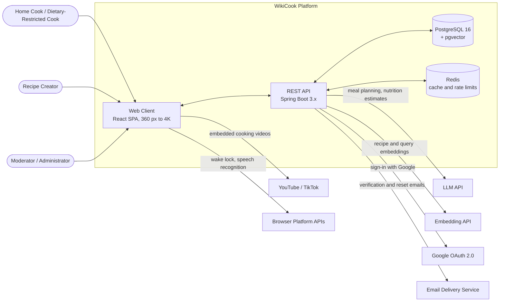
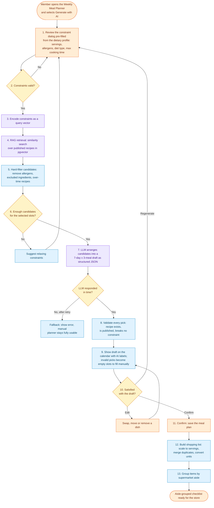
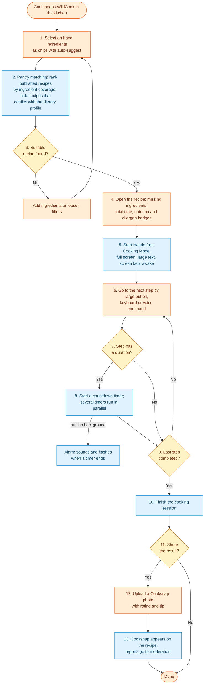

# VISION DOCUMENT: WIKICOOK

**Course:** CS300 - CSC13002 - Introduction to Software Engineering  
**Project Name:** WikiCook — Intelligent Culinary & Meal Planning Ecosystem  
**Team:** Group 05  
**Template:** Adapted from the RUP Vision template for small projects (`rup_vision_sp.docx`)  
**Document Version:** 2.0-draft (Second Edition — Project Assignment 3, Part B; draft 02/11/2026, final 05/11/2026)  
**Date:** October 29, 2026  

---

## DOCUMENT METADATA & RESPONSIBILITY MATRIX

| Section | Section Title | Performed by (Author) | Reviewed by | Edited by | Jira Task |
| :---: | :--- | :---: | :---: | :---: | :---: |
| **Section 1** | Introduction | **Nguyễn Đức Duy (DucDuyNguyen15-IT)** | **Lê Quốc Hưng (LqHung06)** | **Lê Quốc Hưng (LqHung06)** | `SCRUM-32` |
| **Section 2** | Positioning (Problem & Product Position Statements) | **Nguyễn Đức Duy (DucDuyNguyen15-IT)** | **Lê Quốc Hưng (LqHung06)** | **Lê Quốc Hưng (LqHung06)** | `SCRUM-32` |
| **Section 3** | Stakeholder & User Descriptions | **Nguyễn Đức Duy (DucDuyNguyen15-IT)** | **Trần Nguyễn Công Chung (itzchugnn)** | **Lê Quốc Hưng (LqHung06)** | `SCRUM-33` |
| **Section 4** | Product Overview | **Nguyễn Đức Duy (DucDuyNguyen15-IT)** | **Trần Nguyễn Công Chung (itzchugnn)** | **Lê Quốc Hưng (LqHung06)** | `SCRUM-33` |
| **Section 5** | Product Features (10 Core Features) | **Nguyễn Đức Duy (DucDuyNguyen15-IT)** | **Mai Văn Hiển (MaiHien3507)** | **Lê Quốc Hưng (LqHung06)** | `SCRUM-34` |
| **Section 6** | User Workflow Diagrams | **Nguyễn Đức Duy (DucDuyNguyen15-IT)** | **Mai Văn Hiển (MaiHien3507)** | **Lê Quốc Hưng (LqHung06)** | `SCRUM-35` |
| **Section 7** | Non-Functional Requirements | **Mai Văn Hiển (MaiHien3507)** | **Nguyễn Thành Dự (ThanhDu14)** | **Lê Quốc Hưng (LqHung06)** | `SCRUM-36` |
| **Section 8** | Traceability to the Use-Case Model | **Nguyễn Đức Duy (DucDuyNguyen15-IT)** | **Trần Nguyễn Công Chung (itzchugnn)** | **Lê Quốc Hưng (LqHung06)** | `SCRUM-60` |
| **Second Edition** | Revisions to Sections 1, 3, 5 and 6 (see Revision History `v2.0`) | **Nguyễn Đức Duy (DucDuyNguyen15-IT)** | **Trần Nguyễn Công Chung (itzchugnn)** | **Lê Quốc Hưng (LqHung06)** | `SCRUM-60` |

### Revision History

| Date | Version | Description | Author |
| :---: | :---: | :--- | :--- |
| **08/10/2026** | `v0.1` | PA1 draft: positioning, personas, high-level use cases and scope boundary (merged in PR #12). | Nguyễn Đức Duy (`DucDuyNguyen15-IT`) |
| **17/10/2026** | `v0.6` | Restructured to the RUP Vision template; authored Sections 1–2 (`SCRUM-32`); Section 7 reserved for `SCRUM-36`. | Nguyễn Đức Duy (`DucDuyNguyen15-IT`) |
| **17/10/2026** | `v0.7` | Authored Sections 3–4: stakeholders, users, competition and product overview (`SCRUM-33`). | Nguyễn Đức Duy (`DucDuyNguyen15-IT`) |
| **17/10/2026** | `v0.8` | Authored Section 5: 10 core product features and traceability (`SCRUM-34`). | Nguyễn Đức Duy (`DucDuyNguyen15-IT`) |
| **17/10/2026** | `v0.9` | Authored Section 6: 2 Mermaid user workflow diagrams (`SCRUM-35`). | Nguyễn Đức Duy (`DucDuyNguyen15-IT`) |
| **19/10/2026** | `v0.10` | Authored Section 7: quantifiable non-functional requirements grouped by ISO/IEC 25010, with applicable standards and verification approach (`SCRUM-36`). | Mai Văn Hiển (`MaiHien3507`) |
| **22/10/2026** | `v1.0` | Sprint 02 Final Baseline: Completed cross-peer review, synchronized traceability across all 10 features & NFRs, and finalized documentation for submission. | Nguyễn Đức Duy & Lê Quốc Hưng |
| **24/10/2026** | `v1.1` | PA2 submission fixes: corrected group number to Group 05 and updated the document header. | Nguyễn Thành Dự (`ThanhDu14`) |
| **29/10/2026** | `v2.0-draft` | Second Edition draft (`SCRUM-60`): aligned with the Use-Case Model (`SCRUM-49`) and Use-Case Specifications (`SCRUM-50` – `54`); added Section 8 with bidirectional traceability between user needs, features and the 64 use cases; marked pantry matching as a planned increment (§1.2, §3.4, §3.5.4, §5.2, §6.2); corrected specification names in §5.11 and removed the non-existent `101-admin-analytics`; completed the references and definitions (§1.3, §1.4); added the development and deployment environment (§3.3). TA feedback on PA2 (`SCRUM-47`) is incorporated before the final edition. | Nguyễn Đức Duy (`DucDuyNguyen15-IT`) |

---

## 1. INTRODUCTION
*Performed by: Nguyễn Đức Duy (DucDuyNguyen15-IT) | Reviewed by: Lê Quốc Hưng (LqHung06) | Edited by: Lê Quốc Hưng (LqHung06)*

### 1.1. Purpose

The purpose of this Vision Document is to collect, analyze and define the high-level needs and features of **WikiCook**. It focuses on the capabilities that stakeholders and target users need and on **why** those needs exist; the detailed behavior that satisfies each need is specified separately in the feature specifications under `specs/` (Spec Kit). The document serves three audiences:

- **Course Instructors and Teaching Assistants** use it to evaluate whether the product idea, target users and feature scope are well founded and consistent with the PA1 market survey.
- **The Product Owner** uses it as the reference for prioritizing the product backlog and for accepting or rejecting proposed feature changes.
- **The development team** uses it to understand the problem, the users and the boundaries of the system before writing specifications, designs and code.

### 1.2. Scope

This document covers **WikiCook**, a responsive web application (Single-Page Application, usable from a 360 px mobile screen up to a desktop monitor) that helps home cooks decide what to cook, plan their week, shop for groceries, cook step by step and share recipes with a community. The product is developed by Group 05 over five Scrum Sprints (PA1–PA5) of the Fall 2026–2027 semester.

- **In scope:** the ten core features described in Section 5 — user authentication and dietary profile, smart recipe discovery, AI weekly meal planner, smart shopping list, hands-free cooking mode, community recipe contribution, Cooksnaps and reviews, custom collections, nutrition and allergen analysis, and admin content moderation. Pantry matching (Section 5.2) is part of the product vision but is scheduled as a later increment; it is not part of the current release of specification `020`.
- **Out of scope:** native iOS/Android store applications, online grocery ordering and payment, smart-kitchen (IoT) device integration, AI-generated recipes (the AI only plans with recipes that already exist in WikiCook), and medical or clinical dietary advice.

### 1.3. Definitions, Acronyms and Abbreviations

| Term | Definition |
| :--- | :--- |
| **Cooksnap** | A photo of a dish that a user actually cooked from a WikiCook recipe, posted on that recipe as proof and feedback. |
| **Dietary profile** | The per-user record of allergens, excluded ingredients, diet type, preferred cuisines, maximum cooking time and household size. |
| **Hands-free Cooking Mode** | A full-screen, large-text, step-by-step view of a recipe designed for use while cooking, with parallel countdown timers. |
| **Pantry matching** | Searching recipes by the ingredients a user already has at home, ranked by how many recipe ingredients are covered. |
| **LLM** | Large Language Model — a cloud AI model used for meal planning and nutrition estimation. |
| **RAG** | Retrieval-Augmented Generation — retrieving real WikiCook recipes from a vector index first, then letting the LLM work only with those recipes. |
| **pgvector** | PostgreSQL extension that stores recipe embeddings and performs similarity search for RAG. |
| **Guest / Member / Contributor / Moderator / Administrator** | The access roles defined in spec `010-user-authentication-roles`. |
| **PA1–PA5** | Project Assignments 1–5 of course CS300, each corresponding to one Scrum Sprint. |
| **RUP** | Rational Unified Process — the source of the Vision template used by this document. |
| **Use case (UC)** | A goal that an actor achieves with WikiCook, identified as `UC-<spec>-<NN>` (e.g., `UC-020-01`) in the Use-Case Model and specified in the Use-Case Specifications. |
| **Planned increment** | A capability that belongs to the product vision but is not specified for the current release; it is kept in the Use-Case Model at the Brief level. |

### 1.4. References

1. **IEEE Std 830-1998**, *IEEE Recommended Practice for Software Requirements Specifications* — guidance on writing complete, consistent and verifiable requirements (superseded by ISO/IEC/IEEE 29148, used here as the course reference).
2. **RUP Vision Template for Small Projects** (`rup_vision_sp.docx`) — section structure of this document.
3. **Course guidelines:** *CS300 Project Assignment 1* (`PA1-2026.pdf`), *Project Assignment 2* (`PA2-2026.pdf`) and *Project Assignment 3* (`PA3-2026.pdf`).
4. **PA1 Project Proposal:** [`docs/requirements/project-proposal.md`](project-proposal.md) — problem statement, personas, 10 functional modules and the AI Weekly Meal Planner design.
5. **PA1 Existing App Survey:** [`docs/requirements/existing-app-survey.md`](existing-app-survey.md) and [`docs/requirements/comparative-analysis.md`](comparative-analysis.md) — survey of *MyFridgeFood* and *Ăn Gì Ngon*.
6. **Project Plan:** [`docs/management/project-plan.md`](../management/project-plan.md) — Scrum roadmap, roles, constraints and assumptions.
7. **Software Architecture Document:** [`docs/analysis-and-design/architecture.md`](../analysis-and-design/architecture.md).
8. **Feature specifications (Spec Kit):** `specs/010-user-authentication-roles`, `specs/011-user-profile-dietary`, `specs/020-recipe-search-filter`, `specs/030-meal-planner`, `specs/031-ai-weekly-meal-planner`, `specs/040-shopping-list`, `specs/050-cooking-mode`, `specs/060-recipe-editor`, `specs/070-review-cooksnap`, `specs/080-bookmark-collection`, `specs/090-nutrition-analysis`, `specs/100-admin-moderation` and the project constitution `src/constitution.md`.
9. **Use-Case Model:** [`docs/requirements/use-case-model.md`](use-case-model.md) — actors, use-case diagrams of the ten features and the catalogue of use-case IDs (`SCRUM-49`).
10. **Use-Case Specifications:** [`docs/requirements/use-case-specification.md`](use-case-specification.md) — fully dressed specifications of the use cases (`SCRUM-50` – `SCRUM-54`).
11. **Sprint 03 Report:** [`docs/management/reports/sprint-03/sprint-03-report.md`](../management/reports/sprint-03/sprint-03-report.md) — PA3 plan, decisions and task assignment.

### 1.5. Overview

Section 2 positions WikiCook through its business opportunity, problem statement and product position statement. Section 3 describes the stakeholders, the users, their working environment, their key needs and the alternatives they use today. Section 4 places the product in its technical context and lists the assumptions and dependencies it relies on. Section 5 describes the ten core features, and Section 6 illustrates two end-to-end user workflows. Section 7 defines the quantifiable non-functional requirements. Section 8 traces the user needs and features of this document to the use cases of the Use-Case Model in both directions.

---

## 2. POSITIONING
*Performed by: Nguyễn Đức Duy (DucDuyNguyen15-IT) | Reviewed by: Lê Quốc Hưng (LqHung06) | Edited by: Lê Quốc Hưng (LqHung06)*

### 2.1. Business Opportunity

Home cooking involves a chain of separate tasks — deciding what to cook, planning the week, shopping, cooking and sharing the result — and today each task lives in a different place: recipe blogs, notebooks, messaging apps and supermarket aisles. The PA1 survey of two representative platforms showed that each covers only part of this chain: *MyFridgeFood* answers "what can I cook with what I have?" and accepts community recipes, but has no planning, shopping list, nutrition data or moderation; *Ăn Gì Ngon* offers a polished catalogue, a weekly planner and an AI menu generator, but is a one-way editorial blog with no community contribution or reviews. **Neither platform supports the cook while actually cooking, and neither stores a dietary or allergen profile.** WikiCook's opportunity is to connect the whole chain in one product, with AI planning grounded in a moderated community catalogue and personalised by each user's dietary profile.

### 2.2. Problem Statement

| | |
| :--- | :--- |
| **The problem of** | deciding what to cook every day, turning recipes into a grocery plan, following recipes with wet or greasy hands, and verifying that recipes are safe for the user's allergies and diet |
| **affects** | busy home cooks (working professionals, independent students, working parents), people with food allergies or dietary restrictions, and home chefs who want to share their own recipes |
| **the impact of which is** | 15–30 minutes lost every day on meal decisions (PA1 proposal estimate), forgotten or duplicated grocery purchases and wasted food, smudged devices and burned dishes from scrolling static recipe pages while cooking, risk of accidental allergen exposure, and home chefs' recipes lost in unstructured social media posts |
| **a successful solution would be** | a single web platform that finds suitable recipes in seconds (including from on-hand ingredients), plans a full week with AI using only verified WikiCook recipes that respect the user's dietary profile, produces an aisle-grouped shopping list automatically, guides cooking hands-free with parallel timers, and grows a trustworthy, moderated community catalogue through contributions, reviews and Cooksnaps |

### 2.3. Product Position Statement

| | |
| :--- | :--- |
| **For** | busy home cooks, dietary-restricted eaters and home recipe creators |
| **Who** | need to decide, plan, shop for and cook healthy home meals quickly and safely, and want to share their own dishes |
| **WikiCook** | is an intelligent, community-driven culinary web application |
| **That** | connects recipe discovery, AI weekly meal planning, automatic shopping lists, hands-free cooking and community sharing in one workflow, personalised by each user's dietary profile |
| **Unlike** | *MyFridgeFood*, which matches ingredients mechanically in a dated, ad-heavy interface with no planning or nutrition data, and *Ăn Gì Ngon*, a one-way editorial blog with no community contribution, reviews or cooking mode |
| **Our product** | grounds every AI-generated meal plan in real, moderated WikiCook recipes, enforces allergens and dietary rules as hard constraints, and supports the cook from the first idea to the Cooksnap of the finished dish |

---

## 3. STAKEHOLDER AND USER DESCRIPTIONS
*Performed by: Nguyễn Đức Duy (DucDuyNguyen15-IT) | Reviewed by: Trần Nguyễn Công Chung (itzchugnn) | Edited by: Lê Quốc Hưng (LqHung06)*

### 3.1. Stakeholder Summary

Stakeholders are people or organisations who influence or are affected by the project but do not necessarily use the product.

| Name | Description | Responsibilities |
| :--- | :--- | :--- |
| **Course Instructors & Teaching Assistants (CS300)** | Academic sponsors and evaluators of the project. | Approve the project scope, grade each PA deliverable, and give feedback that the team turns into revisions in the next Sprint. |
| **Product Owner** — Nguyễn Đức Duy | Owner of the product vision and requirements. | Maintains this Vision Document, prioritises the backlog, accepts or rejects feature changes, and ensures every spec traces back to a user need in Section 3.4. |
| **Project Manager & Scrum Master** — Lê Quốc Hưng | Owner of the delivery process. | Plans Sprints, tracks progress on Jira, removes blockers and acts as chief editor of all deliverables. |
| **Development Team** — Mai Văn Hiển (Tech Lead), Trần Nguyễn Công Chung (QA Lead), Nguyễn Thành Dự (DevOps Lead) | Engineers who specify, build, test and release WikiCook. | Turn features into specs and working software; own architecture and AI pipeline, quality assurance, and build/release respectively. |
| **External Service Providers** | LLM and embedding API provider, Google (OAuth 2.0), email delivery service. | Provide services WikiCook depends on (Section 4.2); their free-tier quotas and availability constrain the AI features. |

### 3.2. User Summary

| Name | Description | Responsibilities | Stakeholder | System Role (spec 010) |
| :--- | :--- | :--- | :--- | :--- |
| **Busy Home Cook** *(primary)* | Working professionals, independent students and working parents aged 20–45 who cook at home several times a week. | Searches recipes, plans weekly meals, shops from the list, cooks in Cooking Mode, rates recipes and posts Cooksnaps. | Self (represented by the Product Owner) | Guest → Member |
| **Health-Conscious & Dietary-Restricted Cook** *(specialised)* | A sub-group of home cooks aged 18–60: people with food allergies, vegetarians/vegans, fitness enthusiasts and people managing diet-related conditions. | Maintains an accurate dietary profile and relies on allergen filtering, warning badges and nutrition estimates. | Self (represented by the Product Owner) | Member |
| **Recipe Creator** *(secondary)* | Home chefs and culinary hobbyists aged 22–55 who want to document and share their own or family recipes. | Authors structured recipes through the wizard, responds to moderator feedback, and engages with reviews and Cooksnaps. | Self (represented by the Product Owner) | Member → Contributor |
| **Platform Administrator / Moderator** *(system)* | WikiCook operations staff — in this project, members of the team acting as moderators. | Reviews submitted recipes, curates categories, ingredients and allergen links, handles reports and suspends abusive accounts. | Project team | Moderator / Administrator |

**Persona notes.**

- **Busy Home Cook:** wants a dinner decided in under 3 minutes and cookable in 20–45 minutes from what is already in the fridge; is exhausted after work and frustrated by long blog posts with buried ingredient lists.
- **Dietary-Restricted Cook:** needs zero tolerance for restricted ingredients and transparent calories and macros per serving; distrusts unlabelled online recipes and ambiguous ingredient names.
- **Recipe Creator:** wants clean authoring tools, proper attribution and real feedback; is discouraged by unstructured social media posts where recipes are quickly buried.
- **Platform Administrator:** needs an efficient review queue and taxonomy tools to keep a growing catalogue clean, safe and consistently tagged.

### 3.3. User Environment

- **Kitchen (cooking):** one person cooks while the device — usually a smartphone or tablet — is propped on the counter 0.5–1 m away. Hands are frequently wet, greasy or covered in flour, the air is humid and steamy, and the range hood creates background noise. Mobile screens normally dim and lock after 30–60 seconds without touch, and a typical cooking session lasts 20–45 minutes with several overlapping stages. The interface therefore needs large text readable from a distance, oversized touch targets, a screen that stays awake, and alternatives to precise touch (keyboard and voice).
- **Planning (weekly):** planning is usually done once a week, often on a weekend evening, on a laptop or phone, and takes 10–20 minutes. The user plans for a household of typically 1–5 people, so serving counts and household size matter.
- **Supermarket (shopping):** the user holds a phone in one hand and a basket in the other, often in basements or large stores with weak mobile signal. The shopping list must work one-handed and keep checked items when the connection drops.
- **Authoring and moderation:** recipe creators and moderators mostly work on a desktop or laptop where long forms, photo uploads and review queues are comfortable, but authoring must remain usable on mobile.
- **Platforms:** modern browsers — Chrome/Edge 100+, Firefox 100+, Safari 15+ on Windows, macOS, Linux, Android and iOS — from 360 px wide screens up to 4K desktops. An internet connection is required for search, synchronisation and AI features.
- **Other applications:** users share shopping lists through messaging apps such as Zalo or Messenger, and recipe creators link cooking videos from YouTube or TikTok.

### 3.4. Summary of Key Stakeholder or User Needs

| Need | Priority | Concerns | Current Solution | Proposed Solution |
| :--- | :---: | :--- | :--- | :--- |
| **N1.** Decide quickly what to cook | High | 15–30 minutes of daily decision fatigue; recipes that need ingredients the user does not have | Scroll recipe blogs; tick a long checkbox list on MyFridgeFood | Keyword search with combinable filters and one-tap presets, plus pantry matching (Feature 2) |
| **N2.** Plan the week and shop efficiently | High | Repetitive menus; forgotten or duplicate purchases; manual quantity arithmetic | Paper notes; Ăn Gì Ngon's planner with a basic, ungrouped list | AI Weekly Meal Planner (Feature 3) feeding an aisle-grouped Smart Shopping List (Feature 4) |
| **N3.** Follow a recipe with busy, messy hands | High | Smudged devices, lost place in the recipe, overcooked stages, screen locking | Scroll static recipe pages; separate phone timer app | Hands-free Cooking Mode with parallel timers (Feature 5) |
| **N4.** Stay safe from allergens and within a diet | High | Accidental allergen exposure; unknown calories and macros | Read every ingredient manually; neither surveyed app helps | Dietary profile enforced across search and planning (Feature 1), allergen badges and nutrition estimates (Feature 9) |
| **N5.** Share own recipes and receive feedback | Medium | No attribution; unstructured posts; no feedback loop | Facebook groups; MyFridgeFood's single long form | Structured recipe wizard with a clear review lifecycle (Feature 6) |
| **N6.** Trust a recipe before cooking it | Medium | Styled photos and single ratings can mislead | Star ratings only (MyFridgeFood) or nothing (Ăn Gì Ngon) | Reviews, tips and Cooksnaps with a minimum-ratings rule for ranking (Feature 7) |
| **N7.** Find favourite recipes again | Medium | A single flat bookmark list becomes unusable | Browser bookmarks; flat "Saved" lists | Named personal collections (Feature 8) |
| **N8.** Keep the catalogue clean and safe *(admin)* | High | Spam, plagiarism and unsafe content; inconsistent tags and allergen data | No moderation (MyFridgeFood); editorial only (Ăn Gì Ngon) | Moderation queue and taxonomy management (Feature 10) |

### 3.5. Alternatives and Competition

The PA1 survey ([`existing-app-survey.md`](existing-app-survey.md), Sections 1–9) analysed two platforms that represent the two dominant models on the market. The evidence below refers to the screenshots and feature matrices recorded in that survey.

#### 3.5.1. MyFridgeFood (myfridgefood.com) — reverse ingredient search model

- **Strengths:** delivers value immediately — the "What's in your fridge?" ingredient checklist is the homepage itself (survey Figure 1), with a short "Quick Kitchen" list before the full list; core search needs no account; community members submit recipes and rate them with five stars (Figures 5–6).
- **Weaknesses:** matching is purely mechanical checkbox matching over a wall of text checkboxes (Figure 2); the interface dates from around 2010 and is interrupted by advertising banners; there is no meal planner, shopping list, nutrition data, cooking mode or visible moderation (survey Section 2, rows 3–5, 9–10).
- **What WikiCook takes from it:** the "core tool first" homepage, quick presets before full lists, guest browsing and community contribution — rebuilt with chip-based inputs and backed by moderation.

#### 3.5.2. Ăn Gì Ngon (angingon.com) — editorial content and planning model

- **Strengths:** a modern, fast interface over a library of more than 19,000 recipes and tips; multi-dimensional sidebar filters (Figure 7); a weekly planner of days × breakfast/lunch/dinner with an "AI Menu Generator" and a "select dates to create shopping list" action (Figure 10); Google and email login (Figure 11).
- **Weaknesses:** a one-way editorial blog — users cannot contribute recipes, comment, rate or post photos; recipes are static pages that must be scrolled while cooking; no nutrition or allergen information; the shopping list is basic and not grouped by aisle (survey Section 6, rows 4–7, 9).
- **What WikiCook takes from it:** the homepage search entry point, sidebar filters (as a bottom sheet on mobile), recipe cards with time, difficulty and bookmark, and the days × meals planner grid — extended with dietary enforcement and an aisle-grouped list.

#### 3.5.3. Other alternatives

Users also rely on general recipe blogs and YouTube videos (rich content but ad-heavy, unstructured and impossible to follow hands-free), Facebook cooking groups (community feedback but no structure, search or attribution), and paper notes or note-taking apps for shopping (no consolidation and easily forgotten). These alternatives solve single steps of the chain and leave the user to connect them manually.

#### 3.5.4. Competitive Summary

| Capability | MyFridgeFood | Ăn Gì Ngon | WikiCook |
| :--- | :---: | :---: | :---: |
| Keyword search and multi-criteria filters | 🟡 | 🟢 | 🟢 |
| Search by on-hand ingredients | 🟢 | ❌ | 🟢 |
| Dietary profile and automatic allergen filtering | ❌ | ❌ | 🟢 |
| Weekly meal planner | ❌ | 🟢 | 🟢 |
| AI meal planning grounded in the platform's own recipes, with dietary enforcement | ❌ | 🟡 | 🟢 |
| Shopping list merged and grouped by supermarket aisle | ❌ | 🟡 | 🟢 |
| Hands-free cooking mode with parallel timers | ❌ | ❌ | 🟢 |
| Community recipe contribution | 🟢 | ❌ | 🟢 |
| Reviews and Cooksnaps | 🟡 | ❌ | 🟢 |
| Nutrition estimates and allergen badges | ❌ | ❌ | 🟢 |
| Content moderation | ❌ | ➖ (editorial) | 🟢 |

*Notation:* 🟢 supported · 🟡 partial · ❌ not supported · ➖ not applicable. Ratings for MyFridgeFood and Ăn Gì Ngon come from the PA1 survey feature matrices.

**Conclusion.** Each competitor is strong in one model and absent in the other: MyFridgeFood has community and pantry search without planning; Ăn Gì Ngon has planning without community. WikiCook's differentiation is not a single feature but the **connected workflow** — discover → plan → shop → cook → share — combined with three capabilities neither competitor offers: dietary-profile enforcement, hands-free cooking and nutrition/allergen information.

---

## 4. PRODUCT OVERVIEW
*Performed by: Nguyễn Đức Duy (DucDuyNguyen15-IT) | Reviewed by: Trần Nguyễn Công Chung (itzchugnn) | Edited by: Lê Quốc Hưng (LqHung06)*

### 4.1. Product Perspective

WikiCook is a new, self-contained product; it is not a component of a larger system. It is built as a layered client–server web application: a React single-page application in the browser, a stateless Spring Boot REST API, a PostgreSQL 16 database with the `pgvector` extension for recipe embeddings, and Redis for caching and rate limiting (see the Software Architecture Document). The diagram below shows WikiCook's users and the external systems it interacts with.

### 4.2. Assumptions and Dependencies

| ID | Type | Statement | Impact if it does not hold |
| :---: | :--- | :--- | :--- |
| **ASM-01** | Assumption | Users have a modern browser and an internet connection for search, synchronisation and AI features; only Cooking Mode and the Shopping List must tolerate short disconnections. | Offline support would have to be extended to more features, increasing client complexity. |
| **ASM-02** | Assumption | Before the AI planner is demonstrated, the catalogue contains enough published recipes (seeded by the team) to fill a 21-slot week for typical dietary profiles. | The planner returns "not enough recipes" more often and its value cannot be shown. |
| **ASM-03** | Assumption | Moderators keep the ingredient–allergen links accurate; these links, not LLM output, are the source of truth for allergen filtering. | Allergen filtering and badges become unreliable, which is a safety risk for dietary-restricted users. |
| **ASM-04** | Assumption | Free-tier LLM and embedding quotas are sufficient when the AI planner is limited to 5 generations per user per hour and results are cached. | AI features must be throttled further or temporarily disabled, falling back to the manual planner. |
| **ASM-05** | Assumption | Screen Wake Lock and speech recognition are available in the main target browsers but may be missing on some devices. | Cooking Mode falls back to touch and keyboard navigation and shows a hint to keep the screen on. |
| **DEP-01** | Dependency | LLM API (e.g., Gemini or OpenAI) for meal-plan arrangement and nutrition estimation. | Without it, AI planning and nutrition estimates are unavailable; all non-AI features keep working. |
| **DEP-02** | Dependency | Embedding API and PostgreSQL `pgvector` for RAG retrieval of candidate recipes. | Without it, the AI planner cannot retrieve candidates and is disabled. |
| **DEP-03** | Dependency | Google OAuth 2.0 for "Sign in with Google". | Users sign in with email and password only. |
| **DEP-04** | Dependency | An email delivery service for verification and password-reset emails. | New accounts cannot be verified and therefore cannot publish recipes (spec 010 FR-006). |
| **DEP-05** | Dependency | Feature order: roles and dietary profile (specs 010/011) precede all personalised features; structured ingredients from the recipe wizard (spec 060) precede the shopping list, nutrition analysis and AI planner. | Downstream features cannot be built or tested on real data. |
| **DEP-06** | Dependency | Project constraints from the Project Plan: zero budget, five team members and a 14-week semester. | Scope must be re-prioritised; lower-priority features move to a later release. |

---

## 5. PRODUCT FEATURES
*Performed by: Nguyễn Đức Duy (DucDuyNguyen15-IT) | Reviewed by: Mai Văn Hiển (MaiHien3507) | Edited by: Lê Quốc Hưng (LqHung06)*

This section describes the ten core features of WikiCook at the level of capability and value. Each feature is written as one paragraph that explains **what** it does, **why** users need it and **who** benefits directly; detailed requirements live in the feature specification listed in Section 5.11.

### 5.1. User Authentication & Dietary Profile

WikiCook lets visitors register with an email and password or sign in with Google, verifies their email address, and assigns every account exactly one role — Member, Contributor, Moderator or Administrator — that determines what it may do on the platform. After signing in, each user can record a dietary profile listing allergens, excluded ingredients, diet type, preferred cuisines, maximum cooking time and household size. This profile is not a passive settings page: search hides recipes that conflict with it, the meal planner treats it as a hard constraint, and the household size becomes the default number of servings throughout the product. The feature is needed because the PA1 survey found that neither MyFridgeFood nor Ăn Gì Ngon stores any dietary or allergen information, so users must re-check every recipe by hand and remain exposed to accidental allergens. Every signed-in user benefits, but dietary-restricted cooks and families cooking for several people gain the most in safety and saved time.

### 5.2. Smart Recipe Discovery & Filters

Smart Recipe Discovery combines full-text keyword search, which ignores Vietnamese diacritics and letter case so that "pho bo" finds "Phở bò", with combinable filters for total time, cuisine, difficulty, cooking method, category and calories per serving. One-tap presets such as "Under 30 minutes" or "Vegetarian" sit on the homepage, and every query, filter and page number is kept in the URL so that results can be shared, reloaded or revisited with the Back button. A pantry-matching mode extends the same engine: the user selects the ingredients already in the fridge, and WikiCook ranks recipes by how many of their ingredients are covered and shows what is still missing. The feature answers the daily question "What can I cook today?", which the PA1 proposal estimates costs 15 to 30 minutes, and replaces MyFridgeFood's cluttered checkbox wall with a fast, modern interface. Guests and busy home cooks use it as their entry point to the product, while dietary-restricted members also have conflicting recipes hidden automatically.

### 5.3. AI Weekly Meal Planner

The AI Weekly Meal Planner fills the empty slots of a 7-day by 3-meal calendar with WikiCook recipes arranged by a large language model. It first retrieves candidate recipes from a vector index of published recipes (Retrieval-Augmented Generation), then asks the model to arrange them while treating allergens, excluded ingredients, diet type and maximum cooking time as hard rules and variety and ingredient reuse as soft goals. Every AI pick is validated against the database before the user sees the draft, so the model can never invent a dish or slip an allergen into the plan, and the user can swap, move or remove any dish before confirming. The feature exists because deciding up to 21 meals a week is the most tiring part of home cooking, and Ăn Gì Ngon's AI menu generator suggests dishes without enforcing dietary rules or connecting them to a structured shopping list. Busy home cooks and working parents are the primary beneficiaries, and the manual planner remains fully usable whenever the AI service is unavailable.

### 5.4. Smart Shopping List

The Smart Shopping List turns a confirmed meal plan, a single recipe or ad-hoc items into one consolidated grocery checklist. It scales every quantity to the chosen number of servings, merges duplicate ingredients across dishes, converts compatible units such as grams and kilograms, and groups items by supermarket aisle such as Produce, Meat & Seafood, Dairy & Eggs, and Pantry & Spices. In the store the list can be used with one hand and keeps working offline, so checked items are not lost in a basement supermarket with no signal, and it can be copied into a messaging app in one tap. This removes the manual copying, mental arithmetic and forgotten ingredients identified in the PA1 survey, where MyFridgeFood offers no list at all and Ăn Gì Ngon's list is not grouped by aisle. Home cooks doing the weekly grocery run benefit directly, as do the family members to whom they delegate the shopping.

### 5.5. Hands-free Cooking Mode & Timers

Hands-free Cooking Mode presents a recipe as a full-screen, high-contrast sequence of large step cards that can be read from across the kitchen counter. The cook moves between steps with oversized touch targets, the keyboard or optional Vietnamese voice commands, and the screen is kept awake for the whole session. Steps that mention a duration offer a one-tap timer, and several countdown timers can run in parallel with audible and visual alarms — for example, simmering a broth for 15 minutes while sautéing garlic for 2 minutes. The feature is needed because both surveyed competitors show recipes only as static pages that must be scrolled with wet or greasy hands, which leads to smudged devices, lost places in the recipe and burned food. Every cook at the stove benefits, especially beginners following an unfamiliar recipe and busy parents preparing several dishes at once.

### 5.6. Community Recipe Contribution

Community Recipe Contribution gives signed-in members with a verified email a six-step wizard to publish their own recipes: general information, structured ingredients with quantities and units, equipment, steps with optional photos and timers, an optional YouTube or TikTok link, and a final preview. Drafts are saved automatically so no input is lost, and each submission follows a clear lifecycle — Draft, Pending, Published, Rejected or Revision Requested, and Archived — that the author can track on a "My Recipes" page. Because every ingredient is stored as structured data rather than free text, contributed recipes can be scaled, merged into shopping lists, analysed for nutrition and used by the AI planner. The feature grows the catalogue through the community, the model MyFridgeFood proved effective, while avoiding Ăn Gì Ngon's one-way editorial approach that gives home chefs no voice. Recipe creators are the direct users, and every other user benefits from a larger and more diverse catalogue.

### 5.7. Social Cooksnaps & Reviews

Social Cooksnaps & Reviews let members rate a recipe from one to five stars, write a comment, share practical modifications such as an ingredient substitution, and upload a photo of the dish they actually cooked, called a Cooksnap. Ratings feed the recipe's average score, and a recipe needs at least three ratings before it can lead the "Top rated" ranking, so a single enthusiastic review cannot push it to the top. Cooksnaps give prospective cooks visual proof of how a recipe turns out in a real home kitchen rather than in a styled photograph. The PA1 survey showed that MyFridgeFood offers only stars and text comments and Ăn Gì Ngon has no community feedback at all, leaving users with no way to judge a recipe's reliability before cooking it. Home cooks gain trust and practical tips, while recipe creators receive the recognition and feedback that motivate them to keep publishing.

### 5.8. Custom Recipe Collections

Custom Recipe Collections let members save any published recipe with one tap and organise their saved recipes into named personal cookbooks such as "Quick 15-Minute Dinners" or "Tet Holiday Specials". A recipe can belong to several collections, and collections can be renamed, reordered or deleted without affecting the recipes themselves. Saved recipes stay connected to the rest of the product: a dish can be added to the meal plan or opened in Cooking Mode directly from a collection, and saved recipes act as preference signals for the AI planner. Both surveyed apps offer only a single flat bookmark list, which becomes unusable once a user has saved dozens of dishes. Regular home cooks who return to a familiar repertoire benefit most, as do dietary-restricted users who keep a vetted list of recipes they know are safe.

### 5.9. Nutrition & Allergen Analyzer

The Nutrition & Allergen Analyzer estimates calories, protein, carbohydrates and fat per serving for every published recipe by sending its structured ingredient list to a large language model, and displays the result with a clear disclaimer that the figures are AI-generated estimates for reference only. It also shows allergen warning badges, but these badges are derived from the moderator-curated links between catalogue ingredients and allergens rather than from the model, so safety-critical information remains verifiable. The calorie estimates power the calorie filter in search and give users a basis for balancing their weekly plan. Neither MyFridgeFood nor Ăn Gì Ngon provides any nutritional or allergen information, which forces health-conscious users to calculate macros manually or rely on unverified sources. Fitness enthusiasts, people managing diet-related conditions and parents cooking for children with allergies are the main beneficiaries.

### 5.10. Admin Content Moderation

Admin Content Moderation provides a back-office dashboard where moderators review every submitted recipe and approve it, reject it with a reason, or request revisions with notes before it reaches the public catalogue. Administrators also manage the shared taxonomies — categories, cuisines, tags, ingredients and their allergen links — handle reports about abusive reviews or Cooksnaps, and suspend or ban accounts that break community guidelines. A summary panel shows pending submissions, active users and popular recipes so that the team can see where attention is needed. The feature is necessary because open contribution without moderation, as observed on MyFridgeFood, lets spam, plagiarism and unsafe content reach users, and because the allergen data that protects users must be curated by people. Moderators and administrators use it directly, and every end user benefits from a clean, trustworthy catalogue.

### 5.11. Feature Traceability

| # | Feature | User Needs (3.4) | PA1 Module | Specification(s) |
| :---: | :--- | :--- | :---: | :--- |
| 5.1 | User Authentication & Dietary Profile | N4 | 3.1 | `010-user-authentication-roles`, `011` (dietary profile) |
| 5.2 | Smart Recipe Discovery & Filters | N1, N4 | 3.2 | `020-recipe-search-filter` (pantry matching in a later increment) |
| 5.3 | AI Weekly Meal Planner | N2, N4 | 3.3, Section 4 | `030-meal-planner`, `031-ai-weekly-meal-planner` |
| 5.4 | Smart Shopping List | N2 | 3.4 | `040-shopping-list` |
| 5.5 | Hands-free Cooking Mode & Timers | N3 | 3.5 | `050-cooking-mode` |
| 5.6 | Community Recipe Contribution | N5 | 3.6 | `060-recipe-editor` |
| 5.7 | Social Cooksnaps & Reviews | N5, N6 | 3.7 | `070` (reviews and Cooksnaps) |
| 5.8 | Custom Recipe Collections | N7 | 3.8 | `080` (collections) |
| 5.9 | Nutrition & Allergen Analyzer | N4 | 3.9 | `090` (nutrition analyzer) |
| 5.10 | Admin Content Moderation | N8 | 3.10 | `100-admin-moderation`, `101-admin-analytics` |

---

## 6. USER WORKFLOW DIAGRAMS
*Performed by: Nguyễn Đức Duy (DucDuyNguyen15-IT) | Reviewed by: Mai Văn Hiển (MaiHien3507) | Edited by: Lê Quốc Hưng (LqHung06)*

The two diagrams below show how the features in Section 5 combine into end-to-end user journeys. Node colours indicate who performs each step: **orange** — the user, **blue** — the WikiCook system, **purple** — the AI services (embedding and LLM), **yellow** — decisions.

### 6.1. Workflow 1 — AI Meal Planning & Grocery Shopping

| Step | Actor | Description | Feature |
| :---: | :--- | :--- | :---: |
| 1–2 | Member | Confirms or adjusts the constraints pre-filled from the dietary profile; invalid input (no day selected, servings out of range) is rejected before any AI call. | 5.1, 5.3 |
| 3–4 | AI services | The constraints are embedded and used to retrieve semantically similar published recipes from the `pgvector` index (RAG), so the LLM only ever sees real WikiCook recipes. | 5.3 |
| 5–6 | System | Allergens, excluded ingredients and over-time recipes are removed as hard rules; if too few candidates remain, the user is asked to relax constraints instead of receiving a repetitive or unsafe plan. | 5.3 |
| 7 | AI services | The LLM arranges the candidates into a draft for the selected days and meals, aiming for variety and ingredient reuse; on timeout or malformed output the call is retried once, then the manual planner is offered. | 5.3 |
| 8–9 | System | Every pick is checked against the database; invalid picks are never shown and their slots are flagged for manual selection. | 5.3 |
| 10 | Member | Swaps, moves or removes dishes with the normal planner tools, regenerates, or confirms the draft. | 5.3 |
| 11–13 | System | The confirmed plan is saved and its ingredients are scaled, merged and grouped by supermarket aisle into the Smart Shopping List. | 5.4 |

### 6.2. Workflow 2 — Pantry Search & Hands-free Cooking

| Step | Actor | Description | Feature |
| :---: | :--- | :--- | :---: |
| 1–3 | Cook | Picks the ingredients at hand; WikiCook ranks published recipes by coverage and, for signed-in users, hides recipes that conflict with the dietary profile. If nothing fits, the cook adds ingredients or loosens filters. | 5.1, 5.2 |
| 4 | Cook | Reviews the recipe, including any missing ingredients, total time, estimated nutrition and allergen badges. | 5.2, 5.9 |
| 5–6 | System, Cook | Cooking Mode opens full screen and keeps the display awake; the cook advances with large buttons, the keyboard or a voice command, without precise touch. | 5.5 |
| 7–8 | System | A step with a duration offers a timer; timers keep running in the background while the cook moves on, and each one raises an audible and visual alarm when it ends. | 5.5 |
| 9–10 | Cook | The loop repeats until the last step is completed and the session ends. | 5.5 |
| 11–13 | Cook, System | The cook optionally posts a Cooksnap with a rating and tip (sign-in required); it appears on the recipe, and other users can report it to moderators. | 5.7, 5.10 |

---

## 7. NON-FUNCTIONAL REQUIREMENTS
*Performed by: Mai Văn Hiển (MaiHien3507) | Reviewed by: Nguyễn Thành Dự (ThanhDu14) | Edited by: Lê Quốc Hưng (LqHung06)*

This section defines the quantifiable non-functional requirements (NFRs) of WikiCook. Every requirement has a numeric threshold, a stated measurement method and a traceable source, so that the Test Owner can decide pass or fail without interpretation. Requirements are grouped by the quality characteristics of ISO/IEC 25010. Detailed behavior of each feature remains in the specifications under `specs/`; this section consolidates and, where necessary, unifies their numeric thresholds.

### 7.1. Applicable Standards

| Standard | Version / Level | How it is used in this section |
| :--- | :--- | :--- |
| **ISO/IEC 25010** | Product quality model | Classification framework for the requirement groups in Sections 7.3–7.10. |
| **WCAG** (W3C) | 2.1, Level AA | Target for accessibility (Section 7.6). Spec 050 additionally requires a contrast ratio of 7:1 (the WCAG 2.1 AAA level) in the cooking-mode high-contrast theme. |
| **OWASP Top 10** | 2021 | Reference list of web-application risks for injection, broken access control, authentication failures and security misconfiguration (Section 7.4). |
| **OpenAPI Specification** | 3.x | Format of the REST API documentation required by the constitution (Section 7.8). |
| **OAuth 2.0** | RFC 6749 | Protocol of "Sign in with Google" (spec 010 FR-018); its unavailability is covered in Section 7.5. |
| **ISO/IEC/IEEE 29148** | Requirements engineering | Course reference for writing complete, verifiable requirements (see Section 1.4). |

### 7.2. Conventions and Measurement Baseline

- **Source column.** `Constitution` = `src/constitution.md`; `Spec nnn` = `specs/nnn-*/spec.md` with the FR, NFR or SC number; `Plan` = `docs/management/project-plan.md`; `Proposal` = `docs/requirements/project-proposal.md`; `Test plan` = `docs/test/test-plan.md`. **`Proposed (SCRUM-36)`** marks a threshold or condition that no earlier document states; the team approves or rejects it during review of this section.
- **Reference load.** All performance thresholds are measured with **100 concurrent users**, the load of the Release Candidate acceptance gate (Plan 4.4.2). Specs 010, 030 and 080 express their performance NFRs "up to 200 concurrent users"; for verification this section supersedes that figure with 100, and the specs are to be aligned in a later change.
- **Percentiles.** "95%" and "P95" mean that at least 95% of measured requests meet the threshold. "P90" means 90%.
- **Non-AI endpoint.** Any REST endpoint that does not call the LLM or embedding service.
- **Reference environment.** Docker Compose staging (Plan 4.4.6) with seeded data and the Mock LLM, unless a row states otherwise.

### 7.3. Performance Efficiency

| ID | Requirement | Metric & Threshold | Measurement Method | Source |
| :--- | :--- | :--- | :--- | :--- |
| **NFR-PERF-01** | Pages load quickly on a mobile network. | 95% of page loads reach Largest Contentful Paint ≤ 2.0 s. | Lighthouse (mobile profile, simulated 4G, cold cache) on the home, search results, planner, shopping list and collections pages, run on the demo machine. | Plan 4.4.2 (RC gate: page load < 2.0 s); 4G condition: Proposed (SCRUM-36) |
| **NFR-PERF-02** | Non-AI API calls respond promptly. | P95 server response time < 500 ms for every non-AI endpoint, except those with their own threshold in NFR-PERF-03 and NFR-PERF-04 and in the rows for drafts, planner and collections below. | k6 script at 100 virtual users for 10 minutes (20 virtual users for 5 minutes at Build v0.8) against the reference environment. | Plan 4.4.2 (v0.8 and RC gates) |
| **NFR-PERF-03** | Recipe search returns results promptly. | P95 response time < 1.0 s with a catalogue of 10,000 published recipes. | k6 at 100 virtual users on a synthetic dataset of 10,000 published recipes, with keyword and filter combinations. | Constitution V; Spec 020 NFR-001, SC-001 |
| **NFR-PERF-04** | Sign-in completes promptly. | 95% of sign-in attempts complete in < 2.0 s. | k6 at 100 virtual users submitting valid credentials; time from request to response. | Spec 010 NFR-004 |
| **NFR-PERF-05** | The system sustains the reference load. | 100 concurrent users for 10 minutes with NFR-PERF-02 met throughout. | k6 load test before the RC tag. | Plan 4.4.2 (RC gate) |
| **NFR-PERF-06** | Server errors stay rare under load. | Error rate < 1% of requests (HTTP 5xx), excluding AI endpoints, at 100 concurrent users over 10 minutes. | k6 error-rate counter on the load test of NFR-PERF-05. | Plan 4.4.2 (RC gate) |
| **NFR-PERF-07** | The meal planner shows and saves quickly. | 95% of week views fully shown in ≤ 2.0 s; 95% of edits confirmed as saved in ≤ 1.0 s. | k6 against the week-view and plan-item endpoints at 100 virtual users, plus Lighthouse for the view. | Spec 030 NFR-001 |
| **NFR-PERF-08** | Saving recipes and opening collections is immediate. | Save icon changes state ≤ 100 ms after a tap; 95% of saves and dialog confirmations stored in ≤ 1.0 s; 95% of collection pages fully shown in ≤ 2.0 s, with lists at their limits (1,000 saved recipes). | Browser performance trace for the icon; k6 for saves and pages at 100 virtual users. | Spec 080 NFR-001, SC-001 |
| **NFR-PERF-09** | The profile page and dietary-profile save are quick. | 95% of profile page loads and dietary-profile saves complete in < 1.0 s. | k6 at 100 virtual users. | Spec 011 NFR-001 |
| **NFR-PERF-10** | Ingredient suggestions on the profile appear quickly. | 95% of suggestion responses ≤ 300 ms with a catalogue of 10,000 ingredients. | k6 on the suggestion endpoint with a synthetic catalogue of 10,000 ingredients. | Spec 011 NFR-001, SC-007 |
| **NFR-PERF-11** | Saving a recipe draft is quick. | 95% of draft saves complete in < 2.0 s (image uploads excluded). | k6 at 100 virtual users on the draft-save endpoint. | Spec 060 NFR-002 |
| **NFR-PERF-12** | Ingredient suggestions in the recipe wizard appear quickly. | Suggestions shown ≤ 500 ms after the user pauses typing. | Playwright timing from the last keystroke to the rendered list. | Spec 060 NFR-002 |
| **NFR-PERF-13** | Shopping-list check-off feels instant. | Checkbox state, strikethrough and progress bar update in < 50 ms. | Browser performance trace on a mid-tier mobile device. | Spec 040 FR-014, SC-002 |
| **NFR-PERF-14** | A weekly shopping list is aggregated quickly. | Aggregation, unit normalization and aisle sorting of a 21-meal plan (80–120 raw ingredients) in < 1.0 s. | Automated timing test on the aggregation function with a fixture of 100 raw ingredients. | Spec 040 SC-004 |
| **NFR-PERF-15** | Cooking-mode steps change instantly. | Step transition by touch, keyboard or voice in < 100 ms. | Browser performance trace on a mid-tier mobile device. | Spec 050 NFR-002 |
| **NFR-PERF-16** | Cooking timers stay accurate. | Cumulative drift < 1.0 s over any 60-minute interval; alarm starts ≤ 1.0 s after 00:00. | Automated test comparing timer end time with the system clock over 60 minutes. | Spec 050 NFR-003, SC-004 |

### 7.4. Security

| ID | Requirement | Metric & Threshold | Measurement Method | Source |
| :--- | :--- | :--- | :--- | :--- |
| **NFR-SEC-01** | Passwords are stored only as adaptive hashes. | Hash cost factor = 12; 0 passwords stored or logged in readable form. | Unit test asserting the configured cost factor; inspection of database rows and application logs. | Constitution IV; Plan glossary (BCrypt cost 12); Spec 010 NFR-001 |
| **NFR-SEC-02** | Passwords and identifiers have bounded sizes. | Password 8–128 characters with at least 1 letter and 1 digit; email ≤ 254 characters; display name ≤ 50 characters; 100% of out-of-range values rejected. | Boundary-value unit and API tests. | Spec 010 FR-004, Edge Cases |
| **NFR-SEC-03** | Sessions expire on inactivity. | A session without "Remember me" ends after 24 hours of inactivity or when the browser closes; a session with "Remember me" lasts at most 30 days. | Integration test with a controllable clock; manual browser restart test. | Spec 010 FR-009 |
| **NFR-SEC-04** | Access changes take effect immediately. | A role change, suspension or ban applies from the affected user's next request (0 privileged requests accepted afterwards); after a password change or reset, 100% of the user's other sessions are rejected on their next request. | Integration test with two sessions of one account. | Spec 010 FR-016, FR-024; Spec 011 SC-005 |
| **NFR-SEC-05** | Repeated sign-in failures lock the account. | 5 consecutive failed sign-ins within 15 minutes lock the account for 15 minutes and send 1 notification email; lockout works in 100% of tests. | Integration test with 5 wrong passwords, then a correct one. | Spec 010 FR-012, SC-005 |
| **NFR-SEC-06** | Email requests are rate limited. | At most 3 verification or password-reset emails per 15 minutes per email address; the 4th request is refused. | Integration test with 4 consecutive requests. | Spec 010 FR-017 |
| **NFR-SEC-07** | One-time links expire. | Verification link valid 24 hours; password-reset link valid 30 minutes; each usable once; a newer reset link invalidates earlier ones. | Integration test with a controllable clock. | Spec 010 FR-005, FR-015 |
| **NFR-SEC-08** | All traffic is encrypted in transit. | 100% of authentication and API requests served over TLS. | Scan of the deployed configuration; request to the plain-HTTP port must redirect or be refused. | Spec 010 NFR-002; Architecture |
| **NFR-SEC-09** | Sign-in and reset do not reveal registered emails. | 0 differences in status code and response body between registered and unregistered emails; median response-time difference ≤ 100 ms. | Automated test comparing 100 request pairs. | Spec 010 NFR-003, SC-004; timing bound: Proposed (SCRUM-36) |
| **NFR-SEC-10** | Permissions are enforced on the server. | 100% of protected actions in the permission matrix refused for unauthorized roles; 100% of invalid recipe status transitions sent directly to the API refused. | RBAC matrix integration tests, one account per role. | Spec 010 FR-021, SC-004; Spec 060 FR-003, SC-005 |
| **NFR-SEC-11** | User input cannot alter queries or run as code. | 100% of user-input endpoints validated on the server; 0 queries built by string concatenation; 0 stored or reflected script payloads executed in a test set of 20 payloads; 0 High or Critical alerts in an automated scan. | Static search for concatenated queries; payload tests; OWASP ZAP baseline scan. | Constitution IV; Spec 020 NFR-004; Test plan (ZAP scan); scan threshold: Proposed (SCRUM-36) |
| **NFR-SEC-12** | Secrets stay out of the repository. | 0 secrets (database password, JWT secret, OAuth client secret, LLM API key) committed; only `.env.example` present. | Repository secret scan in CI. | Constitution IV |
| **NFR-SEC-13** | Errors do not disclose internals. | 0 stack traces or internal class names in client-visible error responses. | API tests that force exceptions and inspect responses. | Constitution IV |
| **NFR-SEC-14** | Uploaded images are verified. | 100% of files that are not JPEG, PNG or WebP, or are larger than 5 MB, refused; the real file type is verified on the server. | API tests with renamed and oversized files. | Spec 011 FR-004, SC-003; Spec 060 FR-014, SC-003 |
| **NFR-SEC-15** | Abusive request volumes are limited. | Search: 60 requests per minute per client; profile saves and avatar uploads: 20 per hour per user; recipe submissions: 10 per day and 20 open drafts per user. | Integration tests that exceed each limit by one request. | Spec 020 NFR-007; Spec 011 NFR-008; Spec 060 FR-030 |
| **NFR-SEC-16** | Security events are auditable. | Audit entries for sign-in successes and failures, lockouts, password resets, role changes, suspensions and bans retained ≥ 90 days and viewable by Administrators. | Integration test; retention check on seeded entries. | Spec 010 FR-025, NFR-008 |

### 7.5. Reliability & Availability

WikiCook runs on free-tier and local infrastructure (Plan CON-03) and depends on external AI and sign-in providers whose uptime the team cannot control. This section therefore does not set a percentage uptime; it sets the behavior on failure, recovery time and stability evidence that the team can verify.

| ID | Requirement | Metric & Threshold | Measurement Method | Source |
| :--- | :--- | :--- | :--- | :--- |
| **NFR-REL-01** | An AI failure is reported, not hidden. | When the AI service fails or times out, the user sees an error message within 60 s; the attempt is not counted toward the generation limit; 100% of manual planner actions still succeed. | Integration test with the LLM disconnected (`LLM_MODE=offline`) followed by manual planner operations. | Spec 031 FR-023, FR-026, FR-027, US6 |
| **NFR-REL-02** | An AI outage does not affect other features. | 0 failures of non-AI endpoints attributable to the LLM or embedding service being unreachable; NFR-PERF-06 still met. | k6 load test of non-AI endpoints with `LLM_MODE=offline`. | Spec 031 NFR-006; Plan 4.4.4 |
| **NFR-REL-03** | Sign-in survives a Google outage. | 100% of email-and-password sign-ins succeed while the Google provider is unreachable. | Integration test with the OAuth provider stubbed as unreachable. | Spec 010 NFR-005 |
| **NFR-REL-04** | Multi-step changes are all-or-nothing. | 0 dishes lost or duplicated by failed moves and swaps; 0 half-deleted accounts after a forced mid-way failure; 0 recipes left half-added across "Đã lưu" and collections. | Fault-injection integration tests that abort each operation midway. | Spec 030 NFR-005, SC-005; Spec 011 NFR-007, SC-006; Spec 080 NFR-007 |
| **NFR-REL-05** | Typed recipe content is never lost. | 0 characters lost in tests that drop the network, close the tab or expire the session during editing. | Playwright scenarios with network and session interruption. | Spec 060 NFR-001, SC-002 |
| **NFR-REL-06** | The shopping list works without a connection. | 100% of offline check-offs, quantity edits and added items preserved locally and synchronized ≤ 3.0 s after the connection returns. | Playwright with the network switched off and on; timing of the synchronization request. | Spec 040 FR-021, SC-003 |
| **NFR-REL-07** | Cooking mode works without a connection and survives reloads. | 100% of step navigation and timer functions work offline once the recipe has loaded; 100% of step index and timer state restored when reopened within 4 hours. | Playwright offline test; page-reload test within and after the 4-hour window. | Spec 050 NFR-004, SC-005 |
| **NFR-REL-08** | Online-only pages recover automatically. | When the connection is lost, the planner and collection pages show the offline message instead of content and accept 0 edits; content returns ≤ 5 s after the connection returns. | Playwright with the network switched off and on. | Spec 030 SC-006; Spec 080 SC-009 |
| **NFR-REL-09** | A faulty release can be rolled back quickly. | Rollback to the previous tagged build in ≤ 10 minutes. | Timed rollback drill: switch the image tags and restart the stack. | Plan 4.4.7 (contingency measure 1) |
| **NFR-REL-10** | The stack starts from a clean clone. | `docker compose up` brings all 4 containers to `healthy` in ≤ 5 minutes; the health endpoint reports `UP` for `db` and `redis`. | Timed run on a clean clone. | Plan 4.4.2 (Build v0.5 gate) |
| **NFR-REL-11** | The release is stable for the demo. | All 10 demo scenarios D1–D10 pass in 2 consecutive dry runs; 0 open S1 or S2 defects at the RC gate. | Dry runs on the primary and backup demo machines; Jira defect report. | Plan 4.4.2 (RC gate), 4.4.7 |

### 7.6. Usability & Accessibility

| ID | Requirement | Metric & Threshold | Measurement Method | Source |
| :--- | :--- | :--- | :--- | :--- |
| **NFR-USA-01** | Pages conform to WCAG 2.1 Level AA. | 0 critical or serious violations on the sign-in, search, recipe detail, planner, shopping list, cooking mode, recipe wizard, collections and profile pages. | axe-core automated scan on each listed page, plus manual review of the keyboard and screen-reader checks below. | Proposed (SCRUM-36) |
| **NFR-USA-02** | Text is legible. | Contrast ratio ≥ 4.5:1 for normal text and ≥ 3:1 for large text; ≥ 7:1 for instruction text in the cooking-mode high-contrast theme. | Automated contrast check in axe-core; contrast analyzer on the high-contrast theme. | WCAG 2.1 SC 1.4.3 (Proposed, SCRUM-36); Spec 050 NFR-001 |
| **NFR-USA-03** | Cooking text is readable from a distance. | Instruction text readable from 1.5 m on a 6-inch mobile viewport. | Manual test with 5 participants at 1.5 m. | Spec 050 NFR-001 |
| **NFR-USA-04** | Every action works from the keyboard. | 100% of actions in the sign-in, sign-up, search, planner (including moving dishes), recipe wizard, collections and profile flows completed with the keyboard only; every field has a visible label; every error is announced next to its field. | Manual keyboard walkthrough plus a screen-reader check of each flow. | Spec 010 NFR-007; Spec 011 NFR-006; Spec 020 NFR-006; Spec 030 NFR-003; Spec 060 NFR-006; Spec 080 NFR-006 |
| **NFR-USA-05** | Touch targets fit wet or gloved hands. | Minimum target size 44 × 44 px for search, filter, profile and save controls; 48 × 48 px for shopping-list checkboxes; 64 × 64 px for cooking-mode navigation. | Automated bounding-box check in Playwright on a 360 px viewport. | Spec 011 NFR-002; Spec 020 NFR-002; Spec 080 NFR-004; Spec 040 FR-013; Spec 050 FR-007 |
| **NFR-USA-06** | The interface is in Vietnamese. | 100% of user-visible strings are Vietnamese and kept in one shared string store. | Static scan for string literals in components; manual review. | Constitution V; Spec 011 NFR-003 |
| **NFR-USA-07** | A loading state appears without delay. | A skeleton or progress state is shown ≤ 300 ms after a navigation or search starts. | Playwright timing with a throttled network. | Spec 011 FR-039; Spec 020 Edge Cases |
| **NFR-USA-08** | New users complete core tasks unaided. | ≥ 90% of test participants complete sign-up and sign-in on the first attempt; ≥ 90% find a recipe matching three criteria in < 30 s; ≥ 90% create and submit a recipe with 8 ingredients and 6 steps in < 10 minutes. | Usability test with at least 5 participants per task. | Spec 010 SC-003; Spec 020 SC-003; Spec 060 SC-001 |

### 7.7. Compatibility & Platform

| ID | Requirement | Metric & Threshold | Measurement Method | Source |
| :--- | :--- | :--- | :--- | :--- |
| **NFR-COM-01** | The application runs on the supported browsers. | Chrome 100+, Edge 100+, Firefox 100+, Safari 15+, iOS Safari 15+ and Android Chrome 100+; 100% of demo scenarios D1–D10 pass on each. | Playwright on the current Chromium, Firefox and WebKit engines; manual smoke test of D1–D10 on the minimum versions available to the team. | Proposal 2.2; Vision 3.3 |
| **NFR-COM-02** | The application runs on the supported operating systems. | Windows, macOS, Linux, Android and iOS (5 families); D1–D10 pass on at least 1 device of each family available to the team. | Manual smoke test. | Proposal 2.2; Vision 3.3 |
| **NFR-COM-03** | The layout adapts to the screen. | Every screen usable with 0 horizontal page scroll and 0 overlapping controls from 360 px to 3840 px width. | Playwright screenshots at 360, 768, 1280 and 3840 px. | Constitution V; Proposal 2.2; Vision 3.3 |
| **NFR-COM-04** | Missing browser features degrade gracefully. | 0 crashes when Screen Wake Lock, vibration or speech recognition is unavailable; 100% of these cases show the fallback notice or visual alternative. | Tests with each API stubbed as absent. | Spec 050 FR-004, NFR-005 |
| **NFR-COM-05** | Offline features have enough local storage. | Offline shopping list needs ≥ 1.0 MB of IndexedDB; cooking-mode sessions need ≥ 50 KB of local storage; 0 data loss at these quotas. | Tests with the browser storage quota limited to these values. | Spec 040 Assumptions; Spec 050 Assumptions |
| **NFR-COM-06** | The platform runs locally in containers. | PostgreSQL 16, Redis 7, backend and frontend start from one Docker Compose file on Windows, macOS and Linux. | Run of the Compose file on each operating system. | Constitution (technical constraints); Plan 4.4.6 |

### 7.8. Maintainability

| ID | Requirement | Metric & Threshold | Measurement Method | Source |
| :--- | :--- | :--- | :--- | :--- |
| **NFR-MNT-01** | Business logic is covered by tests (line). | Line coverage ≥ 70% of the `service` package; the build fails below this value. At Build v0.8 the value applies to the modules implemented so far; at Build v1.0 RC to all backend business logic. | JaCoCo report in the CI pipeline. | Constitution II; Plan 4.4.2 |
| **NFR-MNT-02** | Business logic is covered by tests (branch). | Branch coverage ≥ 70% of the `service` package. | JaCoCo report in the CI pipeline. | Test plan (mandatory coverage threshold) |
| **NFR-MNT-03** | Every acceptance scenario is tested. | 100% of acceptance scenarios in the specifications have ≥ 1 automated test. | Traceability matrix in `docs/test/`, reviewed at each build gate. | Constitution II; Specs SC "every acceptance scenario" |
| **NFR-MNT-04** | The layered architecture is respected. | 0 controllers accessing a repository directly; 0 JPA entities returned in API responses. | Architecture rules executed as automated tests in CI. | Constitution III |
| **NFR-MNT-05** | Changes pass quality gates before merge. | 100% of merged pull requests have a green CI run (backend `mvn verify`, frontend lint, tests and build) and ≥ 1 review by another member. | Branch-protection settings and GitHub pull-request history. | Constitution (quality gates) |
| **NFR-MNT-06** | The database schema is versioned. | 100% of schema changes delivered as migrations; 0 uses of automatic schema update in deployed configuration. | Review of the migrations folder and of the configuration files. | Constitution (technical constraints) |
| **NFR-MNT-07** | The API is documented. | 100% of public endpoints under `/api/v1` appear in the generated OpenAPI document. | Comparison of the OpenAPI document with the controller mappings. | Constitution (technical constraints) |
| **NFR-MNT-08** | Source code passes static checks. | 0 lint errors in the frontend and 0 failing static checks in the backend build. | ESLint and the backend build in CI. | Constitution (quality gates) |

### 7.9. AI-specific Constraints

| ID | Requirement | Metric & Threshold | Measurement Method | Source |
| :--- | :--- | :--- | :--- | :--- |
| **NFR-AI-01** | A weekly plan draft appears promptly. | P90 of successful generations show a draft in ≤ 30 s. | Timing of 20 test generations against the live LLM, plus Mock LLM runs in CI. | Spec 031 NFR-001, SC-002 |
| **NFR-AI-02** | No generation waits indefinitely. | Hard limit 60 s; after 60 s the user sees a timeout message and no draft. | Integration test with the LLM stubbed to respond after 61 s. | Spec 031 NFR-001, FR-023 |
| **NFR-AI-03** | Slot suggestions appear promptly or not at all. | Suggestions shown ≤ 3.0 s for 90% of picker openings; otherwise the list is hidden without an error. | Timing of 20 picker openings; test with the AI stubbed as slow. | Spec 031 FR-037, SC-008 |
| **NFR-AI-04** | Candidate retrieval is fast. | Retrieval of candidate recipes plus prompt assembly (LLM call excluded) P95 ≤ 5.0 s. | Server-side timing of the retrieval and prompt-building steps, 100 generations on the seeded catalogue. | Proposed (SCRUM-36) |
| **NFR-AI-05** | Drafts never contain unsafe or invented dishes. | 0 drafts containing a non-existent, unpublished or hard-rule-breaking recipe; 100% of injected bad AI picks removed. | Tests in which the AI stub returns an unknown recipe, an archived recipe and an allergen recipe. | Spec 031 NFR-004, SC-003; Spec 011 SC-002 |
| **NFR-AI-06** | Plans do not repeat dishes. | 0 drafts with the same recipe in two AI-filled slots. | Assertion over 20 test generations. | Spec 031 FR-011, SC-005 |
| **NFR-AI-07** | Drafts are filled when enough recipes exist. | ≥ 90% of requested slots filled, on average over 20 test generations with enough suitable recipes. | Test generations on the seeded catalogue (50+ recipes). | Spec 031 SC-004 |
| **NFR-AI-08** | AI usage is capped per user. | 5 counted generations per user in any rolling 60-minute window; the 6th is refused in 100% of tests; failures, timeouts and cancellations do not count. | Integration test with 6 successive generations and with injected failures. | Spec 031 FR-025, FR-026, SC-007 |
| **NFR-AI-09** | The AI recipe index stays current. | A published or edited recipe is available to the AI ≤ 24 hours later; an archived recipe appears in 0 drafts. | Test that publishes, edits and archives a recipe and then generates. | Spec 031 FR-029, FR-030 |
| **NFR-AI-10** | AI keys stay on the server. | 0 requests from the browser to the AI service; 0 AI keys in the frontend bundle. | Network inspection in Playwright; search of the built frontend bundle. | Constitution (technical constraints); Spec 031 NFR-002 |
| **NFR-AI-11** | AI output is labelled. | The AI disclaimer is shown on 100% of constraint dialogs, drafts and AI nutrition estimates. | Playwright assertion on each screen. | Constitution V; Proposal 3.9, 4.6; Spec 031 FR-028 |
| **NFR-AI-12** | Malformed AI output is handled. | A result with the wrong slot count or unreadable content is retried 1 time; after a second failure the user sees an error and no draft. | Integration test with the AI stub returning malformed output twice. | Spec 031 FR-014 |
| **NFR-AI-13** | Uncertain voice commands do nothing. | 100% of speech inputs with recognition confidence < 70% are ignored; ≥ 85% of the 5 supported commands executed correctly in ambient noise ≤ 60 dB; a command executes ≤ 1.0 s after recognition. | Scripted voice test with a recorded command set and background noise at 60 dB. | Spec 050 FR-016, SC-003, US4 |

### 7.10. Privacy

| ID | Requirement | Metric & Threshold | Measurement Method | Source |
| :--- | :--- | :--- | :--- | :--- |
| **NFR-PRV-01** | Dietary data is visible to its owner only. | 0 responses, pages, logs or admin screens exposing a user's dietary profile or household size to a guest, another member or an Administrator. | Tests with a second member, a guest and an Administrator account. | Spec 011 FR-006, NFR-005, SC-004 |
| **NFR-PRV-02** | Email addresses have restricted visibility. | 0 responses exposing an email to anyone other than the account owner and Administrators. | API tests with a guest and a member account. | Spec 010 NFR-009; Spec 011 SC-004 |
| **NFR-PRV-03** | Collections are private. | 0 requests by another user, including an Administrator, that reveal the existence, name or contents of a collection; the response equals the "not found" response of a missing collection. | API tests with a second member and an Administrator account. | Spec 080 FR-002, FR-003, NFR-002, SC-005 |
| **NFR-PRV-04** | Meal plans and unpublished recipes are private. | 0 cross-user reads of meal plans, drafts or non-published recipes, including by guessing their addresses. | API tests with a second member account. | Spec 030 FR-006, NFR-004; Spec 060 NFR-004 |
| **NFR-PRV-05** | The AI service receives no personal identifiers. | 0 requests to the AI service containing a name, email or other account detail; only planning constraints and recipe data sent. | Inspection of the outbound requests captured by the Mock LLM. | Spec 031 NFR-003; Spec 011 NFR-005 |
| **NFR-PRV-06** | Account deletion removes personal data completely. | Account removed immediately and atomically; 100% of listed data items (dietary profile, meal plans, shopping lists, collections, cooksnaps, unpublished recipes) deleted; a forced failure leaves the account fully intact. | Integration test on an account holding every data type, with one forced mid-way failure. | Spec 011 FR-031 to FR-036, SC-006 |
| **NFR-PRV-07** | Abandoned unverified accounts are purged. | An account still unverified 7 days after registration is deleted with all its data. | Integration test with a controllable clock. | Spec 010 FR-005 |
| **NFR-PRV-08** | Audit data is anonymized after deletion. | 0 emails or display names in audit entries of deleted accounts; entries kept ≥ 90 days. | Query of audit entries after an account deletion. | Spec 010 FR-025, NFR-008 |
| **NFR-PRV-09** | Credentials never leave the system in readable form. | 0 occurrences of a password in logs, API responses or audit entries. | Search of logs and responses produced by the security test suite. | Spec 010 NFR-001; Spec 011 NFR-004, FR-042 |
| **NFR-PRV-10** | Avatars carry no location data. | 100% of stored avatars contain 0 EXIF location fields. | Upload of a geotagged test image and inspection of the stored file. | Spec 011 Edge Cases |

### 7.11. Verification Approach

Each requirement is verified at the build gate of the Sprint in which its feature first works, following the incremental Build Plan in Plan 4.4.2. A requirement is accepted when the measured value meets the threshold in the table; a failed measurement is logged in Jira as a defect with the severity scale of Plan 4.4.1.

| Sprint / Build | Date | NFR groups and rows verified |
| :--- | :--- | :--- |
| **Sprint 2 — Build v0.2** | 22/10/2026 | No runnable code. This section is reviewed by the Reviewer named in the metadata line; no NFR is measured. |
| **Sprint 3 — Build v0.5** | 13/11/2026 | NFR-REL-10 (healthy stack in ≤ 5 minutes); NFR-MNT-05, NFR-MNT-06, NFR-MNT-08 (first CI pipeline, migration baseline, lint); NFR-SEC-12 (secret scan). |
| **Sprint 4 — Build v0.8 Beta** | 04/12/2026 | NFR-PERF-02 at the reduced load of 20 virtual users for 5 minutes, NFR-PERF-03, NFR-PERF-04, NFR-PERF-07; NFR-SEC-01 to NFR-SEC-07, NFR-SEC-09 to NFR-SEC-11, NFR-SEC-13 to NFR-SEC-16; NFR-MNT-01 to NFR-MNT-04, NFR-MNT-07 for the modules implemented so far; NFR-REL-01, NFR-REL-02 with the Mock LLM and the LLM disconnected; NFR-REL-04; NFR-AI-01 to NFR-AI-12; NFR-PRV-01 to NFR-PRV-05, NFR-PRV-09. |
| **Sprint 5 — Build v1.0 RC** | RC tag 18/12/2026; demo 25/12/2026 | Full verification of all rows. Load rows NFR-PERF-01, NFR-PERF-02, NFR-PERF-05 and NFR-PERF-06 are measured at 100 concurrent users for 10 minutes. The remaining PERF rows, NFR-REL-03 and NFR-REL-05 to NFR-REL-11, NFR-USA-01 to NFR-USA-08, NFR-COM-01 to NFR-COM-06, NFR-AI-13, NFR-PRV-06 to NFR-PRV-08 and NFR-PRV-10 are verified with the Playwright suite and the two demo dry runs. NFR-MNT-01 applies to all backend business logic. |

The Plan 4.4.2 gate criteria currently list the performance, coverage, RBAC and stability checks above. The accessibility audit (NFR-USA-01), the browser matrix (NFR-COM-01) and the OWASP ZAP scan (NFR-SEC-11) are proposed additions to the RC gate under `SCRUM-36` and take effect once the team approves them.
