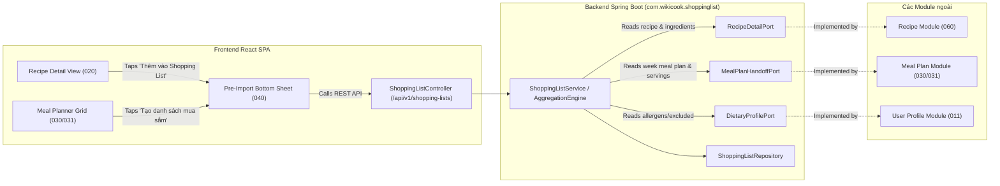

# Integration Contracts: Shopping List & Inter-Module Facades – 040

**Feature**: [spec.md](spec.md) | **Plan**: [plan.md](plan.md) | **OpenAPI**: [openapi.yaml](openapi.yaml)

Tài liệu này định nghĩa giao ước tích hợp (Integration Contracts) giữa module **040-shopping-list** và các module khác trong hệ thống WikiCook theo nguyên tắc **Constitution III** (Kiến trúc phân lớp, package by feature, giao tiếp qua Service Facade/Ports, tuyệt đối không join bảng cross-module trong repository).

---

## 1. Sơ đồ Ranh giới Module & Tích hợp



---

## 2. Java Port Interfaces (Service Facades)

Các interface này được khai báo bên trong package `com.wikicook.shoppinglist.port`:

### 2.1. `RecipeDetailPort` (Giao tiếp với Module 060 & 020)
Đọc thông tin chi tiết công thức, khẩu phần chuẩn, danh sách nguyên liệu và quầy mặc định.

```java
package com.wikicook.shoppinglist.port;

import java.math.BigDecimal;
import java.util.List;
import java.util.Optional;

public interface RecipeDetailPort {
    /**
     * Lấy thông tin công thức để phục vụ tính toán gộp nguyên liệu
     */
    Optional<RecipeImportDto> getRecipeForImport(Long recipeId);

    record RecipeImportDto(
        Long recipeId,
        String title,
        BigDecimal baseServings,
        List<RecipeIngredientImportDto> ingredients
    ) {}

    record RecipeIngredientImportDto(
        Long ingredientId,
        String ingredientName,
        BigDecimal rawQuantity,
        Long unitId,
        String unitName,
        Long defaultAisleCategoryId,
        String defaultAisleCode
    ) {}
}
```

### 2.2. `MealPlanHandoffPort` (Giao tiếp với Module 030 & 031)
Đọc toàn bộ các món ăn trong kế hoạch tuần của người dùng để sinh danh sách mua sắm tự động (FR-004, SC-004).

```java
package com.wikicook.shoppinglist.port;

import java.math.BigDecimal;
import java.time.LocalDate;
import java.util.List;
import java.util.Optional;

public interface MealPlanHandoffPort {
    /**
     * Lấy kế hoạch tuần của người dùng theo mealPlanId hoặc tuần chỉ định
     */
    Optional<MealPlanHandoffDto> getMealPlanForShoppingList(Long userId, Long mealPlanId);

    record MealPlanHandoffDto(
        Long mealPlanId,
        LocalDate weekStart,
        List<MealPlanItemHandoffDto> items
    ) {}

    record MealPlanItemHandoffDto(
        Long mealPlanItemId,
        Long recipeId,
        String recipeTitle,
        BigDecimal recipeBaseServings,
        BigDecimal effectiveServings, // Khẩu phần override của ô nếu có
        List<RecipeDetailPort.RecipeIngredientImportDto> rawIngredients
    ) {}
}
```

### 2.3. `DietaryProfilePort` (Giao tiếp với Module 011)
Đọc danh sách các chất gây dị ứng hoặc nguyên liệu kiêng khem của người dùng để hiển thị biểu tượng cảnh báo an toàn trong modal tiền nhập.

```java
package com.wikicook.shoppinglist.port;

import java.util.Set;

public interface DietaryProfilePort {
    /**
     * Lấy tập hợp ID các nguyên liệu mà user bị dị ứng hoặc loại trừ
     */
    UserDietaryRestrictions getRestrictions(Long userId);

    record UserDietaryRestrictions(
        Set<Long> allergenIngredientIds,
        Set<Long> excludedIngredientIds
    ) {}
}
```

---

## 3. Quy ước Giao tiếp Frontend (UI Contracts)

### 3.1. Điểm nhúng tại Recipe Detail View (`020-recipe-search-filter`)
- Nút bấm *"Thêm vào danh sách mua sắm"* (kèm icon giỏ hàng) xuất hiện bên cạnh phần "Khẩu phần" của công thức.
- Khi người dùng bấm nút:
  1. Frontend đọc số lượng khẩu phần hiện tại đang chọn trên giao diện (`targetServings`).
  2. Mở `PreImportBottomSheet` hiển thị danh sách nguyên liệu của công thức.
  3. Cung cấp checkbox bỏ chọn từng món và nút tiện ích 1-chạm *"Bỏ chọn gia vị cơ bản"*.
  4. Bấm "Thêm vào danh sách": Gọi `POST /api/v1/shopping-lists/import/recipe` kèm header `Idempotency-Key` (UUIDv4) để chống double-click.

### 3.2. Điểm nhúng tại Meal Planner Grid (`030-meal-planner` & `031-ai-weekly-meal-planner`)
- Nút bấm *"Tạo danh sách mua sắm"* ở thanh công cụ đầu tuần của lịch ăn.
- Khi bấm:
  1. Kiểm tra kế hoạch tuần có món nào chưa. Nếu 0 món, hiển thị alert theo Edge Case 1.
  2. Mở modal tổng hợp tất cả nguyên liệu trong 21 ô.
  3. Nếu người dùng đang có một active shopping list có sẵn món, modal hiển thị thêm lựa chọn 2 radio buttons (Q3):
     - `MERGE`: Gộp thêm vào danh sách hiện tại.
     - `ARCHIVE_AND_NEW`: Lưu trữ danh sách cũ vào lịch sử và bắt đầu danh sách mới toanh.
  4. Bấm "Xác nhận tạo": Gọi `POST /api/v1/shopping-lists/import/meal-plan`.
