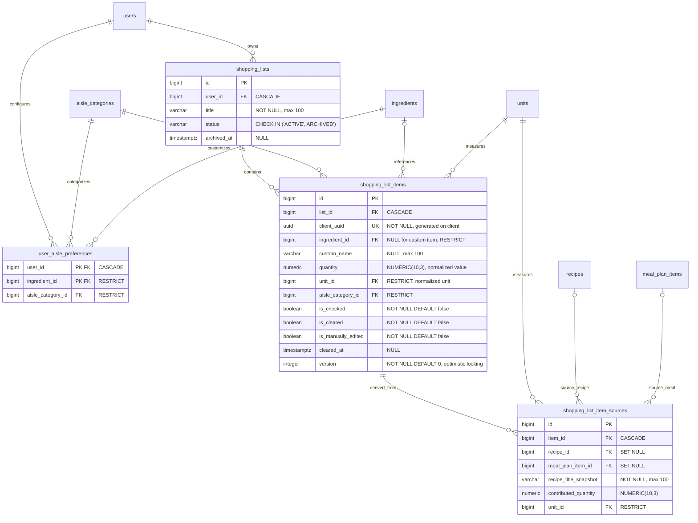

# Data Model: Automated Smart Shopping List & Ingredient Aggregation – 040

**Feature**: [spec.md](spec.md) | **Plan**: [plan.md](plan.md) | **Research**: [research.md](research.md)

This document specifies the Phase 1 Data Model for the **040-shopping-list** module, including the relational database schema (PostgreSQL 16), JPA entities (Java 21), Java Record DTOs, and client-side offline storage structures (IndexedDB).

---

## 1. Relational Database Schema (PostgreSQL 16)

The design fully complies with [Section 4.8 of `docs/analysis-and-design/database/full-schema.md`](../../docs/analysis-and-design/database/full-schema.md#48-shopping-list-040--d) and is initialized through the Flyway migration `V401__shopping_lists.sql`.



### 1.1. `shopping_lists` Table
Stores users' shopping list information.

| Column | Data Type | Nullable | Constraint / Default | Business Meaning |
|---|---|---|---|---|
| `id` | `BIGINT` | NOT NULL | `PRIMARY KEY GENERATED ALWAYS AS IDENTITY` | Unique primary key of the list |
| `user_id` | `BIGINT` | NOT NULL | `REFERENCES users(id) ON DELETE CASCADE` | List owner |
| `title` | `VARCHAR(100)` | NOT NULL | Default: `'Danh sách mua sắm'` | Editable list name (1–60 characters) |
| `status` | `VARCHAR(10)` | NOT NULL | `CHECK (status IN ('ACTIVE', 'ARCHIVED'))` | Activity status |
| `archived_at` | `TIMESTAMPTZ` | NULL | Default: `NULL` | Archival timestamp when a new list is created |

**Indexes & Uniqueness Constraints:**
- `CREATE UNIQUE INDEX uq_shopping_lists_active_user ON shopping_lists(user_id) WHERE status = 'ACTIVE';`
  $\rightarrow$ Ensures each user has **exactly one active list** at a time (FR-001).

---

### 1.2. `shopping_list_items` Table
Stores individual ingredients or products in a list.

| Column | Data Type | Nullable | Constraint / Default | Business Meaning |
|---|---|---|---|---|
| `id` | `BIGINT` | NOT NULL | `PRIMARY KEY GENERATED ALWAYS AS IDENTITY` | Database primary key |
| `list_id` | `BIGINT` | NOT NULL | `REFERENCES shopping_lists(id) ON DELETE CASCADE` | Parent list |
| `client_uuid` | `UUID` | NOT NULL | `UNIQUE` | Client-generated identifier supporting offline idempotency |
| `ingredient_id` | `BIGINT` | NULL | `REFERENCES ingredients(id) ON DELETE RESTRICT` | Standard ingredient reference (NULL for a custom item) |
| `custom_name` | `VARCHAR(100)` | NULL | | Manually entered item name (NULL when `ingredient_id` is present) |
| `quantity` | `NUMERIC(10,3)` | NULL | | Normalized quantity (grams, ml, or count) |
| `unit_id` | `BIGINT` | NULL | `REFERENCES units(id) ON DELETE RESTRICT` | Corresponding stored normalized unit |
| `aisle_category_id` | `BIGINT` | NOT NULL | `REFERENCES aisle_categories(id) ON DELETE RESTRICT` | Supermarket aisle classifying this item |
| `is_checked` | `BOOLEAN` | NOT NULL | `DEFAULT false` | Purchased status (checked into the cart) |
| `is_cleared` | `BOOLEAN` | NOT NULL | `DEFAULT false` | Soft-clear status |
| `is_manually_edited` | `BOOLEAN` | NOT NULL | `DEFAULT false` | Flag recording a user's manual quantity adjustment |
| `cleared_at` | `TIMESTAMPTZ` | NULL | `DEFAULT NULL` | Clear timestamp (used for batch undo) |
| `version` | `INTEGER` | NOT NULL | `DEFAULT 0` | Version key for Optimistic Locking & LWW |

**Table Check Constraint:**
- `CHECK (num_nonnulls(ingredient_id, custom_name) >= 1)`: Ensures an item has an ingredient ID or a free-text name; both cannot be empty.

---

### 1.3. `shopping_list_item_sources` Table
Stores the provenance of the quantities contributing to each aggregated ingredient (FR-009).

| Column | Data Type | Nullable | Constraint / Default | Business Meaning |
|---|---|---|---|---|
| `id` | `BIGINT` | NOT NULL | `PRIMARY KEY GENERATED ALWAYS AS IDENTITY` | Primary key of the contribution row |
| `item_id` | `BIGINT` | NOT NULL | `REFERENCES shopping_list_items(id) ON DELETE CASCADE` | Parent ingredient row |
| `recipe_id` | `BIGINT` | NULL | `REFERENCES recipes(id) ON DELETE SET NULL` | Source recipe (set to null if the recipe is deleted) |
| `meal_plan_item_id`| `BIGINT` | NULL | `REFERENCES meal_plan_items(id) ON DELETE SET NULL`| Source slot in the weekly meal plan 030/031 |
| `recipe_title_snapshot`| `VARCHAR(100)`| NOT NULL | | Recipe title captured when added |
| `contributed_quantity`| `NUMERIC(10,3)`| NULL | | Specific quantity this dish contributes to the total |
| `unit_id` | `BIGINT` | NULL | `REFERENCES units(id) ON DELETE RESTRICT` | Unit of the contributed quantity |

---

### 1.4. `user_aisle_preferences` Table
Stores each user's personal aisle preferences for each ingredient (FR-013, Q12).

| Column | Data Type | Nullable | Constraint / Default | Business Meaning |
|---|---|---|---|---|
| `user_id` | `BIGINT` | NOT NULL | `REFERENCES users(id) ON DELETE CASCADE` | User setting the preference |
| `ingredient_id` | `BIGINT` | NOT NULL | `REFERENCES ingredients(id) ON DELETE RESTRICT` | Ingredient being customized |
| `aisle_category_id`| `BIGINT`| NOT NULL | `REFERENCES aisle_categories(id) ON DELETE RESTRICT`| User's preferred aisle |

**Composite Primary Key (Composite PK):**
- `PRIMARY KEY (user_id, ingredient_id)`: Each user has at most one aisle preference per ingredient.

---

## 2. JPA Entities (Backend Entities - Java 21)

### 2.1. `ShoppingList`
```java
package com.wikicook.shoppinglist.domain;

import jakarta.persistence.*;
import lombok.*;
import java.time.Instant;
import java.util.ArrayList;
import java.util.List;

@Entity
@Table(name = "shopping_lists")
@Getter
@Setter
@NoArgsConstructor
@AllArgsConstructor
@Builder
public class ShoppingList {
    @Id
    @GeneratedValue(strategy = GenerationType.IDENTITY)
    private Long id;

    @Column(name = "user_id", nullable = false)
    private Long userId;

    @Column(nullable = false, length = 100)
    private String title;

    @Enumerated(EnumType.STRING)
    @Column(nullable = false, length = 10)
    private ShoppingListStatus status;

    @Column(name = "archived_at")
    private Instant archivedAt;

    @OneToMany(mappedBy = "shoppingList", cascade = CascadeType.ALL, orphanRemoval = true)
    @Builder.Default
    private List<ShoppingListItem> items = new ArrayList<>();
}
```

### 2.2. `ShoppingListItem`
```java
package com.wikicook.shoppinglist.domain;

import jakarta.persistence.*;
import lombok.*;
import java.math.BigDecimal;
import java.time.Instant;
import java.util.ArrayList;
import java.util.List;
import java.util.UUID;

@Entity
@Table(name = "shopping_list_items")
@Getter
@Setter
@NoArgsConstructor
@AllArgsConstructor
@Builder
public class ShoppingListItem {
    @Id
    @GeneratedValue(strategy = GenerationType.IDENTITY)
    private Long id;

    @ManyToOne(fetch = FetchType.LAZY)
    @JoinColumn(name = "list_id", nullable = false)
    private ShoppingList shoppingList;

    @Column(name = "client_uuid", nullable = false, unique = true)
    private UUID clientUuid;

    @Column(name = "ingredient_id")
    private Long ingredientId;

    @Column(name = "custom_name", length = 100)
    private String customName;

    @Column(precision = 10, scale = 3)
    private BigDecimal quantity;

    @Column(name = "unit_id")
    private Long unitId;

    @Column(name = "aisle_category_id", nullable = false)
    private Long aisleCategoryId;

    @Column(name = "is_checked", nullable = false)
    private boolean checked;

    @Column(name = "is_cleared", nullable = false)
    private boolean cleared;

    @Column(name = "is_manually_edited", nullable = false)
    private boolean manuallyEdited;

    @Column(name = "cleared_at")
    private Instant clearedAt;

    @Version
    @Column(nullable = false)
    private Integer version;

    @OneToMany(mappedBy = "shoppingListItem", cascade = CascadeType.ALL, orphanRemoval = true)
    @Builder.Default
    private List<ShoppingListItemSource> sources = new ArrayList<>();
}
```

---

## 3. Java Records DTO (API Transfer Contracts)

Complies with **Constitution III** (Record DTOs; JPA entities are not exposed through the API).

### 3.1. Response DTOs (Responses)
```java
package com.wikicook.shoppinglist.dto;

import java.math.BigDecimal;
import java.time.Instant;
import java.util.List;
import java.util.UUID;

public record ShoppingListResponse(
    Long id,
    String title,
    String status,
    int totalItems,
    int checkedItems,
    int clearedItems,
    List<AisleGroupDto> aisleGroups
) {}

public record AisleGroupDto(
    Long aisleId,
    String aisleCode,
    String aisleName,
    int displayOrder,
    List<ShoppingListItemDto> items
) {}

public record ShoppingListItemDto(
    UUID clientUuid,
    Long ingredientId,
    String displayName,
    BigDecimal displayQuantity,
    String displayUnit,
    BigDecimal normalizedQuantity,
    String normalizedUnit,
    Long aisleCategoryId,
    boolean isChecked,
    boolean isCleared,
    boolean isManuallyEdited,
    int sourceRecipeCount,
    List<ItemProvenanceDto> sources
) {}

public record ItemProvenanceDto(
    Long sourceId,
    Long recipeId,
    Long mealPlanItemId,
    String recipeTitleSnapshot,
    BigDecimal contributedQuantity,
    String unitName
) {}

public record ClearPurchasedResponse(
    String clearBatchId,
    int clearedCount,
    Instant clearedAt
) {}

public record UndoClearResponse(
    int restoredCount,
    String message
) {}

public record SyncBatchResponse(
    int processedCount,
    int acceptedCount,
    int rejectedCount,
    List<SyncItemResultDto> itemResults
) {}

public record SyncItemResultDto(
    UUID clientUuid,
    String status, // "ACCEPTED", "CONFLICT_RESOLVED", "REJECTED"
    Integer serverVersion,
    String message
) {}
```

### 3.2. Request DTOs (Requests)
```java
package com.wikicook.shoppinglist.dto;

import jakarta.validation.constraints.*;
import java.math.BigDecimal;
import java.time.Instant;
import java.util.List;
import java.util.UUID;

public record CreateCustomItemRequest(
    @NotNull UUID clientUuid,
    @NotBlank @Size(min = 1, max = 100) String customName,
    @Positive BigDecimal quantity,
    String unitName,
    Long aisleCategoryId
) {}

public record UpdateItemRequest(
    Boolean isChecked,
    Boolean isCleared,
    @Positive BigDecimal quantity,
    String unitName,
    Long aisleCategoryId,
    Boolean rememberAisle
) {}

public record ImportRecipeRequest(
    @NotNull Long recipeId,
    @NotNull @DecimalMin("0.5") BigDecimal targetServings,
    List<Long> excludedIngredientIds
) {}

public record ImportMealPlanRequest(
    @NotNull Long mealPlanId,
    @NotBlank String mode, // "MERGE" | "ARCHIVE_AND_NEW"
    List<ServingOverrideDto> servingOverrides,
    List<Long> excludedIngredientIds
) {}

public record ServingOverrideDto(
    Long mealPlanItemId,
    BigDecimal targetServings
) {}

public record SyncBatchRequest(
    @NotEmpty List<SyncMutationDto> mutations
) {}

public record SyncMutationDto(
    @NotNull UUID clientUuid,
    @NotBlank String action, // "CREATE" | "TOGGLE_CHECK" | "UPDATE_QTY" | "CHANGE_AISLE" | "DELETE" | "SOFT_CLEAR"
    Integer expectedVersion,
    Long ingredientId,
    String customName,
    BigDecimal quantity,
    String unitName,
    Long aisleCategoryId,
    Boolean isChecked,
    Boolean isCleared,
    Instant clientTimestamp
) {}

public record UpdateTitleRequest(
    @NotBlank @Size(min = 1, max = 60) String title
) {}
```

---

## 4. Client-side IndexedDB Schema (Offline Store)

Managed in `src/frontend/src/services/offlineShoppingDb.ts` using the `idb` library:

### Database Name: `wikicook_shopping_offline` (Version 1)

1. **Object Store: `active_list`** (KeyPath: `key`)
   - Contains a snapshot of the current shopping list:
   ```typescript
   interface ActiveListRecord {
     key: 'CURRENT_LIST';
     listId: number;
     title: string;
     lastUpdated: number;
     items: Record<string, OfflineShoppingItem>; // Keyed by clientUuid
   }
   ```

2. **Object Store: `mutation_queue`** (KeyPath: `clientUuid`)
   - Offline mutation queue, ordered by timestamp:
   ```typescript
   interface OfflineMutationRecord {
     clientUuid: string;
     action: 'CREATE' | 'TOGGLE_CHECK' | 'UPDATE_QTY' | 'CHANGE_AISLE' | 'DELETE' | 'SOFT_CLEAR';
     payload: any;
     clientTimestamp: number;
     syncAttempts: number;
     lastError?: string;
   }
   ```
