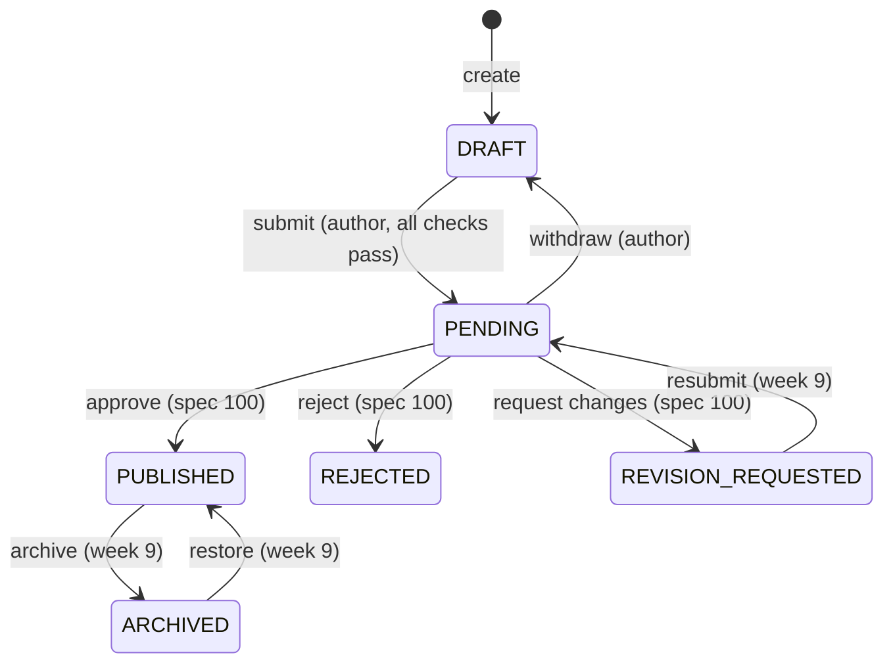

# Data Model: Recipe Creation Wizard (060), week 7 scope

*Performed by: Nguyễn Đức Duy (DucDuyNguyen15-IT) | Reviewed by: _(pending)_ | Edited by: _(pending)_*

Tables come from `V201`, `V202`, `V203` (owned by B). New in this plan: `V205` (one column) and
`R__seed_recipe_taxonomy.sql` (seed rows). Decisions in [research.md](research.md); HTTP shapes in
[contracts/openapi.yaml](contracts/openapi.yaml).

## 1. Schema changes

| File | Change |
|---|---|
| `V205__recipe_client_draft_id.sql` | `ALTER TABLE recipes ADD COLUMN client_draft_id UUID;` + `CREATE UNIQUE INDEX uq_recipes_client_draft ON recipes (author_id, client_draft_id) WHERE client_draft_id IS NOT NULL;` (R3) |
| `R__seed_recipe_taxonomy.sql` | Idempotent inserts (`ON CONFLICT DO NOTHING`): cuisines (`viet-nam`, `trung-hoa`, `nhat-ban`, `han-quoc`, `thai-lan`, `au-my`), `tags` `kind = 'METHOD'` (`chien`, `xao`, `luoc`, `hap`, `nuong`, `kho`, `chien-khong-dau`, `om`, `tron`), `kind = 'EQUIPMENT'` (`noi-com-dien`, `noi-chien-khong-dau`, `lo-nuong`, `lo-vi-song`, `noi-ap-suat`, `may-xay`, `chao-chong-dinh`), a few `kind = 'TAG'` (`mon-nhanh`, `it-dau-mo`, `cho-be`, `an-kieng`). Categories come from the importer mapping (`tools/angingon-scraper/mappings/categories.csv`) and are not duplicated. |

`V204` (search vector) is described in `specs/020-recipe-search-filter/data-model.md` §2.

## 2. JPA entities (`com.wikicook.recipe.domain`)

| Entity | Table | Key fields | Notes |
|---|---|---|---|
| `Recipe` | `recipes` | `id`, `authorId`, `title`, `description`, `cuisineId`, `categoryId`, `difficulty`, `prepTimeMinutes`, `cookTimeMinutes`, `totalTimeMinutes` (read-only), `servings`, `videoUrl`, `videoPlatform`, `status`, `lastWizardStep`, `clientDraftId`, `version` (`@Version`), `submittedAt`, `publishedAt`, timestamps | `search_vector`, `rating_avg`, `review_count`, `featured_position`, `for_*`, source columns are not written by 060 (read-only mapping where needed for the detail view) |
| `RecipeIngredient` | `recipe_ingredients` | `recipeId`, `groupName`, `ingredientId`, `quantity`, `unitId`, `amountText`, `note`, `isOptional`, `position` | Replaced as a set on save |
| `RecipeStep` | `recipe_steps` | `recipeId`, `position`, `title`, `content`, `timerSeconds` | Replaced as a set on save |
| `RecipeMedia` | `recipe_media` | `recipeId`, `role` (`COVER` in week 7), `storageKey` \| `externalUrl`, `contentType`, `sizeBytes`, `uploadedBy` | One `COVER` row (`uq_recipe_media_cover`) |
| `RecipeTag` | `recipe_tags` | `(recipeId, tagId)` | Methods, tags and equipment together |
| `RecipeStatusHistory` | `recipe_status_history` | `recipeId`, `fromStatus`, `toStatus`, `actorId`, `message`, `createdAt` | Append-only |

Enums: `RecipeStatus` (`DRAFT`, `PENDING`, `PUBLISHED`, `REJECTED`, `REVISION_REQUESTED`,
`ARCHIVED`), `Difficulty` (`EASY`, `MEDIUM`, `HARD`), `VideoPlatform` (`YOUTUBE`, `TIKTOK`),
`WizardStep` (`GENERAL=1`, `INGREDIENTS=2`, `EQUIPMENT=3`, `STEPS=4`, `VIDEO=5`, `REVIEW=6`).

## 3. Draft document (`RecipeDraftDocument`, request and response)

```text
version            int          optimistic lock (R2); ignored on create
lastWizardStep     1..6
general:
  title            ≤ 100 (submit: 5..100)
  description      ≤ 500
  cuisineId, categoryId                    submit: required, active
  methodIds[]      tags.kind = METHOD      submit: ≥ 1
  tagIds[]         tags.kind = TAG, ≤ 10
  difficulty       EASY|MEDIUM|HARD        submit: required
  prepTimeMinutes, cookTimeMinutes  0..1440   submit: both required, sum > 0
  servings         1..50                   submit: required
ingredients[] (≤ 50; submit: ≥ 1), in display order:
  groupName        ≤ 60, null = no group
  ingredientId     | proposedName (≤ 100)  exactly one
  quantityText     "1/2", "0,5", "1 1/2" → parsed (R5); empty only if unit.requires_quantity = false
  unitId           active unit             submit: required
  note             ≤ 100
  optional         boolean
equipmentIds[]     tags.kind = EQUIPMENT
steps[] (≤ 30; submit: ≥ 1), in order:
  content          1..1000 (submit: required)
  timerSeconds     10..86400 or null
video:
  url              YouTube / TikTok only (R9) or null
```

Response adds: `id`, `status`, `coverImageUrl`, `updatedAt`, `issues[]` (`step`, `field`, `code`) —
the submit-level problems of the current content (FR-012), and for proposed rows
`ingredientId` + `proposed: true` after the server created or reused the catalogue row (R6).

Positions are taken from array order (`position = index + 1`); the client never sends positions.

## 4. Lifecycle (week 7)



Editable by the author: `DRAFT`, `REVISION_REQUESTED`. Any other status → save refused with 409
`NOT_EDITABLE` (FR-026, AS 3.5).

## 5. Read models

| Record | Use | Fields |
|---|---|---|
| `RecipeDetailDto` | `GET /recipes/{id}` | `id`, `status`, `title`, `description`, `coverImageUrl`, `cuisine`, `category` (`slug`, `name`), `methods[]`, `tags[]`, `equipment[]`, `difficulty`, `prepTimeMinutes`, `cookTimeMinutes`, `totalTimeMinutes`, `servings`, `ratingAvg`, `reviewCount`, `ingredientGroups[]` (`name`, `items[]`: `ingredientId`, `name`, `quantity`, `unit` (`code`, `name`), `amountText`, `note`, `optional`), `steps[]` (`position`, `title`, `content`, `timerSeconds`, `imageUrls[]`), `video` (`url`, `platform`), `author` (`id`, `displayName`), `source` (`name`, `url`) or null, `publishedAt`, `isOwner` |
| `MyRecipeCardDto` | `GET /me/recipes` | `id`, `title`, `coverImageUrl`, `status`, `updatedAt`, `lastWizardStep`, `lastMessage` (latest history message, if any) |
| `EditorOptionsDto` | `GET /recipes/editor/options` | `cuisines[]`, `categories[]`, `methods[]`, `tags[]`, `equipment[]` (`id`, `slug`, `name`), `units[]` (`id`, `code`, `name`, `requiresQuantity`) |
| `IngredientSuggestionDto` | `GET /ingredients/suggest` | `id`, `name`, `proposed` |

Ingredients without a group are returned as one group with `name = null`, first.
