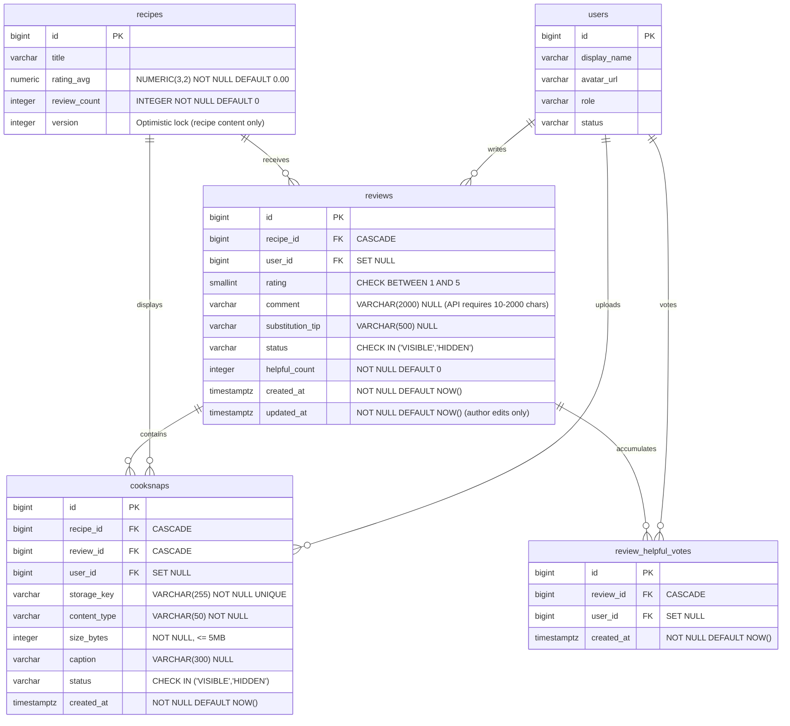

# Data Model: Community Reviews, Cooksnaps & Interactive Ratings – 070

**Feature**: [spec.md](spec.md) | **Plan**: [plan.md](plan.md) | **Research**: [research.md](research.md)

This document specifies the Phase 1 Data Model for the **070-review-cooksnap** module, including the relational database schema (PostgreSQL 16), complete Flyway migration DDL script (`V501__community.sql`), JPA entities (Java 21), Java Record DTOs (API Transfer Contracts), and client-side TypeScript interfaces.

---

## 1. Relational Database Schema (PostgreSQL 16)

The design strictly complies with [Section 4.5 & Section 4.9 of `docs/analysis-and-design/database/full-schema.md`](../../docs/analysis-and-design/database/full-schema.md#49-danh-gia--cooksnap-070--e) and [Constitution Principles III & IV](../../.specify/memory/constitution.md). It is initialized through Flyway migration `V501__community.sql`.



---

### 1.1. `reviews` Table

Stores community culinary reviews, star ratings, and optional ingredient substitution tips.

| Column | Data Type | Nullable | Constraint / Default | Business Meaning |
|---|---|---|---|---|
| `id` | `BIGINT` | NOT NULL | `PRIMARY KEY GENERATED ALWAYS AS IDENTITY` | Unique primary key of the review |
| `recipe_id` | `BIGINT` | NOT NULL | `REFERENCES recipes(id) ON DELETE CASCADE` | Recipe being reviewed |
| `user_id` | `BIGINT` | NULL | `REFERENCES users(id) ON DELETE SET NULL` | Review author (NULL indicates deleted account) |
| `rating` | `SMALLINT` | NOT NULL | `CHECK (rating BETWEEN 1 AND 5)` | Star rating score (1 to 5 stars) |
| `comment` | `VARCHAR(2000)` | NULL | Default: `NULL` | Feedback text and cooking experience. The column stays nullable to match full-schema §4.9, but the API **requires** a trimmed comment of 10–2000 characters (FR-004, `@NotBlank @Size(min = 10, max = 2000)`) |
| `substitution_tip` | `VARCHAR(500)` | NULL | Default: `NULL` | Practical ingredient substitute advice |
| `status` | `VARCHAR(10)` | NOT NULL | `DEFAULT 'VISIBLE' CHECK (status IN ('VISIBLE','HIDDEN'))` | Visibility status. `HIDDEN` is set **only** by moderation (manual hide or auto-quarantine at ≥ 10 open reports). An owner deleting their own review hard-deletes the row (see §1.5) |
| `helpful_count` | `INTEGER` | NOT NULL | `DEFAULT 0 CHECK (helpful_count >= 0)` | Denormalized count of helpful votes. Always recomputed as `COUNT(*)` from `review_helpful_votes` (never `+1`/`-1`), see §1.3 |
| `created_at` | `TIMESTAMPTZ` | NOT NULL | `DEFAULT NOW()` | Submission timestamp |
| `updated_at` | `TIMESTAMPTZ` | NOT NULL | `DEFAULT NOW()` | Last time the **author** edited rating/comment/tip/Cooksnaps. Not changed by helpful votes or moderation status changes (no DB trigger, no `@UpdateTimestamp`) |

**Indexes & Uniqueness Constraints:**
- `CREATE UNIQUE INDEX uq_reviews_recipe_user ON reviews(recipe_id, user_id) WHERE user_id IS NOT NULL;`
  $\rightarrow$ Strictly enforces that each registered user has **at most one review row** per recipe, whatever its `status` (anti-spam constraint, full-schema §4.9). Because the index also covers `HIDDEN` rows, owner deletion is a **hard delete** (§1.5) so the user can review the recipe again later. A review hidden by moderation keeps blocking a new submission (HTTP 409 `REVIEW_UNDER_MODERATION`), so users cannot bypass a quarantine by re-posting.
- `CREATE INDEX idx_reviews_recipe_lookup ON reviews(recipe_id, created_at DESC) WHERE status = 'VISIBLE';`
  $\rightarrow$ Fast paginated retrieval of latest visible reviews for a recipe (NFR-001 $< 500\text{ms}$).
- `CREATE INDEX idx_reviews_recipe_rating ON reviews(recipe_id, rating DESC, created_at DESC) WHERE status = 'VISIBLE';`
  $\rightarrow$ Accelerates `HIGHEST_RATED` and `LOWEST_RATED` sorting (backward index scan for `LOWEST_RATED`). `OLDEST` reuses `idx_reviews_recipe_lookup` scanned backwards.
- `CREATE INDEX idx_reviews_recipe_helpful ON reviews(recipe_id, helpful_count DESC, created_at DESC) WHERE status = 'VISIBLE';`
  $\rightarrow$ Accelerates sorting by most helpful reviews.
- `CREATE INDEX idx_reviews_user_lookup ON reviews(user_id, created_at DESC) WHERE user_id IS NOT NULL;`
  $\rightarrow$ Enables fast lookup of reviews written by a specific user (profile activity).

---

### 1.2. `cooksnaps` Table

Stores user-submitted proof-of-cooking photos attached to reviews, with EXIF stripped and stored securely.

| Column | Data Type | Nullable | Constraint / Default | Business Meaning |
|---|---|---|---|---|
| `id` | `BIGINT` | NOT NULL | `PRIMARY KEY GENERATED ALWAYS AS IDENTITY` | Unique primary key of the Cooksnap photo |
| `recipe_id` | `BIGINT` | NOT NULL | `REFERENCES recipes(id) ON DELETE CASCADE` | Recipe associated with the photo |
| `review_id` | `BIGINT` | NOT NULL | `REFERENCES reviews(id) ON DELETE CASCADE` | Review associated with this photo. ❓ **Not yet in full-schema §4.9** – proposed addition, see research.md Open Items |
| `user_id` | `BIGINT` | NULL | `REFERENCES users(id) ON DELETE SET NULL` | Uploader (NULL indicates deleted account) |
| `storage_key` | `VARCHAR(255)` | NOT NULL | `UNIQUE` | Relative storage key (e.g., `cs_105_789_uuid.webp`); looked up by the media endpoint |
| `content_type` | `VARCHAR(50)` | NOT NULL | `CHECK (content_type IN ('image/jpeg','image/png','image/webp'))` | MIME type of processed image |
| `size_bytes` | `INTEGER` | NOT NULL | `CHECK (size_bytes > 0 AND size_bytes <= 5242880)` | File size in bytes ($\le 5\text{MB}$) |
| `caption` | `VARCHAR(300)` | NULL | Default: `NULL` | Optional caption describing the photo |
| `status` | `VARCHAR(10)` | NOT NULL | `DEFAULT 'VISIBLE' CHECK (status IN ('VISIBLE','HIDDEN'))` | Visibility status (`VISIBLE` or `HIDDEN`) |
| `created_at` | `TIMESTAMPTZ` | NOT NULL | `DEFAULT NOW()` | Upload timestamp |

**Indexes & Foreign Key Constraints:**
- `CREATE INDEX idx_cooksnaps_review ON cooksnaps(review_id) WHERE status = 'VISIBLE';`
  $\rightarrow$ Instant loading of Cooksnaps belonging to a specific review.
- `CREATE INDEX idx_cooksnaps_recipe ON cooksnaps(recipe_id, created_at DESC) WHERE status = 'VISIBLE';`
  $\rightarrow$ Fast retrieval of Cooksnap photo galleries on recipe detail pages.
- `CREATE INDEX idx_cooksnaps_user ON cooksnaps(user_id) WHERE user_id IS NOT NULL;`
  $\rightarrow$ Displays user's uploaded Cooksnaps in their personal profile gallery.
- `CONSTRAINT uq_cooksnaps_storage_key UNIQUE (storage_key)`
  $\rightarrow$ Lets `GET /media/cooksnaps/{storageKey}` resolve the owning row and check its visibility.

**Privacy & Storage Standards (Constitution IV & Research R1):**
- Images are strictly stripped of all EXIF/GPS metadata before writing to storage.
- Storage keys follow the naming convention: `cs_{recipeId}_{reviewId}_{uuid}.webp`.
- Images are served via application endpoint `/api/v1/media/cooksnaps/{storage_key}` (`?thumbnail=true` for the 400×400 variant). No direct filesystem paths or absolute external URLs are stored in the database.
- **Visibility gate**: the media endpoint looks up `storage_key` and streams the file only when `cooksnaps.status = 'VISIBLE'` **and** the parent `reviews.status = 'VISIBLE'`; otherwise it returns `404` (no hint that the file exists). Responses use `Cache-Control: public, max-age=3600, must-revalidate` plus a strong `ETag` (never `immutable`), so a hidden or deleted photo disappears from browser/CDN caches within one hour.
- **File lifecycle**: files are written before the DB commit. `ReviewService` registers a `TransactionSynchronization`: on **rollback** it deletes every file written in that transaction; after **commit** of an owner delete, or of a Cooksnap removal during edit, it deletes the removed files (full image + thumbnail). No orphan files are left on disk.

---

### 1.3. `review_helpful_votes` Table

Tracks user votes marking reviews as "Helpful" (`helpful_count`), preventing duplicate votes from the same account.

| Column | Data Type | Nullable | Constraint / Default | Business Meaning |
|---|---|---|---|---|
| `id` | `BIGINT` | NOT NULL | `PRIMARY KEY GENERATED ALWAYS AS IDENTITY` | Unique primary key of the vote |
| `review_id` | `BIGINT` | NOT NULL | `REFERENCES reviews(id) ON DELETE CASCADE` | Review receiving the helpful vote |
| `user_id` | `BIGINT` | NULL | `REFERENCES users(id) ON DELETE SET NULL` | User who cast the vote. NULL = the voter deleted their account; the vote is kept anonymously so `helpful_count` stays equal to the number of rows (same policy as `reviews.user_id`) |
| `created_at` | `TIMESTAMPTZ` | NOT NULL | `DEFAULT NOW()` | Vote timestamp |

**Indexes & Uniqueness Constraints:**
- `CONSTRAINT uq_review_helpful_votes UNIQUE (review_id, user_id)`
  $\rightarrow$ Prevents a user from voting "Helpful" more than once on the same review.
- `CREATE INDEX idx_review_helpful_votes_user ON review_helpful_votes(user_id, review_id) WHERE user_id IS NOT NULL;`
  $\rightarrow$ Rapid lookup of whether the current user has already upvoted a given set of reviews.

**Toggle algorithm (race-free, `POST /reviews/{reviewId}/helpful`)**, in one transaction:
```sql
-- 1. Serialize concurrent toggles on the same review (double-click, several tabs)
SELECT id, user_id, status FROM reviews WHERE id = :reviewId FOR UPDATE;
--    404 if missing or HIDDEN, 403 if reviews.user_id = :userId
-- 2. Try to remove an existing vote
DELETE FROM review_helpful_votes WHERE review_id = :reviewId AND user_id = :userId;
-- 3. Only if step 2 deleted 0 rows: add the vote
INSERT INTO review_helpful_votes (review_id, user_id) VALUES (:reviewId, :userId);
-- 4. Recompute the counter from the source of truth (self-healing, never drifts)
UPDATE reviews
SET helpful_count = (SELECT COUNT(*) FROM review_helpful_votes WHERE review_id = :reviewId)
WHERE id = :reviewId
RETURNING helpful_count;
```
Because the review row is locked in step 1, two simultaneous toggles from the same user run one after the other (vote, then un-vote) instead of hitting the unique constraint (HTTP 500) or counting twice. Step 4 is a native query and does not change `updated_at`.

---

### 1.4. Summary Columns on `recipes` Table

The `recipes` table ([Section 4.5 of `full-schema.md`](../../docs/analysis-and-design/database/full-schema.md#45-cong-thuc-060-020--b)) contains denormalized rating metrics:

| Column | Data Type | Nullable | Default | Description |
|---|---|---|---|---|
| `rating_avg` | `NUMERIC(3,2)` | NOT NULL | `0.00` | Current arithmetic mean of all visible reviews (1.00 to 5.00) |
| `review_count` | `INTEGER` | NOT NULL | `0` | Total number of visible community reviews |

**Critical Architectural Invariant (Research R2):**
When a review is created, edited, deleted, hidden, restored or auto-quarantined, the write transaction MUST follow this order:

1. **Lock the recipe row first**, before writing the review:
   ```sql
   SELECT id FROM recipes WHERE id = :recipeId FOR UPDATE;
   ```
   Under `READ COMMITTED`, two concurrent review writes on the same recipe would otherwise each aggregate without seeing the other's uncommitted row, and the last writer would persist a stale `review_count`/`rating_avg` (violates NFR-003, SC-003). With the lock, the second transaction waits; its later `AVG/COUNT` statement takes a fresh snapshot that includes the first transaction's committed row. The same lock also makes the duplicate check and the 5-reviews-per-10-minutes check race-free per recipe.
2. Write the review change.
3. Recalculate in the same transaction, rounded to **1 decimal place** (FR-009, SC-003; stored in `NUMERIC(3,2)`, e.g. `4.30`):
```sql
WITH stats AS (
    SELECT
        COALESCE(ROUND(AVG(rating)::numeric, 1), 0.0) AS calc_avg,
        COUNT(*)::integer AS calc_count
    FROM reviews
    WHERE recipe_id = :recipeId AND status = 'VISIBLE'
)
UPDATE recipes
SET rating_avg = stats.calc_avg,
    review_count = stats.calc_count
FROM stats
WHERE recipes.id = :recipeId;
```
> [!IMPORTANT]
> **DO NOT increment `version = r.version + 1`** in the `UPDATE recipes` query for rating calculation. Bumping the recipe's optimistic locking version during background community reviews causes false `409 Conflict` errors for recipe authors or moderators who are concurrently editing the recipe content.

> [!IMPORTANT]
> **The `Recipe` JPA entity (module 060) MUST map these two columns as read-only.** Otherwise saving a stale `Recipe` (an author editing for a while, `version` unchanged by step 3) writes the old `rating_avg`/`review_count` back while the optimistic-lock check still passes:
> ```java
> @Column(name = "rating_avg", insertable = false, updatable = false)
> private BigDecimal ratingAvg;
>
> @Column(name = "review_count", insertable = false, updatable = false)
> private Integer reviewCount;
> ```
> Only the native recalculation query above may write them.

### 1.5. Review Lifecycle & Deletion Semantics

| Action | Who | Effect on `reviews` | Effect on `cooksnaps` / files | Recalculate stats |
|---|---|---|---|---|
| Create | Member (not the recipe author) | `INSERT` (`VISIBLE`) | `INSERT` up to 3 rows; files deleted on rollback | ✅ |
| Edit | Owner, only while `VISIBLE` | `UPDATE` rating/comment/tip, `updated_at = now()` | Listed photos removed (rows deleted, files deleted after commit), new ones added; total ≤ 3 | ✅ |
| Delete own review | Owner | **Hard `DELETE`**, cascading to `cooksnaps`, `review_helpful_votes`, `reports` | Files deleted after commit | ✅ |
| Hide / auto-quarantine | Moderator, or system at ≥ 10 `OPEN` reports | `status = 'HIDDEN'` (row kept for moderation history) | Cooksnaps `status = 'HIDDEN'`; media endpoint returns 404 | ✅ |
| Restore | Moderator | `status = 'VISIBLE'` | Cooksnaps `status = 'VISIBLE'` | ✅ |

- `POST /recipes/{id}/reviews` when the user already has a `VISIBLE` review → 409 `REVIEW_ALREADY_EXISTS`; when their existing review is `HIDDEN` by moderation → 409 `REVIEW_UNDER_MODERATION`.
- `PUT /reviews/{id}` on a `HIDDEN` review → 409 `REVIEW_UNDER_MODERATION` (the owner may still `DELETE` it).

---

## 2. Flyway Migration DDL (`V501__community.sql`)

```sql
-- ============================================================================
-- Migration: V501__community.sql
-- Module: 070-review-cooksnap
-- Standards: PostgreSQL 16, full-schema.md §4.9, Constitution III & IV
-- ============================================================================

-- 1. Table: reviews
CREATE TABLE reviews (
    id               BIGINT GENERATED ALWAYS AS IDENTITY PRIMARY KEY,
    recipe_id        BIGINT       NOT NULL REFERENCES recipes(id) ON DELETE CASCADE,
    user_id          BIGINT       NULL REFERENCES users(id) ON DELETE SET NULL,
    rating           SMALLINT     NOT NULL CHECK (rating BETWEEN 1 AND 5),
    comment          VARCHAR(2000) NULL,  -- API requires 10-2000 chars (FR-004)
    substitution_tip VARCHAR(500)  NULL,
    status           VARCHAR(10)  NOT NULL DEFAULT 'VISIBLE' CHECK (status IN ('VISIBLE', 'HIDDEN')),
    helpful_count    INTEGER      NOT NULL DEFAULT 0 CHECK (helpful_count >= 0),
    created_at       TIMESTAMPTZ  NOT NULL DEFAULT NOW(),
    updated_at       TIMESTAMPTZ  NOT NULL DEFAULT NOW()
);

-- Partial Unique Index: 1 review row per user per recipe (any status).
-- Owner deletion is a hard DELETE so the user can review again; a review HIDDEN by moderation keeps blocking.
CREATE UNIQUE INDEX uq_reviews_recipe_user 
    ON reviews(recipe_id, user_id) 
    WHERE user_id IS NOT NULL;

-- Performance Indexes for filtering, pagination, and multi-criteria sorting
CREATE INDEX idx_reviews_recipe_lookup 
    ON reviews(recipe_id, created_at DESC) 
    WHERE status = 'VISIBLE';

CREATE INDEX idx_reviews_recipe_rating 
    ON reviews(recipe_id, rating DESC, created_at DESC) 
    WHERE status = 'VISIBLE';

CREATE INDEX idx_reviews_recipe_helpful 
    ON reviews(recipe_id, helpful_count DESC, created_at DESC) 
    WHERE status = 'VISIBLE';

CREATE INDEX idx_reviews_user_lookup 
    ON reviews(user_id, created_at DESC) 
    WHERE user_id IS NOT NULL;

-- 2. Table: cooksnaps
CREATE TABLE cooksnaps (
    id           BIGINT GENERATED ALWAYS AS IDENTITY PRIMARY KEY,
    recipe_id    BIGINT       NOT NULL REFERENCES recipes(id) ON DELETE CASCADE,
    review_id    BIGINT       NOT NULL REFERENCES reviews(id) ON DELETE CASCADE,
    user_id      BIGINT       NULL REFERENCES users(id) ON DELETE SET NULL,
    storage_key  VARCHAR(255) NOT NULL CONSTRAINT uq_cooksnaps_storage_key UNIQUE,
    content_type VARCHAR(50)  NOT NULL CHECK (content_type IN ('image/jpeg', 'image/png', 'image/webp')),
    size_bytes   INTEGER      NOT NULL CHECK (size_bytes > 0 AND size_bytes <= 5242880),
    caption      VARCHAR(300) NULL,
    status       VARCHAR(10)  NOT NULL DEFAULT 'VISIBLE' CHECK (status IN ('VISIBLE', 'HIDDEN')),
    created_at   TIMESTAMPTZ  NOT NULL DEFAULT NOW()
);

CREATE INDEX idx_cooksnaps_review 
    ON cooksnaps(review_id) 
    WHERE status = 'VISIBLE';

CREATE INDEX idx_cooksnaps_recipe 
    ON cooksnaps(recipe_id, created_at DESC) 
    WHERE status = 'VISIBLE';

CREATE INDEX idx_cooksnaps_user 
    ON cooksnaps(user_id) 
    WHERE user_id IS NOT NULL;

-- 3. Table: review_helpful_votes
CREATE TABLE review_helpful_votes (
    id         BIGINT GENERATED ALWAYS AS IDENTITY PRIMARY KEY,
    review_id  BIGINT      NOT NULL REFERENCES reviews(id) ON DELETE CASCADE,
    user_id    BIGINT      NULL REFERENCES users(id) ON DELETE SET NULL,  -- keep vote anonymously so helpful_count = COUNT(*)
    created_at TIMESTAMPTZ NOT NULL DEFAULT NOW(),
    CONSTRAINT uq_review_helpful_votes UNIQUE (review_id, user_id)
);

CREATE INDEX idx_review_helpful_votes_user 
    ON review_helpful_votes(user_id, review_id)
    WHERE user_id IS NOT NULL;

-- 4. No updated_at trigger on purpose: updated_at means "last edited by the author"
--    and is set by the application (Review.editContent()). Helpful-vote recounts and
--    moderation status changes must not change it.

-- 5. Comments on tables and columns for self-documenting schema
COMMENT ON TABLE reviews IS 'Community reviews and star ratings on recipes';
COMMENT ON COLUMN reviews.status IS 'VISIBLE, or HIDDEN by moderation/auto-quarantine (owner deletion is a hard delete)';
COMMENT ON COLUMN reviews.updated_at IS 'Last edit by the review author (not changed by votes or moderation)';
COMMENT ON COLUMN reviews.substitution_tip IS 'Optional tip explaining ingredient replacement';
COMMENT ON TABLE cooksnaps IS 'User-uploaded proof-of-cooking images attached to reviews';
COMMENT ON COLUMN cooksnaps.storage_key IS 'Relative file storage key (e.g. cs_12_45_uuid.webp)';
COMMENT ON TABLE review_helpful_votes IS 'Helpful votes cast by authenticated users on reviews';
```

---

## 3. JPA Entities (Backend Entities - Java 21)

Located in package `com.wikicook.review.domain`. Entities follow **Constitution Principle III** (Layered architecture; entities are never directly exposed through web controllers).

### 3.1. `ReviewStatus` Enum
```java
package com.wikicook.review.domain;

public enum ReviewStatus {
    VISIBLE,
    HIDDEN
}
```

### 3.2. `Review` Entity
```java
package com.wikicook.review.domain;

import jakarta.persistence.*;
import jakarta.validation.constraints.*;
import lombok.*;
import org.hibernate.annotations.CreationTimestamp;

import java.time.Instant;
import java.util.ArrayList;
import java.util.List;

@Entity
@Table(name = "reviews")
@Getter
@Setter
@NoArgsConstructor
@AllArgsConstructor
@Builder
public class Review {

    @Id
    @GeneratedValue(strategy = GenerationType.IDENTITY)
    private Long id;

    @NotNull
    @Column(name = "recipe_id", nullable = false)
    private Long recipeId;

    @Column(name = "user_id")
    private Long userId;

    @NotNull
    @Min(1)
    @Max(5)
    @Column(nullable = false)
    private Short rating;

    @NotBlank
    @Size(min = 10, max = 2000)
    @Column(length = 2000)
    private String comment;

    @Size(max = 500)
    @Column(name = "substitution_tip", length = 500)
    private String substitutionTip;

    @NotNull
    @Enumerated(EnumType.STRING)
    @Column(nullable = false, length = 10)
    @Builder.Default
    private ReviewStatus status = ReviewStatus.VISIBLE;

    // Written only by the native recount query of the helpful-vote toggle (§1.3)
    @Min(0)
    @Column(name = "helpful_count", nullable = false, insertable = false, updatable = false)
    private Integer helpfulCount;

    @CreationTimestamp
    @Column(name = "created_at", nullable = false, updatable = false)
    private Instant createdAt;

    // Set explicitly in editContent(); no @UpdateTimestamp and no DB trigger
    @Column(name = "updated_at", nullable = false)
    @Builder.Default
    private Instant updatedAt = Instant.now();

    @OneToMany(mappedBy = "review", cascade = CascadeType.ALL, orphanRemoval = true)
    @Builder.Default
    private List<Cooksnap> cooksnaps = new ArrayList<>();

    @OneToMany(mappedBy = "review", cascade = CascadeType.ALL, orphanRemoval = true)
    @Builder.Default
    private List<ReviewHelpfulVote> helpfulVotes = new ArrayList<>();

    // Domain helper methods
    public void addCooksnap(Cooksnap cooksnap) {
        cooksnaps.add(cooksnap);
        cooksnap.setReview(this);
    }

    public void removeCooksnap(Cooksnap cooksnap) {
        cooksnaps.remove(cooksnap);
        cooksnap.setReview(null);
    }

    /** Author edit: the only place that moves updatedAt. */
    public void editContent(Short rating, String comment, String substitutionTip) {
        this.rating = rating;
        this.comment = comment;
        this.substitutionTip = substitutionTip;
        this.updatedAt = Instant.now();
    }

    /** Moderation only (manual hide / auto-quarantine). Does not touch updatedAt. */
    public void hide() {
        this.status = ReviewStatus.HIDDEN;
        cooksnaps.forEach(Cooksnap::hide);
    }

    public void restore() {
        this.status = ReviewStatus.VISIBLE;
        cooksnaps.forEach(Cooksnap::restore);
    }
}
```

### 3.3. `Cooksnap` Entity
```java
package com.wikicook.review.domain;

import jakarta.persistence.*;
import jakarta.validation.constraints.*;
import lombok.*;
import org.hibernate.annotations.CreationTimestamp;

import java.time.Instant;

@Entity
@Table(name = "cooksnaps")
@Getter
@Setter
@NoArgsConstructor
@AllArgsConstructor
@Builder
public class Cooksnap {

    @Id
    @GeneratedValue(strategy = GenerationType.IDENTITY)
    private Long id;

    @NotNull
    @Column(name = "recipe_id", nullable = false)
    private Long recipeId;

    @ManyToOne(fetch = FetchType.LAZY)
    @JoinColumn(name = "review_id", nullable = false)
    private Review review;

    @Column(name = "user_id")
    private Long userId;

    @NotBlank
    @Size(max = 255)
    @Column(name = "storage_key", nullable = false, length = 255, unique = true)
    private String storageKey;

    @NotBlank
    @Size(max = 50)
    @Column(name = "content_type", nullable = false, length = 50)
    private String contentType;

    @NotNull
    @Positive
    @Max(5242880) // 5 MB limit
    @Column(name = "size_bytes", nullable = false)
    private Integer sizeBytes;

    @Size(max = 300)
    @Column(length = 300)
    private String caption;

    @NotNull
    @Enumerated(EnumType.STRING)
    @Column(nullable = false, length = 10)
    @Builder.Default
    private ReviewStatus status = ReviewStatus.VISIBLE;

    @CreationTimestamp
    @Column(name = "created_at", nullable = false, updatable = false)
    private Instant createdAt;

    public void hide() {
        this.status = ReviewStatus.HIDDEN;
    }

    public void restore() {
        this.status = ReviewStatus.VISIBLE;
    }
}
```

### 3.4. `ReviewHelpfulVote` Entity
```java
package com.wikicook.review.domain;

import jakarta.persistence.*;
import jakarta.validation.constraints.NotNull;
import lombok.*;
import org.hibernate.annotations.CreationTimestamp;

import java.time.Instant;

@Entity
@Table(name = "review_helpful_votes", uniqueConstraints = {
    @UniqueConstraint(name = "uq_review_helpful_votes", columnNames = {"review_id", "user_id"})
})
@Getter
@Setter
@NoArgsConstructor
@AllArgsConstructor
@Builder
public class ReviewHelpfulVote {

    @Id
    @GeneratedValue(strategy = GenerationType.IDENTITY)
    private Long id;

    @NotNull
    @ManyToOne(fetch = FetchType.LAZY)
    @JoinColumn(name = "review_id", nullable = false)
    private Review review;

    // NULL once the voter deletes their account (ON DELETE SET NULL)
    @Column(name = "user_id")
    private Long userId;

    @CreationTimestamp
    @Column(name = "created_at", nullable = false, updatable = false)
    private Instant createdAt;
}
```

---

## 4. Java Record DTOs (API Transfer Contracts)

Located in package `com.wikicook.review.dto`. Java 21 Records guarantee immutability, thread-safety, and complete separation between persistence entities and web clients (**Constitution Principle III**).

### 4.1. Request DTOs

#### `CreateReviewRequest`
```java
package com.wikicook.review.dto;

import jakarta.validation.constraints.Max;
import jakarta.validation.constraints.Min;
import jakarta.validation.constraints.NotBlank;
import jakarta.validation.constraints.NotNull;
import jakarta.validation.constraints.Size;

public record CreateReviewRequest(
    @NotNull(message = "Điểm đánh giá không được để trống")
    @Min(value = 1, message = "Điểm đánh giá tối thiểu là 1 sao")
    @Max(value = 5, message = "Điểm đánh giá tối đa là 5 sao")
    Short rating,

    @NotBlank(message = "Nội dung nhận xét không được để trống")
    @Size(min = 10, max = 2000, message = "Nhận xét phải có từ 10 đến 2000 ký tự")
    String comment,

    @Size(max = 500, message = "Mẹo thay thế nguyên liệu tối đa 500 ký tự")
    String substitutionTip
) {}
```

#### `UpdateReviewRequest`
```java
package com.wikicook.review.dto;

import jakarta.validation.constraints.Max;
import jakarta.validation.constraints.Min;
import jakarta.validation.constraints.NotBlank;
import jakarta.validation.constraints.NotNull;
import jakarta.validation.constraints.Size;
import java.util.List;

public record UpdateReviewRequest(
    @NotNull(message = "Điểm đánh giá không được để trống")
    @Min(value = 1, message = "Điểm đánh giá tối thiểu là 1 sao")
    @Max(value = 5, message = "Điểm đánh giá tối đa là 5 sao")
    Short rating,

    @NotBlank(message = "Nội dung nhận xét không được để trống")
    @Size(min = 10, max = 2000, message = "Nhận xét phải có từ 10 đến 2000 ký tự")
    String comment,

    @Size(max = 500, message = "Mẹo thay thế nguyên liệu tối đa 500 ký tự")
    String substitutionTip,

    // IDs of this review's existing Cooksnaps to remove; new files arrive as multipart part `cooksnapFiles`.
    // Service rule: existing - removed + new <= 3, otherwise 400.
    @Size(max = 3, message = "Tối đa 3 ảnh Cooksnap")
    List<Long> removeCooksnapIds
) {}
```

#### `CreateReportRequest`
```java
package com.wikicook.review.dto;

import jakarta.validation.constraints.NotNull;
import jakarta.validation.constraints.Size;

public record CreateReportRequest(
    @NotNull(message = "Vui lòng chọn lý do báo cáo")
    ReportReason reason,          // SPAM, OFFENSIVE, COPYRIGHT, UNSAFE, OTHER

    @Size(max = 1000, message = "Mô tả chi tiết tối đa 1000 ký tự")
    String details
) {}
```
Used by `POST /reviews/{reviewId}/reports` and `POST /cooksnaps/{cooksnapId}/reports` (FR-015, FR-016, FR-024). The service inserts into the shared `reports` table (full-schema §4.10, owned by spec 100) and:
- maps the unique-index violation to 409 `REPORT_ALREADY_EXISTS`;
- rejects reporting one's own content with 403 `SELF_REPORT_FORBIDDEN`;
- after the insert, counts `OPEN` reports for the target; when the count reaches 10 it calls `Review.hide()` / `Cooksnap.hide()` and recalculates recipe stats in the same transaction, taking the recipe-row lock from §1.4 first.

---

### 4.2. Response DTOs

#### `CooksnapDto`
```java
package com.wikicook.review.dto;

public record CooksnapDto(
    Long id,
    String storageKey,
    String url,
    String thumbnailUrl,
    String caption,
    Integer sizeBytes,
    String contentType
) {}
```

#### `ReviewAuthorDto`
```java
package com.wikicook.review.dto;

public record ReviewAuthorDto(
    Long id,
    String displayName,
    String avatarUrl,
    String role,
    boolean isDeleted
) {}
```

#### `ReviewResponse`
```java
package com.wikicook.review.dto;

import java.time.Instant;
import java.util.List;

public record ReviewResponse(
    Long id,
    Long recipeId,
    ReviewAuthorDto author,
    short rating,
    String comment,
    String substitutionTip,
    List<CooksnapDto> cooksnaps,
    int helpfulCount,
    boolean hasVotedHelpful,
    Instant createdAt,
    Instant updatedAt,
    boolean isOwner
) {}
```

#### `ReportResponse`
```java
package com.wikicook.review.dto;

import java.time.Instant;

public record ReportResponse(
    Long reportId,
    String targetType,   // REVIEW or COOKSNAP
    Long targetId,
    String status,       // OPEN
    Instant createdAt
) {}
```

#### `HelpfulVoteResponse`
```java
package com.wikicook.review.dto;

public record HelpfulVoteResponse(
    Long reviewId,
    int helpfulCount,
    boolean hasVoted
) {}
```

#### `RatingSummaryDto`
```java
package com.wikicook.review.dto;

import java.math.BigDecimal;
import java.util.Map;

public record RatingSummaryDto(
    BigDecimal averageRating,   // rounded to 1 decimal place, e.g. 4.3
    int totalReviews,
    Map<Integer, Long> ratingDistribution // 1 -> count, 2 -> count, ..., 5 -> count
) {}
```

#### `ReviewListResponse`
```java
package com.wikicook.review.dto;

import java.util.List;

public record ReviewListResponse(
    List<ReviewResponse> items,
    long totalElements,
    int totalPages,
    int currentPage,
    int pageSize,
    RatingSummaryDto ratingSummary
) {}
```

---

### 4.3. RFC 7807 Problem Detail (Error Responses)

Standardized API error response format returned by `ReviewExceptionHandler`:

```json
{
  "type": "https://wikicook.com/errors/self-review-forbidden",
  "title": "Forbidden",
  "status": 403,
  "detail": "Bạn là tác giả công thức này — bạn có thể xem đánh giá, nhưng không thể tự chấm điểm.",
  "instance": "/api/v1/recipes/105/reviews"
}
```

```json
{
  "type": "https://wikicook.com/errors/review-already-exists",
  "title": "Conflict",
  "status": 409,
  "detail": "Bạn đã đánh giá công thức này rồi. Vui lòng chỉnh sửa đánh giá hiện có.",
  "instance": "/api/v1/recipes/105/reviews"
}
```

```json
{
  "type": "https://wikicook.com/errors/review-under-moderation",
  "title": "Conflict",
  "status": 409,
  "detail": "Đánh giá của bạn đang bị ẩn để chờ kiểm duyệt nên chưa thể chỉnh sửa hoặc gửi đánh giá mới.",
  "instance": "/api/v1/recipes/105/reviews"
}
```

```json
{
  "type": "https://wikicook.com/errors/rate-limit-exceeded",
  "title": "Too Many Requests",
  "status": 429,
  "detail": "Bạn gửi đánh giá quá nhanh. Vui lòng thử lại sau 10 phút.",
  "instance": "/api/v1/recipes/105/reviews"
}
```

---

## 5. TypeScript Interfaces (Client-Side)

Located in `src/features/reviews/types/review.ts` for use across the React SPA:

```typescript
/**
 * Types & Interfaces for Feature 070: Community Reviews & Cooksnaps
 */

export type ReviewStatus = 'VISIBLE' | 'HIDDEN';

export type ReviewSortOption =
  | 'NEWEST'          // Mới nhất (default)
  | 'OLDEST'          // Cũ nhất
  | 'HIGHEST_RATED'   // Điểm cao nhất
  | 'LOWEST_RATED'    // Điểm thấp nhất
  | 'MOST_HELPFUL';   // Hữu ích nhất
// "Photos only" is the hasCooksnapOnly filter, not a sort option.

export type ReportReason = 'SPAM' | 'OFFENSIVE' | 'COPYRIGHT' | 'UNSAFE' | 'OTHER';

export interface Cooksnap {
  id: number;
  storageKey: string;
  url: string;
  thumbnailUrl: string;
  caption?: string | null;
  sizeBytes: number;
  contentType: string;
}

export interface ReviewAuthor {
  id: number | null;
  displayName: string;
  avatarUrl?: string | null;
  role?: string;
  isDeleted: boolean;
}

export interface Review {
  id: number;
  recipeId: number;
  author: ReviewAuthor;
  rating: number; // 1 to 5
  comment?: string | null;
  substitutionTip?: string | null;
  cooksnaps: Cooksnap[];
  helpfulCount: number;
  hasVotedHelpful: boolean;
  createdAt: string; // ISO 8601 string
  updatedAt: string; // ISO 8601 string
  isOwner: boolean;
}

export interface RatingDistribution {
  1: number;
  2: number;
  3: number;
  4: number;
  5: number;
}

export interface RatingSummary {
  averageRating: number; // 1 decimal place
  totalReviews: number;
  ratingDistribution: RatingDistribution;
}

export interface ReviewListResponse {
  items: Review[];
  totalElements: number;
  totalPages: number;
  currentPage: number;
  pageSize: number;
  ratingSummary: RatingSummary;
}

export interface CreateReviewPayload {
  rating: number;
  comment: string; // required, 10-2000 characters
  substitutionTip?: string;
  cooksnapFiles?: File[];
}

export interface UpdateReviewPayload {
  rating: number;
  comment: string; // required, 10-2000 characters
  substitutionTip?: string;
  removeCooksnapIds?: number[];
  cooksnapFiles?: File[]; // existing - removed + new <= 3
}

export interface CreateReportPayload {
  reason: ReportReason;
  details?: string; // max 1000 characters
}

export interface HelpfulVoteResult {
  reviewId: number;
  helpfulCount: number;
  hasVoted: boolean;
}

export interface ReviewFilterCriteria {
  recipeId: number;
  page?: number;
  size?: number;
  sort?: ReviewSortOption;
  rating?: number;
  hasCooksnapOnly?: boolean;
}

export interface ApiProblemDetail {
  type: string;
  title: string;
  status: number;
  detail: string;
  instance?: string;
  invalidParams?: Array<{
    name: string;
    reason: string;
  }>;
}
```

