# Tasks: Community Reviews, Cooksnaps & Interactive Ratings (070-review-cooksnap)

**Input**: Design documents from `specs/070-review-cooksnap/` (`plan.md`, `spec.md`, `data-model.md`, `contracts/openapi.yaml`, `research.md`, `src/constitution.md`)

**Prerequisites**: `plan.md` (approved), `spec.md` (clarified), `data-model.md` (ratified), `contracts/openapi.yaml` (validated)

**Tests**: Test-First (TDD) approach is **MANDATORY** per Constitution Principle II. Test tasks MUST be written first and fail before implementation begins. Service layer coverage must achieve $\ge 70\%$ via JaCoCo.

**Organization**: Tasks are grouped by phase and user story to enable independent implementation, rigorous testing, and incremental delivery.

**Jira Traceability**:
- `SCRUM-73`: Spec Kit 070 (Author: Duy / Reviewer & Co-author: Chung)
- `SCRUM-77`: Backend Implementation (Author: Chung / Reviewer: Hiển)
- `SCRUM-78`: Frontend UI Integration (Author: Duy / Reviewer: Chung)
- `SCRUM-79`: System Verification & Narrated Demo Video (Author: Chung / Reviewer: Hưng)

---

## Format: `- [ ] [TaskID] [P?] [Story?] Description with exact file path`

- **[P]**: Can run in parallel (different files, no blocking dependencies on incomplete tasks)
- **[Story]**: Which user story or core subsystem this task belongs to:
  * `[CORE]`: Setup, database, shared infrastructure
  * `[US1]`: Star Rating & Cooking Feedback (Priority: P1 - MVP)
  * `[US2]`: Cooksnap Photo Upload & Privacy Guard Pipeline (Priority: P1 - MVP)
  * `[US3]`: Edit & Delete Own Review (Priority: P2)
  * `[US4]`: Browse, Sort & Filter Reviews (Priority: P2)
  * `[VOTE]`: Helpful Community Voting & Recognition (Priority: P3)
  * `[UI]`: Frontend React UI & Vitest Component Testing (`SCRUM-78`)
  * `[QA]`: System Verification, Quality Gates & Benchmarking (`SCRUM-79`)
- **Strict Atomicity**: Exactly 1 file or 1 single verification action per task.
- Exact file paths are derived strictly from Section 4 of `plan.md`.

---

## Path Conventions

- **Backend Source**: `src/backend/wikicook-app/src/main/java/com/wikicook/review/`
- **Backend Tests**: `src/backend/wikicook-app/src/test/java/com/wikicook/review/`
- **Flyway Migrations**: `src/backend/wikicook-db/src/main/resources/db/migration/`
- **Frontend Source**: `src/frontend/src/features/reviews/`
- **Frontend Tests**: `src/frontend/src/test/features/reviews/`
- **Manual Test Documentation**: `docs/test/`

---

## Phase 1: Setup & Shared Infrastructure

**Purpose**: Initialize project build descriptors, configure dependencies, and create directory scaffolding.

- [ ] T001 [CORE] Verify and configure Maven dependencies (`org.sejda.imageio:webp-imageio:0.1.6`, TwelveMonkeys `com.twelvemonkeys.imageio:imageio-metadata:3.10.1` and `imageio-jpeg:3.10.1`, Caffeine `com.github.ben-manes.caffeine:caffeine:3.1.8`, Testcontainers PostgreSQL `16`) in `src/backend/wikicook-app/pom.xml`
- [ ] T002 [P] [CORE] Create backend package structure for review module (`config`, `controller`, `domain`, `dto`, `exception`, `repository`, `service`) in `src/backend/wikicook-app/src/main/java/com/wikicook/review/`
- [ ] T003 [P] [CORE] Create frontend directory structure for review feature modules (`components`, `hooks`, `services`, `types`) in `src/frontend/src/features/reviews/`
- [ ] T004 [P] [CORE] Create storage configuration properties class `ReviewStorageProperties.java` (specifying upload root path `uploads/cooksnaps/`, max size 5MB, allowed MIME types) in `src/backend/wikicook-app/src/main/java/com/wikicook/review/config/ReviewStorageProperties.java`
- [ ] T005 [P] [CORE] Create WebP Service Provider configuration `WebPImageIOConfig.java` ensuring native `webp-imageio` readers/writers register properly upon Spring Boot startup in `src/backend/wikicook-app/src/main/java/com/wikicook/review/config/WebPImageIOConfig.java`

---

## Phase 2: Foundational (Database, Core Entities & Framework Primitives)

**Purpose**: Core database schema, JPA entities, repositories, exception translation, and storage primitives that MUST be completed before any user story can proceed.

**⚠️ CRITICAL**: No user story implementation can begin until this foundational phase is fully complete.

- [ ] T006 [CORE] Create Flyway migration script `V501__community.sql` defining `reviews`, `cooksnaps` (with `review_id` FK and `UNIQUE (storage_key)`), `review_helpful_votes` (`user_id ON DELETE SET NULL`) tables and partial unique index `uq_reviews_recipe_user` (no `updated_at` trigger) in `src/backend/wikicook-db/src/main/resources/db/migration/V501__community.sql`
- [ ] T007 [CORE] Verify Flyway migration execution and assert table and index creation against PostgreSQL 16 container (`Run: cd src/backend && docker compose up -d db && docker compose run --rm migrate`)
- [ ] T008 [P] [CORE] Create `ReviewStatus` enum (`VISIBLE`, `HIDDEN`) in `src/backend/wikicook-app/src/main/java/com/wikicook/review/domain/ReviewStatus.java`
- [ ] T009 [P] [CORE] Create `Review` JPA entity with validation constraints (comment 10-2000), read-only `helpful_count`, `updated_at` set only in `editContent()` (no `@UpdateTimestamp`), and `hide()`/`restore()` helpers in `src/backend/wikicook-app/src/main/java/com/wikicook/review/domain/Review.java` (depends on T008)
- [ ] T010 [P] [CORE] Create `Cooksnap` JPA entity with size check, MIME type check, and storage key mapping in `src/backend/wikicook-app/src/main/java/com/wikicook/review/domain/Cooksnap.java` (depends on T008)
- [ ] T011 [P] [CORE] Create `ReviewHelpfulVote` JPA entity with unique constraint on `(review_id, user_id)` in `src/backend/wikicook-app/src/main/java/com/wikicook/review/domain/ReviewHelpfulVote.java`
- [ ] T012 [P] [CORE] Create `ReviewRepository` interface with queries for active recipe reviews, author checks, and summary calculation in `src/backend/wikicook-app/src/main/java/com/wikicook/review/repository/ReviewRepository.java` (depends on T009)
- [ ] T013 [P] [CORE] Create `CooksnapRepository` interface with lookup queries by review ID and recipe ID in `src/backend/wikicook-app/src/main/java/com/wikicook/review/repository/CooksnapRepository.java` (depends on T010)
- [ ] T014 [P] [CORE] Create `ReviewHelpfulVoteRepository` interface with exists query by user and review in `src/backend/wikicook-app/src/main/java/com/wikicook/review/repository/ReviewHelpfulVoteRepository.java` (depends on T011)
- [ ] T015 [CORE] Create integration test `ReviewRepositoryIT.java` with Testcontainers PostgreSQL 16 verifying entity mappings, partial unique index `uq_reviews_recipe_user`, cascade delete behaviors, and that a helpful-vote recount does not change `updated_at` in `src/backend/wikicook-app/src/test/java/com/wikicook/review/repository/ReviewRepositoryIT.java` (depends on T012, T013, T014)
- [ ] T016 [P] [CORE] Create Java Record DTOs (`CreateReviewRequest`, `UpdateReviewRequest`, `CreateReportRequest`, `ReviewResponse`, `CooksnapDto`, `ReviewAuthorDto`, `HelpfulVoteResponse`, `ReportResponse`, `RatingSummaryDto`, `ReviewListResponse`) matching `data-model.md` and `openapi.yaml` in `src/backend/wikicook-app/src/main/java/com/wikicook/review/dto/`
- [ ] T017 [P] [CORE] Create domain exception classes (`SelfReviewForbiddenException`, `ReviewAlreadyExistsException`, `ReviewUnderModerationException`, `ReportAlreadyExistsException`, `SelfReportForbiddenException`, `RateLimitExceededException`, `ReviewNotFoundException`, `CooksnapProcessingException`) in `src/backend/wikicook-app/src/main/java/com/wikicook/review/exception/`
- [ ] T018 [P] [CORE] Create `ReviewExceptionHandler` translating domain exceptions into RFC 7807 `ProblemDetail` structures without leaking internal stack traces in `src/backend/wikicook-app/src/main/java/com/wikicook/review/controller/ReviewExceptionHandler.java` (depends on T017)
- [ ] T019 [P] [CORE] Create `StorageService` interface defining file save, retrieve, and delete contracts in `src/backend/wikicook-app/src/main/java/com/wikicook/review/service/StorageService.java`
- [ ] T020 [P] [CORE] Implement `LocalStorageServiceImpl` for local disk filesystem storage with UUID-based key naming under `uploads/cooksnaps/{storageKey}`, registering a `TransactionSynchronization` that deletes written files on rollback and removed files after commit in `src/backend/wikicook-app/src/main/java/com/wikicook/review/service/LocalStorageServiceImpl.java` (depends on T004, T019)
- [ ] T021 [P] [CORE] Implement `RateLimitingService` using Caffeine Cache sliding window (5 reviews per 10 minutes per `(userId, clientIp)`) in `src/backend/wikicook-app/src/main/java/com/wikicook/review/service/RateLimitingService.java`
- [ ] T022 [P] [CORE] Create unit test `RateLimitingServiceTest.java` verifying that 5 submissions within 10 minutes pass and the 6th throws `RateLimitExceededException` in `src/backend/wikicook-app/src/test/java/com/wikicook/review/service/RateLimitingServiceTest.java` (depends on T021)

**Checkpoint**: Foundation ready — Schema migrated, entities mapped, repositories verified with Testcontainers, DTOs defined, and storage & rate limiting primitives ready.

---

## Phase 3: User Story 1 & 2 (P1 - Core MVP) - Submit Review & Cooksnap Upload

**Goal**: Deliver core review submission: 1-5 star rating, 10-2000 character comment, optional `substitution_tip` (max 500 chars), up to 3 Cooksnap photos with 100% EXIF/GPS stripping, WebP compression, $400\times 400$ thumbnail generation, and lock-free atomic recipe rating update (**WITHOUT bumping `recipes.version`**).

**Independent Test**: Log in as Member (non-author). Submit a 5-star review with comment "Món phở bò thơm ngon đậm đà" and attach a camera photo with GPS tags. Verify the review is created, recipe `rating_avg` updates, `recipes.version` remains unchanged, and downloading the stored image proves all EXIF/GPS metadata is stripped.

### Tests for User Story 1 & 2 (Test-First: Write FIRST, ensure they FAIL before implementation) ⚠️

- [ ] T023 [P] [US1] Create unit tests in `ImageProcessorServiceTest.java` verifying magic bytes validation (accept JPEG/PNG/WebP, reject spoofed files), 100% EXIF/GPS metadata stripping, and $400\times 400$ thumbnail dimension scaling in `src/backend/wikicook-app/src/test/java/com/wikicook/review/service/ImageProcessorServiceTest.java`
- [ ] T024 [P] [US1] Create unit tests in `ReviewServiceTest.java` covering valid review creation, star validation (1-5), comment length validation (10-2000), `substitution_tip` validation ($\le 500$), author self-review blocking (HTTP 403), duplicate review blocking (HTTP 409 `REVIEW_ALREADY_EXISTS` / `REVIEW_UNDER_MODERATION`), recipe row locked before writing, `rating_avg` rounded to 1 decimal, and rating recalculation without version increment in `src/backend/wikicook-app/src/test/java/com/wikicook/review/service/ReviewServiceTest.java`
- [ ] T025 [P] [US1] Create integration tests in `ReviewControllerIT.java` with Testcontainers testing `POST /api/v1/recipes/{recipeId}/reviews` (both multipart/form-data with images and JSON-only), author self-review rejection (403), duplicate review rejection (409), rate limit enforcement (429), and non-existent recipe rejection (404) in `src/backend/wikicook-app/src/test/java/com/wikicook/review/controller/ReviewControllerIT.java`
- [ ] T026 [P] [US2] Create integration tests in `CooksnapMediaControllerIT.java` testing `GET /api/v1/media/cooksnaps/{storageKey}` (binary streaming, `thumbnail=true` query param, `Cache-Control: public, max-age=3600, must-revalidate` + `ETag`/304, 404 for missing keys, 404 when the Cooksnap or its review is `HIDDEN`) in `src/backend/wikicook-app/src/test/java/com/wikicook/review/controller/CooksnapMediaControllerIT.java`

### Implementation for User Story 1 & 2

- [ ] T027 [US2] Implement `ImageProcessorService` performing magic bytes validation, EXIF metadata stripping via TwelveMonkeys, WebP encoding via `webp-imageio`, and $400\times 400$ thumbnail generation in `src/backend/wikicook-app/src/main/java/com/wikicook/review/service/ImageProcessorService.java` (depends on T023)
- [ ] T028 [US1] Implement `ReviewService.createReview()` locking the recipe row (`SELECT ... FOR UPDATE`), checking author guard (`recipe.author_id != userId`), checking existing review (visible → `REVIEW_ALREADY_EXISTS`, hidden → `REVIEW_UNDER_MODERATION`), saving review, saving processed Cooksnaps, and executing atomic SQL rating calculation without `recipes.version` bump in `src/backend/wikicook-app/src/main/java/com/wikicook/review/service/ReviewService.java` (depends on T024, T027)
- [ ] T029 [US2] Implement `CooksnapMediaService` resolving the Cooksnap by `storage_key`, returning 404 unless the Cooksnap and its review are `VISIBLE`, then retrieving stored image files and thumbnail variants from `StorageService` in `src/backend/wikicook-app/src/main/java/com/wikicook/review/service/CooksnapMediaService.java`
- [ ] T030 [US1] Implement `ReviewController` endpoint `POST /api/v1/recipes/{recipeId}/reviews` supporting both `multipart/form-data` and `application/json` in `src/backend/wikicook-app/src/main/java/com/wikicook/review/controller/ReviewController.java` (depends on T025, T028)
- [ ] T031 [US2] Implement `CooksnapMediaController` endpoint `GET /api/v1/media/cooksnaps/{storageKey}` with `thumbnail` query parameter, `Cache-Control: public, max-age=3600, must-revalidate` and strong `ETag` in `src/backend/wikicook-app/src/main/java/com/wikicook/review/controller/CooksnapMediaController.java` (depends on T026, T029)
- [ ] T072 [CORE] Map `rating_avg` and `review_count` on the module-060 `Recipe` entity as `@Column(insertable = false, updatable = false)` and add a test proving that saving a stale `Recipe` does not overwrite the stats written by a concurrent review in `src/backend/wikicook-app/src/main/java/com/wikicook/recipe/domain/Recipe.java`
- [ ] T073 [US1] Create concurrency integration test `ReviewConcurrencyIT.java` submitting 2 reviews for the same recipe in parallel threads and asserting `review_count = 2` and the correct `rating_avg` in `src/backend/wikicook-app/src/test/java/com/wikicook/review/service/ReviewConcurrencyIT.java`
- [ ] T032 [US1] Verify User Story 1 & 2 test suites pass (`Run: mvn test -Dtest=ImageProcessorServiceTest,ReviewServiceTest,ReviewControllerIT,CooksnapMediaControllerIT`)

**Checkpoint**: User Story 1 & 2 are complete — Core MVP review creation, EXIF-stripped Cooksnap upload, static media serving, and lock-free rating synchronization are verified.

---

## Phase 4: User Story 3 (P2) - Edit & Delete Own Review

**Goal**: Enable users to edit their own reviews (stars, comment, substitution tip, add/remove Cooksnap photos with total ≤ 3) or delete them (hard delete, so they can review again), synchronously triggering rating recalculation. Prevent unauthorized edits by other members and edits of reviews hidden by moderation.

**Independent Test**: As review owner, update rating from 5 to 4 stars and add a substitution tip. Verify updated values and recalculated recipe rating. As another user, attempt to edit review and verify HTTP 403 Forbidden. Remove one Cooksnap and add a new one in the same edit. Delete review and verify the row and its Cooksnap files are gone, recipe `review_count` decrements, and the user can submit a new review for the same recipe.

### Tests for User Story 3 (Test-First: Write FIRST, ensure they FAIL before implementation) ⚠️

- [ ] T033 [P] [US3] Create unit tests in `ReviewServiceTest.java` for `updateReview()` and `deleteReview()` (ownership validation, updating comment/stars/tip, adding/removing Cooksnaps with the ≤ 3 rule, `updated_at` changed only by edits, 409 when the review is `HIDDEN`, hard-deleting the review, rating recalculation)
- [ ] T034 [P] [US3] Create integration tests in `ReviewControllerIT.java` testing `PUT /api/v1/reviews/{reviewId}` and `DELETE /api/v1/reviews/{reviewId}` (owner succeeds 200/204, multipart edit with `removeCooksnapIds` + `cooksnapFiles`, non-owner gets 403 Forbidden, hidden review gets 409, non-existent review gets 404 Not Found, re-review after delete gets 201)

### Implementation for User Story 3

- [ ] T035 [US3] Implement `ReviewService.updateReview()` (recipe row lock, `Review.editContent()`, Cooksnap add/remove, files removed after commit) and `ReviewService.deleteReview()` (hard delete with cascade, files deleted after commit), both recalculating `recipes.rating_avg` and `review_count` in `src/backend/wikicook-app/src/main/java/com/wikicook/review/service/ReviewService.java` (depends on T033)
- [ ] T036 [US3] Implement endpoints `PUT /api/v1/reviews/{reviewId}` and `DELETE /api/v1/reviews/{reviewId}` in `src/backend/wikicook-app/src/main/java/com/wikicook/review/controller/ReviewController.java` (depends on T034, T035)
- [ ] T037 [US3] Verify User Story 3 test suites pass (`Run: mvn test -Dtest=ReviewServiceTest,ReviewControllerIT`)

**Checkpoint**: User Story 3 is complete — Edit (including photos) and delete workflows are secure, ownership-guarded, and recalculate recipe rating statistics.

---

## Phase 5: User Story 4 (P2) - Browse, Sort & Filter Reviews

**Goal**: Provide public, paginated access to recipe reviews with multi-criteria sorting (`NEWEST`, `OLDEST`, `HIGHEST_RATED`, `LOWEST_RATED`, `MOST_HELPFUL`), star rating filter (1-5), Cooksnap-only filter (`hasCooksnapOnly`, joined via `cooksnaps.review_id`), and a comprehensive rating summary breakdown (`RatingSummaryDto`).

**Independent Test**: Query `GET /api/v1/recipes/105/reviews?page=0&size=10&sort=MOST_HELPFUL`. Verify reviews are sorted by `helpful_count` descending, only `status = 'VISIBLE'` reviews appear, and `ratingSummary` contains accurate average and 1-5 star distributions.

### Tests for User Story 4 (Test-First: Write FIRST, ensure they FAIL before implementation) ⚠️

- [ ] T038 [P] [US4] Create unit tests in `ReviewServiceTest.java` testing review pagination, sort mappings, star rating filter, hasCooksnapOnly filter (including reviews of deleted users), and rating distribution aggregation
- [ ] T039 [P] [US4] Create integration tests in `ReviewControllerIT.java` testing `GET /api/v1/recipes/{recipeId}/reviews` (public guest access, page limits, sorting correctness, filter correctness, empty list when no reviews)

### Implementation for User Story 4

- [ ] T040 [US4] Implement `ReviewRepository` dynamic query method `findAllByRecipeIdAndCriteria()` with Spring Data `Pageable` and partial index hints in `src/backend/wikicook-app/src/main/java/com/wikicook/review/repository/ReviewRepository.java`
- [ ] T041 [US4] Implement `ReviewService.getRecipeReviews()` aggregating paginated review items, Cooksnaps, author info (handling GDPR deleted users as `Người dùng đã xóa`), and `RatingSummaryDto` in `src/backend/wikicook-app/src/main/java/com/wikicook/review/service/ReviewService.java` (depends on T038, T040)
- [ ] T042 [US4] Implement endpoint `GET /api/v1/recipes/{recipeId}/reviews` open to public guests (`security: []`) in `src/backend/wikicook-app/src/main/java/com/wikicook/review/controller/ReviewController.java` (depends on T039, T041)
- [ ] T043 [US4] Verify User Story 4 test suites pass (`Run: mvn test -Dtest=ReviewServiceTest,ReviewControllerIT`)

**Checkpoint**: User Story 4 is complete — Paginated browsing, multi-criteria sorting, and rating breakdown calculations are verified.

---

## Phase 6: Helpful Voting ("Hữu ích") & Community Recognition (Priority: P3)

**Goal**: Allow authenticated members to toggle a "Helpful" vote on community reviews; the review row is locked and `helpful_count` is recomputed as `COUNT(*)`. Prevent authors from upvoting their own reviews.

**Independent Test**: Log in as Member B. Tap "Hữu ích" on Member A's review. Verify `helpful_count` increments to 1 and `hasVoted` is true. Tap again, verify `helpful_count` decrements to 0 and `hasVoted` is false. As Member A, attempt to upvote own review and verify HTTP 403 Forbidden.

### Tests for Helpful Voting (Test-First: Write FIRST, ensure they FAIL before implementation) ⚠️

- [ ] T044 [P] [VOTE] Create unit tests in `ReviewServiceTest.java` for `toggleHelpfulVote()` (first vote increments count, second vote decrements count, author self-upvote throws `SelfReviewForbiddenException`, unauthenticated throws 401, `updated_at` unchanged)
- [ ] T045 [P] [VOTE] Create integration tests in `ReviewControllerIT.java` testing `POST /api/v1/reviews/{reviewId}/helpful` (successful toggle, two parallel toggles end with a consistent count and no 500, count stays equal to vote rows after a voter account is deleted, 401 Unauthorized for guests, 403 Forbidden for author, 404 for missing review)

### Implementation for Helpful Voting

- [ ] T046 [VOTE] Implement `ReviewService.toggleHelpfulVote()` checking self-vote guard (`review.user_id != current_user_id`), locking the review row `FOR UPDATE`, deleting or inserting the vote, and recomputing `helpful_count` from `COUNT(*)` in `src/backend/wikicook-app/src/main/java/com/wikicook/review/service/ReviewService.java` (depends on T044)
- [ ] T047 [VOTE] Implement endpoint `POST /api/v1/reviews/{reviewId}/helpful` requiring authentication in `src/backend/wikicook-app/src/main/java/com/wikicook/review/controller/ReviewController.java` (depends on T045, T046)
- [ ] T048 [VOTE] Verify Helpful Voting test suites pass (`Run: mvn test -Dtest=ReviewServiceTest,ReviewControllerIT`)

**Checkpoint**: Helpful voting is complete — Atomic toggle mechanism, anti-self-vote guard, and real-time counter updates are verified.

---

## Phase 6b: User Story 5 (P2) - Report Review or Cooksnap & Auto-Quarantine

**Goal**: Let logged-in members report a review or Cooksnap that is not their own (FR-015), block duplicate reports (FR-016), and auto-hide content at ≥ 10 `OPEN` reports with rating recalculation (FR-024).

**Independent Test**: As Member B, report Member A's review with reason `OFFENSIVE` → 201. Report it again → 409 `REPORT_ALREADY_EXISTS`. As Member A, report own review → 403. Seed 10 distinct reporters on one review → review and its Cooksnaps become `HIDDEN`, recipe `review_count` decrements, media URL returns 404.

### Tests for Reporting (Test-First) ⚠️

- [ ] T074 [P] [US5] Create unit tests in `ReviewReportServiceTest.java` (create report, duplicate → `ReportAlreadyExistsException`, self-report → `SelfReportForbiddenException`, 10th `OPEN` report hides the target and recalculates stats) in `src/backend/wikicook-app/src/test/java/com/wikicook/review/service/ReviewReportServiceTest.java`
- [ ] T075 [P] [US5] Create integration tests in `ReviewReportControllerIT.java` for `POST /api/v1/reviews/{reviewId}/reports` and `POST /api/v1/cooksnaps/{cooksnapId}/reports` (201, 400, 401, 403, 404, 409, auto-quarantine) in `src/backend/wikicook-app/src/test/java/com/wikicook/review/controller/ReviewReportControllerIT.java`

### Implementation for Reporting

- [ ] T076 [US5] Create `Report` entity mapping the shared `reports` table (full-schema §4.10, spec 100) and `ReportRepository` with `countByReviewIdAndStatus` / `countByCooksnapIdAndStatus` in `src/backend/wikicook-app/src/main/java/com/wikicook/review/domain/Report.java` and `.../repository/ReportRepository.java`
- [ ] T077 [US5] Implement `ReviewReportService` (insert report, map unique violation to 409, self-report guard, auto-quarantine at ≥ 10 `OPEN` reports with recipe row lock and stats recalculation) in `src/backend/wikicook-app/src/main/java/com/wikicook/review/service/ReviewReportService.java` (depends on T074, T076)
- [ ] T078 [US5] Implement `ReviewReportController` endpoints in `src/backend/wikicook-app/src/main/java/com/wikicook/review/controller/ReviewReportController.java` (depends on T075, T077)
- [ ] T079 [P] [UI] Implement `ReportDialog.tsx` (reasons `SPAM`/`OFFENSIVE`/`COPYRIGHT`/`UNSAFE`/`OTHER`, details ≤ 1000 chars, login prompt for guests, duplicate-report message) in `src/frontend/src/features/reviews/components/ReportDialog.tsx`
- [ ] T080 [US5] Verify Reporting test suites pass (`Run: mvn test -Dtest=ReviewReportServiceTest,ReviewReportControllerIT`)

**Checkpoint**: Reporting is complete — Reports reach the spec-100 moderation queue, duplicates are blocked, and mass-reported content is quarantined.

---

## Phase 7: Frontend UI Components, State & Vitest Testing (`SCRUM-78`)

**Goal**: Deliver a responsive, touch-friendly React UI for reviews, ratings, Cooksnap gallery, and interactive Lightbox modal.

**Independent Test**: Run Vitest and preview in browser: Render recipe detail review section, open review form, select 5 stars, attach photo preview, submit review, verify review appears in list, click photo thumbnail to open full-screen Lightbox modal, and click "Hữu ích" to toggle vote.

- [ ] T049 [P] [UI] Define TypeScript interfaces and types (`Review`, `Cooksnap`, `ReviewAuthor`, `RatingSummary`, `ReviewListResponse`, `ReviewSortOption`, `CreateReviewPayload`, `UpdateReviewPayload`, `CreateReportPayload`) in `src/frontend/src/features/reviews/types/review.ts`
- [ ] T050 [P] [UI] Implement API client `reviewApi.ts` using Axios wrapping all 8 endpoints in `src/frontend/src/features/reviews/services/reviewApi.ts` (depends on T049)
- [ ] T051 [P] [UI] Implement custom hook `useReviews.ts` managing fetch, pagination, sorting, and filter state in `src/frontend/src/features/reviews/hooks/useReviews.ts` (depends on T050)
- [ ] T052 [P] [UI] Implement custom hook `useReviewVote.ts` with optimistic UI update for helpful votes in `src/frontend/src/features/reviews/hooks/useReviewVote.ts` (depends on T050)
- [ ] T053 [P] [UI] Implement `RatingBreakdown.tsx` component displaying average score badge and 1-5 star distribution bars in `src/frontend/src/features/reviews/components/RatingBreakdown.tsx`
- [ ] T054 [P] [UI] Implement `HelpfulVoteButton.tsx` component with minimum $44\times 44\text{px}$ touch target, thumbs-up icon, and active state in `src/frontend/src/features/reviews/components/HelpfulVoteButton.tsx` (depends on T052)
- [ ] T055 [P] [UI] Implement `CooksnapUploader.tsx` component supporting drag-and-drop, max 3 photos, file size check $\le 5\text{MB}$, and preview thumbnails with remove button in `src/frontend/src/features/reviews/components/CooksnapUploader.tsx`
- [ ] T056 [P] [UI] Implement `ReviewCard.tsx` component rendering author avatar, star rating, comment, `substitution_tip` highlight pill, Cooksnap thumbnails, and helpful vote button in `src/frontend/src/features/reviews/components/ReviewCard.tsx` (depends on T054)
- [ ] T057 [P] [UI] Implement `CooksnapLightbox.tsx` accessible full-screen modal overlay supporting swipe gestures, thumbnail strip, and Esc key dismissal in `src/frontend/src/features/reviews/components/CooksnapLightbox.tsx`
- [ ] T058 [UI] Implement `ReviewForm.tsx` modal/drawer with interactive 5-star selector, character counter (10-2000), `substitution_tip` input, and `CooksnapUploader` in `src/frontend/src/features/reviews/components/ReviewForm.tsx` (depends on T055)
- [ ] T059 [UI] Implement `ReviewList.tsx` master component assembling `RatingBreakdown`, filter controls, sort dropdown, review cards, pagination, and `CooksnapLightbox` in `src/frontend/src/features/reviews/components/ReviewList.tsx` (depends on T051, T053, T056, T057, T058)
- [ ] T060 [P] [UI] Create Vitest component test `ReviewList.test.tsx` verifying review list rendering, sort selection change, and pagination triggers in `src/frontend/src/test/features/reviews/ReviewList.test.tsx`
- [ ] T061 [P] [UI] Create Vitest component test `ReviewForm.test.tsx` verifying validation errors (missing stars, comment $<10$ chars) and submission payload in `src/frontend/src/test/features/reviews/ReviewForm.test.tsx`
- [ ] T062 [P] [UI] Create Vitest component test `CooksnapLightbox.test.tsx` verifying modal open, next/prev image navigation, and Esc key dismissal in `src/frontend/src/test/features/reviews/CooksnapLightbox.test.tsx`
- [ ] T063 [UI] Verify all frontend Vitest tests pass (`Run: npm test -- run reviews`)

**Checkpoint**: Frontend UI integration is complete — All review components, form validations, optimistic voting, and full-screen Lightbox modal are verified.

---

## Phase 8: System Verification, Quality Gates & Benchmarking (`SCRUM-79`)

**Purpose**: Execute end-to-end verification, quality audit, performance benchmarking, and prepare demo evidence.

- [ ] T064 [QA] Execute full backend test suite (`mvn clean verify`) and confirm JaCoCo test coverage for `com.wikicook.review.service` achieves $\ge 70\%$
- [ ] T065 [QA] Execute full frontend test suite (`npm test -- --run`) and assert 100% test pass rate
- [ ] T066 [QA] Execute Performance Benchmark: Verify GET `/recipes/{recipeId}/reviews` p95 response time is $< 100\text{ms}$ and POST Helpful Vote is $< 300\text{ms}$ under 50 concurrent virtual users
- [ ] T067 [QA] Execute Manual Test `TC-MAN-070-01`: Verify 100% of EXIF, GPS coordinates, and camera metadata are stripped from uploaded smartphone photos using `exiftool`
- [ ] T068 [QA] Execute Manual Test `TC-MAN-070-02`: Verify mobile touch targets ($\ge 44\times 44\text{px}$) and smooth Lightbox swipe gestures on mobile viewport ($375\times 667\text{px}$)
- [ ] T069 [QA] Execute Manual Test `TC-MAN-070-03`: Verify that recipe authors see "Bạn là tác giả..." notice and cannot submit reviews on their own recipes
- [ ] T070 [QA] Verify 100% bidirectional synchronization between canonical `specs/070-review-cooksnap/` and mirror `src/specs/070-review-cooksnap/` (`Compare-Object` reports zero differences)
- [ ] T071 [QA] Record terminal test execution logs and capture video demo walk-through for YouTube submission (`SCRUM-79`)

---

## Dependencies & Execution Order

```mermaid
flowchart TD
    subgraph Phase 1: Setup
        T001["T001: Maven Dependencies"] --> T002["T002: Backend Packages"]
        T001 --> T003["T003: Frontend Folders"]
        T001 --> T004["T004: Storage Properties"]
        T001 --> T005["T005: WebP ImageIO Config"]
    end

    subgraph Phase 2: Foundational
        T006["T006: Flyway V501 DDL"] --> T007["T007: Verify Flyway DB"]
        T007 --> T008["T008: ReviewStatus Enum"]
        T008 --> T009["T009: Review Entity"]
        T008 --> T010["T010: Cooksnap Entity"]
        T008 --> T011["T011: HelpfulVote Entity"]
        T009 --> T012["T012: ReviewRepository"]
        T010 --> T013["T013: CooksnapRepository"]
        T011 --> T014["T014: HelpfulVoteRepository"]
        T012 & T013 & T014 --> T015["T015: ReviewRepositoryIT"]
        T015 --> T016["T016: Java Record DTOs"]
        T016 --> T017["T017: Exceptions"] --> T018["T018: ExceptionHandler"]
        T018 --> T019["T019: StorageService"] --> T020["T020: LocalStorageImpl"]
        T020 --> T021["T021: RateLimiter"] --> T022["T022: RateLimiterTest"]
    end

    subgraph Phase 3: Core MVP Review & Cooksnap
        T022 --> T023["T023: ImageProcessorTest"]
        T022 --> T024["T024: ReviewServiceTest"]
        T022 --> T025["T025: ReviewControllerIT"]
        T022 --> T026["T026: MediaControllerIT"]
        T023 --> T027["T027: ImageProcessorService"]
        T024 & T027 --> T028["T028: ReviewService.createReview"]
        T027 --> T029["T029: CooksnapMediaService"]
        T025 & T028 --> T030["T030: ReviewController (POST)"]
        T026 & T029 --> T031["T031: CooksnapMediaController (GET)"]
        T030 & T031 --> T032["T032: Verify US1 & US2"]
    end

    subgraph Phase 4: Edit & Delete
        T032 --> T033["T033: Update/Delete Tests"] --> T034["T034: Controller Update IT"]
        T034 --> T035["T035: ReviewService.update/delete"]
        T035 --> T036["T036: ReviewController (PUT/DEL)"]
        T036 --> T037["T037: Verify US3"]
    end

    subgraph Phase 5: Browse & Filter
        T037 --> T038["T038: Browse Tests"] --> T039["T039: Browse Controller IT"]
        T039 --> T040["T040: Dynamic Query Repo"]
        T040 --> T041["T041: ReviewService.getReviews"]
        T041 --> T042["T042: ReviewController (GET)"]
        T042 --> T043["T043: Verify US4"]
    end

    subgraph Phase 6: Helpful Voting
        T043 --> T044["T044: Helpful Vote Tests"] --> T045["T045: Helpful Controller IT"]
        T045 --> T046["T046: ReviewService.vote"]
        T046 --> T047["T047: ReviewController (Vote)"]
        T047 --> T048["T048: Verify Helpful Voting"]
    end

    subgraph Phase 6b: Reporting
        T048 --> T074["T074: Report Service Tests"] & T075["T075: Report Controller IT"]
        T074 & T075 --> T076["T076: Report Entity/Repo"] --> T077["T077: ReviewReportService"]
        T077 --> T078["T078: ReviewReportController"] --> T080["T080: Verify Reporting"]
    end

    subgraph Phase 7: Frontend UI
        T080 --> T049["T049: TypeScript Types"]
        T049 --> T050["T050: reviewApi.ts"]
        T050 --> T051["T051: useReviews Hook"]
        T050 --> T052["T052: useReviewVote Hook"]
        T051 & T052 --> T053["T053: RatingBreakdown"] & T054["T054: HelpfulVoteButton"] & T055["T055: CooksnapUploader"]
        T053 & T054 & T055 --> T056["T056: ReviewCard"] & T057["T057: CooksnapLightbox"]
        T056 & T057 --> T058["T058: ReviewForm"] --> T059["T059: ReviewList Master"]
        T059 --> T060["T060: Vitest List"] & T061["T061: Vitest Form"] & T062["T062: Vitest Lightbox"]
        T049 --> T079["T079: ReportDialog"]
        T060 & T061 & T062 & T079 --> T063["T063: Verify Frontend"]
    end

    subgraph Phase 8: QA & Benchmarking
        T063 --> T064["T064: JaCoCo Coverage >= 70%"]
        T064 --> T065["T065: Frontend All Tests"]
        T065 --> T066["T066: Performance Benchmark"]
        T066 --> T067["T067: TC-MAN-070-01 (EXIF)"]
        T067 --> T068["T068: TC-MAN-070-02 (Mobile)"]
        T068 --> T069["T069: TC-MAN-070-03 (UI Guard)"]
        T069 --> T070["T070: Mirror Sync Verification"]
        T070 --> T071["T071: Demo Video & Log"]
    end
```

---

## Parallel Implementation Opportunities

- **Phase 1 (Setup)**: Tasks T002, T003, T004, T005 can execute simultaneously across backend and frontend workspaces.
- **Phase 2 (Entities & Primitives)**: Tasks T008 through T011 (Domain Entities) and T016 through T021 (DTOs, Exceptions, Storage, Rate Limiting) can be authored in parallel by multiple developers.
- **Phase 3 (Core MVP)**: Test-writing tasks T023, T024, T025, T026 can be authored in parallel before implementation commences.
- **Phase 7 (Frontend UI)**: Components `RatingBreakdown.tsx` (T053), `HelpfulVoteButton.tsx` (T054), `CooksnapUploader.tsx` (T055), and `CooksnapLightbox.tsx` (T057) can be developed independently in parallel before assembly into `ReviewList.tsx`.
- **Backend & Frontend Separation**: Once Phase 2 (Foundational) and OpenAPI contract (`openapi.yaml`) are ratified, Developer B (Frontend, Duy) can build Phase 7 UI components using Mock Service Worker (`msw`) concurrently while Developer A (Backend Lead, Chung) implements Phases 3 through 6.

